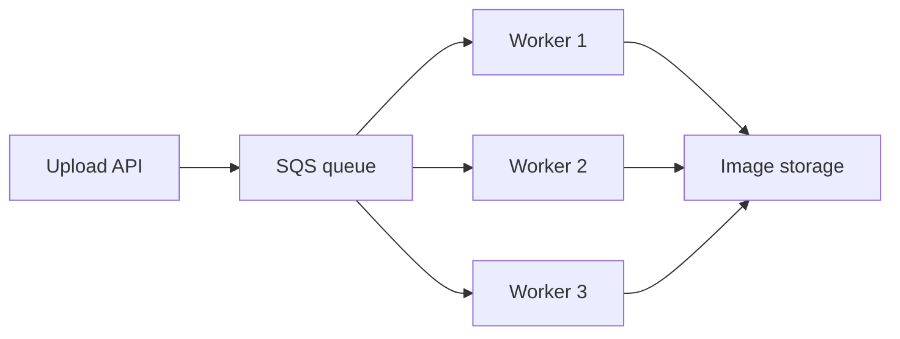
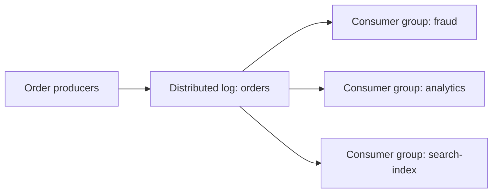
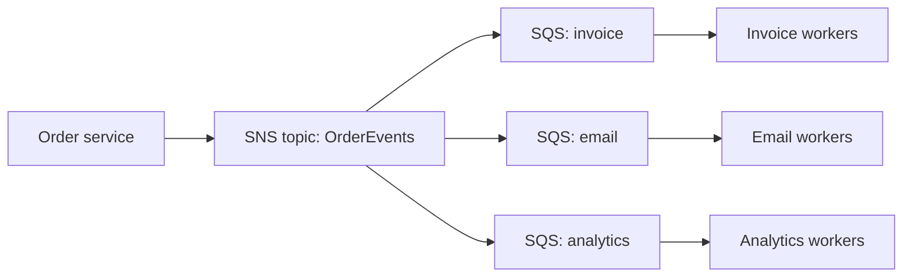
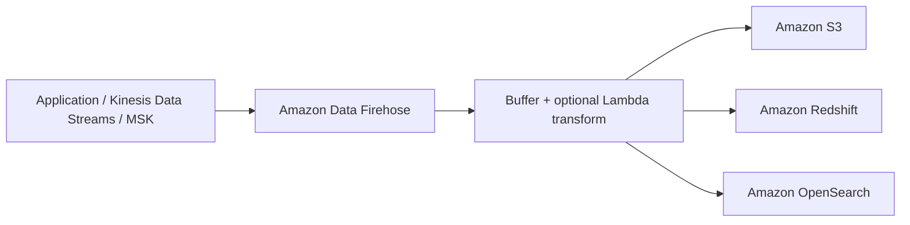
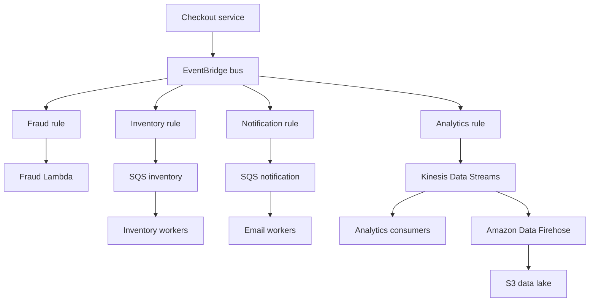

# Phân biệt event stream, hàng đợi và log phân tán

Trong hệ thống phân tán, dữ liệu thường được tạo ra liên tục: đơn hàng được đặt, thanh toán được xác nhận, thiết bị gửi telemetry, ứng dụng ghi log, tài khoản thay đổi trạng thái hoặc một bảng database phát sinh cập nhật. Những dữ liệu này có thể được truyền tới nhiều thành phần để xử lý, phân tích hoặc lưu trữ. Ba khái niệm thường gặp là **event stream**, **message queue** và **distributed log**. Chúng có liên hệ nhưng mô tả những cách tổ chức và tiêu thụ dữ liệu khác nhau.

Event stream mô tả dòng sự kiện phát sinh theo thời gian. Queue tổ chức công việc đang chờ xử lý để các consumer nhận và hoàn tất. Distributed log lưu các bản ghi theo thứ tự trong những phân vùng, cho phép nhiều consumer độc lập đọc lại dữ liệu trong thời gian lưu giữ. Một event stream có thể được triển khai trên distributed log; một hệ thống event-driven cũng có thể dùng queue để phân phối từng event cho worker.

Trong AWS, các lựa chọn phổ biến gồm Amazon SQS, Amazon SNS, Amazon EventBridge, Amazon Kinesis Data Streams, Amazon Managed Streaming for Apache Kafka (Amazon MSK), Amazon Data Firehose và DynamoDB Streams. Chọn đúng dịch vụ đòi hỏi hiểu cách hệ thống xử lý delivery, ordering, retention, replay, consumer concurrency, backpressure và failure.

Sau bài học, bạn có thể:

- Phân biệt event, event stream, queue và distributed log.
- Giải thích mô hình competing consumers, publish/subscribe và consumer groups.
- So sánh delivery, ordering, acknowledgement, retention và replay.
- Chọn SQS, SNS, EventBridge, Kinesis Data Streams hoặc Amazon MSK theo yêu cầu.
- Xác định vai trò của Amazon Data Firehose trong việc chuyển dữ liệu tới đích phân tích.
- Thiết kế partition key, message group, idempotency, retry và dead-letter queue.
- Xây dựng kiến trúc event-driven và streaming trên AWS có khả năng mở rộng, quan sát và phục hồi.

## 1. Bắt đầu từ event và message

**Event** là bản ghi mô tả một điều đã xảy ra tại một thời điểm. Event thường mang tên ở thì quá khứ, ví dụ:

- `OrderPlaced`: một đơn hàng đã được tạo.
- `PaymentAuthorized`: khoản thanh toán đã được cấp phép.
- `InventoryReserved`: hàng tồn kho đã được giữ.
- `DeviceTemperatureMeasured`: thiết bị gửi một lần đo nhiệt độ.
- `CustomerAddressChanged`: địa chỉ khách hàng đã thay đổi.

Một event tốt thường có:
- Event ID duy nhất để nhận diện và chống xử lý trùng.
- Event type hoặc schema version.
- Thời điểm xảy ra và thời điểm được phát.
- Nguồn phát sinh, tenant hoặc entity ID.
- Correlation/trace ID để nối các bước xử lý.
- Payload chứa dữ liệu cần thiết cho consumer.

Ví dụ một event JSON:

```json
{
  "eventId": "evt-01J9A2B3C4D5",
  "eventType": "OrderPlaced",
  "schemaVersion": 2,
  "occurredAt": "2026-11-20T06:30:00Z",
  "producer": "checkout-service",
  "correlationId": "req-7f3a",
  "data": {
    "orderId": "ord-1042",
    "customerId": "cus-204",
    "currency": "USD",
    "total": 125.50
  }
}
```

Đây là ví dụ minh họa. Không đưa password, access key, session token hoặc dữ liệu cá nhân không cần thiết vào event. Event thường được lưu hoặc chuyển qua nhiều hệ thống, nên payload cần được tối thiểu hóa và có chính sách bảo vệ.

**Message** là đơn vị dữ liệu được gửi qua một cơ chế truyền tin. Một message có thể chứa event, command, task hoặc một tham chiếu tới dữ liệu. Ví dụ, `GenerateInvoice` là command yêu cầu worker thực hiện công việc; `InvoiceGenerated` là event thông báo công việc đã hoàn tất.

Phân biệt event và command giúp consumer hiểu ý nghĩa:
- Event mô tả điều đã xảy ra; consumer có thể phản ứng.
- Command yêu cầu một hành động; một thành phần có trách nhiệm thực hiện hoặc từ chối.
- Message là hình thức vận chuyển, không quyết định bản thân nội dung là event hay command.

## 2. Event stream là gì?

**Event stream** là dòng event được tạo ra theo thời gian từ một nguồn hoặc một tập nguồn. Dòng có thể liên tục hoặc theo từng đợt, tốc độ có thể thay đổi và consumer có thể cần xử lý event gần thời gian thực.

Ví dụ:
- Clickstream ghi lại thao tác của người dùng trên website.
- Telemetry stream thu thập CPU, memory, nhiệt độ hoặc trạng thái thiết bị.
- Payment stream ghi nhận các thay đổi của giao dịch.
- Database change stream phát các thay đổi insert/update/delete.
- Application event stream chuyển sự kiện nghiệp vụ tới nhiều dịch vụ.

Event stream thường được mô tả bằng các thuộc tính:

| Thuộc tính | Câu hỏi cần trả lời |
|---|---|
| Producer | Thành phần nào tạo event? |
| Event schema | Event có cấu trúc và version ra sao? |
| Partition/key | Event được phân nhóm theo entity nào? |
| Throughput | Bao nhiêu event/giây, kích thước trung bình và đỉnh? |
| Ordering | Cần thứ tự toàn cục, theo key hay không cần? |
| Retention | Giữ event trong bao lâu? |
| Consumer | Có bao nhiêu ứng dụng cần đọc event? |
| Replay | Có cần đọc lại event cũ để sửa logic hoặc tái tạo state? |
| Delivery | Có thể nhận trùng hoặc mất event trong điều kiện nào? |
| Latency | Độ trễ chấp nhận được là bao nhiêu? |

Một event stream không mặc định bảo đảm mọi event được xử lý đúng một lần, cũng không mặc định có thứ tự toàn cục. Những đặc tính này phụ thuộc vào nền tảng, partitioning, producer và cách consumer quản lý checkpoint.

## 3. Message queue là gì?

**Message queue** là vùng đệm lưu message chờ xử lý. Producer gửi message vào queue; một hoặc nhiều consumer lấy message, xử lý rồi xác nhận hoàn tất. Mô hình phổ biến là **competing consumers**: nhiều worker cùng đọc một queue để chia tải.

Queue phù hợp khi:
- Cần tách producer khỏi thời điểm xử lý.
- Công việc có thể xử lý bất đồng bộ.
- Muốn hấp thụ traffic spike.
- Muốn retry khi worker lỗi.
- Mỗi task thường chỉ cần một worker xử lý thành công.
- Cần giới hạn concurrency hoặc tốc độ xử lý.

Ví dụ luồng xử lý ảnh:



Mỗi worker nhận message, xử lý ảnh rồi xóa message khỏi queue. Nếu worker chết trước khi xóa, message có thể xuất hiện lại sau visibility timeout. Điều này giúp retry nhưng cũng có nghĩa consumer phải xử lý duplicate an toàn.

### 3.1. Visibility timeout và acknowledgement

Với Amazon SQS, khi consumer nhận message, message trở nên invisible trong một khoảng thời gian gọi là visibility timeout. Nếu consumer xử lý thành công, nó gọi `DeleteMessage`. Nếu không xóa trước khi timeout, message có thể được giao lại.

Quy trình:

1. Consumer gọi `ReceiveMessage`.
2. SQS trả message và tạm ẩn message khỏi consumer khác.
3. Consumer xử lý nghiệp vụ.
4. Nếu thành công, consumer gọi `DeleteMessage`.
5. Nếu thất bại hoặc consumer không hoàn tất, message có thể được giao lại sau visibility timeout.

Visibility timeout không phải lease đảm bảo consumer chắc chắn hoàn tất. Nếu xử lý kéo dài, consumer có thể cần gia hạn bằng `ChangeMessageVisibility`. Nếu đặt timeout quá ngắn, message có thể bị giao lại khi worker đầu tiên vẫn đang xử lý. Nếu quá dài, thời gian phát hiện worker chết và retry sẽ lâu hơn.

### 3.2. Queue không phải log để replay tùy ý

Trong queue kiểu destructive read như SQS, sau khi consumer xử lý và xóa message, message không còn trong queue để một consumer khác đọc lại. Queue giữ message tới khi xóa hoặc hết retention, nhưng mục tiêu chính là phân phối công việc.

Có thể dùng dead-letter queue (DLQ), archive hoặc lưu event gốc riêng để điều tra và phát lại. Tuy nhiên, DLQ không biến queue thành distributed log có offset độc lập cho nhiều consumer.

## 4. Distributed log là gì?

**Distributed log** là cấu trúc lưu trữ các record theo thứ tự append trong một hoặc nhiều partition, được phân phối và nhân bản trên nhiều node. Record thường được giữ lại theo retention policy thay vì bị xóa ngay khi consumer đọc.

Một distributed log thường có:
- Topic hoặc stream để nhóm record.
- Partition để chia tải và lưu trữ song song.
- Offset/sequence position để định vị record.
- Consumer group hoặc consumer identity để theo dõi tiến độ.
- Retention theo thời gian hoặc dung lượng.
- Replication để tăng khả năng chịu lỗi.
- Cơ chế replay bằng cách đọc lại từ offset cũ.

Kafka là ví dụ điển hình của distributed log. Amazon MSK cung cấp Kafka được AWS quản lý. Kinesis Data Streams cũng cung cấp một mô hình stream có record retention, shard và consumer checkpoint; khái niệm không hoàn toàn giống Kafka nhưng có nhiều điểm tương đồng ở cách consumer đọc lại dữ liệu.

### 4.1. Consumer độc lập và offset

Giả sử topic `orders` có hai consumer group:
- `fraud-detection` đọc event để phát hiện gian lận.
- `analytics` đọc event để tổng hợp số liệu.

Cả hai có thể đọc cùng một record độc lập và lưu vị trí đọc riêng. Khi analytics bị dừng một giờ, fraud detection vẫn tiếp tục. Analytics có thể tiếp tục từ offset đã lưu hoặc đọc lại từ vị trí sớm hơn nếu dữ liệu còn trong retention.



Đây là điểm khác biệt lớn với competing consumers trên một queue: các consumer group của log có thể cùng đọc toàn bộ stream theo tiến độ riêng; các worker trong cùng một group chia nhau partition để tăng throughput.

### 4.2. Ordering theo partition

Distributed log thường bảo đảm thứ tự trong một partition, không phải thứ tự toàn cục giữa mọi partition. Nếu cần giữ thứ tự các event của cùng một đơn hàng, producer phải dùng `orderId` làm partition key để event cùng đơn hàng đi vào cùng partition.

Nếu dùng key phân bố không đều, một partition có thể trở thành hot partition. Khi đó throughput của key nóng bị giới hạn bởi partition đó dù những partition khác còn nhàn rỗi.

### 4.3. Retention và replay

Retention xác định record được giữ trong log bao lâu. Consumer có thể đọc lại khi:
- Logic xử lý được sửa và cần tính toán lại.
- Một consumer group bị tụt tiến độ.
- Cần tạo lại search index hoặc materialized view.
- Cần kiểm tra sự cố và đối chiếu event.

Replay chỉ khả thi khi record còn trong retention và consumer có quyền đọc. Nếu retention hết hạn, cần nguồn archive hoặc backup riêng. Replay cũng có thể tạo side effect lần nữa, nên consumer phải idempotent hoặc chạy vào môi trường đích riêng.

## 5. So sánh ba mô hình

| Tiêu chí | Event stream | Message queue | Distributed log |
|---|---|---|---|
| Bản chất | Dòng event theo thời gian | Công việc/message chờ xử lý | Log record append-only có phân vùng |
| Mục tiêu | Truyền và xử lý event liên tục | Phân phối task cho worker | Lưu, phân phối và replay dữ liệu |
| Consumer | Một hoặc nhiều subscriber tùy nền tảng | Thường là competing consumers | Nhiều consumer group độc lập |
| Sau khi đọc | Tùy nền tảng | Thường xóa sau khi xử lý | Record vẫn còn tới khi hết retention |
| Tiến độ | Cursor/checkpoint hoặc subscription state | Visibility/acknowledgement | Offset hoặc sequence checkpoint |
| Replay | Phụ thuộc nền tảng | Hạn chế; thường cần DLQ/archive | Là khả năng cốt lõi trong retention |
| Ordering | Phụ thuộc key/partition/dịch vụ | Có thể FIFO hoặc best effort | Thường theo partition |
| Ví dụ AWS | Kinesis Data Streams, EventBridge event flow | SQS | Amazon MSK, Kinesis Data Streams |

Event stream là khái niệm về dòng dữ liệu; queue và log là hai cách tổ chức, lưu và phân phối message/record. Vì vậy, không nên xem ba khái niệm là ba loại dịch vụ loại trừ nhau. Một event stream có thể được lưu trong distributed log và đồng thời được chuyển thành task queue cho worker.

## 6. Delivery semantics: at-most-once, at-least-once và effectively-once

Một trong những câu hỏi quan trọng nhất là message có thể được giao bao nhiêu lần.

### 6.1. At-most-once

Message được giao tối đa một lần. Nếu lỗi xảy ra sau khi message bị mất hoặc đánh dấu hoàn tất nhưng trước khi xử lý xong, dữ liệu có thể bị mất. Mô hình này giảm duplicate nhưng cần chấp nhận khả năng mất event.

### 6.2. At-least-once

Message được giao ít nhất một lần theo cơ chế retry của hệ thống. Nếu consumer xử lý xong nhưng acknowledgement không thành công, message có thể được giao lại. Duplicate là khả năng bình thường.

SQS Standard là ví dụ phổ biến về delivery at-least-once. Consumer cần idempotency, ví dụ ghi nhận `eventId` đã xử lý trong database với unique constraint.

### 6.3. Exactly-once và giới hạn thực tế

Một nền tảng có thể cung cấp tính năng deduplication hoặc transaction trong một phạm vi cụ thể. Tuy nhiên, “exactly once” đầu-cuối rất khó nếu transaction trải qua broker, database, HTTP API và hệ thống bên ngoài.

Ví dụ, worker:
1. Ghi giao dịch thanh toán vào database.
2. Gửi email.
3. Commit offset hoặc xóa message.

Nếu worker chết sau khi gửi email nhưng trước khi commit, message có thể được xử lý lại và email bị gửi hai lần. Broker không thể tự động rollback side effect của email.

Trong thực tế, thiết kế **effectively-once** bằng các kỹ thuật:
- Event ID ổn định.
- Idempotency key ở API hoặc database.
- Unique constraint hoặc inbox table.
- Transactional outbox để phát event cùng transaction nghiệp vụ.
- Checkpoint chỉ sau khi xử lý thành công.
- Consumer có thể retry mà không tạo side effect trùng.

Không tuyên bố hệ thống “exactly once” chỉ vì broker có deduplication. Hãy xác định chính xác phạm vi bảo đảm và nơi có thể xảy ra duplicate.

## 7. Ordering và partitioning

Ordering là yêu cầu nghiệp vụ, không chỉ là cấu hình kỹ thuật. Ví dụ, trạng thái đơn hàng phải theo thứ tự `OrderPlaced` → `PaymentAuthorized` → `OrderShipped`. Nếu `OrderShipped` tới trước `PaymentAuthorized`, consumer có thể cập nhật trạng thái sai.

Các câu hỏi cần trả lời:
- Có cần thứ tự toàn cục hay chỉ theo entity?
- Những event nào phải cùng partition/message group?
- Producer có thể gửi song song không?
- Retry có thể làm event cũ tới sau event mới không?
- Consumer xử lý song song có làm thay đổi thứ tự side effect không?

### 7.1. Partition key trong streaming log

Partition key thường được hash để chọn partition. Chọn key:
- `orderId` nếu cần ordering theo đơn hàng.
- `customerId` nếu cần ordering theo khách hàng.
- `deviceId` nếu cần thứ tự telemetry theo thiết bị.

Không chọn key có cardinality thấp hoặc phân bố lệch nếu nó tạo hot partition. Cũng không chọn random key nếu cần ordering theo entity.

### 7.2. Message group trong FIFO queue

SQS FIFO dùng `MessageGroupId` để xác định nhóm message có thứ tự. Message trong cùng group được xử lý theo thứ tự; các group khác có thể được xử lý song song.

Nếu dùng một group ID cho mọi message, throughput sẽ bị tuần tự hóa. Nếu dùng group ID ngẫu nhiên, ordering nghiệp vụ có thể bị phá vỡ. Chọn group key dựa trên entity cần giữ thứ tự.

## 8. Backpressure và điều tiết tốc độ

Backpressure xuất hiện khi producer gửi nhanh hơn khả năng xử lý của consumer. Nếu không có cơ chế điều tiết, queue depth hoặc consumer lag tăng liên tục, dẫn tới latency, storage growth và cuối cùng là lỗi.

Các dấu hiệu:
- SQS ApproximateNumberOfMessagesVisible tăng.
- Kinesis iterator age tăng.
- Kafka consumer lag tăng.
- Firehose delivery lag tăng.
- Consumer CPU, memory hoặc downstream connection pool đạt ngưỡng.
- Retry/DLQ tăng đột biến.

Cách xử lý:
- Scale consumer theo queue depth hoặc lag.
- Giới hạn producer rate hoặc dùng admission control.
- Batch message/record để giảm overhead.
- Tăng partition/shard khi kiến trúc và key distribution cho phép.
- Giảm công việc trong consumer hoặc chuyển tác vụ nặng sang queue riêng.
- Dùng retry có exponential backoff và jitter.
- Áp dụng circuit breaker khi downstream dependency lỗi.
- Đặt retention và alarm để phát hiện backlog trước khi dữ liệu hết hạn.

Tăng số consumer không phải lúc nào cũng tăng throughput. Với queue, downstream database có thể bị quá tải. Với Kafka/Kinesis, số consumer song song bị giới hạn bởi số partition/shard hoặc cơ chế consumer. Hãy scale theo bottleneck thực tế.

## 9. Amazon SQS: hàng đợi công việc

Amazon Simple Queue Service (SQS) là dịch vụ message queue được quản lý. Producer gửi message vào queue; consumer nhận và xóa message sau khi xử lý.

Hai loại queue chính:

| Đặc điểm | Standard queue | FIFO queue |
|---|---|---|
| Throughput | Mở rộng cao | Có thứ tự theo message group; throughput phụ thuộc chế độ và cấu hình |
| Ordering | Best-effort ordering | FIFO trong cùng message group |
| Delivery | At-least-once; có thể duplicate | Deduplication và FIFO semantics trong phạm vi dịch vụ |
| Dùng khi | Task độc lập, xử lý song song | Cần thứ tự và dedup theo nhóm |
| Consumer | Nhiều worker cạnh tranh | Nhiều worker theo group, giữ thứ tự trong group |

SQS phù hợp với:
- Xử lý đơn hàng bất đồng bộ.
- Resize ảnh/video.
- Gửi email hoặc notification.
- Tác vụ batch.
- Buffer giữa API và worker.
- Retry công việc khi downstream tạm thời lỗi.

### 9.1. Long polling

Long polling cho phép consumer đợi message trong một khoảng thời gian thay vì liên tục hỏi queue khi rỗng. Điều này giảm số request rỗng và chi phí polling. SQS hỗ trợ WaitTimeSeconds tối đa 20 giây.

### 9.2. Dead-letter queue

DLQ nhận message đã vượt quá số lần receive/retry được cấu hình. DLQ giúp cô lập poison message thay vì để chúng liên tục làm nghẽn queue chính.

Một quy trình DLQ:
1. Đặt redrive policy và maxReceiveCount.
2. Alarm khi DLQ có message.
3. Kiểm tra error, payload và dependency.
4. Sửa nguyên nhân hoặc đánh dấu message không hợp lệ.
5. Redrive có kiểm soát về queue nguồn hoặc queue xử lý lại.
6. Theo dõi duplicate và side effect.

DLQ không phải kho lưu trữ vô thời hạn. Thời gian retention của DLQ cần được cấu hình phù hợp và phải lớn hơn retention của queue nguồn theo hướng dẫn SQS.

### 9.3. Ví dụ gửi và nhận message

Gửi message:

```bash
aws sqs send-message \
  --queue-url https://sqs.ap-southeast-1.amazonaws.com/111122223333/order-jobs \
  --message-body '{"eventId":"evt-1001","orderId":"ord-1042","task":"generate-invoice"}' \
  --region ap-southeast-1
```

Nhận message bằng long polling:

```bash
aws sqs receive-message \
  --queue-url https://sqs.ap-southeast-1.amazonaws.com/111122223333/order-jobs \
  --wait-time-seconds 20 \
  --max-number-of-messages 10 \
  --region ap-southeast-1
```

Sau khi xử lý thành công, consumer dùng receipt handle của lần nhận đó để gọi `DeleteMessage`. Receipt handle thay đổi mỗi lần message được nhận; không dùng message ID thay cho receipt handle.

## 10. Amazon SNS: publish/subscribe và fan-out

Amazon Simple Notification Service (SNS) là dịch vụ pub/sub. Publisher gửi message tới topic; SNS phân phối tới các subscriber như SQS, Lambda, HTTPS endpoint hoặc email tùy giao thức hỗ trợ.

SNS phù hợp khi một event cần được gửi tới nhiều hệ thống độc lập. Ví dụ `OrderPlaced` cần:
- Service tạo hóa đơn.
- Service gửi email.
- Service cập nhật analytics.
- Service cập nhật hệ thống tìm kiếm.



Mỗi subscription SQS có queue riêng, nên consumer có thể xử lý độc lập, retry và DLQ riêng. Đây là mẫu SNS-to-SQS fan-out.

### 10.1. SNS hay SQS?

- SQS là nơi lưu task để consumer lấy và xóa sau khi xử lý.
- SNS là publisher phân phối message tới nhiều subscriber.
- Có thể kết hợp SNS và SQS để vừa fan-out vừa có buffer/retry độc lập.
- SNS không thay thế distributed log có offset và replay tùy ý.

SNS Standard phù hợp pub/sub throughput cao và delivery bất đồng bộ; ordering không được bảo đảm như FIFO queue. SNS FIFO hỗ trợ ordering và deduplication theo message group trong mô hình FIFO, với các giới hạn subscription/endpoint được dịch vụ hỗ trợ.

## 11. Amazon EventBridge: định tuyến event theo rule

Amazon EventBridge là dịch vụ event bus giúp nhận event từ AWS services, ứng dụng tùy chỉnh và đối tác, sau đó định tuyến theo rule tới target. Rule có thể lọc event theo source, detail-type và nội dung trong detail.

EventBridge phù hợp khi:
- Nhiều hệ thống phát event theo schema.
- Consumer chỉ cần nhận event phù hợp với điều kiện.
- Muốn định tuyến tới Lambda, SQS, SNS, Step Functions hoặc target được hỗ trợ.
- Muốn giảm kết nối trực tiếp giữa producer và consumer.
- Cần archive và replay event trong use case được hỗ trợ.

Ví dụ rule cho event đơn hàng:

```json
{
  "source": ["com.example.orders"],
  "detail-type": ["OrderPlaced"],
  "detail": {
    "status": ["CONFIRMED"]
  }
}
```

Rule trên minh họa event pattern lọc event có source và detail-type tương ứng, đồng thời status là CONFIRMED. Pattern phải khớp cấu trúc event thực tế.

### 11.1. EventBridge so với queue và log

EventBridge là event router. Nó nhận event và quyết định target dựa trên rule; target có thể là queue để xử lý công việc hoặc Lambda để phản ứng. Event bus không nên được xem như một log partitioned có ordering toàn cục hoặc một queue công việc có destructive read.

EventBridge hỗ trợ retry delivery tới target và có thể cấu hình dead-letter queue cho target khi delivery thất bại. Archive/replay hỗ trợ lưu và phát lại event theo cấu hình. Replay hữu ích cho tái xử lý event, nhưng consumer vẫn phải idempotent vì side effect có thể xảy ra lần nữa.

### 11.2. EventBridge Pipes

EventBridge Pipes kết nối một source với một target theo mô hình point-to-point, có thể lọc, làm giàu dữ liệu và gọi target. Source được hỗ trợ gồm một số queue, stream và hệ thống event; target có thể là AWS service hoặc API được hỗ trợ.

Pipes hữu ích khi muốn nối nguồn như SQS, Kinesis Data Streams hoặc DynamoDB Streams tới target mà không cần viết toàn bộ polling, filtering và routing code. Hãy kiểm tra source/target support, batching, retry, IAM và failure destination trước khi chọn.

## 12. Amazon Kinesis Data Streams: streaming log được quản lý

Amazon Kinesis Data Streams (KDS) nhận record từ producer và lưu trong stream để nhiều consumer đọc. Stream được chia thành shard trong chế độ provisioned; ở on-demand mode, AWS tự điều chỉnh capacity theo lưu lượng mà không cần người dùng quản lý shard capacity trực tiếp.

Một record gồm:
- Partition key.
- Data blob.
- Sequence number do dịch vụ cấp.
- Metadata liên quan.

Partition key được hash để xác định shard. Các record cùng partition key được đưa vào cùng shard, giúp giữ thứ tự tương đối trong key.

### 12.1. Producer và consumer

Producer có thể dùng Kinesis Producer Library (KPL), AWS SDK hoặc dịch vụ tích hợp để ghi record. Consumer có thể dùng:
- Kinesis Client Library (KCL).
- Enhanced fan-out consumer.
- GetRecords API.
- Lambda event source mapping.
- Firehose làm nguồn cho delivery stream theo cấu hình hỗ trợ.

KCL quản lý shard leases và checkpoint, thường dùng DynamoDB để lưu trạng thái. Khi worker restart, consumer tiếp tục từ checkpoint đã lưu. Nếu checkpoint trước khi side effect hoàn tất, record có thể bị bỏ qua sau khi restart; nếu side effect hoàn tất nhưng checkpoint chưa được ghi, record có thể được xử lý lại. Cần chọn checkpoint boundary cẩn thận và làm side effect idempotent.

### 12.2. Shard, throughput và hot partition

Shard là đơn vị song song hóa và capacity của stream ở provisioned mode. Số shard cần dựa trên throughput ghi/đọc, số consumer và phân bố partition key.

Hot shard xảy ra khi một partition key hoặc nhóm key tập trung quá nhiều traffic vào một shard. Dù toàn stream còn capacity, shard nóng vẫn có thể throttling.

Cách khắc phục:
- Chọn partition key có phân bố đều nhưng vẫn đáp ứng ordering.
- Nếu một entity quá nóng, cân nhắc sub-key/sharding strategy và xử lý ordering ở ứng dụng.
- Tăng shard hoặc chuyển capacity mode khi phù hợp.
- Theo dõi write/read throttles, iterator age và incoming bytes/records.

Không tăng shard tùy tiện nếu key distribution vẫn lệch. Thêm shard không tự chia lại một partition key duy nhất thành nhiều thứ tự độc lập.

### 12.3. Retention và replay

Kinesis Data Streams giữ record trong khoảng retention được cấu hình. Mặc định retention là 24 giờ; có thể tăng tối đa 365 ngày theo giới hạn dịch vụ. Consumer có thể đọc lại từ vị trí cũ nếu record vẫn còn trong retention.

Retention dài giúp:
- Bắt kịp khi consumer ngừng hoạt động.
- Rebuild materialized view.
- Chạy consumer mới trên dữ liệu cũ.
- Điều tra sự cố.

Retention không thay thế archive lâu dài. Nếu cần lưu nhiều năm, dùng Data Firehose/S3 hoặc một pipeline archive riêng.

### 12.4. Shared throughput và enhanced fan-out

Nhiều consumer đọc qua GetRecords có thể chia sẻ read throughput của shard. Enhanced fan-out cấp dedicated throughput cho registered consumer và đẩy record qua SubscribeToShard. Điều này phù hợp khi có nhiều consumer cần đọc cùng stream với độ trễ thấp và tránh tranh chấp read capacity.

Chọn enhanced fan-out khi throughput/latency yêu cầu đủ lớn để bù chi phí và độ phức tạp. Nếu chỉ có một hoặc hai consumer với tải thấp, shared throughput có thể đơn giản hơn.

## 13. Amazon MSK và Kafka distributed log

Amazon Managed Streaming for Apache Kafka (Amazon MSK) là dịch vụ AWS quản lý hạ tầng Apache Kafka. Kafka tổ chức dữ liệu theo:
- **Topic**: tên logic của dòng record.
- **Partition**: phân vùng lưu trữ có thứ tự.
- **Offset**: vị trí record trong partition.
- **Broker**: node lưu và phục vụ partition.
- **Replication factor**: số bản sao partition.
- **Consumer group**: nhóm consumer chia partition để xử lý song song.

MSK phù hợp khi:
- Ứng dụng đã dùng Kafka ecosystem.
- Cần Kafka APIs, connectors hoặc tooling.
- Cần log retention, consumer groups và replay.
- Có nhiều producer/consumer và topology streaming phức tạp.
- Muốn tích hợp Kafka với hệ thống data platform hiện hữu.

### 13.1. Partition và consumer group

Trong một consumer group, mỗi partition tại một thời điểm được gán cho tối đa một consumer member trong group. Nếu group có nhiều consumer hơn partition, một số consumer sẽ không được gán partition và không tăng throughput. Nếu consumer ít hơn partition, mỗi consumer có thể xử lý nhiều partition.

Các consumer group khác nhau có thể đọc cùng topic độc lập. Offset được quản lý theo group và partition.

### 13.2. Retention và compaction

Kafka có thể giữ record theo thời gian hoặc dung lượng. Log compaction giữ bản ghi mới nhất theo key trong khi loại bỏ các phiên bản cũ hơn theo quy tắc compaction. Đây là cách hữu ích để lưu changelog/state snapshot theo key, nhưng không giống retention thông thường và không phải cơ chế backup đầy đủ.

### 13.3. MSK Provisioned và MSK Serverless

- MSK Provisioned cho phép chọn và quản lý capacity cluster/broker phù hợp với workload.
- MSK Serverless tự quản lý phần lớn capacity provisioning và phù hợp khi muốn giảm công việc quản trị cluster, trong phạm vi giới hạn và tính năng hỗ trợ.

Cần đánh giá throughput, số partition, storage, network, authentication, retention và khả năng tương thích với Kafka version/client. Không chọn MSK chỉ vì “streaming”; nếu cần queue đơn giản cho task, SQS thường ít vận hành hơn.

## 14. Amazon Data Firehose: delivery tới đích phân tích

Amazon Data Firehose (trước đây là Kinesis Data Firehose) là dịch vụ fully managed để nhận, buffer, tùy chọn transform và phân phối streaming data tới destination được hỗ trợ như Amazon S3, Redshift, OpenSearch, Splunk và HTTP endpoint.

Firehose phù hợp khi mục tiêu là **đưa dữ liệu tới đích** mà không cần tự vận hành consumer fleet.

Một pipeline ví dụ:



Firehose hỗ trợ buffering theo kích thước/thời gian để gom record trước khi delivery. Điều này tối ưu hiệu năng và file size nhưng tạo độ trễ. Có thể dùng Lambda transform để chuẩn hóa hoặc lọc dữ liệu trước khi ghi đích.

Firehose không phải một broker general-purpose để nhiều ứng dụng đọc cùng stream theo offset. Nếu cần replay, hãy lưu dữ liệu vào S3 hoặc dùng Kinesis Data Streams/MSK với retention phù hợp. Cần hiểu retry, backup/error prefix và hành vi delivery của từng destination.

## 15. DynamoDB Streams và change data capture

DynamoDB Streams ghi lại các thay đổi ở cấp item của DynamoDB table trong một khoảng retention ngắn. Một stream record có thể mô tả item được tạo, cập nhật hoặc xóa. Đây là một dạng change data capture (CDC).

Use case:
- Đồng bộ dữ liệu sang search index.
- Cập nhật cache hoặc read model.
- Gửi event tới workflow.
- Audit thay đổi theo ứng dụng.
- Tích hợp dữ liệu với Lambda hoặc Kinesis Data Streams.

DynamoDB Streams thường được dùng qua Lambda event source mapping hoặc KCL adapter. Record có thể được retry; consumer cần idempotent. Nếu cần lưu trữ lâu dài hoặc nhiều consumer độc lập với khả năng replay dài hơn, hãy chuyển dữ liệu sang Kinesis/MSK/S3 theo kiến trúc phù hợp.

## 16. Chọn dịch vụ AWS theo use case

| Nhu cầu | Dịch vụ gợi ý | Lý do |
|---|---|---|
| Worker xử lý task độc lập | SQS Standard | Queue managed, competing consumers, retry |
| Task cần ordering theo entity | SQS FIFO | Message group và deduplication |
| Một event gửi tới nhiều subscriber | SNS + SQS | Fan-out và queue độc lập |
| Định tuyến event theo nội dung | EventBridge | Event bus, rules và targets |
| Event integration giữa AWS services | EventBridge | Nhiều nguồn/đích và filtering |
| Stream analytics nhiều consumer | Kinesis Data Streams | Shards, retention, checkpoint và replay |
| Kafka ecosystem, connector và consumer group | Amazon MSK | Kafka API và distributed log |
| Đưa stream tới S3/Redshift/OpenSearch | Amazon Data Firehose | Buffer và managed delivery |
| CDC từ DynamoDB | DynamoDB Streams | Change records của table |
| Workflow nhiều bước | Step Functions kết hợp event/queue | Điều phối stateful workflow |

Một kiến trúc có thể kết hợp nhiều dịch vụ:
- EventBridge nhận và định tuyến business event.
- SNS fan-out event tới nhiều queue.
- SQS giữ task cho worker.
- Kinesis Data Streams lưu telemetry liên tục.
- Data Firehose đưa telemetry tới S3.
- Athena phân tích dữ liệu trong data lake.

Đừng chọn nhiều broker chỉ để dùng hết dịch vụ. Mỗi thành phần cần có lý do rõ ràng về delivery, ordering, replay, throughput, ownership và vận hành.

## 17. Kiến trúc mẫu: xử lý đơn hàng event-driven

Một hệ thống thương mại điện tử có các yêu cầu:
- Checkout phát `OrderPlaced`.
- Fraud service kiểm tra rủi ro.
- Inventory service giữ hàng.
- Notification service gửi email.
- Analytics tổng hợp dữ liệu.
- Mỗi consumer có tốc độ và SLA khác nhau.

Có thể thiết kế:



EventBridge tách producer khỏi các consumer và định tuyến event theo rule. SQS tạo buffer cho tác vụ inventory/email. Kinesis giữ stream cho analytics cần đọc độc lập hoặc replay. Firehose chuyển dữ liệu tới S3.

Các điểm phải thiết kế thêm:
- Event ID và schema version.
- Idempotency ở inventory/payment.
- Retry và DLQ theo consumer.
- Correlation ID xuyên suốt.
- IAM permission tối thiểu giữa producer, bus, queue, stream và consumer.
- Encryption bằng KMS khi yêu cầu.
- Monitoring delivery failure, queue age, stream lag và business SLA.

## 18. Schema, versioning và event contract

Event có thể được nhiều team tiêu thụ trong nhiều năm. Thay đổi schema không tương thích có thể làm consumer cũ lỗi.

Các nguyên tắc:
- Có schema registry hoặc contract repository.
- Mỗi event có `schemaVersion`.
- Thêm field optional thường dễ tương thích hơn đổi tên hoặc xóa field.
- Consumer bỏ qua field chưa biết nếu contract cho phép.
- Không đổi nghĩa của field mà giữ nguyên version.
- Có kế hoạch migrate producer/consumer.
- Kiểm tra payload trước khi publish.
- Dùng schema validation trong CI/CD.

AWS Glue Schema Registry hỗ trợ quản lý schema cho một số streaming use case với Kinesis Data Streams và Kafka/MSK. EventBridge Schema Registry có thể phát hiện hoặc quản lý schema cho event bus theo tính năng hỗ trợ. Cần chọn registry theo broker, serialization format và client library; không giả định một registry dùng được cho mọi dịch vụ.

## 19. Idempotency, deduplication và transactional outbox

Consumer cần chuẩn bị cho duplicate, kể cả khi nền tảng có deduplication. Một mẫu phổ biến là lưu event ID đã xử lý cùng transaction với thay đổi nghiệp vụ.

Ví dụ logic:

```text
BEGIN TRANSACTION

if event_id exists in processed_events:
    COMMIT
    return

apply business update
insert event_id into processed_events

COMMIT
acknowledge message / checkpoint offset
```

Nếu side effect nằm ngoài database transaction, cần thêm idempotency key hoặc outbox/inbox pattern.

**Transactional outbox** giải quyết vấn đề dual-write: ứng dụng không nên commit database rồi publish event riêng vì một trong hai thao tác có thể thất bại. Thay vào đó, ghi business data và outbox record trong cùng transaction; một relay đọc outbox và publish event. Relay có thể publish trùng nên consumer vẫn idempotent.

**Deduplication** giúp nhận diện và bỏ qua message trùng trong một phạm vi thời gian hoặc key cụ thể. Deduplication không thay thế idempotency vì duplicate có thể xuất hiện sau cửa sổ dedup hoặc qua một đường retry khác.

## 20. Retry, poison message và failure isolation

Một message có thể thất bại vì:
- Downstream tạm thời unavailable.
- Payload sai schema.
- Thiếu quyền IAM.
- Timeout hoặc throttling.
- Dữ liệu tham chiếu chưa tồn tại.
- Bug trong consumer.

Không retry mọi lỗi theo cùng một cách.

| Loại lỗi | Cách xử lý |
|---|---|
| Transient error, throttling | Exponential backoff + jitter, retry có giới hạn |
| Dependency outage | Backpressure, circuit breaker, giữ message |
| Invalid schema/payload | Đưa DLQ/quarantine, cảnh báo producer |
| Permission denied | Alert vận hành, sửa policy; tránh retry vô hạn |
| Business rejection hợp lệ | Ghi kết quả từ chối, không retry như lỗi kỹ thuật |
| Poison message | Cô lập, phân tích, sửa hoặc bỏ theo quy trình |

SQS redrive policy đưa message sang DLQ sau số lần nhận tối đa. EventBridge có retry policy và DLQ cho target. Kinesis consumer tự quản lý checkpoint/error handling; cần có cơ chế lưu record lỗi hoặc quarantine để không làm kẹt shard. Kafka consumer cần quyết định commit offset khi lỗi, retry hoặc chuyển record sang dead-letter topic.

## 21. Security: bảo vệ broker và event payload

Event và message thường chứa dữ liệu nghiệp vụ nhạy cảm. Bảo vệ ở cả transport, storage và consumer.

- Dùng IAM role cho producer/consumer thay vì access key dài hạn.
- Hạn chế quyền publish, consume, delete, describe và administer theo resource.
- Dùng resource policy và condition khi dịch vụ hỗ trợ.
- Bật encryption at rest bằng AWS managed key hoặc customer managed KMS key theo yêu cầu.
- Dùng TLS khi truyền dữ liệu.
- Không đưa credential hoặc payload nhạy cảm không cần thiết vào message.
- Tách quyền đọc event khỏi quyền thay đổi queue/stream/topic.
- Bảo vệ DLQ và archive vì chúng có thể giữ dữ liệu lỗi lâu hơn.
- Ghi CloudTrail và service logs để audit thay đổi cấu hình.
- Thiết lập retention và xóa dữ liệu theo yêu cầu pháp lý.

Khi dùng KMS customer managed key, producer, broker service và consumer có thể cần quyền khác nhau. Kiểm tra key policy, grants và service integration để tránh lỗi publish/consume sau khi bật encryption.

## 22. Observability cho queue và stream

Không chỉ theo dõi CPU của consumer. Cần đo cả backlog, lag, throughput, delivery failure và tuổi dữ liệu.

| Dịch vụ | Metric/Signal nên theo dõi | Ý nghĩa |
|---|---|---|
| SQS | ApproximateNumberOfMessagesVisible | Số message đang chờ |
| SQS | ApproximateAgeOfOldestMessage | Tuổi message cũ nhất, phản ánh backlog |
| SQS | NumberOfMessagesSent/Received/Deleted | Producer/consumer throughput và hoàn tất |
| SQS | DLQ visible messages | Message không xử lý được |
| SNS | NumberOfNotificationsFailed, delivery status logs | Lỗi phân phối subscriber |
| EventBridge | FailedInvocations, ThrottledRules, Invocations | Delivery và rule throughput |
| Kinesis Data Streams | IncomingBytes/Records, Read/WriteProvisionedThroughputExceeded | Tải và throttling |
| Kinesis Data Streams | GetRecords.IteratorAgeMilliseconds | Consumer lag |
| MSK | Consumer lag, bytes in/out, under-replicated partitions | Tiến độ consumer và sức khỏe cluster |
| Data Firehose | DeliveryToS3.* / delivery freshness | Khả năng phân phối tới destination |

Metric cụ thể phụ thuộc dịch vụ, mode và cấu hình. Đặt alarm theo SLA nghiệp vụ: ví dụ queue age vượt ngưỡng hoặc stream iterator age tiến gần retention window. Một backlog lớn nhưng được xử lý nhanh có thể ít rủi ro hơn backlog nhỏ nhưng message đã chờ quá lâu.

Log cần có event ID, correlation ID, consumer group/task, partition/shard, offset/sequence, attempt count và kết quả xử lý. Tránh log toàn bộ payload nếu chứa dữ liệu nhạy cảm.

## 23. Capacity planning và chi phí

Chi phí streaming không chỉ là phí broker:
- SQS request, payload size và data transfer.
- SNS publish/delivery và subscription.
- EventBridge event ingestion, archive/replay và invocation.
- Kinesis shard/capacity mode, retention, enhanced fan-out và data retrieval.
- MSK broker, storage, network, monitoring và operation.
- Data Firehose ingestion, transformation và delivery.
- S3 storage, request, lifecycle và Athena scan.
- Lambda/compute consumer và downstream database.

Capacity planning cần đo:
- Average và peak events per second.
- Kích thước record/message.
- Burst duration.
- Số consumer và consumer group.
- Retention/replay window.
- Processing time và downstream capacity.
- Ordering/partition key distribution.
- Retry rate và DLQ volume.

Với Kinesis/MSK, partitioning quyết định song song và hot spot. Với SQS, scaling consumer phải đi cùng giới hạn database/API downstream. Với Firehose, buffering trade-off giữa latency và file size. Với Athena, Parquet và partition pruning giảm lượng dữ liệu quét.

## 24. Các quyết định kiến trúc thường gặp

### 24.1. SQS hay Kinesis Data Streams?

Chọn SQS khi message là task cần một worker hoàn tất, retry và delete. Chọn Kinesis Data Streams khi cần lưu event liên tục, nhiều consumer đọc độc lập, retention và replay.

### 24.2. SNS hay EventBridge?

SNS phù hợp pub/sub fan-out đơn giản và phân phối message tới subscriber. EventBridge phù hợp event routing dựa trên nội dung, tích hợp nhiều nguồn/target và quản lý event bus/rules. Có thể kết hợp EventBridge với SQS để buffer từng consumer.

### 24.3. Kinesis Data Streams hay Amazon MSK?

Kinesis Data Streams là dịch vụ AWS-native, quản lý shard/capacity và tích hợp sâu với AWS. MSK phù hợp khi cần Kafka APIs, ecosystem, partition/offset semantics, connector và portability theo Kafka. So sánh dựa trên kỹ năng vận hành, client compatibility, throughput, retention, ordering, cost và ecosystem.

### 24.4. Kinesis Data Streams hay Amazon Data Firehose?

Kinesis Data Streams là nền tảng streaming để nhiều consumer xử lý và đọc lại record. Data Firehose là dịch vụ delivery được quản lý, gom/buffer và chuyển dữ liệu tới destination. Có thể dùng Kinesis Data Streams làm source cho Firehose khi vừa cần consumer ứng dụng vừa cần lưu data lake.

## 25. Checklist thiết kế một hệ thống streaming

- [ ] Xác định event, command và task khác nhau ra sao.
- [ ] Ghi rõ producer, consumer và owner của từng event contract.
- [ ] Chọn queue, event bus hay distributed log theo use case.
- [ ] Định nghĩa delivery semantics và cách xử lý duplicate.
- [ ] Xác định ordering scope và partition/message group key.
- [ ] Ước lượng throughput, burst, record size và consumer lag.
- [ ] Chọn retention và replay window.
- [ ] Thiết kế retry, backoff, DLQ hoặc dead-letter topic.
- [ ] Làm consumer idempotent và quản lý checkpoint đúng thời điểm.
- [ ] Kiểm tra schema evolution và backward compatibility.
- [ ] Bảo vệ IAM, KMS, TLS, resource policy và payload.
- [ ] Đặt alarm cho backlog, age, lag, throttling và delivery failures.
- [ ] Kiểm thử downstream outage, poison message và duplicate.
- [ ] Tính chi phí broker, consumer, retention, delivery và query.
- [ ] Viết runbook cho replay, redrive, resharding và incident response.

## 26. Tóm tắt kiến thức

Event stream là dòng event theo thời gian; queue là nơi lưu message chờ consumer xử lý và thường xóa sau acknowledgement; distributed log là kho record append theo partition, giữ dữ liệu trong retention để nhiều consumer group đọc độc lập và replay. Một event stream có thể được triển khai trên distributed log hoặc được định tuyến tới queue tùy nhu cầu.

Trên AWS, SQS phù hợp work queue; SNS phù hợp pub/sub fan-out; EventBridge phù hợp event routing theo rule; Kinesis Data Streams phù hợp streaming với shard, checkpoint, retention và replay; Amazon MSK phù hợp Kafka ecosystem; Amazon Data Firehose chuyển dữ liệu tới destination phân tích; DynamoDB Streams cung cấp CDC cho table. Không có một dịch vụ phù hợp mọi use case.

Thiết kế tốt phải làm rõ delivery, ordering, idempotency, retry, retention, replay, backpressure, security và observability. Hãy chọn dịch vụ từ yêu cầu nghiệp vụ, đo bottleneck thật và kiểm thử cả đường thành công lẫn lỗi. Khi đó hệ thống event-driven vừa tách rời các thành phần, vừa có khả năng mở rộng và phục hồi.

## Tài liệu tham khảo

- [Amazon SQS Developer Guide](https://docs.aws.amazon.com/AWSSimpleQueueService/latest/SQSDeveloperGuide/welcome.html)
- [Amazon SNS Developer Guide](https://docs.aws.amazon.com/sns/latest/dg/welcome.html)
- [Amazon EventBridge User Guide](https://docs.aws.amazon.com/eventbridge/latest/userguide/eb-what-is.html)
- [Amazon EventBridge Pipes](https://docs.aws.amazon.com/eventbridge/latest/userguide/eb-pipes.html)
- [Amazon Kinesis Data Streams Developer Guide](https://docs.aws.amazon.com/streams/latest/dev/introduction.html)
- [Kinesis Data Streams data retention](https://docs.aws.amazon.com/streams/latest/dev/kinesis-extended-retention.html)
- [Kinesis Client Library](https://docs.aws.amazon.com/streams/latest/dev/developing-consumers-with-kcl.html)
- [Amazon Managed Streaming for Apache Kafka](https://docs.aws.amazon.com/msk/latest/developerguide/what-is-msk.html)
- [Amazon Data Firehose Developer Guide](https://docs.aws.amazon.com/firehose/latest/dev/what-is-this-service.html)
- [DynamoDB Streams](https://docs.aws.amazon.com/amazondynamodb/latest/developerguide/Streams.html)
- [AWS Glue Schema Registry](https://docs.aws.amazon.com/glue/latest/dg/schema-registry.html)
- [Amazon SQS dead-letter queues](https://docs.aws.amazon.com/AWSSimpleQueueService/latest/SQSDeveloperGuide/sqs-dead-letter-queues.html)

