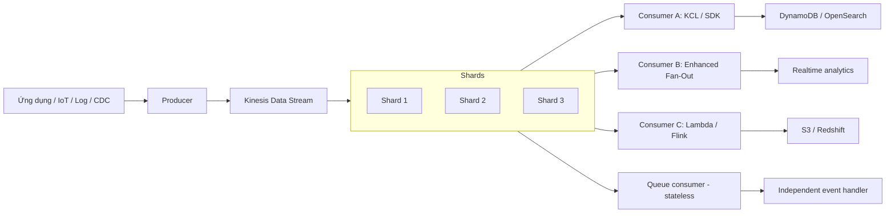

# Producer, consumer và lựa chọn chế độ capacity

Một hệ thống streaming thường nhận sự kiện liên tục từ ứng dụng, thiết bị IoT, log, giao dịch hoặc hệ thống nghiệp vụ. Producer cần gửi dữ liệu với độ trễ thấp và không làm mất sự kiện khi mạng chập chờn. Consumer cần đọc và xử lý dữ liệu đúng tốc độ, có thể mở rộng theo tải và phục hồi sau khi worker bị lỗi. Nếu capacity của luồng không phù hợp, hệ thống có thể gặp throttling, consumer bị trễ, chi phí tăng hoặc mất khả năng xử lý theo thời gian thực.

Amazon Kinesis Data Streams (KDS) là dịch vụ streaming được quản lý, cho phép producer ghi record vào data stream và consumer đọc record từ các shard. Dịch vụ hỗ trợ hai cách quản lý capacity: Provisioned và On-demand. On-demand hiện có hai chế độ tính phí/cấu hình là On-demand Standard và On-demand Advantage. Lựa chọn đúng chế độ cần dựa trên lưu lượng ghi/đọc, độ biến động, số consumer, khả năng phân phối partition key, yêu cầu độ trễ và ngân sách.

Trong hệ sinh thái AWS, Kinesis Data Streams có thể kết nối với AWS SDK, Kinesis Producer Library (KPL), Kinesis Client Library (KCL), AWS Lambda, Amazon Managed Service for Apache Flink, Amazon Data Firehose, Amazon S3, DynamoDB, Redshift, CloudWatch và các hệ thống phân tích khác. Producer, consumer và capacity phải được thiết kế như một luồng end-to-end để bảo đảm dữ liệu đến đúng nơi và được xử lý trong thời gian mục tiêu.

## Mục tiêu học tập

Sau bài học, bạn có thể:

- Mô tả vai trò của producer, data record, partition key, shard và consumer trong Kinesis Data Streams.
- Chọn PutRecord, PutRecords, AWS SDK for Java hoặc KPL cho producer.
- Thiết kế partition key để giữ thứ tự theo thực thể và phân bố tải tránh hot shard.
- Phân biệt shared-throughput consumer, Enhanced Fan-Out (EFO), KCL, Lambda event source mapping và queue consumer.
- Tính số shard cần thiết trong Provisioned mode dựa trên throughput ghi và đọc.
- So sánh Provisioned, On-demand Standard và On-demand Advantage về scaling, giới hạn và chi phí.
- Xử lý retry, throttling, duplicate, checkpoint, consumer lag và thay đổi số shard.
- Giám sát và điều chỉnh capacity dựa trên số liệu thực tế.

## Kiến trúc tổng thể của Kinesis Data Streams

Producer ghi các record vào stream. Kinesis phân phối record vào shard dựa trên partition key hoặc chiến lược phân phối do dịch vụ quản lý. Consumer đọc record và chuyển kết quả đến hệ thống đích, ví dụ DynamoDB, S3, Redshift hoặc một dịch vụ xử lý sự kiện.



Một stream lưu các record bất biến trong khoảng retention đã cấu hình. Kinesis không hiểu schema hay nội dung business trong data blob; producer và consumer phải thống nhất định dạng, version schema, encoding và cách xử lý lỗi. Stream không phải database truy vấn tùy ý: consumer đọc tuần tự theo shard và dùng sequence number để xác định vị trí trong shard.

## Các khái niệm cần nắm

| Thành phần | Vai trò | Điều cần nhớ |
|---|---|---|
| Producer | Ghi record vào stream | Chọn partition key, định dạng dữ liệu, retry và xử lý acknowledgement |
| Data record | Đơn vị dữ liệu trong stream | Gồm partition key, sequence number do Kinesis cấp và data blob |
| Partition key | Xác định record thuộc shard nào trong chiến lược user-managed | Các record cùng key được ánh xạ đến cùng shard; key nóng có thể tạo hot shard |
| Shard | Đơn vị capacity và thứ tự của stream | Có giới hạn throughput ghi/đọc riêng |
| Sequence number | Vị trí record trong shard | Dùng cho checkpoint và tiếp tục đọc; không phải ID toàn cục để sắp xếp giữa mọi shard |
| Consumer | Đọc và xử lý record | Có thể dùng shared throughput, EFO hoặc queue tùy workload |
| Checkpoint | Ghi nhận vị trí xử lý đã hoàn tất | KCL lưu checkpoint để worker có thể tiếp tục sau khi restart |

### Shard và capacity cơ bản

Trong Provisioned mode, một shard hỗ trợ tối đa:

- Ghi: 1 MB/giây hoặc 1.000 record/giây, tùy giới hạn nào đạt trước.
- Đọc bằng `GetRecords`: tổng cộng 2 MB/giây và tối đa 5 lần đọc mỗi giây cho shard.
- Enhanced Fan-Out: mỗi consumer đăng ký EFO có thể nhận tối đa 2 MB/giây cho mỗi shard, độc lập với consumer EFO khác.

Giới hạn trên áp dụng ở mức shard và là cơ sở để tính capacity. Với On-demand, dịch vụ tự quản lý số shard/capacity nhưng giới hạn throughput của shard và partition key vẫn có ý nghĩa khi phân tích throttling và phân bố tải.

Kinesis mặc định cho phép record có data blob tối đa 1 MiB. Có thể cấu hình giới hạn tối đa đến 10 MiB cho stream, nhưng record lớn được hỗ trợ theo cơ chế burst và không làm tăng sustained throughput của shard. Hãy dùng record lớn một cách không thường xuyên; với payload lớn và liên tục, nên lưu payload ở S3 rồi gửi object key/metadata vào stream.

## Producer: ghi dữ liệu vào stream

Producer có thể là API service, ứng dụng Java, agent thu thập log, thiết bị IoT hoặc một dịch vụ AWS. Một producer tốt phải tạo record đúng schema, chọn partition key phù hợp, gửi dữ liệu hiệu quả và xử lý được lỗi tạm thời.

### Chọn PutRecord hay PutRecords

| API | Cách hoạt động | Khi phù hợp |
|---|---|---|
| `PutRecord` | Gửi một record mỗi request; trả về shard ID và sequence number | Khi cần kiểm soát thứ tự theo partition key và muốn xử lý từng record |
| `PutRecords` | Gửi nhiều record trong một request; tối đa 500 record và tổng request tối đa 10 MiB theo API hiện hành | Khi cần tăng throughput và giảm số lần gọi API |

`PutRecords` có thể trả về HTTP thành công nhưng một số record bên trong bị lỗi. Producer phải kiểm tra `FailedRecordCount` và từng phần tử response, sau đó retry đúng các record thất bại. `PutRecords` không bảo đảm thứ tự giữa các record trong batch. Nếu yêu cầu thứ tự nghiêm ngặt cho một partition key, dùng `PutRecord` theo chuỗi và xử lý sequence number phù hợp.

### Partition key và phân bố record

Trong chiến lược user-managed partition key (mặc định), Kinesis băm partition key bằng MD5 để ánh xạ record đến hash key range của một shard. Partition key là chuỗi Unicode có độ dài tối đa 256 ký tự.

Ví dụ:

- Dữ liệu đơn hàng: `orderId`.
- Sự kiện tài khoản: `accountId`.
- Telemetry thiết bị: `deviceId`.
- Log phân vùng theo máy chủ: `hostId`.

Nếu cần giữ thứ tự các sự kiện của cùng một đơn hàng, dùng `orderId` làm partition key. Các record cùng key được gửi đến cùng shard và có thể được xử lý tuần tự theo thứ tự shard. Nhưng nếu một partition key phát sinh lượng traffic quá lớn, toàn bộ record của key đó tập trung vào một shard và có thể vượt giới hạn, dù các shard khác còn capacity.

Tránh dùng các key có cardinality thấp như `region=ap-southeast-1` hoặc một giá trị cố định cho toàn bộ record. Cũng cần tránh một key quá nóng, ví dụ một khách hàng hoặc thiết bị chiếm phần lớn traffic. Có thể tạo key tổng hợp như `customerId#bucket`, nhưng chỉ làm vậy khi nghiệp vụ chấp nhận mất thứ tự toàn cục của customer và consumer biết cách gom các bucket.

### Service-managed record distribution

Với stream On-demand, có thể chọn chiến lược phân phối record:

- **User set / USER_PARTITION_KEY:** producer cung cấp partition key và Kinesis dùng key để chọn shard. Phù hợp khi cần thứ tự theo entity hoặc logic phân vùng rõ ràng.
- **Auto:** Kinesis tự phân phối record đều hơn qua shard và bỏ qua partition key do producer cung cấp. Phù hợp workload stateless, không cần thứ tự theo partition key.

Khi dùng Auto, `PartitionKey` nếu vẫn được gửi sẽ bị bỏ qua cho mục đích shard placement; consumer có thể nhận record không có partition key. Producer và consumer cần xử lý trường hợp này. Service-managed distribution không hỗ trợ KPL aggregation vì KPL aggregation phụ thuộc việc producer dự đoán shard theo partition key. Nếu dùng Auto, tắt aggregation hoặc dùng KPL phiên bản mới với cấu hình nhận diện strategy để tránh lỗi mất record khi de-aggregate.

Không thể trộn Auto và user-managed partition keys trong cùng một stream. Khi chuyển chiến lược, thứ tự theo partition key chỉ áp dụng cho các record mới theo cách phân phối hiện tại; không thể tái sắp xếp dữ liệu đã ghi trước đó.

### AWS SDK for Java 2.x

Ứng dụng Java có thể ghi record trực tiếp bằng AWS SDK for Java 2.x. Ví dụ dưới đây gửi một sự kiện JSON:

```java
import java.nio.charset.StandardCharsets;

import software.amazon.awssdk.core.SdkBytes;
import software.amazon.awssdk.regions.Region;
import software.amazon.awssdk.services.kinesis.KinesisClient;
import software.amazon.awssdk.services.kinesis.model.PutRecordRequest;
import software.amazon.awssdk.services.kinesis.model.PutRecordResponse;

public final class OrderProducer {
    public static void main(String[] args) {
        String streamName = "orders-stream";
        String orderId = "order-1042";
        String json = "{\"eventType\":\"ORDER_CREATED\","
                + "\"orderId\":\"order-1042\","
                + "\"amount\":125000}";

        try (KinesisClient client = KinesisClient.builder()
                .region(Region.AP_SOUTHEAST_1)
                .build()) {

            PutRecordRequest request = PutRecordRequest.builder()
                    .streamName(streamName)
                    .partitionKey(orderId)
                    .data(SdkBytes.fromByteArray(
                            json.getBytes(StandardCharsets.UTF_8)))
                    .build();

            PutRecordResponse response = client.putRecord(request);
            System.out.printf("shard=%s sequence=%s%n",
                    response.shardId(), response.sequenceNumber());
        }
    }
}
```

Trong production, không tạo client cho mỗi record. Tái sử dụng SDK client, cấp credentials qua IAM role, cấu hình timeout/retry, ghi log có correlation ID và xử lý exception. Không đặt access key tĩnh trong source code.

### Gửi batch và xử lý partial failure

Ví dụ rút gọn với `PutRecords`:

```java
import java.nio.charset.StandardCharsets;
import java.util.List;

import software.amazon.awssdk.core.SdkBytes;
import software.amazon.awssdk.services.kinesis.KinesisClient;
import software.amazon.awssdk.services.kinesis.model.PutRecordsRequest;
import software.amazon.awssdk.services.kinesis.model.PutRecordsRequestEntry;
import software.amazon.awssdk.services.kinesis.model.PutRecordsResponse;

List<PutRecordsRequestEntry> entries = events.stream()
        .map(event -> PutRecordsRequestEntry.builder()
                .partitionKey(event.orderId())
                .data(SdkBytes.fromByteArray(
                        event.toJson().getBytes(StandardCharsets.UTF_8)))
                .build())
        .toList();

PutRecordsResponse response = client.putRecords(
        PutRecordsRequest.builder()
                .streamName("orders-stream")
                .records(entries)
                .build());

if (response.failedRecordCount() != null
        && response.failedRecordCount() > 0) {
    for (int i = 0; i < response.records().size(); i++) {
        var result = response.records().get(i);
        if (result.errorCode() != null) {
            // Đưa đúng entries.get(i) vào retry queue có giới hạn.
            // Sau số lần thử tối đa, ghi DLQ hoặc kho lưu lỗi để xử lý lại.
        }
    }
}
```

Batch ở trên cần được chia nhỏ theo giới hạn API: tối đa 500 record và tổng request tối đa 10 MiB, bao gồm partition key. Khi retry, chỉ gửi lại record lỗi; không gửi lại toàn bộ batch nếu một phần đã thành công. Dùng exponential backoff có jitter, giới hạn số lần thử và giữ idempotency key để xử lý trường hợp producer không nhận được acknowledgement nhưng record đã được ghi.

### Kinesis Producer Library (KPL)

KPL là thư viện producer tối ưu cho throughput cao. KPL có thể:

- Buffer và batch nhiều user records thành một lần gọi `PutRecords`.
- Aggregate nhiều user records thành một Kinesis record để giảm overhead.
- Retry tự động và giới hạn tốc độ theo shard.
- Gửi metric producer đến CloudWatch.
- Tích hợp với KCL để consumer de-aggregate user records.

KPL phù hợp với lượng sự kiện nhỏ nhưng rất nhiều, ví dụ hàng nghìn thiết bị gửi telemetry. KPL dùng native component và có cấu hình buffer, aggregation, retry; hãy triển khai đúng nền tảng và kiểm thử nâng cấp phiên bản. Nếu dùng service-managed Auto distribution, không bật aggregation vì contract shard mapping của KPL không còn phù hợp.

## Consumer: đọc và xử lý record

Consumer đọc record từ shard và xử lý theo logic nghiệp vụ. Một stream có thể có nhiều consumer độc lập. Mỗi consumer cần xác định vị trí đọc, cách phân phối shard cho worker, cách lưu checkpoint và cách xử lý lỗi.

### Shared-throughput consumer với GetRecords

Consumer dùng `GetShardIterator` và `GetRecords` theo mô hình pull. Các consumer dùng chung tổng read throughput 2 MB/giây mỗi shard. Nếu nhiều ứng dụng cùng đọc một shard, chúng cạnh tranh cùng capacity. Cách này phù hợp khi có ít consumer hoặc tốc độ đọc vừa phải.

`GetRecords` trả về `NextShardIterator`; consumer dùng iterator tiếp theo để đọc lần sau. Kết quả có thể rỗng dù stream còn tồn tại vì API không block chờ record. Consumer cần poll liên tục với nhịp phù hợp, tránh gọi quá nhanh gây throttling.

### Enhanced Fan-Out (EFO)

EFO cho phép consumer đăng ký với stream và nhận dữ liệu qua `SubscribeToShard` bằng HTTP/2. Mỗi consumer EFO có throughput riêng tối đa 2 MB/giây mỗi shard, không chia sẻ với các consumer khác. Kinesis push record đến consumer nên không cần poll `GetRecords`.

| Tiêu chí | Shared throughput | Enhanced Fan-Out |
|---|---|---|
| API | `GetShardIterator`, `GetRecords` | `RegisterStreamConsumer`, `SubscribeToShard` |
| Mô hình | Consumer pull | Dịch vụ push qua HTTP/2 |
| Throughput | Tổng 2 MB/giây mỗi shard cho mọi consumer shared | Tối đa 2 MB/giây mỗi shard cho từng consumer EFO |
| Độ trễ | Tăng khi nhiều consumer cùng đọc | Thường thấp và ổn định hơn khi có nhiều consumer |
| Chi phí | Không có phí consumer-shard hour riêng | Có phí retrieval và consumer-shard hour ở Standard/Provisioned; On-demand Advantage có cách tính riêng |
| Phù hợp | Một hoặc ít consumer, tải đọc vừa phải | Nhiều ứng dụng cần đọc độc lập hoặc yêu cầu độ trễ thấp |

Theo quota hiện hành, On-demand Standard và Provisioned hỗ trợ tối đa 20 registered EFO consumers trên mỗi stream; On-demand Advantage hỗ trợ tối đa 50 tại các Region được AWS hỗ trợ. Queue consumer cũng dùng chung giới hạn registered consumers với EFO. Kiểm tra danh sách Region và quota mới nhất trước khi thiết kế.

### Kinesis Client Library (KCL)

KCL giúp xây dựng consumer có khả năng mở rộng và phục hồi. KCL tự quản lý vòng đời shard, phân phối shard cho worker, lease, checkpoint, resharding và các tình huống worker restart. KCL dùng DynamoDB để lưu lease/checkpoint và trạng thái điều phối; do đó, consumer role cần quyền Kinesis và quyền phù hợp trên các bảng DynamoDB do ứng dụng KCL quản lý.

Khi một worker nhận lease cho shard, record processor xử lý record theo thứ tự shard. Sau khi side effect đã hoàn tất, ứng dụng checkpoint sequence number. Nếu worker chết trước checkpoint, record có thể được đọc và xử lý lại từ checkpoint gần nhất. KCL không biến pipeline thành exactly-once end-to-end; sink cần idempotency hoặc deduplication.

Với ứng dụng mới, chọn KCL version đang được AWS hỗ trợ và cập nhật theo lifecycle hiện hành. Không bắt đầu dự án mới trên KCL 1.x hoặc 2.x đã cũ; kiểm tra hướng dẫn nâng cấp lên dòng KCL hiện hành, bao gồm KCL 3.x.

### Lambda event source mapping

AWS Lambda có thể đọc Kinesis stream thông qua event source mapping. Lambda quản lý polling, batch, checkpoint và retry theo cấu hình. Các thiết lập cần xem xét gồm batch size, maximum batching window, parallelization factor, bisect batch on function error, retry attempts và on-failure destination.

Lambda phù hợp cho xử lý event-driven với logic ngắn và có thể mở rộng theo shard. Nếu function xử lý lâu hoặc downstream bị chậm, iterator age tăng và batch retry có thể gây duplicate. Cần thiết kế handler idempotent và cấu hình failure destination/DLQ theo yêu cầu.

### Queue consumer cho xử lý stateless

Kinesis Data Streams còn hỗ trợ queue cho On-demand streams. Queue theo dõi trạng thái giao từng record đến queue consumer, giúp consumer không phải tự phối hợp checkpoint theo shard. Producer không cần thay đổi.

Consumer gọi `ReceiveQueueRecords` để nhận tối đa 10 record, xử lý rồi gọi `AcknowledgeQueueRecords` cho các record đã hoàn tất. Queue giao ít nhất một lần: record chưa được acknowledge trước khi visibility timeout hết hạn sẽ được giao lại; trong trường hợp hiếm, record đã acknowledge cũng có thể được giao lại. Queue không bảo đảm thứ tự giống thứ tự producer ghi và có dead-letter handling tích hợp.

Queue phù hợp khi mỗi record có thể được xử lý độc lập, ví dụ gửi thông báo, cập nhật một bản ghi hoặc xử lý tác vụ riêng. Không dùng queue nếu logic cần duy trì trạng thái theo thứ tự record trong cùng partition hoặc cần đọc toàn bộ shard như một chuỗi stateful. Queue chỉ hoạt động với On-demand Standard và On-demand Advantage; không hỗ trợ Provisioned mode. Record chưa được acknowledge vẫn hết hạn khi retention của stream kết thúc, kể cả record dead-letter.

### Chọn loại consumer theo workload

| Nhu cầu | Lựa chọn gợi ý | Lý do |
|---|---|---|
| Một ứng dụng đọc và xử lý stateful theo shard | KCL hoặc SDK shared-throughput | Duy trì vị trí đọc và thứ tự shard |
| Nhiều ứng dụng độc lập cần đọc cùng dữ liệu | EFO | Mỗi consumer có throughput riêng |
| Xử lý stateless từng record, muốn dịch vụ theo dõi delivery/ack | Queue consumer trên On-demand | Giảm phần tự quản lý shard checkpoint |
| Xử lý event ngắn, tích hợp serverless | Lambda event source mapping | Tích hợp managed và tự mở rộng |
| Analytics liên tục, stateful windows | Managed Service for Apache Flink | Có state, window và xử lý stream phức tạp |

## Checkpoint, retry và bảo đảm xử lý

Kinesis Data Streams cung cấp record ít nhất một lần theo mô hình consumer thông thường. Duplicate có thể xuất hiện từ hai phía:

- Producer retry sau timeout: producer không biết request đã được ghi hay chưa; retry có thể tạo record thứ hai.
- Consumer retry: worker xử lý side effect xong nhưng chết trước khi checkpoint; record được đọc lại.

Để giảm tác động duplicate:

1. Mỗi sự kiện nghiệp vụ có ID duy nhất, ví dụ `eventId` hoặc `transactionId`.
2. Sink dùng conditional write, unique constraint hoặc idempotency table để bỏ qua event đã xử lý.
3. Chỉ checkpoint sau khi side effect đã hoàn tất và được xác nhận.
4. Không checkpoint trước khi ghi dữ liệu đích, vì có thể mất record nếu worker chết sau checkpoint.
5. Dùng retry có giới hạn, exponential backoff và jitter; lỗi không thể phục hồi được đưa vào DLQ hoặc kho lỗi.
6. Theo dõi duplicate rate và thời gian xử lý từng batch.

Nếu cần thứ tự theo entity, dùng partition key ổn định và xử lý tuần tự trong shard hoặc theo partition. Không giả định sequence number có thể sắp xếp toàn bộ stream vì sequence number thuộc phạm vi shard.

## Lựa chọn chế độ capacity

Capacity mode quyết định ai quản lý số shard và cách tính phí. Kinesis Data Streams có ba chế độ cần phân biệt:

1. **Provisioned:** người dùng chỉ định số shard và tự tăng/giảm khi tải thay đổi.
2. **On-demand Standard:** dịch vụ tự điều chỉnh capacity theo lịch sử và lưu lượng, tính phí theo mức sử dụng cùng phí stream-hour.
3. **On-demand Advantage:** cấu hình ở cấp account/Region cho các On-demand streams, có warm throughput, pricing đơn giản hơn và mức phí theo GB thấp hơn theo biểu giá công bố; đổi lại có mức cam kết tối thiểu về ingest/retrieval.

| Tiêu chí | Provisioned | On-demand Standard | On-demand Advantage |
|---|---|---|---|
| Quản lý capacity | Người dùng chỉ định số shard | AWS tự quản lý shard/capacity | AWS tự quản lý; có thể đặt warm throughput |
| Phù hợp | Tải ổn định, dự báo được, cần điều khiển shard chi tiết | Tải biến động hoặc chưa rõ, muốn giảm vận hành capacity | Tải tổng hợp lớn/ổn định, nhiều stream hoặc nhiều EFO consumer, cần warm capacity |
| Scale | Tăng/giảm shard qua console/API | Tự động theo traffic và peak lịch sử | Tự động; có thể warm trước và yêu cầu giảm capacity về mức warm/peak gần đây |
| Billing chính | Shard-hour, PUT payload units, optional features | GB ingest/retrieval, phí stream-hour, optional features | GB ingest/retrieval với mức cam kết tối thiểu account-level; không có phí cố định mỗi stream |
| EFO consumer quota | Tối đa 20 mỗi stream | Tối đa 20 mỗi stream | Tối đa 50 ở Region được hỗ trợ |
| Service-managed distribution Auto | Không | Có | Có |
| Queue consumer | Không | Có | Có |

### Provisioned mode

Provisioned phù hợp khi workload ổn định hoặc có thể dự báo tương đối chính xác. Người vận hành chỉ định số shard; mỗi shard bổ sung capacity ghi và đọc. Nếu tải tăng, phải tăng shard count trước hoặc trong khi tải tăng. Nếu shard count quá lớn so với nhu cầu, tổ chức trả tiền cho capacity nhàn rỗi.

Ưu điểm:

- Dự báo chi phí dễ hơn khi traffic ổn định.
- Điều khiển số shard và resharding chi tiết.
- Có thể split một shard nóng cụ thể để giải quyết phân bố partition key không đều.
- Phù hợp với pipeline cần tối ưu chi phí theo capacity đã biết.

Hạn chế:

- Cần lập kế hoạch và theo dõi throughput.
- Phải tăng/giảm shard khi nhu cầu thay đổi.
- Hot shard vẫn có thể throttling dù tổng stream còn capacity.
- Shard count quá cao làm tăng chi phí và độ phức tạp consumer.

### On-demand Standard

On-demand Standard phù hợp khi lưu lượng biến động mạnh hoặc chưa biết trước. AWS quản lý capacity và tự điều chỉnh số shard theo traffic. Mặc định, stream mới có capacity ban đầu 4 MB/s ghi và 8 MB/s đọc; giới hạn tăng tối đa phụ thuộc Region và quota tài khoản.

On-demand Standard có thể đáp ứng tối đa khoảng hai lần peak write throughput quan sát trong 30 ngày trước. Nếu lưu lượng tăng nhanh vượt hai lần peak trong khoảng 15 phút, producer có thể gặp throttling trong giai đoạn scale. Khi đó cần retry có backoff và chuẩn bị warm-up/traffic ramp nếu sự kiện đột biến đã biết trước.

On-demand không có nghĩa mọi partition key đều tự động có capacity vô hạn. Một partition key quá nóng có thể dồn dữ liệu vào một shard và vượt giới hạn 1 MB/s hoặc 1.000 records/s. Nếu phân bố rất lệch, On-demand có thể tiếp tục gặp throttling; cần sửa partition key hoặc cân nhắc Provisioned để split shard cụ thể.

### On-demand Advantage

On-demand Advantage là một thiết lập cấp account trong một Region, áp dụng cho tất cả On-demand streams trong Region đó. Chế độ này giữ khả năng tự scale của On-demand và bổ sung:

- Cấu hình warm throughput để chuẩn bị capacity ghi trước sự kiện dự kiến.
- Có thể yêu cầu giảm capacity sau burst bằng cách điều chỉnh warm throughput xuống; dịch vụ vẫn giữ mức cần thiết để hỗ trợ peak ingest trong giờ gần nhất nếu mức đó cao hơn.
- Không có phí cố định theo stream-hour như On-demand Standard.
- Giá ingest, retrieval và extended retention theo bảng giá Advantage; Enhanced Fan-Out không có phần phí premium như các mode khác.
- Hỗ trợ tối đa 50 registered EFO consumers mỗi stream ở các Region được AWS liệt kê.

Đổi lại, tài khoản cam kết mức tối thiểu 25 MiB/s ingest và 25 MiB/s retrieval tổng hợp trên tất cả On-demand streams trong Region. Nếu usage thấp hơn mức cam kết, có thể phát sinh shortfall charge. Sau khi bật Advantage, cần chờ tối thiểu 24 giờ mới có thể tắt; cần xóa warm throughput đã cấu hình trước khi quay về Standard. Hãy so sánh usage thực tế của toàn Region trước khi bật.

Warm throughput được cấu hình bất đồng bộ. Khi gọi API, stream chuyển sang trạng thái `UPDATING`; việc thay đổi có thể mất vài phút, trong thời gian đó vẫn có thể đọc và ghi. Không đợi đến giây cuối cùng trước sự kiện lớn mới warm stream.

### Chọn mode theo tình huống

| Tình huống | Mode nên đánh giá | Lý do |
|---|---|---|
| Workload mới, lưu lượng khó dự báo | On-demand Standard | Không cần dự đoán số shard ban đầu |
| Traffic ổn định cả ngày và có forecast tốt | Provisioned | Kiểm soát shard và chi phí capacity |
| Event lớn có lịch, cần warm throughput trước | On-demand Advantage | Có thể chuẩn bị write capacity trước spike |
| Hàng trăm stream nhỏ, overhead per-stream đáng kể | On-demand Advantage | Không có phí cố định mỗi stream, nhưng phải tính minimum commitment |
| Nhiều consumer cần throughput riêng | EFO; xem On-demand Advantage nếu phù hợp | Registered consumer quota cao hơn và không có premium EFO trong Advantage |
| Một partition key rất nóng, cần split hash range cụ thể | Provisioned | Có thể xác định shard nóng và split chi tiết |
| Consumer stateless cần ack/DLQ do dịch vụ quản lý | On-demand Standard/Advantage + Queue | Queue không hỗ trợ Provisioned |

Không chọn On-demand Advantage chỉ vì giá ingest trên mỗi GB thấp hơn. Nếu usage thấp hơn mức cam kết tối thiểu, shortfall có thể làm tổng chi phí cao hơn dự kiến. Tính tổng ingest/retrieval của tất cả stream trong Region, EFO consumers, retention, S3 delivery/streaming tables nếu dùng và các phí phụ trợ.

## Tính số shard trong Provisioned mode

Để ước tính số shard, cần tính cả throughput ghi và throughput đọc. Một shard hỗ trợ 1 MB/s hoặc 1.000 records/s ghi và 2 MB/s đọc qua shared `GetRecords`.

Công thức tham khảo:

```text
write_shards = max(
  ceil(write_MB_per_second / 1),
  ceil(write_records_per_second / 1000)
)

shared_read_shards = ceil(
  total_shared_read_MB_per_second / 2
)

required_shards = max(write_shards, shared_read_shards)
```

Với EFO, mỗi consumer có throughput 2 MB/s mỗi shard riêng. Hãy xác nhận consumer cần throughput và quota đăng ký, nhưng không cộng tổng read throughput của EFO consumers như thể chúng dùng chung 2 MB/s.

### Ví dụ tính capacity

Một stream nhận trung bình 2.000 record/giây, mỗi record 2 KB. Có ba ứng dụng consumer cùng đọc bằng shared throughput.

1. Write bandwidth = 2.000 × 2 KB = 4.000 KB/s, xấp xỉ 4 MB/s.
2. Write records rate = 2.000 records/s.
3. Số shard theo write bytes = ceil(4/1) = 4.
4. Số shard theo write records = ceil(2.000/1.000) = 2.
5. Tổng read bandwidth của ba consumer = 4 × 3 = 12 MB/s.
6. Số shard theo shared read = ceil(12/2) = 6.
7. Số shard tối thiểu = max(4, 2, 6) = 6.

Có thể chọn 8 shard để có thêm headroom, nhưng phải kiểm tra peak traffic, phân bố key, burst, record size và tốc độ xử lý downstream. Công thức chỉ ước lượng capacity; không thay thế load test và giám sát shard-level.

### Resharding

Trong Provisioned mode, có thể tăng hoặc giảm shard count bằng console hoặc `UpdateShardCount`. Với hot shard, có thể split shard cụ thể; có thể merge shard khi cần giảm capacity. Resharding làm thay đổi topology shard và có thể khiến consumer xử lý lại một số record gần checkpoint. KCL tự quản lý việc phát hiện shard con và phân phối lại lease; consumer tự viết cần xử lý shard lineage và iterator.

Không nên chỉ tăng shard count khi nguyên nhân là partition key nóng. Nếu một key duy nhất tạo phần lớn traffic, tăng số shard có thể không giúp key đó phân tán vì cùng key vẫn ánh xạ đến cùng shard. Hãy sửa partition key hoặc dùng service-managed Auto nếu không cần thứ tự theo key.

## Chuyển đổi capacity mode

Có thể chuyển stream giữa Provisioned và On-demand qua console hoặc API. Việc chuyển mode không làm gián đoạn producer/consumer đang đọc/ghi; stream chuyển sang trạng thái `UPDATING` rồi trở lại `ACTIVE`. Mỗi stream chỉ được chuyển giữa Provisioned và On-demand tối đa hai lần trong 24 giờ.

Khi chuyển mode, stream ban đầu giữ shard count hiện tại. Nếu chuyển sang On-demand, AWS bắt đầu quản lý capacity theo traffic. Nếu chuyển sang Provisioned, người vận hành chịu trách nhiệm điều chỉnh shard count sau đó. Trước khi chuyển, kiểm tra queue consumer vì queue chỉ hỗ trợ On-demand; nếu stream còn queue, cần xóa queue trước khi chuyển sang Provisioned.

On-demand Standard sang On-demand Advantage là thay đổi account-level, không phải chuyển mode riêng cho một stream. Việc bật ảnh hưởng tất cả On-demand streams trong Region và đi kèm minimum commitment. Lập kế hoạch theo tổng usage và thời gian cam kết.

## Retry, throttling và chống mất dữ liệu

Producer phải xử lý `ProvisionedThroughputExceededException`, `InternalFailure`, timeout và lỗi mạng. Khi retry:

- Dùng exponential backoff và jitter để tránh nhiều producer retry đồng thời.
- Chỉ retry record thất bại trong `PutRecords` response.
- Giới hạn số lần retry và thời gian giữ record trong buffer.
- Lưu record chưa gửi được vào durable outbox hoặc DLQ để không mất dữ liệu khi process restart.
- Dùng event ID để consumer deduplicate nếu producer có thể gửi trùng.
- Với key nóng, điều chỉnh partition strategy hoặc capacity; retry đơn thuần không giải quyết được hotspot kéo dài.

Kinesis không sửa hoặc sắp xếp lại record sau khi ghi. Nếu producer gửi lại sau timeout, có thể tồn tại hai record có nội dung giống nhau nhưng sequence number khác nhau. Consumer cần idempotency để bảo đảm side effect chỉ xảy ra một lần theo nghiệp vụ.

## Giám sát producer, consumer và capacity

CloudWatch cung cấp metric stream-level miễn phí theo phút; shard-level enhanced monitoring cần bật riêng và phát sinh chi phí. Các metric quan trọng:

| Metric | Ý nghĩa | Hành động khi bất thường |
|---|---|---|
| `IncomingBytes` | Số byte ghi vào stream | So sánh với capacity và forecast |
| `IncomingRecords` | Số record ghi vào stream | Phát hiện burst hoặc producer tăng tải |
| `WriteProvisionedThroughputExceeded` | Lỗi/throttling phía producer | Kiểm tra shard, partition key, retries và shard count |
| `PutRecords.FailedRecords` | Số record batch ghi thất bại | Retry record lỗi và theo dõi lỗi kéo dài |
| `GetRecords.IteratorAgeMilliseconds` | Tuổi record cuối consumer đọc được | Nếu tăng liên tục, consumer đang tụt lại |
| `ReadProvisionedThroughputExceeded` | Throttling phía consumer shared read | Cân nhắc EFO, giảm consumer hoặc tăng shard |
| `GetRecords.Bytes` | Dung lượng consumer đọc | Đối chiếu với incoming bytes và số consumer |
| `SubscribeToShard.RateExceeded` | Consumer EFO gọi subscribe quá nhanh | Kiểm tra reconnect/retry và API rate |
| KCL `MillisBehindLatest` | Consumer lag theo shard/worker | Tăng worker/throughput, giảm thời gian xử lý hoặc tăng capacity |

Nếu `IteratorAgeMilliseconds` vượt 50% retention period, nguy cơ record hết hạn trước khi consumer xử lý tăng lên. Mặc định retention là 24 giờ; có thể tăng tối đa 365 ngày. Tăng retention có thể mua thêm thời gian phục hồi nhưng không thay thế việc khắc phục consumer lag.

Nên tạo alarm cho throttling, iterator age, failed records, incoming/outgoing throughput và trạng thái consumer. Dùng maximum statistic cho iterator age để phát hiện shard tệ nhất thay vì chỉ nhìn average. Kết hợp metric KPL/KCL, log xử lý và metric downstream như DynamoDB throttling hoặc S3 delivery failure để xác định đúng bottleneck.

## Tình huống thực tế: xử lý sự kiện đơn hàng

Một ứng dụng thương mại điện tử phát 2.000 sự kiện/giây vào `orders-stream`. Mỗi sự kiện có `orderId`, `eventId`, `eventType`, `createdAt` và payload JSON. Có ba nhóm consumer: cập nhật trạng thái đơn hàng, phân tích fraud và lưu raw events vào S3.

Thiết kế producer:

1. Producer Java dùng AWS SDK 2.x hoặc KPL tùy throughput.
2. Chọn `orderId` làm partition key để các sự kiện của cùng đơn hàng vào cùng shard.
3. Dùng `PutRecords` batch nếu không yêu cầu thứ tự chặt chẽ giữa record trong cùng batch; nếu cần thứ tự chính xác, gửi tuần tự `PutRecord` theo order key.
4. Retry record lỗi với backoff và lưu event ID để consumer deduplicate.

Thiết kế consumer:

1. Consumer cập nhật trạng thái dùng KCL để phân phối shard và checkpoint; sink DynamoDB dùng conditional write theo `eventId`.
2. Consumer fraud dùng EFO để có throughput riêng và độ trễ thấp.
3. Consumer lưu raw event dùng queue nếu mỗi record có thể xử lý độc lập, hoặc dùng Firehose/S3 delivery nếu muốn delivery managed.
4. Dashboard theo dõi iterator age, failed records, write/read throttling và độ trễ xử lý fraud.

Lựa chọn capacity:

- Nếu tải ổn định, có thể dùng Provisioned và tính số shard theo write/read throughput, sau đó load test.
- Nếu traffic tăng mạnh theo chiến dịch và khó dự báo, bắt đầu với On-demand Standard.
- Nếu doanh nghiệp có nhiều stream và tổng throughput ổn định cao, nhiều consumer EFO hoặc cần warm capacity trước chiến dịch, đánh giá On-demand Advantage dựa trên minimum commitment.

Khi chạy chiến dịch, nhóm vận hành kiểm tra forecast, warm capacity nếu dùng Advantage, quota account và năng lực downstream. Nếu consumer lag tăng, không chỉ tăng shard; cần kiểm tra thời gian xử lý mỗi record, DynamoDB capacity, retry và số worker. Sau chiến dịch, rà soát cost và điều chỉnh mode hoặc capacity theo số liệu.

## Những lỗi thiết kế thường gặp

| Lỗi | Hậu quả | Cách khắc phục |
|---|---|---|
| Dùng một partition key cho mọi record | Một shard nóng và throttling | Chọn key có cardinality cao hoặc Auto nếu không cần ordering |
| Chỉ tính capacity ghi | Consumer shared throughput bị thiếu | Tính cả tổng read throughput và số consumer |
| Cho nhiều consumer dùng GetRecords cùng lúc | Các consumer tranh 2 MB/s mỗi shard | Dùng EFO hoặc tách stream theo mục đích |
| Coi PutRecords là atomic | Một phần record thất bại nhưng producer bỏ qua | Kiểm tra FailedRecordCount và retry từng record |
| Retry vô hạn không backoff | Retry storm làm tăng throttling | Exponential backoff, jitter, giới hạn retry và durable outbox |
| Checkpoint trước khi ghi sink | Worker chết có thể làm mất side effect | Ghi sink thành công rồi mới checkpoint |
| Giả định exactly-once | Duplicate tạo giao dịch hoặc thông báo trùng | Idempotency key và deduplication ở sink |
| Chọn On-demand Advantage mà không tính minimum commitment | Chi phí shortfall ngoài dự kiến | Tính tổng ingest/retrieval của toàn Region trước khi bật |
| Dùng KPL aggregation với service-managed Auto | Consumer có thể không de-aggregate đúng và mất user records | Tắt aggregation hoặc dùng strategy tương thích |
| Dùng queue cho xử lý cần thứ tự/stateful | Record có thể đến không theo thứ tự và bị redeliver | Dùng stream consumer KCL/EFO cho stateful processing |
| Không theo dõi iterator age | Record có thể hết retention trước khi xử lý | Alarm iterator age và tăng năng lực consumer |

## Checklist triển khai production

- [ ] Xác định peak records/s, average/max record size, write MB/s và số consumer.
- [ ] Chọn partition key theo yêu cầu ordering và phân bố tải; đánh giá hot key.
- [ ] Chọn PutRecord, PutRecords hoặc KPL; xử lý partial failure và retry.
- [ ] Chọn consumer shared, EFO, KCL, Lambda, Flink hoặc queue theo stateful/stateless và latency.
- [ ] Thiết kế checkpoint, idempotency, deduplication, retry và DLQ.
- [ ] Chọn Provisioned, On-demand Standard hoặc On-demand Advantage theo traffic và chi phí.
- [ ] Nếu dùng Provisioned, tính shard count theo cả write/read và thêm headroom đã kiểm thử.
- [ ] Nếu dùng Advantage, xác nhận minimum commitment, Region support và warm throughput.
- [ ] Xác nhận quota stream, shard, EFO consumer, queue và throughput theo Region/account.
- [ ] Cấu hình retention theo thời gian phục hồi tối đa và yêu cầu replay.
- [ ] Bật CloudWatch alarms cho throttling, iterator age, failed records và consumer lag.
- [ ] Load test peak, burst, hot key, worker restart, resharding và downstream throttling.
- [ ] Kiểm tra chi phí data ingest/retrieval, shard-hours, EFO, retention, enhanced metrics và các dịch vụ đích.
- [ ] Viết runbook cho throttling, consumer lag, duplicate, resharding và đổi capacity mode.

## Kết luận

Producer quyết định chất lượng dữ liệu, partition key và hiệu quả ghi; consumer quyết định tốc độ xử lý, checkpoint và khả năng phục hồi; capacity mode quyết định cách stream đáp ứng tải và cách tính phí. Provisioned phù hợp với traffic dự báo được và cần điều khiển shard chi tiết. On-demand Standard phù hợp với tải biến động hoặc chưa rõ. On-demand Advantage phù hợp khi tổng usage đủ lớn, cần warm throughput hoặc nhiều consumer, nhưng phải tính minimum commitment ở cấp Region. Kết hợp producer retry đúng cách, consumer idempotent, giám sát iterator age và capacity theo cả hai chiều ghi/đọc sẽ giúp pipeline streaming vận hành ổn định.

## Tài liệu tham khảo

- [Amazon Kinesis Data Streams terminology and concepts](https://docs.aws.amazon.com/streams/latest/dev/key-concepts.html)
- [Choose the right mode to stream in](https://docs.aws.amazon.com/streams/latest/dev/how-do-i-size-a-stream.html)
- [Quotas and limits](https://docs.aws.amazon.com/streams/latest/dev/service-sizes-and-limits.html)
- [Write data to Amazon Kinesis Data Streams](https://docs.aws.amazon.com/streams/latest/dev/building-producers.html)
- [Develop producers using the Kinesis Producer Library](https://docs.aws.amazon.com/streams/latest/dev/developing-producers-with-kpl.html)
- [PutRecords API](https://docs.aws.amazon.com/kinesis/latest/APIReference/API_PutRecords.html)
- [Service-managed record distribution strategy](https://docs.aws.amazon.com/streams/latest/dev/service-managed-record-distribution.html)
- [Read data from Kinesis data streams](https://docs.aws.amazon.com/streams/latest/dev/building-consumers.html)
- [Develop enhanced fan-out consumers](https://docs.aws.amazon.com/streams/latest/dev/enhanced-consumers.html)
- [Use Kinesis Client Library](https://docs.aws.amazon.com/streams/latest/dev/kinesis-record-processor-implementation-app-java.html)
- [Consume records from a stream with queues](https://docs.aws.amazon.com/streams/latest/dev/consuming-with-queues.html)
- [Handle duplicate records](https://docs.aws.amazon.com/streams/latest/dev/kinesis-record-processor-duplicates.html)
- [Monitor Kinesis Data Streams with CloudWatch](https://docs.aws.amazon.com/streams/latest/dev/monitoring-with-cloudwatch.html)
- [Amazon Kinesis Data Streams pricing](https://aws.amazon.com/kinesis/data-streams/pricing/)
