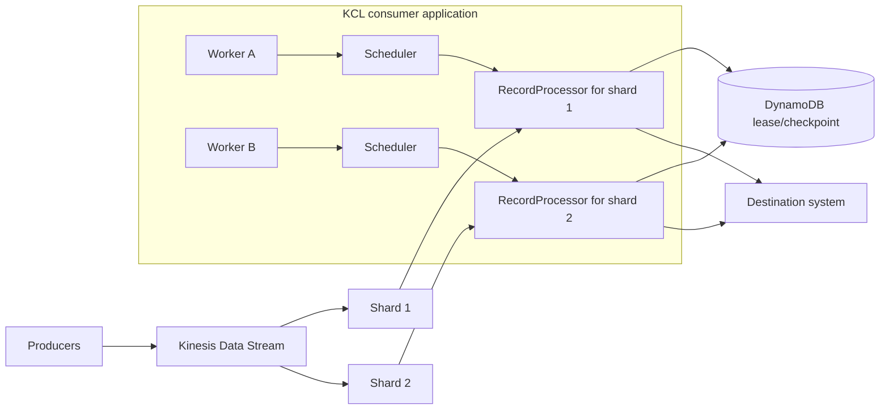
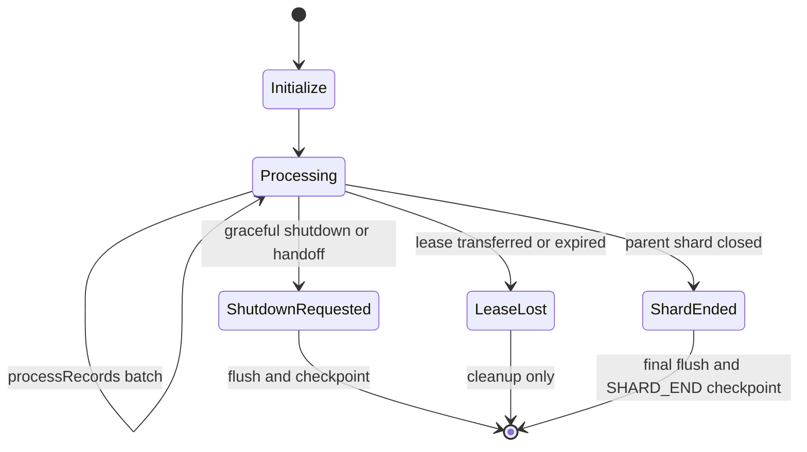

# Kinesis Client Library và checkpoint khi xử lý

Amazon Kinesis Data Streams lưu các record theo shard để nhiều producer có thể ghi dữ liệu liên tục và nhiều consumer có thể xử lý theo thời gian gần thực. Khi số shard và worker tăng, consumer phải giải quyết các bài toán phân phối shard, theo dõi vị trí đã đọc, khôi phục sau lỗi, phối hợp khi worker scale in/out và xử lý shard split/merge.

Kinesis Client Library (KCL) là thư viện Java giúp xây dựng consumer phân tán cho Kinesis Data Streams. KCL quản lý vòng đời shard, lease giữa worker, cân bằng tải và checkpoint; ứng dụng cung cấp logic nghiệp vụ để xử lý record. Checkpoint là vị trí tiến độ được lưu bền vững để consumer có thể tiếp tục sau khi worker dừng hoặc lỗi.

Checkpoint không tự làm cho side effect nghiệp vụ trở thành exactly-once. Nếu ứng dụng ghi dữ liệu đích thành công nhưng chưa checkpoint, record có thể được xử lý lại. Vì vậy, thiết kế KCL cần kết hợp checkpoint với xử lý idempotent, retry, dead-letter queue (DLQ), giám sát và quy trình shutdown đúng.

Bài học tập trung vào KCL 3.x cho Java. KCL 1.x và 2.x đã lỗi thời; KCL 1.x kết thúc hỗ trợ ngày 30-01-2026. Với ứng dụng mới, dùng nhánh KCL hiện hành và AWS SDK for Java 2.x; khi nâng cấp ứng dụng cũ, cần đọc hướng dẫn migration theo version đang chạy.

Sau bài học, người học có thể:

- Giải thích quan hệ giữa Kinesis stream, shard, worker, scheduler, record processor và lease.
- Mô tả cách KCL lưu lease/checkpoint trong DynamoDB.
- Triển khai các callback trong vòng đời `ShardRecordProcessor`.
- Chọn thời điểm checkpoint phù hợp với batch, side effect và yêu cầu phục hồi.
- Phân tích at-least-once delivery, duplicate, lỗi xử lý và idempotency.
- Xử lý shutdown, lease loss, shard end và resharding an toàn.
- Cấu hình, giám sát và vận hành KCL consumer trên AWS.

## 1. KCL nằm ở đâu trong kiến trúc streaming?

### 1.1. Từ stream đến record processor

Amazon Kinesis Data Streams chia stream thành các shard. Mỗi record có partition key và sequence number. Partition key được ánh xạ vào hash-key range của shard; record cùng partition key được đưa vào cùng shard trong phạm vi cấu hình stream, nhờ đó consumer có thể xử lý theo thứ tự của shard.

KCL nằm trong ứng dụng consumer. Thư viện liên tục đọc dữ liệu từ Kinesis, quản lý shard assignment và chuyển batch cho record processor. Ứng dụng không phải tự viết vòng lặp `GetRecords`, tự quản lý shard iterator hoặc tự phân chia shard cho từng máy.

| Thành phần | Trách nhiệm |
|---|---|
| Kinesis data stream | Lưu record theo shard trong thời gian retention |
| Shard | Phân vùng dữ liệu, có sequence number và hash-key range riêng |
| KCL application | Một nhóm consumer logic cùng chia sẻ tiến độ và lease |
| Worker | Một tiến trình/instance chạy KCL application |
| Scheduler | Điều phối discovery shard, lease, record processor và retrieval |
| Record processor | Chạy logic nghiệp vụ cho một shard đang được worker nắm lease |
| Lease | Bản ghi điều phối shard đang được worker nào xử lý |
| DynamoDB lease table | Lưu lease, checkpoint và metadata shard |
| Checkpoint | Vị trí record cuối cùng mà ứng dụng xác nhận đã xử lý bền vững |

### 1.2. Luồng xử lý tổng quát



Một worker có thể nắm nhiều lease và chạy nhiều record processor. Khi worker dừng, mất kết nối hoặc mất lease, KCL có thể chuyển lease sang worker khác. Worker mới đọc tiếp từ checkpoint đã lưu.

### 1.3. Khi nào nên dùng KCL?

KCL phù hợp khi cần consumer chạy trên nhiều EC2 instance, ECS task, EKS pod hoặc môi trường Java khác; cần tự động cân bằng shard; cần phục hồi sau lỗi; hoặc cần theo dõi checkpoint theo shard.

Nếu chỉ có một consumer nhỏ và muốn kiểm soát trực tiếp vòng đọc, có thể gọi Kinesis API như `GetRecords` hoặc dùng enhanced fan-out API trực tiếp. Khi tự quản lý API, ứng dụng phải tự giải quyết shard discovery, iterator, checkpoint, resharding và phối hợp worker. KCL phù hợp khi muốn thư viện quản lý những phần phân tán đó.

KCL không phải engine xử lý stream như Apache Flink. KCL giao batch cho code ứng dụng; logic transform, join, aggregation, stateful window và sink transaction vẫn do ứng dụng hoặc hệ thống downstream đảm nhiệm.

## 2. Các khái niệm điều phối của KCL

### 2.1. Application name và worker identifier

`applicationName` định danh một KCL consumer application. Tất cả worker thuộc cùng một nhóm consumer phải dùng cùng application name để chia sẻ lease và checkpoint. Một consumer logic độc lập đọc lại cùng stream cần application name riêng; khi đó nó có lease table và tiến độ riêng.

`workerIdentifier` định danh một worker instance đang chạy và phải duy nhất giữa các worker hoạt động trong cùng KCL application. Không dùng cùng worker identifier cho hai tiến trình đang chạy song song.

| Cấu hình | Ý nghĩa | Quy tắc |
|---|---|---|
| `streamName` | Kinesis stream nguồn | Phải trỏ đúng stream |
| `applicationName` | Nhóm consumer logic | Dùng chung giữa các worker của cùng consumer; duy nhất giữa consumer độc lập |
| `workerIdentifier` | Một worker instance | Duy nhất cho mỗi instance đang hoạt động |
| `tableName` | Tên DynamoDB lease table | Có thể mặc định theo application name hoặc cấu hình riêng |

Nếu vô tình đổi application name khi restart, KCL có thể xem đó là consumer application mới và tạo metadata/checkpoint mới. Điều này có thể khiến consumer đọc lại từ initial position, tăng tải và tạo side effect trùng. Quản lý application name như một phần của định danh triển khai.

### 2.2. Lease và quyền sở hữu shard

Lease biểu thị trách nhiệm xử lý một shard. Trong trạng thái ổn định, mỗi shard có một lease owner tại một thời điểm. Một worker có thể nắm nhiều lease; KCL phân phối lease giữa các worker và chuyển lease khi cần.

Lease có thời hạn và được worker gia hạn định kỳ. Nếu worker không gia hạn trong khoảng failover đã cấu hình, lease có thể được xem là hết hạn và worker khác nhận xử lý. Vì mạng có thể phục hồi sau khi lease đã được chuyển, một record processor cũ và mới đôi lúc có thể cùng xử lý một shard trong một khoảng ngắn. Ứng dụng phải chịu được tình huống này bằng idempotency và kiểm soát side effect.

### 2.3. DynamoDB metadata tables

KCL dùng DynamoDB để giữ metadata phục vụ điều phối và khôi phục. Với KCL 3.x, cấu hình mặc định tạo ba bảng cho mỗi application:

| Bảng | Vai trò |
|---|---|
| Lease table | Lưu lease theo shard, owner và checkpoint |
| Worker metrics table | Lưu metric tài nguyên của worker để cân bằng tải |
| Coordinator state table | Lưu trạng thái điều phối nội bộ, ví dụ leader election |

Từ KCL 3.5, có thể cấu hình single-table format để hợp nhất metadata vào lease table. Việc chuyển từ ba bảng sang single-table là một quy trình migration theo phase; chờ trạng thái migration hoàn tất trước khi gỡ quyền hoặc xóa bảng cũ. Không tự tạo hoặc sửa schema bảng mà KCL quản lý.

Các thuộc tính thường gặp trong lease table:

- `leaseKey`: định danh lease, thường tương ứng shard ID ở chế độ single-stream.
- `leaseOwner`: worker đang giữ lease.
- `leaseCounter`: bộ đếm giúp nhận biết thay đổi owner.
- `checkpoint`: sequence number đã lưu.
- `checkpointSubSequenceNumber`: vị trí user record bên trong KPL aggregated record khi cần.
- `parentShardId` và `childShardId`: quan hệ lineage khi split/merge.

KCL không tự xóa các metadata table khi ứng dụng consumer bị decommission. Sau khi xác nhận không còn worker và không cần giữ checkpoint để điều tra/khôi phục, đội vận hành phải xử lý các bảng này theo quy trình lifecycle và retention của tổ chức.

### 2.4. Checkpoint nằm trong lease table

Checkpoint là trạng thái tiến độ của record processor trên một shard. KCL ghi checkpoint vào metadata của lease trong DynamoDB. Khi worker mới nhận lease, KCL đọc checkpoint và tiếp tục lấy dữ liệu từ vị trí kế tiếp theo semantics của checkpoint.

Checkpoint được quản lý riêng cho từng shard. Nó không phải một offset toàn stream, cũng không đại diện cho transaction đã commit đồng thời ở mọi shard hoặc mọi hệ thống đích.

## 3. Vòng đời của record processor

### 3.1. Các callback chính

KCL tạo một record processor cho mỗi shard mà worker đang giữ lease. Ứng dụng triển khai interface `ShardRecordProcessor` và factory để tạo instance. Trong KCL 3.x, các callback quan trọng gồm:

| Callback | Khi nào được gọi | Trách nhiệm |
|---|---|---|
| `initialize()` | Khi processor được gán shard | Lưu shard ID, khởi tạo resource/buffer |
| `processRecords()` | Lặp lại khi processor còn giữ lease | Xử lý batch và checkpoint tiến độ |
| `leaseLost()` | Khi worker không còn giữ lease | Dừng side effect, giải phóng resource; không checkpoint |
| `shardEnded()` | Khi shard đã đóng và đã đọc đến cuối | Flush dữ liệu còn lại và checkpoint SHARD_END |
| `shutdownRequested()` | Khi scheduler yêu cầu shutdown/handoff | Hoàn tất phần đang làm, flush và checkpoint nếu còn giữ lease |

### 3.2. Thứ tự callback và trạng thái



Không phải mọi lần dừng đều gọi cùng callback. Khi lease đã mất, processor không còn quyền ghi checkpoint cho shard đó. Khi shard kết thúc do resharding, KCL yêu cầu processor hoàn tất checkpoint cuối để child shard đủ điều kiện xử lý.

### 3.3. Ý nghĩa từng callback

**`initialize()`**

Nhận shard ID và vị trí bắt đầu. Tạo buffer, client hoặc context cần thiết. Không giả định processor luôn gắn với một shard cố định trong suốt vòng đời ứng dụng; khi lease đổi owner, worker khác có thể tạo processor mới.

**`processRecords()`**

Nhận một batch record và thực thi logic nghiệp vụ. Callback có thể được gọi nhiều lần, kể cả batch rỗng tùy cấu hình. Mọi record cần được xử lý theo chính sách retry/DLQ trước khi ứng dụng checkpoint batch.

**`shutdownRequested()`**

KCL gọi khi scheduler đang dừng hoặc muốn bàn giao lease một cách có kiểm soát. Hãy flush buffer và checkpoint phần đã commit. KCL 3.x có graceful lease handoff; tính năng này cần logic checkpoint trong callback `shutdownRequested()` để giảm lượng record phải xử lý lại khi lease chuyển worker.

**`leaseLost()`**

Worker đã mất lease, thường vì lease hết hạn hoặc worker khác nhận quyền xử lý. Không gọi checkpoint trong callback này. Hãy dừng xử lý mới cho shard, hủy tác vụ còn có thể hủy và giải phóng resource. Tác vụ đang chạy có thể đã ghi dữ liệu đích; do đó sink vẫn cần idempotency.

**`shardEnded()`**

Khi shard cha đã đóng do split/merge và record processor đọc đến cuối shard, KCL gọi callback này. Phải hoàn tất mọi buffer còn lại và checkpoint shard end. Nếu không checkpoint ở đây, KCL không thể hoàn tất đúng tiến trình xử lý parent shard và có thể trì hoãn child shard.

## 4. Checkpoint hoạt động như thế nào?

### 4.1. Checkpoint lưu vị trí đã xử lý

Mỗi record trong shard có sequence number do Kinesis cấp. Khi ứng dụng gọi checkpointer, KCL lưu vị trí đó trong DynamoDB lease table. Khi worker mới nhận lease, KCL dùng vị trí này để tiếp tục đọc.

Checkpoint có nghĩa là: “consumer đã hoàn tất và lưu bền vững mọi side effect đến vị trí này”. Nếu ứng dụng checkpoint trước khi dữ liệu đích được commit, worker có thể chết sau checkpoint và trước khi ghi đích; record sẽ bị bỏ qua khi restart. Vì vậy, thứ tự mặc định phải là:

1. Đọc batch.
2. Xử lý và xác nhận side effect ở sink đã commit bền vững.
3. Flush buffer/transaction cần thiết.
4. Ghi checkpoint.
5. Tiếp tục batch tiếp theo.

Không checkpoint trước khi sink xác nhận commit.

### 4.2. Các dạng checkpoint

KCL cung cấp nhiều cách checkpoint. Chọn cách phù hợp với mức độ xử lý trong batch:

| Cách gọi | Vị trí được lưu | Trường hợp dùng |
|---|---|---|
| `checkpoint()` | Record cuối cùng của batch hiện tại | Chỉ checkpoint sau khi toàn bộ batch đã xử lý thành công |
| `checkpoint(record)` | Record được chỉ định | Xử lý tuần tự và muốn checkpoint đến record cuối cùng đã commit |
| `checkpoint(sequenceNumber, subSequenceNumber)` | Sequence number và subsequence cụ thể | Cần định vị user record bên trong KPL aggregation |
| Checkpoint shard end | Đánh dấu shard cha đã hoàn tất | Trong callback `shardEnded()` |

Nếu xử lý batch tuần tự, `checkpoint()` sau khi toàn bộ batch thành công thường đơn giản nhất. Nếu xử lý song song, không checkpoint đến record lớn nhất đã hoàn tất khi còn record đứng trước chưa hoàn tất. Hãy checkpoint đến vị trí liên tục cao nhất mà mọi record trước nó đã commit.

### 4.3. Initial position không phải checkpoint

KCL hỗ trợ vị trí ban đầu như:

- `TRIM_HORIZON`: bắt đầu từ record còn lưu lâu nhất trong stream khi tạo lease ban đầu.
- `LATEST`: bắt đầu từ record mới nhất tại thời điểm khởi tạo lease.
- `AT_TIMESTAMP`: bắt đầu tại thời điểm được chỉ định.

`initialPositionInStreamExtended` chỉ áp dụng khi KCL tạo lease lần đầu cho shard. Nếu lease table đã có checkpoint, KCL tiếp tục theo checkpoint đó; thay đổi initial position không tự động tua lại hoặc tua tới trước cho lease đã tồn tại.

Muốn replay có kiểm soát, nên dùng consumer application name riêng với kế hoạch retention, sink idempotency và giới hạn chi phí rõ ràng. Không xóa lease table production chỉ để thử một initial position khác.

### 4.4. Tần suất checkpoint và trade-off

Checkpoint thường ghi metadata vào DynamoDB, vì vậy checkpoint quá thường xuyên làm tăng write, latency và chi phí. Checkpoint quá thưa làm tăng số record phải replay khi worker lỗi.

| Chiến lược | Ưu điểm | Rủi ro/chi phí |
|---|---|---|
| Mỗi record | Replay ít | Nhiều lần ghi DynamoDB, overhead cao |
| Mỗi batch | Dễ triển khai, cân bằng tốt | Có thể replay toàn batch cuối |
| Mỗi N record | Kiểm soát được replay window | Cần theo dõi vị trí cuối đã commit |
| Theo thời gian | Phù hợp workload liên tục | Batch dài hoặc burst có thể làm checkpoint chậm |
| Theo transaction sink | Đồng bộ với ranh giới commit | Cần thiết kế sink và checkpoint cùng quy trình |

Không có một khoảng checkpoint tối ưu cho mọi workload. Hãy đặt mục tiêu RPO/replay window, đo chi phí DynamoDB và thời gian xử lý, sau đó chọn tần suất phù hợp. Luôn flush buffer trước checkpoint.

### 4.5. Checkpoint không phải backup

Checkpoint chỉ lưu vị trí tiêu thụ. Nó không sao lưu record, không giữ dữ liệu stream lâu hơn retention và không bảo vệ sink. Nếu consumer tụt quá xa và record cũ đã hết retention, checkpoint có thể trỏ đến vị trí không còn dữ liệu để đọc. Theo dõi consumer lag và đặt retention đủ lớn để có thời gian khắc phục.

## 5. At-least-once, duplicate và idempotency

### 5.1. Vì sao record có thể được xử lý nhiều lần?

KCL cung cấp semantics at-least-once. Một record có thể được gửi đến logic xử lý nhiều lần trong các tình huống:

- Worker chết sau khi ghi dữ liệu đích nhưng trước khi checkpoint.
- Checkpoint thành công không rõ kết quả do timeout; ứng dụng restart và replay.
- Lease được chuyển sang worker khác sau khi worker cũ mất kết nối.
- Worker được thêm/bớt khi scale hoặc deploy.
- Shard split/merge làm record processor mới tiếp tục từ checkpoint.
- Producer retry có thể tạo record trùng ở tầng dữ liệu đầu vào.

Checkpoint không tạo transaction phân tán giữa Kinesis, DynamoDB lease table và hệ thống đích. Vì vậy, không thể suy ra exactly-once chỉ từ việc KCL checkpoint thành công.

### 5.2. Hai thứ tự gây lỗi

| Thứ tự | Worker lỗi ở đâu? | Hậu quả |
|---|---|---|
| Checkpoint trước, ghi sink sau | Sau checkpoint, trước sink commit | Record có thể bị bỏ qua khi restart |
| Ghi sink trước, checkpoint sau | Sau sink commit, trước checkpoint | Record được đọc lại và có thể tạo side effect trùng |

Thiết kế an toàn phổ biến là ghi sink trước, checkpoint sau, rồi làm cho thao tác ghi sink idempotent. Nếu record được replay, sink nhận diện đó là cùng một sự kiện và không nhân đôi kết quả.

### 5.3. Xây idempotency key

Một khóa idempotency phải định danh ổn định một logical event. Với Kinesis, có thể kết hợp:

- Stream ARN hoặc stream identity.
- Shard ID.
- Sequence number.
- Subsequence number nếu producer dùng KPL aggregation.
- Event ID nghiệp vụ do producer tạo, nếu ID đó thực sự duy nhất và ổn định.

Không chỉ dùng partition key làm idempotency key vì nhiều record khác nhau có thể dùng cùng partition key.

Ví dụ, bảng đích có thể lưu `event_id` với unique constraint hoặc conditional write. Khi record đến lần đầu, transaction ghi kết quả và event ID. Khi record đến lại, thao tác insert trùng được coi là đã hoàn thành và không tạo side effect lần hai.

### 5.4. Các mẫu xử lý idempotent

| Mẫu | Cách hoạt động | Phù hợp |
|---|---|---|
| Upsert theo event ID | Ghi đè trạng thái theo khóa ổn định | Materialized view, trạng thái hiện tại |
| Conditional write | Chỉ tạo nếu event ID chưa tồn tại | DynamoDB conditional put, database unique key |
| Deduplication ledger | Ghi event ID đã xử lý trong cùng transaction với kết quả | Sink có transactional database |
| Idempotent API | Truyền idempotency key cho API downstream | Payment, order, partner API có hỗ trợ |
| Deterministic object key | Ghi object theo shard/sequence hoặc event ID ổn định | File/object sink |
| Transactional outbox/inbox | Lưu sự kiện và trạng thái xử lý trong transaction | Hệ thống nhiều service cần audit |

Với thao tác tăng số dư, trừ tiền hoặc gửi thông báo, upsert đơn giản có thể không đủ. Hãy dùng transaction, conditional update hoặc idempotency token được hệ thống nghiệp vụ hỗ trợ.

### 5.5. Xử lý lỗi và DLQ

KCL không tự động replay một batch chỉ vì code `processRecords` ném exception. Nếu exception không được xử lý, KCL có thể gọi batch kế tiếp mà không gửi lại batch gây lỗi; ứng dụng có nguy cơ bỏ sót record. Vì vậy, record processor phải chủ động xử lý lỗi.

Một quy trình cho từng record:

1. Phân loại lỗi là transient hay permanent.
2. Với lỗi transient, retry có giới hạn, exponential backoff và jitter.
3. Nếu vẫn lỗi, gửi record cùng metadata vào DLQ bền vững; xác nhận DLQ đã ghi thành công.
4. Chỉ sau khi record được xử lý hoặc DLQ xác nhận lưu, mới coi record đó hoàn tất.
5. Sau khi mọi record trong batch đạt trạng thái hoàn tất, flush sink và checkpoint.

Nếu không thể xử lý và cũng không thể ghi DLQ, hãy fail closed: dừng consumer theo lifecycle của ứng dụng, không cho các batch sau được checkpoint vượt qua record lỗi, phát cảnh báo và khởi động lại từ checkpoint trước đó sau khi khắc phục. Chỉ ném exception rồi tiếp tục chạy không phải chiến lược retry.

DLQ cần chứa payload hoặc tham chiếu dữ liệu, stream/shard/sequence/subsequence, partition key, thời gian, số lần retry, exception class, lỗi đã được che thông tin nhạy cảm và correlation ID. DLQ phải có owner, retention, quyền đọc và quy trình replay.

### 5.6. Ví dụ timeline phục hồi

```mermaid
sequenceDiagram
  participant K as KCL worker
  participant S as Sink database
  participant D as DynamoDB lease table
  K->>S: Commit event E-101 (idempotency key)
  S-->>K: Commit success
  K-xD: Checkpoint request times out
  Note over K,D: Worker restarts or lease changes
  K->>S: Replay event E-101
  S-->>K: Duplicate key; return prior result
  K->>D: Checkpoint sequence for E-101
  D-->>K: Checkpoint saved
```

Trong ví dụ, sink đã commit nhưng checkpoint chưa chắc đã được lưu. Khi replay, sink nhận ra cùng event ID và không lặp side effect. Sau đó worker có thể checkpoint tiến độ.

## 6. KPL aggregation và subsequence checkpoint

### 6.1. Sequence number và user record

Kinesis Producer Library (KPL) có thể gom nhiều user record thành một Kinesis record để tăng hiệu quả ghi. Khi consumer de-aggregate, nhiều user record có thể cùng chia sẻ sequence number của Kinesis record gốc. KCL theo dõi thêm subsequence number để phân biệt từng user record bên trong nhóm aggregate.

Nếu ứng dụng checkpoint theo sequence number mà bỏ qua subsequence, khi restart có thể đọc lại một phần user record đã xử lý trong cùng aggregated record. Đây là lý do checkpoint cần hiểu cả sequence number và subsequence trong trường hợp KPL aggregation.

### 6.2. Chọn API checkpoint phù hợp

Với KCL hỗ trợ de-aggregation, `checkpoint(record)` là cách được khuyến nghị khi cần checkpoint chính xác theo user record. KCL nhận `UserRecord` (một lớp con của record) và có thể lưu subsequence number tương ứng.

Nếu ứng dụng tự lưu checkpoint metadata hoặc gọi overload theo sequence string, cần lưu thêm subsequence number và dùng `checkpoint(sequenceNumber, subSequenceNumber)` khi cần.

Ví dụ minh họa:

```java
// record is a KPL UserRecord delivered by KCL de-aggregation.
String sequenceNumber = record.sequenceNumber();
long subSequenceNumber = record.subSequenceNumber();

// Complete the side effect for this user record first.
sink.applyIdempotently(record);

// Persist the exact user-record position.
checkpointer.checkpoint(sequenceNumber, subSequenceNumber);
```

Đoạn code giả định `record` là `UserRecord` được KCL de-aggregate và `sink.applyIdempotently` đã commit bền vững. Với xử lý theo batch, chỉ checkpoint user record cuối cùng trong batch khi mọi user record trước đó đã hoàn tất.

### 6.3. Khi không cần checkpoint từng user record

Với KPL aggregation, sequence number của các user record bên trong cùng aggregated Kinesis record có thể giống nhau. Khi cần lưu chính xác tiến độ theo user record, dùng `checkpoint(record)` hoặc `checkpoint(sequenceNumber, subSequenceNumber)`. Checkpoint không tham số không nên được xem là checkpoint chính xác của subsequence cuối. Nếu chỉ checkpoint theo batch, hãy kiểm thử semantics của version KCL đang dùng và chấp nhận khả năng replay một phần aggregated record, đồng thời giữ sink idempotent.

Không tự tách payload KPL bằng code tùy ý nếu KCL đã thực hiện de-aggregation. Tránh xử lý hai lần một record đã được de-aggregate.

## 7. Triển khai record processor bằng Java

### 7.1. Khung xử lý batch

Ví dụ dưới đây minh họa KCL 3.x. `OrderSink` và `FatalFailureHandler` là interface do ứng dụng tự xây dựng. Sink phải bảo đảm thao tác idempotent và xác nhận commit bền vững; failure handler gửi tín hiệu cho supervisor dừng worker có kiểm soát khi không thể xử lý hoặc DLQ.

```java
import org.slf4j.Logger;
import org.slf4j.LoggerFactory;

import software.amazon.kinesis.exceptions.InvalidStateException;
import software.amazon.kinesis.exceptions.ShutdownException;
import software.amazon.kinesis.lifecycle.events.InitializationInput;
import software.amazon.kinesis.lifecycle.events.LeaseLostInput;
import software.amazon.kinesis.lifecycle.events.ProcessRecordsInput;
import software.amazon.kinesis.lifecycle.events.ShardEndedInput;
import software.amazon.kinesis.lifecycle.events.ShutdownRequestedInput;
import software.amazon.kinesis.processor.ShardRecordProcessor;
import software.amazon.kinesis.retrieval.KinesisClientRecord;

public final class OrderRecordProcessor implements ShardRecordProcessor {
    private static final Logger log =
        LoggerFactory.getLogger(OrderRecordProcessor.class);

    private final OrderSink sink;
    private final FatalFailureHandler failureHandler;
    private String shardId;

    public OrderRecordProcessor(
            OrderSink sink,
            FatalFailureHandler failureHandler) {
        this.sink = sink;
        this.failureHandler = failureHandler;
    }

    @Override
    public void initialize(InitializationInput input) {
        shardId = input.shardId();
        log.info("Start shard={} at={}",
            shardId, input.extendedSequenceNumber());
        sink.openShard(shardId);
    }

    @Override
    public void processRecords(ProcessRecordsInput input) {
        try {
            for (KinesisClientRecord record : input.records()) {
                // This method retries transient errors and persists
                // permanent failures to a durable DLQ before returning.
                sink.applyWithRetryOrDlq(shardId, record);
            }

            // Flush/commit all buffered side effects before checkpoint.
            sink.flush(shardId);
            input.checkpointer().checkpoint();

        } catch (ShutdownException e) {
            // The lease is no longer valid for checkpointing.
            log.info("Stop processing shard={} after lease shutdown", shardId);
            sink.stopShard(shardId);
        } catch (InvalidStateException e) {
            log.error("Invalid checkpoint state for shard={}", shardId, e);
            failureHandler.signal(e, shardId);
        } catch (Exception e) {
            // Do not checkpoint past a record that was not handled.
            // The supervisor must stop this worker so it can restart
            // from the last durable checkpoint.
            log.error("Fatal batch failure for shard={}", shardId, e);
            failureHandler.signal(e, shardId);
        }
    }

    @Override
    public void leaseLost(LeaseLostInput input) {
        // Checkpointing is not allowed after the lease has been lost.
        log.warn("Lease lost for shard={}", shardId);
        sink.stopShard(shardId);
    }

    @Override
    public void shardEnded(ShardEndedInput input) {
        try {
            sink.flush(shardId);
            input.checkpointer().checkpoint();
            sink.closeShard(shardId);
        } catch (ShutdownException | InvalidStateException e) {
            log.error("Final checkpoint failed for shard={}", shardId, e);
            failureHandler.signal(e, shardId);
        } catch (Exception e) {
            log.error("Final flush failed for shard={}", shardId, e);
            failureHandler.signal(e, shardId);
        }
    }

    @Override
    public void shutdownRequested(ShutdownRequestedInput input) {
        try {
            sink.flush(shardId);
            input.checkpointer().checkpoint();
        } catch (ShutdownException | InvalidStateException e) {
            log.info("Lease handoff prevented checkpoint for shard={}", shardId, e);
        } catch (Exception e) {
            log.error("Flush before shutdown failed for shard={}", shardId, e);
            failureHandler.signal(e, shardId);
        } finally {
            sink.stopShard(shardId);
        }
    }
}
```

Đây là khung tích hợp, cần bổ sung các interface nghiệp vụ, quản lý resource và chính sách retry/DLQ của ứng dụng. Ví dụ checkpoint toàn batch dùng `checkpoint()`; nếu cần vị trí chính xác bên trong KPL aggregated record, áp dụng cách checkpoint theo subsequence ở phần KPL aggregation. Đặc biệt, `failureHandler.signal` phải điều phối supervisor dừng worker; chỉ ném exception từ `processRecords` không bảo đảm KCL gửi lại batch đó. Nếu batch đã được xử lý hoặc DLQ bền vững thành công, ứng dụng mới được phép checkpoint.

### 7.2. Factory tạo processor

KCL cần factory để tạo processor riêng cho từng shard. Factory có thể inject dependency dùng chung như client database hoặc publisher DLQ; mỗi processor vẫn giữ state và buffer riêng theo shard.

```java
import software.amazon.kinesis.processor.ShardRecordProcessor;
import software.amazon.kinesis.processor.ShardRecordProcessorFactory;

public final class OrderRecordProcessorFactory
        implements ShardRecordProcessorFactory {
    private final OrderSink sink;
    private final FatalFailureHandler failureHandler;

    public OrderRecordProcessorFactory(
            OrderSink sink,
            FatalFailureHandler failureHandler) {
        this.sink = sink;
        this.failureHandler = failureHandler;
    }

    @Override
    public ShardRecordProcessor shardRecordProcessor() {
        return new OrderRecordProcessor(sink, failureHandler);
    }
}
```

Nếu sink dùng buffer, không dùng chung một buffer mutable giữa các shard nếu không có cơ chế cô lập. Mỗi processor phải flush đúng phần dữ liệu thuộc shard của nó trước checkpoint hoặc shutdown.

### 7.3. Khởi tạo Scheduler với KCL 3.x

KCL 3.x dùng AWS SDK for Java 2.x. Thêm dependency KCL vào Maven; thay `3.x.x` bằng version hiện hành đã được kiểm thử trong dự án:

```xml
<dependency>
    <groupId>software.amazon.kinesis</groupId>
    <artifactId>amazon-kinesis-client</artifactId>
    <version>3.x.x</version>
</dependency>
```

Ví dụ khởi tạo các client và scheduler (các biến region, streamName, applicationName, sink và failureHandler được cấu hình từ môi trường triển khai):

```java
import java.util.UUID;
import software.amazon.awssdk.regions.Region;
import software.amazon.awssdk.services.cloudwatch.CloudWatchAsyncClient;
import software.amazon.awssdk.services.dynamodb.DynamoDbAsyncClient;
import software.amazon.awssdk.services.kinesis.KinesisAsyncClient;
import software.amazon.kinesis.common.ConfigsBuilder;
import software.amazon.kinesis.common.KinesisClientUtil;
import software.amazon.kinesis.coordinator.Scheduler;

KinesisAsyncClient kinesisClient =
    KinesisClientUtil.createKinesisAsyncClient(
        KinesisAsyncClient.builder().region(region));

DynamoDbAsyncClient dynamoClient =
    DynamoDbAsyncClient.builder().region(region).build();

CloudWatchAsyncClient cloudWatchClient =
    CloudWatchAsyncClient.builder().region(region).build();

ConfigsBuilder configs = new ConfigsBuilder(
    streamName,
    applicationName,
    kinesisClient,
    dynamoClient,
    cloudWatchClient,
    UUID.randomUUID().toString(), // unique workerIdentifier
    new OrderRecordProcessorFactory(sink, failureHandler)
);

Scheduler scheduler = new Scheduler(
    configs.checkpointConfig(),
    configs.coordinatorConfig(),
    configs.leaseManagementConfig(),
    configs.lifecycleConfig(),
    configs.metricsConfig(),
    configs.processorConfig(),
    configs.retrievalConfig()
);

Thread schedulerThread = new Thread(scheduler);
schedulerThread.setName("kcl-scheduler");
schedulerThread.start();
```

Trong production, quản lý vòng đời scheduler theo lifecycle của ứng dụng: nhận `SIGTERM`/shutdown signal, yêu cầu scheduler dừng, chờ record processor flush/checkpoint trong timeout cho phép, rồi đóng các AWS SDK client. Worker identifier phải duy nhất; application name phải ổn định giữa các lần restart.

### 7.4. Retrieval mode: enhanced fan-out và polling

KCL 3.x tạo enhanced fan-out (EFO) consumer theo mặc định. EFO cấp throughput đọc riêng cho consumer đã đăng ký, phù hợp khi cần nhiều consumer độc lập hoặc độ trễ phân phối thấp. EFO có chi phí riêng theo mô hình dịch vụ.

Nếu có ít consumer hoặc không cần propagation delay dưới khoảng 200 ms, có thể cấu hình shared-throughput polling bằng `PollingConfig` trong retrieval config. Shared-throughput consumer dùng quota đọc chung của shard; nhiều consumer có thể cạnh tranh throughput.

Không chọn retrieval mode chỉ theo số lượng worker. Hãy tính số KCL application độc lập, số consumer EFO, throughput cần thiết, độ trễ, quota và chi phí.

## 8. Resharding, lease handoff và scaling

### 8.1. Shard split/merge

Kinesis có thể thay đổi số shard bằng split hoặc merge. Khi shard cha đóng, KCL phải xử lý hết record của shard cha trước khi bắt đầu xử lý child shard theo lineage. Cơ chế này giúp duy trì thứ tự cần thiết trong luồng shard.

Quy trình tổng quát:

1. KCL phát hiện shard mới và quan hệ parent/child.
2. Worker tiếp tục xử lý record còn lại ở parent shard.
3. Khi parent shard đến cuối, KCL gọi `shardEnded()`.
4. Record processor flush dữ liệu và checkpoint shard end.
5. KCL tạo/active lease cho child shard sau khi parent đủ điều kiện hoàn tất.
6. Worker nhận child lease và khởi tạo processor mới.

Nếu callback `shardEnded()` không flush và checkpoint, child shard có thể bị chặn chờ parent. Khi điều tra backlog sau resharding, hãy xem log `shardEnded`, checkpoint cuối, metadata parent/child và metric BlockOnParentTask.

### 8.2. Scale worker

Số worker và số shard quyết định mức song song có thể đạt được. Một shard có một lease owner trong trạng thái ổn định; thêm worker không làm một shard tự chia thành nhiều processor độc lập. Nếu worker nhiều hơn shard, một số worker có thể không có lease. Nếu worker quá ít hoặc CPU/IO không đủ, mỗi worker phải xử lý nhiều shard và lag tăng.

KCL 3.x cân bằng lease dựa trên mức sử dụng tài nguyên worker (đặc biệt CPU) và throughput, không chỉ chia đều số lease. Nếu KCL không thu thập được CPU metric từ môi trường chạy, nó có thể fallback sang cân bằng theo throughput. Vì vậy, hai worker giữ số lease bằng nhau vẫn có thể có tải khác nhau.

### 8.3. Các cấu hình lease cần hiểu

| Cấu hình | Ý nghĩa | Cách cân nhắc |
|---|---|---|
| `failoverTimeMillis` | Thời gian trước khi lease owner được xem là lỗi | Thấp giúp failover nhanh nhưng tăng nhạy với network jitter; cao kéo dài thời gian takeover |
| `shardSyncIntervalMillis` | Khoảng thời gian đồng bộ shard metadata | Tác động độ trễ phát hiện thay đổi shard và số lần gọi API |
| `maxLeasesForWorker` | Giới hạn lease một worker nhận | Không đặt quá thấp vì có thể cản trở assignment và cân bằng tải |
| `billingMode` | Capacity mode của DynamoDB metadata table | On-demand là mặc định được khuyến nghị trong cấu hình KCL hiện hành |
| `isGracefulLeaseHandoffEnabled` | Bật/tắt bàn giao lease có graceful shutdown | Giữ bật khi cần flush/checkpoint trước khi chuyển owner |
| `gracefulLeaseHandoffTimeoutMillis` | Thời gian chờ processor shutdown trước khi force handoff | Đặt đủ dài cho thời gian xử lý batch/flush thực tế |
| `maxRecords` | Số record tối đa mỗi lần retrieval | Cân bằng throughput, memory và thời gian xử lý batch |

Các giá trị mặc định hiện hành có thể thay đổi theo version. Ví dụ, tài liệu KCL 3.x mô tả `failoverTimeMillis` mặc định 10 giây, `shardSyncIntervalMillis` 60 giây, graceful handoff bật mặc định với timeout 30 giây và DynamoDB metadata table mặc định dùng on-demand. Hãy xác minh lại trước khi override.

### 8.4. Graceful lease handoff

KCL 3.x hỗ trợ graceful lease handoff để worker cũ có cơ hội hoàn tất xử lý và checkpoint trước khi worker mới nhận lease. Cấu hình này mặc định bật trong tài liệu KCL 3.x. Để tận dụng, record processor phải thực hiện flush/checkpoint trong `shutdownRequested()`.

Graceful handoff giảm lượng record phải xử lý lại nhưng không loại bỏ duplicate hoàn toàn. Worker có thể lỗi đột ngột, timeout hoặc mất kết nối trước khi checkpoint. Sink idempotent vẫn là yêu cầu bắt buộc.

### 8.5. Chọn worker capacity theo shard workload

Đừng sizing chỉ theo tổng số shard. Đo thêm:

- Records/second và bytes/second của từng shard.
- CPU time và memory cho mỗi record/batch.
- Latency của sink, connection pool và giới hạn downstream.
- Thời gian xử lý batch, checkpoint và flush.
- Consumer lag theo shard và mức phân bố partition key.

Một partition key quá nóng có thể làm một shard trở thành bottleneck dù các shard khác rảnh. KCL phân phối lease giữa worker; nó không tự sửa partition-key skew ở phía producer. Nếu một shard nóng, cần xem lại partition key, shard capacity hoặc logic phân vùng dữ liệu.

## 9. Vận hành checkpoint và cấu hình KCL

### 9.1. DynamoDB metadata capacity

KCL 3.x mặc định tạo metadata tables với billing mode on-demand trong cấu hình hiện hành. Với provisioned mode, phải tính read/write theo số shard, tần suất lease renewal, số worker, tần suất checkpoint và các hoạt động shard sync.

Throttling ở DynamoDB lease table có thể làm lease renewal/checkpoint chậm hoặc thất bại. Khi đó worker có thể mất lease hoặc tăng thời gian khôi phục. Theo dõi DynamoDB throttled requests, consumed capacity, table latency và lỗi checkpoint.

### 9.2. IAM permissions

IAM role của KCL consumer cần quyền tối thiểu trên:

| Dịch vụ | Nhóm quyền | Mục đích |
|---|---|---|
| Kinesis Data Streams | `DescribeStream`, `DescribeStreamSummary`, `ListShards`, `GetShardIterator`, `GetRecords` | Discovery shard và đọc record |
| Kinesis EFO | `RegisterStreamConsumer`, `DescribeStreamConsumer`, `SubscribeToShard` | Chỉ cần khi dùng enhanced fan-out |
| DynamoDB lease table | Create/describe/update/scan/get/put/update/delete theo bảng và index được KCL sử dụng | Quản lý lease và checkpoint |
| DynamoDB worker/coordinator metadata | Quyền quản lý các bảng metadata tương ứng | Cân bằng tải và trạng thái điều phối trong KCL 3.x |
| CloudWatch | `PutMetricData` | Gửi metric KCL |

Giới hạn resource ARN theo stream, bảng và index của application. Với single-table format KCL 3.5, IAM policy cần theo đúng trạng thái migration và bảng thực tế. Không xóa quyền trên worker metrics/coordinator state table trong khi quá trình chuyển single-table chưa hoàn tất.

Nếu stream mã hóa bằng AWS KMS customer managed key, consumer role và key policy cần cho phép giải mã theo yêu cầu. Dùng IAM role của EC2/ECS/EKS thay cho access key dài hạn; không hardcode credential trong source hoặc container image.

### 9.3. Tách consumer application

Mỗi KCL application độc lập có checkpoint và metadata riêng. Đây là cách tạo consumer group logic độc lập trên cùng stream:

- Consumer A ghi dữ liệu vào data lake.
- Consumer B cập nhật search index.
- Consumer C tính metric và cảnh báo.

Mỗi application có application name riêng và tự đọc shard. Nếu các consumer cần throughput đọc độc lập hoặc độ trễ thấp, cân nhắc EFO; nếu dùng polling, tính tổng read throughput của tất cả consumer trên shard.

### 9.4. Decommission consumer

Khi ngừng một consumer:

1. Dừng producer/consumer deployment theo change plan và xác nhận không còn worker.
2. Ghi nhận checkpoint, backlog, DLQ và trạng thái sink cuối.
3. Xác nhận có cần giữ lease/checkpoint để replay hoặc audit không.
4. Gỡ quyền IAM, alarm, dashboard và tài nguyên consumer không còn dùng.
5. Sau thời hạn lưu giữ, xóa metadata table KCL và EFO consumer nếu không còn cần.
6. Ghi nhận owner và bằng chứng đóng dịch vụ.

KCL không tự xóa ba metadata table mặc định khi consumer bị decommission. Bảng còn sót có thể tiếp tục phát sinh chi phí DynamoDB.

## 10. Monitoring và troubleshooting

### 10.1. Metric cần theo dõi

KCL gửi custom metrics lên Amazon CloudWatch với namespace là application name. KCL hỗ trợ mức metric `NONE`, `SUMMARY` và `DETAILED`; mức chi tiết càng cao thì số metric và chi phí CloudWatch có thể tăng.

| Metric | Phạm vi | Ý nghĩa |
|---|---|---|
| `MillisBehindLatest` | Per shard | Consumer đang chậm bao lâu so với record mới nhất của shard |
| `RecordsProcessed` | Per shard | Số record xử lý trong một lần process task |
| `DataBytesProcessed` | Per shard | Dung lượng dữ liệu xử lý |
| `RecordProcessor.processRecords.Time` | Per shard | Thời gian chạy callback xử lý batch |
| `UpdateLease.Success` | Per shard | Số checkpoint thành công |
| `UpdateLease.Time` | Per shard | Thời gian thực hiện checkpoint |
| `CurrentLeases` | Per worker | Số lease worker đang nắm |
| `LostLeases` | Per worker | Số lease bị mất |
| `LeaseSpillover` | Application | Lease không được gán do giới hạn lease/throughput worker |
| `FailedAssignmentCount` | Application | Số lần ghi assignment lease thất bại |
| `BlockOnParentTask.Time` | Application | Thời gian child shard chờ parent hoàn tất |

Đặt alarm theo xu hướng và ngưỡng nghiệp vụ, không chỉ theo một metric đơn lẻ. Ví dụ, `MillisBehindLatest` tăng liên tục cùng `processRecords.Time` tăng có thể chỉ ra sink chậm hoặc worker thiếu CPU. `LostLeases` tăng cùng DynamoDB throttling có thể cho thấy lease renewal/checkpoint bị ảnh hưởng.

### 10.2. Log và tracing

Mỗi log xử lý nên có application name, worker identifier, shard ID, sequence number hoặc event ID, số record trong batch, checkpoint result, retry count và correlation ID. Với lỗi, ghi exception class và thông tin có thể điều tra.

Không ghi raw payload, token, credential hoặc PII vào log nếu không có nhu cầu và cơ chế bảo vệ. Nếu cần lưu record lỗi, dùng DLQ được mã hóa, giới hạn quyền truy cập và retention.

### 10.3. Các lỗi thường gặp

| Triệu chứng | Nguyên nhân thường gặp | Hướng kiểm tra |
|---|---|---|
| `MillisBehindLatest` tăng | Sink chậm, CPU thiếu, shard nóng, throughput đọc không đủ | Đo `processRecords.Time`, sink latency, CPU, bytes/records per shard |
| Record bị bỏ qua | Exception trong `processRecords` không được xử lý và batch không được replay tự động | Kiểm tra exception, retry/DLQ và checkpoint có vượt qua record lỗi không |
| Duplicate side effect | Worker lỗi sau sink commit nhưng trước checkpoint; lease handoff | Kiểm tra idempotency key, sink transaction và checkpoint order |
| Checkpoint bị từ chối | Worker đã mất lease hoặc checkpoint state không hợp lệ | Kiểm tra `ShutdownException`, `InvalidStateException`, lease owner và network |
| Lease liên tục đổi worker | Worker quá tải, failover time quá thấp, network chập chờn hoặc assignment không ổn định | Kiểm tra CPU, worker metrics, failover config và DynamoDB |
| Child shard không bắt đầu | Parent shard chưa được checkpoint SHARD_END | Kiểm tra callback `shardEnded()` và BlockOnParentTask |
| KCL không đọc record cũ | Initial position là `LATEST`, lease đã có checkpoint hoặc record hết retention | Kiểm tra application name, lease table, initial position và retention |
| Iterator/lease hoạt động bất thường | DynamoDB metadata throttling hoặc permission thiếu | Kiểm tra table/index capacity, IAM và lỗi KCL |

### 10.4. Cách chẩn đoán consumer lag

Thực hiện theo thứ tự:

1. Xác định lag tăng ở mọi shard hay chỉ một shard.
2. So sánh tốc độ producer với `RecordsProcessed` và `DataBytesProcessed`.
3. Kiểm tra thời gian callback, sink latency, connection pool, retry và DLQ.
4. Kiểm tra CPU/memory của worker, số lease mỗi worker và `LeaseSpillover`.
5. Kiểm tra DynamoDB lease table, throttling, checkpoint time và lease renewal.
6. Xác minh shard nóng do partition key skew hay tổng capacity của stream.
7. Sau khi sửa, theo dõi lag giảm ổn định và xác minh không có data loss/duplicate ngoài dự kiến.

Tăng worker không phải lúc nào cũng giải quyết được lag. Nếu một shard nóng hoặc sink downstream là bottleneck, thêm worker có thể không tăng throughput của shard đó.

## 11. Best practices về độ tin cậy và vận hành

### 11.1. Thiết kế processing loop

- Xử lý theo batch để giảm overhead; chọn batch size theo memory, latency và throughput.
- Giữ thời gian `processRecords` đủ ngắn để worker có thể duy trì lease và phục hồi đúng hạn.
- Nếu xử lý song song trong một shard, chỉ checkpoint đến record cuối cùng của prefix đã hoàn tất liên tục.
- Không checkpoint khi còn buffer chưa flush hoặc transaction chưa commit.
- Tách transient error khỏi permanent error; retry có giới hạn và có DLQ.
- Giữ xử lý idempotent ngay cả khi bật graceful lease handoff.
- Tránh gọi API downstream tuần tự chậm cho từng record nếu có thể batch hoặc dùng async với giới hạn concurrency.
- Không để một record lỗi khiến ứng dụng bỏ qua toàn bộ batch mà không có retry hoặc DLQ.

### 11.2. Graceful shutdown trong môi trường container

Khi ECS task, EKS pod hoặc EC2 instance bị terminate, scheduler cần có thời gian dừng processor, flush dữ liệu và checkpoint. Cấu hình termination grace period của nền tảng phải lớn hơn thời gian xử lý batch/flush dự kiến cộng với khoảng an toàn.

Nếu container bị kill ngay lập tức, callback graceful shutdown có thể không hoàn tất. Khi worker khởi động lại, KCL tiếp tục từ checkpoint gần nhất và sink phải chịu được replay. Không dựa hoàn toàn vào callback shutdown để bảo đảm dữ liệu.

### 11.3. KCL 3.x và worker utilization metrics

KCL 3.x dùng worker utilization để cân bằng lease. Trên EC2, việc thu thập CPU metric cần Linux và IMDSv2. Trên ECS/EKS/Fargate, cần metadata endpoint/platform phù hợp theo tài liệu AWS. Nếu không lấy được CPU metric, KCL fallback sang throughput per worker.

Khi scale worker, kiểm tra số lease, throughput từng lease, CPU và sink latency. Không giả định mỗi worker phải có cùng số lease.

### 11.4. Version và dependency management

- Dùng KCL 3.x hiện hành và AWS SDK for Java 2.x.
- Ưu tiên `ConfigsBuilder` thay vì tự khởi tạo cấu hình lease bằng constructor thấp cấp, vì API/config có thể thay đổi giữa các major version.
- Tài liệu AWS cảnh báo không dùng AWS SDK for Java 2.27.19 đến 2.27.23 với KCL 3.x do lỗi liên quan DynamoDB; dùng 2.28.0 trở lên theo hướng dẫn tương thích hiện hành.
- Kiểm thử rolling deployment với nhiều worker cùng application name.
- Khi nâng cấp KCL 2.x lên 3.x, làm theo migration guide; không tự ý xóa hoặc đổi metadata table trong lúc fleet đang chuyển version.

### 11.5. Chi phí cần tính

| Thành phần | Nguồn chi phí | Cách kiểm soát |
|---|---|---|
| Kinesis Data Streams | Shard capacity hoặc on-demand data ingestion/retention | Chọn capacity theo traffic và retention; theo dõi hot shard |
| KCL DynamoDB metadata | Lease, worker metrics, coordinator state và checkpoint writes | Dùng on-demand khi phù hợp; tránh checkpoint quá thường xuyên |
| CloudWatch | Custom metrics, API request, log ingestion và retention | Chọn metric level phù hợp, đặt retention và dashboard cần thiết |
| Enhanced fan-out | Consumer registration và dedicated read throughput | Chọn EFO khi cần throughput/latency riêng |
| Compute worker | EC2, ECS, EKS/Fargate, memory và CPU | Autoscaling theo lag/CPU; tránh overprovision |
| DLQ và replay | SQS/S3/DynamoDB hoặc sink lưu lỗi | Retention hợp lý, xử lý và xóa dữ liệu hết hạn theo policy |

KCL 3.x mặc định có thể tạo ba DynamoDB metadata tables; KCL 3.5 hỗ trợ single-table format. Hãy đánh giá lợi ích quản trị bảng và quy trình migration theo phase trước khi bật. Sau khi single-table migration hoàn tất, các bảng metadata cũ không còn được KCL dùng nhưng vẫn cần được xóa thủ công khi đã xác nhận an toàn.

## 12. Ví dụ thực tế: xử lý sự kiện đơn hàng

### 12.1. Bối cảnh

Một cửa hàng trực tuyến ghi sự kiện `OrderCreated`, `OrderPaid` và `OrderCancelled` vào Kinesis Data Streams. Consumer KCL cập nhật bảng trạng thái đơn hàng và phát thông báo cho dịch vụ fulfillment.

Producer dùng `orderId` làm partition key để sự kiện của cùng một đơn hàng đi theo cùng shard và giữ thứ tự trong phạm vi shard. Mỗi event có `eventId` duy nhất, `orderId`, `eventType`, `eventTime` và schema version.

### 12.2. Xử lý batch

Với mỗi record:

1. Parse payload và kiểm tra schema version.
2. Xác minh `eventId`, `orderId` và event type.
3. Ghi trạng thái bằng transaction/upsert có idempotency key.
4. Nếu event không hợp lệ, ghi DLQ kèm metadata và lý do.
5. Flush transaction/buffer của batch.
6. Checkpoint batch sau khi mọi record đã xử lý hoặc được DLQ bền vững.

Nếu database đã commit `OrderPaid` nhưng worker chết trước checkpoint, record sẽ được đọc lại. Unique constraint trên `eventId` giúp lần xử lý lại không trừ tiền hoặc phát thông báo hai lần.

### 12.3. Ma trận lỗi

| Tình huống | Hành động | Checkpoint? |
|---|---|---|
| Database commit thành công | Ghi nhận event ID đã xử lý | Có, sau khi batch flush |
| Lỗi network tạm thời | Retry có backoff/jitter | Chưa, đến khi xử lý xong |
| Payload sai schema nhưng DLQ ghi thành công | Đưa record vào DLQ, ghi lý do | Có thể, sau khi DLQ xác nhận |
| DLQ không khả dụng | Dừng worker có kiểm soát, không tiến checkpoint vượt record | Không |
| Worker mất lease | Dừng side effect và cleanup | Không |
| Shard kết thúc | Flush dữ liệu còn lại và checkpoint shard end | Bắt buộc nếu hoàn tất thành công |

### 12.4. Kiểm thử failure recovery

- Dừng worker ngay sau khi sink commit nhưng trước checkpoint; xác nhận record replay không tạo side effect trùng.
- Dừng worker trước khi sink commit; xác nhận record được xử lý lại sau restart.
- Làm sink tạm thời trả lỗi; xác nhận retry và lag được theo dõi.
- Làm DLQ không khả dụng; xác nhận consumer không checkpoint vượt record lỗi.
- Scale worker in/out; xác nhận lease handoff, shutdown và idempotency.
- Split/merge shard; xác nhận parent hoàn tất trước child và không bỏ sót record.

## 13. Bài thực hành: xây KCL consumer có checkpoint an toàn

### Bối cảnh

Một hệ thống thương mại điện tử ghi event vào Kinesis Data Streams. Có ba worker KCL chạy trên ECS. Consumer đọc event đơn hàng, cập nhật trạng thái trong database và ghi lỗi không thể xử lý vào SQS DLQ. Stream có thể split/merge shard khi tải tăng.

### Nhiệm vụ

1. Tạo Kinesis stream và xác định partition key phù hợp với thứ tự nghiệp vụ.
2. Thêm KCL 3.x và AWS SDK for Java 2.x vào ứng dụng.
3. Tạo application name ổn định và worker identifier duy nhất cho từng task.
4. Triển khai `ShardRecordProcessorFactory` và `ShardRecordProcessor`.
5. Xử lý batch theo thứ tự, retry lỗi transient và gửi lỗi permanent vào DLQ.
6. Dùng event ID hoặc khóa sequence/subsequence để bảo đảm idempotency ở database.
7. Flush sink rồi checkpoint batch.
8. Triển khai `shutdownRequested`, `leaseLost` và `shardEnded` đúng semantics.
9. Bật CloudWatch metrics và alarm cho consumer lag, checkpoint failure, lost lease và DLQ depth.
10. Thử restart worker ở các điểm trước/sau sink commit và trước/sau checkpoint.
11. Thử scale in/out và reshard stream.
12. Ghi lại kết quả replay, duplicate, thời gian failover và chi phí metadata.

### Tiêu chí hoàn thành

- Worker cùng consumer dùng chung application name và worker ID không trùng.
- Mỗi shard có lease được KCL điều phối.
- Checkpoint chỉ được ghi sau khi sink/DLQ xác nhận dữ liệu bền vững.
- Duplicate không làm lặp side effect nghiệp vụ.
- Lỗi không thể xử lý không bị bỏ qua khi batch kế tiếp chạy.
- `leaseLost` không checkpoint; `shardEnded` flush/checkpoint; `shutdownRequested` hỗ trợ graceful handoff.
- Parent shard được hoàn tất trước child shard.
- Consumer lag, checkpoint và lease được quan sát qua CloudWatch.
- Có runbook restart, replay, DLQ redrive và decommission.

## 14. Câu hỏi tự kiểm tra

1. KCL giải quyết những phần nào trong việc xây consumer phân tán?
2. Worker, scheduler, record processor và lease khác nhau như thế nào?
3. Vì sao các worker của cùng consumer phải dùng chung application name?
4. DynamoDB lease table lưu những dữ liệu gì?
5. Checkpoint có ý nghĩa gì đối với record processor?
6. Vì sao checkpoint trước khi sink commit có thể làm mất dữ liệu?
7. Vì sao sink commit trước checkpoint có thể tạo duplicate?
8. KCL có bảo đảm exactly-once cho side effect downstream không?
9. Callback nào không được checkpoint vì worker đã mất lease?
10. Vì sao `shardEnded` phải flush và checkpoint?
11. KCL 3.x graceful lease handoff cần callback nào?
12. Khi KPL aggregation được dùng, subsequence number giải quyết vấn đề gì?
13. Vì sao exception trong `processRecords` cần được xử lý chủ động?
14. Khi consumer lag tăng, nên kiểm tra những metric và bottleneck nào?

### Gợi ý trả lời

1. KCL quản lý shard discovery, worker assignment, lease, retrieval, checkpoint, load balancing, failover và resharding.
2. Worker là tiến trình chạy ứng dụng; scheduler điều phối; record processor xử lý một shard; lease xác định worker chịu trách nhiệm shard đó.
3. Application name liên kết các worker với cùng lease/checkpoint state. Consumer độc lập cần tên riêng.
4. Lease owner, lease counter, checkpoint sequence/subsequence, parent/child shard metadata và thông tin điều phối khác.
5. Checkpoint là vị trí cuối cùng mà ứng dụng xác nhận đã xử lý và lưu side effect bền vững.
6. Worker có thể chết sau checkpoint nhưng trước sink commit; restart sẽ đọc từ sau checkpoint và bỏ qua record chưa ghi đích.
7. Worker có thể chết sau sink commit nhưng trước checkpoint; restart đọc lại record và lặp side effect nếu sink không idempotent.
8. Không. KCL cung cấp at-least-once; ứng dụng cần idempotency/transaction ở sink.
9. `leaseLost`; lúc này worker không còn quyền checkpoint shard.
10. Để xác nhận mọi record của parent shard đã hoàn tất trước khi child shard được xử lý.
11. `shutdownRequested`, nơi processor flush và checkpoint trước khi lease chuyển worker.
12. Nhiều user record trong một Kinesis record có thể chung sequence number; subsequence định vị chính xác user record đã xử lý.
13. KCL không tự replay batch lỗi chỉ vì callback ném exception; ứng dụng phải retry, DLQ hoặc dừng an toàn.
14. `MillisBehindLatest`, `RecordsProcessed`, `processRecords.Time`, sink latency, CPU, lease loss, checkpoint time, DynamoDB throttling và shard skew.

## 15. Checklist production readiness

- [ ] KCL 3.x và AWS SDK for Java 2.x tương thích đã được pin version.
- [ ] Application name ổn định; worker identifier duy nhất.
- [ ] IAM role chỉ có quyền trên stream, metadata table/index và CloudWatch cần thiết.
- [ ] KMS key policy cho phép decrypt khi stream mã hóa bằng customer managed key.
- [ ] Record processor có retry, DLQ và idempotency.
- [ ] Sink commit/flush hoàn tất trước checkpoint.
- [ ] Không checkpoint vượt record chưa xử lý trong batch song song.
- [ ] `leaseLost` không checkpoint.
- [ ] `shardEnded` flush và checkpoint shard end.
- [ ] `shutdownRequested` có flush/checkpoint để hỗ trợ graceful handoff.
- [ ] KPL aggregation được xử lý đúng sequence/subsequence.
- [ ] Initial position chỉ được dùng đúng trong lần tạo lease ban đầu.
- [ ] Consumer lag và checkpoint failure có alarm.
- [ ] DynamoDB metadata capacity/throttling được theo dõi.
- [ ] Có test worker crash, lease handoff, resharding và rolling deployment.
- [ ] Có runbook DLQ redrive, replay, rollback và decommission.
- [ ] Metadata tables cũ được dọn theo lifecycle sau khi consumer ngừng hoạt động.

## 16. Tài liệu tham khảo

- [Use Kinesis Client Library](https://docs.aws.amazon.com/streams/latest/dev/kcl.html)
- [KCL concepts](https://docs.aws.amazon.com/streams/latest/dev/kcl-concepts.html)
- [Develop consumers with KCL in Java](https://docs.aws.amazon.com/streams/latest/dev/develop-kcl-consumers-java.html)
- [KCL configurations](https://docs.aws.amazon.com/streams/latest/dev/kcl-configuration.html)
- [DynamoDB metadata tables and load balancing in KCL](https://docs.aws.amazon.com/streams/latest/dev/kcl-dynamoDB.html)
- [IAM permissions required for KCL consumer applications](https://docs.aws.amazon.com/streams/latest/dev/kcl-iam-permissions.html)
- [Monitor the Kinesis Client Library with CloudWatch](https://docs.aws.amazon.com/streams/latest/dev/monitoring-with-kcl.html)
- [Troubleshoot Kinesis Data Streams consumers](https://docs.aws.amazon.com/streams/latest/dev/troubleshooting-consumers.html)
- [Handle duplicate records](https://docs.aws.amazon.com/streams/latest/dev/kinesis-record-processor-duplicates.html)
- [Implement consumer de-aggregation for KPL](https://docs.aws.amazon.com/streams/latest/dev/kinesis-kpl-consumer-deaggregation.html)
- [Single table format for KCL](https://docs.aws.amazon.com/streams/latest/dev/kcl-single-table-format.html)
- [KCL Java on GitHub](https://github.com/awslabs/amazon-kinesis-client)

