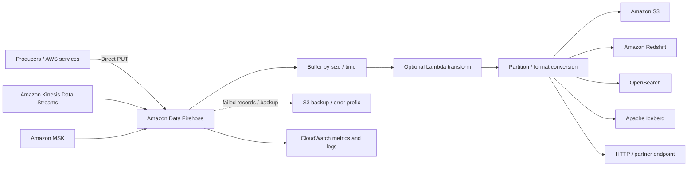

# Amazon Data Firehose và phân phối dữ liệu đến đích

## 1. Vai trò của Amazon Data Firehose

Amazon Data Firehose là dịch vụ được quản lý để thu nhận, đệm, xử lý và phân phối dữ liệu streaming đến đích. Dịch vụ giúp ứng dụng producer gửi record mà không phải tự vận hành fleet consumer, quản lý buffer, ghép file hoặc viết pipeline delivery riêng.

Firehose thường được dùng để đưa log, clickstream, telemetry, audit events và dữ liệu nghiệp vụ đến:

- Amazon S3 để lưu trữ dữ liệu thô, data lake và analytics.
- Amazon Redshift để nạp dữ liệu vào data warehouse.
- Amazon OpenSearch Service hoặc OpenSearch Serverless để tìm kiếm và phân tích log.
- Apache Iceberg Tables để xây dựng bảng dữ liệu dạng lakehouse.
- Các HTTP endpoint và dịch vụ đối tác được hỗ trợ như Splunk, Datadog, Snowflake, New Relic và những nền tảng quan sát khác.

Firehose có thể nhận dữ liệu trực tiếp từ producer, đọc từ Amazon Kinesis Data Streams hoặc Amazon MSK, áp dụng Lambda transformation, chuyển JSON sang Parquet/ORC trong những luồng được hỗ trợ, nén và phân vùng dữ liệu trước khi giao đến đích.

Điểm cốt lõi: Firehose tối ưu cho **managed delivery**. Nó không phải một message broker tổng quát, không thay thế Kinesis Data Streams khi ứng dụng cần tự quản lý consumer, đọc lại record theo sequence hoặc xử lý stream liên tục với logic tùy biến.

## 2. Mục tiêu học tập

Sau bài học, người học có thể:

1. Giải thích vai trò của Firehose trong kiến trúc streaming và data lake.
2. Phân biệt Direct PUT, Kinesis Data Streams và Amazon MSK làm nguồn.
3. Chọn destination phù hợp giữa S3, Redshift, OpenSearch, Iceberg và HTTP endpoints.
4. Thiết kế producer dùng PutRecord/PutRecordBatch có retry và kiểm tra partial failure.
5. Cấu hình buffering, delimiter, compression và S3 object prefix.
6. Dùng dynamic partitioning để tổ chức dữ liệu theo key nghiệp vụ.
7. Tích hợp Lambda để biến đổi record trước khi delivery.
8. Chuyển JSON sang Apache Parquet hoặc ORC bằng AWS Glue Data Catalog.
9. Thiết kế S3 backup, error prefix, retry và recovery.
10. Cấu hình IAM role, KMS encryption, logging và network access.
11. Theo dõi data freshness, delivery success, partition count và processing errors.
12. Tối ưu chi phí, kích thước file và độ trễ phân phối.
13. Xây dựng và kiểm thử delivery stream bằng AWS CLI và lab.

## 3. Firehose trong kiến trúc streaming

Một pipeline điển hình:



Các bước cụ thể phụ thuộc source và destination. Ví dụ, Redshift sử dụng S3 làm staging location rồi chạy COPY; dynamic partitioning và format conversion gắn với S3 destination; một số destination đối tác có buffering và retry riêng.

Firehose tự quản lý việc đệm và giao record, nhưng producer vẫn phải xử lý lỗi khi gửi record vào stream. Ứng dụng cũng cần quan sát destination, vì một stream có trạng thái Active chưa chắc dữ liệu đã đến đích đúng độ trễ mong muốn.

## 4. Các khái niệm quan trọng

| Khái niệm | Ý nghĩa |
|---|---|
| Delivery stream | Tài nguyên Firehose chứa cấu hình source, processing và destination |
| Record | Đơn vị dữ liệu producer gửi vào stream |
| Source | Nơi Firehose nhận record |
| Destination | Nơi Firehose giao record sau khi đệm/xử lý |
| Buffering hint | Ngưỡng kích hoạt delivery theo dung lượng hoặc thời gian |
| Transformation | Thay đổi payload trước khi giao, thường qua Lambda |
| Dynamic partitioning | Phân nhóm record vào các S3 prefix theo key trong dữ liệu |
| Backup | Bản lưu source record hoặc record lỗi tại S3 theo cấu hình |
| Data freshness | Tuổi của record cũ nhất đang chờ giao |
| Delivery error | Lỗi phát sinh khi xử lý hoặc giao dữ liệu đến destination |

Một delivery stream thường có một destination chính. Có thể dùng S3 backup để lưu source data hoặc failed data tùy loại destination và cấu hình. Nếu cần phân phối cùng dữ liệu đến nhiều hệ thống độc lập, cân nhắc producer gửi vào Kinesis Data Streams/EventBridge/SNS trước rồi tạo các nhánh delivery riêng.

## 5. Firehose khác Kinesis Data Streams như thế nào?

Hai dịch vụ có thể kết hợp nhưng giải quyết các bài toán khác nhau.

| Tiêu chí | Amazon Data Firehose | Kinesis Data Streams |
|---|---|---|
| Mục tiêu | Giao dữ liệu đến destination | Thu nhận stream để ứng dụng tự đọc và xử lý |
| Consumer | Firehose quản lý delivery | Ứng dụng quản lý consumer |
| Buffer/retention | Buffer nội bộ theo cơ chế delivery; Direct PUT giữ record tối đa 24 giờ khi đích lỗi | Retention của stream có thể cấu hình theo giới hạn dịch vụ |
| Replay | Không phải stream replay tùy ý; phụ thuộc backup/source | Consumer có thể đọc lại theo sequence/timestamp trong retention |
| Processing | Lambda transform và một số format/partition operations tích hợp | Consumer tự triển khai processing hoặc dùng dịch vụ stream analytics |
| Destination | S3, Redshift, OpenSearch, Iceberg và HTTP endpoints được hỗ trợ | Consumer tự quyết định đích |
| Quản trị | Ít vận hành hơn cho delivery | Linh hoạt hơn, cần quản lý consumer/capacity/checkpoint |

Chọn Firehose khi mục tiêu là đưa record đến storage, warehouse, search hoặc monitoring destination với ít mã vận hành. Chọn Kinesis Data Streams khi cần nhiều consumer độc lập, replay trong retention window, xử lý theo shard/sequence hoặc logic streaming tùy biến.

Một kiến trúc thường gặp là producer ghi vào Kinesis Data Streams, sau đó Firehose đọc stream và giao một bản sang S3 trong khi consumer khác xử lý near-real-time.

## 6. Chọn source cho Firehose stream

Firehose hỗ trợ các nhóm source chính:

### 6.1. Direct PUT

Producer gửi record trực tiếp bằng AWS SDK/API như PutRecord hoặc PutRecordBatch. Nhiều AWS services và agent tích hợp Direct PUT, ví dụ CloudWatch Logs, EventBridge, AWS WAF, API Gateway access logs, AWS IoT, SNS, CloudWatch Metric Streams, Fluent Bit và Fluentd.

Direct PUT phù hợp khi producer đã biết destination stream và cần gửi dữ liệu trực tiếp.

### 6.2. Kinesis Data Streams

Firehose đọc dữ liệu từ một Kinesis Data Stream có sẵn và giao đến destination. Mô hình này tách ingest stream khỏi delivery pipeline, cho phép consumer khác cũng đọc Kinesis Data Streams.

Khi destination lỗi, dữ liệu vẫn phụ thuộc retention của Kinesis Data Streams source. Vì vậy, cần cấu hình retention đủ dài cho thời gian khôi phục và giám sát iterator/read lag.

### 6.3. Amazon MSK

Firehose có thể đọc từ Amazon MSK cluster để phân phối dữ liệu đến S3 theo cấu hình source/destination được hỗ trợ. Đây là lựa chọn khi tổ chức đã dùng Kafka/MSK và muốn giảm công sức xây dựng consumer ghi dữ liệu xuống S3.

Kiểm tra source/destination compatibility, topic, consumer permissions, network access và throughput quotas trước khi tạo stream. Không giả định mọi tổ hợp source đều hỗ trợ mọi destination.

## 7. Chọn destination

| Destination | Mục tiêu | Điểm cần thiết kế |
|---|---|---|
| Amazon S3 | Data lake, archive, raw/curated files | Prefix, file size, compression, partitioning, format |
| Amazon Redshift | Data warehouse | S3 staging, COPY command, schema, retry |
| OpenSearch Service | Search và log analytics | Bulk indexing, mapping, capacity, index strategy |
| OpenSearch Serverless | Search không quản lý cluster | Collection, access policy, capacity và index |
| Apache Iceberg Tables | Lakehouse tables | Catalog, table schema, S3 storage và compatibility |
| HTTP endpoint | Gửi dữ liệu đến hệ thống ngoài AWS | Request/response contract, authentication, retry |
| Partner destination | Monitoring/observability/SaaS | API key, format, rate limit và backup |

Danh sách destination được hỗ trợ có thể mở rộng và khác nhau theo Region, source, tính năng và thời điểm. Kiểm tra tài liệu hiện hành trước khi chọn kiến trúc production.

## 8. Thiết kế delivery stream

Trước khi tạo stream, xác định:

- Source và destination.
- Region và account owner.
- Tên stream, naming convention và tags.
- IAM service role.
- Buffer size và buffer interval.
- Processing Lambda nếu cần.
- Compression, data format và partitioning.
- S3 backup/error bucket.
- CloudWatch log group và alarms.
- KMS key và network access.
- Expected throughput, latency và retention.

Đặt tên stream theo domain và mục đích, ví dụ **orders-to-s3-raw**, **edge-logs-to-opensearch** hoặc **device-telemetry-to-lake**. Dùng tags như Environment, Owner, CostCenter, DataDomain để phân bổ chi phí.

Delivery stream có lifecycle riêng: sau khi tạo, chờ trạng thái Active trước khi producer gửi record. Khi thay đổi destination hoặc processing configuration, xem xét tác động tới buffering, file format, prefix và downstream consumer.

## 9. Producer: PutRecord và PutRecordBatch

### 9.1. PutRecord

PutRecord gửi một record vào delivery stream. Producer cần xử lý exception, timeout và retry có backoff.

### 9.2. PutRecordBatch

PutRecordBatch gửi nhiều record trong một request để giảm API overhead. Mỗi batch tối đa 500 records hoặc 4 MB tổng payload, tùy điều kiện nào đến trước; mỗi record có giới hạn 1,000 KB trước base64 encoding.

API có thể trả HTTP success nhưng vẫn có record thất bại. Luôn kiểm tra **FailedPutCount** và từng phần tử trong **RequestResponses**. Chỉ retry record thất bại thay vì gửi lại toàn bộ batch khi đã biết kết quả từng record.

Nếu timeout hoặc internal error khiến producer không biết request đã được xử lý hay chưa, retry có thể tạo duplicate. Gắn eventId/business ID vào record và xử lý deduplication ở destination khi nghiệp vụ yêu cầu.

### 9.3. Ví dụ record JSON

```json
{
  "eventId": "evt-20261120-0001",
  "eventType": "DeviceTelemetry",
  "occurredAt": "2026-11-20T06:30:00Z",
  "tenantId": "tenant-42",
  "deviceId": "device-1008",
  "region": "ap-southeast-1",
  "temperatureC": 28.4,
  "humidityPct": 72.1
}
```

Firehose lưu data blob; nó không tự hiểu schema JSON trong mọi cấu hình. Nếu muốn deaggregation, dynamic partitioning hoặc format conversion, record phải đúng định dạng và cấu hình tương ứng.

## 10. Record aggregation và deaggregation

Producer có thể gom nhiều logical records thành một Firehose record để giảm API calls. Khi làm vậy, cần bảo đảm Firehose có thể tách record trước khi transform/partition.

Các lựa chọn deaggregation gồm:

- JSON deaggregation: tách các JSON objects theo định dạng hỗ trợ.
- Delimiter deaggregation: tách theo ký tự phân cách như newline.
- KPL aggregation: Firehose có thể deaggregate record được đóng gói theo Kinesis Producer Library khi cấu hình phù hợp.

Thứ tự processing pipeline có thể gồm KPL deaggregation, JSON/delimiter deaggregation, Lambda processing, dynamic partitioning, format conversion và S3 delivery. Kiểm tra thứ tự xử lý vì Lambda có thể nhận logical records sau bước deaggregation.

Không gửi một chuỗi JSON array rồi mặc định Firehose sẽ tách thành nhiều record. Chọn deaggregation mode rõ ràng và thử với payload thực tế.

## 11. Buffering: cân bằng độ trễ và kích thước object

Firehose đệm record trước khi giao đến destination. Buffering hint gồm:

- Buffer size: dung lượng cần tích lũy.
- Buffer interval: thời gian tối đa chờ trước khi giao.

Khi một trong hai ngưỡng đạt tới, Firehose có thể flush buffer. Giá trị hợp lệ và mặc định phụ thuộc destination/processing configuration; kiểm tra tài liệu của destination thay vì dùng một giá trị mặc định cho mọi stream.

### 11.1. Buffer lớn

Ưu điểm: tạo object lớn hơn, giảm số request/object nhỏ và có thể giảm chi phí downstream scan/metadata.

Nhược điểm: tăng data freshness latency, chậm hơn khi dữ liệu cần xuất hiện ở destination; nếu volume thấp, phải chờ interval mới flush.

### 11.2. Buffer nhỏ

Ưu điểm: giảm thời gian chờ, phù hợp log/alert cần xuất hiện nhanh.

Nhược điểm: nhiều object nhỏ, tăng request/metadata overhead và query engine có thể tốn chi phí lập kế hoạch/mở file.

Zero buffering chỉ được hỗ trợ cho một số application destinations; không áp dụng cho S3 backup và không khả dụng khi dynamic partitioning được bật. Chọn buffer theo SLA freshness và downstream workload.

## 12. Giao dữ liệu đến Amazon S3

S3 là destination phổ biến nhất cho data lake và archival.

Firehose gom nhiều record thành một S3 object theo buffering configuration. Mặc định, các record được nối liền mà không tự thêm delimiter. Nếu consumer mong đợi JSON Lines, bật newline delimiter hoặc producer tự thêm delimiter theo format thống nhất.

Một object key có thể chứa custom prefix, time prefix theo UTC hoặc timezone cấu hình, stream name/version, timestamp và UUID, file extension theo compression/format.

Ví dụ prefix:

```text
raw/telemetry/year=!{timestamp:yyyy}/month=!{timestamp:MM}/day=!{timestamp:dd}/
```

S3 prefix chỉ là key naming convention, không phải thư mục vật lý. Dùng prefix nhất quán để Athena, Glue và lifecycle policies dễ quản lý.

### 12.1. Chọn file format

- JSON Lines: dễ debug và linh hoạt schema.
- GZIP JSON: giảm storage/network nhưng không phải columnar.
- Parquet: columnar, nén tốt, phù hợp Athena/EMR/Redshift Spectrum.
- ORC: columnar, phù hợp hệ sinh thái Hadoop/Hive.

Không nén file nhỏ quá mức hoặc tạo quá nhiều file nhỏ. Mục tiêu là cân bằng freshness, file size và hiệu quả query.

## 13. Dynamic partitioning cho S3

Dynamic partitioning chia record vào các S3 prefixes dựa trên key trong dữ liệu, ví dụ tenant, region, event type hoặc ngày nghiệp vụ.

Ví dụ prefix:

```text
lake/region=!{partitionKeyFromQuery:region}/event_type=!{partitionKeyFromQuery:eventType}/year=!{timestamp:yyyy}/month=!{timestamp:MM}/day=!{timestamp:dd}/
```

Các bước:

1. Chọn key có cardinality và phân bố phù hợp.
2. Trích xuất key bằng inline parsing hoặc Lambda.
3. Dùng key trong S3 prefix expression.
4. Theo dõi số active partitions.
5. Kiểm tra error prefix khi vượt quota hoặc key không hợp lệ.

Dynamic partitioning chỉ hỗ trợ S3 destination. Phải bật khi tạo stream mới; stream đã tạo mà chưa bật thì không thể bật bổ sung. Khi đã bật, không thể disable trên stream đó, dù có thể thay đổi partition keys và prefix expressions.

### 13.1. Tránh high-cardinality partition

Không partition theo requestId, transactionId hoặc timestamp tới mili giây nếu mỗi giá trị tạo một prefix riêng. Điều này tạo quá nhiều active partitions và object nhỏ.

Quota mặc định là 500 active partitions cho mỗi Firehose stream. Khi vượt giới hạn, record mới được chuyển tới S3 error prefix với loại lỗi activePartitionExceeded. Có thể yêu cầu tăng quota tối đa 2.500 active partitions theo giới hạn AWS hỗ trợ hoặc chia workload thành nhiều streams.

### 13.2. Buffering theo partition

Mỗi partition có buffer riêng. Nếu tạo nhiều partition nhưng mỗi partition ít dữ liệu, buffer chờ lâu mới đạt size threshold và tạo nhiều object nhỏ. Với dynamic partitioning, end-to-end delay có thể lên tới khoảng 1,5 lần buffering interval đã cấu hình do cơ chế multi-stage buffering.

Thiết kế key theo query pattern thực tế của Athena/Redshift Spectrum. Không partition quá sâu chỉ vì muốn prefix trông chi tiết.

## 14. Lambda transformation

Firehose có thể gọi Lambda đồng bộ theo batch để biến đổi record trước khi giao destination.

Các use case:

- Chuẩn hóa field và timestamp.
- Mask hoặc loại bỏ PII.
- Enrich record bằng lookup nhẹ.
- Parse log thành JSON có schema.
- Thêm partition keys.
- Đổi format đầu vào thành JSON trước format conversion.

Lambda transformation có buffer riêng. Kích thước và interval được cấu hình theo giới hạn Firehose; request/response đồng bộ của Lambda có giới hạn payload 6 MB và function timeout tối đa 5 phút. Thiết kế function ngắn, có khả năng xử lý batch và không phụ thuộc tác vụ dài.

### 14.1. Kết quả xử lý record

Lambda trả kết quả theo record ID với trạng thái như:

- **Ok:** record đã được xử lý thành công.
- **Dropped:** record được chủ động loại bỏ.
- **ProcessingFailed:** xử lý thất bại.

Không trả cấu trúc tùy ý. Response phải đúng schema Firehose yêu cầu và payload data phải được base64 encode theo contract.

### 14.2. Error handling

Khi Lambda timeout, exception hoặc trả response sai cấu trúc, Firehose ghi nhận processing failure. Cấu hình S3 backup/error output để bảo toàn record lỗi và theo dõi các metric ExecuteProcessing.Success, ExecuteProcessing.Duration, SucceedProcessing.Records cùng CloudWatch logs.

Không dùng Lambda để thay thế một ETL engine lớn hoặc xử lý hàng giờ. Với transformation phức tạp, đưa dữ liệu raw xuống S3 rồi dùng Glue/EMR/Step Functions phù hợp hơn.

## 15. Chuyển JSON sang Parquet hoặc ORC

Firehose hỗ trợ chuyển JSON sang Apache Parquet hoặc ORC trước khi lưu vào S3. Tính năng này cần:

1. JSON input có cấu trúc tương thích.
2. Deserializer để đọc JSON.
3. AWS Glue Data Catalog table mô tả schema.
4. Serializer để ghi Parquet hoặc ORC.
5. IAM permissions để Firehose đọc Glue schema và ghi S3.

Nếu input là CSV hoặc text có cấu trúc khác, dùng Lambda transformation để chuẩn hóa thành JSON trước khi format conversion.

### 15.1. Schema evolution

Glue table và record payload cần tương thích. Khi producer thêm field, đổi type hoặc đổi tên field, format conversion có thể thất bại nếu schema không được cập nhật tương ứng.

Dùng schema version, backward-compatible changes và kiểm thử trên sample records trước khi thay đổi production. Dữ liệu không chuyển đổi được cần có error output prefix và quy trình xử lý.

### 15.2. Khi nào chọn Parquet?

Parquet phù hợp với phân tích theo cột, giảm lượng dữ liệu scan và thường cải thiện hiệu quả truy vấn Athena. Nhưng Parquet yêu cầu schema rõ hơn JSON Lines. Nếu dữ liệu biến đổi mạnh hoặc cần debug raw payload, lưu raw JSON song song hoặc duy trì source backup.

## 16. Destination Amazon Redshift

Firehose không ghi từng record trực tiếp vào bảng Redshift. Quy trình là:

1. Firehose buffer records.
2. Ghi dữ liệu vào S3 intermediate bucket.
3. Gửi lệnh Redshift COPY để nạp object từ S3 vào table.
4. Giữ lại object staging trong S3; Firehose không tự xóa sau khi COPY.
5. Dùng S3 lifecycle policy để quản lý retention của staging objects.

Cần cấu hình database, table, columns, COPY options, IAM role và credential phù hợp. Có thể dùng Secrets Manager để quản lý credential theo tính năng destination hỗ trợ.

Retry duration cho COPY failure có giới hạn cấu hình. Khi hết retry, cần theo dõi lỗi và xử lý theo backup/recovery policy. Chú ý định dạng, compression và Region của S3 staging bucket; COPY options phải khớp dữ liệu thực tế.

## 17. Destination OpenSearch

Firehose buffer records rồi tạo bulk request để index nhiều document vào OpenSearch Service hoặc OpenSearch Serverless.

Thiết kế cần quan tâm:

- Record phải là UTF-8 và thường là một JSON object trên một dòng.
- Index name và document ID strategy.
- Mapping và field types.
- Bulk request size và indexing throughput.
- Shard/replica strategy của OpenSearch domain.
- Retry, failed document và S3 backup.
- IAM/resource policy và network access.

Nếu OpenSearch không đủ capacity, Firehose có thể bị backlog và data freshness tăng. Scale destination, điều chỉnh buffering/concurrency phù hợp và theo dõi rejected requests. Không giải quyết backlog bằng cách tăng producer rate.

## 18. HTTP endpoints và partner destinations

Firehose hỗ trợ generic HTTP endpoint và các partner destinations được liệt kê trong tài liệu. Một endpoint cần đáp ứng request/response contract của Firehose và trả acknowledgment theo định dạng được hỗ trợ.

Cần cấu hình endpoint URL và authentication/API key, content encoding, request format và Lambda transformation, acknowledgment timeout, retry duration, S3 backup, rate limit và capacity phía đối tác.

Nếu endpoint không trả acknowledgment đúng hoặc timeout, Firehose retry theo policy. Retry có thể gửi lại batch đã được endpoint xử lý nhưng acknowledgment bị mất; endpoint nên dùng request ID/idempotency để chống duplicate.

Hiện tại Firehose không hỗ trợ delivery đến HTTP endpoint nằm trong VPC. Với destination riêng trong VPC, kiểm tra loại destination được hỗ trợ và network model trước khi chọn kiến trúc.

## 19. Destination Apache Iceberg Tables

Firehose hỗ trợ giao streaming data vào Apache Iceberg Tables trong Amazon S3 hoặc Amazon S3 Tables ở các Region được hỗ trợ. Iceberg giúp quản lý bảng trên object storage với schema, metadata và snapshot semantics cho lakehouse.

Một stream có thể route record đến các Iceberg tables khác nhau. Firehose hỗ trợ thao tác insert, update và delete; insert là mặc định. Update/delete cần unique keys để xác định row. Với Iceberg, Firehose ghi Parquet và hỗ trợ table format V2 cùng Merge-on-Read trong phạm vi được tài liệu hóa. Cần xác định S3 warehouse/table bucket, Glue Data Catalog, database/table names, schema, unique keys, partition spec, IAM/KMS permissions và error handling.

Iceberg destination có yêu cầu và giới hạn riêng so với S3 raw object delivery. Ví dụ, Direct PUT throughput quota khác nhau theo Region; Amazon MSK Serverless source hiện không được hỗ trợ cho Iceberg destination; nhiều stream ghi đồng thời vào cùng một table có thể xung đột optimistic concurrency control. Kiểm tra source/destination compatibility, loại operation, schema behavior và Region support trước khi đưa vào production. Không giả định mọi tính năng S3 như dynamic partitioning có thể kết hợp y nguyên với Iceberg destination.

## 20. Backup, error prefix và recovery

Firehose có thể dùng S3 để backup source records hoặc failed records tùy destination và source. Backup settings được hỗ trợ cho các source phù hợp như Direct PUT và Kinesis Data Streams; cấu hình cụ thể phụ thuộc destination. Ví dụ, với S3 destination, backup settings bổ sung áp dụng khi bật Lambda transformation hoặc format conversion; với Redshift, khi bật Lambda transformation. Các destination ứng dụng khác có danh sách backup support riêng.

Phân biệt:

- **Source record backup:** lưu dữ liệu đầu vào để có thể xử lý lại hoặc audit.
- **Failed data backup:** lưu record được xác định là lỗi theo backup mode và behavior của destination. Không đồng nghĩa mọi delivery failure lập tức được ghi vào error prefix; nhiều lỗi delivery được retry trước, còn processing/format-conversion failures có thể được ghi vào error output prefix.
- **Error output prefix:** phân loại record lỗi như processing-failed, format-conversion-failed hoặc destination-failed.

S3 backup không thay thế backup database hoặc retention policy của data lake. Đặt lifecycle, encryption, access control và retention riêng. Với S3 là destination chính, Firehose tiếp tục retry lỗi ghi S3 trong thời gian retention; lỗi Lambda processing hoặc Parquet conversion có thể được ghi vào error prefix. Với destination khác, đọc đúng retry duration và backup mode của destination đó.

Khi cần replay:

1. Xác định prefix, loại lỗi và thời gian.
2. Đọc error metadata và source record.
3. Sửa schema, IAM, endpoint hoặc destination capacity.
4. Chọn phạm vi record cần xử lý lại.
5. Dùng producer/replay job để gửi lại vào stream phù hợp.
6. Dedupe theo event ID nếu side effect hoặc destination có thể nhận duplicate.
7. Ghi nhận số record phục hồi và record vẫn lỗi.

Không tự động redrive toàn bộ error bucket khi nguyên nhân chưa được khắc phục.

## 21. Retry, retention và delivery semantics

### 21.1. Retention khi destination lỗi

Với Direct PUT source, Firehose giữ record tối đa 24 giờ trong khi thử giao đến destination. Nếu destination không phục hồi trong khoảng này, dữ liệu có thể bị mất khỏi buffer nội bộ.

Với Kinesis Data Streams source, dữ liệu có thể được đọc lại theo retention của Kinesis stream. Với Amazon MSK source, cần đánh giá retention của topic và consumer offset/lag theo cấu hình tích hợp.

Do đó, không coi Firehose là durable archive vô thời hạn. Nếu yêu cầu khôi phục dài ngày, lưu source ở Kinesis/MSK hoặc S3 backup/landing zone phù hợp.

### 21.2. Delivery retry

Retry behavior phụ thuộc destination. Một số destination có retry duration cấu hình; S3 delivery retry tối đa 24 giờ cho Direct PUT source và theo retention của Kinesis/MSK source khi dùng các source này. Destination Redshift/OpenSearch có giới hạn retry riêng.

Khi retry duration hết, Firehose xử lý theo destination backup/error configuration. Đọc kỹ từng destination's retry semantics trước khi đặt RTO/RPO.

### 21.3. Duplicate records

Firehose delivery thường dùng at-least-once semantics. Retry sau timeout có thể tạo duplicate ở một số destination. Tài liệu nêu các ngoại lệ delivery semantics cho S3, Apache Iceberg Tables và Snowflake, nhưng producer API retry vẫn có thể gửi duplicate record nếu kết quả request không rõ.

Đối với nghiệp vụ cần deduplication:

- Gắn eventId duy nhất.
- Dùng document ID ổn định ở OpenSearch nếu phù hợp.
- Dùng unique key/merge logic ở warehouse hoặc downstream.
- Kiểm tra duplicate trước khi aggregate.
- Theo dõi số lần producer retry và FailedPutCount.

Không dựa vào RecordId do Firehose trả về như business idempotency key xuyên toàn pipeline.

## 22. IAM, encryption và network security

### 22.1. Firehose service role

Firehose cần IAM role để truy cập các tài nguyên theo cấu hình:

- Đọc từ Kinesis Data Streams hoặc Amazon MSK nếu dùng làm source.
- Invoke Lambda transformation.
- Ghi S3 destination/backup.
- Đọc Glue Data Catalog cho format conversion.
- Ghi vào Redshift/OpenSearch theo destination.
- Dùng KMS key để encrypt/decrypt khi cần.
- Ghi CloudWatch Logs.

Role trust policy cần cho phép dịch vụ Firehose assume role. Chỉ cấp actions và resource ARN cần thiết; tránh wildcard cho toàn bộ bucket, stream, key hoặc Lambda nếu có thể giới hạn.

### 22.2. Encryption

- Dùng TLS cho producer và delivery path có hỗ trợ.
- Bật server-side encryption cho Firehose stream theo yêu cầu.
- Dùng SSE-S3 hoặc SSE-KMS cho S3 destination.
- Cấp KMS key permissions cho Firehose role.
- Bảo vệ backup/error bucket giống dữ liệu chính.
- Không ghi secret, access token hoặc dữ liệu nhạy cảm không cần thiết vào record.

### 22.3. Network

Với destination nằm trong VPC và được Firehose hỗ trợ, cấu hình VPC delivery với subnet và security group phù hợp. Cần kiểm tra route, endpoint, DNS và network interface.

Không suy ra rằng mọi destination đều hỗ trợ private VPC delivery. HTTP endpoints do partner sở hữu hiện không hỗ trợ delivery vào endpoint nằm trong VPC.

## 23. Monitoring bằng CloudWatch

Firehose phát metrics trong namespace AWS/Firehose, thường theo chu kỳ một phút. Burst chỉ kéo dài vài giây có thể không xuất hiện rõ trong metric một phút.

### 23.1. Ingestion metrics

- IncomingBytes
- IncomingRecords
- ThrottledRecords
- DataReadFromKinesisStream.Bytes
- DataReadFromKinesisStream.Records

Dùng để xác định producer có gửi dữ liệu hay stream có đọc được source hay không.

### 23.2. Delivery metrics

- DeliveryToS3.Success
- DeliveryToS3.Bytes
- DeliveryToS3.Records
- DeliveryToS3.DataFreshness
- DeliveryToRedshift.Success
- DeliveryToAmazonOpenSearchService.Success
- BackupToS3.Success

DataFreshness tăng liên tục thường là dấu hiệu delivery chậm hoặc destination không theo kịp. Một metric Success giảm nhẹ trong lúc retry không nhất thiết là data loss; cần xem freshness, backup và error logs cùng nhau.

### 23.3. Processing và partition metrics

- ExecuteProcessing.Success
- ExecuteProcessing.Duration
- SucceedProcessing.Records
- SucceedProcessing.Bytes
- PartitionCount
- PartitionCountExceeded
- ActivePartitionsLimit
- PerPartitionThroughput

Đặt alarm cho delivery failures, data freshness, throttling, partition limit và S3 backup/error prefix growth. Firehose dùng S3 backup/error output thay vì một DLQ queue tích hợp như SQS. Alarm cần gắn với runbook và owner.

## 24. Troubleshooting thường gặp

| Triệu chứng | Nguyên nhân có thể | Hướng xử lý |
|---|---|---|
| Không có record ở destination | Producer chưa gửi, stream chưa Active hoặc source permission lỗi | Kiểm tra IncomingRecords/Bytes, stream status và IAM |
| S3 không nhận object | Bucket/prefix sai, role thiếu quyền, KMS deny hoặc S3 error | Kiểm tra CloudWatch logs, bucket policy, KMS policy |
| Data freshness tăng | Destination chậm, retry hoặc capacity thiếu | Kiểm tra destination health, retry metrics và throughput |
| Record vào error prefix | Lambda processing, format conversion hoặc dynamic partition failure | Đọc error type, sample record và schema |
| OpenSearch reject document | Mapping sai, JSON không hợp lệ hoặc domain thiếu capacity | Kiểm tra bulk error, mapping và domain metrics |
| Redshift không load | COPY options, credential, table/schema hoặc staging access lỗi | Kiểm tra COPY error, S3 staging và IAM |
| Active partition exceeded | Key cardinality quá cao hoặc buffer quá lâu | Giảm cardinality, điều chỉnh prefix/stream split và quota |
| PutRecordBatch có lỗi | Partial failure hoặc throughput limit | Đọc FailedPutCount/RequestResponses và retry record lỗi |
| Dữ liệu thiếu delimiter | Firehose nối record mà không thêm newline | Bật newline delimiter hoặc thêm delimiter ở producer |
| Nhiều file nhỏ | Buffer nhỏ hoặc nhiều partition ít record | Tăng buffer, giảm partition cardinality hoặc compact downstream |

Khi điều tra, đối chiếu cùng timestamp giữa producer logs, Firehose CloudWatch metrics/logs và destination logs. Một stream có IncomingRecords tăng nhưng Delivery metrics đứng yên thường cần kiểm tra buffering, processing và destination errors.

## 25. Thiết kế S3 prefix và data lake hiệu quả

Với data lake, prefix cần phục vụ cả query pattern lẫn chi phí vận hành.

Ví dụ dữ liệu IoT:

```text
s3://company-data-lake/
  raw/iot/
    region=ap-southeast-1/
      event_type=temperature/
        year=2026/month=11/day=20/
```

Nguyên tắc:

- Partition theo field thường xuất hiện trong filter query.
- Ưu tiên partition theo thời gian và domain/region có cardinality vừa phải.
- Tránh partition theo ID duy nhất của record.
- Dùng Parquet/ORC khi query phân tích theo cột.
- Chọn compression tương thích engine downstream.
- Bật newline delimiter nếu dùng JSON Lines.
- Có lifecycle cho raw, backup và error prefixes.
- Duy trì raw immutable khi cần audit/reprocessing.
- Dùng Glue Catalog để quản lý schema và Athena table.

Không partition quá nhiều cấp. Một bảng có hàng triệu partition nhỏ sẽ làm metadata và query planning trở nên đắt đỏ.

## 26. Chi phí và tối ưu

Chi phí Firehose phụ thuộc Region, lượng dữ liệu ingest, destination, format conversion và các tính năng bổ sung theo pricing hiện hành. Ngoài Firehose, cần tính:

- S3 storage, PUT requests và lifecycle transitions.
- KMS requests.
- Lambda invocation và duration.
- CloudWatch Logs ingestion/storage.
- Kinesis Data Streams hoặc MSK source.
- Redshift/OpenSearch destination capacity.
- Data transfer và cross-Region traffic.
- Athena/EMR query scan và downstream compaction.

Tối ưu bằng cách:

- Dùng PutRecordBatch để giảm request overhead.
- Chọn buffer phù hợp để tránh object quá nhỏ.
- Dùng Parquet/ORC cho analytical queries.
- Chọn dynamic partition keys có cardinality vừa phải.
- Tránh transformation Lambda không cần thiết.
- Dùng lifecycle cho staging/backup/error data.
- Scale destination trước khi backlog tăng.
- Theo dõi cost per GB delivered và cost per query/use case.

Không tăng buffer quá lớn nếu yêu cầu freshness tính bằng giây. Không giảm buffer quá thấp nếu downstream tốn chi phí vì hàng triệu object nhỏ.

## 27. AWS CLI: tạo và kiểm tra Firehose stream

Các lệnh dưới đây là ví dụ. Thay account ID, role ARN, bucket và Region bằng giá trị của lab. Role phải có trust policy và permissions phù hợp.

### 27.1. Tạo Direct PUT stream giao đến S3

```bash
aws firehose create-delivery-stream \
  --delivery-stream-name telemetry-to-s3 \
  --delivery-stream-type DirectPut \
  --extended-s3-destination-configuration '{
    "RoleARN": "arn:aws:iam::111122223333:role/FirehoseDeliveryRole",
    "BucketARN": "arn:aws:s3:::company-data-lake",
    "Prefix": "raw/telemetry/!{timestamp:yyyy/MM/dd/HH}/",
    "ErrorOutputPrefix": "errors/!{firehose:error-output-type}/!{timestamp:yyyy/MM/dd/}",
    "BufferingHints": {
      "SizeInMBs": 5,
      "IntervalInSeconds": 300
    },
    "CompressionFormat": "GZIP",
    "CloudWatchLoggingOptions": {
      "Enabled": true,
      "LogGroupName": "/aws/kinesisfirehose/telemetry-to-s3",
      "LogStreamName": "S3Delivery"
    }
  }' \
  --region ap-southeast-1
```

### 27.2. Kiểm tra trạng thái stream

```bash
aws firehose describe-delivery-stream \
  --delivery-stream-name telemetry-to-s3 \
  --region ap-southeast-1 \
  --query "DeliveryStreamDescription.{Name:DeliveryStreamName,Status:DeliveryStreamStatus,Type:DeliveryStreamType,Version:VersionId}"
```

Chỉ gửi record khi stream ở trạng thái Active.

### 27.3. Gửi một record

AWS CLI nhận blob data theo định dạng base64. Ví dụ trên Linux/macOS:

```bash
RECORD_B64=$(printf '%s' '{"eventId":"evt-1001","eventType":"temperature","deviceId":"dev-01","value":28.4}' | base64 | tr -d '\n')

aws firehose put-record \
  --delivery-stream-name telemetry-to-s3 \
  --record "Data=$RECORD_B64" \
  --region ap-southeast-1
```

### 27.4. Kiểm tra stream và metric

```bash
aws firehose list-delivery-streams \
  --delivery-stream-type DirectPut \
  --region ap-southeast-1

aws cloudwatch get-metric-statistics \
  --namespace AWS/Firehose \
  --metric-name IncomingRecords \
  --dimensions Name=DeliveryStreamName,Value=telemetry-to-s3 \
  --start-time 2026-11-20T00:00:00Z \
  --end-time 2026-11-20T01:00:00Z \
  --period 60 \
  --statistics Sum \
  --region ap-southeast-1
```

CloudWatch metrics có độ trễ publish và được aggregate theo period; không dùng một datapoint đơn lẻ để kết luận mất dữ liệu.

## 28. Bài thực hành: xây dựng streaming delivery đến S3

### 28.1. Mục tiêu

Tạo một Direct PUT Firehose stream nhận telemetry JSON, buffer và ghi thành S3 objects. Sau đó kiểm tra compression, prefix, CloudWatch metrics và error handling.

### 28.2. Điều kiện chuẩn bị

- AWS account lab.
- Một S3 bucket riêng cho raw data và error prefix.
- IAM role cho Firehose.
- CloudWatch log group.
- AWS CLI đã cấu hình quyền.
- Producer có thể gửi JSON records.

### 28.3. Các bước

1. Tạo S3 bucket và prefix raw/error.
2. Tạo IAM role với trust policy cho Firehose.
3. Cấp quyền PutObject vào các prefix cần thiết và KMS nếu dùng SSE-KMS.
4. Tạo Direct PUT delivery stream theo ví dụ CLI.
5. Chờ trạng thái Active.
6. Gửi nhiều telemetry records bằng PutRecord/PutRecordBatch.
7. Kiểm tra FailedPutCount và từng record response.
8. Đợi buffer flush rồi kiểm tra S3 object.
9. Xác minh object prefix theo thời gian UTC và compression.
10. Kiểm tra newline delimiter hoặc định dạng payload đã chọn.
11. Xem IncomingRecords, DeliveryToS3.Success và DeliveryToS3.DataFreshness.
12. Thử cấu hình sai quyền S3 trong môi trường lab để quan sát delivery failure, sau đó khôi phục quyền.
13. Nếu dùng Lambda transformation, kiểm tra processing success/failure và error prefix.
14. Dọn tài nguyên lab hoặc đặt lifecycle để kiểm soát chi phí.

### 28.4. Tiêu chí hoàn thành

- Delivery stream ở trạng thái Active.
- Producer gửi record thành công và xử lý partial failures.
- Record được giao đến đúng S3 bucket/prefix.
- Object format, delimiter và compression được xác minh.
- CloudWatch metrics phản ánh ingestion và delivery.
- IAM role chỉ có quyền cần thiết.
- Có cách phát hiện và khôi phục delivery failure.
- Chi phí lưu trữ và object size được đánh giá.

## 29. Câu hỏi tự kiểm tra

### Câu 1

Amazon Data Firehose giải quyết bài toán gì?

**Đáp án:** Dịch vụ được quản lý để thu nhận, buffer, xử lý và phân phối streaming records đến S3, Redshift, OpenSearch, Iceberg hoặc HTTP/partner destinations được hỗ trợ.

### Câu 2

Firehose khác Kinesis Data Streams thế nào?

**Đáp án:** Firehose tập trung vào managed delivery; Kinesis Data Streams cung cấp stream để ứng dụng tự quản lý consumer, sequence/checkpoint và replay trong retention.

### Câu 3

Direct PUT và Kinesis Data Streams source khác nhau ở đâu?

**Đáp án:** Direct PUT producer gửi thẳng record vào Firehose; Kinesis source để Firehose đọc từ một stream có sẵn, và khả năng giữ dữ liệu khi destination lỗi phụ thuộc retention của Kinesis.

### Câu 4

Vì sao phải kiểm tra FailedPutCount sau PutRecordBatch?

**Đáp án:** HTTP/API call có thể thành công nhưng một số record trong batch vẫn thất bại. Producer cần retry riêng các record lỗi.

### Câu 5

Buffering size và interval ảnh hưởng điều gì?

**Đáp án:** Chúng cân bằng data freshness với kích thước object và số lần delivery. Buffer nhỏ giảm latency nhưng tăng số object; buffer lớn giảm object count nhưng tăng độ trễ.

### Câu 6

Dynamic partitioning có thể bật cho một stream S3 đang tồn tại chưa bật tính năng này không?

**Đáp án:** Không. Dynamic partitioning phải được bật khi tạo stream; sau đó không thể disable trên stream đó.

### Câu 7

Vì sao không nên partition theo requestId?

**Đáp án:** Request ID có cardinality rất cao, tạo nhiều active partitions và object nhỏ, có thể vượt quota partition.

### Câu 8

Firehose format conversion hỗ trợ chuyển đổi gì?

**Đáp án:** Chuyển JSON sang Apache Parquet hoặc ORC trong S3 destination, cần deserializer, serializer và schema từ AWS Glue Data Catalog.

### Câu 9

Firehose giao dữ liệu đến Redshift theo cách nào?

**Đáp án:** Firehose ghi dữ liệu vào S3 staging bucket rồi chạy lệnh Redshift COPY để nạp vào table.

### Câu 10

Khi Direct PUT destination lỗi quá 24 giờ, điều gì có thể xảy ra?

**Đáp án:** Firehose giữ record tối đa 24 giờ; nếu destination không phục hồi trong khoảng đó, dữ liệu trong buffer nội bộ có thể không còn khả dụng. Cần backup/retention bên ngoài phù hợp.

### Câu 11

DeliveryToS3.DataFreshness tăng liên tục thường gợi ý điều gì?

**Đáp án:** Record cũ nhất đang chờ giao ngày càng lâu, có thể do destination chậm, retry hoặc capacity không đủ.

### Câu 12

Tại sao cần S3 backup/error prefix dù Firehose tự retry?

**Đáp án:** Retry có giới hạn hoặc có thể gặp lỗi processing/format conversion. Backup/error prefix giữ record để điều tra và phục hồi theo quy trình.

## 30. Checklist production

### Source và producer

- [ ] Source được chọn theo ingest architecture.
- [ ] Source/destination compatibility được xác nhận.
- [ ] Producer có retry với exponential backoff và jitter.
- [ ] PutRecordBatch kiểm tra FailedPutCount và từng response.
- [ ] Record có eventId/business key để deduplicate khi cần.
- [ ] Record size và batch size nằm trong quotas.

### Buffer và processing

- [ ] Buffer size/interval đáp ứng freshness và object-size target.
- [ ] Delimiter phù hợp downstream parser.
- [ ] Compression được chọn theo destination/consumer.
- [ ] Lambda transformation có timeout, payload và error handling phù hợp.
- [ ] Format conversion dùng schema Glue tương thích.
- [ ] Dynamic partitioning được bật ngay từ lúc tạo nếu cần.
- [ ] Partition cardinality và active partition quota được theo dõi.

### Destination và backup

- [ ] S3 prefix, lifecycle và retention được thiết kế.
- [ ] Redshift staging bucket và COPY options đã kiểm thử.
- [ ] OpenSearch mapping/capacity đã kiểm thử.
- [ ] HTTP endpoint acknowledgment/retry contract được xác nhận.
- [ ] Iceberg catalog/schema compatibility được xác nhận.
- [ ] Backup source/failed data và error prefix đã cấu hình phù hợp.
- [ ] Có quy trình replay/recovery và deduplication.

### Security và monitoring

- [ ] Firehose role theo least privilege.
- [ ] KMS key policy cho source, destination và backup.
- [ ] TLS và destination network access được kiểm soát.
- [ ] CloudWatch logs và destination metrics được bật.
- [ ] Alarm cho data freshness, delivery failures, throttling và partition limit.
- [ ] Có runbook xử lý IAM, KMS, destination capacity và schema errors.
- [ ] Cost Explorer/Data Exports được dùng để phân tích chi phí.

## 31. Tài liệu tham khảo chính thức

### Amazon Data Firehose fundamentals

- [What is Amazon Data Firehose?](https://docs.aws.amazon.com/firehose/latest/dev/what-is-this-service.html)
- [Choose source and destination](https://docs.aws.amazon.com/firehose/latest/dev/create-name.html)
- [Understand data delivery](https://docs.aws.amazon.com/firehose/latest/dev/basic-deliver.html)
- [Amazon Data Firehose quotas](https://docs.aws.amazon.com/firehose/latest/dev/limits.html)

### Producer, buffering và processing

- [PutRecord API](https://docs.aws.amazon.com/firehose/latest/APIReference/API_PutRecord.html)
- [PutRecordBatch API](https://docs.aws.amazon.com/firehose/latest/APIReference/API_PutRecordBatch.html)
- [Configure buffering hints](https://docs.aws.amazon.com/firehose/latest/dev/create-configure-backup.html)
- [Transform source data with Lambda](https://docs.aws.amazon.com/firehose/latest/dev/data-transformation.html)
- [Convert input data format](https://docs.aws.amazon.com/firehose/latest/dev/record-format-conversion.html)

### S3, partitioning và destinations

- [Configure destination settings](https://docs.aws.amazon.com/firehose/latest/dev/create-destination.html)
- [Dynamic partitioning](https://docs.aws.amazon.com/firehose/latest/dev/dynamic-partitioning.html)
- [Enable dynamic partitioning](https://docs.aws.amazon.com/firehose/latest/dev/dynamic-partitioning-enable.html)
- [Buffer data for dynamic partitioning](https://docs.aws.amazon.com/firehose/latest/dev/buffering.html)
- [S3 object name format](https://docs.aws.amazon.com/firehose/latest/dev/s3-object-name.html)
- [Amazon Redshift destination](https://docs.aws.amazon.com/firehose/latest/dev/create-destination.html)
- [Deliver data to Apache Iceberg Tables](https://docs.aws.amazon.com/firehose/latest/dev/apache-iceberg-destination.html)
- [Apache Iceberg considerations and limitations](https://docs.aws.amazon.com/firehose/latest/dev/apache-iceberg-considerations.html)

### Backup, monitoring và troubleshooting

- [Configure backup settings](https://docs.aws.amazon.com/firehose/latest/dev/create-configure-backup.html)
- [Handle data delivery failures](https://docs.aws.amazon.com/firehose/latest/dev/retry.html)
- [CloudWatch metrics](https://docs.aws.amazon.com/firehose/latest/dev/monitoring-with-cloudwatch-metrics.html)
- [CloudWatch logging](https://docs.aws.amazon.com/firehose/latest/dev/monitoring-with-cloudwatch-logs.html)
- [Troubleshoot Firehose](https://docs.aws.amazon.com/firehose/latest/dev/troubleshooting.html)
- [Control access with IAM](https://docs.aws.amazon.com/firehose/latest/dev/controlling-access.html)

