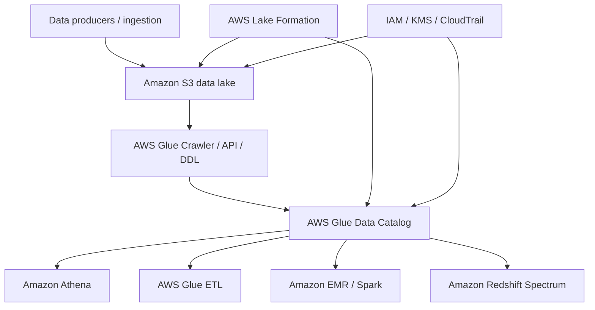
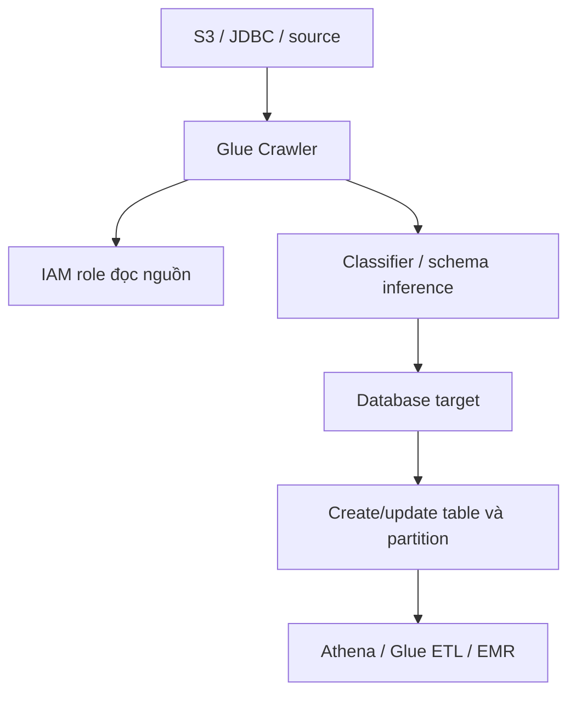

# AWS Glue Data Catalog và quản lý metadata

Data lake có thể lưu hàng terabyte hoặc petabyte dữ liệu trong Amazon S3, nhưng dữ liệu chỉ hữu ích khi người dùng và công cụ biết dữ liệu nằm ở đâu, có cấu trúc gì, được tạo ra từ nguồn nào và ai được phép truy cập. **Metadata** trả lời những câu hỏi đó. AWS Glue Data Catalog là kho metadata tập trung, mô tả database, table, schema, partition, vị trí lưu trữ và một số thuộc tính quản trị để các dịch vụ phân tích dùng chung.

AWS Glue Data Catalog không lưu nội dung file dữ liệu. Nó lưu định nghĩa về dữ liệu: tên cột, kiểu dữ liệu, partition key, định dạng file, SerDe, S3 location, table properties và thông tin liên quan. Dữ liệu vật lý vẫn nằm ở S3, database hoặc nguồn khác. Nhờ vậy, Athena, AWS Glue ETL, Amazon EMR, Redshift Spectrum và Lake Formation có thể sử dụng cùng một lớp metadata.

Trong module `CLOUD_PROVIDERS_AWS`, chủ đề này kết nối lưu trữ, IAM, VPC, streaming, data lake, tích hợp và bảo mật. Một Data Catalog được quản lý tốt giúp tổ chức khám phá dữ liệu, chuẩn hóa schema, phân quyền theo database/table/column, kiểm soát thay đổi và duy trì khả năng truy vấn ổn định khi data lake phát triển.

Sau bài học, bạn có thể:

- Giải thích vai trò của metadata và AWS Glue Data Catalog trong kiến trúc data lake.
- Phân biệt catalog, database, table, partition, crawler, classifier và connection.
- Tạo và quản lý metadata bằng crawler, Glue API, Athena DDL hoặc Infrastructure as Code.
- Thiết kế schema, partition và table properties cho dữ liệu trên S3.
- Kiểm soát schema evolution, crawler behavior, table version và metadata quality.
- Kết hợp Glue Data Catalog với Athena, Glue ETL, EMR, Redshift Spectrum và Lake Formation.
- Áp dụng IAM, Lake Formation permissions, LF-Tags, encryption và audit.
- Xây dựng quy trình metadata lifecycle có owner, lineage context, classification và kiểm tra chất lượng.

## 1. Metadata trong data lake là gì?

Metadata là dữ liệu mô tả dữ liệu. Một file Parquet có thể chứa hàng triệu bản ghi đơn hàng, nhưng nếu không có metadata thì công cụ truy vấn phải tự tìm file, đoán schema, xác định kiểu dữ liệu và hiểu cách chia partition.

Metadata thường có ba nhóm:

| Nhóm metadata | Nội dung | Ví dụ |
|---|---|---|
| Technical metadata | Cấu trúc và cách đọc dữ liệu | Column, data type, format, SerDe, S3 location, partition key |
| Business metadata | Ý nghĩa và mục đích sử dụng | Tên nghiệp vụ, định nghĩa chỉ số, owner, domain, mô tả cột |
| Operational/governance metadata | Vận hành, chất lượng và quyền | Freshness, classification, retention, access policy, data quality status |

Ví dụ một bảng `orders` có thể có technical metadata là `order_id string`, `amount decimal(12,2)`, partition theo `year/month`, file Parquet ở S3. Business metadata mô tả đây là dữ liệu đơn hàng đã thanh toán, thuộc domain Commerce và được nhóm Finance sử dụng. Governance metadata xác định owner, mức phân loại, retention và những principal được truy cập.

Không phải mọi thông tin quản trị đều tự động được Glue Data Catalog suy ra. Tổ chức cần định nghĩa convention, gắn mô tả, tag, parameter và kết nối với quy trình quản trị phù hợp.

## 2. AWS Glue Data Catalog là gì?

AWS Glue Data Catalog là kho metadata được quản lý, dùng để lưu thông tin về data assets và cung cấp metadata cho các dịch vụ AWS phân tích. Đây là thành phần trung tâm trong nhiều kiến trúc data lake trên AWS.

Các đặc điểm chính:
- Là dịch vụ serverless; người dùng không phải vận hành database server cho metadata.
- Có thể chứa metadata từ nhiều nguồn và nhiều định dạng.
- Hỗ trợ database, table, partition, connection và các đối tượng catalog liên quan.
- Có thể được cập nhật bằng Glue crawlers, Glue API/SDK, ETL jobs hoặc DDL của engine tích hợp.
- Được sử dụng bởi Athena, AWS Glue, EMR, Redshift Spectrum và Lake Formation.
- Tích hợp IAM và Lake Formation để kiểm soát quyền truy cập metadata và dữ liệu.
- Có thể chia sẻ metadata giữa account theo cơ chế resource sharing phù hợp.

Mỗi AWS account có Data Catalog theo Region. Một table trong catalog là định nghĩa logic về dataset; nó có thể trỏ tới dữ liệu nằm trong S3 hoặc nguồn được hỗ trợ. Việc tạo table thường không sao chép hay di chuyển dữ liệu.

### 2.1. Data Catalog nằm ở đâu trong kiến trúc?



Data producer ghi dữ liệu vào storage. Crawler hoặc pipeline đăng ký schema và location vào Catalog. Query engine đọc metadata để xác định file và cách giải mã dữ liệu. Lake Formation và IAM kiểm soát ai được khám phá hoặc đọc dữ liệu theo cơ chế tích hợp.

## 3. Cấu trúc của Data Catalog

Có thể hình dung cấu trúc cơ bản như sau:

```text
AWS Account + Region
└── Data Catalog
    ├── Database: raw
    │   ├── Table: click_events
    │   │   ├── Columns
    │   │   ├── Partition keys
    │   │   ├── Storage descriptor
    │   │   └── Table properties
    │   └── Table: device_telemetry
    ├── Database: curated
    │   ├── Table: orders
    │   └── Table: customers
    └── Database: analytics
        └── Table: sales_daily
```

### 3.1. Catalog

Catalog là phạm vi chứa metadata trong account/Region. Glue Data Catalog mặc định thường được định danh bằng account ID. Khi làm việc với API, có thể truyền catalog ID để tham chiếu catalog của account phù hợp.

### 3.2. Database

Database là nhóm logic chứa các table và metadata liên quan. Database không nhất thiết tương ứng với một database engine hoặc một thư mục S3. Có thể tổ chức theo:
- Data zone: raw, standardized, curated.
- Business domain: sales, finance, customer, operations.
- Product/team: commerce, marketing, platform.
- Môi trường: development, staging, production.

Không nên tạo database theo mọi folder nhỏ. Hãy chọn cách tổ chức giúp người dùng khám phá và áp dụng quyền rõ ràng. Tên database nên thống nhất, tránh dấu cách và ký tự gây khó khi viết SQL.

### 3.3. Table

Table mô tả một dataset. Metadata của table có thể gồm:
- Tên và database chứa table.
- Danh sách cột, kiểu dữ liệu và mô tả.
- Partition keys.
- Storage descriptor.
- Location của dữ liệu.
- File format, input/output format và SerDe.
- Table type, parameters và classification.
- Thông tin tạo/cập nhật và phiên bản metadata.

Glue Data Catalog table có thể là external table trỏ tới file trên S3. Table definition không đồng nghĩa dữ liệu đã được nạp vào Glue. Nếu file bị xóa hoặc đổi cấu trúc nhưng metadata không cập nhật, query có thể thất bại hoặc trả kết quả sai.

### 3.4. Partition

Partition chia một table thành các tập dữ liệu nhỏ theo giá trị của partition key, thường tương ứng với cấu trúc folder. Ví dụ:

```text
s3://company-data/curated/orders/
  year=2026/month=10/day=19/part-0001.parquet
  year=2026/month=10/day=20/part-0002.parquet
  year=2026/month=11/day=01/part-0003.parquet
```

Table có thể khai báo partition keys `year`, `month`, `day`. Query lọc theo thời gian sẽ chỉ đọc các partition phù hợp nếu metadata và query engine hỗ trợ partition pruning.

Partition metadata lưu giá trị key và location của partition. Nếu file mới được ghi vào S3 nhưng partition chưa được đăng ký, một số engine không nhìn thấy partition đó cho tới khi crawler, API hoặc lệnh DDL cập nhật catalog.

## 4. Table metadata và Storage Descriptor

Storage Descriptor mô tả cách dữ liệu vật lý được lưu và đọc. Những trường quan trọng gồm:
- `Location`: vị trí dữ liệu, thường là S3 prefix.
- `Columns`: schema cột.
- `InputFormat` và `OutputFormat`: lớp đọc/ghi theo định dạng.
- `SerdeInfo`: serializer/deserializer và properties.
- `Compressed`: thông tin nén.
- `BucketColumns`, `SortColumns`: metadata về bucketing/sorting khi có.

Ví dụ, bảng Parquet thường có classification/format phù hợp và location là S3 prefix chứa file Parquet. Bảng CSV có thể cần SerDe và properties để xác định delimiter, quote, escape và header.

### 4.1. Schema on read

Data lake thường dùng mô hình schema-on-read: dữ liệu được lưu dưới dạng file/object, schema được áp dụng khi query hoặc xử lý. Data Catalog cung cấp schema để engine diễn giải file.

Schema-on-read linh hoạt, nhưng không có nghĩa schema không cần quản trị. Nếu producer thay đổi tên cột, kiểu dữ liệu hoặc định dạng mà consumer không biết, query có thể lỗi hoặc diễn giải dữ liệu sai. Cần contract, versioning và quy trình schema evolution.

### 4.2. File format và SerDe

Một số định dạng thường dùng:

| Định dạng | Đặc điểm | Trường hợp phù hợp |
|---|---|---|
| CSV | Dễ trao đổi, dạng văn bản | Dataset nhỏ hoặc tích hợp đơn giản |
| JSON | Linh hoạt, nested structure | Event và dữ liệu bán cấu trúc |
| Parquet | Columnar, nén tốt, đọc theo cột | Analytics và query trên S3 |
| ORC | Columnar, tối ưu một số engine | Data warehouse/lakehouse |
| Avro | Row-oriented, schema-based | Trao đổi dữ liệu và streaming |
| Apache Iceberg | Open table format có snapshot/metadata | Lakehouse, transaction và schema evolution |

SerDe giúp engine giải mã dữ liệu theo định dạng. Chọn sai SerDe hoặc delimiter có thể khiến cột bị lệch, null bất thường hoặc query lỗi. Với Parquet/ORC, metadata định dạng và schema cần nhất quán với file thực tế.

## 5. Tổ chức database và table trong data lake

Một cách tổ chức phổ biến là chia data lake thành các zone:

| Zone | Mục tiêu | Ví dụ database |
|---|---|---|
| Raw/Bronze | Lưu dữ liệu gần với nguồn, giữ lịch sử ingest | `raw` |
| Standardized/Silver | Chuẩn hóa schema, timezone, kiểu dữ liệu và chất lượng | `standardized` |
| Curated/Gold | Dữ liệu đã mô hình hóa cho nghiệp vụ/BI | `curated` |
| Sandbox | Phân tích thử nghiệm có kiểm soát | `sandbox` |

Một table curated có thể là kết quả transform từ nhiều table raw. Không nên để tên database và table mơ hồ như `db1`, `table_final2`; dùng tên phản ánh domain và nội dung.

### 5.1. Quy ước naming

Ví dụ:
- Database: `raw_commerce`, `curated_finance`.
- Table: `orders`, `order_items`, `payment_events`.
- Partition keys: `event_date`, `region` nếu phù hợp.
- Column: `order_id`, `created_at`, `net_amount`.

Tránh đổi tên table/cột tùy tiện khi nhiều query phụ thuộc. Nếu cần breaking change, tạo table version mới hoặc view tương thích và có kế hoạch chuyển consumer.

### 5.2. Table location và ownership

Mỗi table nên có location rõ ràng và không chồng lấn với table khác theo cách gây đọc trùng. Một prefix S3 có thể được tham chiếu bởi nhiều table, nhưng phải có lý do và schema tương thích.

Metadata nên ghi:
- Data owner và technical steward.
- Nguồn gốc và pipeline tạo dữ liệu.
- Mô tả nghiệp vụ.
- Classification và sensitivity.
- Refresh cadence và SLA.
- Retention và ngày kiểm tra gần nhất.

Có thể dùng table/column comments, parameters, resource tags hoặc LF-Tags theo convention. Những giá trị như owner, domain hay sensitivity cần được duy trì tự động từ IaC hoặc pipeline để tránh lỗi nhập tay.

## 6. AWS Glue Crawler và tự động khám phá metadata

AWS Glue Crawler quét data source, nhận diện định dạng, suy luận schema và tạo/cập nhật database, table hoặc partition trong Data Catalog.

Crawler hữu ích khi:
- Dữ liệu mới liên tục được thêm vào S3.
- Nhiều file có schema cần khám phá.
- Muốn khởi tạo catalog nhanh.
- Muốn phát hiện partition mới.
- Nguồn dữ liệu có cấu trúc ổn định nhưng metadata chưa được đăng ký.

Crawler không phải ETL job. Nó không làm sạch, join, chuẩn hóa hoặc chuyển đổi nội dung file. Nó đọc cấu trúc nguồn để tạo metadata. Muốn transform dữ liệu, dùng Glue ETL hoặc công cụ xử lý khác.

### 6.1. Thành phần của crawler

| Thành phần | Vai trò |
|---|---|
| Crawler name | Tên crawler |
| Data source target | S3 path, JDBC hoặc nguồn được hỗ trợ |
| IAM role | Quyền crawler đọc nguồn và cập nhật Catalog |
| Classifier | Nhận diện định dạng và schema |
| Database target | Database nơi tạo table |
| Schedule | Chạy theo lịch hoặc theo yêu cầu |
| Crawler configuration | Hành vi grouping, schema change và recrawl |
| Logs/metrics | Theo dõi lần chạy, lỗi và số table/partition |

Crawler có thể quét một hoặc nhiều target. Với S3, nên giới hạn prefix để tránh quét toàn bộ bucket. IAM role cần quyền list/read đúng prefix và quyền cập nhật Data Catalog.

### 6.2. Classifier

Classifier xác định dữ liệu thuộc định dạng nào và suy luận schema. Glue có built-in classifiers cho nhiều định dạng phổ biến; có thể dùng custom classifier khi định dạng riêng.

Ví dụ:
- CSV có header, delimiter hoặc quote đặc thù.
- JSON có cấu trúc nested.
- Log text cần Grok pattern.
- JDBC source cần đọc schema từ database.

Nếu classifier nhận diện sai, crawler có thể tạo table sai kiểu dữ liệu hoặc grouping không mong muốn. Kiểm tra mẫu dữ liệu và kết quả table trước khi đưa vào pipeline production.

### 6.3. Quy trình crawler



Trình tự:
1. Chuẩn bị source và IAM role.
2. Tạo crawler với target cụ thể.
3. Chọn database đích hoặc tạo database mới.
4. Cấu hình classifier và schema change policy.
5. Chạy crawler.
6. Kiểm tra table, schema, location và partition.
7. Kiểm thử bằng query engine.
8. Đưa vào schedule hoặc event-driven recrawl nếu cần.

## 7. Quản lý crawler: schedule, recrawl và schema change

### 7.1. Chế độ recrawl

Crawler có thể được cấu hình để:
- Crawl toàn bộ target.
- Chỉ crawl folder mới.
- Dùng event mode cho các thay đổi S3 được theo dõi qua event notifications trong trường hợp được hỗ trợ.

Chọn chế độ dựa trên cách dữ liệu được ghi:
- Nếu file cũ có thể thay đổi schema hoặc nội dung, chỉ crawl folder mới có thể bỏ sót.
- Nếu dữ liệu append-only và folder mới đại diện partition mới, crawl folder mới có thể giảm thời gian.
- Event mode có thể giảm công việc quét nhưng cần cấu hình và vận hành event notifications phù hợp.

Recrawl mode không thay thế kiểm tra schema và partition. Hãy kiểm tra behavior khi object bị xóa, folder đổi tên hoặc file cũ được ghi lại.

### 7.2. Schema change policy

Crawler có thể phát hiện schema thay đổi. Cần quyết định cách cập nhật Data Catalog.

Các hành vi thường dùng:
- `UpdateBehavior=UPDATE_IN_DATABASE`: cập nhật table definition theo schema được crawler phát hiện.
- `UpdateBehavior=LOG`: ghi nhận thay đổi nhưng không cập nhật schema hiện có.
- `DeleteBehavior=DELETE_FROM_DATABASE`: xóa metadata table nếu nguồn không còn theo hành vi crawler.
- `DeleteBehavior=DEPRECATE_IN_DATABASE`: đánh dấu table không còn hiện diện theo cách dịch vụ hỗ trợ.
- `DeleteBehavior=LOG`: chỉ ghi log.

Không để crawler tự động thay đổi schema production mà không có contract. Ví dụ producer đổi `amount` từ decimal sang string; crawler cập nhật Catalog có thể làm query và ETL downstream lỗi. Với dữ liệu quan trọng, dùng `LOG` hoặc quy trình review trước khi cập nhật.

### 7.3. Table grouping và nhiều schema

Nếu nhiều folder có schema gần giống, crawler có thể nhóm thành table chung tùy cấu hình và heuristic. Nếu mỗi folder đại diện một dataset khác nhau, cần cấu hình target hoặc table grouping phù hợp để không hợp nhất sai.

Đừng dựa vào tên folder duy nhất để xác định semantic schema. Kiểm tra file mẫu, partition layout và classifier.

## 8. Partition metadata và tối ưu truy vấn

Partition giúp engine bỏ qua dữ liệu không cần đọc. Ví dụ bảng giao dịch partition theo `year/month/day`, truy vấn một tuần có thể chỉ đọc những partition liên quan thay vì toàn bộ lịch sử.

### 8.1. Thiết kế partition key

Chọn partition key theo query pattern:
- Dữ liệu sự kiện thường partition theo ngày hoặc tháng.
- Dữ liệu theo tenant có thể partition theo tenant nếu số tenant và phân bố phù hợp.
- Dữ liệu theo Region có thể partition theo Region khi truy vấn thường lọc theo vùng.

Tránh:
- Partition quá nhỏ tạo hàng triệu partition.
- Partition key cardinality cao như UUID.
- Quá nhiều folder rỗng.
- Partition theo cột ít được dùng trong filter.
- Một partition quá lớn gây scan nhiều dữ liệu.

Partitioning là quyết định physical layout. Thêm partition key không làm query nhanh hơn nếu truy vấn không lọc theo key hoặc metadata không được cập nhật.

### 8.2. Cập nhật partition metadata

Partition có thể được đăng ký qua:
- Glue Crawler.
- Glue API `CreatePartition` hoặc `BatchCreatePartition`.
- Athena DDL như `ALTER TABLE ADD PARTITION`.
- Glue ETL hoặc pipeline ingest.
- Các cơ chế partition projection của query engine.

Với S3 Hive-style path, crawler hoặc lệnh DDL có thể phát hiện giá trị partition. Cần bảo đảm thứ tự partition key trong table definition khớp cấu trúc path và kiểu dữ liệu.

### 8.3. Partition index và partition projection

Hai khái niệm thường bị nhầm:

- **Glue partition index** là index metadata giúp tìm partition hiệu quả hơn qua Glue Data Catalog APIs với điều kiện lọc phù hợp. Nó không tự tạo partition mới.
- **Athena partition projection** cho phép Athena suy ra giá trị/location partition từ cấu hình table properties thay vì phải đăng ký từng partition trong Catalog. Đây là tính năng của Athena, không phải Glue crawler tự tạo index.

Partition projection phù hợp khi partition có quy luật rõ ràng và query engine hỗ trợ. Cần bảo đảm location template, range và format đúng; nếu cấu hình sai, Athena có thể truy cập path không tồn tại hoặc bỏ sót dữ liệu.

## 9. Quản lý schema evolution

Schema evolution là thay đổi cấu trúc dữ liệu theo thời gian. Ví dụ thêm cột `discount_amount`, đổi tên `customer_id`, thay kiểu `amount` hoặc thay cấu trúc JSON nested.

### 9.1. Thay đổi tương thích và không tương thích

| Thay đổi | Rủi ro | Cách xử lý |
|---|---|---|
| Thêm cột optional | Thường tương thích nếu consumer chấp nhận thiếu/null | Thêm schema và kiểm thử consumer |
| Thêm partition mới | Cần cập nhật partition metadata | Crawler/API/projection |
| Đổi tên cột | Consumer cũ có thể lỗi | Tạo version/view tương thích và migrate |
| Xóa cột | Query downstream có thể lỗi | Deprecate, thông báo và migrate |
| Đổi kiểu dữ liệu | Có thể lỗi cast hoặc sai semantics | Contract, transform và version |
| Thay nested structure | Parser/SerDe có thể không đọc được | Schema version và compatibility test |

### 9.2. Không để crawler là schema authority duy nhất

Crawler phù hợp discovery, nhưng production schema cần có owner và contract. Một quy trình tốt:
1. Producer đề xuất schema change.
2. Kiểm tra backward/forward compatibility.
3. Cập nhật schema contract.
4. Thử trên sample data.
5. Review ảnh hưởng query/ETL.
6. Cập nhật Catalog qua IaC/API hoặc crawler có policy được kiểm soát.
7. Theo dõi consumer sau triển khai.

Nếu cần schema registry cho event/streaming payload, sử dụng AWS Glue Schema Registry hoặc giải pháp phù hợp. Data Catalog table schema và Glue Schema Registry là hai mục đích khác nhau.

## 10. Table versioning và metadata lifecycle

Glue Data Catalog hỗ trợ lưu phiên bản table metadata. Khi table definition được cập nhật, có thể tạo table version mới. Các API như `GetTableVersions` giúp xem lịch sử định nghĩa trong phạm vi hỗ trợ.

Table versioning hữu ích để:
- Theo dõi schema và table properties thay đổi.
- Điều tra vì sao query bắt đầu lỗi.
- So sánh định nghĩa trước/sau.
- Khôi phục table definition theo quy trình nếu thay đổi sai.

Tuy nhiên, table version không phải version dữ liệu. Nó không khôi phục file S3 đã bị xóa, ghi đè hoặc mã hóa. Để bảo vệ dữ liệu, cần S3 Versioning, replication, backup hoặc cơ chế bảo vệ tương ứng.

### 10.1. Metadata lifecycle

Một vòng đời metadata có thể gồm:
- Register: tạo database/table.
- Discover: crawler tìm schema/partition.
- Enrich: thêm mô tả, owner, classification và tags.
- Validate: kiểm tra schema, location, partition và quality.
- Publish: cấp quyền cho consumer.
- Monitor: theo dõi freshness, usage và lỗi.
- Evolve: thay đổi schema có kiểm soát.
- Deprecate: thông báo và ngừng sử dụng table cũ.
- Retire: xóa metadata khi hết retention và không còn consumer.

Không xóa database/table chỉ vì pipeline ngừng chạy một thời gian. Trước khi retire, kiểm tra consumer, quyền, lineage và yêu cầu lưu trữ.

## 11. Glue Data Catalog và AWS Lake Formation

AWS Lake Formation cung cấp lớp quản trị và phân quyền cho data lake, tích hợp với Glue Data Catalog. Catalog mô tả dữ liệu; Lake Formation quản lý quyền trên catalog resources và data locations theo cơ chế được hỗ trợ.

Lake Formation có thể kiểm soát quyền:
- Database.
- Table.
- Column.
- Row/column filters trong các engine và định dạng được hỗ trợ.
- Data location trên S3.

### 11.1. IAM và Lake Formation phối hợp

Trong môi trường tích hợp Lake Formation, người gọi thường cần IAM permissions để gọi API/dịch vụ và Lake Formation grants để truy cập dữ liệu theo chính sách. Hai lớp có vai trò khác nhau:
- IAM xác định principal được phép gọi API và sử dụng dịch vụ.
- Lake Formation quản lý quyền truy cập dữ liệu qua các engine tích hợp.

Không giả định có IAM `glue:GetTable` là đã được phép đọc toàn bộ dữ liệu. Cũng không giả định có Lake Formation grant là đủ nếu IAM, KMS hoặc S3 configuration không cho phép đường truy cập tương ứng.

Nếu người dùng có quyền S3 trực tiếp tới bucket, họ có thể truy cập object ngoài các kiểm soát ở tầng query engine tùy cấu hình. Muốn Lake Formation thực sự quản trị tập trung, cần hạn chế đường đọc S3 trực tiếp không được kiểm soát.

### 11.2. Data location registration

Đăng ký S3 location trong Lake Formation cho phép dịch vụ quản lý quyền truy cập dữ liệu ở location đó. Thường cần role được cấu hình để Lake Formation truy cập S3 và KMS theo yêu cầu.

Cần kiểm tra:
- Bucket policy.
- IAM role và trust policy.
- KMS key policy/grants.
- Lake Formation data location permissions.
- Quyền của Glue/Athena/Redshift principal.
- Các đường truy cập trực tiếp qua S3.

### 11.3. LF-Tags

Lake Formation Tags (LF-Tags) cho phép gắn thuộc tính key-value vào database/table/column và cấp quyền theo tag expression. Ví dụ:
- `domain=finance`
- `classification=confidential`
- `environment=production`

Thay vì cấp quyền từng table, có thể cấp quyền cho principal đối với mọi table có tag phù hợp. Khi table mới được gắn LF-Tag, nó có thể thừa hưởng chính sách theo tag expression.

LF-Tags là công cụ quản trị quyền của Lake Formation, khác với resource tags thông thường trong AWS Tagging và khác với cost allocation tags. Đừng dùng lẫn ba loại tag.

### 11.4. Cross-account sharing

Lake Formation hỗ trợ chia sẻ database/table với account hoặc organization khác theo cơ chế cross-account permissions. Consumer account có thể tạo resource link trong catalog của mình để tham chiếu shared database/table.

Resource link là metadata pointer trong catalog consumer; nó không sao chép dữ liệu hay tự cấp quyền đọc object S3. Consumer vẫn cần quyền thích hợp và truy cập qua engine được hỗ trợ. Cần phối hợp quyền Catalog, Lake Formation, IAM, S3 và KMS.

## 12. Data Catalog permissions và IAM

Glue Data Catalog APIs được kiểm soát bằng IAM. Một số hành động thường gặp:
- `glue:GetDatabase`, `glue:GetDatabases`.
- `glue:GetTable`, `glue:GetTables`.
- `glue:GetPartitions`.
- `glue:CreateDatabase`, `glue:CreateTable`, `glue:UpdateTable`.
- `glue:CreatePartition`, `glue:BatchCreatePartition`.
- `glue:StartCrawler`, `glue:GetCrawler`.
- `glue:StartJobRun`, `glue:GetJobRun`.

Nguyên tắc least privilege:
- Data consumer chỉ cần đọc metadata và dữ liệu được cấp.
- Data producer/pipeline có quyền tạo hoặc cập nhật đúng database/table.
- Crawler role chỉ đọc source prefix cần thiết và cập nhật catalog target.
- Catalog administrator có quyền quản trị metadata nhưng không nhất thiết cần đọc mọi object.
- Security administrator quản lý Lake Formation, KMS và audit riêng.

Một số thao tác cần resource policy hoặc quyền liên account. Hãy kiểm tra action/resource support trong IAM Service Authorization Reference thay vì dùng `glue:*` cho mọi principal.

## 13. Kết nối Data Catalog với Athena

Amazon Athena dùng Glue Data Catalog làm metastore phổ biến cho external tables. Khi người dùng chạy query:
1. Athena đọc table definition từ Catalog.
2. Xác định schema, location, format và partition.
3. Đọc object từ S3 theo quyền được cấu hình.
4. Trả kết quả query vào S3 query result location.

Ví dụ tạo external table Parquet:

```sql
CREATE EXTERNAL TABLE IF NOT EXISTS curated.orders (
    order_id       string,
    customer_id    string,
    order_status   string,
    amount         decimal(12,2),
    created_at     timestamp
)
PARTITIONED BY (
    year string,
    month string
)
STORED AS PARQUET
LOCATION 's3://company-data/curated/orders/';
```

DDL trên tạo metadata table trong Catalog thông qua Athena; nó không tự chuyển đổi file thành Parquet. Dữ liệu tại location phải thực sự là Parquet với schema tương thích.

Sau khi thêm partition folder mới, có thể cập nhật metadata bằng crawler, Glue API hoặc DDL phù hợp. Với Hive-style partition, ví dụ:

```sql
ALTER TABLE curated.orders
ADD IF NOT EXISTS PARTITION (year='2026', month='11')
LOCATION 's3://company-data/curated/orders/year=2026/month=11/';
```

Query có filter partition:

```sql
SELECT order_status, SUM(amount) AS total_amount
FROM curated.orders
WHERE year = '2026'
  AND month = '11'
GROUP BY order_status;
```

Partition pruning giúp giảm dữ liệu đọc khi table layout và query engine phù hợp. Hãy kiểm tra query plan và bytes scanned thay vì giả định partition tự động làm query nhanh.

## 14. Kết nối với AWS Glue ETL

Glue ETL jobs có thể dùng Data Catalog table làm source hoặc target. Job có thể:
- Đọc dữ liệu từ S3 table.
- Chuẩn hóa schema và kiểu dữ liệu.
- Làm sạch record.
- Join nhiều nguồn.
- Ghi dữ liệu curated.
- Cập nhật Catalog table/partition khi cấu hình phù hợp.

Data Catalog lưu metadata; Glue ETL thực hiện biến đổi dữ liệu. Nếu job tạo file mới nhưng không cập nhật partition metadata, consumer có thể chưa nhìn thấy partition mới. Hãy thiết kế rõ bước ghi dữ liệu và bước cập nhật catalog.

Với production pipeline, cần kiểm soát:
- Schema input/output.
- Bookmark hoặc checkpoint nếu dùng incremental processing.
- Idempotency và cách xử lý dữ liệu đến muộn.
- Partition overwrite/append.
- Job role và source/destination permissions.
- Data quality checks trước khi publish table.

## 15. Kết nối với EMR và Redshift Spectrum

### 15.1. Amazon EMR

EMR có thể sử dụng Glue Data Catalog làm external metastore cho Hive/Spark trong các cấu hình được hỗ trợ. Điều này giúp nhiều cluster hoặc ứng dụng dùng chung metadata mà không phải duy trì một metastore riêng.

Cần cấu hình quyền truy cập Glue Catalog, Region/account phù hợp và tương thích phiên bản engine. Nếu EMR dùng Lake Formation integration, cần thêm grants và cấu hình tương ứng.

### 15.2. Amazon Redshift Spectrum

Redshift Spectrum cho phép query dữ liệu external trong S3 thông qua external schema và metadata catalog được hỗ trợ, bao gồm Glue Data Catalog. Redshift đọc metadata để hiểu table, column và partition, rồi truy vấn object trong S3.

Cần kiểm tra:
- IAM role của Redshift cluster/workgroup.
- Glue Catalog permissions.
- Lake Formation grants nếu sử dụng.
- S3 access và KMS decrypt.
- Schema/partition compatibility.
- Region và cross-account configuration.

## 16. AWS Glue Data Catalog và Glue Schema Registry

Hai thành phần này có tên gần nhau nhưng phục vụ mục tiêu khác nhau:

| Thành phần | Mục tiêu | Đối tượng |
|---|---|---|
| Glue Data Catalog | Mô tả dataset/table để query engine đọc dữ liệu | Database, table, column, partition, location |
| Glue Schema Registry | Quản lý schema của message/event trong streaming và kiểm tra compatibility | Schema version cho Avro, JSON hoặc Protobuf theo hỗ trợ |

Ví dụ:
- Bảng `orders` trên S3 được đăng ký trong Glue Data Catalog.
- Event `OrderPlaced` được phát qua Kinesis hoặc Kafka và schema của payload được quản lý trong Glue Schema Registry.

Data Catalog không tự thay thế schema registry cho event. Ngược lại, Schema Registry không phải metastore để Athena tìm table và partition trên S3.

## 17. Data quality và metadata quality

Data quality nói về chất lượng bản ghi; metadata quality nói về tính đúng và đầy đủ của mô tả dataset. Hai việc liên quan nhưng khác nhau.

Metadata quality cần kiểm tra:
- Table có mô tả và owner không?
- Column names/types có khớp dữ liệu thật không?
- Location có tồn tại và đúng prefix không?
- Partition keys có khớp folder layout không?
- Freshness và refresh cadence có được ghi không?
- Classification và access policy có phù hợp không?
- Table có còn được sử dụng hay đã lỗi thời?
- Schema change có được review và version không?

AWS Glue Data Quality có thể dùng ruleset để kiểm tra dữ liệu trong Glue ETL và các luồng tích hợp được hỗ trợ. Ví dụ rule:
- `order_id` không được null.
- `amount` phải lớn hơn hoặc bằng 0.
- Tỷ lệ duplicate không vượt ngưỡng.
- `created_at` phải nằm trong khoảng hợp lệ.

Kết quả data quality có thể được dùng trong pipeline để quyết định publish hoặc quarantine dataset. Không nên coi crawler chạy thành công là bằng chứng dữ liệu đúng nghiệp vụ.

## 18. Metadata discovery và tìm kiếm dataset

Data Catalog giúp công cụ tìm table theo database và schema. Để người dùng tìm đúng dataset, cần bổ sung business context:
- Mô tả database/table/column.
- Domain và data product.
- Owner/steward.
- Classification.
- Refresh schedule và SLA.
- Sample query hoặc documentation.
- Upstream source và downstream consumers.
- Quy trình yêu cầu quyền truy cập.

Tổ chức có thể dùng Glue Data Catalog cùng Lake Formation, Glue Data Quality và các công cụ catalog/governance khác. Nếu cần data marketplace, glossary hoặc lineage nâng cao, cần đánh giá khả năng tích hợp và sản phẩm phù hợp; không giả định Data Catalog tự cung cấp đầy đủ mọi chức năng của một enterprise data catalog.

## 19. Encryption, audit và bảo vệ metadata

Metadata có thể tiết lộ tên hệ thống, dataset nhạy cảm, cấu trúc dữ liệu và quan hệ giữa các domain. Cần bảo vệ cả metadata lẫn data object.

- Dùng IAM least privilege cho Data Catalog API.
- Dùng Lake Formation để quản lý data permissions ở engine tích hợp.
- Mã hóa dữ liệu S3 bằng SSE-S3 hoặc SSE-KMS theo policy.
- Nếu bật encryption cho Data Catalog metadata, quản lý KMS key policy và quyền sử dụng key.
- Hạn chế quyền sửa database/table/partition.
- Audit thao tác qua AWS CloudTrail.
- Bảo vệ Glue connection secrets và thông tin JDBC.
- Không đưa password/token vào table properties hoặc comment.
- Giới hạn quyền đọc query results và log.
- Có quy trình review trước khi chia sẻ catalog cross-account.

CloudTrail ghi lại các API management activity liên quan Glue/Lake Formation theo phạm vi dịch vụ và cấu hình. Kết hợp với S3 data access logs, Athena query history và application audit để điều tra ai truy cập dataset nào.

## 20. Quản lý metadata bằng IaC và API

Crawler giúp khám phá nhanh, nhưng metadata production quan trọng nên được quản lý có thể review và tái tạo. Có thể dùng:
- AWS CloudFormation.
- AWS CDK.
- Terraform.
- AWS Glue API/SDK.
- Athena DDL trong migration pipeline.

IaC hữu ích khi:
- Muốn version database/table schema trong Git.
- Cần tái tạo môi trường dev/stage/prod.
- Muốn review thay đổi trước deploy.
- Cần policy và tags nhất quán.
- Muốn tránh crawler vô tình đổi schema production.

### 20.1. Ví dụ truy vấn metadata bằng AWS CLI

Liệt kê database:

```bash
aws glue get-databases \
  --region ap-southeast-1
```

Xem một table:

```bash
aws glue get-table \
  --database-name curated \
  --name orders \
  --region ap-southeast-1
```

Liệt kê partition của table:

```bash
aws glue get-partitions \
  --database-name curated \
  --table-name orders \
  --region ap-southeast-1
```

Xem trạng thái crawler:

```bash
aws glue get-crawler \
  --name orders-s3-crawler \
  --region ap-southeast-1
```

Các lệnh chỉ đọc metadata. Trong production, cần phân trang kết quả khi có nhiều database/partition; `GetPartitions` có thể trả nhiều trang qua NextToken. Không dùng output của một lần gọi làm danh sách đầy đủ nếu response có token tiếp theo.

### 20.2. Ví dụ tạo database bằng CloudFormation

```yaml
Resources:
  CuratedDatabase:
    Type: AWS::Glue::Database
    Properties:
      CatalogId: !Ref AWS::AccountId
      DatabaseInput:
        Name: curated
        Description: Curated datasets for analytics
        Parameters:
          owner: data-platform
          domain: commerce
```

Ví dụ minh họa cách quản lý metadata bằng IaC. Cần kiểm tra cú pháp và quyền CloudFormation role trong account/Region mục tiêu. Không nên tạo cùng một resource bằng cả crawler và IaC nếu chưa xác định rõ nguồn quản lý chính.

## 21. Vận hành crawler và catalog trong production

Một quy trình vận hành có thể gồm:

1. Data producer ghi file vào vùng raw.
2. Event hoặc schedule kích hoạt crawler/pipeline.
3. Crawler cập nhật schema/partition theo policy đã review.
4. Pipeline kiểm tra table metadata và sample data.
5. Glue Data Quality kiểm tra dữ liệu.
6. Catalog metadata được enrich với owner, description và classification.
7. Lake Formation grants cho consumer.
8. Athena/EMR/Redshift Spectrum truy vấn.
9. Monitoring phát hiện freshness, schema drift và query failure.

Crawler cần log và metric:
- Thời gian chạy.
- Số table được tạo/cập nhật.
- Số partition được thêm.
- Lỗi đọc source hoặc permission.
- Schema change được phát hiện.
- Thời điểm crawler chạy thành công gần nhất.

Không schedule crawler quá dày nếu dữ liệu thay đổi liên tục và có cách cập nhật partition hiệu quả hơn. Với pipeline streaming, có thể dùng micro-batch hoặc API để cập nhật metadata theo lô thay vì quét lại toàn bộ prefix.

## 22. Những lỗi thường gặp và cách xử lý

| Lỗi | Nguyên nhân thường gặp | Hướng xử lý |
|---|---|---|
| Athena báo table không tồn tại | Sai database/catalog/Region hoặc chưa tạo table | Kiểm tra Glue Catalog và workgroup Region |
| Table tồn tại nhưng không thấy dữ liệu mới | Partition chưa đăng ký hoặc location sai | Cập nhật partition và kiểm tra S3 path |
| Query lỗi kiểu dữ liệu | Catalog schema lệch với file | Kiểm tra schema, SerDe và producer |
| Crawler tạo nhiều table ngoài ý muốn | Target quá rộng hoặc grouping không phù hợp | Thu hẹp prefix và điều chỉnh grouping |
| Crawler không đọc được S3 | IAM role/bucket policy/KMS thiếu quyền | Kiểm tra ListBucket/GetObject và decrypt |
| Crawler ghi đè schema ngoài dự kiến | UpdateBehavior quá rộng | Dùng LOG/review hoặc schema contract |
| Glue API AccessDenied | Thiếu IAM hoặc Lake Formation permission | Xác định principal và lớp quyền bị thiếu |
| Athena bị AccessDenied trên object | S3/KMS/Lake Formation policy không khớp | Kiểm tra data location, grants và key policy |
| Partition query chậm | Nhiều partition hoặc thiếu partition pruning/index | Xem partition design, index/projection và query plan |
| Table metadata cũ sau deploy | IaC, crawler và DDL cùng quản lý | Chọn một metadata owner và quy trình cập nhật |
| Cross-account table nhìn thấy nhưng không đọc được | Resource link/grant/IAM/S3/KMS chưa đủ | Kiểm tra toàn bộ quyền catalog và data path |

Khi điều tra, xác định lỗi ở lớp nào: metadata lookup, authorization, object storage, format/schema hay query engine. Không nên sửa schema hoặc cấp `glue:*` ngay khi gặp AccessDenied.

## 23. Tình huống thực tế: xây catalog cho data lake thương mại điện tử

Một doanh nghiệp lưu dữ liệu trong S3 theo ba zone:
- `raw/commerce/orders/`
- `standardized/commerce/orders/`
- `curated/commerce/sales_daily/`

Đội data platform muốn:
- Finance truy cập dữ liệu doanh thu đã chuẩn hóa.
- Analytics truy cập dữ liệu clickstream và đơn hàng.
- Application team chỉ ghi dữ liệu raw của mình.
- Security team quản lý classification và audit.

### 23.1. Thiết kế catalog

Tạo database:
- `raw_commerce`
- `standardized_commerce`
- `curated_commerce`

Đăng ký table:
- Crawler khám phá raw source.
- ETL job chuẩn hóa schema và ghi standardized.
- IaC/DDL tạo curated table có schema ổn định.
- Partition theo `event_date` hoặc `year/month` dựa query pattern.

Mỗi table có mô tả, owner, domain, classification, refresh cadence và S3 location.

### 23.2. Quản trị quyền

- Application role chỉ ghi vào raw prefix của ứng dụng.
- ETL role đọc raw và ghi standardized/curated.
- Finance role chỉ đọc bảng doanh thu được cấp.
- Analytics role đọc các table cần cho phân tích.
- Lake Formation LF-Tags phân loại `domain=commerce`, `classification=internal` hoặc `confidential`.
- KMS key policy và S3 bucket policy giới hạn truy cập object.
- CloudTrail lưu audit các thay đổi catalog và policy.

### 23.3. Kiểm soát thay đổi schema

Producer muốn thêm `discount_amount` vào order event. Quy trình:
1. Đề xuất schema change và mô tả ý nghĩa cột.
2. Kiểm tra consumer hiện có.
3. Thêm cột vào schema contract.
4. Kiểm thử file mới với Glue/Athena.
5. Cập nhật Data Catalog qua IaC hoặc crawler policy có kiểm soát.
6. Chạy Glue Data Quality để kiểm tra null/range.
7. Thông báo consumer và cập nhật curated transformation.

Nhờ metadata có owner và version, thay đổi schema có thể được review thay vì để crawler tự động thay đổi rồi phát hiện lỗi sau khi query production.

## 24. Checklist quản lý AWS Glue Data Catalog

- [ ] Mỗi database có mục đích và naming convention rõ.
- [ ] Mỗi table có owner, mô tả, domain và classification.
- [ ] Schema khớp file thực tế và có contract.
- [ ] Location và format được xác minh.
- [ ] Partition key dựa trên query pattern.
- [ ] Crawler target giới hạn theo prefix/nguồn.
- [ ] IAM crawler role theo least privilege.
- [ ] Schema change/delete behavior đã review.
- [ ] Table versions và quy trình rollback metadata được hiểu rõ.
- [ ] Partition index/projection được chọn đúng use case.
- [ ] Lake Formation grants/LF-Tags nhất quán.
- [ ] IAM, S3 và KMS policy không mở quyền quá rộng.
- [ ] Athena/Glue/EMR/Redshift Spectrum dùng cùng metadata đúng Region/account.
- [ ] Cross-account resource link và grants đã được kiểm thử.
- [ ] Metadata freshness, schema drift và crawler failure có monitoring.
- [ ] Data quality và metadata quality được kiểm tra.
- [ ] Metadata thay đổi quan trọng được quản lý bằng IaC/API và review.
- [ ] Dataset deprecation/retirement có thông báo và kiểm tra consumer.

## 25. Tóm tắt kiến thức

AWS Glue Data Catalog là kho metadata tập trung của data lake. Nó lưu database, table, schema, partition, location, file format và thuộc tính quản trị để Athena, Glue ETL, EMR, Redshift Spectrum và Lake Formation có thể sử dụng cùng một mô tả dữ liệu. Dữ liệu vật lý vẫn nằm trong S3 hoặc nguồn khác; Catalog không tự sao chép hoặc transform file.

Crawler tự khám phá schema và partition, nhưng không thay thế schema contract hoặc pipeline ETL. Table metadata cần được quản lý với owner, description, classification, location và version. Partition phải phù hợp query pattern; Glue partition index và Athena partition projection là hai cơ chế khác nhau. Schema evolution cần review để tránh consumer bị lỗi khi crawler tự cập nhật.

Lake Formation bổ sung quản trị quyền ở cấp database/table/column và data location; IAM, S3 và KMS vẫn là các lớp cần phối hợp. Cross-account sharing cần resource grants, resource links và quyền truy cập data path. Glue Schema Registry quản lý schema message/event streaming, khác với Data Catalog quản lý metadata table.

Một Catalog đáng tin cậy cần metadata quality, data quality, audit, encryption, monitoring và lifecycle rõ ràng. Hãy chọn crawler cho discovery, IaC/API cho metadata ổn định, Lake Formation cho governance và query engines cho truy cập dữ liệu. Khi metadata được quản lý tốt, data lake trở nên dễ khám phá, an toàn và có thể mở rộng cho nhiều nhóm sử dụng.

## Tài liệu tham khảo

- [AWS Glue Data Catalog](https://docs.aws.amazon.com/glue/latest/dg/catalog-and-crawler.html)
- [AWS Glue Data Catalog concepts](https://docs.aws.amazon.com/glue/latest/dg/components-overview.html)
- [Defining crawlers and classifiers](https://docs.aws.amazon.com/glue/latest/dg/add-crawler.html)
- [Crawler schema change policies](https://docs.aws.amazon.com/glue/latest/dg/crawler-schema-changes-prevent.html)
- [AWS Glue Data Catalog table and partition APIs](https://docs.aws.amazon.com/glue/latest/dg/aws-glue-api-catalog-tables.html)
- [AWS Glue Data Catalog encryption](https://docs.aws.amazon.com/glue/latest/dg/encrypt-glue-data-catalog.html)
- [AWS Lake Formation permissions](https://docs.aws.amazon.com/lake-formation/latest/dg/lf-permissions-reference.html)
- [Lake Formation cross-account data sharing](https://docs.aws.amazon.com/lake-formation/latest/dg/cross-account-permissions.html)
- [Lake Formation LF-Tags](https://docs.aws.amazon.com/lake-formation/latest/dg/TBAC-assigning-tags.html)
- [Athena use of the AWS Glue Data Catalog](https://docs.aws.amazon.com/athena/latest/ug/data-sources-glue.html)
- [Athena partition projection](https://docs.aws.amazon.com/athena/latest/ug/partition-projection.html)
- [AWS Glue Schema Registry](https://docs.aws.amazon.com/glue/latest/dg/schema-registry.html)
- [AWS Glue Data Quality](https://docs.aws.amazon.com/glue/latest/dg/glue-data-quality.html)

