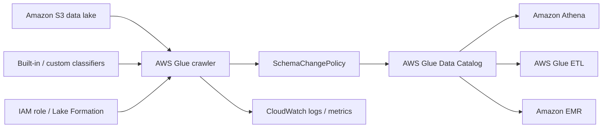

# Glue crawler và kiểm soát thay đổi schema

Trong data lake, dữ liệu thường được ghi liên tục từ nhiều hệ thống vào Amazon S3. Một nhóm có thể xuất JSON từ ứng dụng, nhóm khác ghi Parquet từ ETL, còn dữ liệu lịch sử được chia theo ngày hoặc theo tenant. Để Athena, AWS Glue ETL và các dịch vụ phân tích hiểu được dữ liệu, tổ chức cần metadata mô tả vị trí, định dạng, cột, kiểu dữ liệu và partition. Nếu phải khai báo thủ công cho hàng trăm dataset, catalog nhanh chóng lỗi thời khi dữ liệu và schema thay đổi.

AWS Glue crawler tự động khám phá data store, phân loại định dạng, suy luận schema và cập nhật metadata vào AWS Glue Data Catalog. Tuy nhiên, tự động cập nhật cũng có rủi ro: một file sai định dạng, thay đổi kiểu dữ liệu hoặc một thư mục bị di chuyển có thể khiến catalog thay đổi ngoài dự kiến và làm hỏng truy vấn downstream. Vì vậy, crawler cần được cấu hình cùng chiến lược kiểm soát schema, partition, quyền truy cập, kiểm thử và phê duyệt.

Trong hệ sinh thái AWS, Glue crawler là công cụ khám phá metadata cho data lake. Data Catalog lưu định nghĩa database, table, column, partition và location để Athena, Glue ETL, EMR và các dịch vụ tương thích sử dụng. Crawler không chuyển đổi dữ liệu và không thay thế quy trình quản trị schema. Đối với event streaming, AWS Glue Schema Registry cung cấp phiên bản schema và quy tắc compatibility cho producer/consumer; đó là một lớp quản lý khác với crawler.

## Mục tiêu học tập

Sau bài học, bạn có thể:

- Giải thích crawler, classifier, Data Catalog table và partition hoạt động cùng nhau như thế nào.
- Thiết kế S3 prefix và partition layout để crawler khám phá đúng dataset.
- Chọn built-in classifier, custom classifier, table grouping và table prefix.
- Cấu hình `UpdateBehavior` và `DeleteBehavior` để kiểm soát thay đổi schema và xóa metadata.
- Phân biệt cập nhật toàn bộ schema, chỉ thêm cột mới và ghi log mà không cập nhật schema hiện có.
- Chọn full crawl, incremental new-folder crawl hoặc S3 event-based crawl.
- Kiểm soát thay đổi schema qua quy trình versioning, kiểm thử tương thích và phê duyệt.
- Giám sát crawler, điều tra schema drift và bảo vệ catalog bằng IAM, KMS và Lake Formation.

## AWS Glue crawler và Data Catalog

Crawler kết nối đến một hoặc nhiều data source, quét metadata của các tệp hoặc hệ thống được hỗ trợ, dùng classifier để nhận diện định dạng và suy luận cấu trúc dữ liệu. Sau đó crawler tạo hoặc cập nhật database, table và partition trong Glue Data Catalog.



### Crawler làm gì?

Một lần crawl thường thực hiện các bước sau:

1. Truy cập data source bằng IAM role hoặc Lake Formation credentials được cấu hình.
2. Liệt kê các vị trí và đối tượng thuộc phạm vi crawl.
3. Chọn file mẫu và dùng classifier để nhận diện định dạng như JSON, CSV, Parquet, Avro hoặc ORC.
4. Suy luận tên cột, kiểu dữ liệu, cấu trúc nested và thông tin partition.
5. Nhóm các file có cấu trúc tương thích thành table theo cấu hình grouping.
6. Tạo hoặc cập nhật metadata trong Data Catalog theo schema change policy và crawler output configuration.
7. Ghi trạng thái, thời gian, số lượng table/partition và thông tin lỗi để theo dõi.

Crawler là công cụ suy luận metadata. Nó không xác nhận mọi giá trị trong mọi record đều đúng nghiệp vụ, không tự sửa dữ liệu sai và không biến một schema mới thành schema tương thích với ứng dụng. Với file JSON/CSV có cấu trúc không đồng nhất, một vài file mẫu có thể không đại diện cho toàn bộ dataset. Cần kiểm tra dữ liệu thực tế bằng Glue Data Quality, ETL validation, Athena queries hoặc quy trình kiểm thử riêng.

### Data Catalog table không chứa dữ liệu

Glue Data Catalog là kho metadata. Một table thường mô tả:

- Tên database và table.
- Cột, kiểu dữ liệu, comment và thứ tự cột.
- Location trỏ đến S3 prefix hoặc data source.
- Input/output format, SerDe và table properties.
- Partition keys và danh sách partition metadata.
- Thông tin phân loại, định dạng và các thuộc tính do crawler hoặc người dùng đặt.

Khi crawler tạo table cho `s3://company-lake/orders/`, các file vẫn nằm trong S3. Athena đọc metadata để biết cách diễn giải file và tìm partition. Xóa table khỏi Data Catalog không mặc định xóa các object S3; ngược lại, xóa object S3 cũng không tự động xóa metadata table nếu crawler chưa phát hiện và xử lý thay đổi đó.

### Database, table và partition

Database trong Glue Data Catalog là namespace logic để nhóm table. Table mô tả dataset. Partition chia dataset thành các nhóm dữ liệu theo key như `year`, `month`, `day`, `region` hoặc `tenant`.

Ví dụ layout:

```text
s3://company-lake/orders/
  year=2026/
    month=11/
      day=20/
        part-0001.parquet
        part-0002.parquet
```

Crawler có thể nhận diện `year`, `month`, `day` là partition keys và tạo partition values tương ứng. Khi query Athena theo `year=2026` và `month=11`, engine có thể loại bỏ partition không liên quan, giảm lượng dữ liệu cần đọc.

Tên folder và quy ước partition nên ổn định. Tránh trộn dataset khác nhau trong cùng prefix hoặc dùng nhiều kiểu đặt tên không thống nhất như `month=11`, `month=Nov` và `month=2026-11` cho cùng một partition key.

## Data layout và table grouping

Crawler có thể tạo nhiều table nếu phát hiện các nhóm file có schema hoặc cấu trúc thư mục khác nhau. Một data lake được tổ chức tốt sẽ giúp crawler xác định ranh giới dataset rõ ràng.

### Thiết kế S3 prefix

Nên tách theo domain và dataset:

```text
s3://company-lake/
  raw/
    orders/
    customers/
    payments/
  curated/
    orders/
    customer-360/
  analytics/
    finance/
    marketing/
```

Không nên đặt file orders, customers và payments chung một prefix nếu chúng có schema khác nhau. Khi crawler quét một root prefix rộng, nó có thể tạo nhiều table, nhóm table ngoài dự kiến hoặc tốn thời gian liệt kê quá nhiều object.

### Grouping các S3 path tương thích

Mặc định, crawler dùng cấu trúc S3 và schema để quyết định nhóm file thành table. Nếu nhiều prefix có cùng schema và cùng ý nghĩa nghiệp vụ, có thể cấu hình `TableGroupingPolicy` là `CombineCompatibleSchemas` để tạo một table chung. Ví dụ dữ liệu orders theo ngày nằm ở nhiều thư mục partition có thể thuộc một table duy nhất.

Không bật grouping rộng khi các prefix chỉ tình cờ có cùng cột nhưng khác ý nghĩa. Hai dataset cùng có `id`, `status`, `created_at` vẫn có thể là hai thực thể khác nhau. Table grouping là quyết định về metadata và semantics; hãy xác nhận với data owner trước khi hợp nhất.

### Table prefix và phân tách crawler

`TablePrefix` cho phép thêm tiền tố vào tên table được tạo, ví dụ `raw_` hoặc `partner_a_`. Cách này giảm nguy cơ xung đột tên và giúp nhận diện nguồn dữ liệu. Với data lake lớn, có thể tạo nhiều crawler theo domain hoặc tầng raw/curated thay vì một crawler quét toàn bộ bucket.

Một crawler có thể có nhiều data targets. Nhưng nếu các nguồn có quyền, lịch thay đổi hoặc schema policy khác nhau, tách crawler giúp giảm blast radius và dễ kiểm soát quyền hơn.

## Classifier: nhận diện định dạng dữ liệu

Classifier quyết định cách Glue diễn giải file. AWS Glue cung cấp built-in classifiers cho nhiều định dạng phổ biến như JSON, CSV, Avro, Parquet và ORC. Có thể thêm custom classifier khi dữ liệu có định dạng riêng hoặc cần nhận diện theo mẫu cụ thể.

### Built-in classifier

Built-in classifier thường là lựa chọn đầu tiên cho định dạng chuẩn. Ví dụ:

- Parquet/ORC lưu schema trong metadata của file.
- Avro có schema gắn với container file.
- JSON có thể suy luận cấu trúc object và nested fields.
- CSV cần xác định delimiter, quote, header và kiểu dữ liệu cột.

Đối với CSV, file có header không đồng nhất hoặc chứa dấu phẩy/quote/newline trong field có thể làm kết quả suy luận không chính xác. Cần chuẩn hóa encoding, header và delimiter trước khi crawl.

### Custom classifier

Custom classifier hữu ích khi file không tuân theo cấu trúc chuẩn hoặc cần mẫu nhận diện cụ thể. AWS Glue hỗ trợ Grok, XML và JSON custom classifiers. Classifier tùy chỉnh được đăng ký trong Data Catalog và gắn vào crawler.

Crawler thử classifier theo thứ tự cấu hình. Khi classifier nhận diện thành công, kết quả classification và schema được sử dụng cho file tương ứng. Hãy kiểm thử classifier bằng file đại diện, file thiếu field, file thêm field và file sai định dạng. Không dùng một regex quá rộng vì nó có thể phân loại nhầm nhiều dataset.

### Schema inference không phải schema contract

Crawler quan sát dữ liệu để suy luận schema hiện có. Nó không biết cột `amount` là tiền VND hay USD, `status` có những giá trị nghiệp vụ nào, hoặc trường `customer_id` có được phép null hay không. Các quy tắc này thuộc data contract và cần được định nghĩa ngoài crawler.

Với dữ liệu quan trọng, hãy lưu schema contract trong Git hoặc Glue Schema Registry, kiểm tra file trước khi đưa vào curated zone và chỉ cập nhật Data Catalog sau khi thay đổi đã được chấp thuận.

## Schema drift và schema evolution

Schema drift là tình trạng cấu trúc dữ liệu thay đổi theo thời gian so với schema đã công bố. Một số thay đổi có thể tương thích, một số thay đổi phá vỡ consumer.

| Loại thay đổi | Ví dụ | Rủi ro downstream |
|---|---|---|
| Thêm cột nullable | Thêm `campaign_id` | Thường tương thích với consumer bỏ qua cột mới, nhưng query `SELECT *` có thể thay đổi số cột |
| Thêm cột bắt buộc | Thêm `currency` nhưng record cũ không có giá trị | Consumer hoặc ETL có thể không xử lý được null/missing |
| Xóa cột | Bỏ `legacy_status` | Query, view hoặc job còn tham chiếu cột sẽ lỗi |
| Đổi tên cột | `customer_no` thành `customer_id` | Thường được xem như xóa và thêm; consumer cũ có thể hỏng |
| Đổi kiểu dữ liệu | `amount` từ string sang decimal | Có thể gây cast error, sai kết quả hoặc query failure |
| Thay đổi nested structure | `address` từ string sang struct | SerDe và downstream mapping có thể không tương thích |
| Thay đổi partition key/layout | Từ `dt=...` sang `year/month/day` | Partition discovery và query pruning có thể sai |
| Thay đổi semantics | `amount` chuyển từ gross sang net | Schema không đổi nhưng ý nghĩa dữ liệu thay đổi, nguy hiểm cho báo cáo |

Thêm cột thường dễ tương thích hơn xóa hoặc đổi kiểu, nhưng vẫn phải đánh giá consumer. Đặc biệt, Athena query dùng `SELECT *`, Glue ETL mapping theo vị trí, dashboard và BI extract có thể bị ảnh hưởng khi thứ tự hoặc số lượng cột thay đổi.

### Chiến lược versioning

Một cách an toàn là coi mỗi thay đổi schema như một phiên bản data contract:

1. Producer đề xuất schema mới và mô tả mục đích, kiểu dữ liệu, nullability và thời điểm áp dụng.
2. Kiểm tra compatibility với consumer đang chạy.
3. Thêm test cho file mới và file cũ; chạy thử crawler trong database/catalog thử nghiệm.
4. Xác nhận các query, Glue jobs, views và dashboards vẫn hoạt động.
5. Phê duyệt thay đổi, triển khai producer và cập nhật catalog theo kế hoạch.
6. Theo dõi lỗi và giữ khả năng rollback hoặc đọc song song schema cũ/mới.

Với thay đổi breaking, cân nhắc tạo dataset/version mới hoặc prefix mới thay vì ghi đè schema hiện tại. Ví dụ `orders_v1/` và `orders_v2/` cho phép consumer chuyển đổi theo lịch mà không bị thay đổi bất ngờ.

## SchemaChangePolicy: kiểm soát crawler sửa Data Catalog

`SchemaChangePolicy` định nghĩa cách crawler phản ứng khi phát hiện schema thay đổi hoặc object/table bị xóa. Hai thuộc tính chính là `UpdateBehavior` và `DeleteBehavior`.

### UpdateBehavior

| Giá trị | Hành vi | Khi dùng |
|---|---|---|
| `UPDATE_IN_DATABASE` | Cập nhật định nghĩa table/partition hiện có khi crawler phát hiện schema thay đổi; vẫn tạo table và partition mới | Dataset do crawler quản lý hoàn toàn, schema drift đã được chấp nhận hoặc môi trường thử nghiệm |
| `LOG` | Không sửa schema của table/partition hiện có; ghi nhận thay đổi vào log. Crawler vẫn có thể tạo table mới và partition mới | Muốn bảo vệ schema hiện có, cần kiểm tra thay đổi trước khi cập nhật catalog |

Nếu crawler dùng `LOG`, phát hiện schema mới không đồng nghĩa crawler đã cập nhật table schema. Hãy xem log để biết có thay đổi nào bị bỏ qua và xử lý bằng quy trình được duyệt.

### DeleteBehavior

| Giá trị | Hành vi | Khi dùng |
|---|---|---|
| `LOG` | Ghi log khi table/partition hoặc đối tượng catalog được phát hiện không còn tồn tại; không xóa metadata | Mặc định an toàn cho môi trường cần bảo toàn metadata và audit |
| `DEPRECATE_IN_DATABASE` | Đánh dấu table không còn tồn tại là deprecated và ghi thời điểm deprecation | Muốn giữ dấu vết table cũ trong catalog để consumer và owner nhận biết |
| `DELETE_FROM_DATABASE` | Xóa table/partition metadata tương ứng khỏi Data Catalog khi crawler xác định đã bị xóa | Chỉ dùng khi catalog cần phản ánh trạng thái nguồn và đã đánh giá tác động |

DeleteBehavior tác động đến metadata trong Data Catalog, không phải cơ chế xóa object S3. Không bật `DELETE_FROM_DATABASE` chỉ vì muốn dọn file cũ trong bucket. Với nguồn dữ liệu tạm thời, cần kiểm tra crawler có thể kết luận chính xác object/table đã bị xóa hay không trước khi cho phép xóa metadata.

### Chọn policy theo môi trường

| Môi trường | UpdateBehavior gợi ý | DeleteBehavior gợi ý | Lý do |
|---|---|---|---|
| Sandbox | `UPDATE_IN_DATABASE` | `LOG` hoặc `DELETE_FROM_DATABASE` tùy dữ liệu | Có thể chấp nhận thay đổi nhanh để thử nghiệm |
| Raw production | `LOG` hoặc `MergeNewColumns` | `LOG` | Bảo toàn schema và metadata, phát hiện drift trước khi cập nhật |
| Curated production | Thường quản lý schema bằng ETL/IaC; crawler chỉ cập nhật theo quy trình | `LOG` hoặc `DEPRECATE_IN_DATABASE` | Schema curated là hợp đồng cho consumer, cần review |
| Temporary landing | `UPDATE_IN_DATABASE` | `DELETE_FROM_DATABASE` nếu có retention và ownership rõ | Metadata có thể được dọn theo vòng đời dữ liệu |

Đây là mẫu tham khảo. Quyết định thực tế phụ thuộc mức độ quan trọng của dữ liệu, quyền sở hữu schema, consumer và yêu cầu audit.

## Chỉ thêm cột mới: MergeNewColumns

Trong một số trường hợp, tổ chức muốn crawler tự động thêm cột mới nhưng không thay đổi hoặc xóa các cột đã tồn tại. Có thể cấu hình crawler output `Tables.AddOrUpdateBehavior` thành `MergeNewColumns`.

Ví dụ configuration JSON:

```json
{
  "Version": 1.0,
  "CrawlerOutput": {
    "Tables": {
      "AddOrUpdateBehavior": "MergeNewColumns"
    },
    "Partitions": {
      "AddOrUpdateBehavior": "InheritFromTable"
    }
  }
}
```

`MergeNewColumns` giúp crawler bổ sung các cột mới vào table hiện có mà không thay thế schema hiện tại bằng schema suy luận mới. `InheritFromTable` yêu cầu partition metadata kế thừa schema từ table, giúp tránh partition có schema lệch nhau. Hành vi cụ thể cần được kiểm thử với định dạng dữ liệu, partition và cấu hình crawler thực tế.

### Ghi log mọi thay đổi schema hiện có

Nếu không muốn crawler cập nhật schema của table hiện có, đặt `UpdateBehavior=LOG`. Crawler vẫn ghi nhận thay đổi trong CloudWatch Logs. Có thể kết hợp `Partitions.AddOrUpdateBehavior=InheritFromTable` để partition schema kế thừa từ table.

Ví dụ AWS CLI:

```bash
aws glue update-crawler \
  --name orders-raw-crawler \
  --schema-change-policy UpdateBehavior=LOG,DeleteBehavior=LOG \
  --configuration '{"Version":1.0,"CrawlerOutput":{"Partitions":{"AddOrUpdateBehavior":"InheritFromTable"}}}'
```

Nếu chỉ muốn merge cột mới, dùng `MergeNewColumns` trong `CrawlerOutput.Tables` và kiểm tra schema change policy tương ứng. Không kết hợp các cấu hình theo kiểu sao chép mẫu mà chưa hiểu tác động của từng tùy chọn.

## Recrawl policy: quét toàn bộ hay chỉ quét thay đổi?

Crawler S3 có thể chạy theo các chiến lược recrawl khác nhau:

| RecrawlBehavior | Cách hoạt động | Lợi ích và giới hạn |
|---|---|---|
| `CRAWL_EVERYTHING` | Quét toàn bộ dataset mỗi lần chạy | Phát hiện thay đổi schema và dữ liệu trong phạm vi; tốn thời gian hơn khi dataset lớn |
| `CRAWL_NEW_FOLDERS_ONLY` | Sau lần full crawl đầu tiên, chỉ phát hiện folder mới để thêm partition | Nhanh hơn; không phát hiện sửa đổi hoặc xóa partition hiện có và ép update/delete behavior về `LOG` |
| `CRAWL_EVENT_MODE` | Dùng S3 events để xác định các folder thay đổi cần quét | Giảm việc liệt kê toàn bộ dataset; cần cấu hình event mode và kiểm thử coverage của event |

### Incremental crawl chỉ thêm folder mới

Lần crawl đầu tiên vẫn là full crawl để xây dựng schema và partition hiện có. Những lần tiếp theo với `CRAWL_NEW_FOLDERS_ONLY` chỉ tập trung vào folder mới. Cơ chế này phù hợp khi dataset có schema ổn định và chủ yếu phát sinh partition mới theo thời gian.

Giới hạn quan trọng: incremental new-folder crawl không phát hiện thay đổi hoặc xóa ở partition hiện có. Nếu sửa schema trong folder tháng trước hoặc xóa dữ liệu của một partition cũ, crawler không tự cập nhật catalog theo cách full crawl. Khi có thay đổi lớn, tạm chuyển sang `CRAWL_EVERYTHING`, kiểm tra kết quả, rồi mới bật incremental trở lại.

Khi bật chế độ này, Glue buộc schema update và delete behavior về `LOG`. Nếu các file trong folder mới có schema không tương thích, crawler có thể bỏ qua việc thêm chúng vào Data Catalog và ghi chi tiết vào CloudWatch Logs.

### Event-based crawl

`CRAWL_EVENT_MODE` dùng thông tin thay đổi từ Amazon S3 events để xác định phần dữ liệu cần quét. Cách này phù hợp với bucket có nhiều object và chỉ một phần nhỏ folder thay đổi giữa các lần crawl. Cần cấu hình event notifications theo yêu cầu Glue, bảo đảm event được chuyển đúng và kiểm tra tình huống event trễ, trùng hoặc thất lạc. Lần đầu vẫn cần xây dựng metadata nền; event mode không phải thay thế cho quy trình kiểm tra schema.

## Glue crawler và Glue Schema Registry

Hai tính năng có tên gần nhau nhưng giải quyết hai bài toán khác nhau:

| Tiêu chí | Glue crawler + Data Catalog | Glue Schema Registry |
|---|---|---|
| Mục tiêu | Khám phá schema của dữ liệu đã lưu và tạo table metadata | Quản lý schema có phiên bản và compatibility cho producer/consumer |
| Nguồn phổ biến | S3, JDBC, data store được crawler hỗ trợ | Kinesis Data Streams, Amazon MSK/Kafka và ứng dụng tích hợp |
| Cách có schema | Suy luận từ file/data source | Producer đăng ký hoặc tham chiếu schema version |
| Kiểm soát thay đổi | SchemaChangePolicy và crawler output configuration | Compatibility mode như BACKWARD, FORWARD, FULL và các biến thể `_ALL` |
| Đầu ra | Database, table, column và partition trong Data Catalog | Schema definition/version và metadata trong Registry |

Crawler không thay thế Schema Registry cho streaming event contract. Registry cũng không tự khám phá mọi file trên S3 để tạo Data Catalog tables. Một kiến trúc có thể dùng Schema Registry để kiểm soát producer/consumer, sau đó lưu raw events vào S3 và dùng crawler hoặc ETL để catalog dữ liệu lưu trữ.

### Compatibility modes

Glue Schema Registry kiểm tra schema version mới theo compatibility mode đã chọn. Một số mode phổ biến:

- `BACKWARD`: consumer dùng schema mới có thể đọc dữ liệu được ghi theo schema phiên bản trước gần nhất.
- `BACKWARD_ALL`: kiểm tra khả năng tương thích ngược với mọi phiên bản trước.
- `FORWARD`: consumer dùng schema phiên bản trước có thể đọc dữ liệu được ghi theo schema mới.
- `FORWARD_ALL`: kiểm tra tương thích xuôi với mọi phiên bản trước.
- `FULL` và `FULL_ALL`: yêu cầu tương thích cả hai chiều theo phạm vi phiên bản tương ứng.
- `NONE`: không thực hiện kiểm tra compatibility.

Chọn mode theo cách producer và consumer được triển khai. Ví dụ, nếu consumer có thể được nâng cấp trước producer, backward compatibility thường hữu ích; nếu producer mới sẽ phát dữ liệu trước khi mọi consumer được nâng cấp, cần đánh giá forward compatibility. Hãy kiểm tra quy tắc cụ thể cho format Avro, JSON Schema hoặc Protobuf và cách ứng dụng tích hợp Registry.

## Quy trình triển khai crawler có kiểm soát

### 1. Xác định owner và data contract

Ghi nhận data owner, mục đích dataset, nguồn tạo dữ liệu, schema kỳ vọng, partition keys, retention và consumer. Xác định thay đổi nào được xem là tương thích, thay đổi nào cần version mới hoặc phê duyệt.

### 2. Chuẩn hóa S3 layout

Tách raw, curated và analytics; tách dataset theo domain; dùng partition key nhất quán. Tránh đưa file tạm, manifest, checksum hoặc file lỗi vào cùng prefix dữ liệu chính nếu crawler có thể nhận nhầm chúng thành data file.

### 3. Cấp quyền crawler

Tạo IAM role riêng cho crawler với quyền đọc data source, ghi metadata vào Data Catalog và ghi log. Nếu dữ liệu dùng SSE-KMS, cấp quyền decrypt cho key phù hợp. Nếu dùng Lake Formation, cấu hình crawler sử dụng Lake Formation credentials và cấp quyền database/table/data location tương ứng. Không cấp `s3:*` hoặc `glue:*` toàn tài khoản nếu chỉ cần một bucket/database.

### 4. Chọn classifier và phạm vi crawl

Chọn built-in classifier trước; thêm custom classifier nếu định dạng riêng. Giới hạn target đến prefix cần thiết, dùng include/exclude path nếu phù hợp và đặt table prefix để tránh trùng tên.

### 5. Chọn schema và delete policy

Với raw production, thường bắt đầu bằng `UpdateBehavior=LOG` hoặc `MergeNewColumns` sau khi đã kiểm thử. Chọn `DeleteBehavior=LOG` hoặc `DEPRECATE_IN_DATABASE` nếu cần giữ dấu vết. Chỉ dùng `DELETE_FROM_DATABASE` khi đã có quy trình xác nhận xóa metadata.

### 6. Chọn recrawl strategy

Dùng full crawl khi schema thay đổi thường xuyên hoặc cần phát hiện sửa/xóa. Dùng new-folder incremental crawl khi schema ổn định và chỉ thêm partition. Dùng event mode khi số lượng object lớn, thay đổi thưa và event notification đã được kiểm thử.

### 7. Chạy thử trong catalog riêng

Chạy crawler trên database thử nghiệm hoặc prefix canary. So sánh table/column/partition trước và sau crawl; kiểm tra classifier, type inference, table grouping, partition inheritance và log. Chạy Athena/Glue ETL test để xác nhận downstream vẫn đọc được.

### 8. Đưa vào lịch và giám sát

Chọn lịch crawl phù hợp với tần suất dữ liệu mới. Không cần chạy mỗi phút nếu partition chỉ xuất hiện mỗi ngày. Theo dõi crawler state, thời gian chạy, số lượng table/partition, lỗi và schema drift. Cấu hình alarm hoặc workflow thông báo khi crawler thất bại hoặc schema change bị log.

### 9. Review thay đổi schema

Định kỳ đọc log, so sánh Data Catalog table version và xác định thay đổi có được chấp thuận không. Nếu schema mới hợp lệ, cập nhật bằng crawler policy hoặc ETL `UpdateTable`/catalog update theo quy trình. Nếu không hợp lệ, giữ schema hiện tại, sửa producer/file và chạy lại.

## Ví dụ AWS CLI và cấu hình

### Tạo crawler với schema change policy an toàn

Ví dụ dưới đây tạo crawler cho prefix orders raw. Role ARN và database cần được tạo trước với quyền phù hợp.

```bash
aws glue create-crawler \
  --name orders-raw-crawler \
  --role arn:aws:iam::123456789012:role/GlueCrawlerOrdersRole \
  --database-name raw_catalog \
  --targets '{"S3Targets":[{"Path":"s3://company-lake/raw/orders/"}]}' \
  --schema-change-policy UpdateBehavior=LOG,DeleteBehavior=LOG \
  --table-prefix orders_raw_
```

### Chạy crawler và kiểm tra trạng thái

```bash
aws glue start-crawler --name orders-raw-crawler

aws glue get-crawler --name orders-raw-crawler

aws glue get-crawler-metrics \
  --crawler-name-list orders-raw-crawler
```

Crawler chạy bất đồng bộ. `start-crawler` chỉ khởi chạy tác vụ; cần theo dõi trạng thái đến khi crawler trở về `READY` và kiểm tra thông tin `LastCrawl` để xác nhận thành công.

### Kiểm tra table trong Data Catalog

```bash
aws glue get-tables \
  --database-name raw_catalog

aws glue get-table \
  --database-name raw_catalog \
  --name orders_raw_orders
```

Kiểm tra `StorageDescriptor.Columns`, `PartitionKeys`, `Location`, SerDe và table properties. Đừng chỉ kiểm tra crawler status; một crawl thành công vẫn có thể tạo table hoặc schema không đúng kỳ vọng nghiệp vụ.

## Tình huống thực tế: thêm cột vào dữ liệu orders

Một ứng dụng thương mại điện tử ghi Parquet vào `s3://company-lake/raw/orders/year=2026/month=11/`. Table `orders` hiện có các cột `order_id`, `customer_id`, `amount`, `created_at`. Nhóm phát triển muốn thêm `sales_channel` để phân tích nguồn đơn hàng.

Quy trình đề xuất:

1. Data owner xác nhận `sales_channel` là cột mới, kiểu string, có thể null cho dữ liệu lịch sử.
2. Producer phát hành file mới có cột này; file cũ vẫn giữ schema cũ.
3. Chạy crawler thử nghiệm với `MergeNewColumns` hoặc `UpdateBehavior=LOG` tùy chính sách; so sánh kết quả trong catalog thử nghiệm.
4. Kiểm tra partition schema. Nếu partition metadata khác table, dùng `InheritFromTable` sau khi xác nhận behavior phù hợp.
5. Chạy Athena query và Glue ETL test với cả partition cũ và mới.
6. Nếu schema mới hợp lệ, cập nhật production catalog theo quy trình phê duyệt và thông báo cho BI/consumer owner.
7. Theo dõi query error, ETL failure và log crawler trong các lần crawl tiếp theo.

Nếu thay đổi là đổi `amount` từ string sang decimal hoặc xóa `customer_id`, không nên tự động cho crawler cập nhật production schema. Tạo schema version/dataset version mới, chuyển consumer theo kế hoạch và giữ khả năng đọc dữ liệu cũ trong thời gian chuyển đổi.

## Giám sát và xử lý sự cố

### Chỉ số và log cần theo dõi

- Crawler state: `READY`, `RUNNING`, `STOPPING`.
- Last crawl status, thời gian chạy và thông tin error message.
- Số lượng table/partition được tạo hoặc cập nhật.
- Crawler duration và thay đổi bất thường về số lượng object được quét.
- CloudWatch logs cho classifier, schema drift, quyền truy cập và lỗi data source.
- CloudTrail cho các thay đổi control plane như `CreateCrawler`, `UpdateCrawler`, `StartCrawler`, `UpdateTable` và quyền truy cập catalog.
- Athena/Glue ETL query failure sau khi schema thay đổi.

Nên cảnh báo khi crawler thất bại liên tiếp, thời gian crawl tăng đột biến, số lượng table mới vượt ngưỡng hoặc log xuất hiện schema change chưa được phê duyệt.

### Lỗi thường gặp

| Triệu chứng | Nguyên nhân có thể | Cách điều tra |
|---|---|---|
| Crawler không đọc được S3 | IAM role thiếu `s3:ListBucket`/`s3:GetObject`, bucket policy hoặc KMS key policy chặn | Kiểm tra role, bucket policy, KMS decrypt và CloudTrail |
| Không tạo table | Prefix rỗng, file không được hỗ trợ, classifier không nhận diện hoặc quyền Data Catalog thiếu | Kiểm tra target path, sample file, classifier và Glue permissions |
| Tạo nhiều table ngoài dự kiến | Nhiều schema/format trong cùng prefix hoặc grouping không phù hợp | Tách prefix, dùng crawler riêng hoặc điều chỉnh grouping |
| Schema thay đổi bất ngờ | `UpdateBehavior=UPDATE_IN_DATABASE` hoặc output config cho phép merge/update | Xem crawler config, schema policy và CloudWatch logs |
| Cột mới không xuất hiện | `UpdateBehavior=LOG`, incremental mode hoặc classifier không nhận diện | Kiểm tra policy, recrawl behavior và file mẫu |
| Partition có schema khác table | Partition metadata cũ hoặc cấu hình output không kế thừa schema | Kiểm tra partition và cân nhắc `InheritFromTable` |
| Xóa file nhưng table vẫn tồn tại | Delete behavior là LOG/DEPRECATE hoặc crawl không phát hiện deletion | Kiểm tra policy, recrawl mode và log |
| Thay đổi partition cũ không được phát hiện | `CRAWL_NEW_FOLDERS_ONLY` chỉ quét folder mới | Chạy full crawl có kiểm soát để đồng bộ thay đổi |
| Crawl chậm | Quét quá nhiều object, prefix rộng, nhiều file nhỏ hoặc classifier phức tạp | Thu hẹp target, partition hợp lý, incremental/event mode và tối ưu file layout |
| Athena query lỗi sau crawl | Kiểu dữ liệu, SerDe, column name hoặc partition metadata không tương thích | So sánh schema trước/sau, query sample và rollback catalog theo runbook |

## Thực hành tốt

- Coi Data Catalog là metadata contract mà consumer phụ thuộc; thay đổi cần có owner và quy trình review.
- Tách S3 prefix theo domain, dataset và tầng raw/curated; không trộn file không liên quan.
- Dùng built-in classifier trước, custom classifier khi có lý do và test bằng dữ liệu đại diện.
- Bắt đầu production với `UpdateBehavior=LOG` hoặc `MergeNewColumns` nếu chỉ chấp nhận thêm cột.
- Đặt `DeleteBehavior=LOG` hoặc `DEPRECATE_IN_DATABASE` cho dữ liệu cần audit; chỉ xóa metadata khi có approval.
- Dùng `InheritFromTable` khi muốn partition schema đồng nhất với table và đã kiểm thử.
- Chọn incremental crawl chỉ khi schema ổn định và chấp nhận không phát hiện sửa/xóa partition cũ.
- Dùng event-based crawl cho dataset lớn và thay đổi thưa sau khi xác nhận S3 event coverage.
- Không dựa vào crawler để kiểm tra data quality hoặc enforce business contract.
- Dùng Glue Schema Registry cho schema streaming cần version/compatibility; dùng crawler cho khám phá metadata lưu trữ.
- Cấp IAM/Lake Formation/KMS least privilege cho crawler role và kiểm tra CloudTrail.
- Chạy thử trong catalog hoặc prefix canary trước khi cập nhật production.
- Theo dõi crawler logs, table/partition changes và downstream Athena/ETL failures.
- Lưu schema version, quyết định phê duyệt và phương án rollback cho thay đổi breaking.

## Checklist triển khai production

- [ ] Xác định data owner, consumer, data contract và partition strategy.
- [ ] Chuẩn hóa S3 prefix, file format, encoding, header và naming convention.
- [ ] Chọn crawler targets đủ hẹp, table prefix và grouping policy phù hợp.
- [ ] Chọn built-in/custom classifiers và kiểm thử với file hợp lệ, file thiếu cột và file sai định dạng.
- [ ] Cấp IAM role, S3, KMS, Glue Data Catalog và Lake Formation permissions tối thiểu.
- [ ] Chọn `UpdateBehavior` và `DeleteBehavior` theo mức độ tin cậy của nguồn dữ liệu.
- [ ] Nếu chỉ thêm cột, cân nhắc `MergeNewColumns`; nếu không cập nhật schema, dùng `LOG`.
- [ ] Kiểm tra partition schema và cân nhắc `InheritFromTable`.
- [ ] Chọn full, new-folder incremental hoặc event-mode crawl theo đặc tính dữ liệu.
- [ ] Chạy thử trong catalog/prefix thử nghiệm và so sánh schema trước/sau.
- [ ] Kiểm thử Athena queries, Glue jobs, views và dashboard downstream.
- [ ] Thiết lập lịch, CloudWatch logs/metrics, alarms và CloudTrail audit.
- [ ] Định nghĩa quy trình review, phê duyệt, versioning và rollback schema.
- [ ] Kiểm tra lại sau khi producer thay đổi schema hoặc partition layout.

## Kết luận

Glue crawler giúp tự động khám phá dữ liệu và cập nhật metadata trong Data Catalog, nhưng quyền tự động thay đổi schema cần được giới hạn theo mức độ quan trọng của dataset. `UpdateBehavior` kiểm soát cập nhật schema; `DeleteBehavior` kiểm soát metadata khi nguồn bị xóa; `MergeNewColumns` hỗ trợ thêm cột mà giữ định nghĩa hiện có; recrawl policy quyết định phạm vi quét lại. Kết hợp crawler với data contract, Schema Registry cho streaming, kiểm thử downstream, IAM/Lake Formation và giám sát sẽ giúp data lake duy trì catalog chính xác mà không để schema drift làm gián đoạn consumer.

## Tài liệu tham khảo

- [AWS Glue crawlers and Data Catalog](https://docs.aws.amazon.com/glue/latest/dg/catalog-and-crawler.html)
- [Crawler API and SchemaChangePolicy](https://docs.aws.amazon.com/glue/latest/dg/aws-glue-api-crawler-crawling.html)
- [Preventing a crawler from changing an existing schema](https://docs.aws.amazon.com/glue/latest/dg/crawler-schema-changes-prevent.html)
- [Customizing crawler behavior](https://docs.aws.amazon.com/glue/latest/dg/crawler-configuration.html)
- [Incremental crawls for adding new partitions](https://docs.aws.amazon.com/glue/latest/dg/incremental-crawls.html)
- [Schema Registry and schema version compatibility](https://docs.aws.amazon.com/glue/latest/dg/schema-registry.html)
- [Integrating with AWS Glue Schema Registry](https://docs.aws.amazon.com/glue/latest/dg/schema-registry-integrations.html)
- [AWS Glue crawler SchemaChangePolicy API](https://docs.aws.amazon.com/glue/latest/webapi/API_SchemaChangePolicy.html)
- [AWS Glue crawler configuration API](https://docs.aws.amazon.com/glue/latest/webapi/API_Crawler.html)
