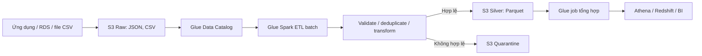

# Glue ETL job với Spark và xử lý dữ liệu theo lô

Một data lake thường nhận dữ liệu từ nhiều hệ thống với định dạng, schema và tốc độ khác nhau. Dữ liệu thô có thể là JSON từ ứng dụng, CSV từ hệ thống nghiệp vụ, Parquet từ pipeline trước hoặc bảng quan hệ đọc qua JDBC. Trước khi dữ liệu được dùng cho báo cáo và phân tích, tổ chức cần chuẩn hóa schema, làm sạch bản ghi, loại trùng, kiểm tra chất lượng và ghi ra vùng dữ liệu có cấu trúc.

AWS Glue cung cấp môi trường ETL được quản lý để chạy Apache Spark mà không phải tự dựng và vận hành cụm. Một Glue Spark job đọc dữ liệu từ Amazon S3, AWS Glue Data Catalog hoặc nguồn JDBC/connector; dùng DynamicFrame và Spark DataFrame để biến đổi; sau đó ghi dữ liệu đã xử lý về S3, database hoặc bảng lakehouse. Glue Data Catalog lưu metadata để Athena, Redshift Spectrum, EMR và Glue cùng khám phá dữ liệu.

Xử lý theo lô (batch processing) phù hợp khi dữ liệu được gom theo cửa sổ thời gian hoặc theo đợt, ví dụ đơn hàng mỗi giờ, giao dịch cuối ngày, file đối soát hoặc snapshot dữ liệu từ hệ thống nguồn. Một batch pipeline tốt phải kiểm soát đầu vào, bookmark/incremental processing, tính lặp an toàn, chất lượng dữ liệu, hiệu năng Spark, chi phí và khả năng quan sát.

## Mục tiêu học tập

Sau bài học, bạn có thể:

- Giải thích vai trò của AWS Glue, Glue Data Catalog, crawler, GlueContext và Spark runtime.
- Tạo Glue Spark ETL job chạy theo lô với script Python/PySpark.
- Chọn DynamicFrame hoặc DataFrame theo yêu cầu xử lý và chất lượng schema.
- Đọc dữ liệu từ S3/Data Catalog và JDBC, áp dụng partition pruning và pushdown.
- Chuẩn hóa schema, xử lý bản ghi lỗi, loại trùng và ghi dữ liệu Parquet có partition.
- Dùng job bookmarks đúng cách và thiết kế output idempotent.
- Chọn Glue version, worker type, Auto Scaling, Flex, timeout và retry phù hợp.
- Tối ưu Spark bằng partitioning, join strategy, file sizing và đo lường bottleneck.
- Bảo vệ job bằng IAM, KMS, Secrets Manager, VPC connection và Lake Formation.
- Orchestrate, giám sát, xử lý sự cố và kiểm soát chi phí của batch pipeline.

## 1. Batch ETL trong data lake

ETL là quy trình **Extract – Transform – Load**:

1. **Extract**: đọc dữ liệu từ nguồn như S3, RDS, database bên ngoài, API hoặc hệ thống file.
2. **Transform**: chuẩn hóa kiểu dữ liệu, kiểm tra chất lượng, làm sạch, join, aggregate, deduplicate và áp dụng quy tắc nghiệp vụ.
3. **Load**: ghi kết quả vào vùng curated, data warehouse hoặc bảng phân tích.

Trong kiến trúc data lake, dữ liệu thường được chia thành các vùng:

| Vùng | Mục đích | Ví dụ |
|---|---|---|
| Raw / Bronze | Giữ dữ liệu gần nguồn, ít biến đổi, phục vụ replay/audit | JSON/CSV gốc theo ngày nhận |
| Cleansed / Silver | Chuẩn hóa schema, timestamp, kiểu dữ liệu và khóa | Parquet đã kiểm tra null, format và duplicate |
| Curated / Gold | Dữ liệu theo mô hình nghiệp vụ, sẵn sàng phân tích | Bảng doanh thu theo ngày, sản phẩm và Region |

Ví dụ pipeline đơn hàng:



Batch ETL xử lý một tập dữ liệu hữu hạn trong mỗi lần chạy. Ví dụ, job chạy lúc 02:00 để xử lý các file của ngày hôm trước. Nếu dữ liệu đến muộn, pipeline có thể chạy lại một partition hoặc backfill một khoảng thời gian. Cần phân biệt batch với streaming: streaming xử lý dữ liệu liên tục và thường dùng checkpoint; job bookmark của Glue batch không phải cơ chế checkpoint của Spark Structured Streaming.

## 2. AWS Glue gồm những thành phần nào?

AWS Glue là dịch vụ data integration serverless. Trong một pipeline Spark batch, các thành phần thường gặp gồm:

| Thành phần | Vai trò |
|---|---|
| Glue job | Định nghĩa script, runtime, worker, role, timeout và tham số thực thi |
| Glue Spark runtime | Môi trường chạy Apache Spark do AWS quản lý |
| GlueContext | Mở rộng SparkContext với Glue DynamicFrame, Catalog và connector |
| DynamicFrame | Cấu trúc dữ liệu của Glue, hỗ trợ schema không đồng nhất và choice type |
| Spark DataFrame | Cấu trúc dữ liệu Spark có schema rõ ràng, tận dụng Spark SQL optimizer |
| Glue Data Catalog | Kho metadata về database, table, schema, location và partition |
| Crawler | Quét nguồn dữ liệu để suy luận schema và partition, sau đó cập nhật Catalog |
| Connection | Lưu thông tin kết nối/network cho JDBC, VPC hoặc connector |
| Job bookmark | Lưu trạng thái nguồn đã xử lý để hỗ trợ incremental batch |
| Trigger / Workflow | Khởi chạy job theo lịch, theo điều kiện hoặc theo event |
| Glue Data Quality | Đánh giá quy tắc chất lượng dữ liệu bằng DQDL |

Glue job chạy bằng IAM execution role. Role cần quyền đọc nguồn, ghi đích, truy cập Catalog, dùng KMS key, lấy secret, ghi log và tạo network interface nếu job chạy trong VPC. Không dùng quyền AdministratorAccess chỉ để xử lý lỗi AccessDenied.

## 3. Chọn Glue version và Spark runtime

Glue version xác định phiên bản Spark, Python/Scala, Java và một số thư viện đi kèm. Đây là một phần của contract runtime: thay version có thể làm thay đổi hành vi Spark SQL, connector, thư viện Python/Java và serialization.

Theo bảng runtime trong tài liệu AWS hiện hành:

| Glue version | Apache Spark | Python cho Spark job | Java | Khi cân nhắc |
|---|---:|---:|---:|---|
| 6.0 | 4.1.1 | 3.13 | 17 | Runtime mới cho job mới sau khi kiểm thử tương thích |
| 5.1 | 3.5.6 | 3.11 | 17 | Lựa chọn khi cần Spark 3.5 và hệ sinh thái thư viện đã xác nhận |
| 5.0 | 3.5.4 | 3.11 | 17 | Nền tảng Spark 3.5 cho workload đã chuẩn hóa |
| 4.0 | 3.3.0 | 3.10 | 8 | Chủ yếu cho job legacy cần thời gian nâng cấp |

Glue 6.0 là runtime mới nhất trong bảng phiên bản được tham chiếu ở đây. Default Glue version cho job mới có thể thay đổi theo thời điểm và giao diện/API; vì vậy production nên pin Glue version rõ ràng trong IaC thay vì dựa vào default. Availability của version và worker type có thể khác theo Region; xác nhận trước khi triển khai.

### Kế hoạch nâng cấp runtime

Khi chuyển Glue version:

1. Liệt kê Python modules, Java JAR, JDBC drivers và custom connectors.
2. Kiểm tra compatibility với Spark/Python/Java mới.
3. Chạy unit test cho transform và integration test trên dữ liệu đại diện.
4. So sánh schema, row count, null rate, duplicate rate và business totals.
5. So sánh execution time, shuffle, memory, worker utilization và cost.
6. Canary trên một partition hoặc một nhóm bảng trước khi nâng toàn bộ lịch chạy.

Không chỉ kiểm tra job có trạng thái `SUCCEEDED`. Một job có thể chạy thành công nhưng thay đổi kết quả do cast, timestamp, decimal precision, ANSI behavior hoặc thư viện connector.

## 4. Glue Data Catalog và crawler

Glue Data Catalog lưu metadata, không phải nơi chứa dữ liệu vật lý. Một database trong Catalog là namespace metadata; một table mô tả schema, location, input/output format, SerDe, partition keys và table properties.

Ví dụ table `raw_orders` có thể mô tả dữ liệu nằm tại:

```text
s3://company-data/raw/orders/
  year=2026/
    month=11/
      day=20/
        part-00001.json
        part-00002.json
```

Catalog lưu schema của các cột như `order_id`, `customer_id`, `amount`, `order_ts`, cùng partition keys `year`, `month`, `day`. Glue Spark job có thể đọc table bằng database/table name thay vì phải tự liệt kê file path.

### Crawler làm gì?

Crawler kết nối nguồn, quét file hoặc database, chạy classifier nếu cần, suy luận schema và tạo/cập nhật database/table/partition trong Catalog. Crawler hữu ích khi onboarding dataset hoặc khi schema/partition thay đổi có kiểm soát.

Crawler không phải bước bắt buộc trước mọi lần chạy ETL. Với pipeline production, có thể quản lý schema bằng IaC hoặc cập nhật Catalog trong ETL job. Chạy crawler liên tục trên prefix lớn có thể làm tăng thời gian discovery, phát sinh thay đổi schema ngoài dự kiến và làm chậm pipeline.

### Schema evolution

Khi nguồn thêm cột, đổi kiểu hoặc thay cấu trúc JSON, cần có quy tắc:

- Cột mới có được chấp nhận tự động không?
- Cột bị xóa có làm job fail hay được xử lý như nullable?
- Đổi `string` sang `decimal` có cần cast và kiểm tra overflow không?
- Schema của raw có được giữ nguyên để replay không?
- Curated schema có version và migration plan không?

Không để crawler tự thay schema curated mà không có review. Dùng crawler cho discovery; dùng schema contract và kiểm tra rõ ràng cho dữ liệu downstream quan trọng.

## 5. Spark job chạy như thế nào?

Glue Spark job tạo một Spark application gồm driver và executors. Driver lập kế hoạch, tạo DAG, điều phối stages/tasks và thu thập metadata; executors đọc, biến đổi và ghi partition dữ liệu. Spark thực thi lazy: nhiều phép biến đổi chỉ tạo execution plan, đến khi có action như `count`, `collect`, `write` thì mới chạy.

Các khái niệm cần hiểu:

- **Transformation**: `select`, `filter`, `withColumn`, `join`, `groupBy`; thường lazy.
- **Action**: `count`, `show`, `collect`, `write`; kích hoạt computation.
- **Partition**: đơn vị dữ liệu được xử lý song song.
- **Stage**: nhóm task không cần shuffle qua ranh giới stage.
- **Shuffle**: trao đổi dữ liệu giữa executors, thường xuất hiện ở join, distinct, groupBy, repartition và sort.
- **Skew**: một số partition có dữ liệu lớn hơn nhiều partition khác, làm một vài task chạy lâu.
- **Driver memory**: quan trọng khi liệt kê file/partition, tạo plan lớn hoặc collect dữ liệu về driver.
- **Executor memory/disk**: quan trọng khi join, cache, aggregate và shuffle.

Tăng số worker không luôn làm job nhanh hơn. Nếu bottleneck là JDBC source, S3 small files, skew hoặc driver metadata, thêm worker có thể chỉ tăng chi phí. Hãy đo trước khi scale.

## 6. DynamicFrame và DataFrame

Glue cung cấp DynamicFrame để làm việc với dữ liệu có schema không đồng nhất. Ví dụ cùng một cột `amount` có record là số, record là chuỗi hoặc record bị null. DynamicFrame có thể biểu diễn choice type để trì hoãn quyết định cách xử lý.

Spark DataFrame có schema rõ ràng và tích hợp sâu với Spark SQL optimizer. Với phép biến đổi SQL thông thường, DataFrame thường thuận tiện và hiệu quả.

| Tiêu chí | DynamicFrame | Spark DataFrame |
|---|---|---|
| Schema | Linh hoạt, hỗ trợ choice type | Schema tĩnh/được xác định tại thời điểm đọc |
| Glue transforms | Hỗ trợ `ApplyMapping`, `ResolveChoice`, `Relationalize` và Glue connectors | Dùng Spark SQL/DataFrame API |
| Bookmark context | Có thể dùng `transformation_ctx` trong Glue source/transform | Không tự hỗ trợ Glue bookmark context |
| SQL optimizer | Có thể chuyển sang DataFrame để tận dụng Spark SQL | Tích hợp trực tiếp Catalyst/Tungsten và Spark SQL |
| Phù hợp | Dữ liệu bán cấu trúc, schema không đồng nhất, Glue-specific transforms | Join, aggregate, window, SQL và transform theo schema rõ |

Chuyển đổi thường dùng:

```python
# DynamicFrame -> Spark DataFrame
df = dynamic_frame.toDF()

# Spark DataFrame -> DynamicFrame
from awsglue.dynamicframe import DynamicFrame
dynamic_frame = DynamicFrame.fromDF(df, glue_context, "curated_frame")
```

Khi gọi `DynamicFrame.fromDF`, tên cột trong DataFrame cần duy nhất; xử lý cột trùng tên trước khi chuyển đổi. Khi chuyển DynamicFrame sang DataFrame, phải resolve choice type nếu kiểu dữ liệu chưa rõ.

### Các Glue transform phổ biến

- `ApplyMapping`: chọn/đổi tên/đổi kiểu cột.
- `ResolveChoice`: quyết định cách xử lý choice type, ví dụ cast hoặc giữ cấu trúc.
- `DropFields` / `SelectFields`: bỏ hoặc chọn trường.
- `Relationalize`: tách cấu trúc lồng nhau thành các bảng quan hệ.
- `Filter`: lọc record theo điều kiện.
- `errorsAsDynamicFrame`: lấy các record gây lỗi trong một số Glue transforms.
- `stageErrorsCount` / `errorsCount`: đọc số lỗi ở stage hoặc toàn bộ transform.

Không dùng DynamicFrame chỉ vì job chạy trên Glue. Với dữ liệu có schema rõ ràng, có thể đọc DynamicFrame từ Catalog rồi chuyển sang DataFrame để dùng `filter`, `join`, `Window`, `groupBy` và Spark SQL.

## 7. Cấu trúc một Glue Spark batch job

Một script Python thường có các bước:

1. Đọc job arguments.
2. Tạo `SparkContext`, `GlueContext` và `Job`.
3. Gọi `job.init`.
4. Đọc source và áp dụng bookmark/pushdown nếu phù hợp.
5. Kiểm tra schema và chuẩn hóa dữ liệu.
6. Thực hiện transform và data quality checks.
7. Ghi dữ liệu hợp lệ và quarantine record.
8. Gọi `job.commit` khi các bước cần thiết đã thành công.

Ví dụ skeleton:

```python
import sys
from awsglue.utils import getResolvedOptions
from pyspark.context import SparkContext
from awsglue.context import GlueContext
from awsglue.job import Job

args = getResolvedOptions(sys.argv, ["JOB_NAME"])

sc = SparkContext.getOrCreate()
glue_context = GlueContext(sc)
spark = glue_context.spark_session

job = Job(glue_context)
job.init(args["JOB_NAME"], args)

# Read -> transform -> validate -> write

job.commit()
```

`job.init` và `job.commit` là phần quan trọng khi dùng job bookmarks. `job.commit` ghi trạng thái bookmark sau khi pipeline đã xử lý thành công. Nếu script bỏ qua hai lời gọi này, bookmark không hoạt động như mong đợi.

## 8. Đọc dữ liệu từ Amazon S3 qua Data Catalog

Đọc từ Catalog giúp tái sử dụng schema và partition metadata:

```python
orders_dyf = glue_context.create_dynamic_frame.from_catalog(
    database="raw_sales",
    table_name="orders",
    transformation_ctx="orders_source_v1"
)

orders_df = orders_dyf.toDF()
```

Nếu table có partition `year`, `month`, `day`, có thể dùng `push_down_predicate` để chỉ đọc partition cần thiết:

```python
orders_dyf = glue_context.create_dynamic_frame.from_catalog(
    database="raw_sales",
    table_name="orders",
    push_down_predicate="(year == '2026' and month == '11' and day == '20')",
    transformation_ctx="orders_source_v1"
)
```

Pushdown giúp lọc partition trước khi Spark liệt kê và đọc file của partition đó. Nếu table có số lượng partition rất lớn, `push_down_predicate` vẫn có thể cần list partition metadata từ Catalog trước khi lọc. Có thể dùng `catalogPartitionPredicate` kết hợp Glue Data Catalog partition indexes để server-side partition pruning. Hai option phục vụ các bước lọc khác nhau; kiểm tra API source đang dùng trước khi cấu hình.

### Đọc trực tiếp từ S3

Khi chưa có Catalog table hoặc cần đọc prefix cụ thể:

```python
source_dyf = glue_context.create_dynamic_frame.from_options(
    connection_type="s3",
    connection_options={
        "paths": ["s3://company-data/raw/events/"],
        "recurse": True
    },
    format="json",
    transformation_ctx="events_source_v1"
)
```

Đọc trực tiếp phù hợp với landing path hoặc dữ liệu tạm. Với dataset dùng lâu dài, Catalog table giúp chuẩn hóa schema, partition và quyền truy cập.

## 9. Đọc từ JDBC database

Glue có thể đọc database qua Glue Connection hoặc connection options. Connection lưu thông tin network/JDBC và có thể tham chiếu secret trong Secrets Manager.

Ví dụ đọc table qua Catalog Connection:

```python
source_dyf = glue_context.create_dynamic_frame.from_options(
    connection_type="postgresql",
    connection_options={
        "useConnectionProperties": "true",
        "connectionName": "sales-postgres-connection",
        "dbtable": "public.orders"
    },
    transformation_ctx="orders_jdbc_source"
)
```

Connection type và options phụ thuộc database/connector. Xác nhận JDBC driver, URL, TLS, secret, VPC subnet, security group và database grants.

### Đọc JDBC song song

Một JDBC source có thể trở thành bottleneck nếu chỉ dùng một query/connection. Glue hỗ trợ parallel reads theo `hashfield` hoặc `hashexpression` cùng `hashpartitions` cho các nguồn tương thích.

Ví dụ khái niệm:

```python
source_dyf = glue_context.create_dynamic_frame.from_options(
    connection_type="postgresql",
    connection_options={
        "useConnectionProperties": "true",
        "connectionName": "sales-postgres-connection",
        "dbtable": "public.orders",
        "hashfield": "order_id",
        "hashpartitions": "8"
    },
    transformation_ctx="orders_jdbc_parallel"
)
```

Chọn field phân bố tương đối đều. Quá nhiều partition sẽ tạo nhiều connection và query đồng thời, có thể làm database nguồn quá tải. Với Spark JDBC reader, `partitionColumn`, `lowerBound`, `upperBound` và `numPartitions` được dùng để tạo dải đọc song song; lower/upper bound xác định stride phân vùng, không phải điều kiện lọc toàn bộ row. Nếu cần lọc row, dùng query hoặc predicate riêng.

## 10. Chuẩn hóa schema và xử lý dữ liệu lỗi

Nguồn CSV/JSON thường chứa dữ liệu không đồng nhất. Một pipeline production nên định nghĩa schema đích và quy tắc cast rõ ràng.

Ví dụ:

```python
from pyspark.sql import functions as F

normalized = (
    orders_df
    .withColumn("order_id", F.trim(F.col("order_id").cast("string")))
    .withColumn("amount", F.col("amount").cast("decimal(18,2)"))
    .withColumn("order_ts", F.to_timestamp("order_ts"))
    .withColumn("region", F.upper(F.trim(F.col("region"))))
    .withColumn("event_date", F.to_date("order_ts").cast("string"))
)
```

Cast có thể biến dữ liệu không hợp lệ thành null hoặc phát sinh lỗi tùy runtime/configuration. Kiểm tra null sau cast thay vì giả định dữ liệu hợp lệ.

### Tách valid và reject records

```python
bad_condition = (
    F.col("order_id").isNull()
    | F.col("amount").isNull()
    | (F.col("amount") < 0)
    | F.col("order_ts").isNull()
    | F.col("region").isNull()
)

valid_df = normalized.filter(~bad_condition)
reject_df = normalized.filter(bad_condition)
```

Ghi reject record vào quarantine với metadata như source path, batch ID, error reason và ingestion timestamp. Không âm thầm drop record lỗi; cần theo dõi tỷ lệ reject và có quy trình sửa/replay.

### Data Quality Definition Language

AWS Glue Data Quality hỗ trợ định nghĩa rule bằng DQDL, ví dụ:

```text
Rules = [
  IsComplete "order_id",
  IsUnique "event_id",
  ColumnValues "amount" >= 0,
  ColumnValues "currency" in ["USD", "VND", "SGD"]
]
```

Có thể đánh giá quality trong ETL job để phát hiện dữ liệu lỗi trước khi load curated. Data Quality cho Catalog phù hợp theo dõi chất lượng bảng đã đăng ký; Data Quality cho ETL job phù hợp kiểm tra luồng dữ liệu ngay trong pipeline và có thể trả kết quả record-level để xử lý reject. Quy tắc business quan trọng vẫn cần owner xác nhận và test bằng dữ liệu biên.

## 11. Join, aggregate và deduplicate với Spark

Spark DataFrame API hỗ trợ SQL operations và window functions.

### Join

```python
customers = customer_dyf.toDF().select("customer_id", "segment")

enriched = (
    valid_df
    .join(customers, on="customer_id", how="left")
)
```

Nếu bảng customer nhỏ, có thể cân nhắc broadcast join:

```python
from pyspark.sql.functions import broadcast

enriched = valid_df.join(broadcast(customers), "customer_id", "left")
```

Chỉ broadcast khi bảng thực sự nhỏ và có thể nằm trong bộ nhớ của executor. Broadcast bảng quá lớn có thể gây out-of-memory.

### Aggregate

```python
daily_sales = (
    enriched
    .groupBy("event_date", "region", "currency")
    .agg(
        F.countDistinct("order_id").alias("order_count"),
        F.sum("amount").alias("gross_amount")
    )
)
```

`groupBy`, `distinct` và join có thể tạo shuffle. Với dữ liệu lớn, theo dõi shuffle read/write, spill, task duration và skew trước khi thay số worker.

### Deduplicate theo khóa nghiệp vụ

Không dùng `dropDuplicates()` một cách máy móc. Nếu một event có nhiều phiên bản, cần định nghĩa bản ghi nào thắng, ví dụ timestamp cập nhật mới nhất và sequence nguồn lớn nhất. Dùng `row_number` theo window để chọn phiên bản xác định. Khóa deduplicate phải phản ánh semantics nghiệp vụ, không chỉ là cột tiện lợi.

## 12. Ghi dữ liệu ra S3 và Glue Data Catalog

Parquet là định dạng columnar phù hợp cho analytics vì hỗ trợ column pruning, compression và schema. Có thể ghi bằng Spark DataFrame:

```python
(
    daily_sales
    .write
    .mode("overwrite")
    .partitionBy("event_date", "region")
    .option("compression", "snappy")
    .parquet("s3://company-data/curated/daily-sales/")
)
```

Hoặc ghi DynamicFrame qua Glue sink:

```python
sales_dyf = DynamicFrame.fromDF(daily_sales, glue_context, "daily_sales")

glue_context.write_dynamic_frame.from_options(
    frame=sales_dyf,
    connection_type="s3",
    connection_options={
        "path": "s3://company-data/curated/daily-sales/",
        "partitionKeys": ["event_date", "region"]
    },
    format="parquet",
    format_options={"compression": "snappy"},
    transformation_ctx="daily_sales_sink"
)
```

`partitionBy`/`partitionKeys` tạo layout thư mục Hive-style, ví dụ `event_date=2026-11-20/region=SG/`. Chọn partition theo cách downstream filter. Không partition theo `order_id`, `customer_id` hoặc key có cardinality quá cao vì sẽ tạo quá nhiều thư mục/file nhỏ.

### Cập nhật Catalog sau khi ghi

Có thể dùng crawler để cập nhật partition sau job, hoặc cấu hình Glue sink với `enableUpdateCatalog` và `partitionKeys` để thêm partition trong lúc ETL chạy. Nếu cho phép update schema, cần chọn behavior rõ ràng; không để job vô tình ghi đè schema Catalog đang được consumer sử dụng.

## 13. Job bookmarks và incremental batch

Job bookmark lưu trạng thái nguồn đã được xử lý để Glue không phải đọc lại toàn bộ input ở các lần chạy sau. Bookmark hỗ trợ JDBC và một số nguồn S3; với S3, các format được hỗ trợ gồm JSON, CSV, Avro, XML và từ Glue 1.0 trở lên có thêm Parquet/ORC. Với S3, bookmark dựa vào last modified time của object. Với JDBC, bookmark dùng một hoặc nhiều bookmark key để xác định row mới.

### Bật bookmark

Trong job configuration, đặt:

```text
--job-bookmark-option = job-bookmark-enable
```

Trong script, gọi `job.init`, giữ `transformation_ctx` ổn định cho source cần bookmark và gọi `job.commit` sau khi xử lý thành công.

### Transformation context

`transformation_ctx` là định danh state của source/transform trong bookmark. Nếu đổi source path/table hoặc đổi context name mà không xử lý trạng thái cũ, bookmark có thể dùng state không còn phù hợp và bỏ sót hoặc đọc lại dữ liệu. Khi thay đổi source, cần kế hoạch reset/rewind hoặc tạo job/context mới.

### Giới hạn quan trọng

- Bookmark không phải transaction phân tán giữa source và sink.
- Với S3, object bị sửa sau lần chạy trước có thể được xử lý lại vì last modified time thay đổi.
- Với JDBC, bookmark mặc định chỉ dùng primary key khi khóa tăng/giảm tuần tự theo điều kiện của Glue. Nếu tự chọn bookmark key, mỗi key phải đơn điệu tăng hoặc giảm; giá trị có thể có khoảng trống. Bookmark không tự phát hiện update của row cũ nếu bookmark key không thay đổi; cần CDC hoặc watermark/update timestamp phù hợp.
- Bookmark không theo dõi và dọn output target.
- Reset/rewind bookmark không xóa file output đã ghi.
- Streaming ETL dùng checkpoint, không dùng Glue batch job bookmarks.

Do đó, job bookmark không tự bảo đảm exactly-once. Thiết kế sink idempotent bằng khóa nghiệp vụ, merge/upsert, deterministic partition overwrite, staging prefix theo batch ID hoặc table format hỗ trợ transaction. Nếu retry sau khi output đã ghi nhưng bookmark chưa commit, cùng input có thể được xử lý lại.

## 14. Thiết kế output idempotent

Một batch pipeline phải trả lời: nếu cùng một batch chạy hai lần, kết quả cuối có bị nhân đôi không?

Các chiến lược thường dùng:

| Chiến lược | Cách làm | Lưu ý |
|---|---|---|
| Deterministic batch path | Ghi vào prefix xác định bởi batch ID; retry ghi đè đúng batch đó | Cần batch ID ổn định và publish step |
| Partition overwrite | Thay toàn bộ partition ngày/Region được xử lý | Cần kiểm soát Spark overwrite mode và S3 commit behavior |
| Merge/upsert table | Dùng Iceberg/Hudi/Delta với khóa nghiệp vụ | Kiểm tra Glue version, table format và transaction semantics |
| Staging + manifest | Ghi output riêng, validate, sau đó publish manifest/metadata | Consumer chỉ đọc batch đã publish |
| Dedup downstream | Ghi append, downstream loại trùng theo event ID | Tăng chi phí và độ trễ truy vấn |

Không coi S3 `append` cộng với job bookmark là exactly-once. Khi dùng plain Parquet, một retry có thể tạo file lặp. Với dữ liệu tài chính hoặc order event, ưu tiên staging/publish, partition replacement hoặc transactional table format.

## 15. File format, compression và partition layout

| Format | Ưu điểm | Dùng khi |
|---|---|---|
| CSV | Đơn giản, dễ trao đổi | Export nhỏ hoặc tích hợp legacy |
| JSON | Linh hoạt, phù hợp event/document | Raw landing, schema thay đổi |
| Parquet | Columnar, compression tốt, schema rõ | Silver/Gold analytics |
| ORC | Columnar, tối ưu một số engine/Hive workload | Hệ sinh thái Hive/warehouse tương thích |
| Avro | Row-oriented, schema evolution | Event exchange hoặc pipeline cần schema registry |

Với Parquet, Snappy thường cân bằng tốc độ và dung lượng. Zstandard có thể giảm dung lượng hơn nhưng cần benchmark CPU và compatibility. Compression lựa chọn theo consumer, không chỉ theo job writer.

### Small files problem

Hàng nghìn file rất nhỏ làm tăng overhead listing, planning và task scheduling. Hãy:

- Điều chỉnh số partition trước khi ghi bằng `repartition` hoặc `coalesce`.
- Ghi file đủ lớn theo workload; khoảng 128–512 MB thường là điểm khởi đầu để benchmark, không phải giới hạn bắt buộc.
- Dùng compaction job khi nguồn sinh nhiều file nhỏ.
- Với một số định dạng đầu vào như CSV/JSON/XML, Glue hỗ trợ grouping nhiều file trong một input partition bằng `groupFiles` và `groupSize`.

File grouping không áp dụng cho mọi format; tài liệu Glue nêu các format như CSV, Ion, GrokLog, JSON và XML, không hỗ trợ Avro/Parquet/ORC trong cơ chế grouping đó. Nếu có hơn 50.000 file trong partition, Glue có thể tự bật grouping cho trường hợp được hỗ trợ.

## 16. Tối ưu partition pruning và pushdown

Giảm dữ liệu phải đọc thường mang lại lợi ích lớn hơn tăng worker.

- **Partition pruning**: đọc đúng partition theo `year/month/day`, `region` hoặc business dimension.
- **Pushdown predicate**: đẩy điều kiện lọc về source/metadata để giảm file/row đọc vào Spark.
- **Column pruning**: chỉ chọn các cột cần thiết.
- **JDBC pushdown**: dùng query/filter mà database có thể thực hiện hiệu quả.
- **Partition index**: dùng Catalog partition index cho bảng có rất nhiều partition.

Ví dụ:

```python
orders = glue_context.create_dynamic_frame.from_catalog(
    database="raw_sales",
    table_name="orders",
    push_down_predicate="(year == '2026' and month == '11')",
    transformation_ctx="orders_source_v1"
)
```

Với JDBC, không đẩy một query quá phức tạp nếu database không có index phù hợp. Xem query plan và execution plan của database nguồn. Một query filter nhưng full table scan ở database vẫn có thể là bottleneck.

## 17. Tối ưu Spark: join, shuffle và skew

Khi job chậm, xác định stage nào chậm trước khi thay cấu hình.

### Join strategy

- Broadcast bảng dimension nhỏ để tránh shuffle cả hai phía.
- Dùng join key có phân bố tốt.
- Lọc và chọn cột trước join để giảm dữ liệu trao đổi.
- Tránh join nhiều lần cùng dataset nếu có thể tái sử dụng kết quả một cách có kiểm soát.
- Kiểm tra duplicate key ở dimension; join một-nhiều ngoài dự kiến có thể làm phình row count.

### Shuffle và partition count

`repartition(n)` tạo shuffle để phân bố lại dữ liệu; `coalesce(n)` thường giảm số partition mà không shuffle toàn bộ. Đặt số partition quá thấp làm executor thiếu việc; quá cao làm task nhỏ và overhead tăng. Đo task duration, shuffle bytes, spill và executor utilization.

### Data skew

Một key như `region='UNKNOWN'` hoặc tenant lớn có thể chiếm phần lớn row. Một số task sẽ chạy lâu hơn hẳn. Có thể xử lý bằng cách lọc/chuẩn hóa key, salting, broadcast dimension, adaptive query execution hoặc tách heavy key thành nhánh riêng.

### Tránh anti-pattern

- Không dùng `collect()`/`toPandas()` cho dataset lớn vì đưa dữ liệu về driver.
- Tránh Python UDF khi Spark SQL expression có thể làm cùng việc.
- Không cache dataset chỉ dùng một lần; cache tiêu tốn memory.
- Không gọi `count()` nhiều lần nếu không cần, vì mỗi action có thể kích hoạt job mới.
- Không `repartition(1)` cho dữ liệu lớn chỉ để tạo một file.
- Không dùng `show()`/debug action trên toàn bộ dữ liệu production.

## 18. Chọn worker, Auto Scaling và Flex

Worker type quyết định CPU, memory và local disk. Các loại G là general purpose; R là memory optimized. Thông số và khả năng sử dụng phụ thuộc Glue version/Region.

| Worker type | DPU hoặc M-DPU | vCPU | Memory | Gợi ý |
|---|---:|---:|---:|---|
| G.1X | 1 | 4 | 16 GB | Batch transform tiêu chuẩn, dữ liệu vừa |
| G.2X | 2 | 8 | 32 GB | Join/aggregate lớn hơn |
| G.4X | 4 | 16 | 64 GB | Transform và shuffle nặng |
| G.8X | 8 | 32 | 128 GB | Workload lớn cần nhiều compute/memory |
| R.1X | 1 M-DPU | 4 | 32 GB | Workload memory-intensive |
| R.2X | 2 M-DPU | 8 | 64 GB | Cache/aggregation nặng |

Khởi đầu bằng G.1X/G.2X và đo. Chuyển sang R worker khi có bằng chứng memory pressure/OOM; tăng G worker khi CPU/compute là bottleneck. G.12X/G.16X và R worker có thể có startup latency cao hơn và availability theo Region.

### Auto Scaling

Auto Scaling cho phép Glue điều chỉnh số worker theo nhu cầu của Spark job trong giới hạn cấu hình. Cần bật bằng `--enable-auto-scaling=true` và đặt maximum workers. Auto Scaling không sửa được source bottleneck, skew hoặc query kém hiệu quả; hãy theo dõi số worker thực tế và thời gian worker hoạt động.

### Flex execution

Flex phù hợp batch job không nhạy thời gian bắt đầu/kết thúc. Thời gian start/completion có thể thay đổi; đổi lại chi phí tính theo worker thực tế được cấp trong quá trình chạy. Flex được hỗ trợ cho Glue Spark jobs từ version 3.0 trở lên, với giới hạn worker type hiện hành (G.1X/G.2X). Không chọn Flex cho pipeline có SLA chặt hoặc downstream cần kết quả đúng giờ.

## 19. Job parameters, retries, timeout và concurrency

Đưa các giá trị thay đổi theo môi trường vào job arguments:

- Source database/table hoặc S3 prefix.
- Target path/table.
- Processing date hoặc batch ID.
- Business rule version.
- Environment và log level.

Không đưa password, token hoặc secret vào arguments vì job parameters có thể xuất hiện trong cấu hình và log. Dùng Secrets Manager hoặc Glue Connection.

### Retry

Retry phù hợp lỗi tạm thời như network transient hoặc service throttling. Retry không sửa lỗi schema, permission hoặc logic. Sink phải idempotent trước khi bật retry nhiều lần.

### Timeout

Đặt timeout dựa trên SLA và baseline. Tài liệu AWS hiện hành quy định tối đa 7 ngày (10.080 phút); với Glue 5.0 trở lên, timeout mặc định nếu bỏ trống là 480 phút. Hãy cấu hình rõ để job treo không chạy và tính phí quá lâu.

### Concurrent runs

Giới hạn số run đồng thời để tránh hai batch cùng ghi một partition hoặc cùng đọc/ghi một JDBC table gây tải quá mức. Nếu pipeline xử lý nhiều ngày song song, hãy bảo đảm mỗi run có partition/batch ID riêng và không có race condition ở Catalog hoặc sink.

## 20. Orchestration: Trigger, Workflow và EventBridge

Glue Trigger có thể chạy job/crawler theo ba cách chính:

- **Schedule**: cron hoặc lịch định kỳ.
- **Conditional**: bắt đầu khi job/crawler trước đạt trạng thái hoặc điều kiện xác định.
- **On demand**: gọi thủ công qua console/API/CLI.

Glue Workflow gom nhiều job, crawler và trigger thành một pipeline. Workflow có thể bắt đầu theo schedule, on-demand hoặc EventBridge event. Ví dụ event S3 object-created có thể kích hoạt workflow khi file đến.

Với pipeline phức tạp, AWS Step Functions có thể điều phối Glue job cùng Lambda, Glue Data Quality, SNS, approval và retry policy. Chọn một nơi chịu trách nhiệm orchestration chính để tránh hai scheduler cùng kích hoạt cùng batch.

### Xử lý event đến trùng hoặc đến muộn

S3/EventBridge event có thể được giao lại; event arrival không bảo đảm đúng thứ tự. Dùng object key, version ID, ETag hoặc batch manifest làm idempotency key. Nếu dữ liệu đến muộn, định nghĩa late-arrival window và cách backfill partition. Không giả định một event tương ứng chính xác một lần chạy thành công.

## 21. Bảo mật Glue job

### IAM execution role

Role của Glue job cần quyền tối thiểu theo source/sink:

- `s3:GetObject`, `s3:ListBucket` cho input và script path.
- `s3:PutObject`, `s3:AbortMultipartUpload` cho output/quarantine.
- Quyền Glue Data Catalog đọc table/partition và cập nhật metadata nếu job cần.
- `kms:Decrypt`/`kms:Encrypt`/`kms:GenerateDataKey` cho KMS key tương ứng.
- `secretsmanager:GetSecretValue` nếu đọc credential từ Secrets Manager.
- Quyền CloudWatch Logs/metrics cần thiết.
- Quyền tạo/đính kèm network interface khi job chạy trong VPC theo yêu cầu Glue.

Không dùng wildcard resource cho mọi bucket, database và key nếu có thể giới hạn ARN/prefix.

### VPC và JDBC connection

Khi job kết nối database trong VPC, cấu hình Glue Connection, subnet, security group và DNS. Security group cần cho phép traffic tới database port; một số cấu hình Glue yêu cầu self-referencing inbound rule để executors giao tiếp nội bộ. Kiểm tra route tới NAT/VPC endpoint nếu job cần tải package hoặc truy cập dịch vụ AWS.

Đảm bảo subnet có đủ IP cho ENI. Subnet hết IP có thể khiến job không khởi tạo được dù database vẫn khỏe.

### Encryption và secrets

- Dùng SSE-S3 hoặc SSE-KMS cho dữ liệu S3 theo policy.
- Dùng Security Configuration để mã hóa CloudWatch logs, S3 output và job bookmarks khi cần.
- Glue chỉ hỗ trợ symmetric KMS keys cho các cấu hình mã hóa liên quan.
- Lưu database password trong Secrets Manager/Glue Connection; không hardcode trong script.
- Dùng TLS cho JDBC và kiểm tra certificate trust.
- Hạn chế log raw row, PII hoặc secret trong exception.

### Lake Formation

Nếu Data Catalog tables được quản trị bằng Lake Formation, quyền đọc/ghi có thể được kiểm soát ở database/table/column/row level theo khả năng runtime và table format. Glue 5.1 bổ sung fine-grained access control cho thao tác write của Spark DataFrames và Spark SQL trong phạm vi được hỗ trợ. Xác minh Glue version, table format và mode truy cập trước khi dựa vào quyền chi tiết; IAM role đơn thuần không thay thế Lake Formation grants.

## 22. Monitoring, logging và job observability

Một job thành công chưa đủ để chứng minh dữ liệu đúng. Theo dõi cả trạng thái thực thi và chất lượng đầu ra.

### CloudWatch Logs

Glue job có thể ghi driver/executor logs, stdout/stderr và continuous logs. Với Glue 5.0, log group mặc định thường gồm `/aws-glue/jobs/error` và `/aws-glue/jobs/output`; cấu hình thực tế có thể thay đổi theo version và job settings. Đặt retention phù hợp, bật encryption nếu yêu cầu và tránh ghi dữ liệu nhạy cảm.

### Job metrics và observability metrics

Bật job metrics/observability metrics để theo dõi:

- Số byte đọc/ghi từ S3 và JDBC.
- Executor/driver memory và CPU.
- Active/completed stages, task duration và shuffle.
- Skewness, throughput, worker utilization và disk utilization.
- Job duration, DPUSeconds, worker type và số worker thực tế.

Job Run Insights có thể phân tích lỗi Spark phổ biến và gợi ý nguyên nhân. Spark UI giúp xem DAG, stage, SQL plan và executor. Bảo vệ Spark event logs vì chúng có thể chứa thông tin về schema, đường dẫn và query.

### Alert cần có

- Job `FAILED`, `TIMEOUT`, `STOPPED` hoặc vượt SLA.
- Input partition không đến hoặc row count thấp bất thường.
- Reject rate tăng vượt ngưỡng.
- Output partition không được tạo hoặc stale quá thời gian cho phép.
- Replication/bookmark hoặc Catalog update không hoàn tất.
- DPUSeconds, worker utilization hoặc duration tăng đột biến.
- Data quality rule thất bại.

Alert nên kèm job name, run ID, batch ID, source partition, target path, lỗi chính và runbook. Không gửi raw dataset trong alert.

## 23. Tối ưu chi phí batch ETL

Chi phí Glue Spark phụ thuộc worker/DPU hoặc M-DPU, thời gian worker chạy, execution class và tính năng liên quan. Ngoài Glue, còn có S3 request/storage, data transfer, KMS, CloudWatch Logs, Catalog, JDBC database và downstream query.

Các cách tối ưu:

- Lọc partition và cột sớm để giảm scan.
- Dùng Parquet/ORC và compression phù hợp.
- Compaction small files và chọn file size hợp lý.
- Tránh shuffle thừa, broadcast đúng kích thước và xử lý skew.
- Bắt đầu bằng worker nhỏ rồi scale dựa trên metric.
- Dùng Auto Scaling khi workload biến động.
- Dùng Flex cho batch không nhạy thời gian.
- Đặt timeout/retry/concurrency hợp lý.
- Không chạy crawler hoặc job full scan khi chỉ có một partition mới.
- Theo dõi cost per GB processed, cost per batch và cost per curated record.

Không tối ưu bằng cách bỏ data quality, giảm retry đến mức mất khả năng phục hồi hoặc append dữ liệu không idempotent. Chi phí sửa dữ liệu sai và chạy lại pipeline có thể cao hơn phần tiết kiệm compute.

## 24. CI/CD và quản lý script

Glue job script nên được quản lý như source code:

1. Lưu script trong Git.
2. Review thay đổi schema, business logic và dependencies.
3. Unit test hàm transform với fixture nhỏ bằng PySpark phù hợp runtime.
4. Integration test với S3/Catalog sandbox.
5. Package dependency theo Glue version; pin version thay vì cài latest mỗi run.
6. Deploy script/config bằng CloudFormation, CDK hoặc Terraform.
7. Canary job trên một partition trước production rollout.
8. Lưu script version, job configuration, runtime version và batch ID để truy vết.

Glue 5.0 trở lên khuyến nghị dùng Python virtual environment cho quản lý module Python theo cơ chế được hỗ trợ; Glue 6.0 có tùy chọn service-generated virtual environment. Với `--additional-python-modules` nếu để pip resolve từ PyPI mỗi lần chạy, phiên bản upstream mới có thể làm kết quả khác nhau. Pin dependency và kiểm thử compatibility.

## 25. Ví dụ hoàn chỉnh: batch ETL đơn hàng

Tình huống: mỗi ngày hệ thống đặt hàng ghi file JSON vào S3 theo partition `year/month/day`. Glue job đọc một ngày, chuẩn hóa schema, tách reject, loại duplicate theo `event_id`, ghi Parquet vào vùng staging theo `BATCH_ID`.

### Cấu trúc dữ liệu nguồn

| Cột | Kiểu nguồn | Kiểu đích | Quy tắc |
|---|---|---|---|
| `event_id` | string | string | Bắt buộc, duy nhất theo event |
| `order_id` | string | string | Bắt buộc |
| `customer_id` | string | string | Bắt buộc |
| `amount` | string/number | decimal(18,2) | Không null, không âm |
| `currency` | string | string | Chuẩn hóa uppercase |
| `order_ts` | string | timestamp | ISO-8601 hoặc format đã thống nhất |
| `source_updated_at` | string | timestamp | Dùng chọn phiên bản mới nhất khi event trùng |
| `region` | string | string | Chuẩn hóa uppercase |

### Script PySpark

```python
import sys
from datetime import datetime

from awsglue.utils import getResolvedOptions
from awsglue.context import GlueContext
from awsglue.job import Job
from pyspark.context import SparkContext
from pyspark.sql import functions as F
from pyspark.sql.window import Window

args = getResolvedOptions(
    sys.argv,
    [
        "JOB_NAME",
        "SOURCE_DATABASE",
        "SOURCE_TABLE",
        "TARGET_PATH",
        "QUARANTINE_PATH",
        "RUN_DATE",
        "BATCH_ID"
    ]
)

sc = SparkContext.getOrCreate()
glue_context = GlueContext(sc)
spark = glue_context.spark_session

job = Job(glue_context)
job.init(args["JOB_NAME"], args)

# RUN_DATE được kiểm tra theo ISO-8601 trước khi tạo partition predicate.
run_date = datetime.strptime(args["RUN_DATE"], "%Y-%m-%d")
predicate = (
    f"(year == '{run_date:%Y}' and "
    f"month == '{run_date:%m}' and day == '{run_date:%d}')"
)

source_dyf = glue_context.create_dynamic_frame.from_catalog(
    database=args["SOURCE_DATABASE"],
    table_name=args["SOURCE_TABLE"],
    push_down_predicate=predicate,
    transformation_ctx="orders_source_v1"
)

# Resolve choice type trước khi chuyển sang DataFrame (amount có thể là string hoặc number).
source_dyf = source_dyf.resolveChoice(specs=[("amount", "cast:string")])
source_df = source_dyf.toDF()
required_columns = {
    "event_id", "order_id", "customer_id", "amount", "currency",
    "order_ts", "source_updated_at", "region"
}
missing = required_columns - set(source_df.columns)
if missing:
    raise ValueError(f"Missing required columns: {sorted(missing)}")

normalized = (
    source_df
    .withColumn("event_id", F.trim(F.col("event_id").cast("string")))
    .withColumn("order_id", F.trim(F.col("order_id").cast("string")))
    .withColumn("customer_id", F.trim(F.col("customer_id").cast("string")))
    .withColumn("amount", F.col("amount").cast("decimal(18,2)"))
    .withColumn("currency", F.upper(F.trim(F.col("currency"))))
    .withColumn("order_ts", F.to_timestamp("order_ts"))
    .withColumn("source_updated_at", F.to_timestamp("source_updated_at"))
    .withColumn("region", F.upper(F.trim(F.col("region"))))
    .withColumn("event_date", F.to_date("order_ts").cast("string"))
    .withColumn("processed_at", F.current_timestamp())
)

invalid_condition = (
    F.col("event_id").isNull()
    | F.col("order_id").isNull()
    | F.col("customer_id").isNull()
    | F.col("amount").isNull()
    | (F.col("amount") < F.lit(0))
    | F.col("order_ts").isNull()
    | F.col("source_updated_at").isNull()
    | F.col("region").isNull()
)

valid_df = normalized.filter(~invalid_condition)
reject_df = normalized.filter(invalid_condition)

# Chọn phiên bản source_updated_at mới nhất cho mỗi event_id.
dedup_window = (
    Window.partitionBy("event_id")
    .orderBy(
        F.col("source_updated_at").desc_nulls_last(),
        F.col("order_ts").desc_nulls_last()
    )
)

deduped_df = (
    valid_df
    .withColumn("_row_number", F.row_number().over(dedup_window))
    .filter(F.col("_row_number") == 1)
    .drop("_row_number")
)

# Prefix ổn định theo batch ID giúp retry ghi lại đúng batch staging.
batch_root = f"{args['TARGET_PATH'].rstrip('/')}/_staging/batch_id={args['BATCH_ID']}"
reject_root = f"{args['QUARANTINE_PATH'].rstrip('/')}/batch_id={args['BATCH_ID']}"

(
    deduped_df
    .write
    .mode("overwrite")
    .partitionBy("event_date", "region")
    .option("compression", "snappy")
    .parquet(f"{batch_root}/valid")
)

(
    reject_df
    .write
    .mode("overwrite")
    .option("compression", "snappy")
    .parquet(reject_root)
)

print(
    f"batch_id={args['BATCH_ID']} "
    f"valid_output={batch_root}/valid reject_output={reject_root}"
)

# Chỉ commit bookmark sau khi các output cần thiết đã ghi thành công.
job.commit()
```

Đây là ví dụ batch staging. Bước publish tiếp theo cần kiểm tra số row, tỷ lệ reject, schema, checksum và business totals rồi mới cập nhật Catalog/manifest hoặc merge vào bảng transactional. `BATCH_ID` phải ổn định cho cùng một logical batch; không tái sử dụng ID cho dữ liệu đầu vào khác. Nếu `source_updated_at` có thể trùng hoàn toàn, bổ sung tie-breaker ổn định như source sequence hoặc event version.

Không gọi `count()` chỉ để log sau mỗi lần write: đó là một action khác và có thể tính lại lineage, làm tăng thời gian/chi phí. Nếu cần row counts chính xác, hãy dùng Data Quality result/metrics hoặc persist dữ liệu một cách có kiểm soát trước khi vừa đo vừa ghi; cân nhắc memory pressure khi cache. Ví dụ tập trung vào luồng logic; production script cần đo và tối ưu theo kích thước dữ liệu thực tế.

### Tạo Glue job bằng AWS CLI

Ví dụ cấu hình job Glue 6.0 với G.2X và bookmark:

```bash
aws glue create-job \
  --name orders-batch-etl \
  --role arn:aws:iam::111122223333:role/GlueOrdersJobRole \
  --command Name=glueetl,ScriptLocation=s3://company-artifacts/glue/orders_batch.py,PythonVersion=3 \
  --glue-version 6.0 \
  --worker-type G.2X \
  --number-of-workers 4 \
  --timeout 120 \
  --max-retries 1 \
  --execution-property MaxConcurrentRuns=1 \
  --default-arguments '{
    "--job-bookmark-option":"job-bookmark-enable",
    "--enable-metrics":"",
    "--enable-observability-metrics":"true",
    "--enable-continuous-cloudwatch-log":"true",
    "--TempDir":"s3://company-artifacts/glue/temp/"
  }' \
  --region ap-southeast-1
```

Xác nhận Glue 6.0, G.2X và các option có sẵn trong Region/account trước khi dùng. Script, TempDir, input, output và KMS key cần được role cho phép truy cập.

### Khởi chạy một batch

```bash
aws glue start-job-run \
  --job-name orders-batch-etl \
  --arguments '{
    "--SOURCE_DATABASE":"raw_sales",
    "--SOURCE_TABLE":"orders",
    "--TARGET_PATH":"s3://company-data/curated/orders/",
    "--QUARANTINE_PATH":"s3://company-data/quarantine/orders/",
    "--RUN_DATE":"2026-11-20",
    "--BATCH_ID":"orders-2026-11-20"
  }' \
  --region ap-southeast-1
```

Theo dõi `JobRunId` tới trạng thái kết thúc. Khi chạy lại cùng logical batch, dùng cùng `BATCH_ID` để ghi staging path xác định; sau đó kiểm tra bookmark và publish state. Không xem việc job được khởi chạy là bằng chứng output đã được publish.

## 26. Troubleshooting Glue Spark batch job

| Triệu chứng | Nguyên nhân có thể | Cách xử lý |
|---|---|---|
| `AccessDenied` khi đọc S3 | IAM policy, bucket policy, SCP hoặc KMS key policy thiếu quyền | Xác minh role, ARN/prefix, `kms:Decrypt` và bucket policy |
| Job không khởi tạo ENI | Subnet hết IP, SG/NACL hoặc IAM thiếu quyền network interface | Kiểm tra subnet IP, route, SG và Glue service role |
| JDBC connection timeout | Route, DNS, SG, database allowlist hoặc connection config | Test từ VPC path, kiểm tra port và secret/driver |
| `AnalysisException` / column not found | Schema thay đổi, tên cột khác hoa/thường hoặc Catalog stale | Kiểm tra schema thực, Catalog table và mapping |
| Cast tạo nhiều null | Dữ liệu nguồn sai format hoặc decimal overflow | Kiểm tra sample, parse format, quarantine và schema contract |
| Driver OOM | Quá nhiều file/partition metadata, `collect`, plan quá lớn | Partition pruning, S3 file lister/grouping phù hợp, bỏ collect và giảm metadata |
| Executor OOM | Join/aggregate lớn, cache quá nhiều, skew hoặc worker memory thấp | Xem Spark UI, giảm cache, broadcast đúng, xử lý skew hoặc đổi worker type |
| Một task chạy rất lâu | Data skew, partition quá lớn hoặc JDBC partition mất cân bằng | Xem task metrics, salting/repartition và cân bằng source partitions |
| Job chạy lâu do S3 listing | Quá nhiều small files hoặc thiếu partition pruning | Partition index, pushdown, file grouping phù hợp và compaction |
| Bookmark đọc lại file cũ | Thiếu `transformation_ctx`, đổi source/context hoặc object modified time thay đổi | Giữ source/context ổn định, kiểm tra bookmark và sink idempotency |
| Bookmark bỏ sót update JDBC | Bookmark key không đổi khi row update | Dùng CDC hoặc update timestamp/version key và backfill |
| Output bị duplicate sau retry | Bookmark không quản lý sink; sink append không idempotent | Batch ID, overwrite partition, merge/upsert hoặc staging/publish |
| Catalog không thấy partition mới | Job không cập nhật Catalog hoặc crawler chưa chạy | Dùng crawler có kiểm soát hoặc `enableUpdateCatalog` |
| Job vượt timeout | Dữ liệu tăng, skew, retry hoặc dependency chậm | So sánh baseline, tối ưu scan/join và điều chỉnh timeout có căn cứ |
| Job đạt SUCCEEDED nhưng dữ liệu sai | Validation yếu, duplicate, timezone hoặc schema drift | Thêm data quality/business reconciliation và canary |

## 27. Bài thực hành: xây dựng pipeline raw-to-curated

Mục tiêu là tạo Glue Spark job đọc file JSON từ S3, chuẩn hóa dữ liệu đơn hàng và ghi Parquet có partition.

### Chuẩn bị

1. Một AWS account sandbox và Region có AWS Glue.
2. Hai S3 prefixes: `raw/orders/` và `curated/orders/`.
3. Dữ liệu JSON mẫu có `order_id`, `customer_id`, `amount`, `order_ts`, `region`.
4. Glue database và table trong Data Catalog.
5. IAM role cho Glue job có quyền S3, Catalog, CloudWatch và KMS nếu dùng.

### Thực hiện

1. Upload file JSON vào S3 theo partition `year/month/day`.
2. Chạy crawler một lần để tạo raw table, hoặc tạo table bằng IaC.
3. Tạo Glue Spark job, chọn Glue version và worker type.
4. Đọc source từ Catalog bằng `from_catalog`.
5. Thêm pushdown predicate để đọc đúng partition.
6. Chuyển DynamicFrame sang DataFrame, cast amount/timestamp và chuẩn hóa region.
7. Tách invalid records vào quarantine.
8. Ghi valid records ra Parquet với partition `event_date`, `region`.
9. Bật job bookmark, chạy lần đầu và ghi lại output.
10. Chạy lại cùng input, quan sát bookmark và xác nhận sink không tạo duplicate.
11. Thêm file mới, chạy lại và xác nhận incremental input.
12. Thử thay schema hoặc đưa record lỗi vào source để kiểm tra quality/reject path.
13. Xem CloudWatch logs, Glue metrics, Spark UI và job run details.

### Kết quả cần đạt

- Job đọc đúng partition và không scan toàn bộ raw dataset.
- Schema đầu ra đúng kiểu dữ liệu.
- Record lỗi được lưu vào quarantine và có thể truy vết.
- Curated Parquet có partition phù hợp query pattern.
- Bookmark hoạt động với source/context ổn định.
- Retry cùng batch không tạo duplicate ở vùng đã publish.
- Dashboard/alert phát hiện job fail, reject rate cao và output stale.

## 28. Những hiểu lầm thường gặp

- **Glue Data Catalog lưu dữ liệu**: Catalog chỉ lưu metadata; data vẫn nằm ở S3/database.
- **Crawler là bắt buộc trước mọi ETL run**: có thể quản lý schema/partition bằng IaC hoặc cập nhật từ ETL.
- **DynamicFrame luôn tốt hơn DataFrame**: DataFrame phù hợp nhiều phép SQL/join/aggregate khi schema đã rõ.
- **Spark chạy ngay sau mỗi transformation**: Spark lazy; action mới kích hoạt execution.
- **Tăng worker luôn làm job nhanh hơn**: bottleneck có thể là source, skew, listing hoặc driver.
- **Job bookmark bảo đảm exactly-once**: bookmark quản lý source state, không quản lý output sink.
- **Reset bookmark xóa output cũ**: reset/rewind không tự dọn target files.
- **JDBC bookmark phát hiện mọi update**: bookmark key không đổi thì row update có thể không được nhận diện.
- **Partition càng nhiều càng tốt**: partition cardinality quá cao tạo small files và metadata overhead.
- **Parquet luôn là định dạng tốt cho mọi consumer**: chọn format theo schema, access pattern và compatibility.
- **Job SUCCEEDED nghĩa là dữ liệu chính xác**: cần kiểm tra row count, quality, business invariant và output freshness.
- **Retry có thể bật mà không cần idempotency**: retry sau khi sink đã ghi có thể tạo duplicate.
- **Glue job tự động có quyền truy cập VPC/database**: cần role, connection, subnet, SG, route và secret phù hợp.
- **Flex phù hợp job có deadline chặt**: thời gian start/completion có thể thay đổi.

## 29. Checklist production

Trước khi đưa Glue Spark batch job vào production, xác nhận:

- [ ] Glue version, Spark/Python version và dependency được pin rõ ràng.
- [ ] Script được version control và deploy qua IaC/CI/CD.
- [ ] Data Catalog schema/partition có owner và quy trình evolution.
- [ ] Source có schema contract và validation trước transform.
- [ ] Pushdown/partition pruning giảm scan theo batch window.
- [ ] JDBC read parallelism không làm quá tải database nguồn.
- [ ] DynamicFrame/DataFrame được chọn theo đúng nhu cầu.
- [ ] Data quality rules và quarantine path có owner/SLA.
- [ ] Job bookmark được bật đúng nguồn và `transformation_ctx` ổn định.
- [ ] Sink idempotent, có batch ID và publish/commit strategy rõ.
- [ ] Partition layout, compression và file size được benchmark.
- [ ] Worker type, Auto Scaling, Flex, timeout, retry và concurrency phù hợp SLA.
- [ ] IAM least privilege, KMS, Secrets Manager và VPC connection được kiểm thử.
- [ ] CloudWatch logs, job metrics, observability metrics và Spark UI sẵn sàng.
- [ ] Alert có runbook, owner, job run ID và batch ID.
- [ ] Chi phí được theo dõi theo job, DPUSeconds, GB processed và output volume.
- [ ] Có kế hoạch backfill, late data, replay và schema rollback.
- [ ] Có test runtime upgrade và canary trước khi nâng Glue version.
- [ ] Có reconciliation kiểm tra business totals và data freshness.
- [ ] Có quy trình dọn staging/temp/quarantine theo retention đã duyệt.

## Kết luận

AWS Glue Spark batch job kết hợp GlueContext, DynamicFrame, Spark DataFrame và Data Catalog để xây dựng pipeline ETL được quản lý. Glue xử lý phần provisioning và runtime; đội dữ liệu vẫn chịu trách nhiệm về schema, business rules, data quality, incremental semantics, output idempotency và cách vận hành.

Hãy lọc dữ liệu sớm bằng partition pruning/pushdown, chọn DynamicFrame hoặc DataFrame theo đúng nhu cầu, tối ưu join/shuffle dựa trên metrics và ghi output theo batch ID hoặc table format có transaction. Job bookmarks giúp theo dõi input đã xử lý nhưng không thay thế cơ chế chống duplicate ở sink. Khi kết hợp IAM least privilege, quality checks, observability, orchestration và CI/CD, pipeline có thể chạy lặp lại an toàn, kiểm soát chi phí và phục vụ các workload phân tích đáng tin cậy.

## Tài liệu tham khảo

- [AWS Glue Developer Guide](https://docs.aws.amazon.com/glue/latest/dg/what-is-glue.html)
- [AWS Glue versions and release notes](https://docs.aws.amazon.com/glue/latest/dg/release-notes.html)
- [Configuring job properties for Spark jobs](https://docs.aws.amazon.com/glue/latest/dg/add-job.html)
- [AWS Glue worker types](https://docs.aws.amazon.com/glue/latest/dg/worker-types.html)
- [Using Auto Scaling for AWS Glue](https://docs.aws.amazon.com/glue/latest/dg/auto-scaling.html)
- [Using job parameters in AWS Glue jobs](https://docs.aws.amazon.com/glue/latest/dg/aws-glue-programming-etl-glue-arguments.html)
- [AWS Glue Data Catalog and crawlers](https://docs.aws.amazon.com/glue/latest/dg/catalog-and-crawler.html)
- [Using crawlers to populate the Data Catalog](https://docs.aws.amazon.com/glue/latest/dg/add-crawler.html)
- [DynamicFrame class](https://docs.aws.amazon.com/glue/latest/dg/aws-glue-api-crawler-pyspark-extensions-dynamic-frame.html)
- [GlueContext class](https://docs.aws.amazon.com/glue/latest/dg/aws-glue-api-crawler-pyspark-extensions-glue-context.html)
- [Connection types and options for Spark ETL](https://docs.aws.amazon.com/glue/latest/dg/aws-glue-programming-etl-connect.html)
- [Tracking processed data using job bookmarks](https://docs.aws.amazon.com/glue/latest/dg/monitor-continuations.html)
- [Using job bookmarks](https://docs.aws.amazon.com/glue/latest/dg/programming-etl-connect-bookmarks.html)
- [Managing partitions for ETL output](https://docs.aws.amazon.com/glue/latest/dg/aws-glue-programming-etl-partitions.html)
- [Optimizing reads with pushdown](https://docs.aws.amazon.com/glue/latest/dg/aws-glue-programming-pushdown.html)
- [Reading input files in larger groups](https://docs.aws.amazon.com/glue/latest/dg/grouping-input-files.html)
- [Reading from JDBC tables in parallel](https://docs.aws.amazon.com/glue/latest/dg/run-jdbc-parallel-read-job.html)
- [AWS Glue Data Quality](https://docs.aws.amazon.com/glue/latest/dg/glue-data-quality.html)
- [AWS Glue triggers](https://docs.aws.amazon.com/glue/latest/dg/about-triggers.html)
- [Overview of workflows in AWS Glue](https://docs.aws.amazon.com/glue/latest/dg/workflows_overview.html)
- [Monitoring with AWS Glue observability metrics](https://docs.aws.amazon.com/glue/latest/dg/monitor-observability.html)
- [Monitoring with AWS Glue job run insights](https://docs.aws.amazon.com/glue/latest/dg/monitor-job-insights.html)
- [Logging for AWS Glue jobs](https://docs.aws.amazon.com/glue/latest/dg/monitor-continuous-logging.html)
- [Setting up encryption in AWS Glue](https://docs.aws.amazon.com/glue/latest/dg/set-up-encryption.html)
- [Using Python libraries with AWS Glue](https://docs.aws.amazon.com/glue/latest/dg/aws-glue-programming-python-libraries.html)
