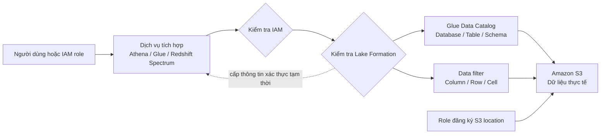

# Lake Formation và phân quyền dữ liệu chi tiết

AWS Lake Formation giúp quản trị tập trung quyền truy cập vào data lake được lưu trên Amazon S3 và mô tả trong AWS Glue Data Catalog. Thay vì cấp quyền đọc cả bucket cho mọi người dùng, bạn có thể cấp quyền theo database, table, column và điều kiện lọc hàng. Cách làm này hữu ích khi nhiều nhóm cùng khai thác một tập dữ liệu nhưng mỗi nhóm chỉ được xem phần dữ liệu phù hợp với nhiệm vụ của mình.

Trong hệ sinh thái AWS, AWS Glue Data Catalog lưu metadata như database, table, schema và vị trí dữ liệu; Amazon S3 lưu các tệp dữ liệu thực tế; Athena, AWS Glue và các dịch vụ phân tích khác đọc dữ liệu thông qua những metadata đó. Lake Formation đứng giữa quy trình này để quản lý quyền ở cấp data lake. Lake Formation không thay thế IAM: một yêu cầu thường phải vượt qua cả kiểm tra IAM và kiểm tra quyền Lake Formation mới được thực hiện.

## Mục tiêu học tập

Sau bài học, bạn có thể:

- Giải thích mối quan hệ giữa IAM, Lake Formation, Glue Data Catalog và Amazon S3.
- Phân biệt quyền metadata, quyền truy cập dữ liệu và quyền vị trí dữ liệu.
- Cấp quyền theo table, column, row và cell bằng named resource và data filter.
- Dùng LF-Tags để quản lý quyền trên số lượng lớn tài nguyên.
- Chọn hybrid access mode khi chuyển đổi dần từ mô hình IAM sang Lake Formation.
- Chia sẻ tài nguyên Data Catalog giữa các AWS account và xử lý các lỗi quyền thường gặp.

## 1. Lake Formation nằm ở đâu trong kiến trúc data lake?

Một data lake thường có nhiều nguồn dữ liệu được đưa vào S3, được crawler hoặc quy trình ETL tạo metadata trong Glue Data Catalog, rồi được truy vấn bằng Athena hoặc các công cụ phân tích khác. Lake Formation quản lý ai được nhìn thấy metadata và ai được phép đọc hoặc ghi dữ liệu phía sau metadata đó.



Quy trình tổng quát:

1. Quản trị viên đăng ký bucket hoặc prefix S3 với Lake Formation và chỉ định IAM role có quyền truy cập vị trí đó.
2. Data engineer tạo database, table hoặc partition trong Glue Data Catalog.
3. Quản trị viên cấp quyền Lake Formation cho IAM user, IAM role hoặc principal được hỗ trợ.
4. Người dùng chạy truy vấn qua dịch vụ tích hợp. Dịch vụ kiểm tra IAM và Lake Formation; khi cần, Lake Formation cấp thông tin xác thực tạm thời để dịch vụ truy cập S3 bằng role đã đăng ký.

Lake Formation áp dụng quyền theo Region. Nếu cùng một data lake được triển khai ở nhiều Region, cần quản lý quyền tương ứng tại từng Region.

## 2. Hai lớp kiểm soát: IAM và Lake Formation

Hai hệ thống có phạm vi trách nhiệm khác nhau:

| Lớp kiểm soát | Vai trò | Ví dụ |
|---|---|---|
| IAM | Cho phép principal gọi API AWS và sử dụng dịch vụ | `athena:StartQueryExecution`, `glue:GetTable`, `lakeformation:GetDataAccess` |
| Lake Formation | Xác định principal được làm gì với tài nguyên data lake | `DESCRIBE` database, `SELECT` table, `DATA_LOCATION_ACCESS` trên S3 location |
| Amazon S3 và KMS | Bảo vệ trực tiếp object, bucket và khóa mã hóa | Bucket policy, S3 IAM actions, quyền giải mã KMS key |

Ví dụ, một analyst có `SELECT` trên table `sales.orders` trong Lake Formation nhưng IAM policy không cho gọi `glue:GetTable` hoặc `lakeformation:GetDataAccess`. Truy vấn vẫn có thể thất bại. Ngược lại, IAM policy cho phép gọi Glue API cũng không tự động cấp quyền `SELECT` trên table đang được Lake Formation quản lý.

Với dữ liệu ở S3 đã đăng ký, Lake Formation sử dụng role đăng ký vị trí để cấp quyền truy cập tạm thời cho dịch vụ tích hợp. Principal chạy truy vấn cũng cần IAM permission `lakeformation:GetDataAccess`; Athena yêu cầu quyền này trên principal chạy truy vấn, còn một số dịch vụ tích hợp khác yêu cầu quyền trên execution role tương ứng.

Một giới hạn bảo mật cần nhớ: quyền Lake Formation không tự chặn mọi cách truy cập trực tiếp vào S3. Nếu IAM policy hoặc bucket policy vẫn cho phép principal gọi S3 API trực tiếp, principal có thể đọc object ngoài luồng truy vấn được Lake Formation kiểm soát. Vì vậy, cần rà soát quyền S3 trực tiếp và chỉ cho phép các đường truy cập đã được thiết kế.

## 3. Các nhóm quyền trong Lake Formation

Lake Formation quản lý ba nhóm quyền thường gặp. Chúng có mục đích khác nhau và không nên cấp thay thế cho nhau.

| Nhóm quyền | Tài nguyên | Quyền tiêu biểu | Ý nghĩa |
|---|---|---|---|
| Quyền Data Catalog | Catalog | `CREATE_DATABASE`, `DESCRIBE` | Tạo database hoặc xem thông tin catalog |
| Quyền Data Catalog | Database | `CREATE_TABLE`, `ALTER`, `DROP`, `DESCRIBE` | Tạo table, sửa metadata, xóa database hoặc xem mô tả database |
| Quyền Data Catalog | Table hoặc view | `SELECT`, `INSERT`, `DELETE`, `ALTER`, `DROP`, `DESCRIBE` | Đọc/ghi dữ liệu hoặc quản lý metadata của table, view |
| Quyền vị trí dữ liệu | S3 bucket hoặc prefix đã đăng ký | `DATA_LOCATION_ACCESS` | Cho phép tạo hoặc thay đổi metadata trỏ đến vị trí S3 đó |

### 3.1 Quyền metadata và quyền dữ liệu

`DESCRIBE` cho phép xem metadata của database hoặc table. Quyền này không tự cấp quyền truy vấn dữ liệu. Người dùng có thể nhìn thấy tên table và schema nhưng vẫn không chạy được truy vấn nếu thiếu `SELECT`.

`SELECT`, `INSERT` và `DELETE` là các quyền trên table có tác động đến dữ liệu bên dưới. Chẳng hạn, `SELECT` cho phép đọc dữ liệu; `INSERT` cho phép thêm dữ liệu; `DELETE` cho phép xóa dữ liệu. Khả năng thực thi còn phụ thuộc dịch vụ tích hợp và quyền IAM tương ứng.

`ALTER`, `DROP` và `CREATE_TABLE` chủ yếu kiểm soát thao tác với metadata. `CREATE_TABLE` được cấp trên database, vì nó cho phép tạo table trong database đó. Người tạo table còn cần quyền vị trí dữ liệu phù hợp nếu table trỏ đến S3 location được Lake Formation quản lý.

### 3.2 Quyền vị trí dữ liệu `DATA_LOCATION_ACCESS`

Quyền này kiểm soát principal nào được phép tạo hoặc thay đổi database/table tham chiếu đến một S3 location đã đăng ký. Nó không phải quyền đọc object và cũng không thay thế `SELECT` hoặc `INSERT` trên table.

Ví dụ: data engineer có `CREATE_TABLE` trên database `sales`, nhưng chỉ được phép tạo table tại prefix `s3://company-lake/sales/`. Lake Formation có thể cấp `DATA_LOCATION_ACCESS` cho prefix này để giới hạn nơi metadata được phép trỏ đến. Quyền vị trí được cấp trên bucket hoặc prefix, không phải trên từng object S3.

Để truy cập dữ liệu ở vị trí đã đăng ký, quy trình thường cần đủ các điều kiện sau:

- S3 location đã được đăng ký với Lake Formation.
- Role dùng để đăng ký location có quyền S3 cần thiết trên vị trí đó.
- Principal có quyền Lake Formation trên table, chẳng hạn `SELECT` hoặc `INSERT`.
- Principal hoặc execution role có IAM permission `lakeformation:GetDataAccess` khi dịch vụ yêu cầu.
- Các chính sách S3, KMS và chính sách tổ chức không chặn thao tác cần thiết.

### 3.3 Grant option và quyền quản trị

Khi cấp một quyền, người cấp có thể kèm `grant option`. Người nhận khi đó được phép cấp tiếp quyền tương ứng cho principal khác. Chỉ cấp khả năng này cho nhóm chịu trách nhiệm quản trị quyền.

Data lake administrator là principal được khai báo trong thiết lập Lake Formation và có khả năng quản trị data lake, bao gồm cấp quyền. Khái niệm này khác với quyền `Super` trên một database hoặc table. Một administrator được bổ sung sau khi tài nguyên đã tồn tại cũng không mặc nhiên có `SELECT` hoặc `DESCRIBE` trên mọi tài nguyên cũ; cần cấp các quyền truy cập dữ liệu phù hợp khi họ thực sự cần sử dụng dữ liệu.

## 4. Phân quyền chi tiết theo column, row và cell

Lake Formation hỗ trợ data filter khi cấp `SELECT` trên table. Một data filter xác định những cột được hiển thị và những hàng được phép xuất hiện trong kết quả truy vấn. Có thể áp dụng bộ lọc cho cấu trúc cột lồng nhau trong những trường hợp được dịch vụ truy vấn hỗ trợ.

| Kiểu kiểm soát | Cách hoạt động | Ví dụ |
|---|---|---|
| Table-level | Cho phép đọc table | Analyst được truy vấn toàn bộ `sales.orders` |
| Column-level | Chỉ hiển thị các cột được chọn hoặc loại trừ | Analyst không được xem `customer_email` |
| Row-level | Chỉ trả về hàng thỏa điều kiện | Nhóm APAC chỉ xem đơn hàng có `region = 'APAC'` |
| Cell-level | Kết hợp điều kiện hàng và cột | Một số cột chỉ hiển thị với những hàng thỏa điều kiện |

Data filter chỉ áp dụng cho thao tác đọc, vì vậy quyền được cấp kèm filter là `SELECT`. Không dùng data filter để kiểm soát `INSERT`, `DELETE`, `ALTER` hoặc `DROP`.

### 4.1 Ví dụ: giới hạn dữ liệu theo khu vực

Giả sử table `sales.orders` có các cột:

| Cột | Nội dung |
|---|---|
| `order_id` | Mã đơn hàng |
| `order_date` | Ngày đặt hàng |
| `region` | Khu vực kinh doanh |
| `product` | Sản phẩm |
| `amount` | Giá trị đơn hàng |
| `customer_email` | Email khách hàng |

Nhóm analyst APAC cần xem đơn hàng thuộc khu vực APAC, nhưng không được xem email khách hàng. Data filter có thể được định nghĩa như sau:

```json
{
  "TableCatalogId": "111122223333",
  "DatabaseName": "sales",
  "TableName": "orders",
  "Name": "apac_analyst",
  "RowFilter": {
    "FilterExpression": "region = 'APAC'"
  },
  "ColumnNames": [
    "order_id",
    "order_date",
    "region",
    "product",
    "amount"
  ]
}
```

Trong cấu hình này, `RowFilter` giới hạn các hàng có `region` bằng `APAC`; `ColumnNames` liệt kê các cột được phép hiển thị. Vì `customer_email` không nằm trong danh sách, truy vấn của principal dùng filter sẽ không trả về cột đó. Biểu thức hàng sử dụng cú pháp PartiQL được Lake Formation hỗ trợ, không phải toàn bộ cú pháp SQL tùy ý.

Sau khi tạo data filter, cấp `SELECT` cho filter đó. Ví dụ với AWS CLI:

```bash
aws lakeformation grant-permissions \
  --principal DataLakePrincipalIdentifier=arn:aws:iam::111122223333:role/RegionalAnalyst \
  --resource '{"DataCellsFilter":{"TableCatalogId":"111122223333","DatabaseName":"sales","TableName":"orders","Name":"apac_analyst"}}' \
  --permissions SELECT
```

Các giá trị account ID, role ARN và tên table trong ví dụ là dữ liệu minh họa; hãy thay bằng tài nguyên thực tế của môi trường. Data filter được tạo cho một table cụ thể trong Data Catalog. Có thể tạo nhiều filter cho cùng một table để phục vụ những nhóm người dùng khác nhau.

### 4.2 Phân biệt row-level và cell-level

Nếu filter cho phép tất cả cột nhưng chỉ chọn một tập hàng, đó là row-level security. Nếu filter cho phép tất cả hàng nhưng chỉ chọn một tập cột, đó là column-level security. Khi filter vừa giới hạn hàng vừa giới hạn cột, đó là cell-level security.

Ví dụ, bộ phận nhân sự có thể xem địa chỉ của nhân viên tại Hoa Kỳ, nhưng chỉ xem các thông tin cơ bản của nhân viên tại Vương quốc Anh. Quy tắc này cần kết hợp điều kiện hàng theo `country` với danh sách cột được hiển thị. Hãy kiểm tra khả năng hỗ trợ của engine truy vấn trước khi triển khai các filter phức tạp, đặc biệt với cột lồng nhau.

## 5. Hai cách cấp quyền metadata: named resource và LF-TBAC

Lake Formation cung cấp hai cách chính để gắn quyền với tài nguyên Data Catalog.

### 5.1 Named resource

Named resource cấp quyền trực tiếp trên database, table hoặc tập table được chỉ định. Cách này dễ hiểu khi số lượng tài nguyên nhỏ và yêu cầu truy cập rõ ràng.

Ví dụ cấp quyền đọc toàn bộ table `sales.orders` cho role analyst:

```bash
aws lakeformation grant-permissions \
  --principal DataLakePrincipalIdentifier=arn:aws:iam::111122223333:role/SalesAnalyst \
  --resource '{"Table":{"DatabaseName":"sales","Name":"orders"}}' \
  --permissions SELECT
```

Để thu hồi quyền tương ứng:

```bash
aws lakeformation revoke-permissions \
  --principal DataLakePrincipalIdentifier=arn:aws:iam::111122223333:role/SalesAnalyst \
  --resource '{"Table":{"DatabaseName":"sales","Name":"orders"}}' \
  --permissions SELECT
```

Named resource phù hợp với một vài ngoại lệ cần chỉ định rõ. Khi số lượng table tăng nhanh, việc cấp và thu hồi từng tài nguyên có thể trở nên khó quản lý.

### 5.2 Lake Formation tag-based access control (LF-TBAC)

LF-TBAC dùng thuộc tính dạng key-value gọi là LF-Tag để mô tả tài nguyên và xây dựng chính sách quyền. Ví dụ:

```text
domain = finance
classification = confidential
environment = production
```

Quản trị viên gắn LF-Tag lên database, table hoặc column, sau đó cấp quyền cho principal dựa trên biểu thức tag. Principal có quyền với các giá trị tag phù hợp sẽ truy cập được tài nguyên tương ứng.

Ví dụ, role `FinanceAnalyst` được cấp quyền đọc tài nguyên có `domain=finance` và `classification=internal`. Khi một table mới được gắn các tag phù hợp, chính sách dựa trên tag có thể áp dụng mà không cần tạo một grant riêng cho từng table.

Một số đặc điểm cần nhớ:

- Table có thể kế thừa LF-Tag từ database; column có thể kế thừa LF-Tag từ table. Có thể ghi đè giá trị kế thừa khi cần.
- Trong một biểu thức LF-Tag, các key khác nhau được kết hợp theo logic AND; nhiều giá trị của cùng key có thể được kết hợp theo logic OR.
- LF-Tag là metadata phục vụ phân quyền của Lake Formation. Chúng không đồng nghĩa với AWS resource tag hoặc S3 object tag.
- Cần phân quyền riêng cho người tạo tag, người gắn tag lên tài nguyên và người cấp quyền dựa trên biểu thức tag.

LF-TBAC phù hợp khi data lake có nhiều database, table, view và column, hoặc khi quyền cần được chia theo domain, mức phân loại dữ liệu hay đơn vị nghiệp vụ. Named resource vẫn hữu ích cho những ngoại lệ nhỏ và tài nguyên cần chỉ định trực tiếp. Khi sử dụng cả hai phương thức, quyền hiệu lực của principal là tổng hợp các quyền được cấp qua những phương thức đó; vì vậy cần rà soát các grant cũ khi thay đổi mô hình.

## 6. Hybrid access mode khi chuyển đổi hệ thống

Nhiều data lake đã sử dụng IAM policy cho Glue và S3 trước khi áp dụng Lake Formation. Bật kiểm soát Lake Formation đồng loạt có thể làm gián đoạn workload cũ nếu chưa rà soát quyền. Hybrid access mode cho phép chọn principal và tài nguyên để áp dụng Lake Formation theo từng bước.

Trong hybrid access mode có hai luồng:

- Principal đã opt in trên tài nguyên: cần đáp ứng cả quyền Lake Formation và quyền IAM liên quan.
- Principal chưa opt in: tiếp tục truy cập theo IAM policy cho AWS Glue và S3 như trước.

Khi đăng ký S3 location ở hybrid mode, Lake Formation mặc định thực thi một số quyền như `CREATE_TABLE`, `CREATE_PARTITION` và `UPDATE_TABLE`. Các principal được opt in sẽ sử dụng quyền Lake Formation trên những database hoặc table đã chọn; các principal khác tiếp tục theo đường IAM.

Quy trình chuyển đổi thường gồm:

1. Kiểm kê workload, principal, IAM policy và các tài nguyên Data Catalog đang được sử dụng.
2. Đăng ký S3 location ở hybrid access mode.
3. Cấp quyền Lake Formation cho principal và tài nguyên cần chuyển đổi.
4. Opt in đúng cặp principal/tài nguyên cần áp dụng Lake Formation.
5. Kiểm thử bằng chính role của workload, sau đó mới điều chỉnh các IAM policy cũ.
6. Theo dõi lỗi truy cập và mở rộng phạm vi opt in theo từng nhóm.

Không nên xóa quyền `IAMAllowedPrincipals` một cách máy móc trong khi chưa hiểu workload hiện tại. Với tài nguyên được quản lý hoàn toàn bằng Lake Formation, cần kiểm tra và cấu hình quyền mặc định phù hợp để nhóm `IAMAllowedPrincipals` không giữ quyền `Super` ngoài dự kiến. Với hybrid mode, nhóm này có thể vẫn cần tồn tại cho đường truy cập IAM của principal chưa opt in.

## 7. Chia sẻ dữ liệu giữa các AWS account

Lake Formation hỗ trợ chia sẻ database và table với AWS account khác, AWS Organization, organizational unit hoặc IAM principal ở account khác. Khi cấp quyền cross-account trên Data Catalog resource, Lake Formation sử dụng AWS Resource Access Manager (AWS RAM) để tạo resource share.

Nếu account nhận nằm trong cùng Organization, resource share có thể sẵn sàng ngay. Nếu account nhận nằm ngoài Organization, AWS RAM gửi lời mời để account đó chấp nhận hoặc từ chối. Sau khi chấp nhận, data lake administrator ở account nhận có thể cấp tiếp quyền cho principal nội bộ theo mô hình được chia sẻ.

Hai cách cấp quyền cross-account gồm:

- Named resource: chỉ định database hoặc table cụ thể cần chia sẻ.
- LF-TBAC: chia sẻ theo LF-Tag expression; phù hợp khi cần quản lý nhiều tài nguyên và nhiều account.

Các dịch vụ như Athena và Redshift Spectrum thường cần resource link trong Data Catalog của account nhận để tham chiếu đến tài nguyên được chia sẻ. Resource link là metadata tham chiếu; nó không tự cấp quyền truy cập dữ liệu. Principal vẫn cần quyền phù hợp trên resource link, tài nguyên được chia sẻ và các API liên quan.

Khi triển khai cross-account, hãy kiểm tra phiên bản cross-account settings của Lake Formation, cấu hình AWS RAM, grant option, quyền của data lake administrator ở account nhận và trạng thái opt in nếu sử dụng hybrid access mode. Không mặc định rằng chia sẻ metadata đã giải quyết mọi yêu cầu truy cập S3 hoặc KMS.

## 8. Quy trình triển khai phân quyền an toàn

Một quy trình có thể áp dụng cho data lake mới:

1. **Xác định principal và vai trò.** Tách data lake administrator, data engineer, analyst và execution role của workload.
2. **Đăng ký vị trí S3.** Chọn bucket hoặc prefix, chỉ định role đăng ký và giới hạn quyền S3 của role ở phạm vi cần thiết.
3. **Thiết lập Data Catalog.** Tạo database/table và xác định owner, vị trí dữ liệu, schema, phân loại dữ liệu.
4. **Chọn mô hình cấp quyền.** Dùng named resource cho số lượng nhỏ; dùng LF-TBAC khi tài nguyên được phân loại bằng tag và tăng trưởng liên tục.
5. **Cấp quyền tối thiểu.** Analyst thường chỉ cần `DESCRIBE` và `SELECT`; data engineer cần các quyền tạo/sửa metadata và quyền location phù hợp.
6. **Áp dụng filter.** Tạo data filter để giới hạn column, row hoặc cell khi cùng một table phục vụ nhiều nhóm.
7. **Kiểm tra IAM và đường truy cập S3.** Bảo đảm principal có các API permission cần thiết, đồng thời không còn đường S3 trực tiếp ngoài dự kiến.
8. **Kiểm thử và theo dõi.** Chạy truy vấn bằng role thật, kiểm tra dữ liệu trả về, rà soát grant và dùng AWS CloudTrail để điều tra hoạt động liên quan.

### Ma trận quyền tham khảo

| Vai trò | Quyền Lake Formation thường cần | Lưu ý |
|---|---|---|
| Data lake administrator | Quyền quản trị Lake Formation và quyền IAM cho các thao tác quản trị | Cần được khai báo trong Lake Formation settings |
| Data engineer | `CREATE_TABLE`, `ALTER`, `DESCRIBE`, `DATA_LOCATION_ACCESS` và quyền cần cho ETL | Phạm vi S3 location nên giới hạn theo domain |
| Data analyst | `DESCRIBE`, `SELECT` và data filter nếu cần | Không cấp `INSERT`, `DELETE` nếu chỉ truy vấn |
| ETL execution role | Quyền đọc/ghi table phù hợp và IAM API permissions | Kiểm tra thêm quyền KMS nếu dữ liệu được mã hóa bằng customer managed key |

Đây là ma trận khởi đầu, không phải policy dùng chung cho mọi workload. Hãy xác định quyền theo thao tác thực tế và dịch vụ thực thi.

## 9. Chẩn đoán lỗi phân quyền

Khi Athena hoặc AWS Glue báo `AccessDeniedException`, hãy kiểm tra theo từng lớp:

| Triệu chứng | Điểm cần kiểm tra |
|---|---|
| Không thấy database hoặc table | `DESCRIBE` trong Lake Formation, `glue:GetDatabase`/`glue:GetTable` trong IAM, Region đang truy cập |
| Thấy table nhưng không truy vấn được | `SELECT`, data filter, `lakeformation:GetDataAccess`, quyền Athena và trạng thái opt in |
| Có quyền `CREATE_TABLE` nhưng tạo table thất bại | `DATA_LOCATION_ACCESS`, S3 location đã đăng ký, `glue:CreateTable` và role đăng ký location |
| Chỉ một số hàng hoặc cột xuất hiện | Row filter, danh sách column được include/exclude và biểu thức filter |
| Principal truy vấn được nhưng đọc S3 trực tiếp thất bại | Đây có thể là hành vi mong muốn; kiểm tra đường truy cập trực tiếp có được cho phép hay không |
| Truy cập cross-account thất bại | AWS RAM share/invitation, grant option, resource link, quyền ở account nhận và cross-account version settings |
| Chỉ workload cũ bị lỗi sau khi bật Lake Formation | `IAMAllowedPrincipals`, hybrid opt-in và IAM policy trước khi chuyển đổi |

Nên kiểm tra quyền bằng đúng IAM role mà ứng dụng sử dụng. Việc kiểm thử bằng administrator có thể che khuất lỗi vì administrator có khả năng cấp quyền rộng hơn principal của workload.

## 10. Nguyên tắc thiết kế cần ghi nhớ

- Cấp quyền tối thiểu theo vai trò và theo từng tài nguyên cần thiết.
- Dùng `DESCRIBE` cho nhu cầu khám phá metadata; chỉ cấp `SELECT` khi principal thực sự cần đọc dữ liệu.
- Dùng data filter khi các nhóm chia sẻ cùng một table nhưng cần xem những cột hoặc hàng khác nhau.
- Dùng LF-TBAC để giảm số lượng grant thủ công trong data lake lớn; quản lý vòng đời tag như một phần của mô hình phân loại dữ liệu.
- Giới hạn quyền S3 trực tiếp để người dùng không đi vòng qua chính sách Lake Formation.
- Rà soát `IAMAllowedPrincipals` và chọn Lake Formation mode hoặc hybrid access mode dựa trên hiện trạng workload.
- Kiểm thử cả đường truy vấn và đường truy cập dữ liệu, gồm IAM, Lake Formation, S3, KMS và chia sẻ liên tài khoản.

## Tài liệu tham khảo

- [Overview of Lake Formation permissions](https://docs.aws.amazon.com/lake-formation/latest/dg/lf-permissions-overview.html)
- [Lake Formation permissions reference](https://docs.aws.amazon.com/lake-formation/latest/dg/lf-permissions-reference.html)
- [Underlying data access control](https://docs.aws.amazon.com/lake-formation/latest/dg/access-control-underlying-data.html)
- [Data filtering and cell-level security](https://docs.aws.amazon.com/lake-formation/latest/dg/data-filtering.html)
- [Lake Formation tag-based access control](https://docs.aws.amazon.com/lake-formation/latest/dg/tag-based-access-control.html)
- [Hybrid access mode](https://docs.aws.amazon.com/lake-formation/latest/dg/hybrid-access-mode.html)
- [Cross-account data sharing](https://docs.aws.amazon.com/lake-formation/latest/dg/cross-account-permissions.html)
