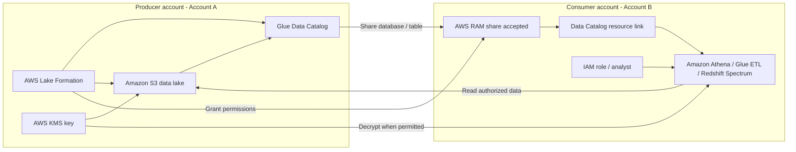

# Chia sẻ dữ liệu liên tài khoản và quản trị truy cập

Một data lake thường được chia thành nhiều AWS accounts để tách môi trường, nhóm sở hữu dữ liệu và trách nhiệm vận hành. Account dữ liệu có thể lưu dữ liệu bán hàng, tài chính hoặc khách hàng; account phân tích cần truy vấn những dataset đó bằng Athena, AWS Glue ETL hoặc Amazon Redshift Spectrum. Nếu chỉ cấp quyền đọc toàn bộ bucket S3, người dùng phân tích có thể nhìn thấy nhiều dữ liệu hơn mức cần thiết. Nếu chỉ chia sẻ metadata trong AWS Glue Data Catalog mà quên quyền truy cập dữ liệu bên dưới, truy vấn vẫn thất bại.

AWS Lake Formation cung cấp mô hình quản trị data lake tập trung, cho phép cấp quyền trên database, table, column và các hàng dữ liệu được lọc. Khi chia sẻ Data Catalog resources giữa các accounts, Lake Formation sử dụng AWS Resource Access Manager (AWS RAM) để thiết lập resource share. Account nhận tạo resource link trong Data Catalog của mình để các công cụ như Athena hoặc Redshift Spectrum truy vấn tài nguyên được chia sẻ. Quyền truy cập metadata, quyền đọc dữ liệu trong S3, quyền sử dụng KMS và quyền chạy truy vấn phải được phối hợp đúng.

Trong hệ sinh thái AWS, chia sẻ liên tài khoản giúp tổ chức phân tách data producer và data consumer, thực thi least privilege, hỗ trợ self-service analytics và duy trì quyền sở hữu dữ liệu. Bài học tập trung vào AWS Lake Formation, AWS Glue Data Catalog, AWS RAM, Amazon S3, IAM, AWS KMS và các công cụ phân tích sử dụng dữ liệu được chia sẻ.

## Mục tiêu học tập

Sau bài học, bạn có thể:

- Phân biệt chia sẻ dữ liệu bằng Lake Formation với cấp quyền trực tiếp qua IAM, Glue resource policy và S3 bucket policy.
- Thiết kế mô hình producer account và consumer account, bao gồm vai trò quản trị và quyền sở hữu dữ liệu.
- Chọn named-resource sharing hoặc Lake Formation tag-based access control (LF-TBAC).
- Giải thích vai trò của AWS RAM, resource link và quy trình chấp nhận resource share.
- Cấp quyền database, table, column, row và data location theo nguyên tắc least privilege.
- Hiểu `IAMAllowedPrincipals`, Lake Formation mode và hybrid access mode khi chuyển đổi mô hình quản trị.
- Phối hợp quyền IAM, S3 bucket policy, Lake Formation và KMS key policy để truy vấn dữ liệu mã hóa liên tài khoản.
- Kiểm thử, giám sát, thu hồi quyền và xử lý lỗi truy cập trong data lake nhiều account.

## Mô hình chia sẻ dữ liệu giữa các accounts

Một mô hình phổ biến gồm hai vai trò:

- **Producer account (account sở hữu dữ liệu):** lưu object trong S3, sở hữu Glue Data Catalog, quản lý Lake Formation permissions và quyết định ai được dùng dataset.
- **Consumer account (account sử dụng dữ liệu):** chứa IAM roles cho analyst, Athena workgroup, Glue ETL jobs hoặc Redshift workgroup; nhận quyền được chia sẻ và tạo resource link để sử dụng dataset.



Sơ đồ thể hiện quan hệ logic. Dữ liệu vẫn nằm trong bucket của producer account; Lake Formation chia sẻ metadata và quyền truy cập. Khi consumer query, engine phải có quyền cần thiết để đọc dữ liệu nguồn thông qua cơ chế tích hợp được hỗ trợ. Việc tạo RAM share hoặc resource link không tự động cấp mọi quyền IAM, S3, KMS hay quyền chạy Athena.

### Tách trách nhiệm

| Vai trò | Trách nhiệm chính |
|---|---|
| Data lake administrator ở producer | Cấu hình Lake Formation, đăng ký data location, phê duyệt quyền chia sẻ và quản lý catalog |
| Data owner / steward | Xác định phân loại dữ liệu, mục đích sử dụng, cột/hàng được phép chia sẻ và thời hạn truy cập |
| Consumer account administrator | Chấp nhận RAM share, tạo resource link và phân phối quyền cho principal nội bộ |
| Analyst / ETL role | Truy vấn hoặc xử lý dữ liệu theo quyền được cấp |
| Security / audit | Rà soát IAM, bucket/KMS policies, CloudTrail, Lake Formation grants và quy trình thu hồi |

Người sở hữu dữ liệu nên quyết định ai được truy cập và dữ liệu nào được chia sẻ. Consumer account quản lý người dùng nội bộ của mình, nhưng không được tự mở rộng quyền trên dữ liệu vượt quá phạm vi producer đã cấp.

## Các lớp quyền cần phối hợp

Truy vấn dữ liệu liên tài khoản thành công khi tất cả lớp kiểm soát cần thiết đều cho phép thao tác. Một cách phân tích hữu ích là chia quyền thành bốn lớp:

1. **Identity và API permissions:** IAM role của người dùng/engine được phép gọi Athena, Glue, Lake Formation, S3 và KMS APIs cần thiết.
2. **Catalog permissions:** quyền `DESCRIBE`, `SELECT` và các quyền khác trên database/table/column được quản lý bởi Lake Formation hoặc Glue Data Catalog resource policy tùy mô hình.
3. **Storage permissions:** quyền đọc object và liệt kê prefix trong S3, thường được Lake Formation thực thi thông qua data access role khi location đã đăng ký; mô hình IAM trực tiếp có thể cần IAM và bucket policy ở cả hai account.
4. **Encryption permissions:** nếu object dùng SSE-KMS, role thực hiện truy cập phải được phép dùng key phù hợp; key policy ở account sở hữu key phải cho phép.

Một IAM policy `Allow` không tự động vượt qua Lake Formation denial. Ngược lại, Lake Formation grant cũng không tự tạo quyền gọi Athena hoặc quyền ghi query results vào bucket của consumer. Hãy kiểm tra từng lớp riêng khi điều tra `AccessDenied`.

## Chia sẻ bằng AWS Lake Formation

Lake Formation cung cấp mô hình `GRANT`/`REVOKE` cho Data Catalog resources. Có thể chia sẻ database, một table, nhiều table hoặc tất cả table trong database. Với bảng dữ liệu, có thể giới hạn quyền bằng data filters để chỉ cho phép truy cập một số cột hoặc hàng.

Hai phương pháp chính để chia sẻ catalog resources là:

| Phương pháp | Cách xác định tài nguyên được chia sẻ | Khi phù hợp |
|---|---|---|
| Named resources | Chọn database/table cụ thể và grant cho account hoặc principal đích | Dataset ít thay đổi, cần kiểm soát chính xác từng tài nguyên |
| LF-TBAC (Lake Formation tag-based access control) | Gán LF-Tags cho database/table/column và grant theo biểu thức tag | Nhiều dataset, nhiều consumer và cần quản trị theo phân loại dữ liệu |

Lake Formation cross-account sharing sử dụng AWS RAM. Nếu recipient account thuộc cùng AWS Organization và sharing trong RAM đã được bật, tài nguyên có thể sẵn sàng mà không cần chấp nhận invitation thủ công. Nếu account ở ngoài Organization, RAM thường gửi invitation; data lake administrator của recipient cần chấp nhận trước khi sử dụng share.

### Named-resource sharing

Named-resource sharing phù hợp khi producer biết rõ database hoặc table nào cần chia sẻ. Ví dụ account A grant `DESCRIBE` trên database `sales_curated` và `SELECT` trên table `orders` cho account B. Nếu cần consumer có quyền chia sẻ tiếp trong phạm vi được cho phép, producer có thể cấp grant option tương ứng; chỉ cấp khi có yêu cầu quản trị rõ ràng.

Quyền thường gặp:

- `DESCRIBE`: xem metadata database/table.
- `SELECT`: đọc dữ liệu table; có thể kết hợp data filter để giới hạn cột/hàng.
- `CREATE_TABLE`: tạo table trong database khi cần và được phép.
- `ALTER`, `DROP`: sửa hoặc xóa metadata; không cấp cho analyst chỉ cần đọc.
- `DATA_LOCATION_ACCESS`: cho phép tạo catalog resource trỏ đến một S3 location đã đăng ký theo điều kiện tương ứng.

Tên quyền và phạm vi phụ thuộc loại resource. Quyền `SELECT` trên table không đồng nghĩa có quyền `DROP` hoặc `ALTER` database.

### LF-TBAC: quản trị theo thuộc tính

LF-TBAC cho phép gắn LF-Tag key/value vào catalog resources và cấp quyền dựa trên tag expression. Ví dụ:

```text
classification = public | internal | confidential | restricted
domain         = sales | finance | customer | operations
environment    = production | nonproduction
```

Một policy có thể cấp quyền đọc cho role `FinanceAnalyst` đối với các table có `domain=finance` và `classification=internal`. Khi table mới được gắn đúng LF-Tags, nó có thể thừa hưởng quyền theo biểu thức mà không cần grant từng table thủ công.

LF-Tags không thay thế data owner review. Gắn nhầm `classification=public` có thể làm mở rộng quyền truy cập ngoài ý muốn. Cần kiểm soát ai được tạo, sửa, gán và xóa LF-Tags; quy định tag bắt buộc; rà soát tag drift và kiểm thử quyền sau mỗi thay đổi.

LF-TBAC hỗ trợ chia sẻ với AWS accounts, Organizations và organizational units (OUs). Một số khả năng chia sẻ cross-account theo Organizations/OUs phụ thuộc Cross-account version settings; kiểm tra yêu cầu phiên bản hiện hành trước khi cấu hình. Theo tài liệu AWS hiện tại, LF-TBAC chia sẻ với Organizations/OUs yêu cầu cross-account version 3 trở lên; chia sẻ tài nguyên ở hybrid access mode và federated catalogs yêu cầu version 4.

### Chia sẻ trực tiếp cho IAM principal ngoài account

Lake Formation hỗ trợ grant trực tiếp cho IAM role/user trong account khác, ngoài cách grant ở cấp account. Cách này hữu ích khi producer cần chỉ định chính xác role nhận quyền thay vì cho toàn bộ account recipient. Principal nhận grant trực tiếp không thể tự chia sẻ tiếp tài nguyên đó cho principal khác.

Hãy dùng ARN principal cụ thể, tránh grant cho toàn bộ account nếu chỉ một workload cần dữ liệu. Consumer vẫn cần quyền IAM phù hợp để gọi các dịch vụ liên quan.

### Không có transitive sharing

Lake Formation cross-account sharing không có tính bắc cầu. Nếu account A chia sẻ table cho account B, account B không thể tự chia sẻ lại table đó cho account C. Producer A cần grant trực tiếp cho C hoặc thiết kế một luồng dữ liệu mới do B sở hữu. Quy tắc này giữ quyền quyết định chia sẻ ở account sở hữu dữ liệu.

## AWS RAM và resource link

### Vai trò của AWS RAM

AWS RAM quản lý resource share giữa các accounts. Khi producer grant catalog resource qua Lake Formation, dịch vụ tạo hoặc cập nhật RAM share tương ứng. Account nhận có thể kiểm tra invitation, chấp nhận share và xem tài nguyên được chia sẻ.

Quy trình tổng quát:

1. Producer tạo Lake Formation grant cho account hoặc principal đích.
2. Lake Formation sử dụng RAM để chia sẻ Glue Data Catalog resource.
3. Nếu cần, recipient account chấp nhận RAM invitation.
4. Shared database/table xuất hiện trong catalog view của recipient.
5. Recipient tạo resource link đến database/table được chia sẻ.
6. Recipient cấp quyền `DESCRIBE` trên resource link và quyền cần thiết trên shared resource cho IAM principals nội bộ.
7. Analyst hoặc engine sử dụng resource link để query.

### Resource link là gì?

Resource link là một object metadata trong Data Catalog của recipient, tham chiếu đến database hoặc table nằm trong catalog của account khác. Nó giống một liên kết logic, không sao chép object S3 và không tạo bản sao table.

Ví dụ:

```text
Producer account A:
  catalog A
    database: sales_curated
      table: orders

Consumer account B:
  catalog B
    database: shared_sales
      resource link: orders_from_a
        -> catalog A / sales_curated / orders
```

Resource link giúp Athena và Redshift Spectrum trong consumer account tham chiếu đến table được chia sẻ qua catalog local. Người dùng cần quyền `DESCRIBE` trên resource link cùng quyền được grant trên tài nguyên gốc. Resource link không làm tăng quyền gốc và không thể được dùng để lách Lake Formation.

### Resource link cho database và table

Tạo resource link ở cấp database giúp consumer nhìn thấy các table được chia sẻ trong database đó. Resource link ở cấp table hữu ích khi chỉ một vài table được chia sẻ hoặc muốn đặt tên local dễ hiểu. Tránh tạo nhiều link trùng tên hoặc khó phân biệt owner/Region.

Resource link không tự động kế thừa mọi quyền của database gốc. Hãy cấp `DESCRIBE` trên link và grant quyền trên resource gốc đúng phạm vi. Khi producer thu hồi share hoặc xóa table gốc, resource link có thể trở thành tham chiếu không còn hợp lệ; consumer cần xử lý metadata link theo quy trình.

## Data filters: giới hạn cột và hàng

Lake Formation data filters cho phép chia sẻ table nhưng chỉ hiển thị một phần dữ liệu. Một filter có thể kết hợp:

- **Column-level access:** chỉ định các cột được phép hoặc loại trừ cột nhạy cảm.
- **Row-level access:** biểu thức lọc hàng, ví dụ chỉ cho phép `region = 'APAC'` hoặc `tenant_id = 'tenant-42'`.
- **Cell-level access:** kết hợp row filter và column filter để giới hạn từng ô dữ liệu mà principal có thể nhìn thấy.

Ví dụ table `orders` có các cột:

```text
order_id, customer_id, region, order_total, payment_token, created_at
```

Nhóm phân tích khu vực chỉ cần `order_id`, `region`, `order_total`, `created_at` và chỉ xem hàng có `region = 'APAC'`. Data filter có thể loại `customer_id` và `payment_token`, đồng thời giới hạn hàng theo vùng. Cần kiểm tra cú pháp row filter, kiểu dữ liệu và engine hỗ trợ trước khi dùng.

Data filters được gắn với quyền `SELECT` trên table. Không nên tạo bản sao table chỉ để ẩn cột nếu Lake Formation filter đáp ứng yêu cầu; tuy nhiên, nếu cần biến đổi dữ liệu, che/mã hóa giá trị hoặc tạo dataset đã khử định danh, hãy dùng ETL để tạo curated view/table riêng.

### Giới hạn và lựa chọn engine

Không phải mọi engine, table format và thao tác đều hỗ trợ cùng một tập data filter. Kiểm tra ma trận tích hợp hiện hành của Lake Formation với Athena, Redshift Spectrum, Glue ETL, EMR và các engine khác. Với Iceberg, Hudi hoặc Delta Lake, hãy xác minh phiên bản và kiểu tích hợp trước khi dựa vào row/cell filtering. Nếu engine không enforce filter, không được cấp đường truy cập S3 trực tiếp có thể bỏ qua kiểm soát đó.

## Glue Data Catalog resource policy và IAM: một cơ chế khác

AWS Glue hỗ trợ Data Catalog resource policy để cấp quyền API catalog cho account hoặc IAM principal khác. Consumer cần IAM identity policy cho phép hành động tương ứng. Cách này hữu ích khi ứng dụng cần truy cập catalog bằng IAM-based permissions.

Tuy nhiên, Glue resource policy chỉ quản lý quyền trên Data Catalog resources. Nó không tự cấp quyền đọc object trong S3. Để ETL job ở account B đọc S3 của account A theo mô hình IAM trực tiếp, cần phối hợp IAM policy của role ở B và S3 bucket policy ở A; nếu dữ liệu mã hóa SSE-KMS, cần KMS key policy/identity policy.

| Cơ chế | Phạm vi chính | Mức kiểm soát dữ liệu |
|---|---|---|
| Lake Formation grants | Catalog resources và quyền dữ liệu được Lake Formation enforce | Có thể table/column/row/cell-level tùy engine |
| Glue Data Catalog resource policy | API access đến catalog/database/table metadata | Không tự cấp quyền S3 object hoặc KMS |
| IAM identity policy | Hành động của principal trong account | Có thể cấp API, S3, KMS; phạm vi phụ thuộc resource và policy |
| S3 bucket policy | Quyền truy cập vào bucket/object | Kiểm soát storage-level, thường theo bucket/prefix/principal/condition |
| KMS key policy | Ai được dùng encryption key | Kiểm soát encrypt/decrypt/data key và grant theo key |

AWS khuyến nghị dùng Lake Formation permissions làm cơ chế quản trị data lake nhất quán thay vì phối hợp tùy tiện nhiều nguồn quyền. Nếu đang dùng Glue resource policy và Lake Formation grants cùng lúc, cần đọc policy hiện tại trước khi sửa. Catalog chỉ có một resource policy và việc cập nhật policy có thể ảnh hưởng cross-account grants đã tồn tại. Khi dùng đồng thời, cần cấu hình `glue:ShareResource` và tùy trường hợp `--enable-hybrid` theo tài liệu AWS.

### Ví dụ Glue resource policy

Đoạn JSON dưới đây minh họa nguyên tắc cấp quyền `glue:GetDatabase` cho một role ở account B trên database ở account A. Đây là ví dụ IAM-based catalog access, không phải cấu hình Lake Formation grant hoàn chỉnh và không cấp quyền S3.

```json
{
  "Version": "2012-10-17",
  "Statement": [
    {
      "Effect": "Allow",
      "Principal": {
        "AWS": "arn:aws:iam::222233334444:role/AnalyticsReadRole"
      },
      "Action": ["glue:GetDatabase", "glue:GetTable", "glue:GetTables"],
      "Resource": [
        "arn:aws:glue:ap-southeast-1:111122223333:catalog",
        "arn:aws:glue:ap-southeast-1:111122223333:database/sales_curated",
        "arn:aws:glue:ap-southeast-1:111122223333:table/sales_curated/*"
      ]
    }
  ]
}
```

Account B cũng cần identity policy cho role `AnalyticsReadRole` cho phép các API tương ứng. Nếu mục tiêu là query S3 data trực tiếp, bổ sung quyền storage và KMS; nếu mục tiêu là Lake Formation fine-grained access, hãy dùng Lake Formation grants và cơ chế storage enforcement tương ứng.

## Hybrid access mode và IAMAllowedPrincipals

Nhiều data lake được xây dựng trước khi áp dụng Lake Formation. Các Glue database/table có thể đang cấp `Super` hoặc `All` cho nhóm `IAMAllowedPrincipals`, nghĩa là quyền truy cập catalog được quản lý bằng IAM và quyền S3. Chuyển toàn bộ resource sang Lake Formation mode ngay có thể làm workload hiện hữu mất quyền.

### Lake Formation mode

Trong mô hình Lake Formation truyền thống, data location được đăng ký với Lake Formation và quyền truy cập dữ liệu được enforce theo Lake Formation grants. Trước khi chia sẻ cross-account một số catalog resources ở Lake Formation mode, cần thu hồi các quyền `IAMAllowedPrincipals` trên resource liên quan theo prerequisite của AWS. Nếu vẫn giữ quyền này trong trường hợp không dùng hybrid mode, Lake Formation có thể từ chối cross-account grant hoặc tạo kết quả quyền không như mong muốn.

### Hybrid access mode

Hybrid access mode cho phép một data location và các catalog resources liên quan tiếp tục phục vụ một số principal bằng IAM-based permissions, đồng thời bật Lake Formation permissions cho các principal đã opt in. Cách này tạo lộ trình chuyển đổi tăng dần mà không phải ngắt mọi workload hiện hữu cùng lúc.

Một quy trình điển hình:

1. Đăng ký S3 location với Lake Formation ở hybrid access mode.
2. Giữ các IAM-based principals hiện tại theo cấu hình đã kiểm tra.
3. Grant Lake Formation permissions cho principal mới hoặc principal cần chuyển đổi.
4. Opt in principal và resource vào hybrid access mode.
5. Kiểm thử truy vấn bằng principal đã opt in và principal IAM-based cũ.
6. Khi workload đã chuyển hoàn toàn, cân nhắc loại bỏ quyền IAM cũ theo kế hoạch và chuyển sang Lake Formation mode nếu phù hợp.

Trong cross-account hybrid sharing, producer chia sẻ resource và cấp quyền; data lake administrator của recipient phân phối quyền cho principal nội bộ và opt in các principal/resource theo quy trình. AWS yêu cầu Cross-account version setting phù hợp; tài liệu hiện tại quy định Version 4 cho chia sẻ catalog resources trong hybrid access mode và federated catalogs.

Hybrid mode không có nghĩa mọi principal tự động được bảo vệ bằng Lake Formation. Chỉ những principal và resource đã opt in mới được enforce theo Lake Formation; principal chưa opt in vẫn có thể đi theo IAM-based path nếu policy cho phép. Cần kiểm kê và theo dõi opt-in để tránh khoảng trống quản trị.

## Đăng ký S3 location và quyền truy cập dữ liệu

Lake Formation cần biết location S3 nào thuộc quyền quản trị của data lake. Khi đăng ký location, Lake Formation sử dụng một IAM role để truy cập S3. Role này cần quyền phù hợp trên bucket và object; bucket policy phải cho phép role nếu bucket ở account khác.

### S3 bucket ở account khác

Ví dụ Glue Data Catalog và Lake Formation ở account A, nhưng bucket S3 nằm trong account B. Để đăng ký location:

- IAM role trong account A phải có quyền truy cập bucket/object ở account B.
- Bucket policy trong account B phải cho phép role của account A thực hiện các hành động cần thiết.
- Nếu bucket dùng SSE-KMS, KMS key policy trong account sở hữu key phải cho phép role sử dụng key và role phải có identity permissions tương ứng.
- Kiểm tra S3 Block Public Access, VPC endpoint policy, bucket owner enforced/Object Ownership và điều kiện encryption.

Không bật public access để giải quyết lỗi cross-account. Hãy dùng bucket policy giới hạn principal cụ thể, role ARN, action và prefix.

### SSE-KMS và quyền giải mã

Với object mã hóa bằng customer managed KMS key, principal cần được phép sử dụng key để giải mã. Trong cross-account, key policy của account sở hữu key phải cho phép external role/account; identity policy của role cũng phải cho phép hành động KMS phù hợp. Lake Formation data access role, Glue job role hoặc engine role cần được xác định đúng theo mô hình tích hợp.

Nếu KMS key nằm ở account B và data lake ở account A, kiểm tra cả hai policy. Chỉ thêm `kms:Decrypt` vào IAM role ở A là chưa đủ nếu key policy ở B không cho phép. AWS managed key trong một số dịch vụ không hỗ trợ cross-account use như customer managed key; chọn customer managed key khi cần chia sẻ mã hóa liên tài khoản và xác minh giới hạn dịch vụ.

### Quyền ghi kết quả truy vấn

Athena query results thường được ghi vào S3 bucket do consumer account cấu hình. Quyền đọc shared table không tự cấp quyền ghi query results. Consumer cần quyền ghi vào output bucket, KMS key tương ứng nếu mã hóa, và quyền đọc kết quả theo chính sách. Hãy tách bucket kết quả truy vấn khỏi data lake nguồn để tránh ghi nhầm vào dữ liệu gốc.

## Truy vấn bằng Athena trong consumer account

Một luồng sử dụng điển hình:

1. Producer chia sẻ database/table qua Lake Formation.
2. Consumer chấp nhận RAM share nếu cần.
3. Consumer tạo resource link trong Glue Data Catalog của account mình.
4. Consumer Lake Formation administrator grant `DESCRIBE` trên resource link và quyền cần thiết trên shared resource cho role analyst.
5. IAM role analyst có quyền chạy Athena query, gọi Glue/Lake Formation APIs cần thiết và ghi query results vào S3 output bucket.
6. Analyst chạy query qua resource link.

Ví dụ query:

```sql
SELECT
    region,
    date_trunc('day', order_timestamp) AS order_day,
    count(*) AS order_count,
    sum(order_total) AS gross_sales
FROM shared_sales.orders_from_a
WHERE region = 'APAC'
  AND order_timestamp >= TIMESTAMP '2026-11-01 00:00:00'
GROUP BY 1, 2
ORDER BY 2;
```

Query chỉ chạy thành công nếu role có quyền trên resource link và table gốc, Lake Formation filter cho phép các cột/hàng được sử dụng, engine có quyền truy cập storage theo mô hình đã cấu hình và output location cho phép ghi. Khi Athena báo `AccessDenied`, hãy xác định lỗi xảy ra ở catalog, Lake Formation, S3 source, KMS key hay output bucket.

## Chia sẻ theo tổ chức và quản trị quy mô lớn

Với nhiều producer và consumer accounts, không nên grant thủ công từng table cho từng analyst. Có thể dùng AWS Organizations, OU và LF-Tags để chuẩn hóa chia sẻ theo domain hoặc classification.

Một mô hình tham khảo:

```text
AWS Organization
  Data Platform OU
    Account A: central data lake / producer
    Account B: finance producer
  Analytics OU
    Account C: finance analytics
    Account D: marketing analytics
  Application OU
    Account E: customer application
```

Ví dụ policy:

- Tables có `domain=finance` và `classification=internal` được chia sẻ cho Finance OU.
- Tables có `classification=restricted` chỉ được chia sẻ cho role đã phê duyệt trong account cụ thể.
- Tables có `domain=marketing` được chia sẻ cho Marketing OU với data filter giới hạn vùng hoặc cột.
- Data owner định kỳ rà soát grant và tag; Security kiểm tra quyền vượt phạm vi.

Nếu chia sẻ cho Organizations hoặc OU, xác nhận AWS RAM organization sharing đã bật và cross-account version settings đáp ứng yêu cầu. Lake Formation sharing không transitive; nếu consumer account cần chia sẻ tiếp, producer phải grant trực tiếp cho account đích hoặc xây dựng một data product mới do consumer sở hữu.

## Thu hồi quyền và vòng đời chia sẻ

Chia sẻ dữ liệu phải có ngày bắt đầu, mục đích, owner và điều kiện kết thúc. Khi đối tác hoặc nhóm phân tích không còn cần dữ liệu:

1. Thu hồi Lake Formation permissions ở producer hoặc gỡ LF-Tag grant theo phạm vi đã phê duyệt.
2. Xóa hoặc cập nhật RAM resource share nếu không còn principal nhận.
3. Trong consumer account, gỡ quyền của IAM role/analyst trên resource link và shared resource.
4. Xóa resource link nếu không còn sử dụng.
5. Kiểm tra Glue resource policies, S3 bucket policies, IAM policies, KMS key policies và grants để bảo đảm không còn đường truy cập khác.
6. Kiểm tra session đang hoạt động, query history, CloudTrail và các bản sao dữ liệu đã được consumer tạo.
7. Lưu bằng chứng thu hồi, người phê duyệt và thời điểm hoàn tất.

Thu hồi Lake Formation grant không xóa bản sao dữ liệu mà consumer đã copy sang bucket riêng. Hợp đồng chia sẻ cần quy định consumer có phải xóa dữ liệu đã xuất, backup và cache khi quyền kết thúc hay không.

## Giám sát, audit và xử lý sự cố

### Nhật ký và bằng chứng

- **AWS CloudTrail:** ghi nhận API changes như grant/revoke permissions, thay đổi Data Catalog, RAM share, S3 bucket policy, IAM policy và KMS policy.
- **Lake Formation audit logs:** hỗ trợ theo dõi truy cập và các hành động được Lake Formation quản lý; cấu hình log destination và retention theo yêu cầu.
- **Athena query history:** cho biết query, principal, thời gian và trạng thái; kết hợp CloudTrail để điều tra.
- **S3 server access logging hoặc CloudTrail data events:** cung cấp bằng chứng truy cập object theo cấu hình, có thể phát sinh chi phí.
- **AWS RAM console/API:** kiểm tra resource share, principal, invitation và trạng thái share.

Không ghi nội dung dữ liệu nhạy cảm vào log. Giới hạn quyền đọc audit logs và lưu trữ theo chính sách bảo mật/tuân thủ.

### Checklist điều tra AccessDenied

| Vị trí lỗi | Câu hỏi cần kiểm tra |
|---|---|
| RAM share | Invitation đã được chấp nhận? Resource share có đúng account/OU/principal không? |
| Lake Formation grant | Có `DESCRIBE` database/table và `SELECT` trên table/filter phù hợp không? Grant có bị revoke hoặc tag expression không còn match? |
| Resource link | Link có trỏ đúng catalog/database/table/Region? Principal có `DESCRIBE` trên link không? |
| IAM | Role có quyền gọi Athena, Glue, Lake Formation và các API liên quan? Có SCP, permission boundary hoặc session policy deny không? |
| S3 | Data location đã register? Data access role có quyền? Bucket policy, VPC endpoint policy hoặc explicit deny có chặn không? |
| KMS | Key policy và IAM policy có cho phép decrypt? Key có ở đúng Region và trạng thái enabled không? |
| Hybrid mode | Principal và resource đã opt in? Cross-account version setting có đúng? Principal đang đi theo IAM path hay Lake Formation path? |
| Athena output | Output bucket, KMS key và workgroup policy có cho phép ghi/đọc kết quả không? |

Khi truy vấn thất bại, kiểm tra một query đơn giản trên một table đã biết trước khi mở rộng sang join hoặc data filter phức tạp. Dùng role thực tế của workload thay vì chỉ thử bằng administrator, vì quyền administrator có thể che giấu thiếu sót trong policy của ứng dụng.

## Tình huống thực tế: chia sẻ dữ liệu đơn hàng cho nhóm phân tích

Một công ty có hai accounts:

- Account A (`111122223333`) sở hữu bucket `company-data-lake` và Glue database `sales_curated`.
- Account B (`222233334444`) chạy Athena cho nhóm phân tích khu vực APAC.

Table `orders` có các cột `order_id`, `customer_email`, `region`, `order_total`, `payment_token`, `order_timestamp`. Nhóm APAC chỉ cần biết khu vực, doanh thu và thời điểm đặt hàng; không được xem email hoặc payment token và chỉ được xem hàng `region='APAC'`.

### Thiết kế quyền

1. Data owner ở account A phân loại `customer_email` và `payment_token` là restricted.
2. Account A đăng ký S3 data location với Lake Formation và bảo đảm data access role có quyền S3/KMS.
3. Account A tạo data filter cho table `orders`: loại trừ `customer_email`, `payment_token`; row filter giới hạn `region='APAC'`.
4. Account A grant `DESCRIBE` database/table và `SELECT` kèm data filter cho account B hoặc IAM role được chỉ định.
5. Lake Formation tạo RAM share; account B chấp nhận invitation nếu không được chia sẻ tự động trong cùng Organization.
6. Lake Formation administrator ở B tạo resource link `orders_from_a` trong database `shared_sales`.
7. Account B grant `DESCRIBE` trên resource link và quyền cần thiết cho role `APACAnalystRole`.
8. Role có quyền chạy Athena và ghi query results vào bucket riêng của B; KMS key output cho phép role mã hóa.
9. Analyst query qua resource link. Nếu query cố truy cập `customer_email` hoặc hàng ngoài APAC, Lake Formation filter giới hạn dữ liệu theo policy.
10. CloudTrail, Lake Formation audit và Athena query history được lưu để kiểm tra việc sử dụng.

Nếu account B cần dữ liệu thô để xây dựng dataset mới, data owner phải đánh giá lại mục đích và cấp quyền phù hợp; không tự động mở rộng từ quyền query có filter sang quyền đọc toàn bộ S3 prefix.

## Thực hành tốt

- Ưu tiên Lake Formation làm mô hình quản trị dữ liệu nhất quán cho Data Catalog và data lake.
- Tách producer/consumer accounts theo ownership, môi trường và trách nhiệm.
- Chia sẻ database/table cụ thể hoặc dùng LF-TBAC khi số lượng dataset lớn.
- Dùng LF-Tags có taxonomy rõ ràng; kiểm soát ai được gán tag classification/domain.
- Cấp `DESCRIBE` và `SELECT` tối thiểu; tránh cấp `ALTER`, `DROP`, `ALL` hoặc grant option cho analyst nếu không cần.
- Dùng data filters cho row/column/cell-level access khi engine hỗ trợ; không dựa vào filter nếu consumer còn đường đọc S3 trực tiếp bỏ qua Lake Formation.
- Tạo resource link trong consumer account và grant quyền trên link lẫn tài nguyên gốc.
- Kiểm tra AWS RAM organization sharing và invitation state.
- Phân biệt Lake Formation grants với Glue resource policy, IAM, S3 bucket policy và KMS key policy.
- Dùng hybrid access mode cho chuyển đổi từng bước; theo dõi opt-in principals/resources.
- Kiểm tra `IAMAllowedPrincipals` trước khi chuyển sang Lake Formation mode hoặc chia sẻ cross-account.
- Dùng customer managed KMS key khi cần mã hóa SSE-KMS và chia sẻ cross-account; kiểm tra cả key policy và identity policy.
- Không chia sẻ transitive; producer phải cấp quyền trực tiếp cho account nhận cuối cùng.
- Thu hồi quyền theo vòng đời hợp đồng và rà soát cả đường truy cập trực tiếp ngoài Lake Formation.
- Bật CloudTrail và audit logs, kiểm tra query thực tế bằng workload role.

## Checklist triển khai production

- [ ] Xác định producer, consumer, data owner, data steward và administrator ở mỗi account.
- [ ] Chọn dataset, Region, database/table và mục đích sử dụng được phê duyệt.
- [ ] Xác nhận Lake Formation cross-account version settings và AWS RAM organization sharing.
- [ ] Chọn named-resource hoặc LF-TBAC; kiểm tra tag taxonomy và grant scope.
- [ ] Kiểm tra `IAMAllowedPrincipals` và chọn Lake Formation mode hay hybrid access mode.
- [ ] Đăng ký S3 location và cấp quyền cho data access role.
- [ ] Nếu bucket hoặc KMS key ở account khác, kiểm tra bucket policy, IAM policy và key policy hai phía.
- [ ] Grant quyền catalog/data tối thiểu; tạo data filters nếu cần giới hạn cột/hàng.
- [ ] Kiểm tra RAM share/invitation và trạng thái recipient.
- [ ] Tạo resource link trong consumer catalog và cấp `DESCRIBE` trên link cùng quyền trên shared resource.
- [ ] Cấp quyền Athena/Glue/Redshift, query output bucket và KMS key theo workload.
- [ ] Test bằng đúng IAM role của consumer; thử cả thao tác được phép và bị từ chối.
- [ ] Thiết lập CloudTrail, Lake Formation audit, Athena query history và cảnh báo.
- [ ] Ghi nhận owner, mục đích, ngày hết hạn, quy trình thu hồi và nghĩa vụ xóa bản sao dữ liệu.

## Kết luận

Chia sẻ dữ liệu liên tài khoản an toàn cần phối hợp metadata, quyền truy cập dữ liệu và mã hóa. Lake Formation quản lý grant ở cấp database/table/column/row; AWS RAM thiết lập resource share; resource link giúp consumer sử dụng tài nguyên trong catalog của mình. LF-TBAC hỗ trợ quản trị theo classification và domain, còn named-resource phù hợp với chia sẻ cụ thể. IAM, S3 bucket policy, KMS key policy và quyền chạy Athena vẫn phải được cấu hình đúng. Hybrid access mode hỗ trợ chuyển đổi dần từ IAM-based access sang Lake Formation; việc kiểm soát `IAMAllowedPrincipals`, opt-in và cross-account version settings là điều kiện quan trọng. Với owner rõ ràng, least privilege, audit và quy trình thu hồi, data lake nhiều account có thể chia sẻ dữ liệu linh hoạt mà vẫn giữ quyền kiểm soát của chủ sở hữu.

## Tài liệu tham khảo

- [Cross-account data sharing in Lake Formation](https://docs.aws.amazon.com/lake-formation/latest/dg/cross-account-permissions.html)
- [Cross-account data sharing: named resources and LF-TBAC](https://docs.aws.amazon.com/lake-formation/latest/dg/cross-data-sharing-lf.html)
- [Cross-account data sharing prerequisites](https://docs.aws.amazon.com/lake-formation/latest/dg/cross-account-prereqs.html)
- [Cross-account data sharing best practices](https://docs.aws.amazon.com/lake-formation/latest/dg/cross-account-notes.html)
- [Creating resource links](https://docs.aws.amazon.com/lake-formation/latest/dg/resource-links-about.html)
- [Hybrid access mode](https://docs.aws.amazon.com/lake-formation/latest/dg/hybrid-access-mode.html)
- [Sharing a Glue resource using hybrid access mode](https://docs.aws.amazon.com/lake-formation/latest/dg/hybrid-access-mode-cross-account.html)
- [Managing permissions with both AWS Glue and Lake Formation](https://docs.aws.amazon.com/lake-formation/latest/dg/hybrid-cross-account.html)
- [Registering an S3 location in another account](https://docs.aws.amazon.com/lake-formation/latest/dg/register-cross-account.html)
- [Registering an encrypted S3 location across accounts](https://docs.aws.amazon.com/lake-formation/latest/dg/register-cross-encrypted.html)
- [AWS Glue cross-account access](https://docs.aws.amazon.com/glue/latest/dg/cross-account-access.html)
- [AWS Glue resource policies and IAM](https://docs.aws.amazon.com/glue/latest/dg/security_iam_service-with-iam.html)
