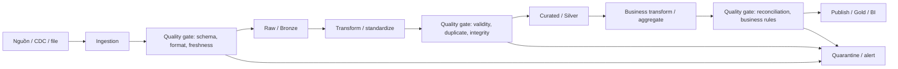
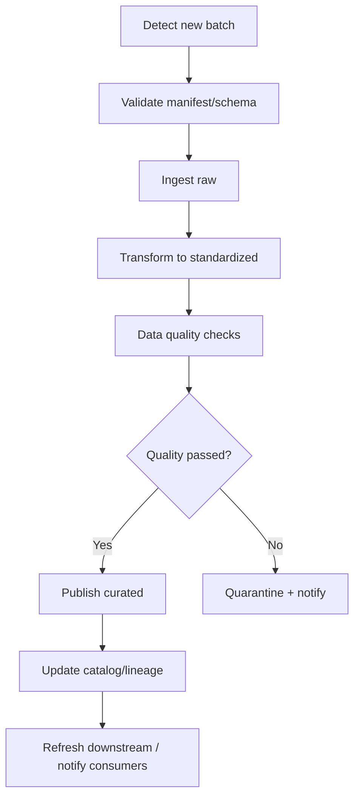
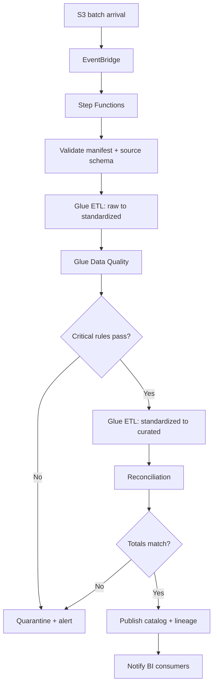

# Chất lượng dữ liệu, lineage và điều phối data pipeline

Một data pipeline chỉ hoàn thành khi dữ liệu được chuyển đúng, có thể tin cậy và người vận hành hiểu được dữ liệu đã đi qua những bước nào. Job ETL kết thúc với trạng thái `SUCCEEDED` chưa chứng minh rằng dữ liệu đầu ra đúng nghiệp vụ. Một bảng có đủ cột vẫn có thể chứa khóa trùng, giá trị sai, bản ghi đến trễ hoặc dữ liệu từ nguồn không đáng tin. Khi dashboard sai, đội kỹ thuật cần truy ngược nguồn và các phép biến đổi để tìm nguyên nhân; khi một bước thất bại, pipeline cần biết nên retry, cách ly dữ liệu hay dừng công bố.

Ba năng lực giải quyết những phần khác nhau của vấn đề:

- **Data quality** đo lường và kiểm tra dữ liệu có đáp ứng quy tắc kỹ thuật, nghiệp vụ và thời gian hay không.
- **Data lineage** ghi lại nguồn gốc, luồng biến đổi và quan hệ phụ thuộc giữa dataset, job và consumer.
- **Pipeline orchestration** điều phối thứ tự công việc, trigger, dependency, retry, timeout, nhánh xử lý lỗi và trạng thái chạy.

Trong module `CLOUD_PROVIDERS_AWS`, các năng lực này kết hợp AWS Glue Data Quality, Data Catalog, Glue ETL, Lake Formation, Amazon S3, AWS Step Functions, Glue Workflows, Amazon EventBridge, Amazon MWAA, CloudWatch và các dịch vụ phân tích. Mục tiêu là xây dựng pipeline có thể kiểm tra, truy vết, phục hồi và vận hành được qua nhiều account hoặc domain dữ liệu.

Sau bài học, bạn có thể:

- Xác định các chiều chất lượng dữ liệu và chuyển yêu cầu nghiệp vụ thành quality rules.
- Viết quy tắc bằng Data Quality Definition Language (DQDL) và dùng AWS Glue Data Quality.
- Đặt quality gate ở các giai đoạn ingest, transform và publish.
- Phân biệt technical lineage, business lineage, dataset lineage và column-level lineage.
- Thu thập và sử dụng lineage qua Glue, OpenLineage và Amazon SageMaker Unified Studio.
- Chọn Glue Workflows, Step Functions, EventBridge hoặc MWAA để điều phối pipeline.
- Thiết kế retry, backoff, idempotency, checkpoint, quarantine và backfill.
- Theo dõi freshness, quality score, job status, lag và chi phí để phát hiện sự cố.

## 1. Ba trụ cột của pipeline đáng tin cậy

Một pipeline có thể chạy đúng thứ tự nhưng tạo ra dữ liệu sai; một dataset có quality score tốt nhưng không rõ nguồn; một lineage graph đầy đủ nhưng không có cơ chế xử lý khi upstream job thất bại. Vì vậy, cần thiết kế ba trụ cột cùng nhau.

| Năng lực | Câu hỏi chính | Kết quả |
|---|---|---|
| Data quality | Dữ liệu có đúng, đủ, nhất quán và kịp thời không? | Rules, metrics, score, failed records, quality gate |
| Data lineage | Dữ liệu đến từ đâu, qua job nào, ảnh hưởng tới ai? | Upstream/downstream graph, column mapping, provenance |
| Orchestration | Bước nào chạy trước, khi nào retry, khi nào dừng hoặc publish? | Workflow state, dependency, trigger, retry, audit |

Ví dụ, pipeline đơn hàng nhận file từ S3, chuẩn hóa schema, loại duplicate, kiểm tra khóa ngoại rồi ghi bảng curated. Quality rules xác nhận `order_id` không null, duy nhất và `amount` hợp lệ. Lineage ghi nhận file nguồn, Glue job, bảng đầu ra và cột được biến đổi. Orchestrator chỉ cho phép publish khi ETL và quality gate thành công.

## 2. Data quality là gì?

Data quality mô tả mức độ dữ liệu phù hợp với mục đích sử dụng. Một dataset không có chất lượng tuyệt đối trong mọi ngữ cảnh. Bảng telemetry có thể chấp nhận một tỷ lệ bản ghi thiếu nhiệt độ, trong khi bảng thanh toán có thể yêu cầu mọi giao dịch phải có mã tiền tệ và số tiền hợp lệ.

Các chiều chất lượng thường gặp:

| Chiều | Câu hỏi | Ví dụ kiểm tra |
|---|---|---|
| Completeness | Trường bắt buộc có giá trị không? | `order_id` không null |
| Uniqueness | Khóa có bị trùng không? | Một `order_id` chỉ xuất hiện một lần |
| Validity | Giá trị có thuộc miền hợp lệ không? | `amount >= 0`, trạng thái nằm trong danh sách |
| Accuracy | Giá trị có phản ánh đúng thực tế không? | Tổng đơn hàng khớp hệ thống giao dịch |
| Consistency | Các trường/bảng có nhất quán không? | Currency và amount phù hợp |
| Timeliness/Freshness | Dữ liệu có đến đúng hạn không? | Partition của ngày hiện tại đã được nạp |
| Integrity | Quan hệ giữa các dataset có hợp lệ không? | Mọi `customer_id` đều tồn tại trong customer table |
| Schema validity | Cấu trúc có đúng hợp đồng không? | Cột, kiểu dữ liệu và version phù hợp |

Không phải mọi chiều đều có thể đo bằng một rule đơn giản. Accuracy thường cần đối chiếu với nguồn đáng tin hoặc hệ thống nghiệp vụ. Completeness và uniqueness dễ tự động hóa hơn; timeliness cần timestamp và SLA; consistency thường cần so sánh nhiều cột hoặc dataset.

### 2.1. Chuyển yêu cầu nghiệp vụ thành quy tắc đo được

Yêu cầu “dữ liệu đơn hàng phải sạch” quá mơ hồ. Hãy chuyển thành điều kiện có thể kiểm tra:

- Mỗi bản ghi phải có `order_id`.
- `order_id` phải duy nhất trong phạm vi business key.
- `amount` không âm và `currency` thuộc danh sách được hỗ trợ.
- `status` chỉ có các giá trị được định nghĩa.
- `customer_id` phải tồn tại trong bảng khách hàng được công bố.
- Partition ngày D phải sẵn sàng trước 06:00 UTC.
- Tổng amount theo ngày phải nằm trong ngưỡng biến động đã thống nhất hoặc được đối chiếu với hệ thống nguồn.

Mỗi rule cần có owner, mục đích, phạm vi dữ liệu, ngưỡng, tần suất, hành động khi fail và ngoại lệ được chấp nhận. Một rule không có owner dễ trở thành cảnh báo bị bỏ qua.

## 3. Đặt quality checks ở đâu trong data lifecycle?

Không nên chờ tới bảng Gold mới kiểm tra dữ liệu. Nếu lỗi được phát hiện sớm, chi phí sửa và điều tra thường thấp hơn.



| Giai đoạn | Mục tiêu | Kiểm tra phù hợp |
|---|---|---|
| Ingestion | Bảo đảm file/event có thể đọc và đúng contract | Schema, encoding, file format, checksum, freshness |
| Raw/Bronze | Giữ dữ liệu gốc và phát hiện lỗi cơ bản | Required fields, parse errors, source metadata |
| Standardized/Silver | Chuẩn hóa và kiểm tra logic | Type, range, uniqueness, referential integrity |
| Curated/Gold | Xác nhận logic nghiệp vụ | Reconciliation, totals, business invariants |
| Consumption | Theo dõi chất lượng khi sử dụng | Freshness SLA, distribution drift, null rate |

Raw zone thường nên giữ bản gốc bất biến hoặc có version để có thể xử lý lại. Bản ghi lỗi có thể được cách ly cùng lý do, source file, batch ID và thời điểm. Đừng xóa dữ liệu lỗi ngay nếu nó cần cho audit hoặc điều tra.

## 4. AWS Glue Data Quality

AWS Glue Data Quality là dịch vụ được quản lý để đo lường và giám sát chất lượng dữ liệu, xây dựng trên nền tảng mã nguồn mở Deequ và sử dụng Data Quality Definition Language (DQDL) để mô tả rule.

Có hai điểm tích hợp chính:

1. **Data Catalog**: đánh giá bảng đã đăng ký trong Glue Data Catalog và các nguồn được hỗ trợ. Phù hợp với data steward hoặc analyst muốn quản lý chất lượng của dataset đã catalog.
2. **Glue ETL jobs**: thực hiện kiểm tra trong luồng xử lý, có thể xác định các record thất bại để lọc hoặc cách ly trước khi ghi output.

Một số khác biệt cần nhớ:

| Khả năng | Data Catalog | Glue ETL |
|---|---|---|
| Tạo rule bằng DQDL | Có | Có |
| Gợi ý rule | Có | Không |
| Kiểm tra dữ liệu trong ETL flow | Đánh giá table đã catalog | Có thể đặt giữa các bước ETL |
| Xác định record-level failure | Không hỗ trợ theo cùng cách | Có thể xuất kết quả theo record |
| DQDL analyzers | Không hỗ trợ analyzer DQDL ở entry point Data Catalog | Có thể dùng analyzer trong ETL theo loại rule được hỗ trợ |
| Lên lịch | Evaluation và evaluation configuration | Workflow/Step Functions hoặc lịch job |
| CloudWatch/EventBridge | Có tích hợp | Có tích hợp |

Glue Data Quality không thay thế quy trình quản trị dữ liệu. Rule cần được xác nhận bởi data owner, ngưỡng phải phù hợp business contract và kết quả cần được nối với quyết định vận hành.

### 4.1. Data Quality Definition Language (DQDL)

DQDL là ngôn ngữ khai báo các rule. Một ruleset gom nhiều quy tắc để đánh giá một dataset.

Ví dụ ruleset cho bảng đơn hàng:

```text
Rules = [
    IsComplete "order_id",
    IsUnique "order_id",
    ColumnValues "amount" >= 0,
    ColumnValues "status" in ["PAID", "PENDING", "CANCELLED"],
    RowCount > 0
]
```

Ý nghĩa:
- `IsComplete` kiểm tra trường có giá trị.
- `IsUnique` kiểm tra giá trị duy nhất.
- `ColumnValues` kiểm tra miền giá trị.
- `RowCount` kiểm tra dataset có bản ghi.

DQDL phân biệt chữ hoa/chữ thường ở tên rule và cấu trúc ruleset. Tên cột phải khớp schema thực tế. Hãy thử ruleset với dữ liệu đại diện trước khi áp dụng production.

### 4.2. Rule theo tỷ lệ và ngưỡng

Không phải lúc nào cũng yêu cầu 100% record đạt một rule. Ví dụ dữ liệu telemetry có thể chấp nhận tối đa 0,5% bản ghi thiếu trường optional, nhưng dữ liệu thanh toán có thể yêu cầu completeness 100% với khóa và số tiền.

Có thể biểu diễn các ngưỡng thống kê bằng DQDL, ví dụ:

```text
Rules = [
    Completeness "device_id" >= 0.995,
    Completeness "temperature" >= 0.98,
    Mean "temperature" between -20 and 80,
    RowCount > 100
]
```

Ngưỡng phải dựa trên SLA và đặc tính nguồn. Không sao chép ngưỡng của một dataset sang dataset khác chỉ vì chúng có cùng schema.

### 4.3. Composite rules

DQDL hỗ trợ kết hợp rule bằng `and` và `or`. Ví dụ:

```text
Rules = [
    (IsComplete "order_id") and (IsUnique "order_id"),
    (ColumnValues "amount" >= 0) and (ColumnValues "currency" in ["USD", "EUR", "VND"])
]
```

Mặc định composite rules được đánh giá theo từng rule trên toàn dataset rồi kết hợp kết quả. Nếu cần semantics kiểu SQL theo từng row, phải cấu hình phương thức đánh giá composite rule là `ROW` trong additional options. Nếu không hiểu phạm vi đánh giá, biểu thức OR có thể cho kết quả khác với kỳ vọng nghiệp vụ.

### 4.4. Cross-dataset rules

Một số rule hỗ trợ kiểm tra quan hệ giữa hai dataset:
- Referential integrity: khóa ở dataset chính có tồn tại ở dataset tham chiếu không.
- Dataset match: hai dataset có khớp theo điều kiện hay không.
- Aggregate match: tổng hợp theo metric có khớp không.
- Schema match: cấu trúc hai dataset có phù hợp không.

Ví dụ, `orders.customer_id` cần tham chiếu tới `customers.customer_id`. Nếu customer table được cập nhật chậm hơn order stream, rule có thể fail tạm thời. Pipeline cần xác định đây là lỗi dữ liệu thật hay do thứ tự cập nhật giữa hai nguồn.

### 4.5. Giới hạn cần biết

- AWS Glue Data Quality không đánh giá trực tiếp nested/list-type data theo cùng cơ chế rule thông thường; cần flatten hoặc chuẩn hóa cấu trúc trước.
- Data Catalog entry point không cung cấp cùng khả năng xác định từng record lỗi như Glue ETL.
- Một số rule cần reference dataset hoặc source type được hỗ trợ.
- Ruleset có giới hạn kích thước và số rule; nên chia nhỏ theo domain hoặc mục tiêu.
- Data Quality score là tỷ lệ rule pass, không phải tỷ lệ record đúng hay thước đo toàn diện về độ tin cậy.

Không dùng score 100% để kết luận dữ liệu chính xác nếu ruleset chưa bao phủ các rủi ro quan trọng.

## 5. Ruleset, evaluation và monitoring

Một quy trình quản lý chất lượng trong Data Catalog thường gồm:

1. Chọn database/table cần đánh giá.
2. Tạo ruleset bằng DQDL hoặc dùng rule recommendations làm điểm khởi đầu.
3. Review và chỉnh sửa rule cùng data owner.
4. Chọn IAM role có quyền truy cập nguồn, Glue và nơi lưu kết quả.
5. Chạy evaluation.
6. Xem từng rule pass/fail, metrics và quality score.
7. Gửi kết quả tới CloudWatch/S3 hoặc hệ thống giám sát theo cấu hình.
8. Đặt lịch hoặc evaluation configuration để theo dõi liên tục.

Rule recommendations giúp khởi đầu nhanh nhưng cần được review. Một profile có thể gợi ý cột thường unique hoặc có tỷ lệ null thấp; nó không biết đầy đủ quy tắc nghiệp vụ. Chẳng hạn giá trị `amount` luôn dương trong dữ liệu lịch sử không có nghĩa nghiệp vụ cho phép mọi giao dịch phải lớn hơn 0.

### 5.1. Monitoring ở cấp catalog/database

AWS Glue Data Quality hỗ trợ data quality evaluation configurations ở cấp catalog, database hoặc table. Với cấu hình ở cấp catalog/database, tổ chức có thể định nghĩa kiểm tra một lần rồi áp dụng cho mọi table trong phạm vi, kể cả table được thêm sau đó. Evaluation có thể chạy một lần, theo lịch hoặc khi metadata table thay đổi theo cấu hình.

Cách này hữu ích khi cần baseline chung như:
- Mọi bảng phải có owner/classification metadata.
- Mọi bảng giao dịch phải đáp ứng một nhóm quy tắc chuẩn.
- Dataset mới trong database phải được đánh giá trước khi công bố.

Tuy nhiên, quy tắc chung không thay thế rule chuyên biệt. Bảng clickstream và bảng ledger có yêu cầu khác nhau; hãy dùng ruleset theo domain hoặc table khi cần.

### 5.2. Data Quality score và cách diễn giải

Glue Data Quality score biểu diễn tỷ lệ các rule trong ruleset được đánh giá là pass. Ví dụ 8/10 rule pass tương ứng score 80%.

Score không tự phản ánh:
- Mức độ nghiêm trọng của từng rule.
- Số lượng record bị ảnh hưởng.
- Trọng số nghiệp vụ của rule.
- Độ chính xác so với thực tế bên ngoài.
- Những chiều chất lượng chưa có rule.

Một rule khóa chính fail có thể nghiêm trọng hơn nhiều rule mô tả optional pass. Dashboard nên hiển thị cả score, rule result, severity, failed record count nếu có, trend và owner.

## 6. Thiết kế quality gate

Quality gate là quyết định có cho phép pipeline đi tiếp hay công bố dataset hay không. Một pipeline có thể có ba kết quả:

- **Pass**: tất cả rule bắt buộc đạt.
- **Warn/Degraded**: có rule cảnh báo fail nhưng vẫn được phép tiếp tục theo chính sách.
- **Fail/Quarantine**: vi phạm rule chặn, dừng publish và cách ly output.

Ví dụ:

| Rule | Severity | Kết quả | Hành động |
|---|---|---|---|
| `order_id` completeness | Critical | Fail | Dừng publish |
| `order_id` uniqueness | Critical | Pass | Tiếp tục |
| `amount >= 0` | Critical | Pass | Tiếp tục |
| Optional phone completeness | Warning | Fail | Publish có cảnh báo |
| Partition freshness | High | Fail | Chờ dữ liệu hoặc báo trễ SLA |

Đừng dùng một ngưỡng score duy nhất làm quality gate nếu các rule có mức độ quan trọng khác nhau. Có thể dùng rule critical làm điều kiện chặn và các rule khác làm cảnh báo.

### 6.1. Quarantine và xử lý bản ghi lỗi

Khi ETL phát hiện record không hợp lệ:
- Ghi record lỗi vào prefix/quarantine dataset riêng.
- Gắn reason code và rule name.
- Giữ source file, batch ID, event ID và timestamp.
- Bảo vệ quyền truy cập vì record lỗi có thể chứa dữ liệu nhạy cảm.
- Cho phép sửa và replay sau khi có approval.
- Không tự động bỏ record nếu việc bỏ có thể làm sai tổng tiền hoặc nghĩa vụ nghiệp vụ.

Với dữ liệu tài chính, nên có reconciliation để so sánh số record và tổng amount giữa source, accepted và quarantined. Điều này giúp phát hiện việc loại bỏ dữ liệu ngoài dự kiến.

## 7. Data lineage là gì?

Data lineage mô tả nguồn gốc và hành trình của dữ liệu qua hệ thống. Lineage trả lời:
- Dataset được tạo từ nguồn nào?
- Job hoặc query nào đã đọc và ghi dataset?
- Các phép biến đổi nào được áp dụng?
- Cột đầu ra được tính từ cột nguồn nào?
- Dataset nào sẽ bị ảnh hưởng nếu schema hoặc pipeline thay đổi?
- Báo cáo nào đang phụ thuộc vào bảng lỗi?

Các mức lineage thường gặp:

| Loại lineage | Phạm vi | Ví dụ |
|---|---|---|
| Dataset/table-level | Quan hệ giữa dataset | `raw.orders` → `curated.orders` |
| Job/run-level | Job nào tạo hoặc cập nhật dataset | Glue job `orders-standardize`, run ID |
| Column-level | Quan hệ giữa cột nguồn và cột đích | `raw.total` → `curated.net_amount` |
| Business lineage | Khái niệm và chỉ số nghiệp vụ | Net Revenue được tính từ order amount trừ refund |
| Operational lineage | Lịch sử lần chạy, trạng thái và sự cố | Run nào fail, retry, publish hoặc backfill |

Lineage không phải chỉ là danh sách job. Một lineage hữu ích cần định danh ổn định cho dataset/job, thời điểm, run ID, input/output và quan hệ biến đổi.

## 8. Vì sao lineage quan trọng?

### 8.1. Root cause analysis

Nếu báo cáo doanh thu sai, lineage cho biết bảng báo cáo được tạo từ bảng curated nào, job nào transform và nguồn nào cấp dữ liệu. Đội vận hành có thể đi ngược tới bước đầu tiên có sai lệch.

### 8.2. Impact analysis

Khi một cột thay đổi kiểu dữ liệu hoặc một bảng bị deprecate, lineage giúp xác định downstream consumer, dashboard, job và ứng dụng cần được kiểm tra.

### 8.3. Compliance và audit

Lineage hỗ trợ chứng minh nguồn gốc dữ liệu, đường đi của dữ liệu nhạy cảm và cách dữ liệu được biến đổi. Tuy nhiên, lineage không tự chứng minh người dùng có quyền truy cập hợp lệ; cần kết hợp Lake Formation, IAM và audit logs.

### 8.4. Trust và data product

Data consumer có thể xem dữ liệu đến từ đâu, được xử lý bởi job nào, quality gate có đạt không và owner là ai. Điều này giúp đánh giá dataset trước khi dùng trong báo cáo hoặc mô hình ML.

## 9. Lineage trong AWS: Glue Data Catalog và OpenLineage

AWS Glue Data Catalog lưu metadata về dataset và có thể duy trì thông tin về các thao tác/biến đổi trên dữ liệu. Để tạo đồ thị lineage xuyên qua nhiều công cụ, có thể dùng cơ chế lineage tương thích OpenLineage trong Amazon SageMaker Unified Studio.

Cần phân biệt:
- **Glue Data Catalog** là metastore lưu database, table, schema, location và metadata.
- **OpenLineage** là đặc tả sự kiện mô tả job, job run, dataset và quan hệ input/output.
- **Amazon SageMaker Unified Studio** cung cấp trải nghiệm thu thập và trực quan hóa lineage tương thích OpenLineage, kết hợp metadata asset và sự kiện từ các công cụ được hỗ trợ.

Một lineage graph có thể hiển thị upstream source, processing job, output dataset và downstream consumer. Column-level lineage có thể cho biết cột đầu ra phụ thuộc vào cột nào trong nguồn khi event và công cụ cung cấp đủ thông tin.

### 9.1. Nguồn lineage tự động và giới hạn

Khả năng capture phụ thuộc nguồn và phiên bản:

- Glue crawlers trong SageMaker Unified Studio có thể tự động capture lineage cho các nguồn được hỗ trợ khi bật cấu hình phù hợp.
- Glue jobs chạy từ Glue console không mặc định tự động gửi mọi lineage event; cần bật cấu hình generate lineage events và cung cấp domain ID theo hướng dẫn.
- OpenLineage libraries cho Spark được tích hợp trong AWS Glue 5.0+ cho Spark DataFrames; Glue DynamicFrames chưa được hỗ trợ theo cơ chế này.
- Với job đọc trực tiếp S3 file, lineage event có thể nhận diện dataset là S3 path thay vì Glue table. Nếu muốn liên kết tới Glue asset, hãy dùng Glue Catalog table làm nguồn trong job.
- Lineage có giới hạn kích thước event và phụ thuộc IAM/network/KMS; cần theo dõi lỗi publish.

Không giả định mọi Glue job hoặc mọi dịch vụ AWS đều tự động xuất hiện trong lineage graph. Hãy kiểm tra support matrix, cấu hình và event status.

### 9.2. Thành phần của OpenLineage event

Một event lineage thường chứa:
- Job namespace/name.
- Run ID và trạng thái lifecycle.
- Input datasets.
- Output datasets.
- Schema facets.
- Column lineage facets khi được hỗ trợ.
- Environment, code version hoặc metadata tùy chọn.

Ví dụ mô tả logic:

```text
Job: orders-standardize
Run: 2026-11-20T02:00Z / run-001
Inputs:
  - glue://raw_commerce/orders
Outputs:
  - glue://standardized_commerce/orders
Transformation:
  - normalize currency
  - parse created_at
  - derive order_date
```

Đây là sơ đồ khái niệm, không phải payload OpenLineage đầy đủ. Trong hệ thống thực tế, dùng thư viện hoặc API tương thích để phát event theo schema OpenLineage.

### 9.3. Lineage và metadata enrichment

Lineage graph chỉ hữu ích khi dataset có business context:
- Owner và steward.
- Business definition.
- Classification.
- Refresh cadence/SLA.
- Quality status.
- Source system.
- Consumer và usage policy.

Có thể bổ sung context qua metadata của Data Catalog và catalog asset trong SageMaker Unified Studio. Không nên dùng comment tự do làm nguồn sự thật duy nhất cho owner hoặc classification; cần quy trình đồng bộ và kiểm tra.

## 10. Orchestration là gì?

Orchestration là điều phối các bước trong pipeline theo dependency và trạng thái. Một orchestrator có thể:
- Khởi chạy job theo lịch hoặc khi có event.
- Chờ job hoàn tất.
- Chạy bước tiếp theo khi điều kiện đạt.
- Retry khi gặp lỗi tạm thời.
- Rẽ nhánh theo quality result.
- Gửi cảnh báo hoặc cách ly dữ liệu khi thất bại.
- Giới hạn concurrency.
- Theo dõi run history và input/output.

Orchestration khác scheduling:
- Scheduling quyết định **khi nào** bắt đầu.
- Orchestration quyết định **những bước nào** chạy, theo thứ tự và điều kiện nào.

Một pipeline phức tạp thường dùng cả hai. EventBridge Scheduler có thể khởi chạy Step Functions mỗi ngày; Step Functions điều phối Glue job, quality check, publish và notification.

## 11. Chọn công cụ orchestration trên AWS

| Công cụ | Phù hợp khi | Điểm mạnh |
|---|---|---|
| AWS Glue Workflows | Chuỗi Glue jobs, crawlers và triggers | Tích hợp native với Glue, đồ thị workflow và run properties |
| AWS Step Functions | Pipeline nhiều dịch vụ, branching, retry, wait và approval | State machine rõ ràng, execution history, service integrations |
| Amazon EventBridge | Kích hoạt theo event và định tuyến | Event-driven, lọc event, tách producer/consumer |
| Amazon MWAA | Tổ chức đã dùng Apache Airflow và DAG phức tạp | Ecosystem operator/provider, scheduling và dependency linh hoạt |
| EventBridge Scheduler | Lịch chạy và cron cho target AWS | Quản lý lịch tách khỏi ứng dụng |
| AWS Batch / EMR / Glue | Thực thi workload xử lý dữ liệu | Compute engine; thường được orchestrator gọi |

Không có công cụ duy nhất phù hợp mọi quy mô. Glue Workflows đơn giản hơn khi pipeline chủ yếu là Glue. Step Functions phù hợp khi cần điều phối nhiều AWS services và xử lý lỗi rõ ràng. MWAA phù hợp khi cần Airflow DAG, plugin và chuẩn vận hành Airflow hiện có, nhưng đi kèm chi phí và vận hành môi trường Airflow.

## 12. AWS Glue Workflows

AWS Glue Workflows gom nhiều Glue jobs, crawlers và triggers thành một workflow. Workflow quản lý trạng thái chạy, thứ tự phụ thuộc và lịch sử của từng component.

Các loại start trigger:
- Schedule.
- On demand.
- EventBridge event.

Trigger trong workflow có thể bắt đầu job/crawler khi component khác hoàn tất hoặc đạt điều kiện. Workflow graph hiển thị cấu trúc và trạng thái thực thi.

### 12.1. Workflow run properties

Workflow run properties là cặp key/value dùng chia sẻ trạng thái giữa các job trong cùng một workflow run. Ví dụ:
- Ngày dữ liệu cần xử lý.
- S3 source prefix.
- Target database.
- Batch ID.
- Environment hoặc run mode.

Properties chỉ áp dụng cho run tương ứng khi được cập nhật. Không đưa password, token hoặc secret plaintext vào run properties vì giá trị có thể được ghi log. Hãy lấy secret từ Secrets Manager hoặc Glue Connection.

### 12.2. Khi nào dùng Glue Workflows?

Dùng khi:
- Pipeline gồm nhiều Glue jobs và crawlers.
- Dependency tương đối rõ và chủ yếu nằm trong Glue.
- Cần lịch sử run và đồ thị thực thi.
- Muốn trigger workflow theo S3/EventBridge event.

Nếu workflow cần nhiều nhánh nghiệp vụ, chờ human approval, gọi nhiều dịch vụ ngoài Glue hoặc điều phối dài hạn, Step Functions thường phù hợp hơn.

## 13. AWS Step Functions cho pipeline đa dịch vụ

AWS Step Functions mô hình hóa pipeline thành state machine. Các state phổ biến:
- Task: gọi Glue, Lambda, Athena hoặc service khác.
- Choice: rẽ nhánh theo quality result.
- Wait: chờ thời gian hoặc callback.
- Parallel/Map: xử lý song song hoặc từng phần tử.
- Retry/Catch: thử lại hoặc xử lý lỗi.
- Succeed/Fail: kết thúc workflow.

Step Functions có optimized integration với AWS Glue `StartJobRun`. Integration pattern `.sync` cho phép Standard Workflow chờ Glue job hoàn tất trước khi chuyển state tiếp theo. Express Workflow chỉ hỗ trợ Request Response cho optimized integration; không dùng `.sync` như Standard Workflow.

### 13.1. Ví dụ state machine

Ví dụ dưới đây chạy Glue ETL, gọi hàm kiểm tra chất lượng, rồi rẽ nhánh. Hàm `validate-orders` đại diện cho bước đọc kết quả Data Quality và trả về trường boolean `passed`.

```json
{
  "Comment": "ETL and data quality pipeline",
  "StartAt": "TransformOrders",
  "States": {
    "TransformOrders": {
      "Type": "Task",
      "Resource": "arn:aws:states:::glue:startJobRun.sync",
      "Parameters": {
        "JobName": "orders-transform"
      },
      "Retry": [
        {
          "ErrorEquals": ["States.Timeout", "States.TaskFailed"],
          "IntervalSeconds": 30,
          "MaxAttempts": 2,
          "BackoffRate": 2
        }
      ],
      "Catch": [
        {
          "ErrorEquals": ["States.ALL"],
          "ResultPath": "$.failure",
          "Next": "Quarantine"
        }
      ],
      "Next": "ValidateQuality"
    },
    "ValidateQuality": {
      "Type": "Task",
      "Resource": "arn:aws:states:::lambda:invoke",
      "Parameters": {
        "FunctionName": "validate-orders",
        "Payload": {
          "dataset": "curated.orders"
        }
      },
      "ResultPath": "$.quality",
      "Catch": [
        {
          "ErrorEquals": ["States.ALL"],
          "ResultPath": "$.failure",
          "Next": "Quarantine"
        }
      ],
      "Next": "QualityGate"
    },
    "QualityGate": {
      "Type": "Choice",
      "Choices": [
        {
          "Variable": "$.quality.Payload.passed",
          "BooleanEquals": true,
          "Next": "Publish"
        }
      ],
      "Default": "Quarantine"
    },
    "Publish": {
      "Type": "Succeed"
    },
    "Quarantine": {
      "Type": "Task",
      "Resource": "arn:aws:states:::lambda:invoke",
      "Parameters": {
        "FunctionName": "quarantine-orders",
        "Payload.$": "$"
      },
      "Next": "PipelineFailed"
    },
    "PipelineFailed": {
      "Type": "Fail",
      "Error": "PipelineFailed",
      "Cause": "ETL or data quality validation failed"
    }
  }
}
```

Đây là mẫu minh họa; cần thay tên job/function, IAM role và logic quarantine theo hệ thống. Retry chỉ phù hợp với lỗi có thể phục hồi. Không retry vô hạn một lỗi schema hoặc business rule fail. Glue job phải idempotent để lần chạy lại không tạo dữ liệu trùng.

### 13.2. Retry, Catch và timeout

- Retry dùng cho lỗi tạm thời như throttling, timeout hoặc dependency gián đoạn.
- Catch chuyển lỗi sang nhánh xử lý như quarantine, notification hoặc rollback.
- Timeout giới hạn thời gian một state được phép chạy.
- Backoff giảm áp lực lên dịch vụ đang lỗi.
- Max attempts tránh vòng lặp vô hạn.

Phân biệt lỗi transient với lỗi permanent. Nếu Glue job fail do thiếu cột bắt buộc, retry ngay thường không giúp ích. Nếu lỗi do throttling, retry có backoff có thể thành công.

## 14. EventBridge và event-driven pipeline

Amazon EventBridge có thể nhận event từ AWS services hoặc ứng dụng, lọc theo event pattern rồi gọi target. Với data pipeline, event thường là:
- Object được tạo trong S3.
- Một batch ingest hoàn tất.
- Glue job hoàn tất.
- Data quality evaluation có kết quả.
- Một nguồn dữ liệu bên ngoài báo batch mới.

EventBridge có thể gọi Step Functions, Lambda, SQS hoặc Glue Workflow theo cấu hình hỗ trợ. Cần thiết kế idempotency vì event có thể được gửi lại hoặc pipeline có thể nhận nhiều event cho cùng một batch.

### 14.1. S3 event và duplicate

S3 event notification được thiết kế để phân phối ít nhất một lần và không bảo đảm thứ tự tuyệt đối. Một object event có thể được gửi trùng. Vì vậy:
- Dùng bucket/key/version ID hoặc batch ID làm idempotency key.
- Không giả định event tới đúng thứ tự.
- Kiểm tra object metadata và manifest trước khi xử lý.
- Dùng SQS buffer khi cần hấp thụ burst.
- Gom event theo batch/window khi một file không phải đơn vị xử lý phù hợp.
- Tránh chạy crawler hoặc ETL nặng cho từng object nhỏ nếu có thể xử lý theo lô.

### 14.2. Trigger theo lịch và theo event

| Kiểu trigger | Dùng khi | Ví dụ |
|---|---|---|
| Schedule | Nguồn dữ liệu đến theo lịch | Daily batch lúc 02:00 UTC |
| Event-driven | Có dữ liệu mới hoặc trạng thái thay đổi | S3 object created |
| Manual/on-demand | Backfill, sửa lỗi hoặc vận hành | Chạy lại ngày bị thiếu |
| Hybrid | Có event nhưng vẫn cần safety schedule | Event trigger + kiểm tra completeness cuối ngày |

Event-driven không đồng nghĩa không cần reconciliation. Nếu event bị lỗi hoặc nguồn không phát event, một scheduled completeness check có thể phát hiện partition bị thiếu.

## 15. Amazon MWAA và Apache Airflow

Amazon Managed Workflows for Apache Airflow (MWAA) là dịch vụ quản lý môi trường Apache Airflow. Airflow biểu diễn pipeline bằng DAG (Directed Acyclic Graph), trong đó task và dependency được định nghĩa bằng Python.

MWAA phù hợp khi:
- Tổ chức đã có DAG và kỹ năng Airflow.
- Cần nhiều operator/provider cho AWS và hệ thống bên ngoài.
- Có dependency phức tạp và scheduling đa dạng.
- Muốn chuẩn hóa orchestration theo Airflow giữa nhiều nền tảng.

Cần cân nhắc:
- Chi phí môi trường và worker.
- Phiên bản Airflow/provider package.
- Networking, private subnets, execution role và secrets backend.
- DAG parsing, scheduler health và worker capacity.
- Retry/backfill/catchup có thể tạo tải lớn nếu cấu hình sai.
- Quản lý dependency giữa DAG và external systems.

Không chọn MWAA chỉ vì pipeline có nhiều bước. Nếu workflow chỉ chạy một vài Glue jobs, Glue Workflows hoặc Step Functions có thể đơn giản và ít vận hành hơn.

## 16. Thiết kế DAG và dependency

Một pipeline thường có dạng DAG:



DAG không được có cycle. Nếu task A phụ thuộc B và B phụ thuộc A, orchestrator không thể xác định thứ tự thực thi. Với dependency vòng giữa các dataset, hãy chia pipeline thành các stage hoặc dùng event/state boundary rõ ràng.

### 16.1. Task granularity

Task quá lớn khó retry và khó xác định lỗi. Task quá nhỏ làm tăng overhead orchestration và số lần gọi dịch vụ. Chọn ranh giới theo đơn vị có thể retry độc lập:
- Một batch/partition.
- Một dataset/domain.
- Một bước transform.
- Một quality gate.
- Một bước publish.

Không tạo một task cho mỗi record nếu có thể batch. Với lượng event lớn, dùng streaming engine hoặc worker pool thay vì tạo hàng triệu state execution.

## 17. Idempotency, checkpoint và xử lý dữ liệu đến trễ

Một pipeline có thể chạy lại do retry, operator restart, event duplicate hoặc backfill. **Idempotency** bảo đảm chạy lại cùng input không làm dữ liệu đầu ra sai hoặc nhân đôi.

Các kỹ thuật:
- Gán batch ID hoặc run ID ổn định.
- Dùng source object version/checksum để nhận diện input.
- Ghi output vào staging prefix trước khi publish.
- Dùng atomic commit hoặc transaction của table format phù hợp.
- Dùng upsert/merge theo business key khi yêu cầu.
- Lưu trạng thái batch đã xử lý.
- Chỉ cập nhật checkpoint sau khi output được commit thành công.
- Thiết kế cleanup cho staging data khi run fail.

AWS Glue Job Bookmarks giúp theo dõi dữ liệu đã xử lý cho một số nguồn và job, nhưng không phải bảo đảm exactly-once cho toàn pipeline. Nếu job có side effect ngoài Glue, cần idempotency riêng.

### 17.1. Late-arriving data và backfill

Dữ liệu có thể đến sau partition date dự kiến. Hãy xác định:
- Watermark: thời điểm coi batch đã đủ.
- Allowed lateness: khoảng thời gian chấp nhận dữ liệu đến muộn.
- Correction window: khoảng thời gian cho phép tính lại partition cũ.
- Backfill policy: cách chạy lại ngày/tháng cũ.
- Consumer notification: ai cần biết khi dữ liệu lịch sử thay đổi.

Đừng đóng partition vĩnh viễn quá sớm nếu nguồn có late data. Ngược lại, không để mọi partition mở vô hạn vì sẽ làm tăng chi phí và khó xác định số liệu cuối cùng.

## 18. Quản lý trạng thái và concurrency

Pipeline cần giới hạn số run đồng thời để tránh:
- Hai job cùng ghi một partition.
- Nhiều run làm quá tải database.
- Một event burst tạo quá nhiều Glue job.
- Backfill chiếm toàn bộ capacity của daily production.

Các biện pháp:
- Max concurrent runs ở Glue job/workflow.
- Queue hoặc semaphore trước khi khởi chạy job.
- Step Functions concurrency controls và Map limits.
- MWAA pools, task concurrency và DAG concurrency.
- Partition-level lock hoặc transaction control.
- Tách backfill workload khỏi production SLA.

Workflow run properties có thể truyền batch ID, date hoặc target prefix giữa các job. Không truyền secret plaintext qua workflow properties hoặc state payload.

## 19. Quan sát và cảnh báo pipeline

Cần theo dõi trạng thái orchestration và chất lượng dữ liệu cùng lúc.

| Nhóm | Metric/signal | Câu hỏi |
|---|---|---|
| Freshness | Thời gian từ source event tới publish | Dataset có đúng SLA không? |
| Completeness | Số partition/batch dự kiến so với thực tế | Có batch bị thiếu không? |
| Quality | Rule pass/fail, score, failed records | Dữ liệu có vi phạm contract không? |
| Lineage | Event capture success, upstream/downstream | Có truy vết được nguồn và consumer không? |
| Orchestration | Job duration, retry count, failure rate | Pipeline có chạy ổn định không? |
| Backlog | SQS age/depth, event lag | Dữ liệu có đang ùn tắc không? |
| Cost | DPU-hours, query scan, storage growth | Pipeline có vượt ngân sách không? |

Sử dụng:
- CloudWatch metrics, logs, dashboards và alarms.
- EventBridge để định tuyến trạng thái hoặc finding.
- SNS hoặc hệ thống incident management để thông báo.
- Glue workflow/job run history.
- Step Functions execution history.
- MWAA/Airflow task logs và metrics.
- S3 manifest hoặc batch registry để kiểm tra completeness.

Đặt alarm theo SLA nghiệp vụ. Job chạy thành công trong 5 phút nhưng tạo partition rỗng vẫn là lỗi dữ liệu. Ngược lại, job lâu hơn bình thường có thể là cảnh báo trước khi vi phạm freshness SLA.

## 20. Xử lý lỗi và khôi phục pipeline

Một runbook cần phân loại lỗi:

| Lỗi | Hành động phù hợp |
|---|---|
| Source chưa tới | Chờ, kiểm tra SLA và retry theo thời gian |
| Schema không tương thích | Quarantine, báo producer, không tự ép kiểu |
| Data quality critical fail | Dừng publish, giữ failed records và run context |
| Glue throttling | Backoff, giảm concurrency hoặc tăng quota phù hợp |
| IAM/KMS AccessDenied | Sửa policy/role/key; tránh retry vô hạn |
| S3 transient error | Retry có giới hạn, kiểm tra object/version |
| Downstream unavailable | Buffer, circuit breaker hoặc pause consumer |
| Partial write | Dọn staging hoặc commit lại theo transaction design |
| Lineage event publish fail | Ghi log/retry riêng; không nhất thiết làm mất dữ liệu nếu policy cho phép |
| Orchestrator timeout | Xác minh trạng thái job trước khi chạy lại để tránh duplicate |

Không phải lỗi lineage nào cũng cần dừng xử lý dữ liệu. Tổ chức có thể quy định lineage capture là blocking control với dataset regulated, hoặc non-blocking observability step với dataset nội bộ. Quyết định phải dựa trên compliance và impact assessment.

### 20.1. Quarantine và replay

Quarantine cần giữ:
- Input reference và checksum/version.
- Batch/run ID.
- Rule fail và metric.
- Error code/stack trace đã lọc secret.
- Thời điểm và pipeline version.
- Trạng thái review/approval.

Sau khi sửa dữ liệu hoặc logic, replay theo batch ID. Không replay toàn bộ lịch sử nếu chỉ một partition bị ảnh hưởng. Kiểm tra downstream side effect trước khi replay, đặc biệt khi pipeline gửi email, thanh toán hoặc gọi API bên ngoài.

## 21. Tình huống thực tế: pipeline đơn hàng thương mại điện tử

Một hệ thống nhận order events vào S3 theo batch mỗi 15 phút. Dữ liệu được xử lý thành ba lớp:
- Raw: lưu nguyên bản event.
- Standardized: chuẩn hóa timezone, currency và schema.
- Curated: tổng hợp doanh thu và trạng thái đơn hàng cho BI.

Mục tiêu:
- Publish partition trong vòng 30 phút.
- `order_id` không null và duy nhất trong batch.
- `amount` không âm.
- Mọi currency nằm trong danh sách hỗ trợ.
- Tổng doanh thu theo ngày đối chiếu với hệ thống order source trong sai số được phê duyệt.
- Có thể truy vết từ dashboard về batch nguồn và Glue job run.

### 21.1. Pipeline



### 21.2. Quality rules

Ruleset kiểm tra:
- `order_id` đầy đủ và duy nhất.
- `amount` lớn hơn hoặc bằng 0.
- `currency` thuộc danh sách cho phép.
- Row count không bằng 0.
- Foreign key `customer_id` có trong customer dataset.

Nếu critical rule fail, không publish curated partition. Bản ghi lỗi được ghi vào quarantine cùng reason. Nếu rule warning fail, pipeline có thể publish với quality status `DEGRADED` và thông báo owner theo policy.

### 21.3. Lineage và điều tra

Lineage ghi nhận:
- Input batch và raw table.
- Glue job/run đã chuẩn hóa.
- Standardized table.
- Job aggregate tạo curated sales table.
- Dashboard hoặc project tiêu thụ dataset nếu catalog platform thu thập được subscription/usage lineage.

Khi doanh thu dashboard sai, đội kỹ thuật xem lineage để xác định upstream table và job. Sau đó đối chiếu quality results và batch ID để khoanh vùng partition bị sai.

### 21.4. Điều phối và phục hồi

Step Functions điều phối:
1. Kiểm tra manifest.
2. Chạy Glue transform với `.sync`.
3. Đọc quality result.
4. Rẽ nhánh publish hoặc quarantine.
5. Gửi notification.
6. Ghi trạng thái batch.

Nếu một event S3 được gửi trùng, batch ID và object version giúp state machine nhận diện lần xử lý đã hoàn tất. Nếu job fail sau khi ghi staging data, lần retry kiểm tra run state và dọn staging trước khi commit lại.

## 22. Data contract và ownership

Data contract là thỏa thuận giữa producer và consumer về cấu trúc, ý nghĩa, chất lượng và hành vi dữ liệu. Nó giúp giảm việc mỗi consumer tự đoán schema và semantics.

Một contract nên có:
- Dataset name và version.
- Schema và field descriptions.
- Required/optional fields.
- Primary/business key.
- Allowed values và constraints.
- Event time/processing time.
- Freshness và delivery SLA.
- Retention.
- Owner, steward và escalation contact.
- Compatibility policy.
- Quality rules và severity.
- Lineage expectations.

Khi producer thay đổi contract:
1. Đề xuất schema/version.
2. Phân tích downstream impact qua lineage.
3. Kiểm thử consumer.
4. Cập nhật DQ rules.
5. Triển khai theo giai đoạn.
6. Theo dõi quality/freshness sau release.
7. Deprecate version cũ sau thời gian chuyển đổi.

## 23. Security và governance

Quality result, lineage graph và orchestration metadata có thể chứa tên dataset, thông tin khách hàng, nguồn dữ liệu hoặc chi tiết lỗi. Bảo vệ các thành phần này:

- IAM role riêng cho producer, ETL, quality evaluator và orchestrator.
- Lake Formation grants theo database/table/column và LF-Tags.
- KMS encryption cho S3, catalog metadata và log khi phù hợp.
- Giới hạn quyền đọc quarantine vì có thể chứa dữ liệu lỗi nhạy cảm.
- Không đưa secret vào workflow input, run properties hoặc log.
- CloudTrail audit các thay đổi IAM, Glue, Step Functions, EventBridge và Lake Formation.
- Tách quyền sửa ruleset khỏi quyền duyệt publish nếu yêu cầu kiểm soát.
- Giữ lineage event và quality results theo retention phù hợp.
- Kiểm soát cross-account access và data sharing.

Orchestrator role chỉ nên gọi job, đọc trạng thái và chuyển nhánh cần thiết. Nó không cần quyền đọc toàn bộ dữ liệu trong S3 nếu các job execution role đảm nhận việc đó.

## 24. Những sai lầm thường gặp

| Sai lầm | Hậu quả | Cách làm đúng |
|---|---|---|
| Chỉ kiểm tra job status | Job thành công nhưng dữ liệu sai | Thêm quality gate và reconciliation |
| Chỉ dùng quality score | Rule quan trọng bị đánh đồng với rule phụ | Phân severity và chặn theo critical rules |
| Crawler được coi là quality test | Schema được phát hiện nhưng giá trị có thể sai | Dùng DQ rules và business validation |
| Lineage chỉ ghi tên job | Không xác định được dataset/cột bị ảnh hưởng | Ghi input/output, run ID và column mapping |
| Giả định mọi Glue job tự có lineage | Graph thiếu dữ liệu | Kiểm tra version, capture config và OpenLineage support |
| Retry mọi lỗi vô hạn | Tăng chi phí và gây duplicate | Retry có giới hạn, phân loại transient/permanent |
| Event S3 được coi là exactly-once | Duplicate trigger và ghi trùng | Idempotency key, batch registry |
| Publish trước khi quality xong | Consumer đọc dữ liệu lỗi | Staging và atomic publish sau gate |
| Một orchestrator điều khiển mọi thứ quá chi tiết | Tăng complexity và chi phí | Chọn task granularity hợp lý |
| Không có backfill policy | Dữ liệu lịch sử không thể sửa an toàn | Định nghĩa correction window và replay |
| Workflow input chứa secret | Lộ credential qua log/history | Dùng Secrets Manager/Glue Connection |
| Không đo freshness | Pipeline chạy xanh nhưng trễ SLA | Theo dõi source-to-publish latency |

## 25. Checklist thiết kế pipeline có quality, lineage và orchestration

- [ ] Có data owner và technical owner cho từng dataset.
- [ ] Data contract mô tả schema, semantics và SLA.
- [ ] Quality dimensions và critical rules được xác định.
- [ ] DQDL ruleset được version control và review.
- [ ] Quality gates có pass/warn/fail và quarantine policy.
- [ ] Data Quality results được lưu và theo dõi.
- [ ] Lineage ghi nhận input, output, job, run ID và schema.
- [ ] Column-level lineage được bật khi use case cần và được hỗ trợ.
- [ ] Orchestrator phù hợp với độ phức tạp pipeline.
- [ ] Retry/backoff/timeout/Catch được thiết kế theo loại lỗi.
- [ ] Job và publish operation idempotent.
- [ ] Event duplicate và late data được xử lý.
- [ ] Backfill/replay có runbook và quyền kiểm soát.
- [ ] Concurrency được giới hạn để bảo vệ downstream.
- [ ] Freshness, quality, lineage capture và job health có alarm.
- [ ] IAM, KMS, Lake Formation và quarantine access theo least privilege.
- [ ] Có dashboard và incident runbook.
- [ ] Diễn tập source outage, schema drift, quality failure và retry.

## 26. Tóm tắt kiến thức

Data quality xác nhận dữ liệu phù hợp mục đích sử dụng thông qua completeness, uniqueness, validity, accuracy, consistency, timeliness và integrity. AWS Glue Data Quality dùng DQDL để kiểm tra bảng trong Data Catalog hoặc dữ liệu trong Glue ETL. Quality gate quyết định publish, cảnh báo hay quarantine; quality score chỉ là một chỉ số tổng hợp và phải được đọc cùng kết quả từng rule.

Data lineage mô tả nguồn gốc, job, lần chạy, biến đổi và quan hệ upstream/downstream. Glue Data Catalog lưu metadata, còn OpenLineage và Amazon SageMaker Unified Studio có thể cung cấp lineage graph xuyên công cụ khi nguồn và cấu hình được hỗ trợ. Cần kiểm tra version, Spark DataFrame/DynamicFrame và cách job tham chiếu dataset để lineage được liên kết chính xác.

Orchestration điều phối dependency, trigger, retry, timeout, branch và recovery. Glue Workflows phù hợp chuỗi Glue jobs/crawlers; Step Functions phù hợp pipeline đa dịch vụ có state machine và error handling; EventBridge kích hoạt theo event; MWAA phù hợp tổ chức đã vận hành Airflow. Hệ thống đáng tin cậy cần idempotency, quarantine, backfill, observability và quyền tối thiểu. Khi ba năng lực quality, lineage và orchestration được thiết kế đồng bộ, data lake có thể cung cấp dữ liệu đáng tin và vận hành được ở quy mô lớn.

## Tài liệu tham khảo

- [AWS Glue Data Quality](https://docs.aws.amazon.com/glue/latest/dg/glue-data-quality.html)
- [Data Quality Definition Language (DQDL)](https://docs.aws.amazon.com/glue/latest/dg/dqdl.html)
- [DQDL rule type reference](https://docs.aws.amazon.com/glue/latest/dg/dqdl-rule-types.html)
- [Getting started with AWS Glue Data Quality for the Data Catalog](https://docs.aws.amazon.com/glue/latest/dg/data-quality-getting-started.html)
- [AWS Glue Data Quality API](https://docs.aws.amazon.com/glue/latest/dg/aws-glue-api-data-quality-api.html)
- [Overview of workflows in AWS Glue](https://docs.aws.amazon.com/glue/latest/dg/workflows_overview.html)
- [Getting and setting workflow run properties](https://docs.aws.amazon.com/glue/latest/dg/workflow-run-properties-code.html)
- [Start an AWS Glue job with Step Functions](https://docs.aws.amazon.com/step-functions/latest/dg/connect-glue.html)
- [Step Functions service integration patterns](https://docs.aws.amazon.com/step-functions/latest/dg/connect-to-resource.html)
- [Amazon EventBridge User Guide](https://docs.aws.amazon.com/eventbridge/latest/userguide/eb-what-is.html)
- [Using EventBridge with Amazon S3](https://docs.aws.amazon.com/AmazonS3/latest/userguide/EventBridge.html)
- [Amazon MWAA User Guide](https://docs.aws.amazon.com/mwaa/latest/userguide/what-is-mwaa.html)
- [Data lineage in Amazon SageMaker Unified Studio](https://docs.aws.amazon.com/sagemaker-unified-studio/latest/userguide/datazone-data-lineage.html)
- [Data lineage support matrix](https://docs.aws.amazon.com/sagemaker-unified-studio/latest/userguide/datazone-support-matrix.html)
- [Automate lineage capture from tools](https://docs.aws.amazon.com/sagemaker-unified-studio/latest/userguide/datazone-data-lineage-automate-capture-from-tools.html)
- [Troubleshooting data lineage](https://docs.aws.amazon.com/sagemaker-unified-studio/latest/userguide/datazone-lineage-troubleshooting.html)

