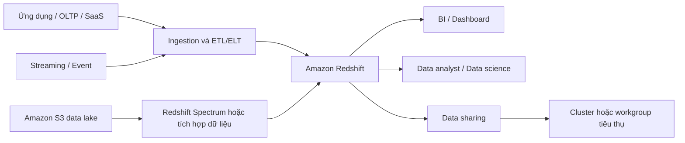
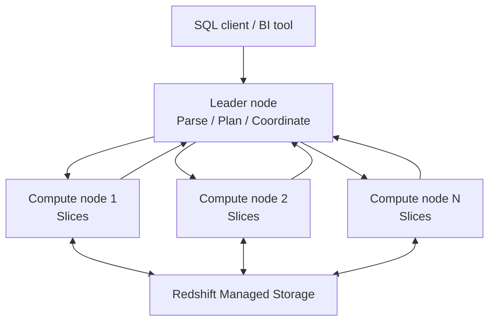
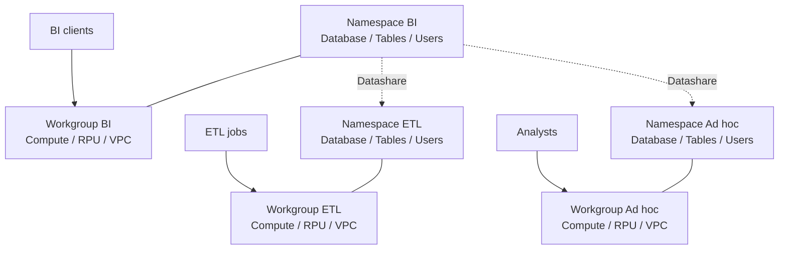

# Redshift provisioned, serverless và quản lý workload

Amazon Redshift là dịch vụ data warehouse được quản lý của AWS, dùng để phân tích dữ liệu có cấu trúc và bán cấu trúc bằng SQL trên quy mô lớn. Khi thiết kế hệ thống Redshift, bạn cần quyết định cách cung cấp compute, cách lưu trữ dữ liệu và cách phân phối tài nguyên giữa các truy vấn. AWS cung cấp hai mô hình triển khai chính: **Redshift provisioned** với cluster và node do bạn lựa chọn, và **Redshift Serverless** với compute được cấp phát tự động theo workload.

Hai mô hình dùng chung nhiều khả năng SQL, bảo mật và phân tích. Khác biệt quan trọng nằm ở cách quản lý compute, cách mở rộng, cơ chế tính phí và mức độ kiểm soát hạ tầng. Sau khi chọn mô hình, workload management (WLM) giúp các truy vấn ETL, báo cáo BI và phân tích ad hoc cùng hoạt động mà không làm một nhóm truy vấn chiếm hết tài nguyên.

## Mục tiêu học tập

Sau bài học, bạn có thể:

- Mô tả kiến trúc cluster provisioned và cách Redshift Serverless tách namespace với workgroup.
- Chọn mô hình provisioned hoặc Serverless dựa trên mẫu tải, khả năng dự đoán và yêu cầu kiểm soát.
- Quản lý node, resize, pause/resume, base RPU và giới hạn sử dụng.
- Cấu hình Auto WLM, query priority, short query acceleration, query monitoring rules và concurrency scaling.
- Phân tích query plan, tối ưu table và sử dụng materialized view để cải thiện hiệu năng.
- Theo dõi hiệu năng, chi phí, backup và khôi phục cho workload Redshift.

## 1. Redshift trong kiến trúc phân tích dữ liệu

Redshift là data warehouse dạng columnar, xử lý truy vấn SQL song song trên nhiều đơn vị compute. Một kiến trúc phân tích phổ biến đưa dữ liệu từ ứng dụng, cơ sở dữ liệu vận hành, log và hệ thống streaming vào Amazon S3 hoặc nạp trực tiếp vào Redshift. ETL/ELT chuẩn hóa dữ liệu thành fact table và dimension table; người dùng BI, data analyst và data scientist khai thác dữ liệu qua SQL.



Redshift phù hợp với truy vấn phân tích, tổng hợp trên lượng lớn bản ghi, báo cáo nhiều chiều và workload đọc song song. Đây không phải lựa chọn thay thế mặc định cho cơ sở dữ liệu giao dịch OLTP có nhiều thao tác cập nhật từng hàng với độ trễ thấp. Hãy chọn dịch vụ lưu trữ giao dịch phù hợp rồi đưa dữ liệu cần phân tích sang Redshift.

## 2. Hai mô hình triển khai

| Tiêu chí | Provisioned | Serverless |
|---|---|---|
| Đơn vị compute | Cluster gồm các node | Workgroup với capacity đo bằng RPU |
| Quản lý capacity | Chọn node type và số node; chủ động resize | Đặt base capacity, giới hạn capacity tối đa và để dịch vụ tự scale |
| Tách compute và storage | RG/RA3 dùng Redshift Managed Storage | Namespace lưu database và dữ liệu; workgroup cung cấp compute |
| Workload phù hợp | Tải ổn định, chạy liên tục, cần kiểm soát cấu hình cluster | Tải biến động, workload theo đợt, môi trường cần giảm vận hành capacity |
| Quản lý workload | WLM trong parameter group, Auto hoặc Manual WLM | Tự động điều chỉnh capacity; vẫn có công cụ quản lý và giới hạn workload |
| Chi phí compute | Theo node và thời gian cluster chạy; có thể pause cluster đủ điều kiện | Theo RPU-hours đã sử dụng |
| Kiểm soát vận hành | Chi tiết hơn ở cấp node, parameter group và lịch cluster | Tập trung vào namespace, workgroup, base/max RPU và usage limits |

Không có mô hình nào luôn rẻ hơn. Hãy so sánh bằng workload thực tế: thời lượng truy vấn, số giờ hoạt động, concurrency, lượng dữ liệu, yêu cầu độ trễ và thời gian nhàn rỗi. Dùng benchmark với dữ liệu đại diện trước khi chốt lựa chọn.

## 3. Redshift provisioned: cluster và node

### 3.1 Kiến trúc cluster

Một cluster provisioned có leader node và compute node. Leader node nhận kết nối, phân tích câu lệnh SQL, xây dựng kế hoạch thực thi và điều phối công việc. Compute node lưu trữ và xử lý dữ liệu song song; dữ liệu được chia thành các slice để nhiều phần của truy vấn có thể chạy đồng thời.



Ở cluster nhiều node, leader node điều phối còn compute node thực hiện phần lớn thao tác đọc, join, aggregate và sort. Vì vậy, thêm node có thể tăng tổng tài nguyên song song, nhưng không đảm bảo mọi truy vấn đều nhanh hơn theo tỷ lệ tuyến tính. Truy vấn có phân phối dữ liệu lệch, join lớn hoặc bước xử lý tuần tự vẫn có thể trở thành nút thắt.

### 3.2 RG và RA3 với Redshift Managed Storage

Với các triển khai mới cần storage mở rộng độc lập với compute, hãy đánh giá các node type RG hoặc RA3 theo Region, tính năng và đặc điểm workload.

- **RA3** sử dụng Redshift Managed Storage (RMS). Node có SSD hiệu năng cao làm lớp lưu trữ cục bộ; dữ liệu dài hạn được quản lý trên Amazon S3. Redshift tự di chuyển dữ liệu giữa các lớp khi cần. Bạn chọn compute theo hiệu năng truy vấn và trả phí storage đã sử dụng riêng.
- **RG** là dòng node dựa trên AWS Graviton. RG cũng sử dụng managed storage và có engine truy vấn data lake tích hợp trên compute của cluster. Với RA3, truy vấn data lake thường sử dụng Amazon Redshift Spectrum.
- **Node type và số node** quyết định CPU, RAM, tài nguyên song song và capacity compute. Chọn cấu hình theo dữ liệu xử lý mỗi ngày, kích thước join, số truy vấn đồng thời và SLA.

Không nên chọn node chỉ dựa trên tổng dung lượng dữ liệu. Một warehouse có nhiều dữ liệu lạnh nhưng truy vấn ít có thể cần compute nhỏ hơn warehouse ít dữ liệu nhưng chạy nhiều truy vấn nặng đồng thời. Managed storage giúp tách quyết định lưu trữ khỏi quyết định compute, nhưng không loại bỏ nhu cầu kiểm tra giới hạn storage theo node type.

### 3.3 Resize cluster

Khi tải tăng, bạn có thể tăng số node hoặc đổi node type. Khi tải giảm, có thể resize xuống để giảm chi phí compute.

| Phương thức | Cách hoạt động | Khi phù hợp |
|---|---|---|
| Elastic resize | Thay đổi số node hoặc node type trong phạm vi được hỗ trợ; thường hoàn tất nhanh hơn | Điều chỉnh capacity thường xuyên với thay đổi cấu hình nằm trong giới hạn elastic resize |
| Classic resize | Tạo cluster đích và di chuyển dữ liệu qua quy trình backup/restore; thường mất nhiều thời gian hơn | Thay đổi lớn hoặc cấu hình không hỗ trợ elastic resize |

Elastic resize thường là lựa chọn đầu tiên khi đáp ứng điều kiện. Trong một số giai đoạn resize, kết nối hoặc truy vấn có thể bị gián đoạn; khi thay node type, truy vấn đang chạy có thể bị hủy. Classic resize có thể mất thời gian đáng kể theo kích thước dữ liệu. Hãy lên lịch vào khung giờ ít tải, thông báo cho chủ workload và xác nhận backup trước khi thực hiện.

Có thể lập lịch resize để tăng capacity trước giờ ETL hoặc giờ cao điểm BI rồi giảm sau đó. Sau resize, kiểm tra query latency, queue time, số kết nối và phân phối dữ liệu để xác nhận thay đổi thực sự cải thiện workload.

### 3.4 Pause và resume

Với cluster provisioned đủ điều kiện, bạn có thể pause khi warehouse không cần phục vụ truy vấn và resume khi cần. Khi cluster ở trạng thái paused, phí compute theo nhu cầu được tạm dừng; phí storage vẫn tiếp tục. Redshift tạo snapshot khi bắt đầu pause và kết thúc các truy vấn đang chạy.

Pause/resume phù hợp với môi trường phát triển, kiểm thử hoặc warehouse chỉ chạy theo lịch. Trong thời gian pause, client không thể kết nối và query monitoring không có metric phần cứng mới. Resume có thể mất vài phút; sau khi resume, dữ liệu được hydrate lại nên hiệu năng có thể cần thời gian để ổn định. Không dùng pause cho hệ thống cần truy vấn liên tục hoặc có SLA phản hồi tức thời.

## 4. Redshift Serverless: namespace và workgroup

Serverless tách tài nguyên lưu trữ và compute thành hai đối tượng quản lý:

- **Namespace** chứa database objects, schema, table, user, quyền, cấu hình mã hóa, datashare, recovery point và các thuộc tính lưu trữ/bảo mật.
- **Workgroup** là tập tài nguyên compute để chạy truy vấn. Workgroup có cấu hình VPC, subnet, security group, endpoint và capacity.

Mỗi namespace chỉ có thể liên kết với một workgroup và mỗi workgroup cũng chỉ liên kết với một namespace. Cách tách này giúp quản lý thuộc tính dữ liệu và compute độc lập trong cùng một cặp namespace/workgroup. Nếu cần nhiều workgroup cô lập, hãy tạo các cặp namespace/workgroup riêng rồi cân nhắc dùng data sharing để chia sẻ dữ liệu giữa chúng.



### 4.1 RPU và base capacity

Redshift Processing Unit (RPU) là đơn vị đo capacity compute của Serverless. Bạn chọn base capacity cho workgroup để xác định mức tài nguyên cơ sở. Capacity cao hơn có thể giúp workload nặng hoàn tất nhanh hơn, nhưng cũng làm tăng mức sử dụng compute.

Serverless có thể tự điều chỉnh compute vượt base capacity khi workload cần thêm tài nguyên. Bạn có thể đặt maximum capacity để giới hạn mức scale tối đa. Cơ chế tự động tối ưu price-performance có thể cân bằng chi phí và hiệu năng theo mục tiêu của workgroup; lựa chọn mục tiêu có thể ưu tiên tiết kiệm chi phí, cân bằng hoặc hiệu năng.

Khi thay đổi mục tiêu price-performance, tác động không nhất thiết xuất hiện ngay. Hãy quan sát workload trong một khoảng thời gian đủ dài, ví dụ vài ngày, rồi đánh giá query duration, RPU usage và chi phí trước khi kết luận.

### 4.2 Usage limits và kiểm soát chi phí

Serverless hỗ trợ giới hạn mức tiêu thụ RPU-hours theo chu kỳ ngày, tuần hoặc tháng. Khi chạm giới hạn, bạn có thể chọn ghi log, phát metric/cảnh báo hoặc ngừng xử lý truy vấn người dùng. Có thể cấu hình thêm giới hạn cho dữ liệu chia sẻ liên Region.

Phân biệt hai loại giới hạn:

- **Maximum capacity** giới hạn lượng compute tối đa mà workgroup có thể scale đến trong một thời điểm.
- **Maximum RPU-hours** giới hạn tổng lượng compute tiêu thụ trong một chu kỳ.

Một giới hạn chỉ kiểm soát đỉnh capacity không bảo đảm tổng hóa đơn nằm trong ngân sách nếu workload chạy liên tục. Ngược lại, usage limit có thể ngừng truy vấn khi chạm ngưỡng; hãy chọn hành động phù hợp với SLA. Với workload production, thường nên bắt đầu bằng cảnh báo và theo dõi trước khi dùng hành động deactivation.

### 4.3 Khi nào dùng nhiều workgroup?

Tạo các cặp namespace/workgroup riêng có thể hữu ích khi ETL, BI và truy vấn ad hoc có mẫu tải khác nhau hoặc cần ranh giới compute, network và chi phí riêng. Ví dụ, cặp BI có base capacity và mục tiêu độ trễ ổn định; cặp ETL được phép scale cao vào cửa sổ nạp dữ liệu; cặp ad hoc có usage limit chặt hơn. Nếu các nhóm cần dùng chung dữ liệu, có thể chia sẻ qua datashare thay vì gắn nhiều workgroup vào cùng namespace.

Không cần tạo workgroup riêng cho từng người dùng. Quá nhiều workgroup có thể làm phức tạp giám sát, quyền, cấu hình network và dự báo chi phí. Chọn ranh giới dựa trên nhóm workload có yêu cầu khác biệt rõ ràng.

## 5. Chọn provisioned hay Serverless

| Tình huống | Hướng cân nhắc | Lý do |
|---|---|---|
| Warehouse chạy gần như cả ngày, tải và concurrency ổn định | Provisioned | Có thể sizing cluster theo baseline và kiểm soát node cụ thể |
| Môi trường dev/test chỉ dùng theo giờ | Provisioned có pause/resume hoặc Serverless | So sánh chi phí compute trong giờ hoạt động và chi phí vận hành |
| Tải phân tích thay đổi mạnh theo thời điểm | Serverless | Dịch vụ tự scale capacity theo workload |
| Cần kiểm soát cấu hình cluster và lịch resize chi tiết | Provisioned | Quản trị node, parameter group, resize và pause/resume |
| Nhiều nhóm cần compute độc lập nhưng dùng chung dữ liệu | Nhiều cặp namespace/workgroup Serverless hoặc nhiều cluster với data sharing | Tách compute và workload theo nhóm |
| Tổ chức đã có cluster vận hành ổn định và quy trình DBA | Provisioned | Có thể tiếp tục tối ưu cấu hình hiện tại nếu tổng chi phí và hiệu năng phù hợp |

Quy trình lựa chọn thực tế:

1. Đo workload: số truy vấn theo giờ, thời lượng, dữ liệu quét, concurrency và thời gian nhàn rỗi.
2. Phân loại truy vấn: ETL batch, dashboard tương tác, truy vấn ad hoc, data science và tác vụ quản trị.
3. Xác định mục tiêu: p95/p99 latency, throughput, thời gian hoàn thành batch và ngân sách.
4. Ước lượng chi phí theo cấu hình provisioned và mức RPU Serverless dự kiến.
5. Chạy benchmark với dữ liệu, truy vấn và lịch tải đại diện.
6. Đánh giá cả vận hành: backup, network, IAM, monitoring, capacity planning và quy trình khôi phục.

## 6. Workload Management (WLM)

WLM điều phối cách Redshift phân phối tài nguyên cho các truy vấn. Nếu nhiều workload dùng chung warehouse, một truy vấn ETL lớn có thể chiếm bộ nhớ và slot khiến dashboard phải chờ. WLM cho phép phân loại truy vấn, đặt mức ưu tiên và theo dõi truy vấn tiêu thụ tài nguyên quá mức.

Trong provisioned, cấu hình WLM thuộc parameter group gắn với cluster. AWS khuyến nghị Auto WLM cho phần lớn workload. Serverless tự quản lý capacity compute, nhưng vẫn hỗ trợ query queues và query monitoring rules để phân loại workload, giới hạn truy vấn và theo dõi hiệu năng. Các queue Serverless không dùng cơ chế priority, slot và concurrency scaling giống provisioned.

### 6.1 Auto WLM

Auto WLM tự xác định mức concurrency và bộ nhớ phù hợp cho truy vấn đang chờ chạy. Truy vấn join lớn có thể được chạy với concurrency thấp hơn để có đủ bộ nhớ; truy vấn nhẹ có thể chạy đồng thời nhiều hơn. Quản trị viên có thể tạo các queue cho nhóm workload, đặt priority và gắn query monitoring rules.

Auto WLM hỗ trợ tối đa tám user queue. Các mức priority gồm `highest`, `high`, `normal`, `low` và `lowest`. Priority thể hiện tầm quan trọng tương đối giữa các workload; nó không thay thế việc tối ưu query plan hay bổ sung capacity khi warehouse thiếu tài nguyên.

Ví dụ phân loại workload:

| Queue | Workload | Priority tham khảo |
|---|---|---|
| `etl` | Nạp dữ liệu và biến đổi theo lịch | `high` trong cửa sổ batch |
| `bi` | Dashboard và truy vấn báo cáo tương tác | `highest` hoặc `high` theo SLA |
| `adhoc` | Truy vấn khám phá dữ liệu | `normal` hoặc `low` |
| `maintenance` | Tác vụ bảo trì và kiểm tra | Theo lịch và mức ảnh hưởng |

Đây là ví dụ phân loại, không phải cấu hình mặc định cho mọi hệ thống. Hãy đo thời gian chờ và thời gian thực thi để xác định priority phù hợp. Đặt mọi queue ở mức cao sẽ làm mất ý nghĩa của việc ưu tiên.

### 6.2 Manual WLM

Manual WLM cho phép quản trị viên cấu hình số query slot và tỷ lệ bộ nhớ cho từng queue. Cách này có thể phù hợp với workload chuyên biệt đã được đo đạc và có yêu cầu phân bổ tài nguyên tĩnh rõ ràng. Tuy nhiên, tài nguyên phân chia trước có thể bị lãng phí khi một queue nhàn rỗi trong khi queue khác đang quá tải.

Nếu dùng Manual WLM, theo dõi queue wait, query spill và mức sử dụng bộ nhớ. AWS khuyến nghị tổng số query slot của cấu hình Manual WLM không vượt quá 15 trong phần lớn trường hợp; dù một queue có thể được cấu hình đến 50 slot, nhiều slot không đồng nghĩa throughput tốt hơn.

### 6.3 Định tuyến truy vấn bằng user group và query group

WLM có thể định tuyến truy vấn dựa trên user group, user role hoặc query group. Query group là nhãn do client đặt trong session, giúp phân loại truy vấn từ một ứng dụng hoặc job.

Ví dụ đặt query group cho một session:

```sql
SET query_group TO 'etl';

-- Các câu lệnh ETL trong session này được gắn nhãn etl.
INSERT INTO analytics.daily_sales
SELECT order_date, region, SUM(amount)
FROM staging.orders
GROUP BY order_date, region;

RESET query_group;
```

Queue cần được cấu hình để nhận đúng query group hoặc user group. Nếu client không đặt lại query group, các câu lệnh tiếp theo trong cùng session có thể tiếp tục mang nhãn cũ; vì vậy nên đặt và reset nhãn trong code quản lý kết nối.

### 6.4 Short Query Acceleration (SQA)

SQA tự nhận diện truy vấn ngắn và chạy chúng trong vùng tài nguyên chuyên dụng, giúp truy vấn nhỏ không phải xếp hàng phía sau truy vấn dài. SQA phù hợp với dashboard và truy vấn tương tác có thời gian chạy ngắn, nhưng không phải giải pháp cho truy vấn chậm do scan quá nhiều dữ liệu hoặc join kém hiệu quả.

Có thể bật SQA cùng Auto WLM. Hãy theo dõi thời gian queue và execution trước/sau khi bật để xác nhận người dùng thực sự nhận được cải thiện.

### 6.5 Query Monitoring Rules (QMR)

QMR theo dõi metric của truy vấn và kích hoạt hành động khi vượt ngưỡng. Trên provisioned, có thể dùng rule để ghi log, hủy truy vấn tiêu tốn tài nguyên quá mức hoặc điều chỉnh priority trong Auto WLM. Hành động `hop` chỉ áp dụng cho Manual WLM; `change_query_priority` áp dụng cho Auto WLM. Trên Serverless, rule hỗ trợ hành động `log` và `abort`; không có `hop` hoặc `change_query_priority`.

Ví dụ chính sách vận hành:

- Ghi log truy vấn chạy quá thời gian mục tiêu để phân tích xu hướng.
- Hủy truy vấn ad hoc quét lượng hàng quá lớn nếu vượt giới hạn đã thống nhất.
- Giảm priority của workload nền khi dashboard tương tác đang chịu áp lực.
- Gửi cảnh báo khi queue wait tăng liên tục.

Chọn metric và ngưỡng dựa trên baseline. Không đặt ngưỡng quá thấp khiến truy vấn hợp lệ thường xuyên bị hủy. Kiểm tra hành động thực tế trên workload thử nghiệm trước khi áp dụng cho production. Với Serverless, các metric phù hợp gồm query execution time, queue time, scan row count, blocks read, temporary blocks to disk và rows joined; không dựa vào các metric CPU time/CPU percentage đã bị loại khỏi Query Limits.

### 6.6 Concurrency scaling

Concurrency scaling là khả năng mở rộng compute tạm thời cho cluster provisioned khi số truy vấn đồng thời vượt khả năng xử lý của queue. Khi bật chế độ `auto` trên queue phù hợp, Redshift chuyển các truy vấn đủ điều kiện sang concurrency scaling cluster để giảm thời gian chờ. Khi cluster chính có slot trống, truy vấn mới có thể chạy trên cluster chính.

Concurrency scaling hữu ích cho workload đọc có các đợt tăng đột biến, chẳng hạn nhiều dashboard cùng làm mới vào đầu giờ. Một số loại truy vấn không đủ điều kiện, ví dụ truy vấn dùng temporary table, interleaved sort key, system table hoặc một số UDF và truy cập external resource bị giới hạn network. Không giả định mọi truy vấn đều được scale out.

Tính phí concurrency scaling phụ thuộc thời gian scaling cluster thực sự chạy truy vấn; cần theo dõi usage và credit theo chính sách giá hiện hành của Region. Đây là cơ chế mở rộng concurrency dành cho provisioned, không thay thế việc sửa query plan hoặc sizing baseline cluster. Serverless tự quản lý scale và không cấu hình concurrency scaling queue như provisioned.

### 6.7 Query queues trên Serverless

Redshift Serverless hỗ trợ queue-based query resource management. Bạn có thể tạo tối đa tám query queue cho một workgroup và định tuyến theo user role hoặc query group. Mỗi queue có thể có các monitoring rule riêng; tổng cộng tối đa 25 rule và mỗi rule có tối đa ba predicate. Nếu không bật queue riêng, có thể áp dụng query monitoring ở cấp workgroup cho toàn bộ truy vấn.

Khác với provisioned, Serverless tự quản lý việc phân bổ compute. Queue Serverless không cho đặt số query slot, phần trăm memory hoặc priority; các hành động `hop` và `change_query_priority` cũng không được hỗ trợ. Rule Serverless dùng `log` hoặc `abort`. Có thể dùng các queue `bi`, `etl` và `adhoc` để áp dụng ngưỡng giám sát khác nhau theo workload mà không tự chia cứng compute.

Ví dụ cấu hình queue trong workgroup có thể định tuyến dashboard bằng query group `bi` và giới hạn thời gian chạy, đồng thời ghi log truy vấn ETL chạy lâu để theo dõi. Bật query queues là thay đổi lâu dài: sau khi bật, không thể quay lại chế độ giám sát không dùng queue. Hãy thiết kế tên queue, role, query group và rule trước khi bật trên production.

## 7. Tối ưu truy vấn và thiết kế table

WLM quyết định truy vấn được xếp hàng và cấp tài nguyên như thế nào. Query tuning quyết định truy vấn cần đọc, di chuyển và xử lý bao nhiêu dữ liệu. Cần làm cả hai để cải thiện latency và throughput.

### 7.1 Đọc query plan bằng EXPLAIN

`EXPLAIN` hiển thị kế hoạch thực thi dự kiến mà không chạy truy vấn. Dùng nó để tìm scan lớn, sort tốn kém, join không phù hợp và thao tác phân phối dữ liệu giữa các node.

```sql
EXPLAIN
SELECT d.region, SUM(f.net_amount) AS revenue
FROM fact_sales AS f
JOIN dim_customer AS d
  ON f.customer_id = d.customer_id
WHERE f.sale_date >= DATE '2026-01-01'
GROUP BY d.region;
```

Khi đọc plan, chú ý:

- `DS_DIST_BOTH` có thể cho thấy dữ liệu của cả hai phía join cần được phân phối lại.
- `DS_BCAST_INNER` phát tán bảng phía trong đến các node; điều này có thể hợp lý với bảng nhỏ nhưng tốn kém với bảng lớn.
- `Nested Loop` thường là dấu hiệu cần xem lại điều kiện join hoặc cấu trúc truy vấn.
- Sort hoặc scan chiếm phần lớn chi phí cần được điều tra bằng filter, sort key, distribution và lượng cột được đọc.

Cost trong `EXPLAIN` là thước đo tương đối giữa các bước của một query plan, không phải thời gian chạy thực tế. Sau khi chạy truy vấn, xem chi tiết thực thi để đối chiếu số hàng, bytes, queue time và thời gian thực tế.

### 7.2 Distribution style

Redshift phân phối hàng của table lên compute node theo distribution style. Mục tiêu là giảm lượng dữ liệu phải di chuyển khi join hoặc aggregate.

| Kiểu phân phối | Hành vi | Trường hợp thường gặp |
|---|---|---|
| `AUTO` | Redshift tự chọn và có thể thay đổi kiểu phân phối theo kích thước và workload | Lựa chọn khởi đầu tốt cho đa số table |
| `EVEN` | Phân phối hàng luân phiên tương đối đều giữa các slice | Không có khóa join phù hợp hoặc table không tham gia join đáng kể |
| `KEY` | Phân phối theo giá trị một cột | Fact/dimension lớn thường join theo cùng một khóa và dữ liệu không bị skew |
| `ALL` | Sao chép table lên mọi node | Dimension nhỏ được đọc nhiều và chi phí lưu trữ/ghi chấp nhận được |

Nếu dùng `KEY`, chọn cột có cardinality và phân bố phù hợp. Một khóa có nhiều giá trị trùng lặp có thể tạo skew khiến một node xử lý nhiều dữ liệu hơn các node còn lại. Với dimension nhỏ, `ALL` có thể tránh bước broadcast khi join nhưng làm tăng chi phí lưu trữ và thao tác cập nhật.

### 7.3 Sort key

Sort key quyết định thứ tự lưu trữ các block dữ liệu. Redshift lưu metadata min/max cho block và có thể bỏ qua block không nằm trong điều kiện lọc. Nếu dashboard thường lọc theo khoảng ngày, cột ngày có thể là ứng viên sort key.

Với bảng mới, `SORTKEY AUTO` giúp Redshift lựa chọn sort key dựa trên mẫu truy vấn. Chỉ chọn sort key thủ công khi workload đã đủ ổn định và benchmark chứng minh lựa chọn đó tốt hơn. Tránh bọc cột sort key trong hàm hoặc ép kiểu không cần thiết trong điều kiện lọc vì có thể làm giảm khả năng tận dụng thứ tự lưu trữ.

### 7.4 Automatic table optimization và bảo trì

Automatic table optimization (ATO) theo dõi workload và có thể điều chỉnh sort key, distribution style để cải thiện hiệu năng. Với table để `AUTO`, bạn có thể giảm công việc dự đoán trước thiết kế vật lý. Kiểm tra đề xuất và lịch sử thay đổi trong các system view như `SVV_ALTER_TABLE_RECOMMENDATIONS` và `SVL_AUTO_WORKER_ACTION` khi cần điều tra.

Redshift còn tự động thực hiện một số hoạt động bảo trì như vacuum sort, vacuum delete và analyze. Không nên chạy `VACUUM` hoặc `ANALYZE` theo lịch cứng mà không xem trạng thái table và hoạt động nền. Hãy kiểm tra unsorted rows, statistics và lịch sử vacuum/analyze trước khi quyết định bảo trì thủ công.

### 7.5 Materialized view

Materialized view lưu kết quả của một câu truy vấn để truy vấn sau có thể đọc kết quả đã tính trước. Redshift có thể tự động rewrite một truy vấn để dùng materialized view phù hợp ngay cả khi câu truy vấn không gọi trực tiếp tên view, miễn là view còn cập nhật và thỏa điều kiện rewrite.

```sql
CREATE MATERIALIZED VIEW mv_daily_sales AS
SELECT sale_date, region, SUM(net_amount) AS revenue
FROM fact_sales
GROUP BY sale_date, region;

-- Cập nhật kết quả materialized view khi cần.
REFRESH MATERIALIZED VIEW mv_daily_sales;

SELECT region, SUM(revenue)
FROM mv_daily_sales
WHERE sale_date >= DATE '2026-01-01'
GROUP BY region;
```

Có thể cấu hình automatic refresh để Redshift cập nhật view khi dữ liệu nguồn thay đổi và tài nguyên cho phép. Nếu cần SLA dữ liệu mới rõ ràng, hãy chọn lịch refresh phù hợp và đo thời gian refresh. View chưa được cập nhật có thể không được dùng cho automatic query rewrite; luôn cân nhắc độ mới dữ liệu, chi phí refresh và thời gian truy vấn.

## 8. Quản lý tải ETL và BI

Một warehouse thường phục vụ nhiều dạng truy vấn:

| Workload | Đặc điểm | Cách quản lý |
|---|---|---|
| ETL/ELT batch | Quét và ghi nhiều dữ liệu, chạy theo cửa sổ | Provisioned: queue riêng; Serverless: query queue theo role/query group; theo dõi spill và thời gian hoàn thành |
| BI dashboard | Truy vấn lặp lại, cần latency ổn định | Provisioned: priority/SQA; Serverless: query queue với ngưỡng giám sát phù hợp; dùng materialized view khi có ích |
| Ad hoc analytics | Mẫu truy vấn khó dự đoán, có thể quét dữ liệu lớn | Provisioned: priority thấp hơn và QMR; Serverless: query monitoring rule và usage limit |
| Data science | Truy vấn thử nghiệm, join và aggregate biến động | Tách nhóm workload hoặc cặp namespace/workgroup khi cần cô lập compute |

Để bảo vệ dashboard trong lúc ETL chạy, có thể đặt queue BI ưu tiên cao hơn, giới hạn truy vấn ad hoc và tránh nạp dữ liệu lớn vào giờ cao điểm. Với provisioned, dùng Auto WLM priority và SQA; với Serverless, dùng query queue và monitoring rule theo từng workload. Nếu workload có mức độ độc lập cao, cân nhắc tách compute bằng các cặp namespace/workgroup hoặc cluster consumer dùng data sharing.

### Data sharing để cô lập compute

Redshift data sharing cho phép producer chia sẻ dữ liệu live với consumer cluster hoặc workgroup mà không cần sao chép dữ liệu qua ETL riêng. Consumer có thể chạy truy vấn bằng compute riêng trong khi dữ liệu vẫn được quản lý ở producer. Cách này hữu ích khi nhiều nhóm cần phân tích cùng một dataset nhưng muốn kiểm soát workload độc lập.

Với cross-account data sharing, producer phải authorize account tiêu thụ và consumer administrator phải associate datashare. Cả producer và consumer cluster cần được mã hóa cho kịch bản chia sẻ cross-account. Quyền ghi trên datashare chỉ có khi producer cấp quyền ghi tương ứng và consumer được cho phép; không mặc định datashare luôn read-only hoặc luôn writable, hãy kiểm tra quyền đã cấp.

## 9. Mô hình chi phí và FinOps

### 9.1 Provisioned

Chi phí provisioned chủ yếu phụ thuộc node type, số node, thời gian cluster chạy và storage được sử dụng. Với RG/RA3, compute và managed storage được tính riêng, giúp tăng hoặc giảm compute mà không phải thay đổi dung lượng dữ liệu tương ứng. Snapshot, data transfer và các dịch vụ liên quan có thể tạo thêm chi phí.

Pause cluster đủ điều kiện có thể giảm chi phí compute trong giờ nhàn rỗi, nhưng storage vẫn được tính phí. Nếu phải resume thường xuyên và chờ hydrate, lợi ích chi phí có thể bị bù bởi độ trễ khởi động và trải nghiệm người dùng.

### 9.2 Serverless

Serverless tính phí compute theo RPU-hours sử dụng và storage theo lượng dữ liệu lưu trữ. Base capacity cao hơn có thể cải thiện hiệu năng nhưng cũng tăng mức tiêu thụ. Khi scale up, capacity cao hơn có thể duy trì một khoảng thời gian sau khi tải giảm; hãy theo dõi usage limits và hóa đơn thực tế.

Mức sử dụng compute được đo theo thời gian, với mức charge tối thiểu theo phiên sử dụng. Truy vấn system table cũng tiêu thụ compute. Với truy vấn data lake trên S3, Serverless tính theo thời gian compute thay vì cộng một khoản Spectrum riêng như một số mô hình cũ. Luôn đối chiếu pricing theo Region và loại workload trước khi dự toán.

### 9.3 Biện pháp kiểm soát

- Gắn tag theo owner, environment, cost center và workload để phân bổ chi phí.
- Đặt usage limits và CloudWatch/SNS alert cho Serverless; dùng maximum capacity để kiểm soát đỉnh RPU.
- Với provisioned, đo baseline utilization rồi điều chỉnh node count/type; lập lịch resize và pause/resume cho môi trường phù hợp.
- Tối ưu query scan, distribution và materialized view để giảm compute time.
- Theo dõi storage growth, snapshot retention, data sharing cross-Region và dữ liệu không còn được truy vấn.
- Đánh giá chi phí theo kết quả nghiệp vụ, ví dụ chi phí trên mỗi batch hoàn tất hoặc mỗi dashboard refresh, thay vì chỉ nhìn tổng RPU-hours/node-hours.

## 10. Bảo mật và bảo vệ dữ liệu

Redshift chạy trong VPC và hỗ trợ mã hóa dữ liệu lưu trữ bằng AWS KMS. Hãy giới hạn inbound traffic bằng security group, dùng private connectivity khi workload không cần endpoint công khai và quản lý quyền bằng IAM role. Workload cần đọc/ghi S3 qua `COPY` hoặc `UNLOAD` phải có IAM role được gắn với cluster/workgroup và chỉ có quyền trên bucket/prefix cần thiết.

Các nguyên tắc vận hành:

- Tách quyền quản trị cluster/workgroup, quyền truy cập database và quyền đọc/ghi S3.
- Dùng IAM authentication hoặc cơ chế quản lý credential an toàn; tránh hardcode mật khẩu trong source code và pipeline.
- Bật audit logging và theo dõi kết nối, thay đổi cấu hình, truy vấn nhạy cảm.
- Dùng KMS key policy và IAM policy phù hợp; kiểm tra quyền key khi restore snapshot hoặc chia sẻ dữ liệu.
- Phân vùng subnet và security group theo kiến trúc mạng; kiểm soát đường truy cập từ BI, ETL và môi trường phát triển.
- Với cross-account data sharing, kiểm tra cả authorization ở producer lẫn association ở consumer.

## 11. Backup, snapshot và khôi phục

### 11.1 Provisioned

Provisioned cluster hỗ trợ automated snapshot và manual snapshot. Snapshot cho phép khôi phục cluster sau lỗi thao tác hoặc sự cố dữ liệu. Xác định retention dựa trên RPO, RTO và yêu cầu lưu trữ; nếu cần khôi phục khi Region gặp sự cố, đánh giá cơ chế copy snapshot sang Region khác.

Trước thay đổi lớn như resize, migration hoặc thay đổi cấu trúc quan trọng, xác nhận snapshot hoàn tất và quy trình restore đã được kiểm thử. Snapshot chưa được kiểm thử restore không chứng minh hệ thống có thể đáp ứng RTO.

### 11.2 Serverless

Serverless tự tạo recovery point định kỳ, thường khoảng mỗi 30 phút hoặc sau khi có lượng dữ liệu thay đổi đủ ngưỡng theo node; các recovery point tự động được giữ trong 24 giờ. Bạn cũng có thể tạo snapshot thủ công để lưu giữ lâu hơn.

Có thể khôi phục snapshot giữa Serverless và provisioned theo các hướng được hỗ trợ. Khi restore snapshot vào Serverless namespace, dữ liệu database hiện tại trong namespace đích bị thay thế bằng dữ liệu trong snapshot. Thao tác này cần được xem như một thay đổi dữ liệu lớn và phải có xác nhận, kế hoạch kiểm tra sau restore.

Khôi phục Serverless có thể hoàn tất theo hai giai đoạn: dữ liệu sớm sẵn sàng cho truy vấn, sau đó hệ thống tiếp tục tối ưu/tune database nền. Trong giai đoạn sau, hiệu năng có thể chưa ổn định và cải thiện dần theo thời gian.

## 12. Giám sát và chẩn đoán workload

Không chỉ theo dõi CPU hoặc tổng số query. Hãy tách thời gian truy vấn thành thời gian chờ trong queue, thời gian thực thi và thời gian xử lý dữ liệu. Điều này giúp phân biệt thiếu compute với query plan kém hiệu quả.

| Tín hiệu | Câu hỏi cần trả lời | Hướng xử lý |
|---|---|---|
| Queue time tăng | Truy vấn đang chờ vì workload khác chiếm tài nguyên? | Xem WLM, concurrency, priority và lịch ETL |
| Execution time tăng | Query plan hoặc lượng dữ liệu đọc có thay đổi? | Dùng `EXPLAIN`, `SYS_QUERY_DETAIL`, xem scan/join/sort |
| RPU usage tăng | Serverless scale do tải thực hay truy vấn kém hiệu quả? | Phân tích query history, maximum capacity và usage limits |
| CPU hoặc node utilization cao kéo dài | Baseline compute có thiếu? | Tối ưu query rồi benchmark resize |
| Disk/storage tăng nhanh | Dữ liệu, staging table hoặc snapshot tăng ở đâu? | Rà soát retention, staging và snapshot policy |
| Query bị abort | QMR, giới hạn usage hay lỗi SQL kích hoạt? | Kiểm tra rule, query history và thông báo lỗi |

### 12.1 SYS monitoring views

`SYS_QUERY_HISTORY` cung cấp lịch sử truy vấn, bao gồm truy vấn DDL, DML, `COPY`, `UNLOAD` và truy vấn Spectrum. `SYS_QUERY_DETAIL` cho biết chi tiết thực thi ở nhiều cấp độ metric. Đây là điểm bắt đầu tốt để điều tra query chậm trên các mô hình Redshift hiện đại.

Ví dụ xem các truy vấn gần đây:

```sql
SELECT
    query_id,
    query_type,
    status,
    start_time,
    elapsed_time,
    queue_time,
    execution_time,
    LEFT(query_text, 300) AS query_text
FROM sys_query_history
ORDER BY start_time DESC
LIMIT 20;
```

Quyền xem system view phụ thuộc principal. Người dùng thông thường có thể chỉ thấy truy vấn của chính mình; superuser có thể xem phạm vi rộng hơn. Khi chuyển từ provisioned sang Serverless, một số truy vấn giám sát cũ dùng STL/STV/SVL chỉ có trên provisioned cần được chuyển sang SYS monitoring views.

### 12.2 Quy trình điều tra query chậm

1. Tìm `query_id` trong `SYS_QUERY_HISTORY` và xác định status, queue time, execution time.
2. Nếu queue time cao, xem WLM queue, priority, số truy vấn đồng thời và QMR.
3. Nếu execution time cao, chạy `EXPLAIN` với câu lệnh tương đương và đọc query plan.
4. Kiểm tra `SYS_QUERY_DETAIL` để xác định bước scan, join, sort hoặc redistribution tốn tài nguyên.
5. Kiểm tra table statistics, sort/distribution, skew và materialized view.
6. Chạy lại benchmark trong điều kiện tương tự rồi so sánh p50/p95, bytes scanned và chi phí.

## 13. Các tình huống vận hành thường gặp

### Tình huống A: Dashboard chậm vào đầu giờ

Nhiều dashboard đồng loạt refresh, trong khi ETL vẫn chạy. Kiểm tra queue time trước. Trên provisioned, phân loại BI và ETL riêng, điều chỉnh priority hoặc dùng SQA cho truy vấn ngắn; đánh giá concurrency scaling cho truy vấn đủ điều kiện. Trên Serverless, dùng query queues và monitoring rules để áp dụng ngưỡng theo workload. Nếu tải BI cần compute riêng, cân nhắc consumer cluster hoặc một cặp namespace/workgroup khác dùng data sharing.

### Tình huống B: Serverless có hóa đơn tăng bất thường

Kiểm tra RPU-hours theo workgroup và thời gian capacity scale cao. Xác định truy vấn gây tiêu thụ bằng `SYS_QUERY_HISTORY`; phân tích query detail để tìm scan lớn, join sai hoặc vòng lặp query từ ứng dụng. Đặt maximum capacity, usage limit và cảnh báo theo ngân sách. Không chỉ hạ base RPU nếu việc đó khiến truy vấn kéo dài và tổng compute time tăng.

### Tình huống C: ETL kéo dài sau khi tăng node

Thêm node không giải quyết được nếu truy vấn bị data skew hoặc phải redistribute nhiều dữ liệu. Dùng `EXPLAIN` và query detail để xem bước phân phối dữ liệu, kiểm tra `DISTKEY`, filter và kích thước bảng sau lọc. Benchmark lại sau khi thay đổi table design.

### Tình huống D: Cluster provisioned chỉ dùng giờ hành chính

Đo thời gian thực sự có query và thời gian chờ. Nếu có thể chấp nhận thời gian resume, thiết lập lịch pause/resume và cảnh báo trước khi pause. Xác nhận không có pipeline, datashare consumer hoặc tác vụ quản trị phụ thuộc cluster trong thời gian đó.

### Tình huống E: Restore xong nhưng truy vấn chậm

Kiểm tra trạng thái restore và giai đoạn tuning. Với Serverless, dữ liệu có thể truy vấn được trước khi quá trình tối ưu hoàn tất. Theo dõi hiệu năng theo thời gian, xác nhận query plan và statistics; tránh kết luận capacity không đủ chỉ từ vài truy vấn đầu tiên sau restore.

## 14. Thực hành: phân loại và giám sát workload

Giả sử một doanh nghiệp bán lẻ có ba workload: nạp dữ liệu đơn hàng mỗi giờ, dashboard doanh thu theo khu vực và truy vấn ad hoc của analyst. Mục tiêu là dashboard có độ trễ thấp, ETL hoàn thành trước giờ làm việc và truy vấn ad hoc không làm tăng chi phí ngoài dự kiến.

### Bước 1: Phân loại workload

| Workload | Nhãn | Mục tiêu |
|---|---|---|
| Nạp dữ liệu | `etl` | Hoàn thành batch đúng hạn |
| Dashboard | `bi` | Giữ latency ổn định |
| Analyst | `adhoc` | Cho phép khám phá dữ liệu với giới hạn hợp lý |

### Bước 2: Đặt query group trong ứng dụng

```sql
SET query_group TO 'bi';
SELECT region, SUM(net_amount)
FROM analytics.daily_sales
WHERE sale_date >= CURRENT_DATE - 7
GROUP BY region;
RESET query_group;
```

Trên provisioned, cấu hình queue trong Auto WLM để định tuyến nhãn `bi`, `etl` và `adhoc` rồi đặt priority tương ứng. Trên Serverless, cấu hình query queues và monitoring rules trong workgroup để định tuyến nhãn theo workload. Nếu cần ranh giới compute/network độc lập, tạo cặp namespace/workgroup riêng và dùng datashare khi cần dữ liệu chung.

### Bước 3: Kiểm tra query plan và lịch sử

```sql
EXPLAIN
SELECT region, SUM(net_amount)
FROM analytics.daily_sales
WHERE sale_date >= CURRENT_DATE - 7
GROUP BY region;

SELECT query_id, status, queue_time, execution_time,
       LEFT(query_text, 200) AS query_text
FROM sys_query_history
WHERE start_time >= DATEADD(hour, -2, GETDATE())
ORDER BY start_time DESC;
```

Đối chiếu queue time và execution time. Nếu queue time tăng, kiểm tra phân loại và concurrency. Nếu execution time tăng, kiểm tra scan, sort, join và cập nhật dữ liệu nguồn.

### Bước 4: Đặt giới hạn và cảnh báo

- Đặt RPU usage limit theo ngày/tuần/tháng cho workgroup Serverless.
- Chọn hành động log hoặc alert trước khi cân nhắc deactivation.
- Tạo QMR cho truy vấn vượt ngưỡng tài nguyên đã được benchmark; trên Serverless dùng query queue/rule theo workload.
- Theo dõi query latency, queue wait, RPU-hours và chi phí theo workload owner.

### Bước 5: Kiểm thử thay đổi

Thử thay đổi một yếu tố tại một thời điểm: priority, base capacity, maximum capacity, distribution style hoặc materialized view. Chạy cùng tập truy vấn với dữ liệu và concurrency tương đương. Ghi lại p50/p95 latency, throughput, chi phí và ảnh hưởng đến workload khác trước khi áp dụng rộng.

## 15. Checklist triển khai production

- [ ] Chọn provisioned hoặc Serverless dựa trên benchmark và mô hình chi phí.
- [ ] Xác định Region, VPC, subnet, security group và endpoint riêng tư.
- [ ] Thiết lập IAM role tối thiểu cho quản trị, workload và truy cập S3.
- [ ] Bật mã hóa bằng KMS và kiểm tra key policy.
- [ ] Phân loại workload ETL, BI, ad hoc và data science.
- [ ] Với provisioned, cấu hình Auto WLM, priority, SQA và QMR theo baseline; với Serverless, cấu hình query queues và query monitoring rules phù hợp.
- [ ] Chỉ bật concurrency scaling cho queue và truy vấn provisioned đủ điều kiện.
- [ ] Theo dõi query history, queue time, execution time và chi phí.
- [ ] Dùng `AUTO` cho sort/distribution khi chưa có bằng chứng cho lựa chọn thủ công.
- [ ] Xác định snapshot retention, recovery point và RPO/RTO.
- [ ] Kiểm thử restore, resize, pause/resume hoặc usage-limit action trong môi trường phù hợp.
- [ ] Rà soát quyền datashare và trách nhiệm producer/consumer.
- [ ] Gắn tag cost allocation và chỉ định owner chịu trách nhiệm theo dõi ngân sách.

## 16. Những nhầm lẫn thường gặp

| Nhầm lẫn | Cách hiểu đúng |
|---|---|
| Serverless nghĩa là không cần cấu hình gì | Vẫn cần thiết kế namespace, workgroup, network, security, base/max RPU và usage limits |
| Provisioned luôn nhanh hơn Serverless | Hiệu năng phụ thuộc workload, capacity, query plan và concurrency; cần benchmark |
| Thêm node sẽ làm mọi query nhanh hơn | Data skew, redistribution, query plan và bước tuần tự có thể là nút thắt |
| WLM priority sửa được query chậm | Priority chỉ điều phối thứ tự/độ ưu tiên; query plan kém vẫn cần tối ưu |
| Concurrency scaling xử lý mọi truy vấn | Chỉ các truy vấn đủ điều kiện mới được chuyển sang scaling cluster |
| Maximum RPU và RPU-hours là cùng một giới hạn | Một giới hạn đỉnh capacity; một giới hạn tổng compute theo chu kỳ |
| Pause cluster không còn phát sinh chi phí | Compute được tạm dừng tính phí, storage vẫn tính phí |
| EXPLAIN cho biết thời gian chạy thực tế | EXPLAIN cho biết plan và cost tương đối, không thực thi truy vấn |
| Materialized view luôn chứa dữ liệu mới nhất | Cần refresh; automatic rewrite dùng view đáp ứng điều kiện cập nhật |
| Snapshot đã tạo đồng nghĩa restore thành công | Cần kiểm thử restore và đo thời gian khôi phục thực tế |

## Tài liệu tham khảo

- [Amazon Redshift provisioned clusters](https://docs.aws.amazon.com/redshift/latest/mgmt/working-with-clusters.html)
- [Workgroups and namespaces in Redshift Serverless](https://docs.aws.amazon.com/redshift/latest/mgmt/serverless-workgroup-namespace.html)
- [Compute capacity for Redshift Serverless](https://docs.aws.amazon.com/redshift/latest/mgmt/serverless-capacity.html)
- [Billing for Redshift Serverless](https://docs.aws.amazon.com/redshift/latest/mgmt/serverless-billing.html)
- [Setting Serverless usage limits](https://docs.aws.amazon.com/redshift/latest/mgmt/serverless-workgroup-max-rpu.html)
- [Setting query queues for Redshift Serverless](https://docs.aws.amazon.com/redshift/latest/mgmt/serverless-workgroup-query-queues.html)
- [Workload management](https://docs.aws.amazon.com/redshift/latest/mgmt/workload-mgmt-config.html)
- [Implementing automatic WLM](https://docs.aws.amazon.com/redshift/latest/dg/automatic-wlm.html)
- [Query priority](https://docs.aws.amazon.com/redshift/latest/dg/query-priority.html)
- [Concurrency scaling](https://docs.aws.amazon.com/redshift/latest/dg/concurrency-scaling.html)
- [Resizing a cluster](https://docs.aws.amazon.com/redshift/latest/mgmt/resizing-cluster.html)
- [Pausing and resuming a cluster](https://docs.aws.amazon.com/redshift/latest/mgmt/rs-mgmt-pause-resume-cluster.html)
- [Automatic table optimization](https://docs.aws.amazon.com/redshift/latest/dg/c_ato-enabling-disabling-monitoring.html)
- [Distribution styles](https://docs.aws.amazon.com/redshift/latest/dg/c_choosing_dist_sort.html)
- [Choosing a sort key](https://docs.aws.amazon.com/redshift/latest/dg/c_best-practices-sort-key.html)
- [Creating and interpreting a query plan](https://docs.aws.amazon.com/redshift/latest/dg/c-the-query-plan.html)
- [Materialized views](https://docs.aws.amazon.com/redshift/latest/dg/materialized-view-overview.html)
- [SYS_QUERY_HISTORY](https://docs.aws.amazon.com/redshift/latest/dg/SYS_QUERY_HISTORY.html)
- [SYS_QUERY_DETAIL](https://docs.aws.amazon.com/redshift/latest/dg/SYS_QUERY_DETAIL.html)
- [Snapshots and recovery points for Serverless](https://docs.aws.amazon.com/redshift/latest/mgmt/serverless-snapshots-recovery-points.html)
- [Sharing data across AWS accounts](https://docs.aws.amazon.com/redshift/latest/dg/across-account.html)
