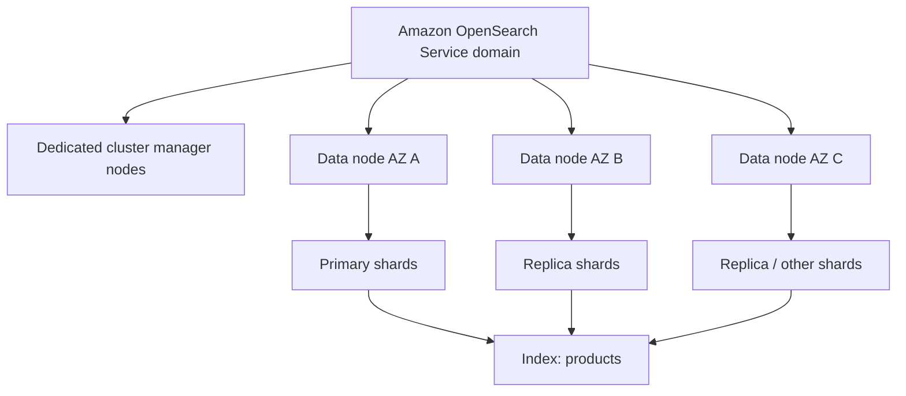

# Amazon OpenSearch Service và thiết kế index tìm kiếm

Một ứng dụng thương mại điện tử có thể lưu hàng triệu sản phẩm, bài viết hoặc sự kiện. Người dùng mong muốn tìm kiếm theo từ khóa, lọc theo giá và danh mục, sắp xếp theo thời gian hoặc mức độ liên quan, đồng thời nhận kết quả nhanh ngay cả khi dữ liệu thay đổi liên tục. Cơ sở dữ liệu giao dịch thường được tối ưu cho thao tác theo khóa và tính nhất quán của giao dịch; nó không phải lúc nào cũng phù hợp cho tìm kiếm toàn văn, phân tích log hoặc truy vấn gần đúng theo vector.

Amazon OpenSearch Service là dịch vụ AWS được quản lý để tìm kiếm, phân tích và trực quan hóa dữ liệu bằng OpenSearch. Dữ liệu được tổ chức thành document trong index; mapping mô tả kiểu trường và cách phân tích; shard phân phối index qua các data nodes; replica tăng khả năng chịu lỗi và có thể tăng năng lực đọc. Thiết kế index ảnh hưởng trực tiếp đến độ trễ truy vấn, throughput ghi, dung lượng lưu trữ, khả năng mở rộng và chi phí.

Trong hệ sinh thái AWS, OpenSearch có thể nhận dữ liệu từ Amazon Kinesis Data Streams, Amazon Data Firehose, Amazon S3, AWS Lambda, Amazon CloudWatch và các ứng dụng Java. Kết quả tìm kiếm có thể được dùng trong API, dashboard, phân tích log, phát hiện bất thường và ứng dụng semantic search/RAG. Bài học tập trung vào cách chọn mô hình triển khai, thiết kế document và mapping, tính shard, quản lý vòng đời index, bảo mật và vận hành.

## Mục tiêu học tập

Sau bài học, bạn có thể:

- Giải thích domain, cluster, node, index, document, shard, replica và mapping.
- Phân biệt Amazon OpenSearch Service provisioned domains với OpenSearch Serverless collections.
- Chọn cấu trúc document, field type, analyzer và dynamic mapping theo kiểu truy vấn.
- Thiết kế primary shards, replicas, index templates, aliases và data streams.
- Tối ưu bulk indexing, refresh interval, truy vấn và pagination.
- Quản lý index theo thời gian bằng Index State Management (ISM), UltraWarm và cold storage.
- Bảo vệ domain/collection bằng VPC, IAM, fine-grained access control, encryption và network/data access policies.
- Giám sát hiệu năng, điều tra shard imbalance và mở rộng capacity.

## Amazon OpenSearch Service là gì?

Amazon OpenSearch Service là dịch vụ managed dựa trên OpenSearch, một công cụ tìm kiếm và phân tích phân tán. Dịch vụ hỗ trợ hai mô hình triển khai chính:

1. **Provisioned domain:** AWS quản lý phần cứng, phần mềm và một số hoạt động vận hành, còn người dùng chọn instance type, số node, storage, Availability Zones, shard layout, replica, index lifecycle và cấu hình cluster.
2. **OpenSearch Serverless:** người dùng tạo collection và index; dịch vụ tự quản lý hạ tầng compute/storage, mở rộng capacity và nhiều hoạt động vận hành. Người dùng vẫn thiết kế mapping, document, query, collection policy và data access.

OpenSearch thường được dùng cho:

- **Full-text search:** tìm sản phẩm, tài liệu, bài viết hoặc nội dung hỗ trợ khách hàng.
- **Log analytics và observability:** phân tích log ứng dụng, trace, sự kiện hạ tầng và security events.
- **Time-series analytics:** truy vấn dữ liệu có timestamp theo khoảng thời gian.
- **Vector search:** tìm tài liệu hoặc sản phẩm theo ngữ nghĩa của embedding, phục vụ semantic search và RAG.
- **Dashboard và phân tích:** tổng hợp, lọc, trực quan hóa và khám phá dữ liệu.

OpenSearch không phải nguồn dữ liệu giao dịch duy nhất của mọi ứng dụng. Với nhiều hệ thống, database hoặc data lake vẫn là source of truth; OpenSearch giữ bản sao đã tối ưu cho tìm kiếm và có thể được xây dựng lại từ nguồn khi cần.

## Domain, cluster, node và index

Trong provisioned domain, các khái niệm chính liên kết với nhau như sau:

| Thành phần | Ý nghĩa | Vai trò thiết kế |
|---|---|---|
| Domain | Môi trường OpenSearch Service được quản lý trong một Region | Ranh giới triển khai, endpoint, security và scaling |
| Cluster | Nhóm node phối hợp lưu trữ và xử lý dữ liệu | Phân phối index, query và replication |
| Cluster manager node | Điều phối cluster state, mapping, index và shard allocation | Dedicated manager giúp giảm tải điều phối khỏi data nodes |
| Data node | Lưu shard và thực hiện indexing/search | CPU, RAM, JVM heap, disk và network ảnh hưởng hiệu năng |
| Index | Tập document có mapping và settings chung | Đơn vị thiết kế schema, shard, replica và lifecycle |
| Document | Một bản ghi JSON | Đơn vị tìm kiếm và cập nhật |
| Primary shard | Phần dữ liệu chính của index | Phân vùng dữ liệu và song song hóa xử lý |
| Replica shard | Bản sao của primary shard | Khả năng chịu lỗi và phục vụ truy vấn đọc |
| Mapping | Định nghĩa field type và cách index field | Quyết định semantics, dung lượng và khả năng query |



Sơ đồ minh họa một domain đa AZ. Shard allocation thực tế do OpenSearch quản lý và chịu ảnh hưởng bởi replica count, awareness attributes, node count, disk watermarks và deployment option.

### Document và index

Một document là JSON mô tả một thực thể mà ứng dụng cần tìm kiếm. Với catalog sản phẩm, mỗi document có thể đại diện cho một SKU hoặc một biến thể. Với log analytics, mỗi document có thể là một log event. Hãy chọn document boundary theo cách ứng dụng truy vấn, cập nhật và xóa dữ liệu.

Không nên đưa mọi bảng quan hệ vào một index như thể OpenSearch là relational database. OpenSearch phù hợp với document denormalized, trong đó các trường cần lọc/sắp xếp/trả về được lưu cùng nhau. Khi dữ liệu liên quan thay đổi, pipeline phải cập nhật document tương ứng.

### Primary shard và replica

Index được chia thành một hoặc nhiều primary shards. Mỗi document được định tuyến đến một primary shard dựa trên document ID và routing. Replica là bản sao của primary shard, được đặt trên node khác và trong kiến trúc multi-AZ nên được phân bố qua AZ khác để tăng khả năng chịu lỗi.

Replica có hai lợi ích chính:

- Duy trì bản sao dữ liệu khi node/AZ gặp lỗi.
- Phân phối một phần truy vấn đọc sang các bản sao, tăng năng lực đọc khi workload phù hợp.

Replica cũng tiêu thụ storage, CPU, network và làm tăng công việc replication khi ghi. Thêm replica không làm tăng write throughput của một primary shard; nếu indexing bị nghẽn, cần kiểm tra primary shard, mapping, bulk size, refresh và node capacity.

## Provisioned domain hay OpenSearch Serverless?

| Tiêu chí | Provisioned domain | OpenSearch Serverless |
|---|---|---|
| Đơn vị triển khai | Domain/cluster gồm các node | Collection gồm một hoặc nhiều index |
| Capacity | Chọn instance type/count, storage, shard và replica | Dịch vụ tự scale bằng OpenSearch Compute Units (OCUs) |
| Vận hành | Có trách nhiệm sizing, shard, node, lifecycle và nâng cấp theo cấu hình | AWS quản lý phần lớn cluster, shard/lifecycle và software updates |
| Tối ưu chi phí | Phù hợp tải ổn định, cần kiểm soát tài nguyên chi tiết | Phù hợp tải biến động, gián đoạn hoặc khó dự báo; có minimum capacity/OCU cost tùy cấu hình |
| Tính năng index | Truy cập rộng các API và tính năng OpenSearch được dịch vụ hỗ trợ | Một số API/tính năng khác domain; không có khái niệm node/cluster cho người dùng quản lý |
| Loại workload | Search, log analytics, time-series, vector và các use case cần tuning sâu | Collection loại Search, Time series và Vector search |
| Lifecycle | Có thể dùng ISM, UltraWarm và cold storage theo cấu hình | Dịch vụ quản lý capacity/lifecycle theo collection type và data lifecycle policies |

### Khi nào chọn provisioned domain?

Provisioned phù hợp khi:

- Workload ổn định và có thể dự báo CPU, RAM, storage, ingest rate và query concurrency.
- Cần điều khiển shard count, replica, instance family, EBS, dedicated cluster manager và topology.
- Cần dùng các tính năng domain-specific như UltraWarm/cold tier hoặc tuning chuyên sâu.
- Có đội ngũ vận hành sẵn sàng theo dõi cluster health, shard allocation, JVM pressure và software updates.

### Khi nào chọn Serverless?

Serverless phù hợp khi:

- Traffic không đều, theo đợt hoặc khó dự báo.
- Muốn giảm công việc quản lý node, cluster, shard và phần mềm.
- Workload phù hợp với collection type và API được Serverless hỗ trợ.
- Có thể kiểm soát chi phí qua min/max indexing/search OCU và chia sẻ capacity trong collection group.

Serverless đo capacity bằng OCU; mỗi OCU kết hợp bộ nhớ và compute. Collection group cho phép đặt minimum/maximum OCU riêng cho indexing và search. Minimum OCU có thể giúp tránh cold start khi scale từ zero; maximum OCU giới hạn mức scale và là một guardrail ngân sách. Search và vector collections giữ dữ liệu trên hot indexes để ưu tiên latency; time-series collections có thể kết hợp hot và warm storage. Kiểm tra collection type, quotas và pricing theo Region trước khi thiết kế.

Serverless không loại bỏ việc thiết kế schema. Người dùng vẫn cần mapping đúng, document hợp lý, query hiệu quả, access policies và retention. Tuy nhiên, không nên áp dụng nguyên xi hướng dẫn shard/node sizing của provisioned domain cho Serverless vì dịch vụ quản lý phần đó.

## Thiết kế document và mapping

Mapping định nghĩa cách OpenSearch lưu trữ, phân tích và truy vấn từng field. Chọn field type theo thao tác ứng dụng cần thực hiện; không dựa vào kiểu JSON đầu vào một cách máy móc.

### `text` và `keyword`

Hai kiểu quan trọng nhất cho chuỗi:

- `text`: phân tích chuỗi thành token để tìm kiếm toàn văn. Phù hợp với tên sản phẩm, mô tả, nội dung bài viết và trường cần match theo từ.
- `keyword`: giữ nguyên giá trị như một term để exact match, filter, sort và aggregation. Phù hợp với SKU, mã đơn hàng, trạng thái, category ID, email hoặc tên chuẩn hóa.

Một field thường cần cả hai khả năng bằng multi-fields:

```json
{
  "mappings": {
    "properties": {
      "product_name": {
        "type": "text",
        "fields": {
          "raw": { "type": "keyword", "ignore_above": 256 }
        }
      }
    }
  }
}
```

Query `match` trên `product_name` dùng phân tích văn bản; exact filter hoặc aggregation theo tên chuẩn hóa có thể dùng `product_name.raw`. Nếu cần sắp xếp theo chuỗi, thường dùng `keyword` hoặc field có `doc_values` phù hợp thay vì `text`.

### Các field type thường gặp

| Kiểu | Dùng cho | Lưu ý |
|---|---|---|
| `keyword` | ID, code, category, status, tag | Exact match, sort và aggregation |
| `text` | Tên, mô tả, nội dung | Analyzer tách token; không dùng trực tiếp cho aggregation/sort thông thường |
| `long`, `integer`, `double`, `scaled_float` | Giá, số lượng, điểm số | Chọn precision và đơn vị phù hợp |
| `date` | Timestamp, ngày tạo, thời điểm event | Chuẩn hóa timezone và format |
| `boolean` | Cờ trạng thái | Tránh biểu diễn boolean thành nhiều chuỗi tùy ý |
| `ip` | Địa chỉ IPv4/IPv6 | Hỗ trợ truy vấn theo IP/range |
| `geo_point` | Vị trí địa lý | Phù hợp geo distance và geo bounding box queries |
| `object` | Object JSON lồng nhau | Các field con được index độc lập; array object có thể làm mất quan hệ giữa các phần tử |
| `nested` | Mảng object cần giữ quan hệ từng phần tử | Tốn tài nguyên hơn; dùng khi query cần ràng buộc field trong cùng object |
| `knn_vector` | Embedding vector | Dimension phải khớp model và cấu hình vector search |

### Object hay nested?

Giả sử sản phẩm có nhiều biến thể:

```json
{
  "variants": [
    { "color": "black", "size": "M", "stock": 4 },
    { "color": "white", "size": "L", "stock": 9 }
  ]
}
```

Nếu `variants` là `object`, OpenSearch có thể index các field con theo dạng phẳng và một query có thể match `color=black` ở object thứ nhất cùng `size=L` ở object thứ hai. Nếu nghiệp vụ yêu cầu màu và size phải thuộc cùng một biến thể, dùng `nested` để giữ quan hệ từng object và truy vấn bằng nested query. Nested fields tạo thêm chi phí index/search; chỉ dùng khi cần semantics đó.

### Dynamic mapping và mapping explosion

Dynamic mapping tự thêm field khi gặp dữ liệu mới. Cách này tiện cho prototype nhưng rủi ro khi producer gửi field không kiểm soát, tên field biến thiên hoặc object lồng nhau sâu. Quá nhiều field làm tăng cluster state, memory, mapping metadata và thời gian quản lý index.

Các chế độ thường dùng:

- `dynamic: true`: tự thêm field mới theo inference.
- `dynamic: false`: giữ field chưa khai báo trong `_source` nhưng không tự index chúng.
- `dynamic: strict`: từ chối document có field chưa được khai báo.

Với index production có data contract rõ, nên khai báo mapping tường minh và cân nhắc `strict`. Với nguồn thay đổi linh hoạt, `false` hoặc dynamic templates có thể cân bằng giữa khả năng lưu dữ liệu và kiểm soát mapping. Không tăng `total_fields.limit` để che giấu producer gửi schema không kiểm soát; hãy xác định field nào thực sự cần tìm kiếm.

### Analyzer và tìm kiếm toàn văn

Analyzer quyết định cách văn bản được chuẩn hóa và tách token khi index/query. Một analyzer thường gồm character filters, tokenizer và token filters.

Ví dụ analyzer tùy chỉnh dùng tokenizer chuẩn, lowercase và asciifolding:

```json
{
  "settings": {
    "analysis": {
      "analyzer": {
        "product_text": {
          "type": "custom",
          "tokenizer": "standard",
          "filter": ["lowercase", "asciifolding"]
        }
      }
    }
  },
  "mappings": {
    "properties": {
      "title": {
        "type": "text",
        "analyzer": "product_text",
        "search_analyzer": "product_text"
      }
    }
  }
}
```

Analyzer phải được kiểm tra bằng `_analyze` với dữ liệu đại diện. Ngôn ngữ tiếng Việt có dấu, tên riêng, mã sản phẩm và từ đồng nghĩa có thể cần chiến lược tokenizer/synonym riêng. Không giả định analyzer mặc định hiểu đầy đủ ngôn ngữ nghiệp vụ. Với plugin hoặc dictionary tùy chỉnh, kiểm tra khả năng hỗ trợ của OpenSearch Service, quy trình upload package và blue/green deployment trước khi dùng production.

## Chọn số primary shards và replicas

Shard count là quyết định quan trọng trước khi index dữ liệu. Trong OpenSearch, số primary shards của index hiện có không thể thay đổi trực tiếp như một setting thông thường. Nếu cần số primary khác, có thể dùng split/shrink khi đủ điều kiện hoặc tạo index mới và reindex.

### Kích thước shard

AWS khuyến nghị các mục tiêu tham khảo:

- Khoảng 10–30 GiB mỗi shard cho workload search ưu tiên latency.
- Khoảng 30–50 GiB mỗi shard cho workload write-heavy như log analytics.
- Tránh shard quá lớn; 50 GiB thường là giới hạn mục tiêu nên giữ để phục hồi và di chuyển dễ hơn.
- Tránh quá nhiều shard nhỏ vì mỗi shard có overhead CPU, memory và cluster metadata.

Đây là guideline, không phải quota cứng áp dụng cho mọi workload. Đối với Multi-AZ with Standby, AWS có giới hạn riêng về shard size và tổng shard count; kiểm tra cấu hình/domain version trước khi chọn.

### Ước tính shard count

Ước tính dung lượng index sau khi dữ liệu được index, không chỉ lấy kích thước JSON gốc. Analyzer, doc values, inverted index, stored fields, vector data và compression làm tỷ lệ source-to-index thay đổi.

```text
estimated_index_size = source_data_size * measured_index_ratio
primary_shards = ceil(estimated_index_size / target_shard_size)
total_shard_copies = primary_shards * (1 + replica_count)
```

Ví dụ, dữ liệu JSON nguồn là 100 GiB. Sau thử nghiệm, tỷ lệ index/source đo được là 1,2; index dự kiến 120 GiB. Với target shard 20 GiB:

```text
primary_shards = ceil(120 / 20) = 6
replicas = 1
total_shard_copies = 6 * (1 + 1) = 12
```

Vậy index có 6 primary shards và 6 replica shards. Tổng 12 shard copies được phân bố trên các data nodes. Nếu workload yêu cầu Multi-AZ with Standby, số replica và số node phải đáp ứng quy tắc deployment option; ví dụ cấu hình standby yêu cầu tối thiểu hai replica cho mỗi index hoặc ba bản sao dữ liệu.

### Cân bằng shard trên data nodes

Shard count cần đủ lớn để phân phối dữ liệu và query song song, nhưng không quá lớn so với số data nodes và JVM heap. Khi có nhiều primary shards, thử chọn số lượng tương thích với node count để giảm mất cân bằng. Tuy nhiên, shard size và throughput quan trọng hơn việc ép shard count thành bội số đẹp.

Trong provisioned domain, shard count có thể ảnh hưởng cluster manager, shard allocation, recovery time và startup. Theo dõi shard count per node, unassigned shards, disk watermark và cluster state update. Một index nhỏ 5 GiB thường không cần 10 primary shards chỉ để “chia đều” trên cluster.

### Replica count và tính sẵn sàng

Với domain production, nên triển khai nhiều AZ và có replica để primary/replica có thể đặt ở các AZ khác nhau. Multi-AZ with Standby là lựa chọn được AWS khuyến nghị cho production cần tính sẵn sàng cao; deployment option này dùng ba AZ, dedicated cluster manager nodes, data nodes và ít nhất hai replicas cho mỗi index (hoặc bội số ba bản sao dữ liệu). Một AZ được giữ standby và được kích hoạt khi có sự cố hạ tầng.

Multi-AZ without Standby vẫn cho phép tự chọn node, AZ và replica count; cần bảo đảm replica được phân bố hợp lý. Nếu không có replica, dịch vụ không có bản sao shard để phục vụ khi primary node/AZ gặp lỗi.

## Index templates, aliases và versioning

### Index template

Index template áp dụng settings và mappings mặc định khi index mới được tạo theo pattern. Template giúp chuẩn hóa shard count, replica, refresh interval, analyzer, dynamic mapping và field types trên nhiều index.

Ví dụ template cho index sản phẩm:

```json
PUT _index_template/products_template
{
  "index_patterns": ["products-v*"] ,
  "priority": 100,
  "template": {
    "settings": {
      "number_of_shards": 3,
      "number_of_replicas": 1,
      "refresh_interval": "30s"
    },
    "mappings": {
      "dynamic": "strict",
      "properties": {
        "product_id": { "type": "keyword" },
        "title": {
          "type": "text",
          "fields": {
            "raw": { "type": "keyword", "ignore_above": 256 }
          }
        },
        "category_id": { "type": "keyword" },
        "price": { "type": "scaled_float", "scaling_factor": 100 },
        "in_stock": { "type": "boolean" },
        "updated_at": { "type": "date" }
      }
    }
  }
}
```

Template được áp dụng khi index được tạo; sửa template không tự thay mapping/settings của index đã tồn tại. Nếu có nhiều composable templates cùng match, `priority` quyết định thứ tự áp dụng theo quy tắc của OpenSearch. Kiểm tra template bằng API trước khi tạo index production.

### Aliases cho đường dẫn ổn định

Alias là tên logic trỏ đến một hoặc nhiều index. Ứng dụng có thể đọc qua alias `products-read` và ghi qua `products-write`, trong khi backend chuyển từ `products-v1` sang `products-v2`.

```json
POST _aliases
{
  "actions": [
    { "add": { "index": "products-v2", "alias": "products-read" } },
    { "add": { "index": "products-v2", "alias": "products-write", "is_write_index": true } }
  ]
}
```

Để chuyển traffic sau khi reindex:

```json
POST _aliases
{
  "actions": [
    { "remove": { "index": "products-v1", "alias": "products-read" } },
    { "remove": { "index": "products-v1", "alias": "products-write" } },
    { "add": { "index": "products-v2", "alias": "products-read" } },
    { "add": { "index": "products-v2", "alias": "products-write", "is_write_index": true } }
  ]
}
```

Alias update trong một request `_aliases` được thực hiện như một thao tác nguyên tử ở mức cluster state. Ứng dụng tiếp tục dùng tên alias và không cần đổi cấu hình endpoint mỗi khi tạo index version mới.

### Reindex khi mapping thay đổi

Nhiều mapping parameters không thể thay đổi sau khi index đã có dữ liệu. Khi cần đổi `text` thành `keyword`, đổi analyzer hoặc thay đổi primary shard count, thường tạo index mới, sau đó reindex từ index cũ.

Quy trình zero-downtime tham khảo:

1. Tạo template/mapping cho index mới.
2. Tạo `products-v2` và kiểm tra settings.
3. Chạy `_reindex` từ `products-v1` sang `products-v2`.
4. Đồng bộ các cập nhật mới phát sinh trong thời gian reindex bằng dual-write, change stream hoặc bước catch-up phù hợp.
5. Kiểm tra document count, sample query, aggregation, latency và lỗi mapping.
6. Chuyển alias read/write sang index mới.
7. Theo dõi rồi mới xóa index cũ sau thời gian rollback đã thống nhất.

Không chỉ chạy `_reindex` rồi lập tức đổi alias nếu ứng dụng vẫn ghi vào index cũ trong khi job đang chạy. Cần bảo đảm các thay đổi phát sinh trong thời gian migration cũng đến index mới.

## Thiết kế index theo loại workload

### Search catalog

Với catalog sản phẩm, thường dùng một index theo domain hoặc loại entity, document đại diện cho một sản phẩm/biến thể và denormalize những thuộc tính thường xuyên được hiển thị hoặc filter. Tránh join nhiều index ở runtime cho mọi request nếu có thể xây dựng search document trước.

Ví dụ:

```json
{
  "product_id": "SKU-10042",
  "title": "Tai nghe không dây chống ồn",
  "brand": "AudioLab",
  "category_id": "electronics-audio",
  "price": 2490000,
  "currency": "VND",
  "in_stock": true,
  "rating": 4.7,
  "tags": ["wireless", "noise-cancelling"],
  "updated_at": "2026-11-20T06:00:00Z"
}
```

Các trường `title` cần full-text search; `brand`, `category_id`, `currency`, `tags` thường cần exact filter/aggregation; `price`, `rating` cần range/sort; `updated_at` cần date range. Dùng multi-fields nếu một trường cần cả full-text và exact match.

### Log và time-series

Với log, có thể tạo index theo ngày hoặc dùng data stream. Tên index dạng `app-logs-2026.11.20` giúp quản lý retention và rollover. Mapping nên giới hạn số field và dùng đúng kiểu cho `@timestamp`, `service`, `host`, `level`, `trace_id`, `message`.

Không tạo index quá nhỏ theo từng phút nếu lưu lượng thấp; số lượng index/shard tăng nhanh và gây overhead. Ngược lại, index quá lớn làm recovery, merge và lifecycle khó khăn. Dùng rollover theo tuổi, kích thước hoặc số document để kiểm soát.

### Data streams

Data stream là abstraction cho dữ liệu time-series append-oriented. Một data stream gồm backing indexes; thao tác ghi đi đến write index hiện tại, còn search có thể truy vấn toàn bộ backing indexes. Data stream thường cần timestamp field và index template. ISM có thể tự động rollover backing indexes và quản lý vòng đời.

Data stream phù hợp log, metrics và event. Nếu cần update/delete document cũ thường xuyên hoặc cần nhiều write aliases phức tạp, đánh giá index/alias thông thường trước khi chọn.

### Vector search

Vector search lưu embedding trong field `knn_vector` và tìm các vector gần nhau theo distance/similarity metric. Đây là nền tảng cho semantic search, recommendation và RAG.

Ví dụ mapping vector trên provisioned domain hoặc Classic vector collection:

```json
PUT product-vectors
{
  "settings": {
    "index.knn": true
  },
  "mappings": {
    "properties": {
      "product_id": { "type": "keyword" },
      "description": { "type": "text" },
      "embedding": {
        "type": "knn_vector",
        "dimension": 768
      }
    }
  }
}
```

`dimension` phải đúng với kích thước embedding do model tạo ra. Không thể index vector có dimension khác mapping. Chọn metric và engine theo model, scale và yêu cầu recall/latency; có thể dùng HNSW cho approximate nearest-neighbor search. Khi lọc theo metadata, cần kiểm tra filtered k-NN support và cấu hình tương ứng.

Với OpenSearch Serverless, chọn collection type `Vector search`. Collection type và generation có thể có khác biệt về mapping parameters, compression, index build và refresh latency. NextGen vector collections đơn giản hóa một số tham số engine/method; không sao chép cấu hình Classic một cách máy móc. Kiểm tra tài liệu collection hiện hành trước khi tạo production index.

## Bulk indexing và độ trễ cập nhật

### Bulk API

Gửi nhiều document bằng `_bulk` thường hiệu quả hơn một request cho mỗi document vì giảm network round trips và overhead. Bulk request dùng NDJSON: mỗi action metadata và document body nằm trên các dòng riêng.

```text
POST _bulk
{ "index": { "_index": "products-v1", "_id": "SKU-10042" } }
{ "product_id": "SKU-10042", "title": "Tai nghe không dây", "price": 2490000 }
{ "index": { "_index": "products-v1", "_id": "SKU-10043" } }
{ "product_id": "SKU-10043", "title": "Bàn phím cơ", "price": 1890000 }
```

AWS khuyến nghị bắt đầu thử nghiệm với bulk request khoảng 3–5 MiB, sau đó tăng dần đến khi throughput không còn cải thiện. Kích thước tối ưu phụ thuộc document size, mapping, node type, concurrency và workload. Không tạo bulk request quá lớn làm tăng memory pressure hoặc timeout.

Response bulk có thể thành công ở HTTP level nhưng một số item thất bại. Producer phải kiểm tra `errors` và trạng thái từng item, retry có giới hạn các item lỗi, đồng thời đưa record không thể xử lý vào DLQ hoặc kho lỗi. Dùng deterministic document ID khi muốn thao tác index/upsert có tính idempotent.

### Refresh interval và near-real-time search

OpenSearch có tính nhất quán đọc gần thời gian thực. Một document được index thành công chưa chắc lập tức xuất hiện trong search; refresh làm segment mới có thể được tìm kiếm. Mặc định refresh interval thường là 1 giây cho index đang được ghi.

Refresh quá thường xuyên làm tăng chi phí indexing và merge. Với batch/log ingestion, có thể tăng `refresh_interval` lên 30 giây hoặc hơn nếu ứng dụng chấp nhận độ trễ hiển thị. Với autocomplete hoặc cập nhật giá cần xuất hiện nhanh, cần cân bằng giữa freshness và throughput. Tránh đặt `refresh=true` cho mọi request ghi trong production vì có thể làm giảm hiệu năng.

### Pipeline ingestion

Các mẫu ingest thường gặp:

- Ứng dụng gọi OpenSearch API trực tiếp qua SDK.
- Kinesis Data Streams kết hợp Lambda/KCL consumer để xử lý event rồi bulk index.
- Amazon Data Firehose hoặc OpenSearch Ingestion pipeline chuyển dữ liệu streaming vào domain/collection.
- S3 object events kích hoạt Lambda hoặc pipeline ETL để index metadata/tài liệu.
- Database CDC hoặc ứng dụng outbox phát sự kiện cập nhật search document.

Pipeline cần xử lý retry, duplicate, backpressure, schema validation và dead-letter. OpenSearch thường là read model; nếu indexing chậm, dữ liệu nguồn vẫn cần được giữ an toàn để replay.

## Query design và tối ưu tìm kiếm

### Match và term query

- `match` dùng analyzer để tìm kiếm toàn văn trong field `text`.
- `term` so sánh chính xác giá trị đã index, thường dùng cho `keyword`, ID, trạng thái và boolean.
- `range` lọc số hoặc ngày.
- `bool` kết hợp `must`, `filter`, `should` và `must_not`.

Ví dụ tìm sản phẩm theo từ khóa, danh mục và khoảng giá:

```json
GET products-read/_search
{
  "size": 20,
  "query": {
    "bool": {
      "must": [
        { "match": { "title": "tai nghe chống ồn" } }
      ],
      "filter": [
        { "term": { "category_id": "electronics-audio" } },
        { "range": { "price": { "gte": 1000000, "lte": 5000000 } } },
        { "term": { "in_stock": true } }
      ]
    }
  },
  "sort": [
    { "_score": "desc" },
    { "rating": "desc" }
  ]
}
```

Đưa điều kiện lọc không cần tính relevance vào `filter` giúp OpenSearch tránh tính score cho các điều kiện đó và có thể tận dụng filter cache. Dùng `term` trên `text` thường không cho kết quả như mong muốn vì `text` đã được phân tích thành token.

### Aggregations và sorting

Facet theo thương hiệu hoặc danh mục nên dùng `keyword`; giá trị số có thể dùng range aggregation hoặc histogram. Sort theo giá, thời gian và rating cần field type phù hợp và doc values. Tránh aggregation trên field `text` trừ khi đã cấu hình field keyword riêng.

### Pagination

`from`/`size` phù hợp với phân trang nông. Deep pagination qua nhiều nghìn kết quả làm tăng công việc trên mỗi shard và memory. Với tập kết quả lớn hoặc export, dùng `search_after` cùng sort ổn định; với snapshot nhất quán trong quá trình duyệt, kết hợp Point in Time (PIT) nếu phiên bản/engine hỗ trợ.

### Tránh query tốn kém

- Hạn chế leading wildcard như `*phone` trên tập dữ liệu lớn.
- Không dùng `script` hoặc regex query rộng nếu có thể thay bằng field được chuẩn hóa.
- Giới hạn số field, số bucket aggregation và kích thước response.
- Tránh sort/aggregation trên field không có doc values phù hợp.
- Chọn `routing` chỉ khi có partitioning key ổn định và hiểu trade-off về hotspot/độ phủ truy vấn.
- Đo p50/p95/p99 và query profile bằng workload đại diện, không tối ưu chỉ dựa trên một query mẫu.

## Quản lý vòng đời index với ISM và storage tiers

Index State Management (ISM) cho phép định nghĩa policy gồm các state, action và transition conditions. Policy có thể tự động rollover, chuyển index sang read-only, migrate sang UltraWarm/cold storage, giảm replica hoặc xóa index khi đạt tuổi/kích thước nhất định.

Ví dụ vòng đời log:

| Tuổi index | State/tier | Hành động |
|---|---|---|
| 0–7 ngày | Hot | Nhận ghi, truy vấn thường xuyên, ưu tiên latency |
| 7–30 ngày | UltraWarm | Read-only, tối ưu chi phí cho dữ liệu ít thay đổi |
| 30–180 ngày | Cold | Lưu trữ ít truy cập hơn nếu cần giữ lâu |
| Sau 180 ngày | Delete | Xóa theo retention policy đã phê duyệt |

Các mốc chỉ là ví dụ; phải căn cứ yêu cầu audit, retention và chi phí.

### UltraWarm và cold storage

UltraWarm lưu dữ liệu ít được truy cập với chi phí thấp hơn hot storage, phù hợp index read-only. Cold storage giúp lưu trữ dữ liệu dài hạn với chi phí thấp hơn nữa; index cold cần được gắn/khôi phục trước khi truy vấn theo cơ chế dịch vụ hỗ trợ. Kiểm tra domain version, instance type, số warm nodes và giới hạn dung lượng trước khi bật.

### ISM policy mẫu

Ví dụ policy đơn giản chuyển index sang trạng thái read-only sau 30 ngày và xóa sau 90 ngày:

```json
PUT _plugins/_ism/policies/log-retention
{
  "policy": {
    "description": "Giữ log 90 ngày",
    "default_state": "hot",
    "states": [
      {
        "name": "hot",
        "actions": [],
        "transitions": [
          {
            "state_name": "read_only",
            "conditions": { "min_index_age": "30d" }
          }
        ]
      },
      {
        "name": "read_only",
        "actions": [ { "read_only": {} } ],
        "transitions": [
          {
            "state_name": "delete",
            "conditions": { "min_index_age": "90d" }
          }
        ]
      },
      {
        "name": "delete",
        "actions": [ { "delete": {} } ],
        "transitions": []
      }
    ]
  }
}
```

Đây là ví dụ minh họa. Với UltraWarm/cold, cần dùng action migrate tương ứng và bảo đảm index đã được snapshot/đủ điều kiện. Kiểm thử policy trên index canary trước khi áp dụng pattern rộng; xóa index là hành động không thể hoàn tác nếu không có snapshot.

## Bảo mật và mạng

OpenSearch domain thường chứa dữ liệu tìm kiếm có thể bao gồm PII, nội dung nội bộ hoặc log bảo mật. Bảo vệ endpoint, index, document và field theo nhiều lớp.

### VPC và access policy

Với workload production, AWS khuyến nghị triển khai domain trong VPC. Khi domain dùng VPC endpoint, client cần có đường mạng từ VPC hoặc mạng kết nối như VPN, Transit Gateway, Direct Connect hoặc proxy. Security group kiểm soát nguồn truy cập đến endpoint; access policy và fine-grained access control tiếp tục kiểm soát quyền ở lớp API/data.

Public endpoint có thể truy cập từ Internet nếu network path và access policy cho phép; chỉ dùng khi có lý do rõ ràng và phải giới hạn nguồn/identity. Không dùng anonymous principal rộng cho domain chứa dữ liệu nhạy cảm.

### IAM và fine-grained access control

Fine-grained access control (FGAC) hỗ trợ kiểm soát ở mức cluster, index, document và field. Có thể ánh xạ IAM role, internal user database, SAML hoặc cơ chế xác thực được hỗ trợ. Một role ứng dụng chỉ nên có quyền index/query cần thiết; không dùng master user credential trong ứng dụng.

FGAC trên domain yêu cầu HTTPS cho mọi request, encryption at rest và node-to-node encryption. Node-to-node encryption bảo vệ giao tiếp giữa các node bằng TLS. Khi bật FGAC, các điều kiện bảo mật này là bắt buộc và không nên xem chúng như tùy chọn độc lập.

### Encryption

- **At rest:** dùng AWS KMS để mã hóa storage và snapshot theo cấu hình domain.
- **In transit:** yêu cầu HTTPS/TLS từ client đến endpoint.
- **Node-to-node:** mã hóa giao tiếp nội bộ giữa các node.
- **Serverless:** collection luôn được mã hóa; chọn AWS owned key hoặc customer managed key theo yêu cầu.

Quản lý KMS key policy, IAM permissions, key rotation và quyền snapshot/restore. Nếu dùng customer managed key, bảo đảm role vận hành và dịch vụ có quyền cần thiết.

### Serverless security policies

OpenSearch Serverless dùng encryption policies, network policies và data access policies để kiểm soát collection. Network policy xác định truy cập qua public endpoint hoặc VPC endpoint; data access policy xác định principal được phép thực hiện thao tác trên collection/index. Cần quản lý policy pattern cẩn thận vì một policy có thể áp dụng cho nhiều collection khớp pattern.

## High availability và mở rộng domain

### Multi-AZ with Standby

Đối với production cần tính sẵn sàng cao, AWS khuyến nghị Multi-AZ with Standby. Cấu hình này trải domain qua ba AZ, dùng ba dedicated cluster manager nodes và data nodes theo quy tắc triển khai; một AZ ở trạng thái standby. Khi có sự cố hạ tầng, dịch vụ kích hoạt standby để duy trì hoạt động.

Multi-AZ with Standby yêu cầu OpenSearch version được hỗ trợ (từ 1.3 trở lên theo tài liệu hiện tại) và Region có ít nhất ba AZ. Deployment option áp đặt các điều kiện về instance types, node counts, replicas và storage. Không phải domain cũ nào cũng có thể chuyển đổi mà không cần điều chỉnh cấu hình.

### Dedicated cluster manager nodes

Dedicated cluster manager nodes xử lý cluster state, index metadata và shard allocation, không trực tiếp phục vụ search/indexing như data nodes. Với domain lớn hoặc production, dùng ba dedicated cluster manager nodes để duy trì quorum khi một node/AZ lỗi. Chọn RAM dựa trên số node, index, shard và mapping; quá nhiều shard có thể làm cluster manager thiếu memory dù data nodes vẫn còn disk.

### Scale domain

Mở rộng domain có thể gồm tăng data node count, chuyển instance type, tăng EBS throughput/size hoặc thêm AZ/replica. Một số thay đổi kích hoạt blue/green deployment, trong đó AWS tạo môi trường mới và chuyển traffic. Hãy lên kế hoạch theo maintenance window, theo dõi cluster health và kiểm tra free storage trước khi thay đổi.

Auto-Tune có thể đề xuất hoặc áp dụng điều chỉnh một số queue/cache/JVM settings tùy cấu hình. Theo dõi đề xuất và maintenance window; Auto-Tune không thay thế việc thiết kế shard, mapping và query.

## Giám sát và điều tra hiệu năng

CloudWatch cung cấp metric domain/cluster; OpenSearch slow logs, application logs và audit logs giúp điều tra chi tiết hơn.

| Metric/tín hiệu | Ý nghĩa | Hành động điều tra |
|---|---|---|
| Cluster status (green/yellow/red) | Trạng thái shard allocation | Xem unassigned shards, node health và allocation explain |
| CPU utilization | Tải xử lý trên node | Kiểm tra query concurrency, bulk ingestion và instance sizing |
| JVM memory pressure | Áp lực heap | Kiểm tra shard count, fielddata, aggregation, mapping và cache |
| Free storage / disk watermarks | Dung lượng còn lại | Kiểm tra shard growth, replica, merge và retention |
| Search latency / indexing latency | Độ trễ phục vụ và ingest | Xem query profile, bulk size, refresh và downstream pipeline |
| Thread pool rejections | Queue/thread pool quá tải | Giảm concurrency, tăng capacity hoặc tối ưu query/bulk |
| Unassigned shards | Shard không thể allocate | Kiểm tra replica placement, disk watermark, zone awareness và node failure |
| Search/Indexing OCU | Capacity Serverless đang sử dụng | So sánh min/max OCU và traffic theo thời gian |
| Slow logs | Query/index operation chậm | Xác định query, index, shard và field gây tốn tài nguyên |

Nên tạo alarm cho CPU, JVM pressure, free storage, cluster status, rejected requests và latency. Dùng percentile p95/p99 thay vì chỉ average vì người dùng cảm nhận tail latency. Theo dõi số shard per node và field count để phát hiện mapping/shard explosion trước khi cluster suy giảm.

### Quy trình điều tra query chậm

1. Xác định index, query type, thời điểm và người gọi.
2. Kiểm tra p95/p99 latency, CPU, JVM, thread pool rejections và shard distribution.
3. Dùng query profile/slow logs để xem thời gian từng phase và shard.
4. Kiểm tra mapping: field có đúng `keyword`/`text` không, analyzer có quá phức tạp không, aggregation có quét cardinality cao không.
5. Kiểm tra pagination, wildcard, script, nested query và số lượng shard tham gia.
6. Thử query trên dữ liệu đại diện, đo trước/sau khi đổi mapping hoặc query.
7. Nếu cluster capacity là bottleneck, cân nhắc tăng data node/storage hoặc chuyển instance type; sau thay đổi, kiểm tra lại tải downstream và tail latency.

## Tình huống thực tế: tìm kiếm catalog thương mại điện tử

Một cửa hàng có 5 triệu SKU, cập nhật giá và tồn kho liên tục. Người dùng tìm theo tên sản phẩm, lọc theo thương hiệu/danh mục/giá, sắp xếp theo rating và xem gợi ý sản phẩm tương tự.

### Thiết kế dữ liệu

- Mỗi SKU/biến thể là một document với ID ổn định.
- `title` là `text` với analyzer phù hợp; thêm multi-field `title.raw` nếu cần exact sort/filter.
- `brand`, `category_id`, `currency`, `tags` là `keyword`.
- `price` là `scaled_float` hoặc kiểu số phù hợp; `rating` là `float`.
- `in_stock` là `boolean`; `updated_at` là `date`.
- Các biến thể dùng `nested` nếu filter phải khớp màu/size trong cùng một biến thể.
- Embedding lưu ở index vector riêng hoặc field `knn_vector` nếu semantic search là một phần của cùng document và workload phù hợp.

### Thiết kế capacity và ingestion

1. Đo kích thước index thực tế từ một tập dữ liệu đại diện.
2. Chọn shard count dựa trên index size và query throughput; tránh tạo quá nhiều shard nhỏ.
3. Dùng Multi-AZ với replica và node capacity đủ để chịu lỗi một AZ theo yêu cầu availability.
4. Producer gửi bulk request theo batch, kiểm tra từng item response và retry lỗi tạm thời.
5. Đặt refresh interval theo độ trễ hiển thị giá/tồn kho mà sản phẩm chấp nhận.
6. Dùng alias `products-read` và `products-write` để có thể reindex khi analyzer hoặc mapping thay đổi.
7. Theo dõi query latency, indexing latency, rejected requests, JVM pressure và storage.

### Luồng truy vấn

API tìm kiếm dùng `match` cho title, `term` cho brand/category/in_stock, `range` cho price và sort theo `_score`, rating hoặc price. Dùng filter context cho điều kiện không cần relevance score. Với truy vấn semantic, tạo embedding cho query bằng cùng model/phiên bản với document và dùng k-NN; có thể kết hợp filter metadata để giới hạn danh mục hoặc tồn kho.

OpenSearch là search read model. Khi giá hoặc tồn kho thay đổi, event từ database/outbox cập nhật document tương ứng. Nếu event bị trễ, ứng dụng có thể kiểm tra lại trạng thái trong nguồn giao dịch trước khi xác nhận đơn hàng; không dùng kết quả tìm kiếm làm nguồn duy nhất cho quyết định giao dịch.

## Những lỗi thiết kế thường gặp

| Lỗi | Hậu quả | Cách khắc phục |
|---|---|---|
| Dùng `text` cho mọi chuỗi | Exact filter, sort và aggregation sai hoặc tốn tài nguyên | Dùng `keyword` và multi-fields đúng mục đích |
| Để dynamic mapping không kiểm soát | Mapping explosion và cluster state tăng | Khai báo mapping, dynamic templates hoặc `strict` |
| Tạo quá nhiều primary shards | Overhead memory/CPU, cluster manager chịu tải | Ước tính shard size và query concurrency trước khi index |
| Tạo shard quá lớn | Recovery, relocation và merge kéo dài | Chia index/rollover theo size/age phù hợp |
| Không có replica ở production | Không có bản sao để chịu lỗi node/AZ | Dùng replica và multi-AZ theo yêu cầu HA |
| Bulk request quá lớn | Memory pressure, timeout và retry khó | Bắt đầu 3–5 MiB rồi benchmark |
| Refresh quá thường xuyên | Indexing throughput giảm | Tăng refresh interval nếu chấp nhận độ trễ |
| Sửa mapping trực tiếp trên index hiện có | Một số thay đổi không được hỗ trợ hoặc dữ liệu cũ không chuyển đổi | Tạo index version mới, reindex và đổi alias |
| Không có ISM/retention | Storage tăng liên tục và chi phí vượt dự kiến | Rollover, tiering, snapshot và delete theo policy |
| Public endpoint/access policy rộng | Dữ liệu bị truy cập ngoài ý muốn | VPC, restrictive policy, FGAC và encryption |
| Dùng OpenSearch làm source of truth giao dịch | Rủi ro mất đồng bộ và semantics cập nhật phức tạp | Giữ database làm nguồn chính, xây dựng search read model |

## Checklist triển khai production

- [ ] Xác định use case: full-text, log/time-series, analytics hay vector search.
- [ ] Chọn provisioned domain hoặc Serverless theo tải, tính năng và mô hình vận hành.
- [ ] Xác định document boundary, ID ổn định, nguồn dữ liệu và data contract.
- [ ] Thiết kế mapping cho `text`, `keyword`, số, ngày, object/nested và vector.
- [ ] Kiểm soát dynamic mapping và số lượng field.
- [ ] Tạo index template trước khi index dữ liệu.
- [ ] Ước tính source-to-index ratio, shard size, primary count, replica và node capacity.
- [ ] Chọn Multi-AZ/Standby và replica phù hợp với RTO/availability.
- [ ] Dùng bulk API, kiểm tra partial failures, retry và DLQ.
- [ ] Chọn refresh interval theo freshness SLA.
- [ ] Tạo aliases, versioning và quy trình reindex/rollback.
- [ ] Cấu hình ISM, rollover, snapshots, UltraWarm/cold và retention.
- [ ] Bảo vệ endpoint bằng VPC/network policy, IAM, FGAC, HTTPS, KMS và node-to-node encryption.
- [ ] Tạo dashboard/alarm cho cluster health, CPU, JVM, storage, latency, rejections và shard allocation.
- [ ] Load test với dữ liệu, query mix và concurrency gần production.
- [ ] Kiểm thử backup/restore, node/AZ failure, reindex và lifecycle policy.
- [ ] Theo dõi chi phí node/OCU, storage, data transfer, snapshots và log retention.

## Kết luận

Amazon OpenSearch Service cung cấp nền tảng tìm kiếm và phân tích phân tán. Hiệu quả của hệ thống phụ thuộc vào document model, mapping, analyzer, shard count, replica, bulk ingestion, refresh interval và query design. Provisioned domain phù hợp khi cần điều khiển cluster và index sâu; Serverless giảm gánh nặng quản lý capacity nhưng vẫn yêu cầu thiết kế schema, query và policy. Index template, alias, reindex và ISM giúp thay đổi schema và vòng đời dữ liệu có kiểm soát. Khi kết hợp Multi-AZ, VPC, FGAC, KMS, CloudWatch và quy trình kiểm thử tải, hệ thống tìm kiếm có thể mở rộng và vận hành ổn định theo nhu cầu nghiệp vụ.

## Tài liệu tham khảo

- [What is Amazon OpenSearch Service?](https://docs.aws.amazon.com/opensearch-service/latest/developerguide/what-is.html)
- [Comparing OpenSearch Service and OpenSearch Serverless](https://docs.aws.amazon.com/opensearch-service/latest/developerguide/serverless-comparison.html)
- [Amazon OpenSearch Serverless collections](https://docs.aws.amazon.com/opensearch-service/latest/developerguide/serverless-collections.html)
- [Managing capacity limits for OpenSearch Serverless](https://docs.aws.amazon.com/opensearch-service/latest/developerguide/serverless-scaling.html)
- [Operational best practices for Amazon OpenSearch Service](https://docs.aws.amazon.com/opensearch-service/latest/developerguide/bp.html)
- [Choosing the number of shards](https://docs.aws.amazon.com/opensearch-service/latest/developerguide/bp-sharding.html)
- [Configuring a Multi-AZ domain](https://docs.aws.amazon.com/opensearch-service/latest/developerguide/managedomains-multiaz.html)
- [Indexing data in Amazon OpenSearch Service](https://docs.aws.amazon.com/opensearch-service/latest/developerguide/indexing.html)
- [Managing indexes](https://docs.aws.amazon.com/opensearch-service/latest/developerguide/managing-indices.html)
- [Index State Management](https://docs.aws.amazon.com/opensearch-service/latest/developerguide/ism.html)
- [Managing time-series data with data streams](https://docs.aws.amazon.com/opensearch-service/latest/developerguide/data-streams.html)
- [Fine-grained access control](https://docs.aws.amazon.com/opensearch-service/latest/developerguide/fgac.html)
- [Launching domains within a VPC](https://docs.aws.amazon.com/opensearch-service/latest/developerguide/vpc.html)
- [Node-to-node encryption](https://docs.aws.amazon.com/opensearch-service/latest/developerguide/ntn.html)
- [Vector search](https://docs.aws.amazon.com/opensearch-service/latest/developerguide/vector-search.html)
- [Working with vector search collections](https://docs.aws.amazon.com/opensearch-service/latest/developerguide/serverless-vector-search.html)
