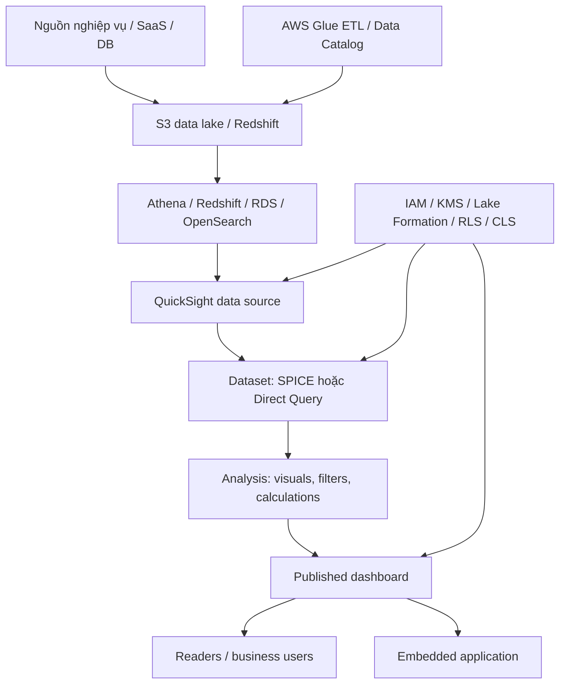
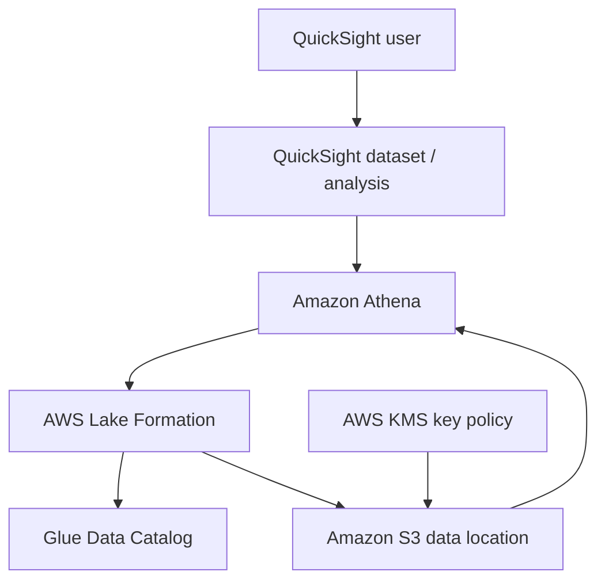

# Amazon QuickSight, dashboard và phân quyền dữ liệu báo cáo

Amazon QuickSight là dịch vụ business intelligence (BI) được quản lý của AWS. Dịch vụ kết nối dữ liệu từ nhiều nguồn, chuẩn bị dataset, xây dựng analysis, trực quan hóa bằng biểu đồ và bảng, rồi xuất bản dashboard để người dùng theo dõi chỉ số và ra quyết định. Dashboard có thể được chia sẻ trong tổ chức hoặc nhúng vào ứng dụng; quyền truy cập dữ liệu cần được thiết kế cùng quyền xem dashboard.

**Cập nhật tên dịch vụ:** từ ngày 09-11-2026, AWS đổi tên nền tảng Amazon Quick thành **AWS Quick** và thành phần BI trước đây gọi là Amazon QuickSight thành **AWS Quick Sight**. Chức năng dashboard, dataset, analysis và SPICE hiện hữu tiếp tục hoạt động. Tên bài học dùng “Amazon QuickSight” theo đề bài và tên quen thuộc trong hệ sinh thái; khi đọc tài liệu hoặc console mới có thể gặp “AWS Quick Sight”. API, SDK và AWS CLI vẫn dùng service identifier `quicksight`.

Trong module `CLOUD_PROVIDERS_AWS`, QuickSight kết nối trực tiếp với các kiến thức về S3, Athena, Glue Data Catalog, Redshift, RDS, OpenSearch, IAM, KMS, VPC và Lake Formation. Một hệ thống BI tốt cần bảo đảm dữ liệu đúng, truy vấn đủ nhanh, dashboard dễ hiểu và mỗi người chỉ nhìn thấy dữ liệu mà họ được phép xem.

Sau bài học, bạn có thể:

- Mô tả luồng từ data source tới dataset, analysis và dashboard.
- Phân biệt SPICE và Direct Query, chọn chế độ theo độ trễ, hiệu năng, chi phí và kích thước dữ liệu.
- Kết nối QuickSight với S3, Athena, Redshift, RDS, OpenSearch và nguồn dữ liệu phù hợp.
- Thiết kế dataset, calculated field, filter, parameter, control và visual.
- Tổ chức analysis, sheet, dashboard, publish và refresh.
- Phân biệt quyền IAM, QuickSight user role, resource permission và quyền truy cập dữ liệu.
- Áp dụng row-level security (RLS), column-level security (CLS) và Lake Formation.
- Chia sẻ dashboard an toàn, nhúng dashboard cho người dùng đã đăng ký hoặc anonymous.
- Theo dõi refresh, SPICE capacity, query performance, chi phí và audit.

## 1. QuickSight trong kiến trúc BI

QuickSight là lớp phân tích và trình bày dữ liệu. Nó không thay thế data lake, data warehouse hoặc hệ thống giao dịch. Dữ liệu thường được chuẩn bị ở các lớp lưu trữ/xử lý trước, sau đó QuickSight kết nối để tạo dataset và dashboard.

Ví dụ kiến trúc:



Các thành phần chính:

| Thành phần | Vai trò |
|---|---|
| Data source | Thông tin kết nối tới database, warehouse, S3 hoặc dịch vụ nguồn |
| Dataset | Mô hình dữ liệu được chọn, join, lọc và chuẩn bị cho phân tích |
| SPICE | Bộ máy in-memory lưu bản dữ liệu đã import |
| Direct Query | Gửi truy vấn tới data source khi cần dữ liệu |
| Analysis | Không gian tác giả xây visuals, sheets, filters và calculations |
| Dashboard | Bản analysis được publish để chia sẻ và tiêu thụ |
| User/group | Danh tính người tạo, quản trị hoặc xem nội dung |
| RLS/CLS | Giới hạn dòng hoặc cột người dùng được phép xem |

Một dashboard không tự lưu bản sao dữ liệu như một snapshot hóa đơn. Dashboard giữ cấu hình phân tích tại thời điểm publish; dữ liệu hiển thị phụ thuộc dataset và chế độ truy vấn/refresh đang dùng.

## 2. Data source và nguồn dữ liệu hỗ trợ

QuickSight có thể kết nối nhiều nguồn dữ liệu có cấu trúc, gồm:

- Amazon Athena.
- Amazon Redshift và Redshift Spectrum.
- Amazon RDS, Amazon Aurora.
- Amazon S3.
- Amazon OpenSearch Service.
- Một số database như PostgreSQL, MySQL, SQL Server, Oracle.
- Một số nguồn SaaS và nền tảng dữ liệu bên ngoài được hỗ trợ.

Khả năng kết nối và chế độ truy vấn phụ thuộc connector, Region, network path và tính năng của nguồn. Ví dụ, S3 thường được nhập vào SPICE; Athena có thể dùng Direct Query hoặc SPICE; database có thể hỗ trợ cả hai chế độ.

### 2.1. Tạo data source

Quy trình tổng quát:

1. Mở QuickSight/AWS Quick Sight trong đúng AWS account và Region.
2. Chọn tạo data source.
3. Chọn loại nguồn.
4. Cung cấp thông tin kết nối hoặc chọn resource AWS.
5. Cấu hình credential, IAM role và network access.
6. Kiểm tra kết nối.
7. Tạo dataset từ table, view hoặc custom SQL.

Không đưa mật khẩu database vào tài liệu hoặc source code. Dùng cơ chế credential được hỗ trợ, quản lý rotation và giới hạn quyền đọc ở database.

### 2.2. Kết nối Athena

Khi QuickSight dùng Athena:
- Cần bật quyền sử dụng Athena trong phần quản trị QuickSight.
- Cấp quyền đọc đúng S3 bucket chứa dữ liệu nguồn.
- Cấp quyền ghi/đọc query result location mà Athena sử dụng.
- Nếu dữ liệu hoặc query results dùng SSE-KMS, role liên quan cần quyền KMS phù hợp.
- Nếu Athena dùng Lake Formation, cần cấu hình tích hợp và grants theo identity model.

QuickSight không tự bỏ qua quyền của Athena, S3, Glue Catalog hoặc KMS. Một kết nối có thể tạo được nhưng query vẫn thất bại nếu thiếu quyền đọc table, object hoặc query results.

### 2.3. Kết nối Redshift và RDS

Với Redshift, RDS hoặc Aurora, kiểm tra:
- Endpoint, port, database và schema.
- Database credentials hoặc cơ chế xác thực được hỗ trợ.
- Security group inbound chỉ cho network interface/connection path cần thiết.
- Route table, subnet, NACL và DNS.
- TLS và certificate nếu yêu cầu.
- Quyền SELECT trên schema/table/view.
- Chi phí data transfer giữa Region hoặc dịch vụ.

Nếu database chỉ truy cập qua private network, xem xét QuickSight VPC connection.

## 3. VPC connection cho nguồn dữ liệu private

VPC connection cho phép QuickSight kết nối tới một số data source nằm trong VPC bằng network path riêng, không cần đưa database ra Internet công cộng. Nó phù hợp với private RDS/Aurora, Redshift, OpenSearch và một số database tương thích được hỗ trợ.

Khi cấu hình, cần:
- Chọn Region và VPC chứa data source.
- Chọn subnet có đủ IP và kết nối tới nguồn.
- Tạo security group cho network interface của QuickSight.
- Cấu hình execution role với trust relationship và quyền EC2 cần thiết để tạo/quản lý network interface.
- Mở inbound ở security group database từ security group của VPC connection trên đúng port.
- Kiểm tra DNS, route, NACL và kết nối on-premises nếu có.

Không phải mọi data source đều hỗ trợ VPC connection. Theo danh sách hỗ trợ hiện hành, các nguồn như Redshift, RDS, Aurora và OpenSearch có thể dùng VPC connection; Athena, S3 và một số nguồn khác không dùng cơ chế này. Đừng gắn VPC connection vào connector không hỗ trợ vì yêu cầu có thể thất bại.

## 4. Dataset: mô hình dữ liệu cho báo cáo

Dataset là lớp mô hình hóa dữ liệu mà author dùng để xây analysis. Dataset có thể lấy một table, view, custom SQL hoặc kết hợp nhiều nguồn trong giới hạn hỗ trợ.

Trong quá trình chuẩn bị dataset, có thể:
- Chọn và bỏ cột.
- Đổi tên field.
- Chọn kiểu dữ liệu.
- Join table.
- Lọc record.
- Tạo calculated field.
- Chọn SPICE hoặc Direct Query.
- Cấu hình refresh.
- Áp dụng RLS/CLS theo edition và tính năng hỗ trợ.

Một dataset tốt nên có grain rõ ràng. Ví dụ bảng `sales_order_line` có một dòng cho mỗi order item; nếu join với bảng order-level mà không kiểm soát cardinality, tổng doanh thu có thể bị nhân lên.

### 4.1. Xác định grain và khóa join

Trước khi join:
1. Xác định mỗi dòng đại diện cho entity nào.
2. Xác định primary/business key.
3. Kiểm tra uniqueness của hai phía.
4. Xác định quan hệ one-to-one, one-to-many hoặc many-to-many.
5. Kiểm tra row count và tổng measure trước/sau join.

Ví dụ, một order có nhiều order item. Join order header với order item làm một order xuất hiện nhiều dòng. Nếu cộng `order_total` từ header sau join, tổng doanh thu sẽ bị nhân theo số item. Dùng measure ở đúng grain hoặc aggregate trước khi join.

### 4.2. Dataset dùng chung

Có thể tạo dataset chuẩn cho nhiều analysis:
- `sales_daily`: dữ liệu doanh thu theo ngày, sản phẩm và vùng.
- `customer_support`: ticket, SLA và trạng thái.
- `cloud_costs`: chi phí theo account, service và team.

Dataset dùng chung giúp chuẩn hóa metric và quyền truy cập. Tuy nhiên, thay đổi schema hoặc calculated field có thể ảnh hưởng nhiều dashboard; cần owner, versioning và quy trình review.

## 5. SPICE và Direct Query

QuickSight cung cấp hai chế độ chính để truy vấn dữ liệu.

**SPICE** (Super-fast, Parallel, In-memory Calculation Engine) nhập dữ liệu vào bộ máy in-memory được QuickSight quản lý. Visuals truy vấn dữ liệu đã nạp trong SPICE.

**Direct Query** gửi truy vấn trực tiếp tới data source thay vì nhập toàn bộ dữ liệu vào SPICE.

| Tiêu chí | SPICE | Direct Query |
|---|---|---|
| Nơi xử lý truy vấn | SPICE in-memory | Data source |
| Tốc độ tương tác | Thường nhanh và ổn định hơn với dataset đã nạp | Phụ thuộc nguồn, network và query |
| Độ mới dữ liệu | Tới thời điểm ingestion gần nhất | Lấy từ nguồn khi truy vấn, có thể chịu cache |
| Chi phí | Dùng SPICE capacity và chi phí refresh | Có thể phát sinh query/compute cost ở nguồn |
| Tải lên nguồn | Giảm tải truy vấn lặp lại sau ingestion | Dashboard có thể tạo tải truy vấn trực tiếp |
| Refresh | Full hoặc incremental theo tính năng hỗ trợ | Không có SPICE ingestion; dữ liệu phụ thuộc nguồn |
| Use case | Dashboard tương tác nhiều, dữ liệu ổn định theo lịch | Dữ liệu cần cập nhật nhanh hoặc nguồn lớn không muốn import |

### 5.1. Khi nào chọn SPICE?

SPICE phù hợp khi:
- Dashboard được nhiều người xem và truy vấn lặp lại.
- Muốn phản hồi nhanh cho filter/control.
- Nguồn có chi phí truy vấn cao hoặc cần giảm tải.
- Dữ liệu có thể chấp nhận refresh theo lịch.
- Dataset nằm trong giới hạn SPICE capacity và data source limits.

SPICE capacity được cấp riêng theo AWS Region. Quản trị viên theo dõi mức sử dụng, mua thêm hoặc giải phóng capacity không dùng. Dataset vẫn chiếm capacity cho tới khi bị xóa khỏi SPICE hoặc chuyển sang chế độ khác. Dữ liệu SPICE được mã hóa at rest trong Enterprise edition.

### 5.2. Khi nào chọn Direct Query?

Direct Query phù hợp khi:
- Dữ liệu cần được đọc từ nguồn mới nhất theo query.
- Dataset quá lớn hoặc không muốn lưu bản copy trong SPICE.
- Data source có năng lực xử lý truy vấn và concurrency phù hợp.
- Cần tận dụng quyền truy cập ở data engine theo cấu hình hỗ trợ.

Direct Query không đồng nghĩa mọi dashboard luôn hiển thị dữ liệu mới tức thời. Query cache, refresh control, connector và nguồn dữ liệu có thể ảnh hưởng độ mới. Cần đo latency, concurrency và load ở data source.

### 5.3. Kết hợp nhiều dataset

Một analysis có thể dùng nhiều dataset, nhưng cách kết hợp có giới hạn. Dataset join cùng nguồn có thể hỗ trợ Direct Query nếu connector cho phép. Cross-source joins thường cần SPICE; join datasets trong SPICE có giới hạn dung lượng secondary tables. Hãy xem giới hạn join hiện hành trước khi thiết kế mô hình lớn.

## 6. SPICE ingestion và refresh

SPICE ingestion nhập dữ liệu từ nguồn vào SPICE. Khi tạo dataset, QuickSight có thể thực hiện lần ingestion đầu; các lần sau có thể chạy thủ công, qua API hoặc theo lịch.

Các kiểu refresh:
- **Full refresh**: nạp lại toàn bộ dữ liệu của dataset.
- **Incremental refresh**: nạp phần dữ liệu mới/thay đổi theo cột timestamp hoặc điều kiện look-back được cấu hình, trong nguồn và edition hỗ trợ.

Incremental refresh thường phù hợp bảng append hoặc cập nhật theo thời gian. Nếu dữ liệu cũ có thể bị sửa/xóa, cần thiết kế look-back window và quy trình full refresh để không bỏ sót correction.

### 6.1. Lập lịch refresh

Có thể cấu hình refresh theo lịch và timezone. Tần suất khả dụng phụ thuộc loại dataset, edition và phương thức refresh; incremental refresh có thể hỗ trợ lịch dày hơn full refresh. Kiểm tra ingestion history và API limits thay vì giả định mọi dataset đều hỗ trợ cùng tần suất.

### 6.2. Theo dõi ingestion

Theo dõi:
- Trạng thái ingestion: hoàn tất, thất bại hoặc bị bỏ qua.
- Thời gian ingestion.
- Số dòng được nạp, bỏ qua hoặc lỗi.
- Error code và nguyên nhân.
- Timestamp lần refresh thành công gần nhất.
- SPICE capacity sau ingestion.

Bật thông báo cho dataset owner khi refresh thất bại nếu phù hợp. Dashboard quan trọng nên có freshness indicator để người xem biết dữ liệu cập nhật tới thời điểm nào.

### 6.3. Dữ liệu upload thủ công

File tải trực tiếp lên QuickSight không có cùng metadata kết nối và location như S3 data source. QuickSight không tự refresh file upload chỉ vì file gốc trên máy hoặc S3 thay đổi. Muốn tự động cập nhật dữ liệu từ S3, tạo dataset bằng S3 data source thay vì upload file thủ công.

## 7. Chuẩn bị dữ liệu và calculated fields

Calculated field tạo measure hoặc dimension từ dữ liệu hiện có. Ví dụ:
- `net_revenue = gross_revenue - refund_amount`
- `conversion_rate = converted_sessions / total_sessions`
- `order_age_days = dateDiff({created_at}, now(), 'DD')`

Tên hàm và cú pháp phải theo QuickSight expression language. Chọn đúng aggregation:
- `sum` cho tổng doanh thu.
- `avg` cho giá trị trung bình.
- `count` hoặc `distinct_count` cho số lượng.
- `min`, `max` cho biên.
- Level-aware calculations khi cần kiểm soát grain tính toán.

Không tính tỷ lệ bằng cách lấy trung bình đơn giản của tỷ lệ từng nhóm nếu mẫu số mỗi nhóm khác nhau. Ví dụ conversion rate toàn hệ thống nên là tổng converted sessions chia tổng sessions, không phải trung bình không trọng số các conversion rate theo ngày.

### 7.1. Kiểu dữ liệu và timezone

Kiểm tra:
- Date/time có timezone rõ ràng.
- Currency và decimal precision.
- ID không bị chuyển thành số gây mất số 0 đầu.
- Boolean và categorical value nhất quán.
- Null khác empty string nếu logic nghiệp vụ cần phân biệt.

Sai kiểu dữ liệu có thể khiến filter, aggregation và sorting không chính xác.

## 8. Analysis, sheet và visual

Analysis là nơi author thiết kế báo cáo. Một analysis có thể chứa nhiều sheet; mỗi sheet tập trung vào một góc nhìn như executive summary, sales performance, customer behavior hoặc operations.

Các loại visual thường dùng:
- KPI card: một chỉ số chính như doanh thu, số đơn, SLA.
- Line chart: xu hướng theo thời gian.
- Bar/column chart: so sánh nhóm.
- Table/pivot table: chi tiết và phân rã.
- Pie/donut: tỷ trọng khi số nhóm ít.
- Scatter plot: tương quan giữa hai measure.
- Heat map: mật độ hoặc hiệu suất theo hai chiều.
- Geospatial map: dữ liệu theo vị trí.
- Combo chart: kết hợp measure có đơn vị khác nhau.

Chọn visual theo câu hỏi:
- “Đang thay đổi ra sao?” → line chart.
- “Nhóm nào cao/thấp?” → bar chart.
- “Một giá trị hiện tại là bao nhiêu?” → KPI.
- “Chi tiết từng bản ghi?” → table.
- “Có quan hệ giữa hai biến?” → scatter.

Không nhồi quá nhiều visual vào một sheet. Mỗi visual nên trả lời một câu hỏi rõ ràng và có tiêu đề mô tả insight.

## 9. Filter, control và parameter

**Filter** giới hạn dữ liệu được dùng trong visual hoặc sheet. **Control** là giao diện để người xem chọn giá trị filter/parameter. **Parameter** là biến đầu vào có thể dùng trong calculated field, filter hoặc URL/custom action.

Ví dụ dashboard doanh thu có:
- Filter `region`.
- Control chọn `month`.
- Parameter `p_target_margin` để thay đổi ngưỡng mục tiêu.
- Calculated field xác định trạng thái đạt mục tiêu.

Parameter có thể nhận giá trị đơn hoặc nhiều giá trị tùy loại. Control có thể là dropdown, list, date picker hoặc slider nếu phù hợp kiểu dữ liệu. Cần xác định filter áp dụng cho một visual, một sheet hay nhiều sheet để người dùng hiểu kết quả.

### 9.1. Cascading controls

Cascading controls giúp lựa chọn ở control trước giới hạn lựa chọn ở control sau. Ví dụ:
1. Chọn Region.
2. Control Country chỉ hiển thị quốc gia trong Region đó.
3. Control City chỉ hiển thị thành phố thuộc Country.

Điều này giúp dashboard dễ dùng khi danh sách giá trị lớn. Cần kiểm tra cardinality và query performance khi control lấy danh sách từ Direct Query.

### 9.2. URL và custom actions

Parameters có thể được truyền qua URL hoặc dùng trong custom actions để điều hướng, lọc hoặc mở ứng dụng khác. Không đưa dữ liệu bí mật hoặc quyền truy cập vào URL. URL parameter là input có thể bị người dùng chỉnh sửa; mọi authorization vẫn phải được thực hiện ở backend hoặc lớp bảo mật dữ liệu.

## 10. Publish analysis thành dashboard

Dashboard là nội dung được publish từ analysis để người dùng tiêu thụ. Dashboard viewer thường có thể xem, lọc và tương tác theo các tùy chọn đã publish; họ không thể sửa analysis như author.

Quy trình:
1. Hoàn thiện dataset và kiểm tra quyền.
2. Tạo analysis với các sheet/visual.
3. Kiểm thử filter, parameter, calculation và drill.
4. Xác nhận RLS/CLS với các nhóm người dùng.
5. Chọn Publish.
6. Tạo dashboard mới hoặc thay thế dashboard hiện có.
7. Chọn sheet cần publish.
8. Cấu hình tùy chọn tương tác, download và filter.
9. Chia sẻ dashboard cho đúng user/group.
10. Kiểm thử bằng tài khoản viewer thực tế.

Dashboard publish lưu cấu hình analysis tại thời điểm publish. Thay đổi ở analysis chưa tự động xuất hiện trên dashboard cho tới khi publish lại. Dữ liệu hiển thị vẫn thay đổi theo SPICE refresh hoặc Direct Query.

### 10.1. Dashboard không phải data snapshot

Dashboard là read-only view của analysis đã publish. Nó không đóng băng toàn bộ dữ liệu ở thời điểm publish. Khi dataset được refresh, dashboard có thể hiển thị dữ liệu mới mà không cần publish lại nếu cấu hình dashboard không đổi.

Điều này giúp tách hai vòng đời:
- Thay đổi thiết kế dashboard → cần publish.
- Thay đổi dữ liệu trong dataset → cần refresh SPICE hoặc truy vấn nguồn theo Direct Query.

## 11. Dashboard sharing và resource permissions

Mặc định dashboard mới chỉ owner truy cập được. Sau khi publish, owner có thể chia sẻ với user, group hoặc mọi người trong Quick account theo tùy chọn hỗ trợ.

Các mức quyền thường gặp:
- Viewer: xem và tương tác với dashboard theo khả năng được bật.
- Co-owner: có quyền quản lý/chỉnh sửa hoặc chia sẻ dashboard theo role.
- Owner: người sở hữu nội dung và có thể quản trị asset.

Quyền có thể khác theo Quick role (Reader/Author/Admin) và loại asset. Reader thường chỉ nhận Viewer access; Author có thể được cấp Co-owner theo chính sách.

### 11.1. Chia sẻ qua group

Nên chia sẻ dashboard cho group thay vì từng người khi cùng một nhóm nghiệp vụ có quyền giống nhau:
- `Sales-Readers`
- `Finance-Readers`
- `Operations-Authors`

Khi nhân viên gia nhập/rời nhóm, quản trị danh tính cập nhật membership. Điều này giảm việc sửa từng dashboard.

### 11.2. Quyền dashboard không thay thế RLS/CLS

Người được chia sẻ dashboard có thể xem dữ liệu dùng trong analysis đó. Nếu dashboard chứa dữ liệu nhiều tenant, vùng hoặc khách hàng, chỉ chia sẻ dashboard không đủ để cách ly dữ liệu. Cần cấu hình RLS/CLS hoặc cơ chế bảo vệ ở data source.

Không dùng filter thông thường làm security control. Người xem có thể thay đổi filter nếu dashboard cho phép; filter chỉ điều khiển hiển thị, không phải authorization.

## 12. User roles và identity trong QuickSight

QuickSight hỗ trợ các loại identity như QuickSight-managed identity, IAM hoặc IAM Identity Center tùy cấu hình account và tính năng. Role BI phổ biến:

| Role | Khả năng tổng quát |
|---|---|
| Reader | Xem dashboard |
| Author | Tạo data source, dataset, analysis và dashboard |
| Admin | Khả năng author cùng quản trị account/settings |
| Reader Pro / Author Pro / Admin Pro | Các role Pro bổ sung khả năng Generative BI theo gói và cấu hình hiện hành |

Không cấp Admin cho người chỉ cần xem báo cáo. Tách người tạo dataset, người publish dashboard và người quản trị user/permissions nếu quy trình yêu cầu separation of duties.

### 12.1. IAM permission và QuickSight role là hai lớp

IAM policy cho phép principal gọi API quản trị hoặc sử dụng tài nguyên AWS. QuickSight role xác định người dùng có thể làm gì bên trong môi trường BI. Resource permissions xác định ai được truy cập asset cụ thể như dataset, data source, analysis, dashboard, folder hoặc theme.

Một user có IAM permission gọi QuickSight API không tự động có quyền xem mọi dashboard. Ngược lại, dashboard share không cấp quyền quản trị AWS account hoặc quyền đọc trực tiếp bucket S3.

### 12.2. API và CLI identifier

Dù giao diện mới có thể dùng tên AWS Quick Sight, API namespace và CLI command vẫn dùng `quicksight` để tương thích. Ví dụ:

```bash
aws quicksight list-dashboards \
  --aws-account-id 111122223333 \
  --region ap-southeast-1
```

Ví dụ xem metadata dataset:

```bash
aws quicksight describe-data-set \
  --aws-account-id 111122223333 \
  --data-set-id sales-dataset-01 \
  --region ap-southeast-1
```

Các lệnh trên chỉ đọc danh sách/metadata. Cần chọn đúng account và Region; QuickSight resources có ARN chứa Region và account ID.

## 13. Row-level security (RLS)

RLS giới hạn những dòng dữ liệu mà user được xem. Ví dụ một dataset có doanh thu của nhiều vùng; Sales Manager vùng APAC chỉ được xem các dòng thuộc APAC, còn EMEA Manager chỉ xem EMEA.

QuickSight Enterprise hỗ trợ RLS theo:
- User/group-based rules cho user hoặc group đã provision trong QuickSight.
- Tag-based rules cho một số kịch bản embedded dashboard anonymous.
- Có thể kết hợp các cách theo phạm vi hỗ trợ.

### 13.1. User-based RLS

Tạo một permissions dataset chứa user/group và giá trị được phép truy cập.

Ví dụ:

| UserName | region | business_unit |
|---|---|---|
| sales-apac | APAC | Retail |
| sales-emea | EMEA | Retail |
| finance-lead | NULL | NULL |

Trong ví dụ, user `sales-apac` chỉ thấy dữ liệu APAC/Retail; `sales-emea` chỉ thấy EMEA/Retail. Dòng quyền có NULL ở các trường hạn chế có thể biểu diễn quyền không giới hạn theo trường đó theo semantics RLS được hỗ trợ; cần kiểm thử chính xác cách xử lý NULL/empty.

Một số nguyên tắc:
- Tên cột và giá trị phải khớp chính xác, có phân biệt chữ hoa/chữ thường.
- Permission dataset không nên có duplicate rule.
- RLS áp dụng cho reader; dataset owner có thể thấy toàn bộ dữ liệu.
- Field được dùng để RLS cần là text/string theo giới hạn hiện hành.
- NULL và empty string có semantics riêng; rule rỗng có thể bị bỏ qua để tránh vô tình cấp quyền toàn bộ.
- Với Direct Query, số lượng filter values có giới hạn tùy nguồn.

Hãy kiểm thử bằng tài khoản thuộc từng nhóm và tài khoản không có rule. Không dùng tài khoản owner để xác nhận RLS vì owner có thể thấy toàn bộ dataset.

### 13.2. Tag-based RLS cho anonymous embedding

Tag-based RLS phù hợp khi ứng dụng nhúng dashboard cho khách hàng chưa được provision thành QuickSight user. Backend xác thực khách hàng, xác định tenant được phép xem rồi truyền session tags khi tạo embed URL bằng API anonymous embedding được hỗ trợ.

Ví dụ:
- Dataset có cột `tenant_id`.
- Cấu hình tag rule ánh xạ cột `tenant_id` với tag `tenant`.
- Backend xác thực phiên của khách hàng A.
- Backend tạo embed session với tag `tenant=A`.
- QuickSight chỉ trả các dòng tenant A.

Tag value phải do backend đáng tin cậy quyết định. Không nhận tenant ID tùy ý từ browser rồi chuyển thẳng vào embed request mà không xác thực. Tag-based RLS hiện chỉ áp dụng cho anonymous embedding qua `GenerateEmbedUrlForAnonymousUser`, không phải cơ chế chung cho mọi dashboard/API.

## 14. Column-level security (CLS)

CLS giới hạn user/group được xem một số cột. Ví dụ:
- Sales team xem `order_id`, `region`, `sales_amount`.
- Finance team xem thêm `discount_amount`, `margin`.
- Chỉ HR được xem `employee_salary`.

CLS phù hợp khi một dataset có nhiều trường nhạy cảm nhưng có thể chia sẻ cùng mô hình dữ liệu. Trong Enterprise edition, administrator chọn cột bị hạn chế và user/group được phép xem.

Khi user không có quyền truy cập một cột:
- Visual dùng cột bị hạn chế có thể không hiển thị.
- Table/pivot có thể hiển thị các giá trị được phép và đánh dấu cột không được phép là Not Authorized tùy vị trí field.
- Author cần kiểm tra visuals để tránh dashboard lỗi hoặc gây hiểu nhầm.

CLS không thay thế RLS:
- RLS giới hạn **dòng**.
- CLS giới hạn **cột**.
- Có thể kết hợp cả hai.

## 15. Lake Formation và QuickSight qua Athena

Khi dữ liệu nằm trong S3 và được catalog bằng Glue Data Catalog, AWS Lake Formation có thể quản lý quyền truy cập database/table/column/row cho Athena. QuickSight có thể dùng Athena làm query engine và tích hợp với Lake Formation.

Luồng truy cập:



Để truy vấn thành công, cần phối hợp:
- QuickSight account đã bật quyền Athena.
- IAM role có quyền Athena, Glue Catalog và S3 query results.
- Lake Formation grants cho principal/identity model phù hợp.
- Data location đã đăng ký và được cấp quyền.
- KMS key cho phép decrypt nếu object mã hóa SSE-KMS.
- Workgroup Athena và output bucket được cấu hình.

QuickSight Enterprise và Standard có cách tích hợp Lake Formation khác nhau. Enterprise có thể cấp fine-grained permissions cho user/group; Standard thường cấp quyền cho IAM role. Khi dùng trusted identity propagation với IAM Identity Center, Lake Formation đánh giá quyền theo end user và group. Một số tính năng có thể không khả dụng trong mô hình này, bao gồm SPICE datasets, Custom SQL, email reports và một số export/analytics features. Kiểm tra compatibility trước khi chọn.

## 16. Chia sẻ dashboard và embedded analytics

Dashboard có thể được nhúng vào portal nội bộ hoặc ứng dụng khách hàng. Hai kịch bản phổ biến:

- **Registered-user embedding**: người dùng đã được quản lý trong QuickSight/identity system và được cấp quyền dashboard.
- **Anonymous embedding**: người dùng ứng dụng chưa có QuickSight user; backend tạo session embed có quyền giới hạn.

### 16.1. Registered-user embedding

Backend dùng IAM role có quyền tạo embed URL cho user/namespace phù hợp. User cần có identity và resource permissions tương ứng. Dashboard chỉ hiển thị nội dung mà user được phép truy cập, bao gồm RLS/CLS.

### 16.2. Anonymous embedding

Backend xác thực người dùng ứng dụng, sau đó gọi `GenerateEmbedUrlForAnonymousUser` với:
- Account ID và namespace.
- Dashboard ARN.
- Session lifetime.
- Allowed domains nếu dùng runtime allow list.
- Session tags khi cần tag-based RLS.
- Các tùy chọn experience configuration.

Embed URL có thời hạn và nên được tạo ở backend. Không hardcode AWS credentials hoặc quyền quản trị vào frontend. Domain nhúng cần nằm trong allow list; dùng HTTPS và giới hạn domain đúng ứng dụng.

### 16.3. Bảo vệ embedded dashboard

- Không tin giá trị tenant/region do browser tự gửi.
- Tạo session theo identity đã xác thực.
- Dùng RLS/CLS và resource permissions.
- Hạn chế domain allow list.
- Không bật public/anonymous sharing nếu không có use case rõ.
- Theo dõi API tạo embed URL và quyền dashboard.
- Kiểm tra logout/session expiration và revoke khi cần.
- Không log embed URL/token đầy đủ nếu có thể tái sử dụng trong thời hạn.

## 17. Folder, namespace và tổ chức asset

Khi số lượng dashboard tăng, tổ chức cần convention cho folder, namespace, group và owner.

Ví dụ:
- Folder `Executive`: dashboard điều hành.
- Folder `Finance`: báo cáo tài chính.
- Folder `Operations`: vận hành.
- Folder `Sandbox`: thử nghiệm có kiểm soát.

Namespace có thể tách phạm vi user theo identity configuration. Folder permissions giúp chia sẻ và quản trị asset theo nhóm. Tuy nhiên, quyền folder không tự thay thế RLS/CLS trên dataset.

Mỗi dashboard nên có:
- Business owner.
- Technical owner.
- Mô tả và mục đích.
- Dataset phụ thuộc.
- Refresh SLA.
- Classification.
- Audience/group được phép truy cập.
- Ngày review và quy trình deprecation.

## 18. Filters, alerts và email reports

Dashboard có thể hỗ trợ người xem lọc dữ liệu, đăng ký nhận report hoặc theo dõi threshold alerts tùy edition, cấu hình và loại dataset.

### 18.1. Threshold alerts

Threshold alert phù hợp với KPI dạng số, ví dụ:
- Doanh thu hôm nay thấp hơn ngưỡng.
- Số lỗi vượt giới hạn.
- SLA breach rate lớn hơn 2%.
- SPICE refresh failure hoặc dataset freshness vượt SLA có thể được giám sát qua CloudWatch/notification pipeline riêng.

Không phải mọi visual/measure hoặc mọi chế độ dữ liệu đều hỗ trợ threshold alerts. Hãy kiểm tra tính năng hiện hành và đảm bảo người nhận có quyền truy cập dashboard.

### 18.2. Email reports

Dashboard report có thể được gửi theo lịch tới người dùng có quyền truy cập phù hợp. Nội dung email/report có thể chứa dữ liệu nhạy cảm; kiểm soát recipient, group, subscription và retention. Không giả định chia sẻ dashboard cho toàn account tự động đồng nghĩa email report được gửi cho tất cả user.

## 19. Bảo mật dữ liệu và dashboard

Một dashboard có thể tiết lộ dữ liệu doanh thu, lương, thông tin khách hàng, chi phí hoặc hoạt động nội bộ. Áp dụng defense in depth:

1. Identity: dùng IAM Identity Center/federation hoặc cơ chế quản lý user phù hợp.
2. Quick role: Reader/Author/Admin theo công việc.
3. Resource permissions: share đúng dataset, analysis, dashboard và folder.
4. Data source permissions: giới hạn database/table và credential.
5. RLS/CLS: giới hạn dòng/cột trong dataset.
6. Lake Formation: quản lý quyền data lake qua Athena.
7. S3/KMS: bảo vệ object và key.
8. Network: VPC connection, security group và private routing khi cần.
9. Audit: CloudTrail và log truy cập phù hợp.
10. Lifecycle: thu hồi quyền khi user đổi vai trò hoặc rời tổ chức.

Không dùng filter control hoặc hidden sheet làm cơ chế bảo mật. Nếu user có quyền truy cập dataset mà không có RLS/CLS, họ có thể tiếp cận dữ liệu ngoài góc nhìn dashboard dự kiến tùy quyền được cấp.

## 20. CloudTrail và audit

CloudTrail ghi nhận các hoạt động API QuickSight trong phạm vi hỗ trợ. Audit hữu ích để:
- Xác định ai tạo hoặc sửa dataset.
- Theo dõi thay đổi dashboard permissions.
- Kiểm tra user/group provisioning.
- Điều tra thay đổi data source hoặc refresh.
- Theo dõi thao tác tạo embed URL và cấu hình account.

Kết hợp CloudTrail với:
- Dataset ingestion history.
- Athena query history.
- S3 access logs/CloudTrail data events khi cần.
- KMS events.
- Lake Formation permission changes.
- Application logs cho embedded session.

Log nên có correlation ID nhưng không ghi secret, password, token hoặc embed URL đầy đủ.

## 21. Hiệu năng dashboard

Hiệu năng phụ thuộc cả QuickSight và nguồn dữ liệu.

Các yếu tố thường gặp:
- Dataset quá lớn hoặc quá nhiều cột.
- Visual có quá nhiều dimension.
- Filter control có hàng chục nghìn giá trị.
- Direct Query tạo nhiều truy vấn đồng thời.
- Join sai grain hoặc join cardinality lớn.
- Custom SQL phức tạp.
- SPICE ingestion chậm hoặc refresh thất bại.
- Database thiếu index/capacity.
- Data source và QuickSight nằm khác Region.

Cách cải thiện:
- Chỉ giữ cột cần thiết trong dataset.
- Aggregate dữ liệu ở data warehouse trước khi BI.
- Dùng Parquet/partitioning ở S3 khi truy vấn qua Athena.
- Chọn SPICE cho truy vấn lặp lại nếu phù hợp.
- Dùng Direct Query khi nguồn đủ capacity.
- Tối ưu SQL, filter và join.
- Giới hạn số visual mỗi sheet.
- Dùng parameter/control có cardinality phù hợp.
- Theo dõi ingestion, query latency và dashboard load time.

## 22. Chi phí QuickSight và nguồn dữ liệu

Các thành phần chi phí có thể gồm:
- User subscription theo role/edition.
- SPICE capacity.
- Query/compute ở Athena, Redshift, RDS hoặc nguồn khác.
- S3 storage và request.
- Data transfer giữa Region hoặc dịch vụ.
- VPC/networking và các thành phần hỗ trợ.
- Embedded analytics theo mô hình giá hiện hành.

SPICE giúp tránh query lặp lại trên nguồn sau khi import, nhưng cần capacity và refresh. Direct Query có thể không cần SPICE capacity cho dataset đó nhưng có thể làm tăng query cost và tải nguồn. Không chọn chế độ chỉ dựa vào chi phí một dịch vụ; hãy tính tổng chi phí từ ingestion, query, storage, user và data transfer.

## 23. Tình huống thực tế: dashboard doanh thu đa vùng

Một doanh nghiệp bán hàng ở APAC, EMEA và Americas. Dữ liệu đơn hàng được xử lý trong S3, catalog bằng Glue và query qua Athena. Finance muốn dashboard doanh thu theo ngày; mỗi regional manager chỉ được xem vùng của mình.

### 23.1. Kiến trúc

- S3 lưu dữ liệu curated Parquet partition theo ngày.
- Glue Data Catalog định nghĩa bảng `sales_orders`.
- Athena query dữ liệu.
- QuickSight tạo data source Athena và dataset.
- SPICE dùng cho dashboard có nhiều người xem, refresh theo lịch.
- Analysis có sheet Executive, Region và Product.
- Dashboard được publish và chia sẻ cho group.
- RLS giới hạn `region` theo user/group.
- Finance lead có quyền xem toàn bộ theo permissions dataset.
- CloudTrail audit thay đổi quyền và asset.

### 23.2. RLS permissions dataset

| GroupName | region |
|---|---|
| APAC-Managers | APAC |
| EMEA-Managers | EMEA |
| Americas-Managers | AMERICAS |
| Finance-Leadership | NULL |

Permissions dataset được gắn vào sales dataset. Kiểm thử bằng user thuộc từng group và user không có rule. Owner/admin có thể có quyền rộng hơn; phải kiểm tra theo role thực tế.

### 23.3. Dashboard và publish

- KPI: total revenue, orders, average order value.
- Line chart: revenue trend.
- Bar chart: revenue by product category.
- Table: top customers và order status.
- Filter control: date range, product category.
- Publish dashboard, share cho các group.
- Xác nhận người dùng không thể thấy dữ liệu vùng khác.
- Theo dõi SPICE refresh và dashboard freshness.

## 24. Checklist triển khai QuickSight an toàn

- [ ] Xác định business owner và audience của dashboard.
- [ ] Chọn data source phù hợp và kiểm tra Region/network.
- [ ] Dùng IAM role và database credential theo least privilege.
- [ ] Kiểm tra Glue Catalog, Athena, S3, KMS và Lake Formation permissions.
- [ ] Chọn SPICE hoặc Direct Query dựa trên freshness, performance và cost.
- [ ] Định nghĩa dataset grain, join keys và calculated fields.
- [ ] Kiểm tra schema, null, duplicate và aggregation.
- [ ] Tạo analysis với visuals, filters và parameters rõ ràng.
- [ ] Publish dashboard sau khi test.
- [ ] Chia sẻ cho user/group đúng phạm vi.
- [ ] Cấu hình RLS/CLS nếu dữ liệu cần giới hạn.
- [ ] Test bằng user thật ở từng role và nhóm dữ liệu.
- [ ] Không dùng filter/hidden sheet làm security boundary.
- [ ] Nếu embed, allow-list domain và tạo URL ở backend.
- [ ] Với anonymous embedding, kiểm tra tag-based RLS và tenant identity.
- [ ] Theo dõi ingestion/refresh và SPICE capacity.
- [ ] Theo dõi query latency, error và source load.
- [ ] Bật audit và quy trình revoke access.
- [ ] Review dashboard owner, classification và usage định kỳ.

## 25. Lỗi thường gặp

| Triệu chứng | Nguyên nhân có thể | Hướng kiểm tra |
|---|---|---|
| Dataset không kết nối được Athena | Chưa bật Athena/S3 access hoặc thiếu IAM | Quick account permissions, Athena workgroup, S3 |
| Query lỗi AccessDenied | Thiếu Glue, S3, Lake Formation hoặc KMS | Kiểm tra từng lớp quyền và principal |
| Dashboard không cập nhật | SPICE refresh chưa chạy hoặc fail | Ingestion history, schedule, notification |
| Direct Query chậm | Nguồn thiếu capacity hoặc SQL phức tạp | Query plan, DB load, indexes, filter |
| Dashboard hiển thị số liệu nhân đôi | Join sai grain/cardinality | Kiểm tra khóa và aggregate trước join |
| Người dùng thấy dữ liệu quá rộng | Chưa bật RLS hoặc dùng filter thường | Test dataset rules và user role |
| RLS không lọc như mong đợi | Sai username/group/value, NULL/blank semantics | Kiểm tra permission dataset và identity |
| Anonymous embed thấy dữ liệu sai tenant | Backend truyền tag sai hoặc tin input client | Xác thực tenant ở backend và test session tags |
| Visual biến mất khi bật CLS | User không có quyền với cột trong visual | Kiểm tra column permissions và field wells |
| VPC connection thất bại | Nguồn không hỗ trợ hoặc SG/route sai | Support matrix, ENI, subnet, SG, NACL |
| Dashboard thay đổi không xuất hiện | Analysis chưa publish lại | Publish và kiểm tra dashboard version |
| User không thấy dashboard | Chưa share resource hoặc sai namespace | Dashboard permissions và group membership |

## 26. Tóm tắt kiến thức

Amazon QuickSight, hiện được gọi là AWS Quick Sight trong nền tảng AWS Quick, là lớp BI để kết nối nguồn, tạo dataset, xây analysis và publish dashboard. Data source cung cấp kết nối; dataset định nghĩa grain, schema, joins và calculations; SPICE nhập dữ liệu vào in-memory engine; Direct Query truy vấn nguồn. Lựa chọn chế độ cần cân bằng freshness, latency, tải nguồn, capacity và chi phí.

Analysis là nơi tác giả xây sheets, visuals, filters, controls và parameters. Dashboard là phiên bản publish để chia sẻ, nhưng không phải snapshot dữ liệu bất biến. Quyền dashboard, Quick user role, IAM và quyền data source là các lớp khác nhau. RLS giới hạn dòng, CLS giới hạn cột; với data lake qua Athena, Lake Formation có thể quản lý quyền chi tiết. Anonymous embedding có thể dùng tag-based RLS nếu backend xác thực và truyền tag an toàn.

Một dashboard đáng tin cậy cần dataset đúng grain, metric được định nghĩa rõ, refresh được giám sát, quyền được kiểm thử bằng danh tính thực tế và hiệu năng/chi phí được theo dõi. Không dùng filter giao diện làm security control. Hãy thiết kế quyền từ data source tới dashboard, publish có kiểm soát và audit mọi thay đổi quan trọng.

## Tài liệu tham khảo

- [Amazon QuickSight / AWS Quick Sight — What's new and service naming](https://aws.amazon.com/about-aws/whats-new/2026/11/amazon-quick-aws-quick/)
- [What is AWS Quick?](https://docs.aws.amazon.com/quick/latest/userguide/what-is.html)
- [Supported data sources](https://docs.aws.amazon.com/quick/latest/userguide/supported-data-sources.html)
- [Creating datasets from data sources](https://docs.aws.amazon.com/quick/latest/userguide/creating-data-sets-new.html)
- [SPICE and importing data](https://docs.aws.amazon.com/quick/latest/userguide/spice.html)
- [Refreshing data in AWS Quick](https://docs.aws.amazon.com/quick/latest/userguide/refreshing-data.html)
- [Refreshing SPICE datasets](https://docs.aws.amazon.com/quick/latest/userguide/refreshing-imported-data.html)
- [Publishing dashboards](https://docs.aws.amazon.com/quick/latest/userguide/creating-a-dashboard.html)
- [Sharing dashboards](https://docs.aws.amazon.com/quick/latest/userguide/sharing-a-dashboard.html)
- [Working with dashboards and reports](https://docs.aws.amazon.com/quick/latest/userguide/working-with-dashboards.html)
- [Row-level security](https://docs.aws.amazon.com/quick/latest/userguide/row-level-security.html)
- [User-based row-level security rules](https://docs.aws.amazon.com/quick/latest/userguide/restrict-access-to-a-data-set-using-row-level-security.html)
- [Tag-based RLS for anonymous embedding](https://docs.aws.amazon.com/quick/latest/userguide/quicksight-dev-rls-tags.html)
- [Column-level security](https://docs.aws.amazon.com/quick/latest/userguide/restrict-access-to-a-data-set-using-column-level-security.html)
- [VPC connections and supported data sources](https://docs.aws.amazon.com/quick/latest/userguide/vpc-connection-supported-data-sources.html)
- [Using VPC connections](https://docs.aws.amazon.com/quick/latest/userguide/working-with-aws-vpc.html)
- [Using Lake Formation with Quick](https://docs.aws.amazon.com/lake-formation/latest/dg/qs-integ-lf.html)
- [Authorizing Athena connections](https://docs.aws.amazon.com/quick/latest/userguide/athena.html)
- [Embedding security](https://docs.aws.amazon.com/quicksight/latest/developerguide/embedded-analytics-security.html)
- [Embedding dashboards with the APIs](https://docs.aws.amazon.com/quick/latest/userguide/embedded-analytics-api.html)
- [QuickSight resource permissions](https://docs.aws.amazon.com/quicksight/latest/developerguide/resource-permissions.html)

