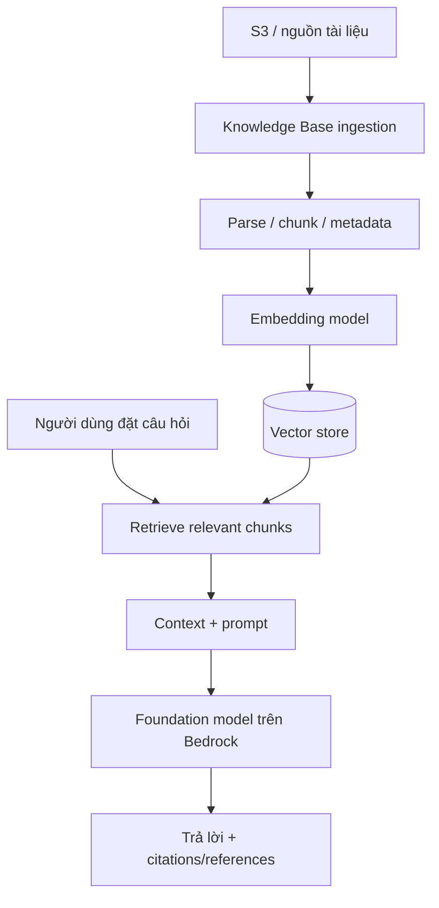
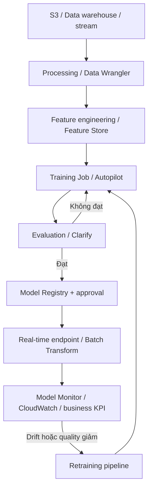

# Lựa chọn dịch vụ AI được quản lý, Bedrock và SageMaker

AWS cung cấp nhiều cách đưa AI vào ứng dụng. Có thể gọi một API AI chuyên biệt để nhận dạng ảnh, trích xuất dữ liệu từ hóa đơn, chuyển giọng nói thành văn bản hoặc dịch ngôn ngữ. Có thể dùng foundation model để xây chatbot, tóm tắt tài liệu, tạo nội dung và agent. Với bài toán dự đoán riêng của doanh nghiệp, đội ML có thể chuẩn bị dữ liệu, huấn luyện, đánh giá và triển khai model của mình.

Không có một dịch vụ phù hợp cho mọi bài toán. Lựa chọn nên bắt đầu từ đầu ra nghiệp vụ cần có, mức độ tùy chỉnh model, dữ liệu được phép xử lý, yêu cầu latency/throughput, kỹ năng đội ngũ và mức kiểm soát hạ tầng cần thiết. AWS có các AI services chuyên biệt, Amazon Bedrock cho ứng dụng generative AI dựa trên foundation models và Amazon SageMaker AI cho vòng đời xây dựng, huấn luyện, tùy chỉnh và triển khai model. Những dịch vụ này có thể kết hợp trong cùng một kiến trúc.

Bài học trình bày cách chọn dịch vụ theo use case, cách sử dụng Bedrock và SageMaker AI, các thành phần bảo mật/đánh giá/vận hành và những tình huống thực tế để quyết định khi nào nên dùng API AI có sẵn, khi nào nên dùng foundation model và khi nào cần phát triển model riêng.

## Mục tiêu học tập

Sau bài học, bạn có thể:

- Phân biệt AI service chuyên biệt, foundation model platform và ML development platform.
- Chọn dịch vụ AWS phù hợp với đầu vào/đầu ra như ảnh, tài liệu, văn bản, âm thanh, hội thoại và dự đoán.
- Giải thích vai trò và giới hạn của Amazon Bedrock, Amazon SageMaker AI và các công cụ liên quan.
- Dùng Bedrock Model Catalog, Converse API, Knowledge Bases, Guardrails và agent capabilities ở mức kiến trúc.
- Thiết kế RAG để model trả lời dựa trên dữ liệu doanh nghiệp.
- Mô tả vòng đời ML trên SageMaker AI từ chuẩn bị dữ liệu, huấn luyện, đánh giá đến inference và monitoring.
- So sánh các lựa chọn inference, chi phí, latency, throughput và mức kiểm soát hạ tầng.
- Thiết kế IAM, encryption, data governance, responsible AI và human review cho workload AI.
- Xây dựng quy trình thử nghiệm, đánh giá, triển khai, giám sát và cải tiến giải pháp AI.

## 1. Bản đồ dịch vụ AI trên AWS

AI là phạm vi rộng gồm nhận dạng, phân loại, dự đoán, tìm kiếm, tạo nội dung và hỗ trợ ra quyết định. Machine learning (ML) là một nhóm kỹ thuật để hệ thống học quy luật từ dữ liệu. Generative AI dùng model đã học trên lượng dữ liệu lớn để tạo nội dung mới như văn bản, mã, hình ảnh, âm thanh hoặc video.

AWS cung cấp các lớp dịch vụ khác nhau:

| Lớp | Cách sử dụng | Ví dụ dịch vụ |
|---|---|---|
| AI service chuyên biệt | Gọi API cho một tác vụ đã được đóng gói | Rekognition, Textract, Comprehend, Transcribe, Polly, Translate, Lex, Personalize |
| Generative AI platform | Chọn và gọi foundation model, kết hợp RAG/guardrails/agents | Amazon Bedrock, Bedrock AgentCore |
| ML development platform | Chuẩn bị dữ liệu, train, tune, deploy và monitor model | Amazon SageMaker AI |
| Large-scale model infrastructure | Cung cấp compute và orchestration cho model lớn | SageMaker HyperPod, EC2 GPU, AWS Trainium, AWS Inferentia, EKS |
| AI assistant/application | Sử dụng ứng dụng AI có sẵn mà không tự xây model | Amazon Quick Suite, Kiro và các sản phẩm chuyên biệt |

Các lớp này có thể cùng xuất hiện. Ví dụ, Textract trích xuất nội dung từ hóa đơn; SageMaker AI train model phân loại rủi ro; Bedrock tạo phần giải thích dễ đọc dựa trên kết quả; ứng dụng nghiệp vụ gọi API và lưu audit record.

## 2. Bắt đầu từ bài toán, không bắt đầu từ tên dịch vụ

Trước khi chọn dịch vụ, mô tả use case theo các câu hỏi:

1. **Đầu vào là gì?** Ảnh/video, PDF, văn bản, âm thanh, dữ liệu bảng, event hay câu hỏi tự nhiên?
2. **Đầu ra cần là gì?** Nhãn, trường dữ liệu, transcript, bản dịch, dự đoán số, câu trả lời, nội dung mới hay hành động trong hệ thống?
3. **Có model phù hợp sẵn không?** Một API chuyên biệt có thể đáp ứng trực tiếp hay phải học từ dữ liệu riêng?
4. **Dữ liệu riêng có cần tham gia inference không?** Nếu cần, dùng feature pipeline, RAG, fine-tuning hoặc training tùy mục tiêu.
5. **Mức tùy chỉnh cần thiết?** Chỉ cần prompt/configuration, cần RAG, cần fine-tune hay cần tự huấn luyện?
6. **Yêu cầu vận hành?** Latency, throughput, concurrency, availability, batch window, Region và RTO/RPO.
7. **Ràng buộc bảo mật?** PII, data residency, encryption, model provider terms, audit, retention và human approval.
8. **Kỹ năng và ngân sách?** Đội ứng dụng, data engineer, data scientist hay ML platform engineer sẽ sở hữu giải pháp?

Hãy định nghĩa một metric nghiệp vụ để đánh giá thành công. Ví dụ, với hệ thống xử lý hóa đơn, metric có thể là tỷ lệ trích xuất đúng các trường quan trọng và thời gian xử lý mỗi tài liệu, không chỉ là số request API thành công.

## 3. Khi nào dùng AI service chuyên biệt?

AI service chuyên biệt phù hợp khi đầu vào/đầu ra khá rõ và AWS đã cung cấp API được huấn luyện cho tác vụ đó. Bạn không phải tự xây pipeline training, chọn model hay vận hành endpoint.

| Nhu cầu | Dịch vụ | Đầu vào / đầu ra điển hình |
|---|---|---|
| Phân tích ảnh/video | Amazon Rekognition | Ảnh/video → object, label, face attributes, moderation hoặc thông tin video theo API hỗ trợ |
| Đọc biểu mẫu/tài liệu | Amazon Textract | PDF/ảnh scan → text, table, form fields, layout và dữ liệu trích xuất |
| Phân tích ngôn ngữ | Amazon Comprehend | Văn bản → sentiment, entity, key phrase, language hoặc phân loại theo API hỗ trợ |
| Speech-to-text | Amazon Transcribe | Audio/video → transcript và thông tin thời gian/người nói theo tính năng |
| Text-to-speech | Amazon Polly | Văn bản → audio giọng nói tổng hợp |
| Dịch ngôn ngữ | Amazon Translate | Văn bản → bản dịch giữa các ngôn ngữ được hỗ trợ |
| Chatbot/hội thoại | Amazon Lex | Text/voice → intent, slot và luồng hội thoại |
| Recommendation | Amazon Personalize | Tương tác người dùng/item → gợi ý cá nhân hóa |
| Enterprise search | Amazon Kendra | Truy vấn tự nhiên → kết quả tìm kiếm trên kho tài liệu được kết nối |

Tên API, ngôn ngữ, Region, quota và tính năng thay đổi theo dịch vụ. Kiểm tra tài liệu và bảng Region support trước khi cam kết SLA.

### Ví dụ chọn nhanh

- Muốn đọc số hóa đơn, mã số thuế, bảng và trường biểu mẫu từ PDF scan: bắt đầu với Textract.
- Muốn phân tích cảm xúc đánh giá khách hàng hoặc phát hiện entity trong văn bản: xem Comprehend.
- Muốn nhận dạng vật thể trong ảnh hoặc kiểm duyệt nội dung hình ảnh: xem Rekognition.
- Muốn chuyển cuộc gọi thành transcript: xem Transcribe.
- Muốn đọc văn bản thành giọng nói: xem Polly.
- Muốn dịch mô tả sản phẩm: xem Translate.
- Muốn chatbot có intent/slot và luồng hội thoại định nghĩa rõ: xem Lex.
- Muốn recommendation dựa trên hành vi người dùng: xem Personalize.

### Khi nào AI service chưa đủ?

Nếu cần hợp nhất nhiều nguồn dữ liệu, giải thích kết quả bằng ngôn ngữ tự nhiên, thực hiện nhiều bước hoặc xử lý câu hỏi mở, một API chuyên biệt có thể chỉ giải quyết một phần. Có thể kết hợp nhiều AI services với Bedrock hoặc SageMaker AI. Không dùng LLM chỉ để thay một API xác định nếu API đó đã trả đúng cấu trúc, nhanh và dễ kiểm thử hơn.

## 4. Amazon Bedrock là gì?

Amazon Bedrock là dịch vụ managed/serverless để truy cập foundation models từ Amazon và các model provider thông qua API. Ứng dụng có thể thử nghiệm model, chọn model theo use case, gọi inference, xây RAG, áp dụng guardrails, tùy chỉnh model và tạo agent/workflow mà không phải tự quản lý cụm GPU cho từng model.

Bedrock phù hợp khi:

- Xây chatbot, trợ lý nội bộ, tóm tắt, sinh nội dung hoặc hỏi đáp tài liệu.
- Cần thử nhiều foundation model và thay đổi model mà không viết lại toàn bộ hệ thống.
- Cần RAG để trả lời dựa trên tài liệu doanh nghiệp.
- Cần guardrails, prompt management, model evaluation và tích hợp AWS.
- Cần agent sử dụng API/công cụ để thực hiện tác vụ nhiều bước.
- Đội ngũ muốn tập trung vào ứng dụng, dữ liệu và đánh giá thay vì vận hành model server.

Bedrock không tự giải quyết mọi vấn đề chất lượng. Model vẫn có thể tạo câu trả lời sai, thiếu căn cứ, bị prompt injection hoặc không phù hợp chính sách. Ứng dụng phải xác thực người dùng, kiểm soát quyền truy cập nguồn dữ liệu, đánh giá kết quả và có fallback/human review.

## 5. Foundation model và Model Catalog

Foundation model (FM) là model được huấn luyện trước trên dữ liệu lớn và có thể thích nghi với nhiều tác vụ. Một số model tập trung vào text/chat, một số hỗ trợ image, audio, video, embeddings hoặc reranking. Không phải model nào cũng hỗ trợ mọi modality hoặc cùng API.

Amazon Bedrock Model Catalog giúp khám phá model, provider, modality, giới hạn và cách sử dụng. Model catalog thay đổi thường xuyên; không nên hardcode tên model trong tài liệu kiến trúc dài hạn mà không có quy trình cập nhật.

### Tiêu chí chọn model

| Tiêu chí | Câu hỏi |
|---|---|
| Chất lượng | Model có giải quyết đúng tác vụ và ngôn ngữ cần thiết không? |
| Context window | Có đủ sức chứa prompt, history và retrieved context không? |
| Modality | Có hỗ trợ text/image/audio/video/embedding cần thiết không? |
| Latency | Thời gian phản hồi phù hợp UX và SLA không? |
| Throughput | Có đáp ứng request/giây, token/giây và concurrency không? |
| Cost | Chi phí input/output, cache, batch hoặc throughput có phù hợp không? |
| Region | Model có sẵn ở Region yêu cầu? Có cần cross-Region inference không? |
| Customization | Có hỗ trợ fine-tuning, distillation, continued pre-training hoặc custom import phù hợp không? |
| Terms | EULA, license, use case restriction và điều kiện dữ liệu có chấp nhận được không? |

Không chọn model chỉ vì benchmark tổng quát hoặc kích thước lớn. Hãy chạy evaluation trên tập prompt đại diện cho dữ liệu, ngôn ngữ, cách hỏi và lỗi thực tế của sản phẩm.

### Model access và điều kiện sử dụng

Nhiều model có thể dùng ngay khi account có quyền IAM và điều kiện Marketplace phù hợp; một số model cần bước cấp quyền, subscription, use-case details hoặc chấp nhận EULA riêng. Quy trình có thể khác giữa provider/model và thay đổi theo thời điểm. Kiểm tra trạng thái model access trong account/Region, không suy luận rằng model xuất hiện trong catalog đồng nghĩa request sẽ được phép gọi.

Trong Organization, account khác nhau có thể có trạng thái access khác nhau. Quản trị viên có thể dùng IAM/SCP để kiểm soát model nào được phép gọi và quy trình review license trước khi bật quyền.

## 6. Gọi model bằng Bedrock Runtime

Bedrock cung cấp API inference. `Converse`/`ConverseStream` tạo giao diện hội thoại thống nhất cho các model tương thích; `InvokeModel`/`InvokeModelWithResponseStream` cho phép dùng request/response format riêng của model. Chọn API dựa trên khả năng model và tính năng cần dùng.

Ví dụ Python dùng Boto3 Converse:

```python
import boto3

bedrock = boto3.client(
    "bedrock-runtime",
    region_name="us-east-1"
)

response = bedrock.converse(
    modelId="MODEL_ID_OR_INFERENCE_PROFILE_ARN",
    messages=[
        {
            "role": "user",
            "content": [
                {"text": "Tóm tắt nội dung sau trong 5 gạch đầu dòng: ..."}
            ]
        }
    ],
    inferenceConfig={
        "maxTokens": 500,
        "temperature": 0.2
    }
)

answer = response["output"]["message"]["content"][0]["text"]
print(answer)
```

Thay model placeholder bằng model ID hoặc inference profile ARN tương thích. Tham số hỗ trợ và cấu trúc nội dung có thể khác theo model; kiểm tra API model-specific trước khi triển khai.

### Streaming

Với chatbot, streaming có thể gửi từng phần câu trả lời về client để giảm thời gian chờ cảm nhận. Streaming không làm model suy luận nhanh hơn; nó thay đổi cách truyền kết quả. Backend cần xử lý stream event, lỗi giữa chừng, timeout, client disconnect và token usage cuối cùng.

### Inference profiles và cross-Region inference

Inference profile có thể định tuyến request tới model ở một hoặc nhiều Region được cấu hình. Cơ chế này giúp tăng khả năng phục vụ hoặc phân phối tải khi model/Region có capacity hạn chế. Trước khi dùng, kiểm tra:

- Region nguồn và Region đích được hỗ trợ.
- Dữ liệu prompt/response có thể được xử lý ở các Region nào.
- IAM policy và SCP có cho phép gọi profile/Region đích không.
- Yêu cầu data residency, compliance và customer contract.
- Chi phí, latency và logging phát sinh trên các Region liên quan.

Không bật cross-Region inference mặc định nếu dữ liệu bị ràng buộc phải xử lý trong một Region.

## 7. Chọn chế độ inference và capacity trên Bedrock

Các mô hình phục vụ inference có nhiều cách tính capacity:

| Cách dùng | Đặc điểm | Khi cân nhắc |
|---|---|---|
| On-demand | Trả theo lượng inference sử dụng, không đặt capacity cố định | Traffic biến động, giai đoạn thử nghiệm hoặc tải chưa dự báo |
| Provisioned Throughput | Dành capacity cho model/unit phù hợp theo cam kết | Traffic ổn định, throughput/SLA cần dự báo |
| Batch inference | Xử lý tập request không đồng bộ | Tóm tắt/phân loại nhiều bản ghi không cần trả kết quả tức thì |
| Inference profile | Định tuyến model qua Region/profile được hỗ trợ | Tăng khả năng phục vụ hoặc đáp ứng routing policy |
| Service tier | Một số model/Region cung cấp tier về ưu tiên/tốc độ/chi phí | Cần cân bằng độ ưu tiên, chi phí và thời gian phản hồi |

Tên gọi, khả năng, giới hạn và mức giá có thể thay đổi theo model. Đọc pricing page và model-specific guide trước khi ước tính production cost.

## 8. RAG và Bedrock Knowledge Bases

Retrieval-Augmented Generation (RAG) kết hợp khả năng sinh ngôn ngữ của model với dữ liệu bên ngoài. Thay vì yêu cầu model nhớ toàn bộ tài liệu, ứng dụng truy xuất những đoạn liên quan rồi đưa vào context để model trả lời.

Amazon Bedrock Knowledge Bases quản lý nhiều bước của RAG như kết nối data source, đồng bộ dữ liệu, chunking, tạo embedding, lưu vector và truy xuất context. Ứng dụng có thể gọi API retrieve hoặc retrieve-and-generate tùy mức kiểm soát mong muốn.

### Kiến trúc RAG cơ bản



### Các quyết định quan trọng trong RAG

- **Data source**: S3, nguồn được hỗ trợ hoặc custom ingestion pipeline.
- **Parsing**: tài liệu PDF, HTML, DOCX, CSV, hình ảnh và nội dung phức tạp có thể cần parser phù hợp.
- **Chunking**: chunk quá nhỏ mất ngữ cảnh; quá lớn làm retrieval kém chính xác và tốn token.
- **Metadata**: document ID, owner, tenant, classification, timestamp, source URI và access scope.
- **Embedding model**: chọn theo ngôn ngữ, semantic quality, dimension và chi phí.
- **Vector store**: chọn dịch vụ được hỗ trợ, throughput, backup, encryption, filtering và chi phí.
- **Retrieval**: top-K, metadata filter, hybrid search, reranking và threshold.
- **Grounding**: yêu cầu model trả lời từ nguồn được truy xuất, nêu khi thiếu bằng chứng và dẫn nguồn.
- **Evaluation**: đo retrieval relevance, answer correctness, faithfulness và citation accuracy.

### Bảo vệ quyền truy cập trong RAG

Không được xem vector database là nơi tự động bảo đảm authorization. Nếu dữ liệu có nhiều tenant hoặc nhiều nhóm quyền, phải áp dụng access filter trước hoặc trong retrieval. Tenant/user context phải đến từ identity đã xác thực; không tin metadata filter do client tự gửi.

Đồng bộ tài liệu phải giữ ACL và metadata. Khi tài liệu bị xóa hoặc người dùng mất quyền, index phải được cập nhật theo SLA. Nếu retrieve được đoạn dữ liệu người dùng không có quyền xem, guardrail ở bước generation không thể sửa được lỗi phân quyền đó.

### Khi nào RAG tốt hơn fine-tuning?

- Dữ liệu thay đổi thường xuyên, cần cập nhật mà không huấn luyện lại model: ưu tiên RAG.
- Cần câu trả lời có căn cứ và trích dẫn tài liệu: RAG thường phù hợp.
- Cần model học phong cách, format hoặc hành vi ổn định từ ví dụ: cân nhắc fine-tuning.
- Cần kiến thức mới và hành vi mới: có thể kết hợp RAG với fine-tuning.

Fine-tuning không phải cơ chế đáng tin cậy để lưu toàn bộ knowledge base hoặc bảo đảm model nhớ chính xác từng fact.

## 9. Guardrails và responsible AI trên Bedrock

Generative AI có thể trả lời sai, tạo nội dung không an toàn hoặc bị khai thác qua prompt injection. Bedrock Guardrails cung cấp các policy bảo vệ đầu vào/đầu ra, có thể kết hợp:

- Content filters cho nhóm nội dung không phù hợp.
- Denied topics để chặn chủ đề ngoài phạm vi.
- Sensitive information filters để phát hiện/ẩn thông tin nhạy cảm theo policy.
- Word filters cho cụm từ bị cấm.
- Image content filters cho use case/model được hỗ trợ.
- Automated reasoning checks hoặc cơ chế safeguard nâng cao tùy tính năng/model.

Guardrail có thể được tham chiếu khi gọi model và tích hợp với Knowledge Bases/Agents trong phạm vi API hỗ trợ. Không phải mọi model/modality đều hỗ trợ mọi loại guardrail; ví dụ embedding, reranking và image generation có giới hạn khác với text/chat inference. Kiểm tra bảng compatibility hiện hành.

Guardrails không thay thế:

- Authentication và authorization ở ứng dụng.
- Kiểm soát quyền truy cập tài liệu trong RAG.
- Kiểm tra output theo schema và business rule.
- Human approval cho hành động có tác động tài chính/pháp lý.
- Bảo vệ chống prompt injection trong tool/data sources.
- Kiểm thử abuse, red-team và theo dõi production.

## 10. Agents, Flows và AgentCore

Một agent dùng model để hiểu mục tiêu, lập kế hoạch và gọi công cụ/API nhằm hoàn thành tác vụ nhiều bước. Agent phù hợp khi yêu cầu không chỉ là tạo một đoạn văn mà còn cần tra cứu, kiểm tra trạng thái hoặc thao tác trên hệ thống.

### Agents for Amazon Bedrock

Bedrock Agents hỗ trợ orchestration dựa trên foundation model, action groups, knowledge bases và session context. Agent có thể gọi Lambda/API hoặc truy xuất dữ liệu để thực hiện các bước theo hướng dẫn. Developer cần định nghĩa rõ:

- Instruction và phạm vi nhiệm vụ.
- Action group/API schema và quyền gọi.
- Knowledge base được phép truy xuất.
- Session state, timeout và giới hạn vòng lặp.
- Confirmation/approval trước hành động có tác động.
- Logging, trace và cách xử lý lỗi tool.

### Amazon Bedrock Flows

Flows hỗ trợ nối các bước như prompt, model, knowledge base, condition và Lambda thành workflow trực quan. Flow phù hợp khi logic có các bước định nghĩa trước; agent phù hợp hơn khi cần quyết định thứ tự tool theo yêu cầu và trạng thái.

### Amazon Bedrock AgentCore

AgentCore là bộ capability để xây dựng, triển khai và vận hành agent theo nhiều framework/model. Nó tập trung vào runtime và thành phần vận hành agent ở quy mô production. Phân biệt AgentCore với Bedrock Agents: Bedrock Agents là tính năng managed orchestration cụ thể; AgentCore cung cấp nền tảng rộng hơn để chạy agent do đội phát triển xây dựng.

### Guardrail cho tool execution

Không để model tự có quyền rộng. Dùng backend tool adapter với IAM role tối thiểu, allowlist action, input validation, idempotency key và approval. Với thao tác như chuyển tiền, xóa dữ liệu, cấp quyền hoặc gửi thông báo hàng loạt, cần xác nhận của người có thẩm quyền trước khi commit.

## 11. Prompt management, model evaluation và customization

### Prompt management

Prompt management giúp quản lý prompt template có version, biến đầu vào và cách tái sử dụng. Prompt nên có owner, version, test cases và quy trình release. Không nhúng secret hoặc dữ liệu cá nhân cố định vào prompt template.

### Model evaluation

Bedrock hỗ trợ đánh giá model bằng automatic evaluation và human evaluation trong các tình huống được hỗ trợ. Xây bộ test từ câu hỏi thực tế, bao gồm:

- Câu hỏi phổ biến và câu hỏi hiếm.
- Input thiếu dữ liệu hoặc mơ hồ.
- Câu hỏi ngoài phạm vi.
- Prompt injection và nội dung độc hại.
- Ngôn ngữ, thuật ngữ và định dạng đặc thù.
- Dữ liệu có thể gây bias hoặc lộ thông tin.

Đo nhiều chiều: correctness, relevance, groundedness, helpfulness, refusal behavior, toxicity, latency và cost. Một điểm tổng hợp duy nhất có thể che giấu failure nghiêm trọng ở một nhóm người dùng.

### Model customization

Tùy model và Region, Bedrock hỗ trợ các cách tùy chỉnh như fine-tuning, continued pre-training, distillation, reinforcement fine-tuning và custom model import. Mỗi phương pháp có yêu cầu dữ liệu, model support, compute, chi phí và điều kiện license khác nhau.

Chọn phương pháp theo mục tiêu:

- RAG: đưa kiến thức ngoài model vào lúc inference.
- Fine-tuning/SFT: học pattern/hành vi từ ví dụ input-output.
- Continued pre-training: tiếp tục huấn luyện trên corpus domain trong phạm vi được hỗ trợ.
- Distillation: chuyển hành vi từ teacher model sang model nhỏ hơn.
- Reinforcement fine-tuning: tối ưu hành vi theo reward/evaluation signal trong use case phù hợp.
- Custom model import: đưa model đã tùy chỉnh ở môi trường khác vào Bedrock nếu đáp ứng yêu cầu.

Không fine-tune chỉ để cập nhật vài tài liệu mới; RAG thường dễ cập nhật và audit hơn.

## 12. Amazon SageMaker AI là gì?

Amazon SageMaker AI (trước đây gọi là Amazon SageMaker) là nền tảng managed để chuẩn bị dữ liệu, xây dựng, huấn luyện, tuning, triển khai và giám sát model AI/ML. SageMaker AI phù hợp cả classical ML như regression/classification và các model deep learning/foundation model cần tùy chỉnh hoặc kiểm soát inference.

Chọn SageMaker AI khi:

- Cần model dự đoán riêng từ dữ liệu có nhãn hoặc dữ liệu nghiệp vụ.
- Cần huấn luyện/tùy chỉnh model với thuật toán, framework, container hoặc hyperparameter cụ thể.
- Cần quản lý pipeline ML, experiment, model registry, lineage và approval.
- Cần kiểm soát instance, GPU, throughput, latency, autoscaling hoặc network.
- Cần triển khai model custom/open-weight/proprietary mà không có lựa chọn Bedrock phù hợp.
- Cần build MLOps process có khả năng lặp lại và kiểm toán.

SageMaker AI không chỉ dành cho nhà nghiên cứu. Các capability như Canvas/Autopilot có thể hỗ trợ người dùng ít kinh nghiệm ML tạo model dự đoán trong phạm vi bài toán được hỗ trợ. Tuy nhiên, training job, distributed training và production inference vẫn cần kỹ năng dữ liệu/vận hành phù hợp.

## 13. Thành phần chính của SageMaker AI

| Thành phần | Vai trò |
|---|---|
| SageMaker Studio | Môi trường web để phát triển và quản lý workflow ML |
| Data Wrangler | Khám phá, làm sạch và biến đổi dữ liệu |
| Ground Truth | Tổ chức labeling/human annotation cho dữ liệu huấn luyện |
| Autopilot | Tự động thử pipeline/model cho một số bài toán ML tabular |
| Training Jobs | Huấn luyện model trên managed compute |
| Hyperparameter Tuning | Thử các cấu hình hyperparameter để tối ưu metric |
| Processing Jobs | Chạy data preparation, evaluation hoặc batch processing |
| Feature Store | Lưu và phục vụ feature cho training/inference |
| Pipelines | Orchestrate các bước ML có thể lặp lại |
| Experiments / MLflow | Theo dõi lần chạy, parameter, metric và artifact |
| Model Registry | Version, metadata, approval và lineage của model |
| Endpoints | Phục vụ real-time inference |
| Batch Transform | Inference trên tập dữ liệu lớn theo batch |
| Model Monitor | Theo dõi data/model quality và drift trong phạm vi hỗ trợ |
| Clarify | Phân tích bias và giải thích dự đoán |
| Model Cards / Model Dashboard | Ghi nhận thông tin và theo dõi model trong vận hành |
| HyperPod | Hạ tầng resilient, scale lớn cho training/inference model lớn |

Tên gọi, tính năng và tích hợp thay đổi theo phiên bản. SageMaker Unified Studio là môi trường thống nhất cho dữ liệu/analytics/AI, có thể tích hợp các capability như Bedrock và SageMaker AI; nó không phải tên khác của một model hay endpoint.

## 14. Vòng đời ML trên SageMaker AI

Một quy trình ML có thể gồm:

1. **Business framing**: xác định mục tiêu, label, metric và quyết định nghiệp vụ dựa trên model.
2. **Data collection**: lấy dữ liệu từ S3, database, stream hoặc data warehouse.
3. **Data preparation**: làm sạch, join, split train/validation/test và tránh data leakage.
4. **Feature engineering**: tạo feature, chuẩn hóa và lưu feature dùng chung.
5. **Training**: chọn algorithm/framework, instance, hyperparameter và training script.
6. **Evaluation**: đo metric trên dữ liệu holdout, kiểm tra bias, robustness và calibration.
7. **Model registration**: lưu artifact, metadata, lineage và approval state.
8. **Deployment**: triển khai endpoint hoặc batch transform.
9. **Monitoring**: theo dõi latency, errors, data drift, model quality và business KPI.
10. **Retraining/rollback**: cập nhật model khi dữ liệu thay đổi hoặc chất lượng giảm.



### Tránh data leakage

Data leakage xảy ra khi feature hoặc thông tin trong training set chứa dữ liệu mà tại thời điểm dự đoán thực tế chưa có. Ví dụ, dùng trạng thái chargeback cuối cùng để dự đoán gian lận tại thời điểm thanh toán. Model có thể đạt metric rất cao trong test nhưng thất bại trong production.

Tách dữ liệu theo thời gian hoặc theo entity phù hợp, xây feature chỉ từ thông tin có sẵn tại prediction time và ghi rõ cách tạo label.

## 15. Training và inference trên SageMaker AI

### Training Job

Training Job chạy script/container trên compute được chỉ định. Input thường ở S3 hoặc nguồn được hỗ trợ; output model artifact được lưu về S3. Cần xác định:

- Framework/container image và version.
- Instance type, GPU/CPU, số instance và distributed strategy.
- Training data, channel, hyperparameters và random seed.
- IAM execution role, KMS encryption, VPC và network access.
- Checkpoint, logs, metrics và model artifact location.
- Budget, max runtime và cách dừng job khi vượt ngưỡng.

### Các kiểu inference

| Kiểu | Đặc điểm | Dùng khi |
|---|---|---|
| Real-time endpoint | Endpoint luôn sẵn sàng, trả kết quả đồng bộ | API cần latency thấp và request liên tục |
| Serverless Inference | Tự quản lý capacity theo request trong giới hạn hỗ trợ | Traffic không đều, không muốn giữ instance liên tục |
| Asynchronous Inference | Nhận request và xử lý bất đồng bộ, hỗ trợ payload lớn hơn trong giới hạn dịch vụ | Request dài hoặc không cần response ngay |
| Batch Transform | Xử lý tập input từ S3 thành output theo đợt | Scoring hàng triệu bản ghi theo lịch |
| Multi-model endpoint | Một endpoint phục vụ nhiều model artifact trong cấu hình được hỗ trợ | Nhiều model nhỏ có traffic thấp/vừa |

Không chọn real-time endpoint chỉ vì nó quen thuộc. Nếu chỉ chạy scoring ban đêm, Batch Transform thường đơn giản và kinh tế hơn. Nếu request có thể chờ, asynchronous inference có thể phù hợp.

### Triển khai inference bằng SDK

Ví dụ gọi endpoint đã deploy:

```python
import json
import boto3

runtime = boto3.client("sagemaker-runtime", region_name="us-east-1")

response = runtime.invoke_endpoint(
    EndpointName="fraud-risk-endpoint",
    ContentType="application/json",
    Accept="application/json",
    Body=json.dumps({"features": [0.12, 42, 3, 0.81]})
)

prediction = json.loads(response["Body"].read())
print(prediction)
```

Payload và response schema phụ thuộc container/model đã deploy. Endpoint name không phải model name; cần quản lý endpoint configuration, model artifact, variant, instance type và autoscaling riêng.

## 16. SageMaker Canvas, Autopilot và JumpStart

Không phải mọi dự án ML đều cần viết training code từ đầu.

- **SageMaker Canvas**: giao diện low-code/no-code để phân tích dữ liệu, xây model và tạo dự đoán trong các use case được hỗ trợ.
- **SageMaker Autopilot**: tự động thử các candidate model/pipeline cho classification, regression và các bài toán tabular phù hợp.
- **SageMaker JumpStart**: khám phá model/solution, foundation model và mẫu triển khai để bắt đầu tùy chỉnh hoặc deploy.
- **SageMaker Studio**: môi trường phát triển cho data scientist/ML engineer.
- **SageMaker HyperPod**: phục vụ training/inference model lớn với cluster và orchestration ở quy mô cao.

Các công cụ tăng tốc khởi đầu nhưng không thay thế hiểu biết về data leakage, metric, label quality, bias, license và deployment constraints. Model được Autopilot chọn vẫn phải được đánh giá bằng dữ liệu production-like và phê duyệt trước khi ra quyết định thật.

## 17. Bedrock và SageMaker AI: so sánh để chọn

Hai dịch vụ có vùng giao nhau, đặc biệt ở foundation model, fine-tuning và inference. Điểm quyết định là mức quản lý mong muốn và mức kiểm soát cần có.

| Tiêu chí | Amazon Bedrock | Amazon SageMaker AI |
|---|---|---|
| Mục tiêu chính | Xây ứng dụng/agent với foundation models được quản lý | Xây, train, customize và deploy AI/ML model |
| Cách bắt đầu | Chọn model và gọi API | Chuẩn bị dữ liệu, chọn framework/model và workflow |
| Infrastructure | Serverless/API-centric cho nhiều use case | Managed compute; có nhiều mức kiểm soát từ serverless tới cluster |
| Tùy chỉnh | Prompt, RAG, fine-tuning/distillation/custom import theo model support | Training jobs, custom container, fine-tuning và HyperPod |
| Model | Catalog model từ Amazon và provider bên ngoài | Built-in, open, proprietary và custom model theo khả năng deploy |
| Inference | API, batch, provisioned throughput, inference profiles | Endpoint, serverless/asynchronous inference, Batch Transform, HyperPod |
| Người dùng chính | Application developer, solution architect, product team | Data scientist, ML engineer, AI platform team |
| Chi phí | Thường theo token/throughput/service tier và feature sử dụng | Compute/training/endpoint/storage/data processing hoặc chế độ serverless tương ứng |
| Phù hợp | Chatbot, RAG, content generation, agent, model API | Dự đoán riêng, custom model, MLOps, training/deployment control |

### Quy tắc quyết định

- Nếu cần một model có sẵn để xây chatbot/RAG/agent nhanh: bắt đầu với Bedrock.
- Nếu cần phân loại/dự đoán dựa trên feature và label riêng: xem SageMaker AI.
- Nếu cần model chuyên biệt cho ảnh/tài liệu/giọng nói và API chuyên dụng đáp ứng: bắt đầu với AI service tương ứng.
- Nếu cần model tùy chỉnh nhưng muốn serverless inference: đánh giá các đường customization và deployment qua Bedrock được hỗ trợ.
- Nếu cần kiểm soát container, framework, GPU, throughput, latency hoặc training loop: nghiêng về SageMaker AI/HyperPod.
- Nếu cần hệ thống lớn: có thể train/customize trên SageMaker AI rồi phục vụ qua SageMaker endpoint hoặc Bedrock, tùy khả năng model và mục tiêu vận hành.

AWS khuyến nghị bắt đầu từ lựa chọn managed nhất đáp ứng yêu cầu, rồi tăng mức kiểm soát khi có lý do cụ thể. Không chuyển sang tự quản lý GPU chỉ vì muốn “tùy chỉnh nhiều hơn” nếu Bedrock hoặc SageMaker AI đã đáp ứng được yêu cầu.

## 18. Kết hợp AI services, Bedrock và SageMaker AI

Các dịch vụ không loại trừ nhau. Một kiến trúc có thể phân chia nhiệm vụ theo thế mạnh.

### Ví dụ xử lý hồ sơ vay

1. Textract trích xuất thông tin từ PDF/ảnh scan.
2. Comprehend hoặc logic nghiệp vụ phát hiện entity/nhóm nội dung nếu phù hợp.
3. SageMaker AI chạy model dự đoán rủi ro dựa trên feature đã chuẩn hóa.
4. Bedrock tạo phần giải thích dễ hiểu từ kết quả và policy được phép sử dụng.
5. Business rules và human reviewer quyết định phê duyệt/từ chối.
6. CloudTrail/application audit lưu input reference, model version, output và người phê duyệt.

### Ví dụ trợ lý kỹ thuật nội bộ

1. Tài liệu được lưu trong S3 và đồng bộ vào Bedrock Knowledge Base.
2. Người dùng đăng nhập qua IdP; backend xác thực group/tenant.
3. Backend truy xuất dữ liệu theo quyền của người dùng.
4. Bedrock model tạo câu trả lời dựa trên context, kèm nguồn tham khảo.
5. Guardrails lọc input/output theo policy.
6. Nếu cần thao tác hệ thống, agent gọi API qua tool adapter với IAM role tối thiểu và approval.

### Ví dụ dự báo nhu cầu

1. Glue/Redshift chuẩn bị dữ liệu lịch sử.
2. SageMaker AI train và đánh giá model forecasting phù hợp.
3. Batch Transform tạo dự báo hàng ngày.
4. Bedrock có thể tóm tắt các biến động và giải thích kết quả cho người vận hành.
5. QuickSight/dashboard hiển thị số liệu; business owner xác nhận quyết định.

## 19. Bảo mật, IAM và quản trị dữ liệu

AI workload xử lý dữ liệu nhạy cảm và có thể gọi tool, do đó security phải được thiết kế từ đầu.

### IAM least privilege

- Tách role cho application runtime, Bedrock invocation, Knowledge Base ingestion, SageMaker training và SageMaker inference.
- Chỉ cấp `bedrock:InvokeModel` cho model/profile cần thiết; thêm `bedrock:InvokeModelWithResponseStream` khi ứng dụng dùng streaming.
- Tách quyền tạo model, fine-tune, deploy endpoint và gọi endpoint.
- Giới hạn S3 bucket/prefix, KMS key và secret theo workload.
- Dùng SCP/permission boundary để chặn model/service không được phê duyệt.
- Không cấp quyền gọi mọi model hoặc truy cập toàn bộ data lake cho một role dùng chung.

### Data protection

- Mã hóa dữ liệu at rest bằng KMS và in transit bằng TLS.
- Xác định nơi lưu prompt, response, embedding, model artifact, training data và log.
- Mask/tokenize PII trước khi gửi vào model nếu use case không cần giá trị gốc.
- Đặt retention và quyền truy cập cho CloudWatch logs, S3 output, vector store và experiment artifact.
- Kiểm tra model provider terms, license, data handling và Region support trước production.
- Không ghi prompt/response nhạy cảm vào log chỉ để debug; dùng sampling/masking và access review.

### Bedrock model access

Quản trị viên cần kiểm soát model nào được sử dụng, account nào có quyền, điều kiện Marketplace/EULA và Region. Model xuất hiện trong catalog không đồng nghĩa mọi principal hoặc account đều gọi được. Kiểm tra `AccessDeniedException` bằng cách xác minh model availability, IAM, Marketplace permissions, account-level requirements và điều kiện provider.

### SageMaker network isolation

Training job, processing job và endpoint có thể cấu hình VPC/network controls theo loại workload. Cần xác định data source, S3 endpoint, package repository, ECR, KMS, logging và outbound access. Nếu bật network isolation, bảo đảm mọi dependency đã được đóng gói hoặc được truy cập qua đường cho phép.

## 20. Responsible AI, quality và human review

Model tốt trên tập test không bảo đảm phù hợp cho mọi người dùng và mọi hoàn cảnh. Responsible AI gồm fairness, explainability, privacy, robustness, transparency và accountability.

### Đối với model dự đoán

- Đánh giá bias theo nhóm người dùng/thuộc tính được phép.
- Kiểm tra false positive/false negative theo chi phí nghiệp vụ.
- Kiểm tra calibration, drift và data leakage.
- Dùng Clarify/Model Monitor hoặc công cụ phù hợp để hỗ trợ bias/explainability/monitoring.
- Lưu model version, dataset version, feature definition và approval record.

### Đối với generative AI

- Đánh giá hallucination, groundedness và citation correctness.
- Kiểm tra prompt injection, jailbreak và data exfiltration.
- Đặt giới hạn tool/action và quyền dữ liệu.
- Có refusal behavior và fallback khi model không chắc chắn.
- Đánh giá output theo ngôn ngữ, văn hóa và nhóm người dùng.
- Có human review với quyết định có tác động cao.

Không dùng câu trả lời của model làm bằng chứng duy nhất cho quyết định pháp lý, tín dụng, y tế, tuyển dụng hoặc hành động rủi ro cao nếu chưa có kiểm soát và phê duyệt phù hợp.

## 21. Evaluation và kiểm thử trước production

Đánh giá AI phải phản ánh mục tiêu thực tế, không chỉ một benchmark chung.

| Nhóm kiểm thử | Ví dụ metric/câu hỏi |
|---|---|
| Functional | API trả đúng schema, format, tool result và error handling không? |
| Quality | Accuracy, F1, precision/recall, BLEU/ROUGE hoặc metric domain-specific phù hợp không? |
| Grounding | Câu trả lời có được hỗ trợ bởi tài liệu truy xuất không? |
| Safety | Toxicity, PII leakage, denied topic và prompt injection có bị chặn không? |
| Fairness | Hiệu năng có chênh lệch bất hợp lý giữa các nhóm không? |
| Robustness | Model xử lý typo, input dài, thiếu dữ liệu và adversarial input thế nào? |
| Performance | p50/p95/p99 latency, throughput, concurrency và timeout ra sao? |
| Cost | Cost per request, token, document, prediction hoặc business transaction? |
| Reliability | Retry, throttling, model unavailable và failover được xử lý thế nào? |

Tạo golden dataset có expected output/criteria, giữ lại dữ liệu test không dùng trong prompt tuning/training và chạy regression mỗi lần đổi model, prompt, embedding, chunking hoặc guardrail.

### Canary và A/B test

Triển khai model mới cho một phần traffic hoặc nhóm người dùng trước. So sánh quality, latency, cost, refusal, escalation và business KPI. Có rollback về model/prompt version trước nếu metric vượt ngưỡng. Không so sánh hai model trên tập request khác nhau mà không kiểm soát traffic distribution.

## 22. Monitoring và vận hành production

Theo dõi cả model, application và business process.

### Bedrock

- Request count, token input/output, latency và throttling.
- Model invocation errors, access denied và quota/throughput utilization.
- Guardrail interventions, refusal và user feedback.
- Knowledge Base ingestion status, retrieval latency và data freshness.
- Agent tool success/failure, loop count, timeout và approval outcome.
- Cost per session/task và chất lượng câu trả lời.

### SageMaker AI

- Endpoint invocation count, latency, 4xx/5xx và instance utilization.
- Training job status, duration, resource usage và failure reason.
- Data capture/quality, drift và model quality metric.
- Model Registry approval state và deployed model version.
- Feature freshness, training-serving skew và pipeline success.
- Cost theo training job, endpoint instance-hours, storage và data processing.

### Incident runbook

1. Xác định phạm vi: model, Region, endpoint, account, tenant hoặc dataset.
2. Kiểm tra service health, quota, IAM, model access và network.
3. Xác định lỗi ở prompt/data/retrieval/model/tool hay application integration.
4. Chuyển sang model/endpoint dự phòng hoặc fallback rule nếu đã được đánh giá.
5. Tắt tool/action nguy hiểm nếu có nguy cơ lạm dụng.
6. Bảo toàn audit evidence, request ID và model version.
7. Đánh giá ảnh hưởng dữ liệu và thông báo owner theo incident policy.
8. Chỉ mở lại traffic sau khi quality/security regression pass.

## 23. Chi phí và tối ưu

Chi phí AI phụ thuộc loại dịch vụ và cách inference.

| Dịch vụ/cách dùng | Thành phần chi phí thường gặp |
|---|---|
| AI service chuyên biệt | Số request, số trang tài liệu, phút audio/video, ảnh hoặc đơn vị xử lý theo bảng giá dịch vụ |
| Bedrock on-demand | Input/output tokens, modality, model và service tier |
| Bedrock provisioned throughput | Capacity được provision và thời gian cam kết |
| Bedrock batch inference | Số token/request được xử lý theo batch pricing và model support |
| Knowledge Bases | Ingestion, embedding, vector store, retrieval/generation và storage |
| Guardrails/Agents/AgentCore | Các request/capacity/tài nguyên và dịch vụ phụ trợ theo tính năng sử dụng |
| SageMaker training | Instance/GPU hours, storage, data processing và transfer |
| SageMaker endpoints | Instance hours, serverless invocation/capacity hoặc async/batch resources |
| SageMaker HyperPod | Cluster compute, orchestration và storage liên quan |

### Tối ưu Bedrock

- Chọn model nhỏ hơn nếu chất lượng vẫn đạt ngưỡng.
- Giảm prompt dư thừa, giới hạn output tokens và context window.
- Dùng retrieval để chỉ đưa context liên quan thay vì toàn bộ tài liệu.
- Dùng prompt caching, batch inference hoặc service tier phù hợp khi model hỗ trợ.
- Dùng routing giữa model theo độ khó tác vụ nếu chất lượng cho phép.
- Theo dõi token/request, cache hit, retrieval count và cost per successful task.

### Tối ưu SageMaker AI

- Chọn instance theo benchmark và workload; không mặc định dùng GPU.
- Tắt endpoint không cần thiết hoặc dùng serverless/batch/async inference.
- Dùng autoscaling và scale-to-zero trong giới hạn dịch vụ.
- Tối ưu data pipeline, training duration, checkpoint và hyperparameter search budget.
- Dùng Spot Training khi workload chịu được interruption và hỗ trợ checkpoint.
- Xóa artifact/volume cũ theo retention; giữ model version cần audit.

Không tối ưu bằng cách giảm evaluation, guardrail hoặc logging cần thiết. Hãy so sánh cost per business outcome thay vì chỉ cost per token hoặc cost per instance-hour.

## 24. Region, quota và availability

Model, feature và inference mode không nhất thiết có mặt ở mọi Region. Trước production, kiểm tra:

- Model ID và modality có sẵn tại Region mục tiêu không.
- Knowledge Bases, vector store integration, Agents, Guardrails và customization có hỗ trợ Region không.
- SageMaker instance/GPU/HyperPod capacity và quota có sẵn không.
- Cross-Region inference có phù hợp residency và policy không.
- Quota cho requests, tokens, concurrent jobs, endpoints và training resources.
- Service-linked role, KMS key, VPC endpoint và logging configuration.

Quota tăng không có nghĩa capacity chắc chắn được cấp tức thời. Với workload critical, test load ở mức production-like và có fallback/queueing strategy.

## 25. CLI và SDK kiểm tra ban đầu

### Liệt kê foundation models trong Region

```bash
aws bedrock list-foundation-models \
  --region us-east-1
```

Danh sách thay đổi theo Region và thời điểm; không sử dụng kết quả này thay cho kiểm tra model access/Marketplace requirements.

### Liệt kê SageMaker endpoints

```bash
aws sagemaker list-endpoints \
  --status-equals InService \
  --region us-east-1
```

### Gọi AI service chuyên biệt: Comprehend

```python
import boto3

comprehend = boto3.client("comprehend", region_name="us-east-1")
result = comprehend.detect_sentiment(
    Text="The delivery was fast and the support team was very helpful.",
    LanguageCode="en"
)

print(result["Sentiment"], result["SentimentScore"])
```

Kiểm tra ngôn ngữ được hỗ trợ cho API cụ thể trước khi dùng. Nếu ngôn ngữ đầu vào không nằm trong danh sách, cần bước phát hiện/dịch ngôn ngữ hoặc chọn model khác.

### Gọi Bedrock bằng Converse

```python
import boto3

client = boto3.client("bedrock-runtime", region_name="us-east-1")
result = client.converse(
    modelId="MODEL_ID_OR_INFERENCE_PROFILE_ARN",
    messages=[{
        "role": "user",
        "content": [{"text": "Giải thích RAG bằng một ví dụ ngắn."}]
    }],
    inferenceConfig={"maxTokens": 300, "temperature": 0.2}
)

print(result["output"]["message"]["content"][0]["text"])
```

### Gọi SageMaker endpoint

```python
import json
import boto3

runtime = boto3.client("sagemaker-runtime", region_name="us-east-1")
result = runtime.invoke_endpoint(
    EndpointName="my-model-endpoint",
    ContentType="application/json",
    Body=json.dumps({"instances": [[0.1, 0.2, 0.3]]})
)

print(result["Body"].read().decode("utf-8"))
```

Payload phụ thuộc model/container. Không copy ví dụ request này vào endpoint khác nếu chưa kiểm tra input contract.

## 26. Tình huống lựa chọn dịch vụ

### Tình huống A: đọc hóa đơn và kiểm tra trường dữ liệu

Doanh nghiệp nhận PDF hóa đơn từ nhiều nhà cung cấp. Textract trích xuất text/table/form; backend kiểm tra trường bắt buộc và tính hợp lệ; Bedrock có thể tóm tắt điểm bất thường cho nhân viên kế toán. Nếu cần model riêng để phân loại rủi ro hóa đơn, SageMaker AI có thể train classifier từ dữ liệu đã gắn nhãn.

### Tình huống B: trợ lý hỏi đáp tài liệu nội bộ

Tài liệu được lưu ở S3. Bedrock Knowledge Bases tạo embedding/index; ứng dụng xác thực user và lọc tài liệu theo quyền; Bedrock model tạo câu trả lời có nguồn; Guardrails kiểm soát input/output. Không cần huấn luyện LLM riêng nếu RAG đáp ứng chất lượng và quyền dữ liệu.

### Tình huống C: phát hiện gian lận giao dịch

Giao dịch có feature như amount, device risk, velocity, merchant và lịch sử. SageMaker AI phù hợp để train model classification, đánh giá precision/recall theo cost of false positive/negative và triển khai endpoint. Bedrock có thể giúp analyst tóm tắt case, nhưng không nên thay model scoring bằng câu trả lời LLM tự do nếu quyết định cần score ổn định.

### Tình huống D: sinh nội dung sản phẩm

Ứng dụng cần tạo mô tả sản phẩm từ thuộc tính và guideline. Bedrock model có sẵn, prompt template và guardrails có thể đủ. Nếu cần style riêng, đánh giá prompt/RAG trước; fine-tune khi có tập ví dụ chất lượng và yêu cầu hành vi ổn định.

### Tình huống E: model open-weight cần throughput tối ưu

Đội ML cần kiểm soát GPU, batching, quantization, container và serving stack để đạt cost/latency mục tiêu. SageMaker AI endpoint hoặc HyperPod có thể phù hợp hơn Bedrock managed API. Đổi lại, đội phải chịu trách nhiệm nhiều hơn về capacity, model serving, scaling và patching.

## 27. Bài thực hành: thử Bedrock và xây quyết định chọn model

Mục tiêu là tạo một prototype tóm tắt văn bản, so sánh model theo chất lượng/latency/cost và xác định các kiểm soát cần có trước production.

### Chuẩn bị

1. AWS account sandbox và Region có Bedrock model mong muốn.
2. IAM role có quyền đọc model catalog và invoke model phù hợp.
3. Kiểm tra model access, Marketplace prerequisites và EULA.
4. Bộ 20–50 đoạn văn bản đại diện cho use case, đã loại bỏ dữ liệu nhạy cảm.
5. Bảng tiêu chí đánh giá chất lượng, latency và chi phí.

### Thực hiện

1. Dùng Bedrock Model Catalog chọn hai model phù hợp về modality/ngôn ngữ.
2. Gọi từng model qua Converse với cùng prompt và cùng bộ input.
3. Ghi input/output token usage, latency và lỗi.
4. Chấm điểm output theo correctness, completeness, groundedness và format.
5. Thử prompt injection và câu hỏi ngoài phạm vi.
6. Thêm Guardrail và kiểm tra blocked/refusal behavior.
7. Nếu câu trả lời cần kiến thức nội bộ, tạo thử Knowledge Base/RAG với một tập tài liệu không nhạy cảm.
8. So sánh kết quả RAG với prompt-only.
9. Ước tính cost per successful task và throughput khi concurrency tăng.
10. Viết decision record: model được chọn, lý do, rủi ro, Region, quota, IAM và fallback.

### Nhánh mở rộng với SageMaker AI

1. Chọn một dataset tabular có label và xác định prediction target.
2. Chuẩn bị train/validation/test theo thời gian hoặc entity để tránh leakage.
3. Thử Autopilot hoặc training job với baseline model.
4. Đánh giá metric phù hợp business cost và kiểm tra bias.
5. Đăng ký model candidate và phê duyệt trước khi deploy endpoint.
6. Gọi endpoint test, đo latency và theo dõi CloudWatch metrics.
7. Viết kế hoạch rollback và retraining trigger.

### Kết quả cần đạt

- Có bảng so sánh model theo chất lượng, latency, token/cost và safety.
- Có decision record giải thích tại sao chọn AI service, Bedrock hay SageMaker AI.
- Xác định được data/Region/IAM/EULA constraints.
- Có bộ test regression và guardrail scenarios.
- Với nhánh SageMaker, có baseline model, evaluation report và deployment plan.

## 28. Những hiểu lầm thường gặp

- **Bedrock và SageMaker AI là hai tên của cùng một dịch vụ**: Bedrock tập trung vào ứng dụng foundation model managed; SageMaker AI tập trung vào vòng đời build/train/customize/deploy ML.
- **Bedrock luôn tốt hơn vì serverless**: nếu cần kiểm soát sâu training/serving hoặc model không có trong Bedrock, SageMaker AI/hạ tầng tự quản có thể phù hợp.
- **SageMaker AI chỉ dành cho data scientist**: Canvas/Autopilot hỗ trợ một số quy trình low-code, nhưng production vẫn cần đánh giá và governance.
- **Model lớn nhất luôn chính xác nhất**: model phải được benchmark trên use case, ngôn ngữ và dữ liệu thật.
- **RAG loại bỏ hallucination hoàn toàn**: retrieval sai, thiếu context hoặc model diễn giải sai vẫn có thể tạo câu trả lời không chính xác.
- **Guardrails thay thế IAM**: guardrails kiểm soát nội dung, không thay thế authorization và data access control.
- **Fine-tuning là cách cập nhật knowledge base**: dữ liệu thay đổi thường xuyên thường phù hợp RAG hơn.
- **Gọi model được là model đã được cấp quyền đầy đủ**: model access, Marketplace/EULA, Region và IAM có thể khác nhau theo account.
- **Endpoint luôn rẻ hơn batch**: endpoint trả chi phí giữ capacity; batch thường phù hợp scoring không cần real-time.
- **Model drift chỉ là model code thay đổi**: input distribution, label, business behavior và feature pipeline cũng có thể thay đổi.
- **AI output có thể tự động thực hiện mọi action**: tool execution cần allowlist, least privilege, idempotency và approval theo mức rủi ro.
- **Benchmark là đủ để đưa production**: cần kiểm thử safety, latency, cost, data governance, monitoring và fallback.

## 29. Checklist production

Trước khi triển khai AI workload production, hãy xác nhận:

- [ ] Use case, owner, user impact và business success metric được xác định.
- [ ] Đã so sánh AI service chuyên biệt, Bedrock, SageMaker AI và phương án tự quản.
- [ ] Model/feature có sẵn ở Region mục tiêu và quota đủ.
- [ ] Model access, Marketplace prerequisites, EULA và provider terms được review.
- [ ] Bộ test đại diện có expected outcome/criteria và dữ liệu nhạy cảm được xử lý đúng.
- [ ] Model được đánh giá về quality, latency, throughput, cost, robustness và safety.
- [ ] RAG có metadata/ACL filtering, data freshness và citation validation.
- [ ] Guardrails, prompt injection defense và tool allowlist được kiểm thử.
- [ ] IAM role tách biệt, least privilege; KMS, VPC và secrets được cấu hình.
- [ ] Prompt, model version, dataset, feature và model artifact có version/lineage.
- [ ] Human approval được yêu cầu cho hành động có tác động cao.
- [ ] Monitoring có request/error/latency/token/cost/quality/drift phù hợp.
- [ ] Có rate limit, quota, retry, timeout, circuit breaker và fallback.
- [ ] Có canary/A-B test, rollback và incident runbook.
- [ ] Có retention cho prompt, response, vector store, logs và model artifacts.
- [ ] Có cost budget, alert và unit economics theo business outcome.
- [ ] Có quy trình review định kỳ khi model, provider, license hoặc Region thay đổi.

## Kết luận

Lựa chọn dịch vụ AI trên AWS nên dựa vào tác vụ, đầu vào/đầu ra, mức tùy chỉnh và mức kiểm soát cần thiết. AI services chuyên biệt phù hợp với tác vụ rõ như nhận dạng ảnh, đọc tài liệu, phân tích văn bản, speech, dịch và recommendation. Amazon Bedrock phù hợp để xây ứng dụng generative AI và agent bằng foundation model được quản lý, kết hợp RAG, Guardrails và các công cụ orchestration. Amazon SageMaker AI phù hợp khi cần xây, huấn luyện, tùy chỉnh, triển khai và quản lý model theo vòng đời ML.

Không nhất thiết chọn một dịch vụ cho toàn bộ hệ thống. Có thể dùng Textract để trích xuất tài liệu, SageMaker AI để dự đoán và Bedrock để tạo giải thích, với business rules/human review kiểm soát quyết định cuối. Hãy bắt đầu từ lựa chọn managed đáp ứng yêu cầu, đánh giá trên dữ liệu đại diện, bảo vệ quyền truy cập và đo cost per successful task trước khi mở rộng production.

## Tài liệu tham khảo

- [Choosing an AWS machine learning service](https://docs.aws.amazon.com/decision-guides/latest/decision-guides/ml-guide.html)
- [Amazon Bedrock or Amazon SageMaker AI?](https://docs.aws.amazon.com/decision-guides/latest/decision-guides/bedrock-or-sagemaker.html)
- [Choosing a generative AI service](https://docs.aws.amazon.com/decision-guides/latest/decision-guides/genai-guide.html)
- [Amazon Bedrock documentation](https://docs.aws.amazon.com/bedrock/)
- [Amazon Bedrock model access](https://docs.aws.amazon.com/bedrock/latest/userguide/model-access.html)
- [Amazon Bedrock Converse API](https://docs.aws.amazon.com/bedrock/latest/userguide/conversation-inference.html)
- [Amazon Bedrock inference profiles](https://docs.aws.amazon.com/bedrock/latest/userguide/inference-profiles.html)
- [Amazon Bedrock Knowledge Bases](https://docs.aws.amazon.com/bedrock/latest/userguide/knowledge-base.html)
- [Amazon Bedrock Guardrails](https://docs.aws.amazon.com/bedrock/latest/userguide/guardrails.html)
- [Agents for Amazon Bedrock](https://docs.aws.amazon.com/bedrock/latest/userguide/agents.html)
- [Amazon Bedrock AgentCore](https://docs.aws.amazon.com/bedrock-agentcore/latest/devguide/what-is-bedrock-agentcore.html)
- [Amazon SageMaker AI Developer Guide](https://docs.aws.amazon.com/sagemaker/latest/dg/whatis.html)
- [Amazon SageMaker AI features](https://docs.aws.amazon.com/sagemaker/latest/dg/whatis-features.html)
- [Amazon SageMaker AI training](https://docs.aws.amazon.com/sagemaker/latest/dg/how-it-works-training.html)
- [Deploy models with SageMaker AI](https://docs.aws.amazon.com/sagemaker/latest/dg/how-it-works-deployment.html)
- [Amazon SageMaker Feature Store](https://docs.aws.amazon.com/sagemaker/latest/dg/feature-store.html)
- [Amazon SageMaker Model Registry](https://docs.aws.amazon.com/sagemaker/latest/dg/model-registry.html)
- [Amazon SageMaker Model Monitor](https://docs.aws.amazon.com/sagemaker/latest/dg/model-monitor.html)
- [Amazon SageMaker Clarify](https://docs.aws.amazon.com/sagemaker/latest/dg/clarify.html)
- [Amazon Textract Developer Guide](https://docs.aws.amazon.com/textract/latest/dg/what-is.html)
- [Amazon Rekognition Developer Guide](https://docs.aws.amazon.com/rekognition/latest/dg/what-is.html)
- [Amazon Comprehend Developer Guide](https://docs.aws.amazon.com/comprehend/latest/dg/what-is.html)
- [Amazon Transcribe Developer Guide](https://docs.aws.amazon.com/transcribe/latest/dg/what-is.html)
- [Amazon Polly Developer Guide](https://docs.aws.amazon.com/polly/latest/dg/what-is.html)
- [Amazon Translate Developer Guide](https://docs.aws.amazon.com/translate/latest/dg/what-is.html)
- [Amazon Lex Developer Guide](https://docs.aws.amazon.com/lexv2/latest/dg/what-is.html)
- [Amazon Personalize Developer Guide](https://docs.aws.amazon.com/personalize/latest/dg/what-is-personalize.html)
