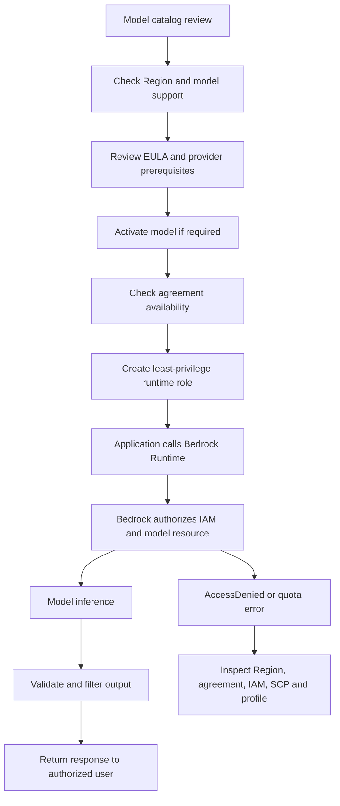

# Amazon Bedrock, foundation model và quyền truy cập mô hình

Amazon Bedrock là dịch vụ AWS được quản lý để xây dựng ứng dụng generative AI bằng foundation model (FM) từ Amazon và các nhà cung cấp bên thứ ba. Thay vì tự triển khai hạ tầng GPU và vận hành endpoint cho từng mô hình, ứng dụng gọi API của Bedrock để gửi prompt hoặc dữ liệu đầu vào và nhận kết quả suy luận (inference). Bedrock cung cấp model catalog, API thống nhất cho nhiều mô hình, lựa chọn inference profile, công cụ bảo vệ và cơ chế kiểm soát quyền truy cập bằng IAM.

Foundation model là mô hình được huấn luyện trước trên lượng dữ liệu lớn và có thể thích ứng với nhiều nhiệm vụ. Tùy model, đầu vào và đầu ra có thể là văn bản, hình ảnh, âm thanh, video, dữ liệu đa phương thức hoặc vector embedding. Mỗi model có nhà cung cấp, model ID, Region hỗ trợ, modality, context window, giới hạn throughput, giá và điều khoản sử dụng riêng.

Để sử dụng một model, ứng dụng cần thỏa mãn đồng thời nhiều điều kiện: model có sẵn trong Region hoặc inference profile được chọn; tài khoản đã đáp ứng yêu cầu kích hoạt của nhà cung cấp; IAM principal có quyền gọi API trên đúng model resource; và các chính sách Organizations, SCP, permission boundary, session policy hoặc VPC endpoint policy không chặn request. Có quyền vào console không đồng nghĩa với quyền gọi inference, và có quyền gọi API không tự động đồng nghĩa tài khoản đã hoàn tất mọi điều kiện model access.

Bài học tập trung vào việc chọn foundation model, xác định model ID, gọi inference và thiết kế quyền truy cập an toàn trong Amazon Bedrock.

Sau bài học, người học có thể:

- Giải thích vai trò của Amazon Bedrock và foundation model trong kiến trúc generative AI.
- Phân biệt model provider, model ID, model ARN, inference profile và provisioned model ARN.
- Chọn model theo modality, chất lượng, latency, context window, Region, throughput, chi phí và điều khoản.
- Phân biệt `Converse`, `ConverseStream`, `InvokeModel` và `InvokeModelWithResponseStream`.
- Giải thích cơ chế model access hiện hành trong commercial AWS Regions, AWS Marketplace subscription và yêu cầu riêng của một số provider.
- Viết IAM policy giới hạn quyền invocation theo model resource.
- Phân tích quyền bổ sung khi dùng cross-Region inference hoặc application inference profile.
- Chẩn đoán `AccessDeniedException`, model availability và lỗi cấu hình Region.

## 1. Amazon Bedrock và foundation model

### 1.1. Bedrock cung cấp điều gì?

Amazon Bedrock cung cấp một lớp dịch vụ được quản lý giữa ứng dụng và các foundation model. Ứng dụng có thể chọn model từ Model catalog, gửi yêu cầu đến runtime API và nhận kết quả mà không phải tự quản lý máy chủ GPU của nhà cung cấp.

Các nhóm năng lực thường gặp:

| Năng lực | Mục đích | Ví dụ sử dụng |
|---|---|---|
| Foundation model inference | Sinh nội dung từ prompt hoặc dữ liệu đầu vào | Chatbot, tóm tắt, phân loại, tạo nội dung |
| Embeddings | Chuyển dữ liệu thành vector | Semantic search, retrieval-augmented generation (RAG) |
| Multimodal inference | Kết hợp nhiều loại dữ liệu đầu vào/đầu ra | Hỏi đáp trên ảnh, phân tích âm thanh/video nếu model hỗ trợ |
| Model evaluation | So sánh chất lượng và hành vi các model | Chọn model cho một bộ test nghiệp vụ |
| Model customization | Điều chỉnh model bằng dữ liệu huấn luyện/validation theo tính năng hỗ trợ | Fine-tuning hoặc tiếp tục pre-training |
| Provisioned Throughput | Cung cấp throughput được dành riêng theo cấu hình mua | Workload có nhu cầu throughput ổn định |
| Guardrails | Áp dụng chính sách lọc nội dung và kiểm soát đầu vào/đầu ra | Giảm nội dung không phù hợp, phát hiện dữ liệu nhạy cảm |
| Inference profiles | Điều phối request qua Region hoặc theo dõi usage/cost | Cross-Region inference, application-level cost attribution |

Không phải model nào cũng hỗ trợ mọi năng lực. Một model sinh văn bản có thể không tạo ảnh; model embedding có thể không hỗ trợ chat; một số model có giới hạn với tool use, streaming, structured output hoặc multimodal input. Luôn xem feature support trên model detail page trước khi thiết kế ứng dụng.

### 1.2. Foundation model là gì?

Foundation model được huấn luyện trước trên tập dữ liệu rộng, có số lượng tham số lớn và có thể được sử dụng cho nhiều nhiệm vụ sau khi huấn luyện. Model có thể được dùng trực tiếp bằng prompt, kết hợp với dữ liệu doanh nghiệp qua RAG, hoặc tùy chỉnh bằng phương pháp được Bedrock hỗ trợ.

Một số nhóm model:

| Nhóm | Đầu vào/đầu ra chính | Ví dụ tác vụ |
|---|---|---|
| Text generation/chat | Văn bản → văn bản | Hội thoại, giải thích, viết nội dung, reasoning |
| Embedding | Văn bản/ảnh → vector | Semantic search, clustering, retrieval |
| Image generation | Prompt văn bản → ảnh | Tạo hình minh họa, thiết kế ý tưởng |
| Multimodal | Kết hợp text, image, audio hoặc video | Hỏi đáp nội dung đa phương thức |
| Speech/audio | Âm thanh hoặc văn bản → âm thanh/văn bản | Transcription, speech generation, audio understanding |
| Reranking | Query và danh sách tài liệu → thứ hạng | Sắp xếp kết quả retrieval |

Model provider có thể là Amazon hoặc nhà cung cấp bên thứ ba. Model catalog thay đổi theo thời gian: model mới được bổ sung, version cũ có thể bị ngừng hỗ trợ, và cùng một model family có thể có nhiều model ID với capability hoặc mức giá khác nhau.

### 1.3. Base model, custom model và provisioned model

| Khái niệm | Ý nghĩa | Cách dùng |
|---|---|---|
| Base foundation model | Model gốc do Amazon hoặc provider cung cấp | Gọi bằng base model ID hoặc inference profile |
| Custom model | Model đã được tùy chỉnh bằng dữ liệu của tổ chức | Thường cần mua Provisioned Throughput trước khi inference |
| Imported model | Model được import vào Bedrock theo quy trình hỗ trợ | Gọi bằng imported model ARN |
| Provisioned model | Model endpoint/throughput đã được provision | Dùng ARN trả về từ quá trình tạo Provisioned Throughput |
| Inference profile | Định danh model routing hoặc theo dõi usage/cost | Dùng làm `modelId` trong request được hỗ trợ |

Không nhầm model customization với việc chỉ thay đổi system prompt. Prompting thay đổi cách ứng dụng yêu cầu model trả lời; customization thay đổi model theo quy trình huấn luyện/tùy chỉnh và có yêu cầu dữ liệu, chi phí, quyền, throughput riêng.

### 1.4. Những gì ứng dụng vẫn phải tự chịu trách nhiệm

Bedrock quản lý endpoint và việc phục vụ model, nhưng ứng dụng vẫn cần:

- Xác thực người dùng và kiểm tra quyền truy cập dữ liệu trước khi đưa dữ liệu vào prompt.
- Thiết kế prompt, context, conversation state và cách xử lý output.
- Kiểm tra nội dung đầu vào/đầu ra, chống prompt injection và bảo vệ secret.
- Giới hạn token, timeout, retry, concurrency và chi phí.
- Đánh giá chất lượng, hallucination, latency và hành vi theo từng model version.
- Lưu log có kiểm soát, bảo vệ PII và xác định retention.
- Đáp ứng EULA, privacy, data residency và các chính sách tổ chức.

Model access chỉ là một lớp trong bảo mật ứng dụng AI. Người dùng cuối không nên được cấp quyền IAM trực tiếp để tự chọn bất kỳ model nào nếu ứng dụng cần enforce model allowlist hoặc policy nghiệp vụ.

## 2. Chọn foundation model phù hợp

### 2.1. Chọn theo bài toán, không chỉ theo tên model

Bắt đầu bằng việc xác định nhiệm vụ, dữ liệu và tiêu chí chấp nhận:

1. Tác vụ là chat, generation, summarization, classification, extraction, embeddings, reranking hay multimodal?
2. Ngôn ngữ nào được dùng? Có yêu cầu tiếng Việt, đa ngôn ngữ hoặc thuật ngữ chuyên ngành không?
3. Context đầu vào dài bao nhiêu? Output cần tối đa bao nhiêu token?
4. Cần tool use, JSON/structured output, streaming hay reasoning không?
5. Mức latency, throughput và concurrency yêu cầu là gì?
6. Dữ liệu có nhạy cảm hoặc bị ràng buộc Region không?
7. Giá mỗi input/output token, cache, batch hoặc provisioned throughput ảnh hưởng thế nào?
8. Điều khoản provider, license và điều kiện sử dụng có phù hợp không?

Không chọn model chỉ vì benchmark công khai cao. Đánh giá trên tập dữ liệu đại diện của ứng dụng, prompt thật và tiêu chí đo cụ thể.

### 2.2. Ma trận đánh giá model

| Tiêu chí | Câu hỏi đánh giá | Cách kiểm tra |
|---|---|---|
| Quality | Kết quả có đúng và hữu ích không? | Golden dataset, human review, task metrics |
| Language | Model có hiểu và trả lời tiếng Việt tốt không? | Bộ test tiếng Việt, thuật ngữ và lỗi dấu |
| Context window | Có đủ chứa system prompt, history và retrieved context không? | Đo token của request thực tế |
| Output limit | Có sinh đủ nội dung cần thiết không? | Test output token limit và truncation |
| Latency | Thời gian first token và total response là bao nhiêu? | Load test theo concurrency |
| Throughput | Có đáp ứng requests/tokens per minute không? | Test peak load và quota |
| Modality | Có hỗ trợ image/audio/video/embedding cần thiết không? | Model detail page và API feature support |
| Tool/structured output | Có hỗ trợ tool use và định dạng đầu ra cần thiết không? | Integration test |
| Region | Có sẵn trong Region hoặc inference profile được phép không? | Model catalog và inference profile detail |
| Cost | Tổng chi phí theo traffic thực tế là bao nhiêu? | Tính input/output token, cache, batch, profile |
| License/EULA | Điều khoản provider có chấp nhận được không? | Review agreement với bộ phận phụ trách |
| Lifecycle | Model version còn được hỗ trợ bao lâu? | Model lifecycle và deprecation notice |

### 2.3. Model ID và model ARN

Model ID là định danh được truyền vào trường `modelId` khi gọi Bedrock Runtime. Tùy loại model và cách gọi, giá trị này có thể là:

- Base model ID, ví dụ dạng `provider.model-family-version`.
- System-defined inference profile ID.
- Application inference profile ARN.
- Provisioned model ARN.
- Custom model ARN hoặc imported model ARN trong các luồng được hỗ trợ.

Model ARN của foundation model thường có dạng:

```text
arn:aws:bedrock:<REGION>::foundation-model/<MODEL_ID>
```

Ví dụ minh họa:

```text
arn:aws:bedrock:ap-southeast-1::foundation-model/<MODEL_ID>
```

Không tự ghép hoặc đoán model ID từ tên hiển thị. Hãy lấy ID từ Model catalog/model detail page hoặc API `ListFoundationModels`. Region, model version và inference profile có thể ảnh hưởng đến định danh cần dùng.

### 2.4. Kiểm tra model và Region trước khi triển khai

Model support khác nhau theo AWS Region và theo feature. Một model có thể có mặt trong Region A nhưng không có trong Region B; model cũng có thể hỗ trợ `InvokeModel` nhưng không hỗ trợ một tính năng phụ cụ thể.

Có thể liệt kê model bằng AWS CLI:

```bash
aws bedrock list-foundation-models \
  --region <REGION> \
  --query "modelSummaries[].{id:modelId,provider:providerName,input:inputModalities,output:outputModalities}" \
  --output table
```

Dùng `GetFoundationModel` hoặc model detail page để xem thông tin chi tiết. Với model có yêu cầu account-level access, kiểm tra thêm trạng thái availability/agreement. Không coi kết quả `ListFoundationModels` là bằng chứng rằng principal hiện tại đã có quyền invoke model.

### 2.5. Đánh giá bằng thử nghiệm có kiểm soát

Tạo bộ prompt và expected outcomes đại diện cho nghiệp vụ. Với mỗi model:

- Gửi cùng input và system instruction.
- Đo task accuracy, factuality, completeness và format validity.
- Đo first-token latency, total latency và throughput.
- Ghi lại token input/output và chi phí ước tính.
- Kiểm tra hành vi khi prompt thiếu dữ liệu, mâu thuẫn hoặc có nội dung độc hại.
- Kiểm tra response khi model bị throttle, timeout hoặc trả lỗi.
- Lặp lại nhiều lần để quan sát độ ổn định.

Nếu thay model hoặc version, chạy lại regression evaluation trước khi phát hành. Một model version mới có thể thay đổi chất lượng, output style, token usage hoặc hành vi tool call.

## 3. Gọi foundation model bằng Bedrock Runtime

### 3.1. Control plane và runtime plane

Amazon Bedrock có các API phục vụ quản lý tài nguyên và các API phục vụ inference:

| Nhóm | Endpoint/client | Ví dụ thao tác |
|---|---|---|
| Control plane | Bedrock control plane | List/get foundation models, get inference profile, kiểm tra model availability |
| Runtime plane | Bedrock Runtime | Converse, InvokeModel, streaming inference |
| Async inference | Bedrock Runtime và tài nguyên liên quan | Gửi job suy luận bất đồng bộ cho model hỗ trợ |
| Model agreement | Bedrock control plane | Kiểm tra offer, tạo hoặc xóa agreement khi cần |

Trong AWS SDK for Java 2.x, control plane dùng `BedrockClient`; inference dùng `BedrockRuntimeClient`. Hai client có endpoint và quyền khác nhau. Không gọi `Converse` bằng control-plane client.

### 3.2. Converse API và InvokeModel API

| API | Cách gửi request | Khi phù hợp |
|---|---|---|
| `Converse` | Message theo cấu trúc chung gồm role và content | Chat và hội thoại đa lượt với model hỗ trợ Converse |
| `ConverseStream` | Tương tự Converse nhưng nhận event stream | Hiển thị token/kết quả dần cho người dùng |
| `InvokeModel` | Body theo schema riêng của model/provider | Cần tham số đặc thù hoặc model chưa hỗ trợ Converse |
| `InvokeModelWithResponseStream` | Body riêng và response stream | Cần streaming với model dùng Invoke schema |

Converse API giúp dùng một cấu trúc request chung cho nhiều model, gồm system instruction, message, tool configuration và inference configuration trong phạm vi model hỗ trợ. Ứng dụng có thể thay model mà ít phải thay đổi cấu trúc hội thoại.

InvokeModel cho phép gửi request body theo schema của provider. Cách này linh hoạt hơn nhưng ứng dụng phải biết định dạng request/response của từng model. Không gửi payload của Anthropic vào model Amazon Nova hoặc ngược lại nếu schema không tương thích.

Không phải mọi model đều hỗ trợ cả bốn API. Kiểm tra feature support trên model detail page trước khi chọn API.

### 3.3. Ví dụ Converse bằng AWS SDK for Java 2.x

Ví dụ sau gọi một model hỗ trợ Converse. Thay `MODEL_ID` bằng model ID hoặc inference profile ID đã xác minh trong Region. Credentials được lấy từ AWS SDK default credentials provider chain, ví dụ IAM role của EC2/ECS/EKS.

```java
import software.amazon.awssdk.regions.Region;
import software.amazon.awssdk.services.bedrockruntime.BedrockRuntimeClient;
import software.amazon.awssdk.services.bedrockruntime.model.ContentBlock;
import software.amazon.awssdk.services.bedrockruntime.model.ConverseRequest;
import software.amazon.awssdk.services.bedrockruntime.model.ConverseResponse;
import software.amazon.awssdk.services.bedrockruntime.model.ConversationRole;
import software.amazon.awssdk.services.bedrockruntime.model.InferenceConfiguration;
import software.amazon.awssdk.services.bedrockruntime.model.Message;

public class BedrockChatExample {
    public static void main(String[] args) {
        String region = System.getenv("AWS_REGION");
        String modelId = System.getenv("BEDROCK_MODEL_ID");

        try (BedrockRuntimeClient client = BedrockRuntimeClient.builder()
                .region(Region.of(region))
                .build()) {

            Message userMessage = Message.builder()
                .role(ConversationRole.USER)
                .content(ContentBlock.fromText("Giải thích foundation model bằng tiếng Việt."))
                .build();

            ConverseRequest request = ConverseRequest.builder()
                .modelId(modelId)
                .messages(userMessage)
                .inferenceConfig(InferenceConfiguration.builder()
                    .maxTokens(300)
                    .temperature(0.2F)
                    .build())
                .build();

            ConverseResponse response = client.converse(request);
            String answer = response.output()
                .message()
                .content()
                .get(0)
                .text();

            System.out.println(answer);
        }
    }
}
```

Đây là ví dụ tối giản cho một user message. Ứng dụng hội thoại nhiều lượt phải gửi lại các message cần thiết theo đúng role và thứ tự. Trong production, không hardcode prompt hoặc model ID nhạy với môi trường; lấy từ cấu hình được quản lý, validate input, giới hạn token, xử lý lỗi và ghi usage có kiểm soát.

### 3.4. Ví dụ gọi Converse bằng AWS CLI

```bash
aws bedrock-runtime converse   --region <REGION>   --model-id <MODEL_ID_OR_PROFILE_ID>   --messages '[{"role":"user","content":[{"text":"Tóm tắt vai trò của Amazon Bedrock."}]}]'   --inference-config '{"maxTokens":256,"temperature":0.2}'
```

Request dùng model ID hoặc inference profile ID. Nếu dùng profile, IAM policy cần quyền invocation trên profile và các model resource liên quan theo yêu cầu của loại profile.

### 3.5. InvokeModel và schema riêng của provider

Với `InvokeModel`, trường `body` chứa JSON theo schema của model. Ví dụ, tên trường để giới hạn output token hoặc cấu trúc message có thể khác nhau giữa provider. Header `contentType` và `accept` thường là `application/json` cho model dùng JSON, nhưng modality và API cụ thể có thể yêu cầu định dạng khác.

Quy trình tích hợp:

1. Chọn model và đọc phần API request/response example trên model detail page.
2. Xác định `modelId`, Region, content type và output format.
3. Xây payload đúng schema, bao gồm giới hạn token và tham số inference.
4. Gọi `InvokeModel` hoặc streaming variant.
5. Parse response theo schema của model; không giả định mọi response đều có trường `content[0].text`.
6. Bảo vệ prompt, output và metadata trong log.

### 3.6. Streaming và giới hạn request

Streaming API gửi response theo nhiều event. Client có thể hiển thị phần nội dung đã nhận trong khi model tiếp tục sinh. Ứng dụng phải xử lý stream event, lỗi giữa luồng, client disconnect và timeout; response chưa kết thúc không được xem là câu trả lời hoàn chỉnh.

Các giới hạn cần quản lý:

- Input token + output token không vượt context window và model-specific limit.
- Request rate và token throughput nằm trong quota của model/Region/profile.
- Timeout đủ dài cho tác vụ nhưng có giới hạn để tránh giữ connection vô hạn.
- Retry chỉ với lỗi có thể retry; dùng exponential backoff và jitter cho throttling.
- Không retry vô hạn một request có side effect ở hệ thống downstream.
- Dùng correlation ID để nối request, log và metric mà không ghi prompt nhạy cảm.

## 4. Model access trong commercial AWS Regions

### 4.1. Hiểu đúng cơ chế access hiện hành

Trong commercial AWS Regions, nhiều foundation model có cơ chế access mặc định/auto-enablement. Với model bên thứ ba có sản phẩm AWS Marketplace, lần đầu invoke có thể khởi tạo subscription tự động ở background. Điều này khác với quy trình cũ yêu cầu người dùng vào trang Model access và gửi yêu cầu cho từng model.

Trong giai đoạn subscription đang hoàn tất, một số request đầu có thể thành công nhưng request sau trả `AccessDeniedException` nếu điều kiện kích hoạt chưa đủ. Quá trình có thể mất đến khoảng 15 phút; sau khi cấp thêm quyền cần thiết, việc hoàn tất có thể mất thêm vài phút. Do đó, hãy kiểm tra và hoàn tất prerequisites trước khi đưa model vào production.

Các điểm cần nhớ:

- Model phải được hỗ trợ ở Region hoặc inference profile đang gọi.
- IAM principal cần quyền `bedrock:InvokeModel` hoặc action streaming phù hợp.
- Với model có Marketplace product ID, lần kích hoạt đầu cần Marketplace permissions.
- AWS account cần payment method hợp lệ cho AWS Marketplace khi áp dụng.
- Một số model/provider có yêu cầu bổ sung như Anthropic First Time Use (FTU).
- Một số model cần account-level access riêng ngay cả khi các bước activation đã hoàn tất.
- Agreement/EULA của provider áp dụng khi sử dụng model.

Trang Model access trong Bedrock console hiện chủ yếu dùng cho quy trình AWS GovCloud (US). Trong commercial Regions, nhiều model được kích hoạt khi sử dụng lần đầu theo cơ chế tự động; không nên hướng dẫn người dùng đi tìm quy trình request access cũ như một bước chung cho mọi model.

### 4.2. AWS Marketplace permissions

Với serverless third-party model có product ID trên AWS Marketplace, role thực hiện lần kích hoạt đầu cần các quyền Marketplace:

| IAM action | Mục đích |
|---|---|
| `aws-marketplace:Subscribe` | Cho phép tự động đăng ký/subscription model |
| `aws-marketplace:Unsubscribe` | Cho phép hủy subscription khi cần |
| `aws-marketplace:ViewSubscriptions` | Cho phép xem subscription |

Các quyền này chỉ cần cho bước kích hoạt đầu tiên của model trong account. Sau khi model đã được enable, người dùng gọi inference không cần Marketplace subscription permissions nếu các quyền đó đã được cấp cho account trước đó.

Có thể giới hạn `aws-marketplace:Subscribe` bằng condition key `aws-marketplace:ProductId` để chỉ cho phép subscription tới các sản phẩm đã phê duyệt. Không phải mọi provider hoặc model đều có product ID. Model không có product ID phải được kiểm soát bằng IAM policy của Amazon Bedrock, ví dụ deny `bedrock:InvokeModel` trên model ARN.

Một điểm dễ nhầm: chỉ deny `aws-marketplace:Subscribe` không đủ để chặn lần invoke đầu, vì Bedrock tự khởi tạo subscription ở background. Muốn chặn việc sử dụng model, cần deny các Bedrock invocation action trên đúng resource hoặc áp dụng SCP phù hợp.

### 4.3. Anthropic First Time Use (FTU)

Một số Anthropic model yêu cầu khách hàng lần đầu gửi thông tin use case trước khi invoke. Theo tài liệu hiện hành, yêu cầu FTU áp dụng cho các model trước Claude Opus 4.7; model từ Opus 4.7 trở đi không cần biểu mẫu này. Quy định cũng khác với model được truy cập qua `bedrock-mantle` endpoint.

Thông tin gửi lên thường bao gồm mô tả tổ chức, website hoặc URL mô tả use case, loại người dùng và mục đích sử dụng. Tổ chức có thể hoàn tất ở management account; thông tin có thể được kế thừa trong AWS Organization theo quy định của AWS.

Sau khi gửi form, trạng thái agreement có thể ở `PENDING`. Trong thời gian này, request có thể vẫn trả `AccessDeniedException`. Dùng `GetFoundationModelAvailability` để kiểm tra `agreementAvailability.status`; trạng thái `AVAILABLE` mới cho biết agreement đã sẵn sàng.

Không tự động áp dụng yêu cầu FTU cho mọi model của Anthropic hoặc mọi endpoint. Luôn kiểm tra điều kiện theo model/version và endpoint cụ thể.

### 4.4. Model có yêu cầu account-level access riêng

Một số model có thể yêu cầu quyền account-level bổ sung. Hoàn tất Marketplace subscription hoặc provider prerequisites không đồng nghĩa tài khoản chắc chắn được cấp quyền sử dụng model. Quyền này được xét riêng theo AWS account; hai account trong cùng Organization có thể có trạng thái khác nhau.

Nếu nhận `AccessDeniedException`, hãy kiểm tra theo thứ tự:

1. Model ID có đúng và model còn được hỗ trợ không?
2. Model có sẵn trong Region hoặc inference profile không?
3. Agreement/Marketplace subscription đã `AVAILABLE` chưa?
4. FTU/provider prerequisite có áp dụng và đã hoàn tất chưa?
5. IAM policy có cho phép invocation trên đúng resource ARN không?
6. SCP, permission boundary, session policy hoặc endpoint policy có deny không?
7. Nếu các điều kiện trên đều đạt, model có thể cần account-level access bổ sung; làm theo hướng dẫn AWS cho model đó.

### 4.5. Kiểm tra model availability bằng CLI

Có thể kiểm tra trạng thái agreement và quyền truy cập của model:

```bash
aws bedrock get-foundation-model-availability   --region <REGION>   --model-id <MODEL_ID>
```

Đọc các trường availability trong kết quả, đặc biệt là `agreementAvailability.status`, `authorizationStatus`, `entitlementAvailability` và `regionAvailability` nếu được trả về. `PENDING` có nghĩa là agreement đang được thiết lập; `NOT_AVAILABLE` hoặc `ERROR` cần được xử lý theo thông tin lỗi. API này giúp phân biệt model activation với lỗi IAM invocation.

## 5. IAM permissions cho model invocation

### 5.1. Quyền API và quyền trên resource

IAM authorization cho Bedrock gồm hai phần chính:

1. Action: principal được gọi API nào.
2. Resource: model hoặc inference resource nào được gọi.

Các action invocation quan trọng:

| IAM action | API được kiểm soát | Khi cần |
|---|---|---|
| `bedrock:InvokeModel` | `InvokeModel` và `Converse` | Inference không streaming |
| `bedrock:InvokeModelWithResponseStream` | `InvokeModelWithResponseStream` và `ConverseStream` | Inference streaming |
| `bedrock:GetInferenceProfile` | Đọc thông tin inference profile cần thiết cho invocation | Khi dùng inference profile |
| `bedrock:ListInferenceProfiles` | Liệt kê profile để chọn trong console | Khi cần duyệt profile trong console |
| `bedrock:GetGuardrail` | Lấy guardrail để áp dụng khi inference | Khi request sử dụng Guardrails |
| `bedrock:ApplyGuardrail` | Áp dụng guardrail | Khi request sử dụng Guardrails |

`Converse` không có IAM action độc lập tên `bedrock:Converse`; quyền được kiểm soát bằng `bedrock:InvokeModel`. Tương tự, `ConverseStream` cần `bedrock:InvokeModelWithResponseStream`.

### 5.2. Resource ARN cho foundation model

Foundation model ARN thường có dạng:

```text
arn:aws:bedrock:<REGION>::foundation-model/<MODEL_ID>
```

Một policy tối giản cho một model đã được phê duyệt có thể như sau:

```json
{
  "Version": "2012-10-17",
  "Statement": [
    {
      "Sid": "InvokeApprovedFoundationModel",
      "Effect": "Allow",
      "Action": [
        "bedrock:InvokeModel",
        "bedrock:InvokeModelWithResponseStream"
      ],
      "Resource": "arn:aws:bedrock:ap-southeast-1::foundation-model/<MODEL_ID>"
    }
  ]
}
```

Thay `ap-southeast-1` và `<MODEL_ID>` bằng Region/model thực tế đã được phê duyệt. Policy trên chỉ cấp quyền invocation cho model resource đó; nó không tự cấp quyền tạo model, sửa guardrail, quản lý agreement hoặc truy cập dữ liệu doanh nghiệp.

Nếu ứng dụng chỉ dùng request không streaming, có thể bỏ `bedrock:InvokeModelWithResponseStream`. Nếu ứng dụng dùng streaming, giữ action đó. Cấp đúng action giúp thu hẹp quyền.

### 5.3. Quyền xem model catalog và console

Quyền liệt kê model hoặc chọn tài nguyên trong console khác với quyền gọi inference. Ví dụ:

- `bedrock:ListFoundationModels` để liệt kê foundation model.
- `bedrock:GetFoundationModel` để đọc metadata của model.
- `bedrock:ListInferenceProfiles` để duyệt inference profile.
- `bedrock:GetInferenceProfile` để đọc chi tiết profile.

Một số API list không hỗ trợ resource-level restriction và cần `Resource: "*"`. Tách quyền discovery/console khỏi quyền invocation giúp policy rõ ràng hơn. Role runtime của ứng dụng thường không cần quyền quản trị model catalog nếu model ID đã được cấu hình sẵn.

### 5.4. Least privilege theo môi trường

Một cách tổ chức quyền:

| Principal | Quyền phù hợp |
|---|---|
| Developer sandbox | Invocation tới tập model thử nghiệm, giới hạn Region và quota |
| Application runtime role | Invoke đúng model/profile của ứng dụng; không có quyền subscription nếu account đã kích hoạt |
| Model platform administrator | Quản lý catalog, agreement, inference profile, throughput và policy |
| Security reviewer | Đọc policy, agreement metadata, CloudTrail và cấu hình; không nhất thiết được invoke |
| CI/CD deployment role | Tạo/cập nhật tài nguyên Bedrock cần cho deployment; không mặc định có quyền gọi mọi model |

Không gắn `AmazonBedrockFullAccess` cho runtime role chỉ để giải quyết một lỗi invocation. Managed policy rộng có thể cấp quyền quản lý model và tài nguyên ngoài nhu cầu của ứng dụng. Hãy dùng policy riêng theo model ARN và action thực sự cần.

### 5.5. Marketplace subscription và IAM invocation là hai lớp khác nhau

Marketplace permission phục vụ việc kích hoạt subscription ban đầu cho model có product ID. Bedrock invocation permission phục vụ việc gửi request tới model. Chúng không thay thế nhau.

Ví dụ:

- Role có `aws-marketplace:Subscribe` nhưng thiếu `bedrock:InvokeModel`: có thể kích hoạt subscription nhưng không invoke được model.
- Role có `bedrock:InvokeModel` nhưng model chưa được enable và không có quyền/điều kiện kích hoạt cần thiết: request đầu có thể thất bại.
- Model đã được enable ở account: runtime role có thể invoke mà không cần Marketplace subscription permission, miễn là IAM Bedrock policy cho phép.

Đây là lý do nên tách role/bootstrap process có quyền Marketplace khỏi role runtime thường trực. Quyền subscription không nên được giữ rộng trong mọi ứng dụng sau khi model đã được kích hoạt.

## 6. Inference profile và quyền cross-Region

### 6.1. Inference profile là gì?

Inference profile là định danh cho cách Bedrock định tuyến request hoặc theo dõi việc sử dụng model. Hai loại phổ biến:

| Loại | Mục đích |
|---|---|
| System-defined cross-Region inference profile | AWS định nghĩa các Region nguồn/đích mà request có thể được route tới |
| Application inference profile | Tổ chức tạo profile để theo dõi usage/cost theo ứng dụng hoặc workload; có thể dựa trên model/profile được hỗ trợ |

Trong request inference, truyền inference profile ARN vào trường `modelId` thay cho base model ID khi API và model hỗ trợ. Với system-defined cross-Region profile, có thể dùng ID hoặc ARN; với application inference profile, dùng ARN. Trước khi dùng, gọi `GetInferenceProfile` hoặc xem model detail page để xác định profile, trạng thái và danh sách model ARN đích.

### 6.2. Cross-Region inference hoạt động thế nào?

Cross-Region inference nhận request tại source Region và route đến một destination Region thuộc profile. Việc route có thể giúp tăng khả năng đáp ứng throughput và tận dụng capacity ở nhiều Region.

Phân biệt:

- Source Region: Region mà ứng dụng gọi API/profile.
- Destination Region: Region Bedrock có thể dùng để xử lý inference.
- Geographic profile: route trong một phạm vi địa lý nhất định như US hoặc EU, theo danh sách Region được AWS xác định.
- Global profile: route trên phạm vi thương mại toàn cầu đối với model/profile hỗ trợ.

Danh sách destination Region phụ thuộc model, profile và source Region. Global profile có thể thay đổi khi AWS bổ sung Region; profile theo địa lý có danh sách đích cố định cho profile đó. Không hardcode danh sách Region dựa trên một ví dụ cũ.

### 6.3. IAM permissions cho cross-Region inference

Khi gọi cross-Region inference, policy thường phải cho phép:

1. Inference profile resource ở source Region.
2. Foundation model resource ở source Region.
3. Foundation model resource tại các destination Region mà profile có thể chọn.

Với Global cross-Region inference, AWS yêu cầu policy ba phần. ARN model toàn cầu có dạng đặc biệt không có Region và account:

```text
arn:aws:bedrock:::foundation-model/<MODEL_ID>
```

Ví dụ rút gọn minh họa các resource cần xét:

```json
{
  "Version": "2012-10-17",
  "Statement": [
    {
      "Sid": "InvokeGlobalProfile",
      "Effect": "Allow",
      "Action": [
        "bedrock:InvokeModel",
        "bedrock:InvokeModelWithResponseStream"
      ],
      "Resource": "arn:aws:bedrock:<SOURCE_REGION>:<ACCOUNT_ID>:inference-profile/global.<MODEL_NAME>"
    },
    {
      "Sid": "InvokeSourceRegionModel",
      "Effect": "Allow",
      "Action": [
        "bedrock:InvokeModel",
        "bedrock:InvokeModelWithResponseStream"
      ],
      "Resource": "arn:aws:bedrock:<SOURCE_REGION>::foundation-model/<MODEL_ID>"
    },
    {
      "Sid": "InvokeGlobalModel",
      "Effect": "Allow",
      "Action": [
        "bedrock:InvokeModel",
        "bedrock:InvokeModelWithResponseStream"
      ],
      "Resource": "arn:aws:bedrock:::foundation-model/<MODEL_ID>"
    }
  ]
}
```

Đây là khung để hiểu ba loại resource, không phải policy hoàn chỉnh cho mọi profile. Với profile địa lý, cần cho phép foundation model ARN tại từng destination Region trong profile. Với application inference profile, cần cho phép ARN của application profile và underlying model resource theo hướng dẫn IAM của profile đó.

### 6.4. SCP và Region restrictions

IAM policy và Service Control Policy (SCP) cùng quyết định cross-Region inference có được phép hay không. Nếu SCP chặn một destination Region bất kỳ trong profile, request có thể thất bại ngay cả khi các Region đích còn lại được cho phép.

Khi dùng cross-Region inference:

- Xác minh toàn bộ destination Region từ `GetInferenceProfile`.
- Đảm bảo SCP cho phép Bedrock inference action tại tất cả destination Region cần thiết.
- Đảm bảo IAM role cho phép profile resource và foundation model resource tương ứng.
- Xem xét các Region opt-in mà profile có thể sử dụng.
- Kiểm tra data residency, privacy và yêu cầu compliance trước khi bật.

Cross-Region inference có thể route tới opt-in Region ngay cả khi account chưa chủ động opt-in Region đó. Prompt và output có thể được lưu tại opt-in Region để phục vụ abuse detection. Nếu yêu cầu dữ liệu phải ở một địa lý nhất định, hãy dùng in-Region hoặc geographic inference profile phù hợp và xác minh danh sách đích hiện hành.

### 6.5. Application inference profile và cost attribution

Application inference profile giúp gắn inference usage với ứng dụng hoặc workload để theo dõi chi phí. Có thể tạo profile riêng cho dev, staging, production hoặc từng business unit; sau đó dùng profile làm model target trong request được hỗ trợ.

Cách tổ chức này hỗ trợ:

- Tách usage/cost theo application.
- Theo dõi model usage qua tag hoặc profile metadata.
- So sánh mức tiêu thụ giữa môi trường.
- Xây dashboard và budget theo workload.

Profile không tự thay thế IAM. Runtime role vẫn phải được cấp quyền invocation trên profile và underlying model theo yêu cầu. Không cấp quyền trên một profile rồi giả định mọi model trong account đều có thể được gọi.

## 7. Quản trị EULA và kiểm soát model trong tổ chức

### 7.1. EULA và model agreement

Một số foundation model bên thứ ba đi kèm End User License Agreement (EULA) hoặc điều khoản provider riêng. Việc invoke model lần đầu có thể được xem là chấp nhận điều khoản áp dụng. Tổ chức cần xác định ai có thẩm quyền review và chấp nhận EULA trước khi bật model cho workload production.

Quy trình governance tham khảo:

1. Lập danh sách model/provider được đề xuất.
2. Review license, EULA, pricing, data handling và mục đích sử dụng được phép.
3. Đánh giá Region, data residency và yêu cầu compliance.
4. Chỉ định account hoặc platform team được phép kích hoạt model.
5. Dùng SCP/IAM để chặn model chưa được duyệt.
6. Sau khi review hoàn tất, cấp quyền invocation cho runtime role theo model allowlist.
7. Theo dõi model version, agreement, chi phí và thay đổi điều khoản.

AWS khuyến nghị tổ chức cần review EULA trước khi cho phép sử dụng có thể block model access ban đầu bằng SCP hoặc IAM policy, review điều khoản, rồi mới mở quyền. Chỉ deny Marketplace subscribe không đủ để ngăn auto-enablement khi người dùng invoke lần đầu.

### 7.2. Chặn model chưa được phê duyệt

Ví dụ policy deny model cụ thể:

```json
{
  "Version": "2012-10-17",
  "Statement": [
    {
      "Sid": "BlockUnapprovedFoundationModel",
      "Effect": "Deny",
      "Action": [
        "bedrock:InvokeModel",
        "bedrock:InvokeModelWithResponseStream"
      ],
      "Resource": "arn:aws:bedrock:*::foundation-model/<UNAPPROVED_MODEL_ID>"
    }
  ]
}
```

Có thể áp dụng ở IAM identity policy hoặc SCP theo phạm vi tổ chức. Với cross-Region inference, cần xét cả inference profile resource và foundation model resource tại các Region liên quan. Nếu chỉ deny một ARN mà profile còn có thể đánh giá resource khác, policy có thể chưa chặn đầy đủ.

Nếu dùng Marketplace product ID, có thể thêm deny subscription theo product:

```json
{
  "Version": "2012-10-17",
  "Statement": [
    {
      "Sid": "BlockMarketplaceSubscriptionForUnapprovedProduct",
      "Effect": "Deny",
      "Action": "aws-marketplace:Subscribe",
      "Resource": "*",
      "Condition": {
        "ForAnyValue:StringEquals": {
          "aws-marketplace:ProductId": "<PRODUCT_ID>"
        }
      }
    }
  ]
}
```

Policy Marketplace ở trên chỉ ngăn subscription action. Để chặn invocation, vẫn cần deny Bedrock invocation action trên model resource. Đối với model không có product ID, dùng model ARN và Bedrock action để kiểm soát.

### 7.3. Tách bootstrap role và runtime role

Một mô hình phân quyền an toàn:

- **Model activation role:** chỉ một nhóm platform/admin được phép có Marketplace subscription permission và thực hiện quy trình activation/agreement.
- **Application runtime role:** chỉ được invoke model/profile đã phê duyệt, không có quyền subscribe/unsubscribe.
- **Security governance role:** đọc trạng thái agreement, CloudTrail và policy để audit; không nhất thiết có quyền invoke.
- **Deployment role:** tạo application inference profile hoặc cấu hình liên quan theo scope; không mặc định được phép dùng mọi model.

Cách tách này giúp hạn chế việc một ứng dụng tự kích hoạt model mới chỉ bằng cách thử gọi model ID bất kỳ.

### 7.4. Kiểm soát theo Region và inference profile

Ngoài model allowlist, có thể giới hạn request theo `aws:RequestedRegion` và điều kiện `bedrock:InferenceProfileArn` khi phù hợp. Với cross-Region inference, phải hiểu cách Bedrock đánh giá Region và resource: Global inference có thể có một bước đánh giá resource toàn cầu với `aws:RequestedRegion` là `unspecified`.

Không áp dụng một deny policy Region đơn giản mà chưa thử với profile thực tế. Nếu SCP chặn bất kỳ destination Region nào của profile, request có thể thất bại. Xác minh profile bằng API và kiểm thử bằng role production-like trước khi rollout.

### 7.5. Model access không thay thế guardrails và data authorization

IAM quyết định principal có được gọi model hay không. Nó không quyết định người dùng cuối có được đọc tài liệu nào, prompt có chứa dữ liệu nào hoặc output có được phép hiển thị hay không.

Một ứng dụng an toàn cần kết hợp:

- Authentication và authorization ở tầng ứng dụng.
- Kiểm tra ACL/tenant trước khi truy xuất dữ liệu đưa vào prompt.
- Guardrails hoặc bộ lọc phù hợp cho nội dung đầu vào/đầu ra.
- Mã hóa, secret management và log redaction.
- Giới hạn token, request rate và chi phí theo user/tenant.
- Kiểm thử prompt injection, data exfiltration và nội dung không an toàn.

Không dùng guardrail như một thay thế cho IAM hoặc ACL. Guardrail giúp áp dụng chính sách nội dung trong phạm vi hỗ trợ; nó không cấp quyền truy cập dữ liệu hoặc thay thế authorization của ứng dụng.

## 8. Troubleshooting model access và IAM

### 8.1. Phân biệt lỗi model access và lỗi invocation

`AccessDeniedException` có thể xuất hiện khi model chưa được kích hoạt, provider prerequisite chưa hoàn tất, account-level access chưa có hoặc IAM policy không cho phép request. Không nên sửa bằng cách gắn full access ngay lập tức.

| Triệu chứng | Nguyên nhân có thể | Cách xác minh |
|---|---|---|
| `AccessDeniedException` ngay lần đầu | Thiếu Marketplace permission, payment method hoặc FTU | Kiểm tra model access prerequisites |
| Request đầu thành công, request sau bị deny | Auto-subscription chưa hoàn tất hoặc thất bại | Chờ trạng thái agreement và kiểm tra `GetFoundationModelAvailability` |
| Agreement `PENDING` | Provider setup hoặc FTU chưa hoàn tất | Kiểm tra `agreementAvailability.status` |
| Model không được hỗ trợ trong Region | Model ID đúng nhưng Region sai | Kiểm tra model detail page và regional support |
| IAM deny dù model đã available | Resource ARN sai, thiếu action hoặc explicit deny | Kiểm tra IAM policy simulator, SCP, boundary, session policy |
| Profile invoke bị deny | Thiếu quyền trên profile hoặc underlying model ARN | Kiểm tra `GetInferenceProfile` và policy cho từng resource |
| Cross-Region request thất bại | SCP chặn destination Region hoặc thiếu model ARN đích | Kiểm tra toàn bộ Region trong profile |
| Streaming bị deny nhưng Converse thường chạy | Thiếu `bedrock:InvokeModelWithResponseStream` | Bổ sung đúng action cho streaming |
| Console thấy model nhưng runtime role không gọi được | Quyền console và quyền runtime khác nhau | Kiểm tra role thực tế mà ứng dụng assume |

### 8.2. Quy trình xử lý AccessDeniedException

1. Ghi lại account, Region, model ID/profile ID, API action và principal ARN.
2. Kiểm tra model có được hỗ trợ trong Region không.
3. Gọi `GetFoundationModelAvailability` nếu cần xác minh agreement/provider access.
4. Kiểm tra Marketplace permission và provider FTU prerequisite nếu model cần.
5. Kiểm tra `bedrock:InvokeModel` hoặc `bedrock:InvokeModelWithResponseStream`.
6. So khớp Resource ARN với base model, inference profile hoặc provisioned model đang dùng.
7. Kiểm tra explicit Deny trong identity policy, SCP, permission boundary, session policy và VPC endpoint policy.
8. Với cross-Region profile, kiểm tra destination Region và underlying foundation model ARN.
9. Nếu model vẫn bị deny dù activation, Region và IAM đã đúng, xác minh khả năng account-level access bổ sung.

### 8.3. Kiểm tra identity và policy thực tế

Dùng STS để xác nhận principal mà ứng dụng đang sử dụng:

```bash
aws sts get-caller-identity
```

Không kiểm tra policy của user đăng nhập console rồi suy ra ứng dụng có cùng quyền. Ứng dụng có thể assume role khác, dùng task role, instance profile hoặc web identity role.

Khi kiểm tra policy:

- Xác minh action chính xác cho API đang gọi.
- Xác minh ARN model/profile đúng Region, account và resource type.
- Tìm explicit Deny trong mọi lớp policy.
- Kiểm tra condition key như `aws:RequestedRegion`, `aws:SourceIp`, `bedrock:InferenceProfileArn`.
- Với Marketplace activation, kiểm tra principal tạo first invocation có thỏa điều kiện policy hay không.

### 8.4. Dùng CloudTrail để điều tra

CloudTrail ghi nhận Bedrock API activity theo cấu hình audit của account. Dùng event history hoặc trail để xác định principal, API action, Region, thời điểm và lỗi. Với policy dùng `aws:SourceIp`, xem `sourceIPAddress` trong CloudTrail vì giá trị này có thể khác địa chỉ host tự báo cáo.

Không đưa raw prompt, dữ liệu cá nhân hoặc secret vào log chỉ để tiện debug. Ghi correlation ID và metadata tối thiểu; nếu cần lưu request/response để điều tra, phải áp dụng retention, encryption và quyền truy cập riêng.

## 9. Quy trình triển khai model access cho một ứng dụng

### 9.1. Tình huống: trợ lý nội bộ

Một doanh nghiệp muốn xây trợ lý nội bộ để trả lời câu hỏi về quy trình vận hành. Ứng dụng chạy trên ECS, gọi Amazon Bedrock bằng task role và chỉ được phép dùng một model đã phê duyệt. Dữ liệu tài liệu được lấy từ knowledge base hoặc hệ thống tìm kiếm có ACL.

Các bước triển khai:

1. Chọn model có chất lượng tiếng Việt phù hợp, hỗ trợ Converse và có mặt trong Region đã được phê duyệt.
2. Platform team review model agreement, EULA, pricing và provider prerequisites.
3. Nếu model có Marketplace product ID, dùng activation role để hoàn tất auto-subscription hoặc agreement.
4. Nếu provider yêu cầu FTU, hoàn tất form và kiểm tra trạng thái availability.
5. Tạo runtime role chỉ cho phép `bedrock:InvokeModel` trên đúng foundation model ARN.
6. Nếu dùng streaming, bổ sung `bedrock:InvokeModelWithResponseStream`.
7. Nếu dùng inference profile, thêm quyền trên profile và underlying model resource theo profile type.
8. Triển khai ứng dụng với model ID trong cấu hình và gọi bằng `BedrockRuntimeClient`.
9. Kiểm tra ACL của người dùng trước khi truy xuất tài liệu đưa vào prompt.
10. Bật metric, alarm, log redaction và budget theo application.

### 9.2. Luồng access và inference



### 9.3. Tách quyền activation khỏi runtime

Ví dụ quyền activation cho model có product ID (cần giới hạn ProductId theo catalog đã được phê duyệt):

```json
{
  "Version": "2012-10-17",
  "Statement": [
    {
      "Sid": "EnableApprovedMarketplaceModel",
      "Effect": "Allow",
      "Action": [
        "aws-marketplace:Subscribe",
        "aws-marketplace:Unsubscribe",
        "aws-marketplace:ViewSubscriptions"
      ],
      "Resource": "*"
    }
  ]
}
```

Policy trên minh họa nhóm quyền Marketplace. Trong production, giới hạn `aws-marketplace:Subscribe` bằng condition `aws-marketplace:ProductId` khi model có product ID; các action còn lại cần cấu hình theo hướng dẫn AWS Marketplace. Không gắn policy này cho task role chỉ để gọi inference.

Runtime role chỉ nên có action invocation cần thiết và model resource cụ thể như ví dụ ở phần IAM. Nếu tổ chức có nhiều ứng dụng, dùng role hoặc policy riêng cho từng application để tách quyền, cost attribution và audit.

### 9.4. Explicit model agreement bằng SDK/CLI

Ngoài auto-enablement, tài liệu AWS cung cấp API để quản lý model agreement của third-party model bằng SDK/CLI. Luồng tổng quát:

1. `ListFoundationModelAgreementOffers` để liệt kê offer và lấy offer token.
2. Với model Anthropic cần FTU, gọi `PutUseCaseForModelAccess` trước.
3. `CreateFoundationModelAgreement` để tạo agreement với model/offer.
4. `GetFoundationModelAvailability` để kiểm tra trạng thái.
5. Chỉ cho phép runtime role invoke khi model availability và policy đã sẵn sàng.

CLI minh họa bước kiểm tra availability:

```bash
aws bedrock get-foundation-model-availability   --region <REGION>   --model-id <MODEL_ID>
```

Các thao tác quản lý agreement áp dụng cho third-party model và có điều kiện theo model. Đối với commercial Regions, phần lớn model sử dụng cơ chế auto-enablement khi invoke lần đầu; không cần chạy quy trình agreement thủ công cho mọi model.

### 9.5. Production checklist trước lần invoke đầu

- Model ID đã được lấy từ model detail page/API.
- Region hỗ trợ model và feature được ứng dụng sử dụng.
- EULA/terms đã được review và chấp nhận bởi người có thẩm quyền.
- Marketplace permissions và payment method sẵn sàng nếu model cần.
- FTU hoặc provider prerequisite đã hoàn tất nếu áp dụng.
- Agreement availability đạt trạng thái phù hợp.
- Runtime role chỉ có invocation action và model resource cần thiết.
- SCP, permission boundary, session policy và endpoint policy không chặn request.
- Nếu dùng inference profile, đã kiểm tra toàn bộ destination Region và ARN.
- Có test cho timeout, throttling, AccessDenied và quota exhaustion.

## 10. Bài thực hành: cấp quyền tối thiểu cho một Bedrock model

### Bối cảnh

Một ứng dụng Java chạy trên ECS cần gọi một foundation model ở Region `ap-southeast-1`. Ứng dụng chỉ cần chat không streaming. Tổ chức muốn giới hạn runtime role vào đúng một model đã được duyệt và yêu cầu platform team quản lý model activation.

### Nhiệm vụ

1. Mở Bedrock Model catalog và chọn một model phù hợp với tác vụ tiếng Việt.
2. Kiểm tra model ID, input/output modality, Converse support và Region availability.
3. Xác định model có Marketplace product ID hoặc provider prerequisite nào không.
4. Review EULA và hoàn tất activation bằng role phù hợp nếu cần.
5. Dùng `GetFoundationModelAvailability` để kiểm tra trạng thái.
6. Viết IAM policy runtime chỉ cho phép `bedrock:InvokeModel` trên model ARN đã chọn.
7. Không cấp `aws-marketplace:Subscribe` cho runtime role.
8. Cấu hình Java SDK `BedrockRuntimeClient` bằng task role và gọi `Converse`.
9. Thử gọi một model ID khác để xác nhận bị deny.
10. Thử gọi cùng model ở Region không hỗ trợ để quan sát lỗi.
11. Nếu sử dụng cross-Region inference, bổ sung profile ARN và model ARN theo từng destination Region rồi thử SCP.
12. Ghi lại principal ARN, model ID, Region, API action, agreement status và kết quả test.

### Tiêu chí hoàn thành

- Ứng dụng gọi được model đã duyệt.
- Runtime role không có quyền subscribe model.
- Runtime role không thể invoke model ngoài allowlist.
- Policy có đúng action cho API không streaming.
- Region và model ID được xác minh từ nguồn chính thức.
- Lỗi `AccessDeniedException` được phân loại thành model access, IAM, Region hoặc SCP.
- Không ghi prompt/response nhạy cảm vào log.
- Có tài liệu ghi lại owner và quy trình thay model/version.

## 11. Câu hỏi tự kiểm tra

1. Foundation model khác model được tùy chỉnh như thế nào?
2. Vì sao model ID không thể suy ra chỉ từ tên hiển thị?
3. Model ID, model ARN và inference profile khác nhau ra sao?
4. Khi nào nên dùng Converse thay vì InvokeModel?
5. IAM action nào cho phép gọi Converse API?
6. Vì sao quyền vào Bedrock console không đồng nghĩa có quyền invoke model?
7. AWS Marketplace permissions dùng cho bước nào?
8. Vì sao deny `aws-marketplace:Subscribe` không đủ để chặn model invocation đầu tiên?
9. Anthropic FTU áp dụng cho model nào theo hướng dẫn hiện hành?
10. `GetFoundationModelAvailability` giúp xác minh điều gì?
11. Khi dùng cross-Region inference, vì sao cần xem SCP ở mọi destination Region?
12. Vì sao runtime role nên tách khỏi model activation role?
13. Guardrails có thay thế IAM hoặc ACL dữ liệu không?
14. Những nguyên nhân nào có thể gây `AccessDeniedException`?

### Gợi ý trả lời

1. Base model được provider huấn luyện trước; custom model đã được điều chỉnh bằng dữ liệu huấn luyện/validation theo tính năng hỗ trợ.
2. Model ID phụ thuộc provider, version và loại tài nguyên; phải lấy từ catalog/API.
3. Model ID là giá trị truyền trong request; model ARN là resource identifier cho IAM; inference profile định tuyến request hoặc theo dõi usage/cost.
4. Converse dùng cấu trúc message thống nhất cho model hỗ trợ; InvokeModel dùng schema riêng của provider.
5. `bedrock:InvokeModel` cho phép InvokeModel và Converse; streaming dùng `bedrock:InvokeModelWithResponseStream`.
6. Console và runtime có thể dùng principal/policy khác nhau; quyền catalog không tự cấp quyền invocation.
7. Kích hoạt/subscription ban đầu cho một số third-party serverless model có product ID.
8. Bedrock có thể auto-initiate subscription trong background; phải deny Bedrock invocation action trên model resource để chặn sử dụng.
9. FTU áp dụng cho Anthropic models trước Claude Opus 4.7, trừ model truy cập qua bedrock-mantle endpoint theo hướng dẫn hiện hành.
10. Agreement status, authorization, entitlement và Region availability của model.
11. Nếu profile có một destination Region bị SCP chặn, request có thể thất bại dù các Region còn lại được cho phép.
12. Để chỉ một nhóm có quyền chấp nhận EULA/subscribe; runtime role chỉ có quyền invoke model đã duyệt.
13. Không. Guardrail kiểm soát nội dung trong phạm vi hỗ trợ; IAM và ACL vẫn chịu trách nhiệm authorization.
14. Thiếu IAM action/resource, model chưa được enable, Marketplace/FTU chưa hoàn tất, Region không hỗ trợ, account-level access chưa có, hoặc SCP/boundary/session/endpoint policy deny.

## 12. Checklist production readiness

- [ ] Model/provider được chọn dựa trên benchmark và workload thực tế.
- [ ] Model ID, model ARN và Region được xác minh.
- [ ] Model feature support phù hợp với API và modality cần dùng.
- [ ] EULA và provider terms được review.
- [ ] Marketplace activation/FTU/account-level prerequisite hoàn tất nếu áp dụng.
- [ ] Agreement availability đã được kiểm tra.
- [ ] Runtime role chỉ có `bedrock:InvokeModel` và/hoặc streaming action cần thiết.
- [ ] Resource ARN giới hạn đúng foundation model hoặc inference profile.
- [ ] Runtime role không có Marketplace subscription permission nếu không cần.
- [ ] Cross-Region profile có đủ IAM và SCP permissions cho mọi destination Region.
- [ ] Data residency và abuse-detection storage implications đã được đánh giá.
- [ ] Guardrails, application authorization và log redaction được triển khai.
- [ ] Timeout, retry, throttling, token limits và quota được kiểm thử.
- [ ] CloudTrail, metrics, cost attribution và alert được cấu hình.
- [ ] Có quy trình đổi model/version và thu hồi quyền.

## 13. Tài liệu tham khảo

- [Amazon Bedrock - Using models with Bedrock](https://docs.aws.amazon.com/bedrock/latest/userguide/foundation-models-reference.html)
- [Supported foundation models in Amazon Bedrock](https://docs.aws.amazon.com/bedrock/latest/userguide/models-supported.html)
- [Request access to models](https://docs.aws.amazon.com/bedrock/latest/userguide/model-access.html)
- [Prerequisites for running model inference](https://docs.aws.amazon.com/bedrock/latest/userguide/inference-prereq.html)
- [Making inference requests](https://docs.aws.amazon.com/bedrock/latest/userguide/inference.html)
- [Use an inference profile in model invocation](https://docs.aws.amazon.com/bedrock/latest/userguide/inference-profiles-use.html)
- [Supported Regions and models for inference profiles](https://docs.aws.amazon.com/bedrock/latest/userguide/inference-profiles-support.html)
- [Global cross-Region inference](https://docs.aws.amazon.com/bedrock/latest/userguide/global-cross-region-inference.html)
- [Actions, resources, and condition keys for Amazon Bedrock](https://docs.aws.amazon.com/service-authorization/latest/reference/list_bedrock.html)
- [Monitor Amazon Bedrock API calls using CloudTrail](https://docs.aws.amazon.com/bedrock/latest/userguide/logging-using-cloudtrail.html)
- [AWS SDK for Java 2.x code examples for Amazon Bedrock](https://docs.aws.amazon.com/sdk-for-java/latest/developer-guide/java_bedrock-runtime_code_examples.html)
- [Amazon Bedrock pricing](https://aws.amazon.com/bedrock/pricing/)
