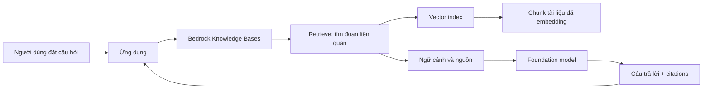
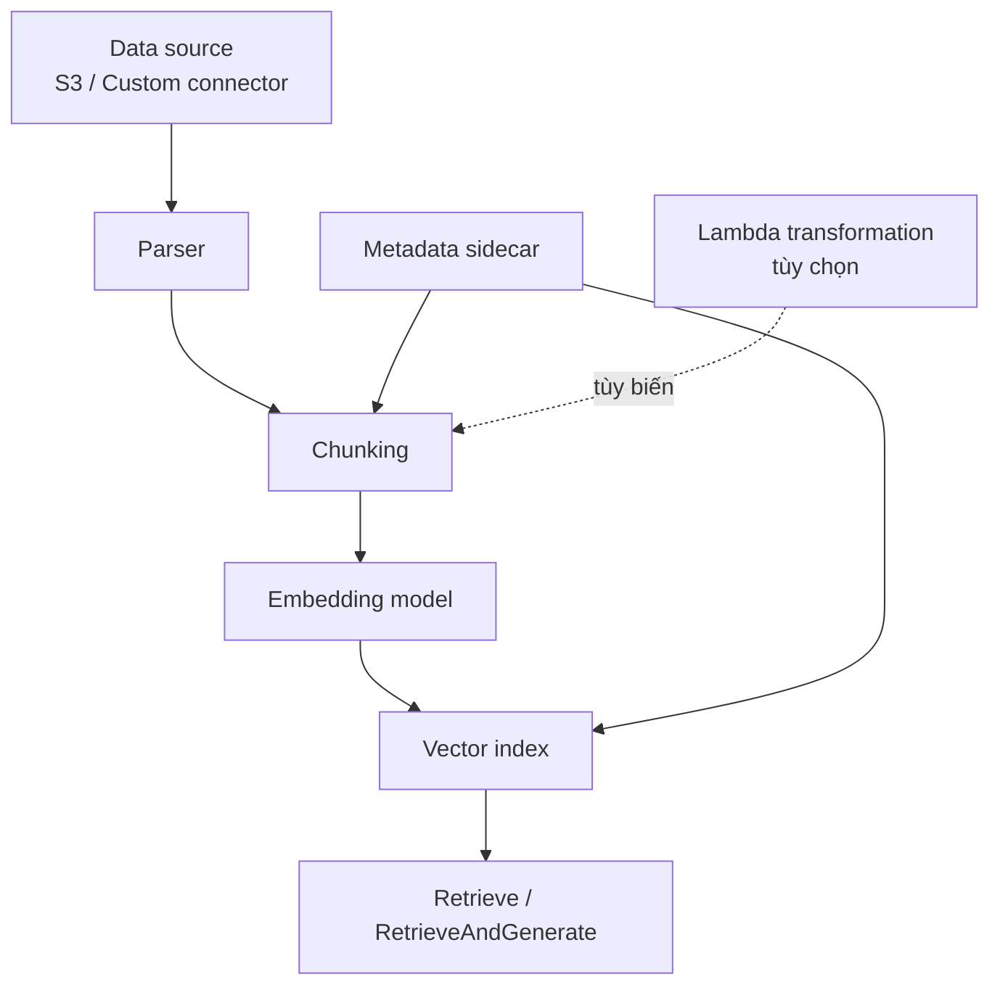
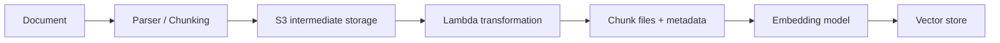

# Bedrock Knowledge Bases và quy trình nạp dữ liệu

Amazon Bedrock Knowledge Bases cung cấp lớp truy xuất tri thức cho ứng dụng generative AI. Dịch vụ kết nối dữ liệu doanh nghiệp với mô hình nền tảng (foundation model), chuyển tài liệu thành biểu diễn vector, tìm các đoạn nội dung liên quan đến câu hỏi rồi đưa ngữ cảnh đó vào prompt để mô hình tạo câu trả lời có căn cứ. Kiến trúc này thường được gọi là Retrieval-Augmented Generation (RAG).

Chất lượng RAG phụ thuộc nhiều vào dữ liệu và quy trình nạp dữ liệu. Một mô hình tốt không thể bù cho tài liệu lỗi thời, parser bỏ sót bảng, chunk bị cắt giữa ý hoặc metadata thiếu. Vì vậy, khi xây dựng Knowledge Base, bạn cần thiết kế nguồn dữ liệu, parsing, chunking, embedding, vector store, đồng bộ và kiểm thử truy xuất như một pipeline thống nhất.

## Mục tiêu học tập

Sau bài học, bạn có thể:

- Giải thích vai trò của Bedrock Knowledge Bases trong kiến trúc RAG.
- Phân biệt Managed Knowledge Base với customer-managed Knowledge Base.
- Thiết kế data source, service role, embedding model và vector store.
- Chọn parser và chiến lược chunking phù hợp với loại tài liệu.
- Quản lý metadata, bộ lọc truy xuất và đồng bộ dữ liệu tăng dần.
- Khởi chạy, theo dõi và xử lý lỗi ingestion job bằng Console hoặc AWS CLI.
- Sử dụng `Retrieve` và `RetrieveAndGenerate` để xây dựng ứng dụng hỏi đáp có trích dẫn.
- Đánh giá chất lượng truy xuất, bảo mật dữ liệu và chi phí vận hành.

## 1. Bedrock Knowledge Bases giải quyết vấn đề gì?

Foundation model có kiến thức tổng quát từ dữ liệu huấn luyện, nhưng không mặc nhiên biết tài liệu nội bộ, chính sách mới nhất hay dữ liệu riêng của doanh nghiệp. Bạn có thể đưa toàn bộ nội dung vào prompt, nhưng cách này tốn token, khó cập nhật và không phù hợp khi kho tài liệu lớn.

Knowledge Bases giúp ứng dụng tìm đúng phần nội dung cần thiết ở thời điểm truy vấn. Thay vì gửi toàn bộ kho tài liệu cho mô hình, hệ thống chuyển câu hỏi thành vector, tìm các đoạn tài liệu tương đồng trong vector index, sau đó đưa một tập đoạn liên quan vào mô hình tạo sinh. Ứng dụng có thể trả lời kèm nguồn trích dẫn để người dùng kiểm chứng.



RAG giúp câu trả lời gắn với dữ liệu được truy xuất, nhưng không bảo đảm mọi câu trả lời đều đúng. Nếu nguồn dữ liệu sai, parser bỏ sót nội dung hoặc truy vấn không tìm được đoạn phù hợp, mô hình vẫn có thể trả lời thiếu hoặc suy diễn. Vì vậy, phải kiểm tra cả chất lượng dữ liệu, kết quả retrieval và câu trả lời cuối cùng.

## 2. Hai loại Knowledge Base

Amazon Bedrock hiện cung cấp hai hướng triển khai chính. Tên gọi và khả năng có thể khác nhau giữa Console, API và tài liệu theo từng loại Knowledge Base; cần xác định đúng loại trước khi chọn hướng dẫn triển khai.

| Tiêu chí | Managed Knowledge Base | Customer-managed Knowledge Base |
|---|---|---|
| Hạ tầng ingestion, index, storage và retrieval | Amazon Bedrock quản lý | Khách hàng chọn và quản lý vector store cùng cấu hình liên quan |
| Embedding và reranking | Có thể dùng model do dịch vụ quản lý; có tùy chọn model riêng ở phạm vi được hỗ trợ | Khách hàng chọn embedding model và cấu hình vector store |
| Data source connectors | Có các connector như S3, SharePoint, Confluence, Google Drive, OneDrive và Web Crawler | Phụ thuộc loại data source được hỗ trợ cho Knowledge Base; S3 và custom data source là các lựa chọn phổ biến |
| Parsing | Smart Parsing tự chọn cách xử lý theo loại tài liệu; hỗ trợ tài liệu có hình ảnh, audio, video và scan theo khả năng của connector | Khách hàng cấu hình parser, chunking và lưu trữ nội dung đa phương thức |
| Vector store | Hạ tầng lưu trữ do dịch vụ quản lý | Có thể dùng OpenSearch, Aurora, Neptune Analytics, S3 Vectors hoặc các vector store bên thứ ba được hỗ trợ |
| Document-level permissions | Hỗ trợ ACL filtering tại retrieval cho các connector được hỗ trợ, ngoại trừ Web Crawler | Không mặc nhiên có tính năng ACL filtering tương đương; cần tự thiết kế kiểm soát truy cập |
| Vận hành | Ít phải quản lý hạ tầng vector và pipeline hơn | Linh hoạt hơn nhưng phải chịu trách nhiệm capacity, index, schema, quyền và vận hành vector store |

Managed Knowledge Base phù hợp khi muốn tập trung vào ứng dụng, connector và trải nghiệm truy xuất. Customer-managed Knowledge Base phù hợp khi cần kiểm soát sâu vector database, schema, cách embedding, parsing hoặc tích hợp với hạ tầng hiện có. Không nên giả định API, filter hay tính năng của hai loại là hoán đổi cho nhau.

Ví dụ, khi truy vấn Managed Knowledge Base, cấu hình retrieval dùng `managedSearchConfiguration`; customer-managed Knowledge Base dùng `vectorSearchConfiguration`. Managed Knowledge Base luôn sử dụng hybrid search và bật managed reranking theo mặc định trong cấu hình tiêu chuẩn; customer-managed Knowledge Base phụ thuộc vector store và cấu hình bạn chọn.

## 3. Pipeline ingestion từ tài liệu đến vector index

Với customer-managed Knowledge Base sử dụng dữ liệu phi cấu trúc, ingestion thường gồm bốn bước:

1. **Parsing:** đọc file và trích xuất nội dung có thể tìm kiếm.
2. **Chunking:** chia nội dung thành những đoạn nhỏ hơn để truy xuất.
3. **Embedding:** chuyển từng chunk thành vector bằng embedding model.
4. **Indexing:** ghi vector, text chunk và metadata vào vector store.



Parser quyết định nội dung nào được giữ lại. Chunking quyết định ranh giới ngữ cảnh. Embedding model quyết định cách nội dung được biểu diễn trong không gian vector. Vector store quyết định cách index, lọc và mở rộng dữ liệu. Sai sót ở bất kỳ bước nào đều có thể làm giảm recall hoặc precision của truy xuất.

Với Managed Knowledge Base, dịch vụ quản lý phần lớn các bước này và cung cấp Smart Parsing, embedding, reranking cùng retrieval theo mô hình quản lý. Bạn vẫn cần chuẩn hóa dữ liệu nguồn, kiểm tra connector, quyền, metadata và chất lượng kết quả.

## 4. Chọn data source và chuẩn bị tài liệu

### 4.1 Nguồn dữ liệu

Các nguồn dữ liệu phi cấu trúc thường gặp gồm:

- Amazon S3: tài liệu trong bucket hoặc prefix, phù hợp với data lake và kho tài liệu do doanh nghiệp quản lý.
- Connector doanh nghiệp: ví dụ SharePoint, Confluence, Google Drive, OneDrive hoặc Web Crawler trong Managed Knowledge Base và các connector được hỗ trợ.
- Custom data source: ứng dụng tự quản lý nội dung và gửi tài liệu qua API phù hợp.

Nếu dữ liệu nằm tại nhiều hệ thống, hãy xác định hệ thống nào là nguồn chuẩn (system of record), ai chịu trách nhiệm cập nhật và cách xóa tài liệu khi hết hiệu lực. Tránh đồng bộ nhiều bản sao giống nhau nếu không có metadata giúp phân biệt phiên bản hoặc nguồn.

### 4.2 Định dạng tài liệu

Với S3 data source của customer-managed Knowledge Base, các định dạng tài liệu phổ biến gồm:

| Loại | Phần mở rộng |
|---|---|
| Plain text UTF-8 | `.txt` |
| Markdown UTF-8 | `.md` |
| HTML UTF-8 | `.html` |
| Microsoft Word | `.doc`, `.docx` |
| CSV | `.csv` |
| Excel | `.xls`, `.xlsx` |
| PDF | `.pdf` |

S3 và custom data source còn có thể hỗ trợ ảnh, audio, video và tài liệu có bảng, biểu đồ hoặc sơ đồ khi chọn đúng multimodal processing approach. Định dạng, kích thước file, quota và khả năng parser thay đổi theo loại Knowledge Base và Region; kiểm tra trang quota trước khi nạp dữ liệu production. Ví dụ, tài liệu S3 thông thường trong một số luồng ingestion có giới hạn 50 MB mỗi file, còn file JPEG/PNG có quota riêng.

### 4.3 Cấu trúc prefix S3

Nên tổ chức prefix theo domain, loại tài liệu hoặc môi trường để dễ giới hạn phạm vi ingestion:

```text
s3://company-knowledge/
  finance/
    policies/
    procedures/
    reports/
  hr/
    handbook/
    benefits/
  engineering/
    runbooks/
    architecture/
```

Tạo data source trỏ vào prefix phù hợp thay vì mặc định quét toàn bộ bucket. Prefix filter và file pattern có thể giới hạn phạm vi crawl. Với customer-managed S3 connector, bucket phải ở cùng Region với Knowledge Base; role của Knowledge Base phải được phép đọc bucket và object.

### 4.4 Chuẩn hóa dữ liệu trước ingestion

Trước khi upload, hãy:

- Chuyển encoding văn bản về UTF-8 và xử lý ký tự lỗi.
- Loại bỏ bản nháp, bản sao và tài liệu đã hết hiệu lực.
- Đặt tên file ổn định, tránh ghi đè nội dung không có version hoặc lịch sử.
- Giữ tiêu đề, heading, bảng và cấu trúc đoạn văn có ý nghĩa.
- Chuyển bảng scan thành dữ liệu có thể trích xuất nếu parser mặc định không đọc được.
- Gắn owner, domain, classification, language và thời gian hiệu lực bằng metadata.
- Xác định chính sách xóa hoặc giữ vector khi xóa data source.

Một file PDF có thể chứa văn bản, bảng và hình ảnh. Nếu chỉ dùng parser văn bản, hình minh họa hoặc bảng có thể không được trích xuất đúng. Với tài liệu quan trọng, hãy so sánh nội dung parser trả về với bản gốc trước khi mở rộng ingestion.

## 5. Parsing: trích xuất đúng nội dung

Parsing là bước chuyển tài liệu gốc thành nội dung có thể chunk và embedding. Customer-managed Knowledge Base cung cấp các lựa chọn parser khác nhau.

| Parser | Đặc điểm | Phù hợp |
|---|---|---|
| Bedrock default parser | Trích xuất văn bản từ các định dạng tài liệu hỗ trợ; không tính phí parser riêng | Tài liệu chủ yếu là text, Markdown, HTML, Word, Excel hoặc PDF đơn giản |
| Bedrock Data Automation (BDA) | Dùng dịch vụ quản lý để xử lý tài liệu đa phương thức, trích xuất nội dung, mô tả hình ảnh hoặc chuyển audio/video thành văn bản theo khả năng hỗ trợ | PDF có bảng/biểu đồ, ảnh, audio/video và tài liệu cần trích xuất trực quan |
| Foundation model parser | Dùng foundation model để hiểu cấu trúc phức tạp; có thể tùy biến parsing prompt | Tài liệu nhiều bảng, sơ đồ, hình ảnh hoặc bố cục phức tạp cần diễn giải |

Default parser chỉ xuất text. Nếu PDF có biểu đồ, hình, bảng hoặc ảnh cần được truy xuất, hãy cân nhắc BDA hoặc foundation model parser. Các lựa chọn này có chi phí riêng: BDA thường tính theo trang hoặc nội dung xử lý; foundation model parser tính theo token đầu vào/đầu ra. Nếu chọn parser nâng cao cho data source, parser đó có thể được dùng cho tất cả PDF trong nguồn, kể cả PDF chỉ có text.

Một số điểm cần lưu ý khi thiết kế:

- Chọn parser theo nội dung thực tế, không chỉ theo phần mở rộng file.
- Nếu dùng parser trích xuất multimodal content, cần cấu hình S3 destination để lưu nội dung được trích xuất.
- Không thể đổi loại parsing strategy của data source đã tạo, ví dụ từ default sang BDA. Muốn đổi loại strategy, cần tạo data source mới.
- Với multimodal storage destination, cần cấu hình ngay khi tạo Knowledge Base; không thể bổ sung vị trí lưu multimodal sau khi Knowledge Base đã được tạo theo luồng yêu cầu đó.
- Parser có thể bỏ sót header/footer, bảng nhiều cột, ký hiệu kỹ thuật hoặc nội dung scan. Kiểm tra sample output trước khi ingest hàng loạt.

## 6. Chunking: chọn ranh giới nội dung

Embedding cả tài liệu dài thành một vector làm mất khả năng truy xuất chính xác một đoạn nhỏ. Chunking chia tài liệu thành những đơn vị có ngữ cảnh đủ rõ để tìm kiếm và đưa vào prompt.

### 6.1 Default chunking

Default chunking thường chia nội dung thành các đoạn khoảng 300 token và cố gắng giữ nguyên ranh giới câu. Đây là điểm bắt đầu đơn giản cho tài liệu text thông thường.

Ưu điểm là không cần tinh chỉnh nhiều. Nhược điểm là kích thước mặc định có thể không phù hợp với tài liệu có bảng, đoạn định nghĩa dài, mã nguồn hoặc quy trình nhiều bước.

### 6.2 Fixed-size chunking

Fixed-size chunking cho phép đặt `maxTokens` và `overlapPercentage`. Overlap giữ lại một phần nội dung ở cuối chunk trước và đầu chunk sau để giảm nguy cơ mất ngữ cảnh tại ranh giới.

```json
{
  "chunkingStrategy": "FIXED_SIZE",
  "fixedSizeChunkingConfiguration": {
    "maxTokens": 400,
    "overlapPercentage": 15
  }
}
```

Ví dụ trên chỉ minh họa cấu hình. Hãy thử nhiều kích thước với bộ câu hỏi thực tế. Chunk quá nhỏ dễ mất điều kiện hoặc chủ thể của câu; chunk quá lớn chứa nhiều chủ đề không liên quan và làm giảm độ chính xác của vector search.

### 6.3 Hierarchical chunking

Hierarchical chunking tạo hai cấp:

- Child chunk nhỏ hơn, giúp embedding và tìm kiếm xác định vị trí liên quan.
- Parent chunk lớn hơn, cung cấp ngữ cảnh rộng hơn khi retrieval chọn được child chunk phù hợp.

Trong quá trình retrieval, hệ thống có thể thay child chunk bằng parent chunk để cung cấp thêm ngữ cảnh cho mô hình. Do nhiều child chunk có thể cùng trỏ về một parent, số kết quả trả về thực tế có thể ít hơn số lượng kết quả yêu cầu.

Chiến lược này phù hợp với tài liệu dài có cấu trúc như handbook, chính sách, tài liệu kỹ thuật và quy trình nhiều bước. Không nên dùng hierarchical chunking với S3 Vectors nếu không có lý do rõ ràng; cấu trúc parent/child và metadata ngữ cảnh có thể làm tăng áp lực lên giới hạn metadata. Khi tổng token parent/child quá lớn, có thể gặp giới hạn metadata của vector store.

### 6.4 Semantic chunking

Semantic chunking dùng mô hình ngôn ngữ để chia đoạn dựa trên sự thay đổi ý nghĩa giữa các câu. Bạn có thể điều chỉnh:

- Maximum tokens: giới hạn kích thước chunk.
- Buffer size: số câu lân cận được xem xét khi tạo embedding để xác định ranh giới.
- Breakpoint percentile threshold: ngưỡng khác biệt ngữ nghĩa để quyết định tách chunk.

Buffer lớn có thể giữ thêm ngữ cảnh nhưng làm chunk chứa nhiều ý hơn. Threshold cao thường đòi hỏi các câu khác biệt rõ hơn trước khi tách, do đó tạo ít chunk hơn và chunk trung bình lớn hơn. Semantic chunking phát sinh thêm chi phí vì sử dụng foundation model trong bước xử lý.

Semantic chunking hiện không được hỗ trợ cho Managed Knowledge Base. Nếu chọn Managed Knowledge Base, hãy dùng chiến lược chunking mà loại dịch vụ đó hỗ trợ; semantic chunking là lựa chọn trong luồng customer-managed Knowledge Base.

### 6.5 No chunking

Với chiến lược `NONE`, mỗi tài liệu được xem là một chunk duy nhất. Cách này phù hợp khi tài liệu đã được chia sẵn thành những file nhỏ có ý nghĩa hoặc khi custom Lambda tự tạo chunk.

Không chunking có thể làm một file lớn trở thành đơn vị retrieval quá rộng. Ngoài ra, với một số luồng customer-managed, citation không hiển thị page number và không thể lọc bằng metadata `x-amz-bedrock-kb-document-page-number`.

### 6.6 Chọn chiến lược theo loại tài liệu

| Loại tài liệu | Điểm bắt đầu | Lý do |
|---|---|---|
| FAQ ngắn | Default hoặc no chunking | Mỗi mục hỏi đáp đã là một đơn vị nhỏ |
| Policy/handbook dài | Hierarchical hoặc fixed-size có overlap | Cần tìm đoạn nhỏ và trả về ngữ cảnh điều khoản rộng hơn |
| Hướng dẫn kỹ thuật có heading | Fixed-size hoặc hierarchical | Giữ quan hệ giữa thao tác, điều kiện và kết quả |
| Tài liệu nhiều bảng/biểu đồ | Parser phù hợp trước, sau đó chunking | Cần trích xuất cấu trúc bảng và chú thích trước khi chia đoạn |
| Nội dung có ranh giới ý nghĩa rõ nhưng độ dài không đều | Semantic | Có thể giữ các nhóm câu cùng chủ đề |
| Dữ liệu đã được tiền xử lý thành file theo đoạn | No chunking | Không muốn chia lại các đoạn đã được chuẩn hóa |

Với nội dung đã parse thành cấu trúc có ranh giới logic như trang hoặc section, Bedrock có thể giữ các ranh giới đó và không gộp nội dung qua boundary chỉ vì tăng max token. Hãy xem output thực tế thay vì giả định chunker chỉ cắt theo số token.

## 7. Embedding model và vector store

### 7.1 Embedding model

Embedding model chuyển văn bản hoặc nội dung đa phương thức thành vector số. Khi người dùng đặt câu hỏi, query cũng được chuyển thành vector trong cùng không gian biểu diễn để hệ thống tìm các vector gần nhất.

Một số embedding model thường gặp trong customer-managed Knowledge Base:

| Model | Đặc điểm cần cân nhắc |
|---|---|
| Amazon Titan Text Embeddings V2 | Hỗ trợ nhiều kích thước vector như 256, 512 và 1.024; phù hợp nhiều bài toán text embedding |
| Cohere Embed Multilingual v3 | Hỗ trợ embedding đa ngôn ngữ, phù hợp kho tài liệu nhiều ngôn ngữ |
| Cohere Embed English v3 | Tập trung vào nội dung tiếng Anh |
| Amazon Titan Multimodal Embeddings G1 | Dùng cho một số luồng text và hình ảnh đa phương thức được hỗ trợ |
| Amazon Nova Multimodal Embeddings | Embedding trực tiếp nội dung đa phương thức như hình ảnh, audio và video trong các luồng hỗ trợ |

Danh sách model, vector dimension, vector type và Region khả dụng thay đổi theo thời gian. Hãy kiểm tra trang Supported models and Regions trước khi thiết kế. Với dữ liệu tiếng Việt, cần kiểm thử chất lượng tìm kiếm bằng câu hỏi tiếng Việt, tên riêng, thuật ngữ tiếng Anh xen kẽ và từ viết tắt trong domain.

Vector dimension trong index phải khớp với embedding model đã chọn. Nếu đổi model hoặc dimension, vector index hiện tại có thể không tương thích và thường cần tạo index/Knowledge Base phù hợp rồi ingest lại dữ liệu.

### 7.2 Vector store

Customer-managed Knowledge Base hỗ trợ một số vector store như:

| Vector store | Điểm cần cân nhắc |
|---|---|
| Amazon OpenSearch Serverless | Quản lý collection/index tìm kiếm vector; phù hợp khi cần tích hợp tìm kiếm và filter metadata |
| Amazon OpenSearch Service Managed Clusters | Phù hợp khi tổ chức đã vận hành OpenSearch cluster |
| Amazon Aurora PostgreSQL | Có thể dùng PostgreSQL và extension vector để lưu embedding gần dữ liệu quan hệ |
| Amazon Neptune Analytics | Phù hợp các bài toán kết hợp vector retrieval với quan hệ đồ thị/GraphRAG trong luồng hỗ trợ |
| Amazon S3 Vectors | Lưu vector trên hạ tầng S3 Vectors, phù hợp khi muốn vector storage được quản lý theo hướng S3 |
| Pinecone, Redis Enterprise Cloud, MongoDB Atlas | Lựa chọn bên thứ ba khi tổ chức đã dùng hoặc cần tính năng riêng của nền tảng đó |

Không phải mọi model, dimension, vector type và tính năng đều tương thích với mọi vector store. Ví dụ, binary embeddings chỉ được hỗ trợ bởi OpenSearch Serverless và OpenSearch Managed Clusters trong danh sách vector store được nêu ở tài liệu AWS; S3 Vectors dùng floating-point embeddings. Hãy kiểm tra compatibility trước khi tạo index.

### 7.3 Tự tạo vector index

Khi tự chuẩn bị vector store, index thường cần các trường cho:

- Vector embedding do model tạo ra.
- Text chunk được trích xuất từ tài liệu.
- Metadata nội bộ do Bedrock quản lý.
- Metadata tùy chỉnh cần dùng để filter.

Với OpenSearch vector index, cần cấu hình engine và dimension tương ứng. Tài liệu AWS yêu cầu engine `faiss` cho vector index dùng trong luồng Knowledge Base này; `nmslib` không được hỗ trợ. Với Aurora, cần chuẩn bị schema và trường metadata tương ứng; nếu dùng metadata filtering, nên gom metadata vào custom metadata field theo hướng dẫn và tạo index phù hợp.

Ví dụ mapping khái quát của OpenSearch:

```json
{
  "settings": {
    "index": {
      "knn": true
    }
  },
  "mappings": {
    "properties": {
      "embedding": {
        "type": "knn_vector",
        "dimension": 1024,
        "method": {
          "name": "hnsw",
          "engine": "faiss"
        }
      },
      "AMAZON_BEDROCK_TEXT_CHUNK": {
        "type": "text"
      },
      "AMAZON_BEDROCK_METADATA": {
        "type": "text",
        "index": false
      }
    }
  }
}
```

Mapping trên chỉ minh họa cấu trúc cốt lõi. Hãy dùng đúng dimension, vector type, field name và mapping theo model cùng cấu hình thực tế. Nếu metadata filter không có kiểu `keyword` hoặc `text` với subfield `keyword` khi cần, truy vấn filter có thể lỗi hoặc hoạt động không như mong muốn.

## 8. Metadata: lọc đúng tài liệu khi truy xuất

Metadata bổ sung ngữ cảnh cho từng tài liệu, ví dụ:

- `department`: finance, hr, engineering.
- `classification`: public, internal, confidential.
- `language`: vi, en.
- `document_type`: policy, procedure, faq.
- `effective_date`: ngày bắt đầu hiệu lực.
- `owner`: nhóm chịu trách nhiệm.

Metadata filter giúp thu hẹp kết quả retrieval. Ví dụ, câu hỏi của nhân viên thuộc phòng HR chỉ tìm trong tài liệu HR và tài liệu còn hiệu lực. Metadata không làm thay đổi nội dung nguồn; nó gắn thuộc tính để hệ thống lọc hoặc cải thiện embedding.

### 8.1 S3 metadata sidecar

Với S3 data source của customer-managed Knowledge Base, có thể đặt một file metadata cạnh file nguồn. Tên file metadata có dạng:

```text
employee-handbook.pdf
employee-handbook.pdf.metadata.json
```

Hai file phải nằm cùng vị trí; metadata file phải giữ đúng tên file nguồn và thêm hậu tố `.metadata.json`. Kích thước metadata file bị giới hạn (tài liệu connector hiện nêu tối đa 10 KB).

Ví dụ metadata sidecar:

```json
{
  "metadataAttributes": {
    "department": {
      "value": {
        "type": "STRING",
        "stringValue": "hr"
      },
      "includeForEmbedding": false
    },
    "language": {
      "value": {
        "type": "STRING",
        "stringValue": "vi"
      },
      "includeForEmbedding": true
    },
    "effective_year": {
      "value": {
        "type": "NUMBER",
        "numberValue": 2026
      },
      "includeForEmbedding": false
    },
    "is_current": {
      "value": {
        "type": "BOOLEAN",
        "booleanValue": true
      },
      "includeForEmbedding": false
    }
  }
}
```

Các kiểu metadata thường dùng gồm `STRING`, `NUMBER`, `BOOLEAN` và `STRING_LIST`. `includeForEmbedding: false` giữ metadata để filter nhưng không nối giá trị vào nội dung embedding. `includeForEmbedding: true` nối key-value vào nội dung trước khi tạo vector, giúp những truy vấn nhắc đến metadata có thể ảnh hưởng đến độ tương đồng. Key-value này không được trả về như một phần của text chunk gốc.

Nếu không cần điều khiển embedding, có thể dùng dạng rút gọn:

```json
{
  "metadataAttributes": {
    "department": "hr",
    "language": "vi"
  }
}
```

Dạng rút gọn lưu metadata để filter và tương đương `includeForEmbedding: false`.

### 8.2 Metadata trong CSV

CSV có cách xử lý riêng: mỗi dòng được xem như một đơn vị dữ liệu; một cột được chọn làm content field, các cột khác có thể trở thành metadata. Bedrock Knowledge Bases hiện hỗ trợ một content field cho cấu hình CSV này. Nội dung cột content được chia chunk và embedding; metadata của dòng được gắn với các chunk tương ứng.

Ví dụ bảng danh mục sản phẩm:

| description | category | region | price |
|---|---|---|---:|
| Máy lọc không khí cho phòng ngủ | home | VN | 2500000 |
| Bộ định tuyến Wi-Fi cho văn phòng | networking | VN | 1800000 |

Chọn `description` làm content field; `category`, `region`, `price` có thể dùng làm metadata. Khi metadata file của CSV thay đổi, file thường phải được ingest lại vì Bedrock cần xử lý lại cấu hình cấu trúc CSV.

### 8.3 Metadata filter và bảo mật

Filter có thể dùng các toán tử như `equals`, `notEquals`, `greaterThan`, `lessThan`, `in`, `notIn`, `startsWith` hoặc `stringContains` tùy loại Knowledge Base và vector store. Có thể kết hợp điều kiện bằng `andAll` và `orAll`.

Ví dụ filter cho tài liệu HR tiếng Việt còn hiệu lực:

```json
{
  "andAll": [
    {
      "equals": {
        "key": "department",
        "value": "hr"
      }
    },
    {
      "equals": {
        "key": "language",
        "value": "vi"
      }
    },
    {
      "equals": {
        "key": "is_current",
        "value": true
      }
    }
  ]
}
```

Một số filter không được hỗ trợ trên Managed Knowledge Base. Ví dụ `startsWith` và `stringContains` hiện không được hỗ trợ trong managed metadata filter; hãy dùng toán tử được tài liệu của loại Knowledge Base đó cho phép. Metadata field có prefix dành riêng của dịch vụ cũng không được ghi đè.

Quy ước reserved metadata khác nhau theo loại Knowledge Base: customer-managed Knowledge Base dành riêng các field có prefix `x-amz-bedrock`, còn Managed Knowledge Base dùng prefix underscore cho các field nội bộ như `_source_uri` và `_data_source_id`.

Không xem metadata filter thông thường là cơ chế xác thực người dùng. Nếu ứng dụng cho phép client tự gửi filter, client có thể sửa filter để tìm nội dung ngoài phạm vi dự kiến. Với dữ liệu nhạy cảm, dùng document-level ACL filtering của Managed Knowledge Base nếu connector hỗ trợ, hoặc tách Knowledge Base/nguồn dữ liệu theo tenant và để backend kiểm soát filter. Luôn thực thi authorization ở lớp ứng dụng và IAM.

## 9. Tạo Knowledge Base và cấu hình service role

Quy trình tạo customer-managed Knowledge Base ở mức tổng quát:

1. Chọn Region có Knowledge Bases, embedding model và vector store tương thích.
2. Tạo IAM service role cho Bedrock Knowledge Bases.
3. Cấp quyền đọc data source, gọi embedding model, truy cập vector store và giải mã KMS khi cần.
4. Tạo hoặc chọn vector store và vector index với đúng dimension.
5. Tạo Knowledge Base, chọn embedding model và vector store.
6. Tạo data source, cấu hình S3 prefix, parser, chunking và metadata.
7. Chạy ingestion job đầu tiên.
8. Kiểm tra job status, số file thành công/thất bại và truy vấn thử.

### 9.1 Quyền của service role

Service role được Bedrock assume để thực hiện ingestion. Tùy cấu hình, role thường cần:

- Trust relationship cho phép dịch vụ Bedrock assume role.
- Quyền đọc bucket/object như `s3:ListBucket` và `s3:GetObject`.
- Quyền gọi embedding model như `bedrock:InvokeModel`.
- Quyền truy cập vector store: OpenSearch, Aurora, S3 Vectors hoặc dịch vụ bên thứ ba.
- Quyền KMS phù hợp nếu source, vector store hoặc intermediate storage dùng customer managed key.
- Quyền truy cập secret trong Secrets Manager nếu vector store bên thứ ba cần credential.

Chỉ cấp bucket/prefix và model ARN cần thiết. Không cấp quyền `s3:*` trên toàn bộ account chỉ để làm ingestion hoạt động.

### 9.2 Quyền của người vận hành

IAM principal quản lý Knowledge Base cần quyền tạo/sửa Knowledge Base, data source và ingestion job. Principal chạy truy vấn cần quyền gọi API retrieval/runtime. Khi tạo Managed Knowledge Base, principal tạo tài nguyên còn cần `iam:PassRole` để chuyển service role cho Bedrock.

Một điểm bảo mật quan trọng với customer-managed Knowledge Base: `CreateDataSource`, `UpdateDataSource` và `StartIngestionJob` sử dụng service role đã gắn với Knowledge Base. Người có quyền quản lý data source có thể khiến ingestion đọc bất kỳ vị trí nào mà service role được phép đọc, rồi truy vấn nội dung đó qua Knowledge Base. Vì vậy, hãy giới hạn service role theo bucket/prefix và xem quyền quản lý data source là quyền nhạy cảm.

### 9.3 S3 và KMS

Nếu S3 bucket ở account khác, cần bucket policy cho service role của Knowledge Base. Nếu object mã hóa bằng customer managed KMS key, key policy và IAM policy phải cho phép service role giải mã. Với multimodal storage destination hoặc intermediate storage, cần thêm quyền ghi/xóa object phù hợp.

Bucket S3 dùng làm data source cho customer-managed Knowledge Base phải đáp ứng yêu cầu Region của connector. Cross-account access cần phối hợp cả identity policy ở account Knowledge Base, bucket policy ở account nguồn và key policy nếu có SSE-KMS.

## 10. Chạy ingestion job

Sau khi tạo Knowledge Base và data source, ingestion job sẽ đọc tài liệu, parse, chunk, tạo embedding và ghi vector vào index. Với customer-managed Knowledge Base, bạn có thể khởi chạy job qua Console hoặc API.

Ví dụ AWS CLI:

```bash
aws bedrock-agent start-ingestion-job \
  --knowledge-base-id KB12345678 \
  --data-source-id DS12345678 \
  --description "Initial ingestion for HR knowledge"
```

Lệnh trả về `ingestionJob` chứa ID và trạng thái job. Dùng ID đó để kiểm tra:

```bash
aws bedrock-agent get-ingestion-job \
  --knowledge-base-id KB12345678 \
  --data-source-id DS12345678 \
  --ingestion-job-id JOB12345678
```

Các ID trên chỉ là giá trị minh họa. Có thể liệt kê các job gần đây:

```bash
aws bedrock-agent list-ingestion-jobs \
  --knowledge-base-id KB12345678 \
  --data-source-id DS12345678
```

Trong kết quả, chú ý trạng thái job, thời gian bắt đầu/kết thúc, số tài liệu được thêm, sửa, xóa, thất bại và thông báo lỗi. Không nên đánh giá job chỉ dựa vào trạng thái tổng thể; một job có thể hoàn tất nhưng vẫn có tài liệu thất bại cần xử lý.

## 11. Đồng bộ dữ liệu tăng dần

Sau khi data source thay đổi, cần sync để cập nhật Knowledge Base. Với S3 connector, sync là incremental: Bedrock so sánh thay đổi và xử lý tài liệu được thêm, sửa hoặc xóa kể từ lần sync trước.

| Thay đổi tại nguồn | Kết quả khi sync |
|---|---|
| Không có thay đổi | Tài liệu được bỏ qua |
| Thêm file mới | File mới được ingest |
| Sửa nội dung file | File được parse, chunk, embedding và index lại |
| Sửa metadata sidecar | Thường re-ingest tài liệu; một số trường hợp chỉ cập nhật metadata mà không gọi embedding model |
| Xóa file nguồn | Nội dung tương ứng được xóa khỏi vector store khi sync |

Metadata-only optimization có thể áp dụng khi chỉ metadata file thay đổi, không có thay đổi ở file nội dung, tài liệu không phải CSV và data source không dùng custom transformation Lambda. Khi đáp ứng điều kiện, Bedrock có thể lấy vector embedding hiện có, cập nhật metadata rồi ghi lại mà không gọi embedding model.

### 11.1 Xóa data source và deletion policy

Khi xóa data source, cần hiểu deletion policy. Với customer-managed Knowledge Base, bạn có thể chọn `DELETE` hoặc `RETAIN`. Managed Knowledge Base hiện chỉ hỗ trợ `DELETE` và đây cũng là mặc định.

- `DELETE`: xóa dữ liệu đã ingest liên quan đến data source khỏi vector store và supplemental storage theo chính sách; vector store do khách hàng tạo không bị xóa. Quá trình xóa có thể thất bại nếu role không còn quyền truy cập hoặc cấu hình vector store có lỗi; khi đó cần kiểm tra trạng thái `DELETE_UNSUCCESSFUL` và failure reasons.
- `RETAIN`: giữ dữ liệu đã ingest trong vector store. Nội dung tiếp tục có thể xuất hiện khi truy vấn ngay cả sau khi data source bị xóa. Nếu muốn loại bỏ nội dung này, cần chủ động sync Knowledge Base qua data source còn lại theo quy trình AWS hướng dẫn.

Xóa Knowledge Base hoặc data source không đồng nghĩa vector store do bạn tạo sẽ tự bị xóa. Với `RETAIN`, dữ liệu được giữ lại; cần thực hiện sync hoặc quy trình dọn dẹp phù hợp nếu muốn loại bỏ nội dung khỏi retrieval. Hãy kiểm tra deletion policy trước khi xóa connector để tránh giữ tài liệu đã hết hiệu lực hoặc xóa nhầm dữ liệu cần lưu.

### 11.2 Lập lịch đồng bộ

Nếu tài liệu thay đổi thường xuyên, cần có lịch sync hoặc quy trình event-driven phù hợp. S3 event notification có thể kích hoạt workflow điều phối, nhưng không nên khởi chạy quá nhiều ingestion job đồng thời vượt quota. Gom thay đổi theo batch, kiểm tra job đang chạy và retry có kiểm soát.

## 12. Custom transformation Lambda

Khi chunking mặc định không phù hợp, customer-managed Knowledge Base cho phép dùng Lambda trong ingestion pipeline. Một số trường hợp:

- Tách tài liệu theo heading, trang, mục hoặc cấu trúc nghiệp vụ riêng.
- Gắn metadata riêng cho từng chunk.
- Chuẩn hóa định dạng nội dung trước khi embedding.
- Loại bỏ phần header/footer hoặc boilerplate lặp lại.

Với custom chunking, có thể chọn chiến lược `NONE`, cấu hình S3 intermediate storage, rồi để Lambda tạo các chunk và trả về tham chiếu file đã xử lý cho Knowledge Base. Nếu muốn giữ chunking tích hợp nhưng bổ sung chunk-level metadata, có thể chọn chunking strategy có sẵn và dùng Lambda ở bước post-chunking.



Lambda cần xử lý đúng contract input/output, timeout, kích thước payload và quyền đọc/ghi intermediate bucket. Chunk-level metadata có thể ghi đè metadata cấp file nếu trùng key; hãy đặt quy ước tên field rõ ràng. Lambda làm tăng độ linh hoạt nhưng cũng tăng chi phí, độ phức tạp và bề mặt lỗi của ingestion.

## 13. Multimodal Knowledge Base

Knowledge Base có thể xử lý nội dung text cùng hình ảnh, audio, video, bảng, biểu đồ và sơ đồ nếu chọn đúng data source, parser và embedding model. Có hai cách tiếp cận chính.

### 13.1 Native multimodal embeddings

Với model multimodal như Amazon Nova Multimodal Embeddings, nội dung hình ảnh, audio hoặc video có thể được đưa trực tiếp vào embedding model để tạo vector tương ứng. Cách này giữ được tín hiệu trực quan hoặc âm thanh mà bước trích xuất text có thể làm mất.

Chunking audio/video có thể cấu hình thời lượng từ 1 đến 30 giây; giá trị mặc định thường là 5 giây. Với video, cấu hình thời lượng video chunk được áp dụng ngay cả khi video có audio; audio chunk duration áp dụng cho file audio độc lập.

Native multimodal embeddings phù hợp với tìm ảnh tương tự, tìm cảnh video hoặc truy vấn dựa trên đặc trưng trực quan. Tuy nhiên, khả năng retrieval/generation phụ thuộc API và model. Ví dụ, `RetrieveAndGenerate` với Nova Multimodal Embeddings có giới hạn RAG ở nội dung text; nếu cần RAG dựa trên transcript audio/video, có thể dùng BDA để chuyển nội dung thành text rồi embedding bằng text model theo luồng hỗ trợ.

### 13.2 Bedrock Data Automation hoặc foundation model parser

BDA có thể chuyển audio/video thành transcript và mô tả cảnh, còn foundation model parser có thể trích xuất text, bảng, hình và cấu trúc tài liệu theo khả năng model. Sau đó, nội dung được chuyển thành text và dùng text chunking thông thường.

| Nhu cầu | Hướng cân nhắc |
|---|---|
| Tìm ảnh giống ảnh truy vấn | Native multimodal embeddings |
| Tìm nội dung trong cuộc gọi hỗ trợ | BDA để tạo transcript rồi text embedding |
| Tìm đoạn video theo lời nói và hình ảnh | BDA với transcript và mô tả cảnh |
| Hiểu biểu đồ, sơ đồ kỹ thuật trong PDF | Foundation model parser hoặc BDA theo khả năng hỗ trợ |
| Tìm tài liệu text thông thường | Default parser và text embedding |

Không phải mọi connector đều hỗ trợ mọi định dạng đa phương thức. Tính năng, Region và loại model phải được kiểm tra trước khi thiết kế. Structured data source có giới hạn khác với unstructured data source; không mặc định multimodal support áp dụng cho mọi loại Knowledge Base.

## 14. Truy xuất dữ liệu: Retrieve và RetrieveAndGenerate

Sau ingestion, ứng dụng có thể truy vấn Knowledge Base qua các API runtime.

### 14.1 Retrieve

`Retrieve` trả về các chunk hoặc nội dung liên quan nhất đến câu hỏi. Ứng dụng tự xây prompt và quyết định cách gọi model tạo sinh. Cách này phù hợp khi cần kiểm soát prompt, kết hợp nhiều nguồn hoặc thực hiện logic nghiệp vụ trước khi sinh câu trả lời.

### 14.2 RetrieveAndGenerate

`RetrieveAndGenerate` kết hợp retrieval với việc gọi foundation model để tạo câu trả lời bằng ngôn ngữ tự nhiên. Kết quả có thể chứa citations trỏ đến tài liệu hoặc chunk nguồn. Đây là cách bắt đầu nhanh khi muốn có RAG pipeline tiêu chuẩn.

### 14.3 GenerateQuery và AgenticRetrieveStream

Với structured data store, `GenerateQuery` chuyển câu hỏi tự nhiên thành truy vấn phù hợp với nguồn dữ liệu có cấu trúc. `AgenticRetrieveStream` có thể phân rã câu hỏi phức tạp thành các sub-query, truy xuất lặp qua nhiều Knowledge Base và đánh giá xem đã đủ thông tin hay chưa; khả năng này phụ thuộc loại Knowledge Base và API được hỗ trợ.

### 14.4 Reranking

Reranker đánh giá lại mức liên quan của các chunk đã truy xuất và sắp xếp lại kết quả. Reranking có thể cải thiện thứ tự kết quả khi vector similarity ban đầu chưa đủ phân biệt. Reranking thường áp dụng cho dữ liệu text; cần kiểm tra model, Region, số kết quả và giới hạn API. Với Managed Knowledge Base, managed reranker có thể được bật mặc định; có thể chọn model riêng hoặc tắt trong cấu hình được hỗ trợ.

### 14.5 Hybrid search

Hybrid search kết hợp semantic search bằng vector với keyword search. Semantic search có thể tìm nội dung cùng ý nghĩa dù từ ngữ khác nhau; keyword search hữu ích với mã sản phẩm, tên riêng, mã lỗi và thuật ngữ chính xác. Managed Knowledge Base sử dụng hybrid retrieval; customer-managed Knowledge Base có khả năng hybrid tùy vector store và cấu hình.

## 15. Ví dụ truy vấn bằng AWS CLI

Ví dụ sau dùng customer-managed Knowledge Base và `vectorSearchConfiguration`. Hãy thay Knowledge Base ID, model ARN và metadata filter theo môi trường.

```bash
aws bedrock-agent-runtime retrieve-and-generate \
  --input '{"text":"Quy trình phê duyệt chi phí công tác là gì?"}' \
  --retrieve-and-generate-configuration '{
    "type":"KNOWLEDGE_BASE",
    "knowledgeBaseConfiguration":{
      "knowledgeBaseId":"KB12345678",
      "modelArn":"arn:aws:bedrock:ap-southeast-1::foundation-model/anthropic.claude-3-haiku-20240307-v1:0",
      "retrievalConfiguration":{
        "vectorSearchConfiguration":{
          "numberOfResults":5,
          "filter":{
            "equals":{
              "key":"department",
              "value":"finance"
            }
          }
        }
      }
    }
  }'
```

Model ARN trong ví dụ chỉ minh họa định dạng; model ID và Region phải được hỗ trợ cho account của bạn. Với Managed Knowledge Base, sử dụng cấu hình `managedSearchConfiguration` theo API tương ứng, không sao chép nguyên `vectorSearchConfiguration` của customer-managed Knowledge Base.

Nếu muốn tự kiểm soát prompt và model generation, gọi `Retrieve` trước:

```bash
aws bedrock-agent-runtime retrieve \
  --knowledge-base-id KB12345678 \
  --retrieval-query '{"text":"Quy trình phê duyệt chi phí công tác là gì?"}' \
  --retrieval-configuration '{
    "vectorSearchConfiguration":{
      "numberOfResults":5
    }
  }'
```

Ứng dụng có thể lấy các `retrievalResults`, ghép text chunk vào prompt và gọi model bằng API runtime phù hợp. Khi tự ghép prompt, cần giới hạn số token ngữ cảnh, giữ source URI/citation metadata và chỉ dùng kết quả truy xuất phù hợp với quyền của người dùng.

## 16. Đánh giá chất lượng ingestion và retrieval

Một ingestion job thành công chỉ xác nhận pipeline đã xử lý tài liệu theo cấu hình. Nó không chứng minh tài liệu được parse đúng, chunk có ý nghĩa hoặc truy vấn tìm đúng thông tin.

### 16.1 Kiểm tra ingestion

- Số file được phát hiện có khớp số file dự kiến trong prefix không?
- Có file nào thất bại do format, kích thước, quyền S3, KMS hoặc parser không?
- Nội dung trích xuất có giữ được heading, bảng, mã lỗi và dấu tiếng Việt không?
- Chunk có bị cắt giữa điều kiện, bước thao tác hoặc bảng không?
- Metadata có gắn đúng file và đúng kiểu dữ liệu không?
- Xóa hoặc sửa tài liệu ở nguồn có được phản ánh sau sync không?

### 16.2 Kiểm tra retrieval

Tạo bộ câu hỏi chuẩn có đáp án và tài liệu nguồn đã biết. Bao gồm câu hỏi trực tiếp, câu hỏi diễn đạt lại, câu hỏi có tên riêng/mã lỗi, câu hỏi nhiều điều kiện và câu hỏi không có đáp án trong kho dữ liệu.

| Chỉ số | Ý nghĩa |
|---|---|
| Recall@K | Tỷ lệ câu hỏi mà ít nhất một chunk đúng xuất hiện trong top K kết quả |
| Precision@K | Tỷ lệ chunk trong top K thực sự liên quan |
| MRR | Vị trí trung bình của kết quả liên quan đầu tiên |
| Citation accuracy | Citation có trỏ đúng tài liệu và đoạn hỗ trợ nhận định không |
| Groundedness | Câu trả lời có được hỗ trợ bởi nội dung truy xuất không |
| Abstention quality | Hệ thống có từ chối hoặc nói rõ khi kho dữ liệu không có câu trả lời không |

Nếu recall thấp, xem lại parser, chunk size, embedding model, query rewriting và metadata filter. Nếu precision thấp, kiểm tra tài liệu trùng lặp, chunk quá rộng, metadata hoặc reranking. Nếu chunk đúng nhưng câu trả lời sai, kiểm tra prompt, model, context length và cách xử lý mâu thuẫn giữa các nguồn.

### 16.3 Kiểm thử tài liệu tiếng Việt

Với kho tài liệu tiếng Việt, cần kiểm thử:

- Dấu tiếng Việt và biến thể gõ không dấu.
- Thuật ngữ tiếng Anh xen kẽ tiếng Việt.
- Tên dịch vụ AWS, mã lỗi, ARN, mã chính sách và tên bảng.
- Từ đồng nghĩa và cách viết tắt trong nội bộ doanh nghiệp.
- Bảng có cột/đơn vị, ngày tháng và số tiền.
- Tài liệu có phiên bản mới và cũ cùng tồn tại.

Nếu tài liệu có nhiều phiên bản, hãy dùng metadata `effective_date`, `version` hoặc `is_current` để filter đúng phiên bản. Không nên chỉ dựa vào similarity score để phân biệt tài liệu hết hiệu lực.

## 17. Bảo mật, vận hành và chi phí

### 17.1 Bảo mật nội dung

- Giới hạn service role theo đúng data source, model và vector store.
- Dùng KMS để mã hóa dữ liệu khi cần; cấu hình key policy cho service role.
- Dùng document-level ACL filtering của Managed Knowledge Base khi connector hỗ trợ.
- Với customer-managed Knowledge Base, backend phải kiểm tra quyền trước khi truy vấn và áp dụng filter do server kiểm soát.
- Không đưa thông tin bí mật hoặc dữ liệu cá nhân vào metadata không cần thiết.
- Rà soát log, query và citation để tránh rò rỉ nội dung giữa tenant.

Guardrails áp dụng lên input và generated response của LLM, nhưng không tự động áp dụng lên các reference được retrieval trả về tại runtime. Vì vậy, không dùng guardrail thay thế authorization. Nội dung tài liệu cũng có thể chứa prompt injection; ứng dụng nên xem chunk là dữ liệu không đáng tin cậy, không phải chỉ thị hệ thống.

### 17.2 Theo dõi và xử lý sự cố

Theo dõi ingestion job status, số tài liệu lỗi, thời gian xử lý, dung lượng vector index, latency retrieval, lỗi model invocation và tỷ lệ citation. Khi có lỗi, phân loại theo lớp:

| Triệu chứng | Điểm kiểm tra |
|---|---|
| Không tìm thấy file | S3 prefix filter, file pattern, Region, connector role và bucket policy |
| AccessDenied khi ingest | Trust policy, S3 IAM, bucket policy, KMS key policy, model invoke và vector store permissions |
| File bị bỏ qua | Format, kích thước, extension, file filter và trạng thái incremental sync |
| Parser không lấy được bảng/hình | Parser strategy, multimodal storage destination và loại file |
| Không nhận metadata | Tên sidecar, vị trí cùng folder, JSON schema và giới hạn kích thước |
| Vector index lỗi | Dimension, field mapping, engine, index schema và service role |
| Kết quả truy xuất sai | Chunking, embedding, metadata filter, dữ liệu cũ và reranker |
| Câu trả lời không có citation | Cấu hình API, loại Knowledge Base và cách ứng dụng xử lý response |

Khi thay đổi parser, embedding model hoặc chunking, hãy cân nhắc tạo data source/Knowledge Base mới và ingest lại theo kế hoạch. Thay đổi lớn có thể làm thay đổi toàn bộ vector index và chất lượng retrieval.

### 17.3 Chi phí

Các thành phần chi phí chính gồm:

- Embedding model cho tài liệu mới hoặc tài liệu được ingest lại.
- Parser BDA hoặc foundation model parser cho PDF, bảng, hình ảnh, audio/video.
- Foundation model dùng cho semantic chunking hoặc custom processing.
- Vector store storage, index capacity, throughput và backup.
- Retrieval, reranking và generation ở thời điểm query.
- S3 storage, KMS, Lambda, data transfer và các dịch vụ hỗ trợ.
- Managed Knowledge Base service và model usage theo pricing hiện hành.

Đồng bộ incremental giúp bỏ qua file không thay đổi. Metadata-only optimization có thể tránh embedding lại trong các trường hợp được hỗ trợ. Tuy nhiên, sửa nội dung file thường khiến file phải parse, chunk, embedding và index lại. Hãy tính chi phí theo số file thay đổi mỗi ngày, kích thước tài liệu, số chunk, tỷ lệ truy vấn và số token generation.

## 18. Case study: kho quy trình nhân sự

Một doanh nghiệp có handbook tiếng Việt, biểu mẫu, chính sách nghỉ phép và quy trình tuyển dụng trong S3. Nhân viên hỏi qua chatbot nội bộ. Hệ thống cần trả lời theo phòng ban, ngôn ngữ và phiên bản chính sách hiện hành.

### Bước 1: Chuẩn hóa nguồn

```text
s3://company-knowledge/hr/
  handbook/
    employee-handbook-2026.pdf
    employee-handbook-2026.pdf.metadata.json
  leave/
    annual-leave-policy.md
    annual-leave-policy.md.metadata.json
  recruitment/
    interview-process.docx
    interview-process.docx.metadata.json
```

Mỗi sidecar gắn `department=hr`, `language=vi`, `is_current=true` và `effective_date`. File cũ được chuyển vào prefix archive riêng hoặc gắn `is_current=false` để tránh xuất hiện trong câu trả lời mặc định.

### Bước 2: Chọn cấu hình

- Chọn Managed Knowledge Base nếu cần connector, document ACL và vận hành vector store do dịch vụ quản lý.
- Chọn customer-managed Knowledge Base nếu cần tự chọn vector store hoặc kiểm soát sâu cấu hình index.
- Chọn embedding model có chất lượng phù hợp với tiếng Việt và kiểm thử truy vấn hỗn hợp Việt/Anh.
- Dùng default parser cho Markdown/text; dùng parser nâng cao cho PDF có bảng hoặc biểu đồ quan trọng.
- Bắt đầu với default hoặc fixed-size chunking, sau đó benchmark hierarchical nếu câu trả lời cần ngữ cảnh từ nhiều mục.

### Bước 3: Ingest và kiểm tra

Chạy ingestion job, kiểm tra số file thành công/thất bại, mở một số chunk mẫu và xác nhận metadata. Sau đó chạy bộ câu hỏi như:

- Nhân viên được nghỉ phép năm bao nhiêu ngày?
- Quy trình xin nghỉ cần ai phê duyệt?
- Hồ sơ nào cần có trong vòng phỏng vấn kỹ thuật?
- Chính sách có hiệu lực từ ngày nào?

Kiểm tra citations có trỏ đến đúng file và đoạn nội dung. Thử một câu hỏi về chính sách không tồn tại để xác nhận chatbot không tự bịa câu trả lời.

### Bước 4: Vận hành

Khi HR cập nhật chính sách, thay file nguồn và chạy incremental sync. Khi chính sách cũ bị thu hồi, cập nhật metadata hoặc xóa file rồi sync để vector store phản ánh thay đổi. Theo dõi job thất bại, chất lượng citation và quyền truy cập theo nhân viên.

## 19. Checklist production

- [ ] Xác định Managed hay customer-managed Knowledge Base.
- [ ] Xác nhận data source, Region, connector và định dạng file được hỗ trợ.
- [ ] Chuẩn hóa tài liệu, loại bản trùng và quản lý phiên bản.
- [ ] Cấu hình service role theo least privilege.
- [ ] Kiểm tra bucket policy, KMS key policy và vector store permissions.
- [ ] Chọn parser phù hợp với text, bảng, ảnh, audio hoặc video.
- [ ] Chọn chunking strategy và kiểm thử kích thước/overlap bằng bộ câu hỏi thật.
- [ ] Chọn embedding model và vector dimension tương thích.
- [ ] Thiết lập metadata sidecar, filter và quy tắc ACL/tenant.
- [ ] Chọn deletion policy và quy trình xóa tài liệu đã hết hiệu lực.
- [ ] Tự động hóa ingestion sync với giới hạn concurrency và retry.
- [ ] Theo dõi job status, file failures, vector store và retrieval latency.
- [ ] Đánh giá Recall@K, Precision@K, citation accuracy và groundedness.
- [ ] Kiểm thử truy vấn không có đáp án, prompt injection và rò rỉ giữa tenant.
- [ ] Dự toán embedding, parser, vector store, reranking và generation cost.
- [ ] Kiểm thử backup, restore và quy trình tái ingest.

## 20. Những nhầm lẫn thường gặp

| Nhầm lẫn | Cách hiểu đúng |
|---|---|
| Tạo Knowledge Base là dữ liệu đã sẵn sàng để truy vấn | Cần kết nối data source và chạy ingestion/sync |
| Vector embedding là bản sao nguyên văn của tài liệu | Vector là biểu diễn số; text chunk và metadata vẫn cần được lưu để trả kết quả |
| Chunk càng lớn càng tốt | Chunk lớn giữ ngữ cảnh nhưng có thể giảm độ chính xác retrieval |
| Chunk càng nhỏ càng tốt | Chunk nhỏ dễ mất chủ thể, điều kiện và quan hệ giữa các câu |
| Metadata filter là authorization | Filter là điều kiện retrieval; quyền truy cập phải được backend/ACL kiểm soát |
| File nguồn thay đổi thì vector tự cập nhật | Phải sync hoặc dùng API ingestion trực tiếp theo nguồn hỗ trợ |
| Xóa data source luôn xóa vector store | Deletion policy có thể là DELETE hoặc RETAIN; vector store có thể vẫn tồn tại |
| RetrieveAndGenerate luôn tốt hơn Retrieve | Retrieve phù hợp khi cần tự điều khiển prompt, model hoặc logic nghiệp vụ |
| Parser mặc định đọc được mọi bảng và hình | Default parser chủ yếu trích xuất text; multimodal cần parser/model phù hợp |
| Ingestion job thành công nghĩa là RAG chính xác | Cần đánh giá retrieval và câu trả lời bằng bộ câu hỏi chuẩn |

## Tài liệu tham khảo

- [Amazon Bedrock Knowledge Bases overview](https://docs.aws.amazon.com/bedrock/latest/userguide/knowledge-base.html)
- [Turning data into a knowledge base](https://docs.aws.amazon.com/bedrock/latest/userguide/kb-how-data.html)
- [Supported models and Regions](https://docs.aws.amazon.com/bedrock/latest/userguide/knowledge-base-supported.html)
- [Supported document formats and limits](https://docs.aws.amazon.com/bedrock/latest/userguide/knowledge-base-ds.html)
- [Amazon Bedrock service quotas](https://docs.aws.amazon.com/general/latest/gr/bedrock.html)
- [Managed Knowledge Base quotas](https://docs.aws.amazon.com/bedrock/latest/userguide/kb-managed-quotas.html)
- [Connect to Amazon S3](https://docs.aws.amazon.com/bedrock/latest/userguide/s3-data-source-connector.html)
- [Parsing options](https://docs.aws.amazon.com/bedrock/latest/userguide/kb-advanced-parsing.html)
- [Content chunking](https://docs.aws.amazon.com/bedrock/latest/userguide/kb-chunking.html)
- [Customize ingestion](https://docs.aws.amazon.com/bedrock/latest/userguide/kb-data-source-customize-ingestion.html)
- [Custom transformation Lambda](https://docs.aws.amazon.com/bedrock/latest/userguide/kb-custom-transformation.html)
- [Metadata and filtering](https://docs.aws.amazon.com/bedrock/latest/userguide/kb-metadata.html)
- [Service role permissions](https://docs.aws.amazon.com/bedrock/latest/userguide/kb-permissions.html)
- [Vector store prerequisites](https://docs.aws.amazon.com/bedrock/latest/userguide/knowledge-base-setup.html)
- [Sync data sources](https://docs.aws.amazon.com/bedrock/latest/userguide/kb-data-source-sync-ingest.html)
- [Delete a data source](https://docs.aws.amazon.com/bedrock/latest/userguide/kb-ds-delete.html)
- [Retrieve data](https://docs.aws.amazon.com/bedrock/latest/userguide/kb-test-retrieve.html)
- [Retrieve and generate responses](https://docs.aws.amazon.com/bedrock/latest/userguide/kb-test-retrieve-generate.html)
- [Managed Knowledge Base query configuration](https://docs.aws.amazon.com/bedrock/latest/userguide/kb-managed-test-config.html)
- [Multimodal Knowledge Bases](https://docs.aws.amazon.com/bedrock/latest/userguide/kb-multimodal.html)
