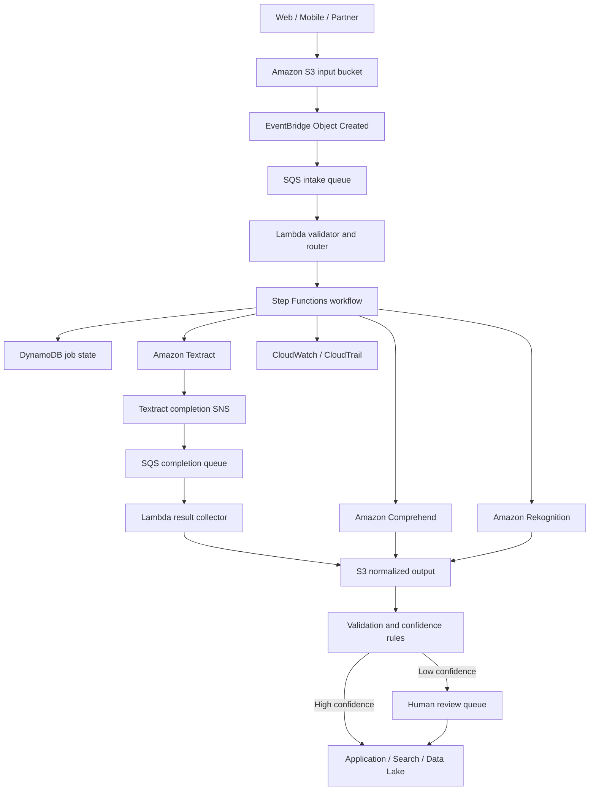

# Textract, Comprehend, Rekognition và xử lý tài liệu, hình ảnh

## 1. Bức tranh tổng thể: từ tài liệu và hình ảnh đến dữ liệu có thể sử dụng

Ứng dụng doanh nghiệp thường nhận PDF, hóa đơn, biểu mẫu, giấy tờ định danh, ảnh sản phẩm, ảnh hiện trường hoặc video. Dữ liệu đầu vào có thể chứa văn bản in, bảng, trường biểu mẫu, đối tượng, chữ trong ảnh, khuôn mặt và nội dung cần kiểm duyệt. Ứng dụng cần chuyển chúng thành dữ liệu có cấu trúc để tìm kiếm, đối soát, phân loại, kiểm duyệt hoặc đưa vào quy trình xử lý tiếp theo.

AWS cung cấp ba dịch vụ AI chuyên biệt thường được kết hợp:

- **Amazon Textract** trích xuất chữ và cấu trúc từ tài liệu: dòng, từ, cặp key-value, bảng, checkbox, chữ ký và câu trả lời cho câu hỏi về nội dung tài liệu.
- **Amazon Comprehend** phân tích ngôn ngữ trên văn bản: entity, key phrase, sentiment, ngôn ngữ, PII và phân loại/nhận diện thực thể tùy chỉnh.
- **Amazon Rekognition** phân tích hình ảnh và video: object/scene labels, text trong ảnh, face detection/analysis, content moderation, face search và custom labels.

Mỗi dịch vụ giải quyết một loại tín hiệu. Textract biến bố cục tài liệu thành text và relationships; Comprehend phân tích ý nghĩa của text; Rekognition hiểu nội dung hình ảnh/video. Một pipeline có thể dùng một dịch vụ hoặc nối nhiều dịch vụ theo nhu cầu.

Ví dụ, với hồ sơ vay:
1. Textract đọc biểu mẫu, bảng thu nhập và tài liệu hỗ trợ.
2. Comprehend phân loại đoạn văn bản hoặc trích xuất entity nếu ngôn ngữ được hỗ trợ.
3. Rekognition có thể kiểm tra ảnh tài liệu hoặc hình ảnh liên quan theo use case phù hợp.
4. Ứng dụng hợp nhất kết quả, kiểm tra confidence và chuyển trường hợp không chắc chắn sang người duyệt.

Không dịch vụ nào tự thay thế kiểm tra nghiệp vụ. Kết quả AI là tín hiệu có confidence, cần validation, quyền truy cập phù hợp và human review khi quyết định ảnh hưởng đến khách hàng.

## 2. Mục tiêu học tập

Sau bài học, người học có thể:

1. Phân biệt nhiệm vụ của Textract, Comprehend và Rekognition.
2. Chọn API đồng bộ hoặc bất đồng bộ theo loại dữ liệu và yêu cầu latency.
3. Dùng Textract để đọc text, forms, tables, queries, signatures, expenses và lending documents.
4. Đọc cấu trúc Block, relationships, geometry và confidence trong kết quả Textract.
5. Dùng Comprehend để nhận diện entity, key phrase, sentiment và PII.
6. Phân biệt real-time, batch synchronous và asynchronous batch trong Comprehend.
7. Chọn Rekognition Image, Video, moderation, face và custom-label operations.
8. Thiết kế pipeline S3, EventBridge, SQS, SNS, Lambda và Step Functions.
9. Xử lý pagination, duplicate notifications, retry, idempotency và service quotas.
10. Thiết kế confidence thresholds, exception queue và human review.
11. Bảo vệ tài liệu, hình ảnh, PII và biometric data bằng IAM, S3, KMS và retention.
12. Đo chi phí theo trang, request, ảnh/video và workflow.
13. Xây dựng, kiểm thử và vận hành pipeline bằng AWS CLI.

## 3. Chọn đúng dịch vụ

| Nhu cầu | Dịch vụ/API | Kết quả |
|---|---|---|
| OCR tài liệu, đọc dòng và từ | Textract DetectDocumentText | LINE, WORD và geometry |
| Trích xuất key-value, checkbox | Textract AnalyzeDocument với FORMS | KEY_VALUE_SET, selection elements |
| Trích xuất bảng | Textract AnalyzeDocument với TABLES | TABLE, CELL, relationships |
| Tìm trường theo câu hỏi | Textract AnalyzeDocument với QUERIES | QUERY và QUERY_RESULT |
| Phát hiện vị trí chữ ký | Textract với SIGNATURES | SIGNATURE geometry/confidence |
| Hóa đơn và biên lai | Textract AnalyzeExpense | Vendor, summary fields, line items |
| Phân tích bộ hồ sơ cho vay | Textract Analyze Lending | Phân loại trang và kết quả theo loại tài liệu |
| Tìm người, tổ chức, địa điểm | Comprehend DetectEntities | Entity, type, offsets, score |
| Tóm lược cụm từ nổi bật | Comprehend DetectKeyPhrases | Key phrases |
| Phân tích sắc thái văn bản | Comprehend DetectSentiment | Positive, negative, neutral, mixed |
| Phát hiện PII | Comprehend DetectPiiEntities | PII type, offsets, score |
| Nhận diện object/scene | Rekognition DetectLabels | Labels và confidence |
| Đọc chữ trong ảnh | Rekognition DetectText | Text detections và geometry |
| Phát hiện khuôn mặt | Rekognition DetectFaces | Face box, landmarks, attributes |
| So sánh khuôn mặt | Rekognition CompareFaces | Similarity score |
| Kiểm duyệt ảnh | Rekognition DetectModerationLabels | Moderation labels và confidence |
| Phân tích video lưu trong S3 | Rekognition Video Start/Get APIs | Kết quả bất đồng bộ theo thời gian |
| Phát hiện vật thể riêng của doanh nghiệp | Rekognition Custom Labels | Custom model inference |

Quy tắc chọn nhanh:

- Tài liệu có layout, bảng hoặc form: bắt đầu bằng Textract.
- Đã có text và cần hiểu nội dung: dùng Comprehend nếu ngôn ngữ được hỗ trợ.
- Đầu vào là ảnh/video và cần hiểu object, text, face hoặc moderation: dùng Rekognition.
- Cần nhiều bước, nhiều nhánh hoặc review: điều phối bằng Step Functions và queue.

## 4. Amazon Textract: OCR có cấu trúc

Textract không chỉ trả về một chuỗi OCR phẳng. Với document analysis, service trả về danh sách Block có relationships để mô tả cấu trúc tài liệu.

Các nhóm dữ liệu thường gặp:

- PAGE: trang tài liệu.
- LINE và WORD: dòng và từ được nhận dạng.
- KEY_VALUE_SET: cặp key/value của biểu mẫu.
- TABLE và CELL: bảng và ô.
- SELECTION_ELEMENT: checkbox/radio button cùng trạng thái chọn.
- SIGNATURE: vùng có chữ ký.
- QUERY và QUERY_RESULT: câu hỏi, alias và câu trả lời tương ứng.
- LAYOUT blocks: title, paragraph, list, header/footer và các thành phần bố cục được hỗ trợ.

Mỗi block có thể chứa confidence, geometry, page number và relationships. Ứng dụng nên dùng relationship IDs để dựng lại cấu trúc thay vì giả định thứ tự block trong response luôn là thứ tự nghiệp vụ.

### 4.1. DetectDocumentText

Dùng `DetectDocumentText` khi chỉ cần dòng và từ OCR, không cần quan hệ form/table.

Use case: lấy text từ ảnh scan; index tài liệu để tìm kiếm; trích xuất text thô làm đầu vào cho NLP; phân tích nhanh chất lượng scan.

API trả về LINE/WORD blocks và vị trí tương đối. Ứng dụng có thể ghép text theo page và geometry nhưng cần giữ nguyên metadata để đối chiếu với ảnh gốc.

### 4.2. AnalyzeDocument

`AnalyzeDocument` dùng khi cần quan hệ giữa các thành phần. Tham số `FeatureTypes` xác định loại phân tích:

- `FORMS`: cặp key-value và selection elements.
- `TABLES`: table/cell structure.
- `QUERIES`: tìm trường theo câu hỏi.
- `SIGNATURES`: vị trí chữ ký.
- `LAYOUT`: cấu trúc bố cục như paragraph, title, list và header/footer.

Có thể kết hợp nhiều feature types trong một request nếu use case cần. Tất cả LINE/WORD vẫn có thể xuất hiện trong kết quả kể cả khi không được chọn làm feature chính.

AnalyzeDocument đồng bộ phù hợp với tài liệu đơn trang và phản hồi nhanh. Với tài liệu nhiều trang hoặc xử lý theo lô, dùng StartDocumentAnalysis/GetDocumentAnalysis.

### 4.3. Forms và key-value pairs

Với biểu mẫu đăng ký, Textract có thể nhận diện key như `Applicant Name` và value tương ứng. Kết quả biểu diễn qua KEY_VALUE_SET blocks và relationship giữa KEY với VALUE.

Ứng dụng cần dựng map block theo ID, tìm block có entity type KEY, đọc relationship VALUE để tìm block giá trị, rồi lưu text, confidence, page và bounding box. Sau đó validate kiểu dữ liệu và business rules.

Không giả định mọi label đều nằm ngay cạnh value. Biểu mẫu có nhiều cột, checkbox hoặc bố cục lệch cần logic dựng quan hệ.

### 4.4. Tables và selection elements

Textract có thể trích xuất table, cell, title/footer và selection elements. Khi xử lý bảng hóa đơn hoặc báo cáo, giữ lại row/column relationships, page number và geometry để không làm mất ngữ cảnh.

Bảng có merged cells, đường kẻ mờ, chữ xoay hoặc ảnh nền phức tạp có thể làm giảm độ chính xác. Nếu downstream cần CSV, hãy dựng lại bảng từ cell relationships và kiểm tra các ô bị thiếu trước khi xuất.

### 4.5. Queries

Queries cho phép hỏi Textract những trường cần tìm, ví dụ:

- “What is the invoice number?”
- “What is the invoice date?”
- “What is the total amount due?”

Kết quả gồm QUERY và QUERY_RESULT, liên kết bằng ID và có confidence score. Query nên dùng từ ngữ gần với cách trường xuất hiện trong tài liệu.

Queries không phải chatbot tổng quát và không tự suy luận nghiệp vụ ngoài nội dung tài liệu. Feature này hiện chỉ hỗ trợ tiếng Anh; không dùng query tiếng Việt với kỳ vọng service hiểu câu hỏi nếu language matrix không hỗ trợ.

### 4.6. Signatures

Textract có thể phát hiện vùng chữ ký và trả về bounding box/confidence. Đây là phát hiện vị trí có dấu hiệu chữ ký, không phải xác minh người ký, tính hợp pháp hay tính xác thực của chữ ký.

Nếu quy trình cần xác thực danh tính người ký, phải có hệ thống identity verification hoặc quy trình nghiệp vụ riêng.


## 5. Hóa đơn, biên lai và hồ sơ cho vay

### 5.1. AnalyzeExpense

Textract AnalyzeExpense được tối ưu cho invoices và receipts. Kết quả có thể chứa:

- Vendor name và thông tin nhà cung cấp.
- Invoice/receipt summary fields.
- Tổng tiền, thuế, ngày và thông tin thanh toán.
- Line items như mô tả, số lượng, đơn giá và tổng dòng.
- Geometry và confidence của trường được trích xuất.

Dùng `AnalyzeExpense` cho hóa đơn/biên lai thay vì tự dựng mọi trường từ OCR text. Tuy nhiên, cần kiểm tra tổng tiền, currency, tax, line-item arithmetic và vendor identity với dữ liệu nghiệp vụ.

Với tài liệu nhiều trang, dùng StartExpenseAnalysis/GetExpenseAnalysis. Textract xử lý mỗi trang hóa đơn/biên lai như một tài liệu riêng; không tự giữ ngữ cảnh invoice qua nhiều trang của cùng PDF.

### 5.2. AnalyzeID

`AnalyzeID` trích xuất thông tin từ một số giấy tờ định danh được hỗ trợ, chẳng hạn US passport và US driver's license. Không giả định API này đọc được mọi loại căn cước hoặc hộ chiếu của mọi quốc gia.

Nếu xử lý giấy tờ Việt Nam, cần xác minh rõ tài liệu và language/region support; có thể phải dùng OCR tổng quát kết hợp quy tắc trích xuất, model riêng hoặc vendor phù hợp.

### 5.3. Analyze Lending

Analyze Lending là workflow cho bộ hồ sơ cho vay. Textract có thể phân loại các trang theo loại tài liệu và route tới operation phù hợp, sau đó trả kết quả cho từng trang hoặc bản summary.

Luồng thường dùng:

- StartLendingAnalysis để bắt đầu job.
- SNS thông báo khi job hoàn tất.
- GetLendingAnalysis lấy kết quả trang.
- GetLendingAnalysisSummary lấy bản tóm tắt.

Phải kiểm tra loại tài liệu được hỗ trợ, Region, quota và ngôn ngữ trước khi triển khai.

## 6. Đồng bộ và bất đồng bộ trong Textract

| Tiêu chí | Synchronous | Asynchronous |
|---|---|---|
| API | DetectDocumentText, AnalyzeDocument, AnalyzeExpense, AnalyzeID | Start*/Get* operations |
| Use case | Tài liệu đơn trang, phản hồi nhanh | PDF/TIFF nhiều trang, xử lý lô |
| Input | S3 object hoặc bytes theo API | Tài liệu lưu trong S3 |
| Response | Kết quả trong API response | JobId rồi lấy kết quả sau |
| Completion | Trong request | SNS notification, SQS/Lambda consumer |
| Pagination | Có thể tùy API | Get API có NextToken khi kết quả nhiều |
| Điều phối | Request/response | Event-driven workflow |

Với async operations, không nên poll Get API liên tục để kiểm tra trạng thái. Textract publish completion status tới SNS; có thể subscribe SQS hoặc Lambda, sau đó gọi Get API khi job hoàn tất.

Textract giữ kết quả async trong bucket do service quản lý trong 7 ngày theo mặc định. Có thể dùng `OutputConfig` để ghi kết quả vào S3 bucket do mình quản lý và cấu hình encryption/retention riêng.

### 6.1. ClientRequestToken và idempotency

Các Start APIs hỗ trợ `ClientRequestToken`. Nếu gửi lại cùng request với cùng token trong thời gian hiệu lực, Textract trả lại cùng JobId thay vì tạo job mới. Token có lifetime 7 ngày.

Tạo token ổn định từ document ID + version + operation + config hash. Không tạo token mới cho mỗi lần retry nếu mục tiêu là tránh tạo job trùng.

## 7. Amazon Comprehend: hiểu văn bản

Comprehend phân tích văn bản bằng các model dựng sẵn hoặc model tùy chỉnh.

Các built-in operations phổ biến:

- `DetectDominantLanguage`: nhận diện ngôn ngữ chính.
- `DetectEntities`: nhận diện người, tổ chức, địa điểm, ngày tháng, quantity và các entity khác.
- `DetectKeyPhrases`: tìm cụm từ quan trọng.
- `DetectSentiment`: đánh giá Positive, Negative, Neutral hoặc Mixed.
- `DetectPiiEntities`: tìm thông tin nhận dạng cá nhân.
- `DetectTargetedSentiment`: sentiment gắn với từng entity trong câu, hiện chỉ hỗ trợ tiếng Anh.
- `DetectToxicContent`: phát hiện nội dung độc hại trong các ngôn ngữ/tình huống được hỗ trợ.

Comprehend trả về text, entity type, offsets và confidence. Offsets thường dùng để xác định vị trí entity trong input text; giữ nguyên encoding và chuỗi đầu vào khi highlight hoặc redaction.

### 7.1. Entities và key phrases

Ví dụ câu:

```text
Amazon opened a new data center in Singapore in November.
```

Comprehend có thể nhận diện Amazon là ORGANIZATION, Singapore là LOCATION và November là DATE nếu ngôn ngữ được hỗ trợ.

Key phrases có thể giúp lập chỉ mục hoặc phân nhóm nội dung. Tuy nhiên, entity extraction không tương đương với xác minh sự thật; tên riêng viết tắt, lỗi OCR hoặc văn bản ngắn có thể gây nhầm lẫn.

### 7.2. Sentiment và targeted sentiment

`DetectSentiment` phân loại sentiment tổng thể của đoạn text. Kết quả không phải đánh giá khách quan về chất lượng sản phẩm hay cảm xúc thật của người viết.

`DetectTargetedSentiment` liên kết sentiment với target/entity cụ thể, ví dụ khách hàng hài lòng với giao hàng nhưng không hài lòng với sản phẩm. Feature này chỉ hỗ trợ tiếng Anh theo language matrix hiện tại.

Dùng sentiment như tín hiệu hỗ trợ phân tích phản hồi, không tự động xử phạt nhân viên hoặc quyết định quyền lợi khách hàng.

### 7.3. PII detection và redaction

`DetectPiiEntities` trả về loại PII, offsets và confidence. Nó phát hiện vùng text có khả năng chứa tên, địa chỉ, số định danh, thông tin tài chính hoặc loại PII khác theo model.

Phát hiện và che dữ liệu là hai bước khác nhau:

1. Detect PII để lấy entity type và offsets.
2. Áp dụng policy xác định loại nào cần che.
3. Thay text hoặc dùng asynchronous redaction job.
4. Kiểm tra kết quả và lưu bản đã che vào vùng dữ liệu có quyền truy cập phù hợp.

Không coi PII detector là bộ lọc hoàn hảo. Có thể có false positive và false negative; cần kiểm tra bằng test set và human review khi dữ liệu nhạy cảm.

## 8. Comprehend custom models

### 8.1. Custom classification

Custom classifier phân loại văn bản theo nhãn nghiệp vụ, ví dụ khiếu nại thanh toán, yêu cầu hoàn tiền, hỏi thông tin sản phẩm, hồ sơ cần kiểm tra pháp lý hoặc hóa đơn/hợp đồng.

Quy trình gồm chuẩn bị dữ liệu có nhãn, huấn luyện model, đánh giá precision/recall/F1, tạo endpoint hoặc chạy batch job và theo dõi drift.

### 8.2. Custom entity recognition

Custom entity recognizer nhận diện entity riêng của domain, ví dụ mã hợp đồng, mã thiết bị, tên sản phẩm nội bộ hoặc loại điều khoản.

Cần tạo tập dữ liệu gán nhãn nhất quán, chia train/test, đánh giá theo từng entity type và quản lý version model.

### 8.3. Model endpoint và batch

Real-time endpoint phù hợp ứng dụng cần phản hồi trực tiếp nhưng có thể phát sinh chi phí endpoint provisioned/throughput. Async batch phù hợp tập dữ liệu lớn trong S3 và ghi kết quả trở lại S3.

Không duy trì endpoint custom model khi không có nhu cầu nếu billing phụ thuộc thời gian endpoint hoạt động.

## 9. Ba chế độ xử lý trong Comprehend

| Chế độ | Số lượng | Đặc điểm |
|---|---|---|
| Single-document synchronous | Một document | Request trả kết quả trực tiếp |
| Multiple-document synchronous | Tối đa 25 documents/request cho Batch APIs | Một request, một ngôn ngữ cho batch, có ResultList/ErrorList |
| Asynchronous batch | Tập file trong S3 | Start job, theo dõi status, lấy output từ S3 |

Async jobs phù hợp khối lượng lớn. Input và output S3 phải ở cùng Region với Comprehend endpoint được gọi; DataAccessRoleArn cần quyền đọc input và ghi output.

Với PII batch detection/redaction, language code hiện hỗ trợ English và Spanish. Kiểm tra giới hạn từng operation vì quota file size, document count, request TPS và job concurrency khác nhau.

## 10. Ngôn ngữ được hỗ trợ: kiểm tra trước khi triển khai

Language support là điều kiện kiến trúc, không phải chi tiết nhỏ.

### 10.1. Textract

Textract có language categories theo API/feature. Danh sách hiện hành bao gồm nhiều ngôn ngữ như English, Spanish, French, German, Italian, Portuguese và nhiều ngôn ngữ khác cho một số OCR/table/layout operations. Tuy nhiên, không phải mọi feature đều hỗ trợ toàn bộ danh sách:

- Queries, Expense, ID và Lending là nhóm English-only trong language matrix.
- Forms hỗ trợ English, French, German, Italian, Portuguese và Spanish.
- Tables, Signatures, Layout và text detection có language coverage rộng hơn.
- Handwriting có giới hạn ngôn ngữ riêng.

Tiếng Việt không nằm trong danh sách ngôn ngữ được hỗ trợ công bố hiện tại. Không giả định Textract đọc chính xác giấy tờ tiếng Việt chỉ vì API nhận PDF/JPEG/PNG.

### 10.2. Comprehend

Danh sách ngôn ngữ hiện được hỗ trợ cho các built-in features gồm German, English, Spanish, Italian, Portuguese, French, Japanese, Korean, Hindi, Arabic, Chinese simplified và traditional.

- Entities và key phrases hỗ trợ các ngôn ngữ trong danh sách.
- PII detection/redaction chỉ English và Spanish.
- Targeted sentiment chỉ English.
- Plain-text custom classification hỗ trợ German, English, Spanish, French, Italian và Portuguese; native document models chỉ hỗ trợ tài liệu tiếng Anh.
- Custom entity recognition hỗ trợ German, English, Spanish, French, Italian và Portuguese; xử lý PDF/Word chỉ hỗ trợ tài liệu tiếng Anh.
- Syntax analysis và các feature khác có danh sách ngôn ngữ riêng.
- Tiếng Việt không nằm trong danh sách hiện tại.

DetectDominantLanguage có thể nhận diện ngôn ngữ từ tập rộng hơn, nhưng việc nhận diện được `vi` không có nghĩa các NLP operations khác hỗ trợ tiếng Việt. Với văn bản tiếng Việt, cần chọn model/ngôn ngữ khác phù hợp, tự huấn luyện giải pháp được hỗ trợ hoặc dùng dịch vụ NLP khác sau khi đánh giá bảo mật và chất lượng. Dịch text sang English có thể làm thay đổi tên riêng, số liệu và sắc thái; không dùng kết quả dịch như ground truth.

### 10.3. Rekognition

Rekognition Image tập trung vào hình ảnh JPEG/PNG và các tác vụ thị giác như object labels, text detection, face analysis và moderation. Với DetectText, khả năng nhận dạng chữ phụ thuộc script/font/chất lượng ảnh và language coverage của model. Không giả định ảnh chứa chữ tiếng Việt sẽ được OCR chính xác.

Luôn thử trên dữ liệu thật của doanh nghiệp, tính precision/recall theo nhóm tài liệu và lưu các trường hợp không đạt để human review.

## 11. Amazon Rekognition: phân tích hình ảnh

Rekognition Image APIs thường đồng bộ, nhận ảnh JPEG/PNG từ S3 hoặc image bytes qua SDK và trả JSON.

### 11.1. DetectLabels

`DetectLabels` phát hiện objects, scenes, concepts và activities, ví dụ car, person, tree, office, beach hoặc running. API có thể trả hierarchy, confidence, bounding boxes và image properties theo cấu hình.

Use case gồm phân loại ảnh sản phẩm, gắn tag ảnh hiện trường, tìm ảnh có phương tiện hoặc thiết bị, kiểm tra PPE trong một số tình huống và tạo metadata để tìm kiếm.

Labels là dự đoán model. Không dùng nhãn chung như “person” để kết luận danh tính hay đặc điểm nhạy cảm.

### 11.2. DetectText

`DetectText` tìm chữ trong ảnh và trả detected text, geometry, confidence cùng quan hệ giữa LINE và WORD khi có.

Dùng cho đọc mã sản phẩm hoặc biển hiệu, tìm chữ trên nhãn hàng hóa, kiểm tra ảnh có watermark/text overlay và trích text thô từ ảnh không có layout tài liệu phức tạp.

Nếu ảnh là hóa đơn, bảng biểu hoặc biểu mẫu, Textract thường phù hợp hơn vì trả về cấu trúc document.

### 11.3. DetectFaces

`DetectFaces` phát hiện khuôn mặt và có thể trả face bounding box, landmarks, pose, quality và các thuộc tính dự đoán.

Phân biệt:
- Face detection: phát hiện vùng có khuôn mặt.
- Face analysis: dự đoán thuộc tính hình ảnh của khuôn mặt.
- Face comparison/search: so sánh hoặc tìm match với dữ liệu đã lưu trong collection.

Các thuộc tính dự đoán như giới tính biểu kiến hoặc emotion không xác định bản dạng giới hay trạng thái cảm xúc thật của một người. Không dùng các dự đoán này để quyết định quyền lợi, tuyển dụng, tín dụng, bảo hiểm hoặc truy cập dịch vụ.

### 11.4. CompareFaces và collections

`CompareFaces` so sánh face source với target và trả similarity/confidence. Collections cho phép lưu face vectors để tìm kiếm khuôn mặt tương tự bằng SearchFaces hoặc SearchFacesByImage.

Đây là dữ liệu sinh trắc học nhạy cảm. Trước khi dùng cần có mục đích hợp pháp, thông báo/consent phù hợp, retention policy, access logging, deletion process và kiểm tra bias/false match. Similarity score không phải bằng chứng chắc chắn về danh tính.

## 12. Rekognition content moderation

`DetectModerationLabels` phát hiện nội dung hình ảnh có thể không phù hợp theo taxonomy của Rekognition. Với video lưu trữ, dùng StartContentModeration/GetContentModeration.

Mỗi label có confidence và taxonomy level. Có thể đặt MinConfidence để lọc kết quả.

Thiết kế moderation:

1. Chọn threshold theo mức độ rủi ro.
2. Auto-allow các trường hợp confidence thấp nếu policy cho phép.
3. Auto-block chỉ với nhóm label và threshold đã được kiểm chứng.
4. Chuyển vùng không chắc chắn vào human review queue.
5. Lưu model version, label, confidence và quyết định cuối.
6. Theo dõi false positive/false negative và cập nhật policy.

Rekognition moderation không phải bộ lọc hoàn hảo hoặc exhaustive. Không dùng nó làm căn cứ duy nhất để khẳng định nội dung hợp pháp/phi pháp hoặc thay thế moderation policy và review của con người.

## 13. Rekognition Video và streaming video

### 13.1. Stored video

Rekognition Video phân tích video lưu trong S3 theo mô hình bất đồng bộ:

1. Gọi Start operation như StartLabelDetection hoặc StartContentModeration.
2. Lưu JobId và JobTag.
3. Rekognition publish completion notification tới SNS.
4. Consumer nhận notification qua SQS/Lambda.
5. Gọi Get operation để lấy kết quả.
6. Xử lý pagination và timestamps/segments.

Các use case gồm labels, moderation, text detection, face detection/search, celebrity recognition, person tracking và segment detection tùy API.

Không poll Get APIs liên tục. Dùng SNS notification và queue để điều phối nhiều video đồng thời.

### 13.2. Streaming video

Với video stream, Rekognition tích hợp Amazon Kinesis Video Streams thông qua stream processor. Các capability và output khác nhau theo loại stream processor, ví dụ label detection, face search hoặc face liveness.

Đánh giá ingestion bandwidth, frame sampling, stream retention, latency, throughput và chi phí video trước khi triển khai.

## 14. Kiến trúc pipeline xử lý tài liệu và hình ảnh

Một kiến trúc event-driven điển hình:



Luồng có thể rút gọn nếu chỉ dùng một service. Không bắt buộc gọi cả ba dịch vụ cho mọi file.

### 14.1. Ingestion và validation

Khi file được upload, kiểm tra extension, MIME type và magic bytes; kiểm tra kích thước, số trang, độ phân giải và encryption; quét malware theo yêu cầu bảo mật; tạo document ID và version; lưu metadata như tenant, owner, consent, retention class và source system; đặt object vào prefix raw có quyền truy cập hạn chế.

Không tin hoàn toàn file extension hoặc metadata do client gửi.

### 14.2. Routing

Lambda hoặc Step Functions phân loại:

- PDF/TIFF nhiều trang: Textract async.
- Ảnh đơn trang cần OCR: Textract hoặc Rekognition tùy mục tiêu.
- Hóa đơn/biên lai: Textract Expense.
- Text đã trích xuất: Comprehend nếu ngôn ngữ hỗ trợ.
- Ảnh sản phẩm: Rekognition DetectLabels/Custom Labels.
- Ảnh UGC cần moderation: Rekognition moderation.
- Video: Rekognition Video async hoặc streaming path.

### 14.3. Hợp nhất kết quả

Chuẩn hóa output thành schema nội bộ gồm documentId, version, sourceUri, serviceName, operation, model/version, jobId, status, startedAt, completedAt, pageNumber, blockType, text, normalizedValue, entityType, confidence, boundingBox, offsets, reviewStatus, reviewer, decision, errorCode, retryCount và traceId.

Lưu raw response để audit/reprocessing; lưu normalized representation để ứng dụng downstream dễ dùng.


## 15. Orchestration bất đồng bộ với SNS và SQS

Textract async và Rekognition Video trả JobId rồi phát completion notification qua SNS. Một SQS queue subscribe SNS giúp tách completion events khỏi ứng dụng và hấp thụ burst.

Mẫu xử lý:

1. Worker tạo job và ghi JobId vào DynamoDB.
2. Notification đến SNS rồi được chuyển vào SQS.
3. Consumer lấy message và tra job metadata.
4. Consumer gọi Get API sau khi status SUCCEEDED.
5. Consumer đọc mọi trang kết quả bằng NextToken.
6. Consumer ghi normalized output.
7. Consumer cập nhật job state COMPLETED.

SQS message có thể được giao nhiều lần. Consumer phải idempotent theo JobId + operation + result page/token. Cấu hình visibility timeout, DLQ và redrive policy.

Nếu nhận notification trước khi state record được ghi, consumer có thể retry ngắn hoặc đưa vào reconciliation flow. Không giả định thứ tự event giữa nhiều dịch vụ là tuyệt đối.

## 16. Pagination và xử lý kết quả lớn

GetDocumentAnalysis, GetDocumentTextDetection và nhiều Get APIs trả kết quả theo trang với NextToken.

Quy trình:

1. Gọi Get API với JobId.
2. Lưu blocks/results nhận được.
3. Nếu có NextToken, gọi lại với token đó.
4. Lặp đến khi không còn token.
5. Kiểm tra số trang, số block và status.
6. Chỉ đánh dấu job hoàn tất sau khi đã đọc hết kết quả.

Không lưu toàn bộ response lớn trong Lambda memory hoặc Step Functions state. Ghi từng batch ra S3/DynamoDB và truyền object key/JobId giữa các bước. Step Functions state payload có giới hạn; truyền reference thay vì document bytes hoặc hàng nghìn blocks.

## 17. Confidence, validation và human review

Confidence là mức tin cậy của model cho một detection. Nó không phải xác suất đã được hiệu chỉnh cho mọi domain và không bảo đảm trường được trích xuất đúng về mặt nghiệp vụ.

Ví dụ với hóa đơn:

- Vendor name có confidence cao nhưng vendor không tồn tại trong master data.
- Total amount có confidence cao nhưng không bằng subtotal + tax.
- Invoice date hợp lệ về OCR nhưng nằm ngoài kỳ kế toán.
- Một chữ ký được phát hiện nhưng không xác minh được người ký.

Kết hợp confidence với rule validation: required fields, type/range/format, checksum nếu có, master data, arithmetic, cross-field consistency và threshold theo mức rủi ro.

Trường hợp thiếu, mâu thuẫn hoặc confidence thấp cần đưa vào human review. Ghi lại cả model output ban đầu và giá trị người duyệt sửa để đo chất lượng.

### 17.1. Human review và A2I

Textract có HumanLoopConfig tích hợp Amazon Augmented AI (A2I) trong các luồng được hỗ trợ. Tuy nhiên, tài liệu AWS hiện ghi A2I đã vào maintenance mode từ tháng 7/2026 và không nhận khách hàng mới; request dùng HumanLoopConfig có thể lỗi nếu account chưa là khách hàng A2I hiện hữu.

Với workflow mới, thiết kế review queue/UI riêng hoặc dùng giải pháp human review đang được AWS hỗ trợ cho account/Region. Không coi A2I là lựa chọn mặc định cho account mới.

## 18. Idempotency, retries và chống xử lý trùng

Các event S3, SNS, SQS và Lambda có thể được giao lặp. Retry của API cũng có thể tạo job mới nếu không dùng idempotency token.

Dùng document ID + object version/ETag; Textract ClientRequestToken cho Start operations; JobId làm định danh job phân tích; idempotency key cho mỗi stage và page; DynamoDB conditional write để claim/complete stage; SQS visibility timeout và DLQ; retry với exponential backoff và jitter; dead-letter handling cho lỗi dữ liệu không thể sửa tự động.

Phân loại lỗi:

| Loại lỗi | Hành động |
|---|---|
| Throttling/TooManyRequests | Retry có backoff, giảm concurrency |
| ServiceUnavailable/InternalServerError | Retry có giới hạn |
| InvalidS3Object/AccessDenied | Sửa file, Region hoặc IAM; không retry vô hạn |
| UnsupportedDocument/InvalidParameter | Đưa vào exception queue |
| Low confidence | Human review |
| Output schema mismatch | Quarantine result, sửa parser/version |
| Quota exceeded | Queue workload và xin quota increase nếu cần |

## 19. Bảo mật dữ liệu tài liệu, PII và hình ảnh

Tài liệu có thể chứa số định danh, địa chỉ, tài khoản ngân hàng, hợp đồng, chữ ký và dữ liệu sinh trắc học. Thiết kế bảo mật từ ingestion đến retention.

### 19.1. S3 và KMS

- Block Public Access trên input, output và review buckets.
- SSE-KMS cho raw documents, normalized output và result archives.
- Bucket policy giới hạn account/principal.
- Tách raw bucket khỏi sanitized/processed bucket.
- Lifecycle expiration và retention lock theo yêu cầu.
- Không đưa document bytes hoặc PII vào log.

### 19.2. IAM roles

Dùng service roles riêng theo workflow:

- Textract role đọc input S3, publish SNS và ghi OutputConfig nếu có.
- Comprehend DataAccessRole đọc input và ghi output S3.
- Rekognition role có quyền đọc object cần phân tích.
- Lambda execution role chỉ có quyền queue, DynamoDB và prefix S3 cần thiết.
- Step Functions role chỉ gọi các task cần thiết.

Giới hạn trust policy bằng SourceArn/SourceAccount khi phù hợp để giảm confused deputy risk.

### 19.3. Biometric và face data

Face collections chứa face metadata/templates là dữ liệu nhạy cảm. Chỉ tạo collection khi có use case và cơ sở pháp lý rõ ràng. Định nghĩa consent/notice và mục đích sử dụng, retention và deletion, quyền search/index, audit trail, false-match review và cơ chế xử lý khi người dùng rút consent.

Không sử dụng face attributes để suy ra bản dạng giới, cảm xúc thật hoặc quyết định quyền lợi nhạy cảm.


## 20. Region, quotas và throughput planning

Textract, Comprehend và Rekognition đều có quotas theo account, Region và API operation. TPS của sync APIs, start/get async APIs và concurrent jobs có thể khác nhau.

Trước khi chạy production:

1. Chọn Region nơi dữ liệu được lưu và API có mặt.
2. Kiểm tra service endpoints và feature availability.
3. Đọc Service Quotas cho từng API cần gọi.
4. Ước tính pages/images/documents mỗi giây và giờ cao điểm.
5. Kiểm tra concurrent async jobs.
6. Dùng SQS để làm phẳng traffic burst.
7. Thiết kế backpressure và retry.
8. Xin quota increase trước khi tăng production traffic.

Không hardcode quota lấy từ một Region làm chuẩn toàn cầu. Bảng quota AWS có thể thay đổi; kiểm tra quota hiện tại trong account và Region đích.

## 21. Chất lượng đầu vào và tối ưu accuracy

Chất lượng scan ảnh hưởng trực tiếp tới kết quả OCR/vision.

Khuyến nghị:

- Scan thẳng, đúng chiều đọc.
- Độ phân giải đủ cao; Textract khuyến nghị ảnh chất lượng tốt, thường khoảng 150 DPI trở lên.
- Tránh blur, glare, bóng đổ và nén quá mạnh.
- Không downsample file đã ở định dạng được hỗ trợ nếu không cần.
- Tách trang hoặc tài liệu đúng cách.
- Giữ màu/contrast phù hợp.
- Tránh crop mất lề, dấu hoặc chữ ký.
- Kiểm tra language support theo feature.
- Lưu original object bất biến để đối chiếu.

Với Rekognition, ảnh JPEG/PNG và kích thước/độ phân giải phải đáp ứng giới hạn service. Với video, kiểm tra codec/container và source location.

## 22. Monitoring và audit

Theo dõi theo từng stage:

- Số file nhận vào và file bị reject.
- Số Textract/Comprehend/Rekognition jobs đã tạo.
- Job success/failure/throttling.
- Thời gian từ upload đến hoàn tất.
- Pages/records/images processed.
- Confidence distribution theo field/label.
- Human review rate và correction rate.
- SQS backlog, age of oldest message và DLQ count.
- Lambda errors/duration/throttles.
- Step Functions failed/timed-out executions.
- Chi phí theo document type, tenant và workflow.

Dùng CloudWatch metrics/logs cho vận hành, CloudTrail cho audit API activity và correlation ID xuyên các bước. Ghi JobId, documentId, operation, Region, model version và timestamp. Mask PII trong log và chỉ lưu text cần thiết.

## 23. Chi phí và tối ưu

Chi phí phụ thuộc API/feature, số trang, số ký tự, số ảnh/video, batch size, custom model/endpoint và Region.

Các khoản liên quan:

- Textract: số trang và loại operation/feature.
- Comprehend: lượng text/units, real-time vs batch, custom model training/endpoint.
- Rekognition: số ảnh, video duration/operation và collection-based features.
- S3: raw input, output, intermediate results, backup và lifecycle.
- KMS: cryptographic requests.
- SNS/SQS/EventBridge: event và message volume.
- Lambda/Step Functions: duration, requests và state transitions.
- CloudWatch: logs, metrics và alarms.

Tối ưu bằng cách route từng file tới đúng operation; batch công việc khi API hỗ trợ; dùng async jobs cho khối lượng lớn; giảm duplicate bằng idempotency; không polling Get APIs quá mức; giữ file result trong S3 thay vì truyền payload lớn qua workflow; chọn Rekognition APIs phù hợp; chỉ duy trì custom endpoints khi cần latency; đo cost per successfully processed document.

Không chỉ so sánh giá một API. Hãy tính toàn bộ workflow, gồm retries, review, storage và downstream operations.

## 24. Ví dụ kiến trúc: xử lý hóa đơn nhà cung cấp

Một doanh nghiệp nhận hóa đơn PDF từ nhiều nhà cung cấp.

| Bước | Dịch vụ | Kết quả |
|---|---|---|
| Upload | S3 | Raw invoice |
| Trigger | EventBridge + SQS | Event có document key |
| Orchestration | Step Functions | Job state và retry |
| Extraction | Textract StartExpenseAnalysis | Vendor, totals, line items |
| Result notification | SNS + SQS | Job completion |
| Retrieval | Textract GetExpenseAnalysis | Full result, pagination |
| Validation | Lambda | VAT, currency, arithmetic, vendor master |
| NLP | Comprehend nếu language support phù hợp | Entity/PII classification |
| Review | Internal review queue | Sửa trường thiếu/sai |
| Persist | S3 + DynamoDB/RDS | Raw JSON và normalized invoice |
| Audit | CloudWatch/CloudTrail | Trace và decision record |

Không tự động thanh toán hóa đơn chỉ vì Textract trả confidence cao. Cần đối chiếu vendor, purchase order, duplicate invoice number, amount, tax và approval policy.


## 25. Ví dụ kiến trúc: phân tích ảnh sản phẩm và moderation

Một marketplace nhận ảnh sản phẩm và ảnh do người dùng tải lên.

1. Ảnh được upload vào S3 quarantine prefix.
2. EventBridge/SQS gửi event đến moderation workflow.
3. Rekognition DetectModerationLabels đánh giá nội dung ảnh.
4. DetectLabels gắn tag object/scene nếu cần.
5. DetectText kiểm tra text overlay hoặc mã sản phẩm nếu use case cần.
6. Confidence và policy rules quyết định allow, block hoặc review.
7. Human moderator xử lý trường hợp mơ hồ.
8. Chỉ ảnh được duyệt mới chuyển sang published bucket/CDN.
9. Lưu moderation model version và decision audit.

Không dùng moderation label đơn lẻ để quyết định cuối cho mọi trường hợp. Cần policy phù hợp loại nội dung, threshold và review.

## 26. AWS CLI: Textract, Comprehend và Rekognition

Các ví dụ dùng placeholder. Thay bucket, key, topic ARN và Region bằng tài nguyên lab. CLI role cần quyền phù hợp.

### 26.1. Bắt đầu Textract document analysis bất đồng bộ

Tạo file `textract-request.json`:

```json
{
  "DocumentLocation": {
    "S3Object": {
      "Bucket": "company-doc-input",
      "Name": "invoices/invoice-001.pdf"
    }
  },
  "FeatureTypes": [
    "TABLES",
    "FORMS",
    "QUERIES",
    "SIGNATURES"
  ],
  "QueriesConfig": {
    "Queries": [
      {
        "Text": "What is the invoice number?",
        "Alias": "invoice_number",
        "Pages": ["1"]
      },
      {
        "Text": "What is the total amount due?",
        "Alias": "total_due",
        "Pages": ["1"]
      }
    ]
  },
  "NotificationChannel": {
    "SNSTopicArn": "arn:aws:sns:ap-southeast-1:111122223333:textract-completion",
    "RoleArn": "arn:aws:iam::111122223333:role/TextractPublishRole"
  },
  "ClientRequestToken": "invoice-001-v1-analysis"
}
```

Chạy job:

```bash
aws textract start-document-analysis \
  --cli-input-json file://textract-request.json \
  --region ap-southeast-1
```

Sau khi SNS notification báo SUCCEEDED, lấy kết quả:

```bash
aws textract get-document-analysis \
  --job-id JOB_ID_FROM_START_RESPONSE \
  --region ap-southeast-1
```

Nếu response có NextToken, gọi tiếp GetDocumentAnalysis với token đó đến khi hết trang kết quả.

### 26.2. Phân tích entity với Comprehend

Ví dụ văn bản tiếng Anh:

```bash
aws comprehend detect-entities \
  --text "Amazon opened a new office in Singapore in November." \
  --language-code en \
  --region ap-southeast-1
```

Đối với PII:

```bash
aws comprehend detect-pii-entities \
  --text "Contact Alex at alex@example.com." \
  --language-code en \
  --region ap-southeast-1
```

LanguageCode phải nằm trong danh sách được API hỗ trợ. Không đổi sang `vi` nếu operation không hỗ trợ tiếng Việt.

### 26.3. Phân tích labels và moderation ảnh với Rekognition

```bash
aws rekognition detect-labels \
  --image '{"S3Object":{"Bucket":"company-image-input","Name":"products/item-001.jpg"}}' \
  --max-labels 20 \
  --min-confidence 80 \
  --region ap-southeast-1
```

Moderation:

```bash
aws rekognition detect-moderation-labels \
  --image '{"S3Object":{"Bucket":"company-image-input","Name":"ugc/photo-001.jpg"}}' \
  --min-confidence 70 \
  --region ap-southeast-1
```

Threshold chỉ là ví dụ. Chọn theo test data, precision/recall và policy review.

## 27. Bài thực hành: pipeline xử lý hóa đơn và ảnh đính kèm

### 27.1. Mục tiêu

Xây dựng pipeline nhận PDF hóa đơn và ảnh đính kèm, trích xuất dữ liệu bằng Textract, phân tích text bằng Comprehend khi ngôn ngữ hỗ trợ và kiểm tra ảnh bằng Rekognition.

### 27.2. Chuẩn bị

- AWS account lab.
- S3 input/output buckets riêng.
- SNS topic và SQS completion queue.
- IAM roles cho Textract, Comprehend, Rekognition và Lambda.
- DynamoDB table lưu document/job state.
- Step Functions state machine.
- CloudWatch log group và alarm.
- Bộ hóa đơn/ảnh test không chứa dữ liệu cá nhân thật hoặc đã được khử định danh.

### 27.3. Các bước

1. Tạo S3 input bucket với Block Public Access và SSE-KMS.
2. Tạo SNS topic cho Textract completion.
3. Subscribe SQS queue vào SNS và cấu hình DLQ.
4. Tạo DynamoDB table với documentId/version làm key.
5. Tạo Lambda validator để kiểm tra file type, size, Region và metadata.
6. Tạo Step Functions workflow nhận object key, không truyền bytes tài liệu trong state.
7. Route hóa đơn sang StartExpenseAnalysis hoặc StartDocumentAnalysis.
8. Lưu JobId và ClientRequestToken.
9. Khi notification đến, consumer gọi Get API và xử lý NextToken.
10. Chuẩn hóa output thành JSON; giữ raw response ở S3.
11. Với text có ngôn ngữ được hỗ trợ, gọi Comprehend để nhận diện entity/PII.
12. Với ảnh JPEG/PNG, gọi Rekognition DetectLabels hoặc moderation phù hợp.
13. Áp dụng confidence thresholds và validation rules.
14. Đưa trường hợp thiếu/sai/low confidence vào review queue.
15. Ghi decision, model version và audit metadata.
16. Kiểm thử duplicate notification, throttling, invalid document và service failure.
17. Đo thời gian xử lý, tỷ lệ review và cost per document.
18. Đặt lifecycle cho input/output/temporary data theo retention policy.

### 27.4. Tiêu chí hoàn thành

- File được validate và route đúng service.
- Textract job có JobId và nhận completion notification.
- Get API pagination được xử lý đầy đủ.
- Comprehend chỉ chạy với language/feature được hỗ trợ.
- Rekognition trả labels/moderation theo policy.
- Duplicate events không tạo duplicate business records.
- Low-confidence results được đưa vào review.
- S3/KMS/IAM theo least privilege.
- Dashboard thể hiện job status, latency, errors và review rate.
- Chi phí được đo theo document/image thành công.

## 28. Troubleshooting

| Triệu chứng | Nguyên nhân có thể | Hướng xử lý |
|---|---|---|
| Textract InvalidS3Object | Sai bucket/key, Region hoặc quyền đọc | Kiểm tra object, Region và service role |
| Textract UnsupportedDocument | Định dạng hoặc số trang không phù hợp | Kiểm tra PDF/TIFF/JPEG/PNG và operation |
| Textract LimitExceeded | TPS/concurrent jobs vượt quota | Queue request, backoff và xin quota |
| Textract không có Query result | Query language/field không hỗ trợ hoặc prompt không phù hợp | Kiểm tra English-only và test query |
| Thiếu block/table cells | Scan kém, layout phức tạp hoặc model không nhận diện | Cải thiện scan, review geometry và confidence |
| Comprehend UnsupportedLanguage | LanguageCode không hỗ trợ operation | Kiểm tra feature language matrix |
| Comprehend PII không trả kết quả | Ngôn ngữ không phải English/Spanish hoặc text format sai | Validate language và input |
| Comprehend batch FAILED | IAM role thiếu S3 permission hoặc input format sai | Kiểm tra DataAccessRole và file layout |
| Rekognition InvalidS3Object | Bucket/Region/permission không phù hợp | Kiểm tra S3 object và Region endpoint |
| Rekognition throttling | TPS vượt quota | Smooth traffic bằng SQS, retry/backoff |
| Rekognition false positive | Threshold hoặc model không phù hợp | Tuning bằng test set và human review |
| Job hoàn tất nhưng thiếu dữ liệu | Chưa xử lý hết NextToken | Tiếp tục pagination đến hết |
| Job bị xử lý hai lần | SNS/SQS duplicate delivery hoặc retry tạo job mới | Idempotency key, ClientRequestToken và conditional writes |

## 29. Anti-patterns thường gặp

| Anti-pattern | Hậu quả | Cách cải thiện |
|---|---|---|
| Dùng Textract cho mọi loại ảnh | Tốn chi phí và không tận dụng vision labels | Chọn Rekognition cho object/scene/moderation |
| Dùng Rekognition OCR cho hóa đơn phức tạp | Mất cấu trúc form/table | Dùng Textract |
| Gọi Comprehend trên ngôn ngữ không hỗ trợ | Kết quả không đáng tin hoặc request lỗi | Validate language/feature trước khi gọi |
| Coi confidence là xác suất đúng tuyệt đối | Quyết định sai | Kết hợp rule validation và human review |
| Poll Textract/Rekognition Get APIs liên tục | Throttling và chi phí vận hành | SNS/SQS completion notifications |
| Đưa PDF/image bytes vào Step Functions state | Payload quá lớn | Lưu S3 object và truyền key/reference |
| Không xử lý NextToken | Mất một phần kết quả | Pagination loop có checkpoint |
| Không idempotent | Duplicate records hoặc business actions | Job ID, document version và conditional write |
| Log raw PII | Rò rỉ dữ liệu | Mask/redact và giới hạn retention |
| Dùng face attributes cho quyết định nhạy cảm | Rủi ro sai lệch và xâm phạm quyền riêng tư | Chỉ dùng trong use case phù hợp, có review và governance |
| Dùng A2I cho account mới mà không kiểm tra availability | Workflow có thể fail | Kiểm tra trạng thái A2I; dùng review workflow được hỗ trợ |
| Bỏ qua quotas | Throttling và backlog | SQS, backoff, concurrency limits và quota planning |

## 30. Checklist production

### Service selection and language

- [ ] Textract/Comprehend/Rekognition được chọn theo đúng loại input và output.
- [ ] API sync/async phù hợp latency và document size.
- [ ] Language matrix được kiểm tra theo operation cụ thể.
- [ ] Tiếng Việt không bị giả định là được hỗ trợ khi không có trong language list.
- [ ] Region và service quotas được xác minh.

### Pipeline reliability

- [ ] S3 upload event được xử lý idempotently.
- [ ] JobId, documentId và object version được lưu.
- [ ] Textract/Rekognition completion notifications đi qua SNS/SQS.
- [ ] Get API pagination xử lý hết NextToken.
- [ ] Retry có exponential backoff/jitter và DLQ.
- [ ] Step Functions state chỉ truyền object reference.
- [ ] Có reconciliation cho job stuck/notification bị mất.

### Accuracy and review

- [ ] Có test dataset đại diện cho document/image thực tế.
- [ ] Theo dõi confidence và error rate theo field/label.
- [ ] Business validation kiểm tra arithmetic, format và master data.
- [ ] Low-confidence hoặc conflicting results được human review.
- [ ] Moderation threshold được hiệu chỉnh bằng test data.
- [ ] Face/biometric use case có policy và legal basis phù hợp.

### Security and privacy

- [ ] S3 Block Public Access và SSE-KMS.
- [ ] IAM least privilege theo service role.
- [ ] SNS topic policy và confused deputy protections.
- [ ] PII/biometric data được phân loại và giới hạn quyền.
- [ ] Logs không chứa raw document/PII.
- [ ] Retention, deletion và audit trail được cấu hình.
- [ ] Human review tool có access control và audit.

### Cost and operations

- [ ] Theo dõi cost per processed document/image.
- [ ] SQS smooth traffic để không vượt TPS.
- [ ] Không poll Get APIs quá mức.
- [ ] CloudWatch dashboard và alarms có owner.
- [ ] Có runbook cho throttling, invalid document và failed jobs.
- [ ] Lifecycle cleanup cho raw/intermediate/output data.
- [ ] Custom model endpoint chỉ chạy khi có nhu cầu.

## 31. Tài liệu tham khảo chính thức

### Amazon Textract

- [What is Amazon Textract?](https://docs.aws.amazon.com/textract/latest/dg/what-is.html)
- [Analyzing documents](https://docs.aws.amazon.com/textract/latest/dg/how-it-works-analyzing.html)
- [AnalyzeDocument API](https://docs.aws.amazon.com/textract/latest/APIReference/API_AnalyzeDocument.html)
- [Analyzing invoices and receipts](https://docs.aws.amazon.com/textract/latest/dg/analyzing-expense.html)
- [Asynchronous operations](https://docs.aws.amazon.com/textract/latest/dg/api-async.html)
- [Calling asynchronous operations](https://docs.aws.amazon.com/textract/latest/dg/async.html)
- [Supported languages](https://docs.aws.amazon.com/textract/latest/dg/supported-languages.html)
- [Textract quotas](https://docs.aws.amazon.com/textract/latest/dg/limits-quotas-explained.html)
- [Textract data protection](https://docs.aws.amazon.com/textract/latest/dg/data-protection.html)

### Amazon Comprehend

- [What is Amazon Comprehend?](https://docs.aws.amazon.com/comprehend/latest/dg/what-is.html)
- [Supported languages](https://docs.aws.amazon.com/comprehend/latest/dg/supported-languages.html)
- [Document processing modes](https://docs.aws.amazon.com/comprehend/latest/dg/concepts-processing-modes.html)
- [Detect entities](https://docs.aws.amazon.com/comprehend/latest/dg/how-entities.html)
- [Detect PII entities](https://docs.aws.amazon.com/comprehend/latest/dg/how-pii.html)
- [PII asynchronous jobs](https://docs.aws.amazon.com/comprehend/latest/dg/async-pii-api.html)
- [PII redaction](https://docs.aws.amazon.com/comprehend/latest/dg/redact-api-pii.html)
- [Guidelines and quotas](https://docs.aws.amazon.com/comprehend/latest/dg/guidelines-and-limits.html)

### Amazon Rekognition

- [What is Amazon Rekognition?](https://docs.aws.amazon.com/rekognition/latest/dg/what-is.html)
- [Understanding image and video operations](https://docs.aws.amazon.com/rekognition/latest/dg/how-it-works-operations-intro.html)
- [Types of analysis](https://docs.aws.amazon.com/rekognition/latest/dg/how-it-works-types.html)
- [Moderating content](https://docs.aws.amazon.com/rekognition/latest/dg/moderation.html)
- [Stored video analysis](https://docs.aws.amazon.com/rekognition/latest/dg/video.html)
- [Face attribute guidelines](https://docs.aws.amazon.com/rekognition/latest/dg/guidance-face-attributes.html)
- [Image specifications](https://docs.aws.amazon.com/rekognition/latest/dg/images-information.html)
- [Rekognition quotas](https://docs.aws.amazon.com/rekognition/latest/dg/limits.html)

### Kiến trúc và vận hành

- [AWS Guidance for Intelligent Document Processing](https://docs.aws.amazon.com/solutions/intelligent-document-processing-on-aws/)
- [Step Functions best practices](https://docs.aws.amazon.com/step-functions/latest/dg/sfn-best-practices.html)
- [Lambda application design and idempotency](https://docs.aws.amazon.com/lambda/latest/dg/concepts-application-design.html)
- [Using Lambda with SQS](https://docs.aws.amazon.com/lambda/latest/dg/with-sqs.html)


