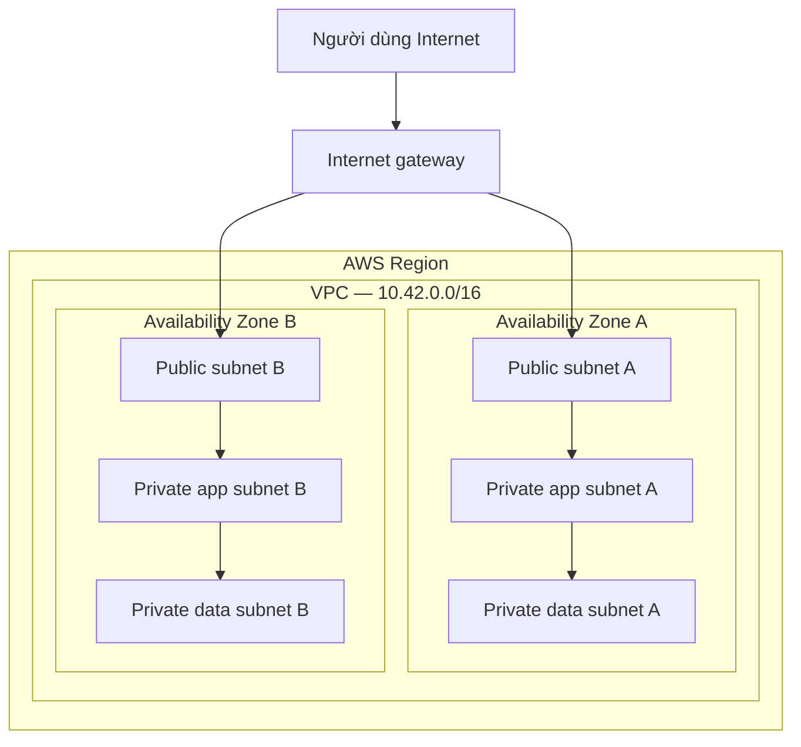
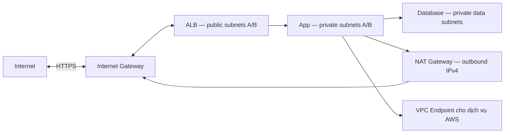

# VPC, CIDR và lập kế hoạch địa chỉ IP

Khi triển khai ứng dụng trên AWS, quyết định **mạng nào chứa ứng dụng, dải địa chỉ nào được cấp và các thành phần được phép giao tiếp với nhau ra sao** cần được đưa ra trước khi tạo EC2, ECS, EKS, RDS hoặc nhiều dịch vụ khác. Quyết định vội vàng có thể khiến subnet hết IP, các VPC không kết nối được do trùng dải mạng hoặc phải di chuyển tài nguyên tốn kém khi mở rộng hệ thống.

Bài học thuộc chương **Mạng VPC** của module **CLOUD_PROVIDERS_AWS**. Từ nền tảng **Region/AZ, IAM và Amazon VPC**, người học thực hành chọn dải **CIDR**, chia **subnet theo Availability Zone**, dự trù IP cho dịch vụ tính toán, lưu trữ, cơ sở dữ liệu và serverless, đồng thời đặt nền móng cho kết nối an toàn, giám sát, phục hồi và kiểm soát chi phí.

## 1. Mục tiêu học tập

Sau bài học, bạn có thể:

1. Mô tả **Amazon VPC**, subnet, Availability Zone và vai trò của các thành phần mạng liên quan.
2. Giải thích ký hiệu **CIDR**; tính địa chỉ đầu/cuối, tổng số địa chỉ IPv4 và số IP có thể gán cho tài nguyên trong subnet AWS.
3. Thiết kế sơ đồ cấp phát IPv4 có khả năng mở rộng, không trùng lặp, trải qua ít nhất hai AZ.
4. Phân biệt **public subnet, private subnet** với **public IP/private IP**, hiểu vai trò của route table, internet gateway, NAT gateway và VPC endpoint.
5. Nhận biết cách dùng **IPv6/dual-stack**, AWS IP Address Manager (IPAM) và các giới hạn vận hành ảnh hưởng đến kế hoạch địa chỉ.
6. Kiểm tra bản thiết kế bằng bảng phân bổ, phép tính, mã ví dụ và các câu hỏi thực tế.

## 2. Amazon VPC là gì?

**Amazon Virtual Private Cloud (Amazon VPC)** là mạng ảo được cô lập logic trong AWS. Bạn chọn dải IP cho VPC, tạo subnet, cấu hình đường đi lưu lượng và các lớp kiểm soát truy cập cho tài nguyên được kết nối.

Một **VPC nằm trong một Region** và có thể chứa nhiều subnet. **Mỗi subnet thuộc đúng một Availability Zone (AZ)**; cùng một VPC có thể có các subnet ở nhiều AZ khác nhau. AWS cung cấp các thành phần mạng nền, còn bạn thiết kế cách phân vùng và bảo vệ lưu lượng.

### 2.1. Phân biệt các đối tượng

| Đối tượng | Phạm vi/ý nghĩa | Câu hỏi cần trả lời |
|---|---|---|
| **AWS account** | Ranh giới quản trị, quyền, tài nguyên và chi phí | Đội nào sở hữu mạng và workload? |
| **Region** | Khu vực địa lý AWS | Đặt dữ liệu/ứng dụng tại Region nào? |
| **Availability Zone (AZ)** | Vùng hạ tầng được thiết kế cô lập lỗi trong Region | Cần chạy tài nguyên ở mấy AZ để chịu lỗi? |
| **VPC** | Mạng ảo trong một Region | Dải IP và phạm vi kết nối của hệ thống là gì? |
| **Subnet** | Phân đoạn IP của VPC, gắn một AZ | Tài nguyên của tầng ứng dụng nằm ở đâu? |
| **Network interface (ENI)** | Giao diện mạng ảo, có thể chiếm địa chỉ IP từ subnet | Dịch vụ nào đang tiêu thụ IP? |
| **Route table** | Tập quy tắc xác định đích tiếp theo của gói tin theo địa chỉ đích | Lưu lượng nội bộ, Internet hoặc on-premises đi đường nào? |
| **Security group** | Bộ quy tắc lưu lượng **stateful** ở cấp giao diện mạng/tài nguyên | Ai được kết nối tới tài nguyên? |
| **Network ACL** | Bộ quy tắc **stateless** ở cấp subnet | Có cần chặn/cho phép lưu lượng ở ranh giới subnet? |

VPC không phải một máy chủ; subnet cũng không nhất thiết là mạng “public”. Hai subnet khác AZ có thể nằm trong cùng một VPC và trao đổi lưu lượng qua định tuyến `local`, nhưng quyền kết nối thực tế còn phụ thuộc vào security group, NACL, routing và cấu hình dịch vụ.

### 2.2. Sơ đồ khái niệm



*Sơ đồ thể hiện phân tầng logic, không ngụ ý mọi kết nối tự động được cho phép hay phải triển khai đúng theo các mũi tên. Đường đi thực tế cần route, chính sách mạng và cấu hình dịch vụ tương ứng.*

> **Nguyên tắc:** Chọn CIDR dựa trên kết nối dự kiến trong nhiều năm, không chỉ số lượng EC2 sẽ chạy hôm nay. Dải mạng của một VPC có thể được kết nối với VPC khác, với trung tâm dữ liệu tại chỗ, VPN hoặc mạng doanh nghiệp về sau.

## 3. Hiểu địa chỉ IPv4 và CIDR

**IPv4** gồm 32 bit, biểu diễn thành bốn nhóm số từ 0 đến 255, chẳng hạn `10.42.16.8`. **CIDR** (*Classless Inter-Domain Routing*) biểu diễn một khối địa chỉ bằng địa chỉ mạng và **độ dài tiền tố** (prefix), chẳng hạn `10.42.16.0/24`.

Trong `/24`, có **24 bit cho phần mạng** và **8 bit cho phần host**. Dải có tổng cộng `2^8 = 256` địa chỉ, từ `10.42.16.0` tới `10.42.16.255`.

Công thức tổng quát cho IPv4:

```text
Số bit host             = 32 - prefix_length
Tổng địa chỉ IPv4       = 2 ^ (32 - prefix_length)
IP dùng được trong AWS  ≈ Tổng địa chỉ - 5
```

Dòng cuối đúng với **subnet IPv4 thông thường** vì AWS dành trước năm địa chỉ. Đây không phải công thức để tính toàn bộ IPv4 của VPC, càng không phải số phiên bản EC2 chắc chắn triển khai được: một tài nguyên có thể chiếm nhiều IP, các dịch vụ có quota và yêu cầu IP bổ sung. Có ngoại lệ về địa chỉ dự trữ với các dải IPv4 mang vào AWS bằng **BYOIP**; hãy kiểm tra tài liệu AWS khi dùng trường hợp đó.

### 3.1. Tra nhanh kích thước khối IPv4

| CIDR | Subnet mask | Tổng IPv4 | IPv4 có thể gán trong subnet AWS thông thường | Trường hợp hay gặp |
|---|---|---:|---:|---|
| `/16` | `255.255.0.0` | 65.536 | 65.531 | Dải lớn cho VPC hoặc tập tài nguyên có quy mô lớn |
| `/20` | `255.255.240.0` | 4.096 | 4.091 | Subnet tương đối lớn, có nhu cầu nhiều ENI/IP |
| `/22` | `255.255.252.0` | 1.024 | 1.019 | Tầng ứng dụng có nhu cầu co giãn đáng kể |
| `/24` | `255.255.255.0` | 256 | 251 | Subnet phổ biến cho workload vừa và nhỏ |
| `/26` | `255.255.255.192` | 64 | 59 | Nhóm tài nguyên vừa phải |
| `/27` | `255.255.255.224` | 32 | 27 | Phân đoạn nhỏ |
| `/28` | `255.255.255.240` | 16 | 11 | Phân đoạn nhỏ nhất được AWS hỗ trợ cho subnet IPv4 thông thường |

**Chú ý:** Trên AWS, độ dài CIDR IPv4 được phép khi tạo **VPC** và **subnet** thường nằm trong khoảng **`/16` đến `/28`**; khối địa chỉ phải thuộc dải hợp lệ và tuân theo điều kiện của dịch vụ. Không thể tạo subnet IPv4 `/29` theo cách thông thường.

### 3.2. Địa chỉ mạng và ranh giới khối

Dải `10.42.16.0/24` chứa:

- Địa chỉ đầu tiên: `10.42.16.0`.
- Địa chỉ cuối cùng: `10.42.16.255`.
- Tổng: 256 địa chỉ.

Nếu chia thành hai khối `/25`, ta có:

| Khối | Dải địa chỉ | Tổng |
|---|---|---:|
| `10.42.16.0/25` | `10.42.16.0` – `10.42.16.127` | 128 |
| `10.42.16.128/25` | `10.42.16.128` – `10.42.16.255` | 128 |

Chia `/24` thành bốn khối `/26` thì các địa chỉ bắt đầu phải là **0, 64, 128, 192** ở octet cuối.

Vì vậy, `10.42.16.64/26` là ranh giới hợp lệ, còn `10.42.16.70/26` không phải địa chỉ đầu của một khối `/26`. Công cụ/API có thể chuẩn hóa giá trị CIDR nhập vào thành địa chỉ mạng chuẩn; bạn nên **tính ranh giới trước** và tránh phụ thuộc vào việc chuẩn hóa tự động.

### 3.3. RFC 1918: dải IPv4 private

Ba dải private thường dùng trong mạng nội bộ:

| Dải | Phạm vi | Số lượng địa chỉ |
|---|---|---:|
| `10.0.0.0/8` | `10.0.0.0` – `10.255.255.255` | 16.777.216 |
| `172.16.0.0/12` | `172.16.0.0` – `172.31.255.255` | 1.048.576 |
| `192.168.0.0/16` | `192.168.0.0` – `192.168.255.255` | 65.536 |

**Dải private không có nghĩa là tự động bảo mật.** Bạn vẫn phải cấu hình route, SG, NACL, IAM và các biện pháp bảo vệ dữ liệu. Ngược lại, một máy dùng IP private vẫn có thể truy cập Internet theo tuyến egress được thiết kế, chẳng hạn NAT gateway đối với IPv4.

## 4. AWS dự trữ những địa chỉ nào trong subnet?

Trong **subnet IPv4 thông thường**, AWS dành trước **bốn địa chỉ đầu** và **một địa chỉ cuối**. Với `10.42.16.0/24`:

| IP | Lý do AWS dành trước |
|---|---|
| `10.42.16.0` | Địa chỉ mạng |
| `10.42.16.1` | Router của VPC |
| `10.42.16.2` | Dự trữ cho DNS theo thiết kế địa chỉ của VPC |
| `10.42.16.3` | Dự trữ cho mục đích tương lai |
| `10.42.16.255` | Địa chỉ broadcast của mạng; AWS không hỗ trợ broadcast trong VPC |

Các địa chỉ IPv4 có thể cấp thông thường ở ví dụ trên là `10.42.16.4` đến `10.42.16.254`, tổng **251 địa chỉ**.

Đối với subnet `10.42.16.0/28`:

- Tổng `2^(32-28) = 16` địa chỉ, từ `10.42.16.0` tới `10.42.16.15`.
- Trừ năm địa chỉ AWS dành trước, chỉ còn **11 IP** có thể gán.
- Nếu một dịch vụ dùng thêm ENI hoặc địa chỉ phụ, bạn có thể cạn IP rất nhanh. `/28` thường quá chật cho một tầng ứng dụng có autoscaling.

**Đừng nhầm “tổng số địa chỉ của CIDR” với “số địa chỉ còn khả dụng” trên AWS.** Thuộc tính `AvailableIpAddressCount` của subnet có thể phản ánh lượng IP IPv4 chưa dùng tại thời điểm truy vấn; số thực tế thay đổi theo tài nguyên đang tạo, xóa hoặc giữ địa chỉ.

Nguồn: [AWS — Subnet CIDR blocks](https://docs.aws.amazon.com/vpc/latest/userguide/subnet-sizing.html).

## 5. Quy tắc cấp phát CIDR trong VPC

Trước khi vẽ subnet, cần nắm các ràng buộc:

1. **VPC phải có một CIDR IPv4 chính** lúc tạo (trừ khi AWS thay đổi yêu cầu cho loại VPC cụ thể); có thể gắn thêm các khối IPv4 phụ tuân theo giới hạn dịch vụ.
2. **Mọi CIDR của subnet phải nằm trong một khối CIDR đã liên kết với VPC** và thuộc định dạng được hỗ trợ.
3. **Các subnet trong cùng VPC không được chồng lấn CIDR**, dù nằm ở AZ khác nhau.
4. **Mỗi subnet gắn với một AZ**, và không thể chuyển AZ của subnet bằng việc sửa thuộc tính.
5. **Không thể thay trực tiếp khối IPv4 CIDR của subnet đã tạo**. Khi cần phân đoạn khác, thường phải tạo subnet mới và di chuyển/triển khai lại các tài nguyên liên quan.
6. **Các CIDR liên kết cùng một VPC không được chồng lấn**; việc thêm/xóa secondary CIDR còn phụ thuộc điều kiện route và tài nguyên hiện hữu.
7. **Không nên chồng CIDR giữa những mạng có khả năng cần định tuyến với nhau**, kể cả khác AWS account hoặc Region.

### 5.1. Ví dụ phân biệt CIDR hợp lệ và chồng lấn

Giả sử VPC có `10.42.0.0/16`:

| Đề xuất | Đánh giá | Giải thích |
|---|---|---|
| `10.42.0.0/24` và `10.42.1.0/24` | Hợp lệ | Hai dải liên tiếp, không giao nhau |
| `10.42.16.0/22` và `10.42.20.0/22` | Hợp lệ | `/22` tăng theo khối bốn ở octet thứ ba; các dải riêng biệt |
| `10.42.16.0/24` và `10.42.16.128/25` | **Không hợp lệ** | `/25` nằm bên trong `/24`, gây chồng lấn |
| `10.43.0.0/24` | **Không hợp lệ** nếu VPC chỉ có `10.42.0.0/16` | Ngoài dải CIDR đã gắn với VPC |
| `10.42.16.0/29` | **Không hợp lệ** cho subnet IPv4 thông thường | Nhỏ hơn kích thước `/28` tối thiểu được hỗ trợ |
| Hai subnet đều là `10.42.32.0/24` ở AZ khác nhau | **Không hợp lệ** | AZ khác không cho phép tái sử dụng dải trong cùng VPC |

### 5.2. Trùng dải giữa các VPC: lỗi khó sửa khi cần kết nối

Ví dụ:

- VPC A (production): `10.60.0.0/16`.
- VPC B (shared services): `10.60.1.0/24`.

Cả hai đều có thể tồn tại độc lập ở các VPC/account khác nhau, nhưng **hai dải trùng nhau**. Khi sau này triển khai VPC peering, Transit Gateway hoặc kết nối doanh nghiệp, kiến trúc định tuyến IP giữa các mạng có thể không thực hiện được như mong muốn. AWS VPC peering không hỗ trợ peering các VPC có CIDR IPv4 chồng lấn; Transit Gateway cũng có hạn chế tương ứng với các CIDR chồng lấn.

**Cách tốt hơn:** phân bổ tập trung ngay từ đầu, ví dụ:

- `10.60.0.0/16`: production.
- `10.61.0.0/16`: staging.
- `10.62.0.0/16`: development.
- `10.63.0.0/16`: shared services.

*Các dải trên chỉ minh họa.* Phải đối chiếu với mạng văn phòng, VPN, Direct Connect, các nhà cung cấp cloud khác và kế hoạch mở rộng để không trùng phạm vi đã được tổ chức sử dụng.

## 6. Thiết kế subnet theo hai Availability Zone

Giả sử nhóm xây hệ thống đặt hàng có load balancer, ứng dụng và cơ sở dữ liệu. Chọn:

- Region theo nhu cầu kinh doanh, độ trễ, pháp lý và dịch vụ được hỗ trợ.
- VPC `10.42.0.0/16`.
- Hai AZ (ký hiệu **A** và **B**) để giảm rủi ro một AZ gặp sự cố.
- Ba nhóm subnet: **ingress/public**, **application/private**, **database/private**.

### 6.1. Bảng phân bổ mẫu

| Subnet | AZ | CIDR | IPv4 có thể gán | Dự kiến sử dụng |
|---|---|---|---:|---|
| `public-a` | A | `10.42.0.0/24` | 251 | ALB công khai, NAT gateway nếu cần |
| `public-b` | B | `10.42.1.0/24` | 251 | ALB công khai, NAT gateway nếu cần |
| `app-a` | A | `10.42.16.0/22` | 1.019 | EC2, ECS tasks, ENI và các thành phần ứng dụng |
| `app-b` | B | `10.42.20.0/22` | 1.019 | Tầng ứng dụng dự phòng/co giãn ở AZ B |
| `data-a` | A | `10.42.32.0/24` | 251 | Thành phần dữ liệu cần subnet/ENI ở AZ A |
| `data-b` | B | `10.42.33.0/24` | 251 | Thành phần dữ liệu cần subnet/ENI ở AZ B |

**Phân bổ còn trống:** giữ `10.42.48.0/20` và một số khối khác để mở rộng trong tương lai; vùng “để dành” là **quy ước quản trị trên sơ đồ**, chưa phải một subnet AWS nếu bạn chưa tạo.

Lợi ích của cách bố trí:

- Mỗi tầng có subnet ở **hai AZ**, đáp ứng điều kiện nền cho nhiều mô hình cân bằng tải và dự phòng.
- Tầng ứng dụng có `/22` thay vì `/28` vì có thể tạo thêm EC2, container tasks, pod, endpoint/ENI.
- Các dải không chồng nhau, có khoảng trống để tạo subnet mới khi mở rộng.
- Sơ đồ được quản lý theo tập CIDR dễ đọc và kiểm tra.

**Không đồng nghĩa tất cả thành phần tự động HA.** Ví dụ, RDS Multi-AZ, ECS deployment nhiều AZ hay ALB cần cấu hình riêng; subnet ở hai AZ chỉ cung cấp địa chỉ và vị trí để triển khai.

### 6.2. Tính số địa chỉ trong mẫu

- `10.42.16.0/22`: `2^(32-22) = 1.024` địa chỉ; khoảng **1.019 IPv4 có thể cấp** trong subnet AWS thông thường.
- `10.42.0.0/24`: `2^8 = 256` địa chỉ; khoảng **251 IPv4 có thể cấp**.
- Tổng IPv4 khả dụng của sáu subnet mẫu: `2 × 251 + 2 × 1.019 + 2 × 251 = 3.042` địa chỉ.

Con số 3.042 **không phải số tài nguyên có thể chạy bảo đảm**: ALB, NAT gateway, nhiều loại endpoint, EC2 có secondary private IP, container và database có thể sử dụng địa chỉ không theo tỷ lệ một tài nguyên/một IP.

### 6.3. Cách dự trù headroom

Không nên chỉ lấy “số máy hiện tại + 5”. Tính dung lượng với đơn vị là **địa chỉ IP thực tế dịch vụ sử dụng**:

```text
IP cần dùng ở giờ cao điểm
  = IP gắn với máy/ENI chính
  + IP phụ, IP cho pod/task/endpoint theo kiến trúc
  + IP cần cho rollout, scale-out và nâng cấp
  + IP tạm thời của cân bằng tải/dịch vụ quản lý (nếu có)
  + phần dự phòng tăng trưởng

CIDR được chọn phải đáp ứng:
  IP cần dùng ở giờ cao điểm <= tổng IP có thể gán trong subnet
```

Để dự báo có cơ sở, xác định **quy mô mỗi AZ**, số lượng ENI và phương pháp mạng của dịch vụ. Ví dụ:

- ECS tasks ở chế độ mạng `awsvpc` sử dụng ENI/IP theo mô hình thực thi và tính năng hỗ trợ.
- EKS với Amazon VPC CNI có thể tiêu thụ nhiều địa chỉ cho pod và ENI; lượng sử dụng phụ thuộc cấu hình CNI, loại instance, prefix delegation và phiên bản.
- Application Load Balancer cần đủ địa chỉ IP trong subnet để mở rộng và bảo trì; cần xem yêu cầu của ELB với subnet được chọn.
- Interface VPC endpoints tạo ENI trong subnet; một số dịch vụ quản lý tạo/giữ IP tạm trong lúc nâng cấp.
- AWS đặt giới hạn quota và các ràng buộc tài nguyên, nên **dải địa chỉ đủ rộng chưa bảo đảm có thể triển khai vô hạn**.

**Ví dụ định lượng:** nếu mục tiêu 300 IP đang dùng trong một AZ và cần tối thiểu 25% dự phòng (`300 × 1,25 = 375`), subnet `/24` chỉ có 251 IP sẽ không đủ; `/23` có 507 IP có thể gán, còn `/22` có 1.019 IP. Chọn `/22` có thể hợp lý nếu dự kiến tăng trưởng mạnh, nhưng vẫn phải cân đối địa chỉ dùng chung toàn tổ chức.

## 7. Public subnet, private subnet và đường đi lưu lượng

Tính public/private của subnet **không chỉ dựa trên tên hoặc CIDR**. Với IPv4 thông thường, một **public subnet** có route đến **internet gateway (IGW)**. Một instance cần có **public IPv4/Elastic IP** hoặc được dịch vụ công khai đứng trước hỗ trợ thì mới có đường kết nối trực tiếp phù hợp tới Internet; route IGW một mình chưa cấp public IP.

**Private subnet** không có route trực tiếp ra IGW. Workload ở private subnet có thể truy cập ra Internet theo hướng outbound qua **NAT gateway** (đối với IPv4), hoặc truy cập dịch vụ AWS qua **VPC endpoint** khi phù hợp.

### 7.1. Route table tham khảo

**Route table của public subnet**:

| Destination | Target | Ý nghĩa |
|---|---|---|
| `10.42.0.0/16` | `local` | Giao tiếp trong VPC, nếu chính sách mạng cho phép |
| `0.0.0.0/0` | Internet gateway | Đường đi Internet IPv4 |

**Route table của private app subnet** (ví dụ AZ A):

| Destination | Target | Ý nghĩa |
|---|---|---|
| `10.42.0.0/16` | `local` | Giao tiếp nội bộ VPC |
| `0.0.0.0/0` | NAT gateway đặt ở public subnet AZ A | Cho outbound IPv4; không tự mở inbound từ Internet |

**Route table của private data subnet**:

| Destination | Target | Ý nghĩa |
|---|---|---|
| `10.42.0.0/16` | `local` | Nội bộ VPC |
| Các route riêng cần thiết | Đích tương ứng, nếu được phê duyệt | Kết nối với dịch vụ/mạng cụ thể |

Không thêm đường mặc định ra Internet cho data subnet nếu không có yêu cầu. Nếu database cần cập nhật hoặc truy cập dịch vụ AWS, xem xét phương án egress an toàn, endpoint, proxy hoặc thiết kế riêng thay vì mặc định đưa database ra Internet.

### 7.2. Những thành phần thường phối hợp

| Thành phần | Mục đích | Điều không nên hiểu sai |
|---|---|---|
| **Internet gateway** | Cho lưu lượng Internet theo route và địa chỉ phù hợp | Có IGW không đồng nghĩa mọi máy trong VPC đã public |
| **NAT gateway** | Hỗ trợ kết nối outbound từ mạng private IPv4 theo thiết kế | Có thể phát sinh phí theo giờ và lưu lượng; không thay firewall |
| **Gateway endpoint** | Route riêng tới dịch vụ như S3/DynamoDB tại Region hỗ trợ | Chỉ áp dụng cho loại dịch vụ và cơ chế endpoint được hỗ trợ |
| **Interface endpoint / AWS PrivateLink** | Kết nối private tới dịch vụ qua ENI trong VPC | Chiếm IP trong subnet và thường có phí riêng |
| **Security group** | Quy tắc stateful inbound/outbound của tài nguyên/ENI | Không quyết định route, không thay subnet |
| **Network ACL** | Quy tắc stateless ở ranh giới subnet | Phải tính cả hai chiều và cổng ephemeral nếu dùng rule chặt |
| **VPC Flow Logs** | Ghi thông tin lưu lượng IP ở phạm vi hỗ trợ | Không phải bản ghi mọi nội dung gói tin và không thay CloudTrail |

**Sơ đồ lưu lượng gợi ý:**



*NAT gateway, ALB và endpoint có thể có nhiều điểm triển khai, route và điều kiện riêng theo AZ. Sơ đồ rút gọn để giải thích logic.*

### 7.3. Sẵn sàng và chi phí cho NAT gateway

Một mẫu phổ biến là đặt **NAT gateway ở mỗi AZ** và cấu hình private subnet cùng AZ đi tới NAT tương ứng. Lợi ích là giảm phụ thuộc chéo AZ khi một AZ gặp lỗi và có thể hạn chế lưu lượng qua AZ. Tuy nhiên chi phí tăng vì mỗi NAT gateway có phí riêng; cấu hình dùng chung một NAT gateway có thể rẻ hơn nhưng tạo phụ thuộc và có thể phát sinh phí truyền dữ liệu khác AZ.

Đánh giá **tính sẵn sàng, lượng outbound thực tế, chi phí truyền dữ liệu và endpoint** trước khi lựa chọn.

## 8. IPv6 và dual-stack khi lập kế hoạch IP

IPv4 có 32 bit; **IPv6 có 128 bit**, giúp tăng không gian địa chỉ và hỗ trợ nhiều thiết kế giao tiếp trực tiếp bằng địa chỉ IPv6. Trên AWS có các cách triển khai IPv4-only, **dual-stack** (IPv4 + IPv6) và subnet IPv6-only theo điều kiện của dịch vụ.

### 8.1. Các điểm cần nhớ

- VPC AWS có **CIDR IPv4** và có thể liên kết thêm CIDR **IPv6**; cách cấp phát IPv6 tùy nguồn địa chỉ (Amazon-provided, IPAM, BYOIP).
- Với địa chỉ IPv6 **Amazon-provided**, AWS thường cấp **`/56` cho VPC**. Mẫu phổ biến là **`/64` cho mỗi subnet**, nhưng **AWS hiện hỗ trợ các độ dài subnet IPv6 khác trong phạm vi `/44` đến `/64`, tăng theo bước `/4`**, nếu phù hợp với dải VPC và điều kiện cấp phát.
- AWS cũng dành trước **bốn địa chỉ IPv6 đầu và một địa chỉ cuối** trong mỗi subnet IPv6 thông thường.
- IPv6 có route và quy tắc security group/NACL riêng; không suy ra lưu lượng IPv6 được phép chỉ vì đã cho phép IPv4.
- Với outbound IPv6 chỉ khởi tạo từ trong VPC, có thể dùng **egress-only internet gateway** và route `::/0` tương ứng. Với public IPv6, route `::/0` tới internet gateway kết hợp rule bảo mật phù hợp.
- Các dịch vụ trong cùng ứng dụng cần được kiểm tra mức hỗ trợ dual-stack/IPv6; **không mặc định mọi dịch vụ hoặc client đều dùng IPv6**.

### 8.2. Ví dụ mô hình địa chỉ

Giả sử VPC được AWS cấp khối IPv6 dạng `2001:db8:abcd:1200::/56` (*tiền tố `2001:db8::/32` chỉ để minh họa tài liệu, không phải địa chỉ có thể triển khai công khai*). Ta có thể minh họa các subnet `/64`:

| Subnet | IPv6 CIDR minh họa |
|---|---|
| `public-a` | `2001:db8:abcd:1200::/64` |
| `public-b` | `2001:db8:abcd:1201::/64` |
| `app-a` | `2001:db8:abcd:1210::/64` |
| `app-b` | `2001:db8:abcd:1211::/64` |
| `data-a` | `2001:db8:abcd:1220::/64` |
| `data-b` | `2001:db8:abcd:1221::/64` |

Các khối trên nằm trong một `/56` và không trùng nhau. Khi dùng thật, AWS cấp tiền tố IPv6 thực tế; không nhập dải tài liệu ví dụ vào VPC production.

**Cảnh báo thiết kế:** Không thể quy đổi đơn giản việc “đã có IPv6” thành “ứng dụng không bao giờ thiếu IPv4”: các thành phần chỉ dùng IPv4, giới hạn ENI, công cụ quan sát và dịch vụ chưa hỗ trợ vẫn có thể tạo điểm nghẽn.

Nguồn: [AWS — VPC CIDR blocks](https://docs.aws.amazon.com/vpc/latest/userguide/vpc-cidr-blocks.html), [AWS — Subnet sizing](https://docs.aws.amazon.com/vpc/latest/userguide/subnet-sizing.html), [AWS — Add IPv6 support for your VPC](https://docs.aws.amazon.com/vpc/latest/userguide/vpc-migrate-ipv6-add.html).

## 9. Quy trình lập kế hoạch địa chỉ IP từ đầu

### Bước 1 — Thu thập ràng buộc

Ghi rõ:

- **Phạm vi tài khoản, Region, AZ**: có bao nhiêu ứng dụng, môi trường và mạng dùng chung?
- **Kết nối tương lai**: on-premises, site-to-site VPN, Direct Connect, VPC peering, Transit Gateway, cloud khác?
- **Dải IP hiện có**: IPAM doanh nghiệp, mạng văn phòng, VPN của người dùng, VPC mặc định và các mạng vendor.
- **Nhu cầu workload**: EC2, ECS, EKS, RDS, Lambda trong VPC, ALB/NLB, NAT, endpoints, dịch vụ dữ liệu.
- **Tiêu chí vận hành**: RTO/RPO, hai hay nhiều AZ, mạng cách ly, chi phí NAT/endpoint, khả năng tăng trưởng.

### Bước 2 — Phân bổ không gian ở cấp tổ chức

Ví dụ một quy hoạch giả định có quyền sử dụng dải `10.64.0.0/12` (gồm các octet thứ hai từ 64 đến 79):

| Môi trường | CIDR VPC dự kiến | Lưu ý |
|---|---|---|
| Production | `10.64.0.0/16` | Chỉ khi không trùng với mạng đang dùng và đã được tổ chức phê duyệt |
| Staging | `10.65.0.0/16` | Kết nối với production chỉ theo nhu cầu |
| Development | `10.66.0.0/16` | Dự kiến nhiều tài nguyên thử nghiệm |
| Shared services | `10.67.0.0/16` | DNS, network, dịch vụ chia sẻ nếu có |
| Dự phòng | Các khối `/16` tiếp theo trong `10.64.0.0/12` | Để mở rộng, không cấp phát trùng |

**Đây là ví dụ sơ đồ, không phải khuyến nghị mặc định dùng `10.64.0.0/12`.** Nếu doanh nghiệp đã phân bổ IP, phải ưu tiên phương án hiện hành và làm việc với đội network.

Đối với tổ chức có nhiều account/Region, **Amazon VPC IP Address Manager (IPAM)** hỗ trợ quản lý pool CIDR, phân bổ địa chỉ, theo dõi mức sử dụng và tình trạng overlap/compliance theo phạm vi được cấu hình. IPAM giúp chuẩn hóa quy trình; nó không tự sửa các route hoặc xung đột của những mạng đã triển khai.

### Bước 3 — Phân bổ subnet theo tầng và AZ

Thiết lập bảng cho mỗi subnet:

- Tên, account/VPC/Region/AZ, CIDR IPv4/IPv6.
- Đối tượng sử dụng (load balancer, ứng dụng, dữ liệu).
- Dự báo IP hiện tại và cực đại.
- Route table, security group chuẩn, NACL tùy yêu cầu.
- Các gateway/endpoint và ai chịu trách nhiệm.
- Chủ sở hữu, trạng thái đã cấp phát và khối kế cận dành cho mở rộng.

**Tính theo AZ.** Tổng 500 IP trên toàn VPC không giúp ích nếu ứng dụng đang cần 350 IP ở riêng AZ A trong subnet `/24` chỉ có 251 IP khả dụng.

### Bước 4 — Kiểm tra va chạm và ranh giới

Trước khi tạo VPC/subnet:

1. Kiểm tra CIDR từng subnet nằm trong CIDR VPC.
2. Không có hai subnet nào chồng lấn.
3. Các subnet cùng tầng có mặt ở đủ AZ theo mục tiêu sẵn sàng.
4. VPC không trùng những mạng cần kết nối.
5. Có đủ IP cho ENI, rollout, cập nhật dịch vụ và tăng trưởng.
6. Route phù hợp với mô hình public/private; không lộ data subnet ngoài ý muốn.
7. Có người chịu trách nhiệm cập nhật sổ đăng ký khi tạo hoặc xóa subnet.

### Bước 5 — Kiểm chứng và duy trì

Sau triển khai, theo dõi số IP còn lại trong subnet, số lượng ENI, metric/alert ứng dụng, VPC Flow Logs nếu phù hợp và kiểm tra chi phí mạng. Xem lại thiết kế khi dùng EKS, thêm AZ, thêm account hoặc kết nối mạng đối tác.

**Không thể “nới CIDR subnet” bằng một nút sửa trực tiếp**; nhiều trường hợp phải tạo subnet mới, điều chỉnh resource mappings, route, subnet groups, cân bằng tải và di chuyển workload. Vì thế nên dự trù khoảng trống **tại thời điểm thiết kế**.

## 10. Công cụ tính toán và kiểm tra CIDR

### 10.1. Kiểm tra bằng Python chuẩn (chạy trên máy cá nhân)

Thư viện chuẩn `ipaddress` giúp xác minh subnet nằm trong VPC và không chồng nhau. Đoạn mã sau **chỉ tính toán, không gọi API AWS, không tạo tài nguyên**:

```python
from ipaddress import ip_network

vpc = ip_network("10.42.0.0/16")
subnets = {
    "public-a": ip_network("10.42.0.0/24"),
    "public-b": ip_network("10.42.1.0/24"),
    "app-a": ip_network("10.42.16.0/22"),
    "app-b": ip_network("10.42.20.0/22"),
    "data-a": ip_network("10.42.32.0/24"),
    "data-b": ip_network("10.42.33.0/24"),
}

for name, subnet in subnets.items():
    assert subnet.subnet_of(vpc), f"{name}: outside VPC"
    assert subnet.prefixlen >= 16 and subnet.prefixlen <= 28
    usable_ipv4 = subnet.num_addresses - 5
    print(f"{name:10} {str(subnet):18} usable={usable_ipv4}")

items = list(subnets.items())
for i in range(len(items)):
    name_a, subnet_a = items[i]
    for j in range(i + 1, len(items)):
        name_b, subnet_b = items[j]
        assert not subnet_a.overlaps(subnet_b), (
            f"overlap: {name_a} and {name_b}"
        )

print("CIDR plan: OK")
```

Hãy thử đổi `app-b` từ `10.42.20.0/22` thành `10.42.18.0/23` và kiểm tra kết quả: subnet mới **chồng lấn** với `app-a` vì `10.42.18.0/23` nằm trong `10.42.16.0/22`. Đây là lỗi quy hoạch, không phải lỗi tạo máy ảo.

Mã trên dùng phép trừ năm địa chỉ cho subnet IPv4 thông thường theo quy tắc AWS; trường hợp BYOIP có ngoại lệ cần xử lý riêng.

### 10.2. Kiểm tra tài khoản AWS bằng lệnh chỉ đọc

Nếu được cấp **profile AWS CLI** có quyền `ec2:DescribeVpcs` và `ec2:DescribeSubnets`, có thể xem CIDR đã triển khai:

```bash
# Xem danh sách VPC và IPv4 CIDR chính trong Region ví dụ
aws ec2 describe-vpcs \
  --region ap-southeast-1 \
  --profile learning \
  --query "Vpcs[].[VpcId,CidrBlock]" \
  --output table

# Xem subnet: AZ, CIDR và số IPv4 hiện còn khả dụng
aws ec2 describe-subnets \
  --region ap-southeast-1 \
  --profile learning \
  --query "Subnets[].{Vpc:VpcId,Subnet:SubnetId,AZ:AvailabilityZone,CIDR:CidrBlock,FreeIPv4:AvailableIpAddressCount}" \
  --output table
```

Lệnh chỉ truy vấn các tài nguyên mà danh tính hiện tại được phép xem; kết quả là **thông tin tại thời điểm chạy**, không thay thế số liệu sử dụng lịch sử hoặc dự báo tăng trưởng. Thay Region/profile theo môi trường được cấp quyền.

### 10.3. AWS IPAM và giám sát năng lực

Với vài subnet, một bảng tính quản lý CIDR có thể đủ cho bước thiết kế ban đầu. Khi quy mô lên nhiều AWS accounts, Regions, VPCs và mạng on-premises:

- Phân chia pool theo môi trường, khu vực và nhu cầu kết nối.
- Cấp phát từ pool thay vì để từng đội tự chọn CIDR.
- Theo dõi **overlapping CIDRs**, địa chỉ đã cấp, còn trống và quy tắc cấp phát.
- Đặt cảnh báo mức sử dụng subnet theo ngưỡng phù hợp.
- Tính chi phí của IPAM và các tính năng đi kèm theo bảng giá hiện hành.

Nguồn: [AWS — Amazon VPC IP Address Manager](https://docs.aws.amazon.com/vpc/latest/ipam/what-is-it-ipam.html), [Monitor CIDR usage by resource](https://docs.aws.amazon.com/vpc/latest/ipam/monitor-cidr-compliance-ipam.html).

## 11. Sai lầm phổ biến và cách xử lý

| Sai lầm | Hệ quả | Cách phòng tránh |
|---|---|---|
| Chọn `/28` vì hiện tại chỉ có vài máy | Hết IP khi có autoscaling, endpoints hoặc rollout | Ước lượng IP cực đại theo từng AZ và dự phòng tăng trưởng |
| Dùng cùng CIDR cho mọi VPC dev/prod | Khó hoặc không thể định tuyến khi muốn kết nối các mạng | Phân bổ địa chỉ riêng từ pool chung |
| Nhầm public subnet với EC2 có public IP | Chọn route hoặc cấu hình truy cập Internet sai | Kiểm tra đồng thời route, public IP, SG và NACL |
| Dùng một NAT gateway cho mọi AZ mà không đánh giá | Phụ thuộc vào một AZ và có thể chịu phí truyền cross-AZ | So sánh HA, phí NAT, endpoint và egress thực tế |
| Chỉ dựa vào số máy để tính IP | Bỏ sót ENI, pod, task, load balancer, VPC endpoint | Tính theo cách từng dịch vụ sử dụng IP |
| Cho rằng hai AZ có thể dùng trùng subnet CIDR | AWS từ chối tạo subnet | Mỗi subnet phải có CIDR riêng, không overlap |
| Chia subnet sát nhau không để chỗ mở rộng | Phải di chuyển tài nguyên khi muốn subnet lớn hơn | Dự trù dải dự phòng có ghi nhận |
| Có route `local` nên nghĩ traffic tự động được phép | Kết nối bị SG/NACL chặn hoặc quyền quá rộng | Phân biệt chức năng route và các lớp policy |
| Bật IPv6 rồi giữ nguyên security policy IPv4 | Có lưu lượng IPv6 chưa được xem xét | Kiểm tra riêng route `::/0` và rule IPv6 |
| Tạo VPC mà không kiểm tra dải văn phòng/VPN | Trùng tuyến khi kết nối hybrid | Đồng bộ quy hoạch CIDR với đội mạng doanh nghiệp |

## 12. Thực hành tình huống

### Tình huống A — Chọn kích thước subnet cho EKS

Một hệ thống dự kiến cần tối đa **420 địa chỉ IPv4 ở mỗi AZ** cho pods, ENIs và thời điểm rollout. Bạn đang cân nhắc:

- Phương án 1: `/24`.
- Phương án 2: `/23`.
- Phương án 3: `/22`.

**Câu hỏi:** phương án nào đáp ứng số lượng IP trên lý thuyết? Những yếu tố nào cần kiểm chứng thêm?

**Gợi ý:**

- `/24`: 251 IP khả dụng → không đủ.
- `/23`: 507 IP khả dụng → đủ về mặt số lượng nhưng biên dự phòng 87 IP (~17% trên 507) cần đánh giá.
- `/22`: 1.019 IP khả dụng → có nhiều khoảng dự phòng hơn nhưng dùng không gian địa chỉ lớn hơn.
- Ngoài số IP, cần kiểm tra giới hạn loại instance, CNI, prefix delegation, quy trình scale, quota AWS và cấu hình theo AZ.

### Tình huống B — Chọn CIDR cho VPC mới

Công ty đã có:

- VPC A: `10.50.0.0/16`.
- Mạng văn phòng: `10.51.0.0/16`.
- Mạng dự định dùng cho đối tác: `10.52.0.0/16`.

Ba đề xuất cho VPC B:

1. `10.50.128.0/17`.
2. `10.53.0.0/16`.
3. `10.51.100.0/24`.

**Câu hỏi:** nếu cần kết nối tất cả các mạng, phương án nào ít xung đột nhất?

**Gợi ý:** phương án **2** không chồng lên ba dải đã nêu; phương án 1 nằm trong VPC A, phương án 3 nằm trong mạng văn phòng. Dù chọn phương án 2, vẫn phải kiểm tra các mạng khác chưa được liệt kê và chính sách IPAM.

### Tình huống C — Kiểm tra bảng subnet

Một VPC có CIDR `10.42.0.0/16`, dự kiến ba subnet:

| Subnet | CIDR |
|---|---|
| frontend-a | `10.42.0.0/24` |
| frontend-b | `10.42.1.0/24` |
| app-a | `10.42.0.128/25` |

**Vấn đề:** `app-a` nằm một phần trong `frontend-a` nên không hợp lệ. Bạn có thể sửa thành `10.42.2.0/25` nếu chưa cấp vùng đó và nhu cầu dung lượng phù hợp; subnet sau sửa có 123 IPv4 có thể gán.

### Tình huống D — Hết IP dù EC2 chạy ít

Một subnet chỉ có 10 EC2 đang chạy nhưng `AvailableIpAddressCount` gần bằng 0.

**Các giả thuyết cần kiểm chứng:** các instance giữ secondary IP; ENI của endpoint hoặc dịch vụ khác dùng địa chỉ; stopped instances vẫn giữ private IP; pod/task dùng IP; địa chỉ còn gán cho ENI cũ; subnet được chọn quá nhỏ. Hãy xem ENI/IP allocation thực tế và mô hình dịch vụ trước khi mở rộng hệ thống.

### Tự kiểm tra

1. Với `10.0.8.0/22`, dải địa chỉ chạy từ đâu đến đâu?
2. Subnet IPv4 `/26` AWS thông thường có bao nhiêu IP có thể gán?
3. Vì sao `10.0.8.0/24` và `10.0.8.128/25` không thể cùng nằm trong một VPC?
4. Hai subnet nằm ở hai AZ có thể cùng CIDR IPv4 không?
5. Có route `0.0.0.0/0` tới internet gateway nghĩa là EC2 trong đó chắc chắn truy cập được Internet không?
6. Vì sao thiết kế IP nên tính tới Transit Gateway hoặc VPN ngay cả khi hiện tại chỉ có một VPC?
7. Một ứng dụng có hai AZ nhưng chỉ dùng NAT gateway ở AZ A có vấn đề khả dụng gì?
8. Khi thêm IPv6, vì sao cần rà soát lại SG, NACL và route?
9. Vì sao chia subnet ngay lúc tạo VPC sẽ tiết kiệm công sức hơn khi lượng workload tăng nhanh?
10. AWS IPAM giúp giải quyết vấn đề gì mà tài khoản AWS đơn lẻ khó quản lý bằng tay?

**Đáp án nhanh:** (1) `10.0.8.0`–`10.0.11.255`; (2) 59; (3) overlap; (4) không; (5) chưa chắc — còn public IP và các lớp policy khác; (6) tránh overlap khi kết nối các mạng; (7) workload ở AZ B có thể phụ thuộc AZ A cho egress; (8) IPv6 dùng route/rule riêng; (9) CIDR subnet đã tạo không thể đổi trực tiếp; (10) quy hoạch pool, cấp phát nhất quán và phát hiện trùng/dùng thiếu hiệu quả.

## 13. Checklist trước khi đưa thiết kế VPC vào triển khai

- [ ] Đã thống nhất Region, số AZ và chủ sở hữu account/VPC.
- [ ] Dải IPv4 VPC không trùng các mạng cần kết nối hiện tại và dự kiến.
- [ ] CIDR subnet nằm trong VPC, đúng ranh giới và không chồng lấn.
- [ ] Mỗi tầng workload có đủ subnet/AZ theo yêu cầu khả dụng.
- [ ] Dung lượng IP tính cả ENI, pod/task, endpoint, rollout và tăng trưởng.
- [ ] Có vùng CIDR dự trữ, có người quản lý sổ phân bổ/IPAM.
- [ ] Public/private được xác định bằng route và cách truy cập thực tế.
- [ ] Các route IGW/NAT/VPC endpoint cùng SG/NACL đã được kiểm tra.
- [ ] Đã đánh giá khả năng dual-stack/IPv6 của các dịch vụ nếu dùng.
- [ ] Kế hoạch quan sát mức dùng IP, Flow Logs, lỗi kết nối và kiểm soát chi phí đã có.
- [ ] Những yêu cầu sao lưu, phục hồi và thay đổi mạng có quy trình vận hành phù hợp.

## 14. Kết luận

**VPC** tạo ranh giới mạng ảo trong một Region; **subnet** phân bổ địa chỉ và đặt tài nguyên vào một AZ; **CIDR** mô tả không gian địa chỉ phải được chia theo nhu cầu thực tế. Một bản thiết kế đáng tin cậy bắt đầu bằng việc thống nhất dải IP cấp tổ chức, tránh overlap, dự trù địa chỉ theo mỗi AZ và phân biệt rõ định tuyến với chính sách bảo mật.

Bước tiếp theo là vận dụng sơ đồ CIDR vào **route table, internet gateway, NAT, security group, NACL, VPC endpoint và kết nối liên VPC**, rồi kiểm chứng khi triển khai dịch vụ tính toán, cơ sở dữ liệu, lưu trữ, tích hợp và serverless. Thiết kế địa chỉ đúng từ đầu giúp hệ thống mở rộng, vận hành an toàn và kiểm soát chi phí dễ hơn nhiều.

### Tài liệu AWS chính thức

1. [What is Amazon VPC?](https://docs.aws.amazon.com/vpc/latest/userguide/what-is-amazon-vpc.html)
2. [VPC CIDR blocks](https://docs.aws.amazon.com/vpc/latest/userguide/vpc-cidr-blocks.html)
3. [Subnet CIDR blocks and reserved addresses](https://docs.aws.amazon.com/vpc/latest/userguide/subnet-sizing.html)
4. [Subnets for your VPC](https://docs.aws.amazon.com/vpc/latest/userguide/configure-subnets.html)
5. [Route tables for your VPC](https://docs.aws.amazon.com/vpc/latest/userguide/VPC_Route_Tables.html)
6. [Connect to the internet using an internet gateway](https://docs.aws.amazon.com/vpc/latest/userguide/VPC_Internet_Gateway.html)
7. [NAT gateways](https://docs.aws.amazon.com/vpc/latest/userguide/vpc-nat-gateway.html)
8. [Add IPv6 support for your VPC](https://docs.aws.amazon.com/vpc/latest/userguide/vpc-migrate-ipv6-add.html)
9. [Amazon VPC IP Address Manager](https://docs.aws.amazon.com/vpc/latest/ipam/what-is-it-ipam.html)
