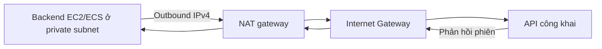
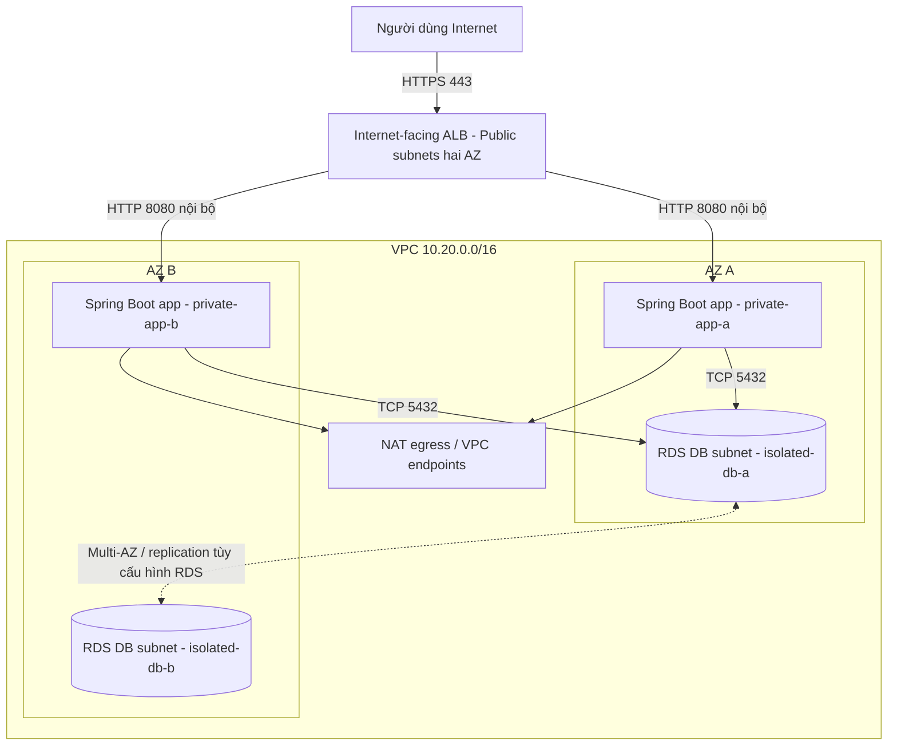

# Subnet công khai, riêng tư và biệt lập

> **Chương:** Mạng VPC · **Mô-đun:** `CLOUD_PROVIDERS_AWS`

## 1. Vì sao cần phân loại subnet trong AWS VPC?

Một ứng dụng Java chạy trên AWS thường có ba nhóm lưu lượng khác nhau: người dùng ngoài Internet truy cập website; dịch vụ ứng dụng gọi API đối tác hoặc lấy dữ liệu từ S3; cơ sở dữ liệu chỉ nhận yêu cầu từ dịch vụ ứng dụng. Nếu đặt tất cả vào cùng một kiểu kết nối, việc giới hạn quyền truy cập, xử lý sự cố, dự phòng và tính toán chi phí sẽ khó hơn.

**Amazon VPC (Virtual Private Cloud)** là mạng riêng ảo trong một AWS Region. VPC được chia thành các **subnet** để đặt tài nguyên như Amazon EC2, giao diện mạng của Amazon ECS/EKS, Application Load Balancer (ALB), cơ sở dữ liệu Amazon RDS và các dịch vụ tương thích. Subnet có thể được tổ chức theo ba mục đích phổ biến:

| Loại subnet | Dấu hiệu định tuyến | Khả năng kết nối từ Internet | Nơi dùng phù hợp |
| --- | --- | --- | --- |
| **Public (công khai)** | Có route trực tiếp tới **Internet Gateway (IGW)**. | Có thể nhận kết nối khi tài nguyên có địa chỉ IP phù hợp và chính sách cho phép. | Internet-facing ALB, điểm vào HTTPS, một số máy chủ công khai. |
| **Private (riêng tư)** | Không có route trực tiếp tới IGW; có thể dùng NAT, egress-only IGW hoặc kết nối riêng. | Thông thường không nhận kết nối mới trực tiếp từ Internet. | Backend EC2/ECS/EKS, worker, ứng dụng cần kết nối outbound. |
| **Isolated (biệt lập)** | Không có đường ra Internet theo thiết kế; có thể vẫn có route nội bộ hoặc endpoint xác định. | Không nhận trực tiếp từ Internet. | Database, thành phần dữ liệu nhạy cảm, dịch vụ chỉ cần giao tiếp nội bộ. |

**Điểm mấu chốt:** Public/private/isolated là cách mô tả **cấu hình route table và mục tiêu kiến trúc**, không phải thuộc tính `Type` có sẵn khi tạo subnet. Đặt tên `public-a` hoặc gắn tag `Tier=Private` không biến subnet thành loại tương ứng. Trong tài liệu AWS, một subnet có đường định tuyến trực tiếp tới IGW là public; “isolated” là tên gọi thiết kế cho một dạng subnet không có Internet egress, không phải cơ chế bảo mật tuyệt đối chỉ bằng một lựa chọn.

Trong mô-đun `CLOUD_PROVIDERS_AWS`, việc phân loại subnet hỗ trợ lựa chọn và triển khai dịch vụ AWS theo Region/AZ, IAM, VPC, tính toán, lưu trữ, cơ sở dữ liệu, tích hợp và serverless. Kỹ năng cần đạt là vừa mở đúng đường kết nối cho ứng dụng, vừa kiểm soát bề mặt tấn công, giám sát, phục hồi và chi phí.

**Mục tiêu học tập:**

1. Nhìn route table để phân biệt ba loại subnet, không suy đoán từ tên hoặc từ việc EC2 có public IP.
2. Hiểu đường đi qua IGW, NAT gateway, egress-only IGW và VPC endpoints cho IPv4/IPv6.
3. Thiết kế ứng dụng ba tầng trên ít nhất hai Availability Zone (AZ).
4. Kết hợp routing với security group, network ACL, DNS, IAM và endpoint policies.
5. Phân tích lỗi kết nối, khả năng sẵn sàng và chi phí mạng.

## 2. Những khái niệm nền tảng trước khi phân loại

### 2.1. Region, AZ, VPC, subnet và CIDR

- **VPC** thuộc một AWS Region, có dải địa chỉ IPv4 riêng (và có thể có IPv6).
- **Subnet** nằm trong đúng **một AZ**. Một VPC có thể chứa nhiều subnet ở nhiều AZ; nếu cần dự phòng AZ, phải phân bố tài nguyên trên các subnet ở AZ khác nhau.
- **CIDR** định nghĩa dải IP. Ví dụ VPC `10.20.0.0/16` có thể chứa các subnet `10.20.0.0/24`, `10.20.10.0/24`, miễn các subnet không chồng lấn và nằm trong CIDR của VPC.
- AWS dự trữ **5 địa chỉ IPv4** của mỗi subnet cho mục đích hệ thống. Một subnet `/24` có 256 địa chỉ IPv4 tổng cộng nhưng không thể cấp cả 256 địa chỉ cho workload.

Ví dụ sơ đồ địa chỉ cho một ứng dụng:

| Tầng | AZ A | AZ B |
| --- | --- | --- |
| Public | `public-a: 10.20.0.0/24` | `public-b: 10.20.1.0/24` |
| Private app | `private-app-a: 10.20.10.0/24` | `private-app-b: 10.20.11.0/24` |
| Isolated DB | `isolated-db-a: 10.20.20.0/24` | `isolated-db-b: 10.20.21.0/24` |

Subnet CIDR cần tính đến số lượng ENI, số task/pod và mức mở rộng của compute, load balancer hoặc database.

### 2.2. Route table là cơ chế phân loại thực tế

Mỗi subnet sử dụng **một route table** tại một thời điểm. Có thể gán trực tiếp (explicit association); nếu chưa gán, subnet sử dụng **main route table** của VPC (implicit association). Mỗi route có cặp **Destination → Target**. Ví dụ:

| Destination | Target | Ý nghĩa |
| --- | --- | --- |
| `10.20.0.0/16` | `local` | Định tuyến trong VPC. |
| `0.0.0.0/0` | `igw-...` | Định tuyến IPv4 ngoài những đích cụ thể hơn ra IGW. |
| `0.0.0.0/0` | `nat-...` | Định tuyến IPv4 tới NAT gateway. |
| `::/0` | `eigw-...` | Định tuyến IPv6 outbound-only tới egress-only IGW. |

Route `local` được AWS tạo để các subnet trong VPC có thể tìm đường đến nhau. **Có route không có nghĩa được kết nối**: security group, network ACL và chính sách ứng dụng vẫn có thể từ chối. Khi có nhiều route cùng khớp một địa chỉ, AWS chọn **route có prefix dài nhất** (longest prefix match). Ví dụ địa chỉ thuộc `10.20.0.0/16` sẽ dùng route `local` thay vì `0.0.0.0/0`.

**IPv4 và IPv6 độc lập về default route:** `0.0.0.0/0` không bao gồm IPv6; `::/0` không bao gồm IPv4. Khi có dual-stack, phải đánh giá cả hai để tránh vô tình mở một đường truy cập mà nhóm vận hành không biết.

### 2.3. Địa chỉ IP và đường định tuyến là hai điều kiện khác nhau

Một EC2 có **private IPv4** như `10.20.0.25`. Để đi Internet trực tiếp qua IGW bằng IPv4, thông thường EC2 cần thêm **public IPv4** hoặc **Elastic IP**, route tới IGW và policy cho phép. EC2 có public IPv4 nhưng subnet không có route IGW vẫn không tự truy cập Internet theo đường đó. Ngược lại, subnet có route IGW nhưng instance chỉ có private IPv4 cũng chưa đủ điều kiện đi Internet trực tiếp bằng IPv4.

IPv6 có địa chỉ định tuyến toàn cầu; nếu gán IPv6 cho tài nguyên và thêm route `::/0 → igw` thì tài nguyên có thể giao tiếp Internet IPv6 theo chính sách SG/NACL. Không mặc định IPv6 là “an toàn vì subnet dùng private IPv4”.

## 3. Public subnet: kết nối trực tiếp với Internet Gateway

**Internet Gateway (IGW)** được attach vào VPC, đóng vai trò target của route phục vụ kết nối Internet. Một route table public điển hình:

| Destination | Target |
| --- | --- |
| `10.20.0.0/16` | `local` |
| `0.0.0.0/0` | `igw-example` |
| `::/0` *(nếu dùng IPv6 public)* | `igw-example` |

Đối với EC2 dùng IPv4, cần đồng thời: route IGW đang hoạt động, public IPv4/EIP, SG/NACL cho phép lưu lượng cần thiết và ứng dụng thực sự lắng nghe trên cổng tương ứng. IGW ánh xạ giữa public IPv4 và private IPv4 của instance khi chuyển lưu lượng, nhưng **IGW không tự bỏ qua các chính sách bảo mật**.

### 3.1. Tài nguyên phù hợp trong public subnet

- **Internet-facing ALB:** nhận HTTPS 443 từ client và chuyển request tới target ở private subnet qua route `local`. ALB production thường được cấu hình ở nhiều AZ.
- **Bastion host khi thực sự cần:** hạn chế nguồn IP/cổng quản trị, MFA và log truy cập; cân nhắc dùng **AWS Systems Manager Session Manager** để giảm nhu cầu SSH/RDP public.
- **Public zonal NAT gateway:** loại NAT theo AZ sử dụng public subnet và Elastic IP để cung cấp outbound IPv4 cho tài nguyên private.

**Không nên đặt RDS hoặc backend nội bộ vào public subnet chỉ vì muốn dễ bảo trì.** Việc nhận lưu lượng công khai nên tập trung vào những điểm vào được thiết kế và giám sát.

### 3.2. Public subnet không đồng nghĩa “mọi thứ bên trong đều công khai”

Một máy trong public subnet có thể không có public IPv4 hoặc bị SG chặn tất cả inbound. “Public” mô tả **khả năng định tuyến trực tiếp tới IGW**, không khẳng định Internet truy cập được mọi cổng. Ngược lại, nếu SG cho phép TCP 22 từ mọi IP và EC2 có public IPv4, mạng của máy có thể bị lộ vào Internet; cần kiểm tra cả routing lẫn policy.

## 4. Private subnet: cho phép egress mà không công bố backend

Private subnet **không có route trực tiếp tới IGW**. Với IPv4, backend cần ra Internet thường đi qua **NAT gateway**; Internet không thể tự khởi tạo phiên đến backend chỉ nhờ NAT đó.



### 4.1. Zonal NAT và Regional NAT Gateway

AWS hiện có hai mô hình NAT cho Internet egress:

| Thuộc tính | Zonal NAT gateway | Regional NAT Gateway |
| --- | --- | --- |
| Phạm vi | Hoạt động trong **một AZ**. | Hoạt động ở cấp **Region**, có thể tự mở rộng theo AZ có workload. |
| Vị trí cho Internet egress | **Public zonal NAT** tạo trong public subnet, gắn Elastic IP; gateway có đường tới IGW. | Tạo cho VPC, **không cần public subnet** để chứa NAT; AWS quản lý phần định tuyến liên quan. |
| Route của private subnet | `0.0.0.0/0 → nat-zonal-id` | `0.0.0.0/0 → nat-regional-id` |
| Dự phòng nhiều AZ | Thường tạo một zonal NAT **mỗi AZ** và cho subnet private trỏ tới NAT cùng AZ. | Có chế độ tự động mở rộng và duy trì khả năng sẵn sàng theo dấu chân workload, theo giới hạn dịch vụ. |
| Kết nối private NAT tới VPC/on-prem | Có thể dùng loại **private zonal NAT** phù hợp. | **Không hỗ trợ private NAT**; dùng zonal khi cần private NAT. |

**Lưu ý về tài liệu theo thời gian:** Câu “NAT gateway luôn phải nằm trong public subnet” chỉ đúng cho trường hợp **public zonal NAT**. [Regional NAT Gateway](https://docs.aws.amazon.com/vpc/latest/userguide/nat-gateways-regional.html) là mô hình mới hơn, không cần public subnet; cần kiểm tra Region/AZ được hỗ trợ, thời gian mở rộng sang AZ mới, route, tính phí và chế độ trước khi chọn.

Với mô hình zonal, nếu backend trong AZ B sử dụng NAT của AZ A, sự cố AZ A có thể làm mất Internet egress ở AZ B. Để giảm rủi ro và lưu lượng liên AZ:

```text
private-app-a (AZ A)  -> NAT zonal A -> IGW
private-app-b (AZ B)  -> NAT zonal B -> IGW
```

NAT có thể phát sinh phí theo thời gian hoạt động và dữ liệu xử lý. Lưu lượng đi qua AZ khác có thể tạo thêm phí truyền dữ liệu. Tính toán phải dựa trên traffic thực tế, yêu cầu sẵn sàng và các VPC endpoints thay thế được những lượt đi NAT không cần thiết.

### 4.2. Private subnet dùng IPv6

Với IPv6, nếu cần **chỉ cho phép khởi tạo kết nối ra Internet**, có thể dùng **egress-only Internet Gateway**:

```text
::/0 -> eigw-xxxxxxxx
```

Egress-only IGW là thành phần **stateful** dành cho IPv6. Nó cho phép phản hồi cho kết nối đã khởi tạo từ trong VPC, đồng thời ngăn các phiên IPv6 mới từ Internet tự đi vào qua gateway. Trong một số bài toán IPv6-only cần kết nối đích chỉ có IPv4, AWS có cơ chế **DNS64/NAT64** khi cấu hình NAT gateway đúng; cơ chế này khác với Internet egress IPv6 thông thường. Đừng coi NAT64 là chức năng tự động của mọi subnet IPv6.

### 4.3. Private subnet vẫn cần kiểm soát outbound

Không có inbound công khai không có nghĩa an toàn tuyệt đối. Nếu backend bị lộ credential, nó có thể gửi dữ liệu qua những đường outbound đang mở. Hãy giới hạn SG outbound, IAM, VPC endpoint policies, domain/proxy khi cần, kiểm soát dữ liệu và giám sát Flow Logs. Private subnet là **một lớp phân đoạn mạng**, không thay thế xác thực, mã hóa hoặc kiểm soát quyền API.

## 5. Isolated subnet: không có đường ra Internet theo thiết kế

Trong một hệ thống quản lý dữ liệu, database thường không cần tự gửi request ra Internet. Một **isolated subnet** có thể chỉ dùng route `local` để các ứng dụng trong cùng VPC kết nối đến database; không cấu hình Internet default route. Ví dụ route table cho `isolated-db-a`:

| Destination | Target |
| --- | --- |
| `10.20.0.0/16` | `local` |
| Không có `0.0.0.0/0` tới NAT/IGW | — |
| Không có `::/0` tới IGW/egress-only IGW | — |

Isolated **không có nghĩa không có mạng**. Backend trong `private-app-a` vẫn có thể kết nối tới RDS ở `isolated-db-a` bằng private IP và route `local`, nếu SG/NACL cho phép. Một subnet biệt lập cũng có thể có route riêng tới VPN, Transit Gateway, mạng doanh nghiệp hoặc VPC endpoint khi yêu cầu kiến trúc cho phép.

Do đó, “không có Internet default route” chỉ là một bằng chứng. Nếu tồn tại proxy, NAT tự quản lý, route cụ thể hoặc thiết bị chuyển tiếp trong mạng khác, traffic có thể ra Internet **gián tiếp**. Với hệ thống dữ liệu nhạy cảm, cần kiểm tra tất cả lối ra, giới hạn policy, IAM, quyền truy cập dữ liệu và nhật ký.

### 5.1. VPC endpoint đưa traffic tới dịch vụ AWS mà không cần NAT

Một ứng dụng đặt ở private/isolated subnet vẫn có thể cần đọc file từ Amazon S3, gửi log tới CloudWatch hay đọc bí mật từ AWS Secrets Manager. **VPC endpoints** giúp kết nối tới những dịch vụ được hỗ trợ mà không đi qua Internet Gateway hoặc NAT gateway.

| Kiểu endpoint | Cách hoạt động | Dịch vụ/ví dụ | Chi phí |
| --- | --- | --- | --- |
| **Gateway endpoint** | Route table có đích là service prefix list và target `vpce-id`. | **Amazon S3**, **DynamoDB**. | Không thu phụ phí gateway endpoint; phí của các dịch vụ liên quan vẫn có thể phát sinh. |
| **Interface endpoint (AWS PrivateLink)** | Tạo ENI có private IP trong subnet, ứng dụng truy cập qua endpoint/DNS riêng. | Secrets Manager, CloudWatch Logs, SSM hoặc dịch vụ hỗ trợ PrivateLink. | Thường có phí endpoint theo AZ/giờ và lưu lượng xử lý. |

Ví dụ, app ở `private-app-a` có thể dùng S3 gateway endpoint. Route table sẽ có:

| Destination | Target |
| --- | --- |
| `10.20.0.0/16` | `local` |
| `pl-s3-example` | `vpce-s3-example` |
| `0.0.0.0/0` | `nat-example` |

Đích khớp prefix list S3 sẽ đi qua endpoint trước default NAT route do định tuyến cụ thể hơn. Endpoint không tự cấp quyền đọc dữ liệu: vẫn cần **IAM role**, **endpoint policy**, **S3 bucket policy** và điều kiện KMS nếu đối tượng được mã hóa theo cách yêu cầu quyền sử dụng key.

Với interface endpoint, cần cấu hình **Private DNS** theo hướng dẫn dịch vụ, subnet chứa ENI endpoint, và security group cho phép cổng (thường TCP 443) từ client tương ứng. Nếu dùng **AWS Systems Manager Session Manager** để vào EC2 không có Internet, phải bảo đảm agent, IAM, DNS và các endpoint cần thiết cho SSM được thiết lập theo môi trường. Không phải mọi dịch vụ AWS đều có gateway endpoint; không phải mọi endpoint đều miễn phí.

### 5.2. Ví dụ kiểm soát dữ liệu ở isolated subnet

Giả sử một job tạo báo cáo đọc dữ liệu từ S3 và ghi vào RDS:

1. Job chạy tại subnet không có default route ra Internet.
2. Dùng **S3 gateway endpoint** gắn với route table của subnet để đọc bucket được cấp quyền.
3. Kết nối RDS qua private IP/DB endpoint và route `local`; SG DB chỉ cho phép SG job.
4. Gửi logs qua **CloudWatch Logs interface endpoint** nếu cần và đã đủ cấu hình.
5. Kiểm tra IAM policies, endpoint policies, DNS, VPC Flow Logs và alerting để bảo đảm hoạt động đúng với quyền tối thiểu.

Nếu job phải gọi API đối tác công khai, isolated theo định nghĩa egress ở trên có thể không phù hợp; chọn private subnet với egress được quản lý, hoặc một proxy được kiểm soát theo chính sách.

## 6. Nhận diện ba loại subnet qua route table

Các bảng sau dùng VPC `10.20.0.0/16`, chưa bật IPv6 để dễ so sánh. ID bắt đầu bằng `igw-`, `nat-`, `vpce-` và `pl-` chỉ là placeholder, không phải mã tài nguyên thật.

### 6.1. Public subnet

| Destination | Target | Kết luận |
| --- | --- | --- |
| `10.20.0.0/16` | `local` | Truy cập nội bộ VPC theo policy. |
| `0.0.0.0/0` | `igw-example` | Có IPv4 Internet route trực tiếp; subnet **public**. |

### 6.2. Private app subnet có egress

| Destination | Target | Kết luận |
| --- | --- | --- |
| `10.20.0.0/16` | `local` | Có thể trao đổi với các subnet trong VPC nếu được cho phép. |
| `pl-s3-example` *(tùy chọn)* | `vpce-s3-example` | S3 qua gateway endpoint. |
| `0.0.0.0/0` | `nat-example-a` | Có outbound IPv4 qua NAT, **không trực tiếp qua IGW**. |

### 6.3. Isolated DB subnet

| Destination | Target | Kết luận |
| --- | --- | --- |
| `10.20.0.0/16` | `local` | Có đường đi nội bộ VPC. |
| Không có Internet default route | — | Isolated nếu không có các đường egress khác trái mục tiêu. |

**Cần chú ý hai chiều:** route table của subnet nguồn quyết định gửi request đi, nhưng phản hồi và trạng thái firewall vẫn phải cho phép kết nối hoàn tất. Với giao tiếp trong cùng VPC, `local` thường định tuyến tự động giữa subnet nguồn và đích; không cần IGW hoặc NAT.

### 6.4. Khi main route table thay đổi

Nếu `isolated-db-a` không được gán route table tường minh, nó ngầm dùng **main route table**. Một quản trị viên vô tình thêm `0.0.0.0/0 → nat-...` vào main route table có thể làm xuất hiện đường egress ngoài dự định cho database subnet. Quy trình quản trị nên:

1. Đặt tên route table theo ý định sử dụng, ví dụ `rt-public-a`, `rt-private-app-a`, `rt-isolated-db`.
2. **Explicitly associate** từng subnet với route table phù hợp.
3. Giữ main route table tối giản khi thiết kế cho phép.
4. Kiểm tra drift bằng IaC review, inventory và định kỳ kiểm toán tuyến IPv4/IPv6.

### 6.5. Phân tích một VPC dual-stack

| Subnet | IPv4 default route | IPv6 default route | Phân loại theo đường Internet |
| --- | --- | --- | --- |
| A | `0.0.0.0/0 → igw` | Không có IPv6 | Public IPv4. |
| B | `0.0.0.0/0 → nat` | `::/0 → eigw` | Private, có outbound IPv4 và IPv6. |
| C | Không có | Không có | Isolated khi không tồn tại egress gián tiếp. |
| D | Không có | `::/0 → igw` | **Có Internet route IPv6 trực tiếp**, không phải isolated. |

Một subnet có private IPv4 và global IPv6 không tự trở thành isolated chỉ vì IPv4 không đi ra Internet. Cần kiểm tra đủ IP, route, SG/NACL và ứng dụng dùng giao thức nào.

## 7. Kiến trúc tham khảo: ứng dụng Java ba tầng trên hai AZ

Một hệ thống Spring Boot gồm frontend/HTTPS, backend xử lý nghiệp vụ, database PostgreSQL. Lựa chọn subnet:

- **Public:** ALB phục vụ Internet ở `public-a` và `public-b`; đây là điểm vào được giám sát.
- **Private:** ECS tasks hoặc EC2 chạy Spring Boot ở `private-app-a` và `private-app-b`; không cấp public IPv4. Backend có thể gọi API đối tác qua NAT phù hợp.
- **Isolated:** RDS PostgreSQL ở DB subnet group thuộc `isolated-db-a` và `isolated-db-b` theo kiểu triển khai RDS/Multi-AZ được chọn; không có Internet default route.



Sơ đồ mô tả quan hệ logic. Vị trí RDS primary, standby/replica và cơ chế failover do kiểu triển khai RDS quản lý; ứng dụng thường dùng **DB endpoint DNS** thay vì cố định IP của một node. Route từ ALB đến app, từ app đến RDS cùng VPC đi qua `local`. NAT egress có thể dùng zonal theo từng AZ hoặc Regional NAT; VPC endpoints có thể giúp một số traffic dịch vụ AWS không phải qua NAT.

### 7.1. Security groups theo nguyên tắc tối thiểu

| Security group | Inbound cần thiết | Outbound theo nhu cầu |
| --- | --- | --- |
| `sg-alb` | TCP 443 từ client được phép; `0.0.0.0/0` chỉ khi thật sự cung cấp website công khai. | TCP 8080 tới `sg-app`. |
| `sg-app` | TCP 8080 **chỉ từ SG của ALB**. | TCP 5432 tới `sg-db`, TCP 443 tới API/endpoint được phép. |
| `sg-db` | TCP 5432 **chỉ từ `sg-app`**. | Giới hạn theo yêu cầu thực tế của database/workload. |

Đặt RDS thành **không truy cập công khai** (`Publicly accessible = No`) nếu chỉ phục vụ app nội bộ. Khi triển khai RDS, kiểm tra DB subnet group, số AZ cần thiết, loại engine, cơ chế Multi-AZ, backup, encryption và quyền quản lý secrets. Không mở cổng database cho mọi nguồn Internet chỉ để quản trị dễ hơn.

### 7.2. Hành trình một request

1. Client gửi HTTPS tới DNS của ALB.
2. ALB nhận request ở public subnet và forward vào app target thuộc private subnet.
3. SG của app chỉ cho phép traffic tới cổng ứng dụng từ SG ALB; endpoint app không cần public IPv4.
4. App truy vấn RDS bằng endpoint DNS; route `local` mang traffic trong VPC.
5. SG RDS chỉ cho phép lưu lượng từ SG app, database dùng xác thực/secret quản lý phù hợp.
6. Nếu app cần gọi dịch vụ Internet, nó tạo kết nối đi ra qua NAT hoặc giải pháp egress được kiểm soát; nếu đọc S3 thì ưu tiên xem xét gateway endpoint.

### 7.3. Tại sao phải phân bố nhiều AZ?

Vì mỗi subnet nằm trong một AZ, việc chỉ có một private app subnet đồng nghĩa backend dễ chịu ảnh hưởng khi AZ đó gián đoạn. Độ sẵn sàng cao yêu cầu phối hợp:

- ALB hoạt động ở nhiều AZ và target thực sự phân tán qua các AZ.
- Backend autoscaling/placement đủ số bản sao và health checks.
- Database có Multi-AZ/replication và quy trình backup/restore với RTO/RPO rõ ràng.
- NAT egress không phụ thuộc duy nhất một zonal NAT ở AZ khác; cân nhắc NAT zonal mỗi AZ hoặc Regional NAT theo điều kiện AWS hiện hành.
- Route table, DNS, SG, NACL và quyền IAM phù hợp cả khi failover.

**Phân chia subnet không tự động tạo high availability.** Nó chỉ cung cấp cấu trúc để triển khai workload và dữ liệu có thể phục hồi đúng mục tiêu.

## 8. Phối hợp routing với các lớp bảo mật

Route table trả lời câu hỏi **“Gửi packet đến đâu?”**. Security group, network ACL và chính sách ở các tầng khác trả lời **“Có được gửi/nhận packet hoặc gọi API hay không?”**.

| Thuộc tính | Security group (SG) | Network ACL (NACL) |
| --- | --- | --- |
| Phạm vi | Mức ENI/tài nguyên. | Mức subnet. |
| Rule | **Allow**, không có explicit deny rule. | Có **allow** và **deny**, thứ tự rule có ý nghĩa. |
| Trạng thái | **Stateful**: phản hồi của phiên được phép tự động thông qua. | **Stateless**: phải mở chiều đi và phản hồi; cần xét ephemeral ports. |
| Cách dùng | Chính sách theo ứng dụng/role SG. | Lớp kiểm soát bổ sung theo subnet và CIDR/port. |

Giả sử public subnet có `0.0.0.0/0 → igw` nhưng SG của EC2 không cho inbound TCP 22. Khi đó EC2 không nhận được SSH mới qua SG này. Ngược lại, SG mở TCP 22 nhưng không có đường mạng phù hợp thì SSH cũng không hoạt động. Không thể chẩn đoán chỉ từ route hoặc chỉ từ SG.

Các công cụ và biện pháp liên quan:

1. **IAM và resource/endpoint policies** để quản lý quyền gọi API AWS, không thay thế routing hoặc SG.
2. **VPC Flow Logs** thu thập metadata traffic, thường có thông tin nguồn/đích, port, `ACCEPT`/`REJECT`; không thu payload ứng dụng. Có thể xuất về CloudWatch Logs hoặc S3.
3. **VPC Reachability Analyzer** kiểm tra khả năng đạt tới đích từ cấu hình mạng, hỗ trợ tìm điểm chặn; vẫn cần kiểm thử kết nối thật và application logs.
4. **AWS Network Firewall**, egress proxy và chính sách DNS khi cần kiểm soát outbound chuyên sâu.
5. **CloudWatch metrics, ALB access logs, RDS logs, VPC Flow Logs** để ghép bức tranh từ mức định tuyến đến mức ứng dụng.

Với môi trường production, quản lý route tables, security groups, NACL, VPC endpoints và DNS qua IaC và code review, lưu lịch sử thay đổi qua CloudTrail/nguồn quản trị phù hợp. Điều này làm rõ tác động nếu một subnet bất ngờ có egress ra Internet.

## 9. Thực hành xác minh subnet bằng AWS CLI (chỉ đọc)

Các lệnh dưới đây chỉ **mô tả** tài nguyên, không tạo hoặc sửa VPC. Khi chạy trên tài khoản được cấp quyền, hãy thay `vpc-0123456789abcdef0` bằng VPC ID của bạn và chọn Region đúng. Có thể cấu hình profile đăng nhập qua IAM Identity Center và kiểm tra tài khoản trước khi thực hành.

```bash
# 1. Xác nhận AWS account hiện tại
aws sts get-caller-identity

# 2. Liệt kê subnet, AZ, CIDR và chế độ tự gán public IPv4
aws ec2 describe-subnets \
  --region ap-southeast-1 \
  --filters "Name=vpc-id,Values=vpc-0123456789abcdef0" \
  --query "Subnets[].{Subnet:SubnetId,AZ:AvailabilityZone,CIDR:CidrBlock,AutoPublicIPv4:MapPublicIpOnLaunch}" \
  --output table

# 3. Xem route tables và associations của cả VPC
aws ec2 describe-route-tables \
  --region ap-southeast-1 \
  --filters "Name=vpc-id,Values=vpc-0123456789abcdef0" \
  --output json

# 4. Kiểm tra Internet Gateways gắn với VPC
aws ec2 describe-internet-gateways \
  --region ap-southeast-1 \
  --filters "Name=attachment.vpc-id,Values=vpc-0123456789abcdef0" \
  --output json
```

Khi xem JSON của `describe-route-tables`, chú ý:

- `RouteTables[].RouteTableId`: ID bảng route.
- `Routes[].DestinationCidrBlock` và `Routes[].DestinationIpv6CidrBlock`: đích IPv4/IPv6.
- `Routes[].GatewayId`, `Routes[].NatGatewayId` hoặc các trường target tương ứng: route đang hướng tới gateway, NAT, endpoint hay thành phần nào.
- `Routes[].State`: route `blackhole` không phải một tuyến đang hoạt động bình thường.
- `Associations[].SubnetId`: liên kết subnet **tường minh**; nếu subnet không có liên kết tường minh, hãy tìm **main route table** qua `Associations[].Main` trong VPC.
- `MapPublicIpOnLaunch`: chỉ phản ánh hành vi gán public IPv4 tự động khi tạo EC2, **không** quyết định public/private subnet.

### 9.1. Cách lập bảng kết luận

Ghi một dòng cho mỗi subnet theo mẫu:

| Subnet ID | AZ | Effective route table | IPv4 Internet path | IPv6 Internet path | Có public IP? | Phân loại |
| --- | --- | --- | --- | --- | --- | --- |
| `subnet-example-a` | AZ A | `rtb-example-a` | IGW | Không có | Kiểm tra theo ENI | Public IPv4 |
| `subnet-example-b` | AZ A | `rtb-example-b` | NAT | Egress-only IGW | Không | Private dual-stack |
| `subnet-example-c` | AZ B | `rtb-example-c` | Không | Không | Không | Isolated theo cấu hình |

**Không đồng nhất** “có route” với “gói tin đi được”. Sau khi xác định route, phải kiểm tra địa chỉ IP, SG, NACL, DNS, firewall bên trong máy, quota, trạng thái gateway và quyền API nếu dịch vụ đích yêu cầu.

### 9.2. Quy trình kiểm tra sau thay đổi

1. **Trước thay đổi:** lưu route hiện tại, associations, policy của SG/NACL, danh sách tài nguyên bị ảnh hưởng, chỉ số độ trễ/lỗi và dự kiến chi phí.
2. **Trong thay đổi:** áp dụng theo IaC/change review; không chỉnh route của tất cả subnet production cùng lúc khi chưa kiểm thử.
3. **Sau thay đổi:** thử đường đi dự kiến như ALB → app, app → RDS, app → S3 endpoint, app → API outbound; thử cả đường **phải bị chặn**, ví dụ Internet → DB.
4. **Giám sát:** theo dõi ALB target health, lỗi DNS, TCP timeout, VPC Flow Logs, NAT metrics và cảnh báo ứng dụng.
5. **Đóng công việc:** lưu bằng chứng kết quả, kiểm tra chi phí NAT/endpoint phát sinh, ghi rõ hướng rollback.

## 10. Các lỗi thường gặp và cách khắc phục

| Triệu chứng | Nguyên nhân đáng kiểm tra | Hành động xác minh |
| --- | --- | --- |
| EC2 trong subnet tên “public” không truy cập được Internet IPv4. | Thiếu public IPv4/EIP; thiếu route IGW; SG/NACL hoặc DNS chặn. | Xem route table hiệu lực, IGW attachment, ENI/public IP, thử kết nối theo chính sách. |
| Backend private không tải package hoặc gọi API đối tác. | NAT/default route sai; NAT không hoạt động; thiếu SG outbound; NACL chặn chiều về; lỗi proxy/DNS. | Kiểm tra `0.0.0.0/0`, loại NAT và AZ, SG/NACL, nhật ký kết nối. |
| App gọi S3 thất bại dù đã tạo gateway endpoint. | Endpoint chưa liên kết route table; IAM/endpoint/bucket policy từ chối; dịch vụ hoặc Region không phù hợp. | Kiểm tra prefix list route, trạng thái endpoint và log `AccessDenied`. |
| App không kết nối được RDS. | Sai hostname/port; SG DB không cho phép SG app; NACL hoặc DNS; nhầm VPC. | Kiểm tra DB endpoint, SG hai đầu, route nội bộ, tình trạng RDS. |
| IPv4 hoạt động nhưng IPv6 không đi ra ngoài. | Thiếu địa chỉ IPv6/CIDR, route `::/0`, SG/NACL IPv6 hoặc cấu hình DNS. | Kiểm tra route IPv6 và target IGW/eigw; xác minh firewall IPv6. |
| NAT Gateway có chi phí cao bất thường. | Lưu lượng S3/DynamoDB đi qua NAT; chuyển traffic qua AZ; request tải artifact lớn. | Đọc Cost Explorer/NAT metrics, xem xét gateway endpoint, điều chỉnh lộ trình theo AZ. |
| Database subnet bất ngờ có Internet egress. | Main route table bị sửa, IPv6 bị mở, có đường qua proxy/TGW/VPN. | Kiểm tra explicit/implicit association và tất cả đường IPv4/IPv6. |
| Khi AZ A gặp sự cố, backend tại AZ B mất egress. | Cả hai AZ dùng zonal NAT ở AZ A. | Cân nhắc zonal NAT mỗi AZ hoặc Regional NAT và kiểm tra giới hạn hiện hành. |
| Reachability Analyzer cho thấy có đường đi nhưng app vẫn lỗi. | DNS, TLS, thông tin xác thực, application listener hoặc lỗi từ dịch vụ đích. | Kết hợp log ứng dụng, logs của target, SG/NACL và chỉ số timeout/lỗi. |

**Nguyên tắc xử lý:** Không chữa lỗi bằng cách mở tất cả inbound/outbound cho `0.0.0.0/0` hoặc đặt tất cả máy vào public subnet. Xác định đúng lớp đang chặn rồi thay đổi nhỏ, có kiểm thử và rollback.

## 11. Độ tin cậy và kiểm soát chi phí

| Thành phần | Chi phí/rủi ro vận hành | Cách giảm thiểu hợp lý |
| --- | --- | --- |
| **Internet Gateway** | Không có phí riêng cho IGW; lưu lượng và địa chỉ public IPv4 có thể bị tính phí. | Dùng ALB làm điểm vào chung, cấp public IPv4 có chủ đích. |
| **Zonal/Regional NAT Gateway** | Phí theo thời gian và dữ liệu xử lý; liên AZ có thể phát sinh phí. | Chọn NAT theo nhu cầu dự phòng, tính traffic thực tế, chuyển lưu lượng AWS phù hợp sang endpoints. |
| **S3/DynamoDB gateway endpoint** | Không thu phí endpoint riêng; vẫn có chi phí dịch vụ dữ liệu. | Dùng cho traffic S3/DynamoDB tương thích để tránh NAT không cần thiết. |
| **Interface endpoint** | Thường có phí AZ/giờ và dữ liệu xử lý. | Chỉ chọn các dịch vụ thật sự cần; tối ưu số endpoint/AZ và DNS. |
| **VPC Flow Logs** | Phí lưu trữ/truy vấn CloudWatch Logs, S3 hoặc dịch vụ đích. | Thiết kế retention, mức ghi nhận và quyền truy cập dữ liệu giám sát. |
| **Multi-AZ** | Tăng số bản sao, traffic và một số chi phí mạng. | Cân bằng theo SLO, RTO/RPO, kế hoạch failover và thử nghiệm định kỳ. |

Khi tính chi phí, cần nhìn **toàn bộ hành trình traffic**. Ví dụ backend đọc S3 liên tục ở private subnet: số request S3 và byte xử lý qua NAT có thể đáng kể; dùng S3 gateway endpoint thường tiết kiệm hơn. Tuy nhiên, nếu chỉ có vài request HTTPS tới một dịch vụ hỗ trợ interface endpoint, phí duy trì nhiều interface endpoints cũng cần được so với NAT theo lưu lượng. Giá và khả dụng thay đổi theo Region: xác minh trên [AWS VPC pricing](https://aws.amazon.com/vpc/pricing/) và trang giá dịch vụ liên quan.

Trong kiến trúc ứng dụng có tính phục hồi, tối ưu chi phí không nên làm mất dự phòng AZ. Một NAT rẻ hơn có thể thành điểm lỗi tập trung, gây gián đoạn dịch vụ khi một AZ hỏng. Chọn mô hình theo mục tiêu kỹ thuật, ngân sách và hậu quả của downtime.

## 12. Bài tập thực hành và tự kiểm tra

### Bài tập 1 — Phân loại từ route table

Một VPC chứa năm subnet:

1. `local + 0.0.0.0/0 → igw`.
2. `local + 0.0.0.0/0 → nat`.
3. Chỉ có `local`; không có Internet default route.
4. `local + pl-s3 → vpce`; không có Internet default route.
5. `local + ::/0 → igw`; không có IPv4 Internet default route.

Hãy phân loại từng subnet. Trình bày liệu tài nguyên có thể nhận kết nối **mới** từ Internet hay không và điều kiện bổ sung về IP/SG/NACL. Giải thích vì sao subnet 4 có thể truy cập S3 mà vẫn được xem là isolated theo yêu cầu Internet egress.

### Bài tập 2 — Thiết kế kiến trúc Java ba tầng

Bạn triển khai Spring Boot, ALB và PostgreSQL RDS trong VPC `10.20.0.0/16` ở hai AZ. Hãy:

1. Chia sáu subnet theo ba tầng, không chồng CIDR.
2. Vẽ route table cho từng tầng, nêu cách backend có outbound Internet (nếu cần).
3. Thiết kế SG sao cho ALB nhận HTTPS công khai, app chỉ nhận từ ALB, DB chỉ nhận từ app.
4. Đề xuất phương án đọc S3 không phải đi NAT.
5. Mô tả failover nếu AZ A bị gián đoạn và cách giám sát sau sự cố.

### Bài tập 3 — Tình huống sự cố NAT

Backend ở cả AZ A và B đều trỏ về zonal NAT đặt tại AZ A. Khi AZ A gián đoạn, ứng dụng ở AZ B vẫn chạy nhưng các kết nối đến API thanh toán bị timeout. Hãy xác định lớp bị ảnh hưởng, đưa ra hai phương án cải thiện (NAT zonal theo AZ hoặc Regional NAT theo điều kiện), phân tích thay đổi route và cân nhắc thêm chi phí.

### Bài tập 4 — Isolated cùng VPC endpoints

Một job chỉ cần đọc S3, gọi Secrets Manager, ghi DynamoDB và gửi logs tới CloudWatch Logs. Job không cần gọi API Internet công khai. Hãy thiết kế subnet, route, gateway/interface endpoints, SG và IAM. Cho biết endpoint nào có thể làm tăng chi phí theo AZ/giờ; nêu cách kiểm tra DNS và endpoint policies trước khi chạy production.

### Câu hỏi tự kiểm tra

1. Tại sao subnet mang tên `public` có thể không kết nối Internet được?
2. Khác biệt giữa `0.0.0.0/0 → igw` và `0.0.0.0/0 → nat` là gì?
3. Isolated subnet có hoàn toàn không thể kết nối các subnet khác không? Vì sao?
4. Route `local` giúp ALB, app, DB trao đổi như thế nào?
5. Vì sao phải kiểm tra `::/0` ngay cả khi đã xác minh IPv4 route table?
6. Tại sao endpoint S3 không tự cấp quyền truy cập bucket?
7. Khi nào nên có NAT riêng mỗi AZ và khi nào có thể cân nhắc Regional NAT?
8. Vì sao `MapPublicIpOnLaunch=true` không chứng minh subnet là public?
9. SG stateful và NACL stateless khác nhau ra sao khi xử lý traffic phản hồi?
10. Vì sao phải xem effective route table của từng subnet thay vì chỉ xem main route table?

## 13. Tài liệu AWS chính thức

- [Amazon VPC — Subnets for your VPC](https://docs.aws.amazon.com/vpc/latest/userguide/configure-subnets.html)
- [Amazon VPC — Subnet route tables](https://docs.aws.amazon.com/vpc/latest/userguide/subnet-route-tables.html)
- [Amazon VPC — Work with route tables](https://docs.aws.amazon.com/vpc/latest/userguide/WorkWithRouteTables.html)
- [Amazon VPC — Internet gateways](https://docs.aws.amazon.com/vpc/latest/userguide/VPC_Internet_Gateway.html)
- [Amazon VPC — NAT gateways](https://docs.aws.amazon.com/vpc/latest/userguide/vpc-nat-gateway.html)
- [Amazon VPC — Regional NAT gateways](https://docs.aws.amazon.com/vpc/latest/userguide/nat-gateways-regional.html)
- [Amazon VPC — Egress-only Internet Gateway](https://docs.aws.amazon.com/vpc/latest/userguide/egress-only-internet-gateway.html)
- [AWS PrivateLink — Gateway endpoints](https://docs.aws.amazon.com/vpc/latest/privatelink/gateway-endpoints.html)
- [AWS PrivateLink — Interface endpoints](https://docs.aws.amazon.com/vpc/latest/privatelink/vpce-interface.html)
- [Amazon VPC — Security groups](https://docs.aws.amazon.com/vpc/latest/userguide/vpc-security-groups.html)
- [Amazon VPC — Network ACLs](https://docs.aws.amazon.com/vpc/latest/userguide/vpc-network-acls.html)
- [Amazon VPC — VPC Flow Logs](https://docs.aws.amazon.com/vpc/latest/userguide/flow-logs.html)
- [Amazon VPC — Example routing options](https://docs.aws.amazon.com/vpc/latest/userguide/route-table-options.html)
- [Amazon VPC — Pricing](https://aws.amazon.com/vpc/pricing/)

**Ghi nhớ:** Public subnet có route trực tiếp tới IGW; private subnet không đi IGW trực tiếp nhưng có thể chủ động đi Internet qua NAT hoặc cơ chế egress phù hợp; isolated subnet được thiết kế không có Internet egress. Khi đánh giá một ứng dụng AWS, phải xem **route table thực tế, IPv4/IPv6, public IP, SG/NACL, endpoints, DNS, tính sẵn sàng và chi phí** cùng nhau.
