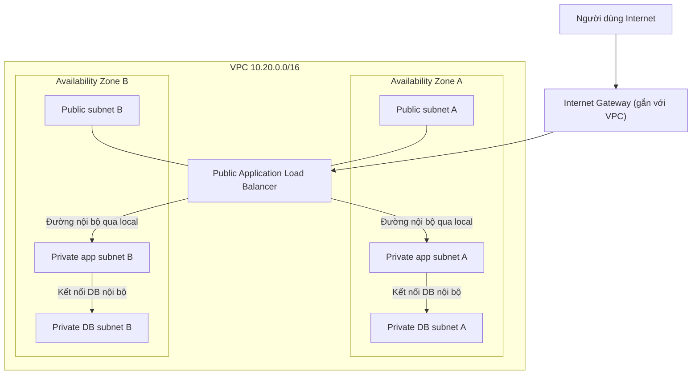

# Route table, local route và Internet Gateway

Trong AWS, việc tạo **VPC** và **subnet** mới xác định không gian mạng của ứng dụng; các tài nguyên có liên lạc được với nhau và với Internet hay không còn phụ thuộc vào **bảng định tuyến (route table)**, **Internet Gateway (IGW)**, địa chỉ IP và các lớp kiểm soát truy cập. Một máy EC2 đặt trong subnet được gọi là “public” vẫn có thể không truy cập Internet nếu thiếu địa chỉ công khai hoặc quy tắc mạng phù hợp.

Bài này thuộc chương **Mạng VPC** của mô-đun **CLOUD_PROVIDERS_AWS**, trong lộ trình tìm hiểu Region/AZ, IAM, VPC, tính toán, lưu trữ, cơ sở dữ liệu, tích hợp và serverless. Khả năng đọc và thiết kế route table là nền tảng để triển khai ứng dụng an toàn, phân tầng mạng, vận hành đa Availability Zone, theo dõi sự cố kết nối và kiểm soát chi phí hạ tầng.

## 1. Mục tiêu học tập

Sau bài học, bạn có thể:

1. Giải thích ý nghĩa **Destination**, **Target**, **Route state** và **subnet association** trong route table của Amazon VPC.
2. Phân biệt **main route table**, **custom route table** và **local route** tự sinh cho CIDR của VPC.
3. Dùng nguyên tắc **longest prefix match** để dự đoán đường đi của gói tin.
4. Mô tả vai trò của **Internet Gateway** và điều kiện để một EC2 truy cập Internet bằng IPv4 hoặc IPv6.
5. Xác định subnet public/private từ route table hiệu lực; giải thích sự khác biệt giữa IGW, NAT Gateway và egress-only Internet Gateway.
6. Thiết kế tuyến mạng cơ bản cho ứng dụng web nhiều tầng và ít nhất hai Availability Zone.
7. Đọc, tạo và kiểm tra route table/IGW qua AWS Console hoặc AWS CLI trong môi trường thực hành được cấp quyền.
8. Chẩn đoán lỗi thường gặp mà không nhầm định tuyến với Security Group, network ACL hay địa chỉ IP.

## 2. Bối cảnh: mạng VPC hoạt động như thế nào?

**Amazon Virtual Private Cloud (Amazon VPC)** là mạng ảo được cô lập về mặt logic trong một AWS Region. VPC có dải địa chỉ IP dưới dạng **CIDR block**, ví dụ `10.20.0.0/16`. Bên trong đó, ta chia thành các subnet có CIDR nhỏ hơn và đặt chúng vào từng Availability Zone (AZ).

Các thành phần trong bài:

| Thành phần | Vai trò | Phạm vi |
| --- | --- | --- |
| **VPC** | Mạng ảo chứa dải CIDR, subnet và nhiều thành phần kết nối | Một Region |
| **Subnet** | Một phần dải CIDR, chứa ENI/tài nguyên ở cùng AZ | Một Availability Zone |
| **Route table** | Xác định đường đi của lưu lượng theo địa chỉ đích | Thuộc một VPC, được gán cho subnet hoặc loại gateway được hỗ trợ |
| **Local route** | Đường định tuyến mặc định cho các dải CIDR của chính VPC | Có trong các route table thuộc VPC |
| **Internet Gateway** | Điểm kết nối giữa VPC và Internet cho IPv4/IPv6 | Gắn với một VPC tại một thời điểm |
| **Security Group (SG)** | Tường lửa trạng thái cho ENI/tài nguyên được hỗ trợ | Quy tắc cho lưu lượng vào/ra |
| **Network ACL (NACL)** | Lọc lưu lượng không trạng thái ở ranh giới subnet | Các quy tắc inbound/outbound của subnet |

Một VPC có **router ngầm định (implicit router)** do AWS quản lý. Bạn không tạo “router EC2” để các subnet trong cùng VPC liên lạc; bạn cấu hình **route table** để router biết đích nào phải đi tới đâu.

### Ví dụ thiết kế IPv4

Ta có VPC `10.20.0.0/16` gồm ba subnet:

- **Public subnet** `10.20.1.0/24`: đặt một Application Load Balancer công khai hoặc máy thử nghiệm được cho phép.
- **Private application subnet** `10.20.11.0/24`: đặt ứng dụng nội bộ.
- **Private database subnet** `10.20.21.0/24`: đặt cơ sở dữ liệu, không cần Internet trực tiếp.

Hai địa chỉ trong cùng VPC như `10.20.1.10` và `10.20.11.20` có thể dùng đường `local` để trao đổi **nếu SG/NACL và cấu hình dịch vụ cho phép**. Muốn kết nối tới `8.8.8.8` hoặc một dịch vụ Internet, route table phải có tuyến phù hợp tới một điểm ra mạng như IGW/NAT.

## 3. Route table: cấu trúc và cách gắn với subnet

### 3.1. Một route có những trường nào?

Ví dụ route table của một public subnet:

| Destination | Target | State | Ý nghĩa |
| --- | --- | --- | --- |
| `10.20.0.0/16` | `local` | `active` | Lưu lượng tới IP thuộc VPC được định tuyến nội bộ |
| `0.0.0.0/0` | `igw-xxxxxxxxxxxxxxxxx` | `active` | Lưu lượng IPv4 ngoài các tuyến cụ thể hơn đi qua Internet Gateway |

**Destination** là dải IP đích. Ký hiệu CIDR `/16` có nghĩa 16 bit đầu xác định phần mạng, còn `/0` khớp mọi địa chỉ IPv4.

**Target** là nơi chuyển gói tin tiếp theo, ví dụ `local`, `igw-...`, `nat-...`, `pcx-...`, `tgw-...` hoặc một network interface (ENI) khi được hỗ trợ.

**State** thường hiển thị `active` hoặc `blackhole`. `blackhole` cho thấy target không còn khả dụng theo trạng thái route, ví dụ gateway/attachment đã bị xóa hoặc không thể sử dụng. Một route `active` cũng **không bảo đảm kết nối thành công** nếu SG, NACL, IP hoặc dịch vụ đích chặn kết nối.

### 3.2. Main route table và custom route table

**Main route table** được AWS tạo tự động khi tạo VPC. Mọi subnet không gán tường minh với route table khác sẽ **kế thừa liên kết ngầm định** (*implicit association*) tới main route table.

**Custom route table** là bảng được tạo thêm để phân chia hành vi định tuyến. Ví dụ: tạo `rtb-public` cho public subnet và `rtb-private` cho private subnet.

Quy tắc gắn route table:

- Một **subnet chỉ có một subnet route table hiệu lực tại một thời điểm**.
- Một **route table có thể được gán cho nhiều subnet** trong cùng VPC.
- Nếu không có **explicit subnet association**, subnet sử dụng **main route table**.
- Khi thay đổi main route table, những subnet đang liên kết **ngầm định** có thể bị đổi hành vi định tuyến ngay. Vì thế nên dùng custom route table và kiểm tra trước khi áp dụng rộng.
- Việc tạo route table mới **không tự động** làm các subnet sử dụng nó. Bạn phải gán cụ thể.

> **Lưu ý:** AWS còn có **gateway route table** để định tuyến lưu lượng đi vào qua Internet Gateway hoặc Virtual Private Gateway, phục vụ trường hợp đặc biệt như chèn thiết bị kiểm tra mạng (*middlebox*). Gateway route table **khác** subnet route table, có quy tắc association và đích route riêng. Bài này tập trung vào **subnet route table**.

### 3.3. Phân loại subnet theo route table

Một **public subnet** có route tới IGW cho lưu lượng Internet cần dùng (thường `0.0.0.0/0 → igw-...` và/hoặc `::/0 → igw-...`). Một **private subnet** không có route trực tiếp đến IGW cho phạm vi giao thức tương ứng.

| Trường hợp | Route IPv4 | Phân loại/khả năng kết nối |
| --- | --- | --- |
| Public subnet | `0.0.0.0/0 → igw-...` | Có đường IPv4 tới Internet Gateway |
| Private subnet cô lập | Chỉ `VPC-CIDR → local` | Chỉ có đường nội bộ VPC; không có đường IPv4 ra Internet |
| Private subnet cần tải cập nhật | `0.0.0.0/0 → nat-...` | Máy private khởi tạo kết nối IPv4 ra Internet thông qua **public NAT Gateway** được cấu hình đúng |
| Subnet có kết nối doanh nghiệp | Route cụ thể tới `vgw-...` hoặc `tgw-...` | Có đường tới mạng khác theo tuyến và chính sách kết nối |
| Subnet có IPv6 outbound-only | `::/0 → eigw-...` | Đi Internet qua **egress-only Internet Gateway**, không cho Internet tự khởi tạo phiên IPv6 đến subnet |

Tên subnet như `public-subnet-1` hay `private-subnet-1` **không quyết định hành vi thật**; route table đang gắn mới là bằng chứng. Việc cấp public IP cho EC2 cũng không tự biến subnet thành public.

## 4. Local route: đường liên lạc trong VPC

Khi bạn tạo VPC với CIDR `10.20.0.0/16`, AWS tự thêm route có dạng sau vào mỗi route table:

| Destination | Target |
| --- | --- |
| `10.20.0.0/16` | `local` |

Nhờ đó các subnet dùng IP thuộc CIDR VPC có đường định tuyến tới nhau. Ví dụ:

- EC2 A: `10.20.1.10` (public subnet).
- EC2 B: `10.20.11.20` (private subnet).
- Đường đi về logic: **EC2 A → VPC router theo local route → EC2 B**.
- Không cần gửi lưu lượng nội bộ tới IGW, ngay cả khi subnet của A có default route đến IGW.

Nếu một VPC có **nhiều IPv4 CIDR block**, các route table có một route `local` cho từng CIDR. Khi thêm IPv6 CIDR vào VPC, AWS cũng thêm local route cho dải IPv6 tương ứng.

### 4.1. Vì sao route `local` được chọn thay vì default route?

Giả sử bảng có:

```text
10.20.0.0/16    local
0.0.0.0/0       igw-xxxxxxxxxxxxxxxxx
```

Một gói tin đến `10.20.11.20` khớp **cả hai** route, nhưng `/16` cụ thể hơn `/0`. AWS chọn **longest prefix match** (tiền tố dài nhất). Gói tin đến `1.1.1.1` không khớp `10.20.0.0/16` nên đi theo `0.0.0.0/0`.

| IP đích | Route khớp được chọn | Target |
| --- | --- | --- |
| `10.20.11.20` | `10.20.0.0/16` | `local` |
| `10.20.1.50` | `10.20.0.0/16` | `local` |
| `1.1.1.1` | `0.0.0.0/0` | IGW |
| `8.8.8.8` | `0.0.0.0/0` | IGW |

Đây là nguyên tắc cơ bản khi đọc route table: **tìm các route khớp IP đích, chọn route cụ thể nhất**, rồi xem target và các hạn chế khác. Trong các trường hợp đích trùng khớp, AWS có thêm quy tắc ưu tiên giữa route tĩnh, route từ prefix list và route được quảng bá; xem tài liệu ở cuối bài.

### 4.2. Local route có phải luôn bất biến không?

**Không.** Theo cơ chế VPC hiện hành, không thể xóa local route mặc định khỏi route table, nhưng AWS cho phép **thay target của local route** bằng ENI hoặc endpoint được hỗ trợ trong một số kiến trúc định tuyến qua thiết bị mạng, rồi **khôi phục target về `local`**. Bạn cũng có thể cấu hình một số tuyến cụ thể hơn tới network appliance khi AWS hỗ trợ.

Đây là chức năng nâng cao phục vụ **inspection, firewall, traffic steering**. Trong bài lab cơ bản, giữ nguyên target `local`. Đổi local route của hệ thống đang chạy có thể làm gián đoạn kết nối giữa các subnet.

### 4.3. Local route không phải tường lửa

Local route tạo **khả năng có đường đi**, không tự cấp phép kết nối. Để ứng dụng ở private subnet nhận lưu lượng từ public subnet, cần thỏa mãn đồng thời:

1. Route hiệu lực cho IP đích và đường phản hồi tồn tại.
2. Security Group của tài nguyên đích cho phép đúng **nguồn, giao thức và cổng**.
3. Network ACL inbound/outbound của các subnet liên quan không chặn.
4. Dịch vụ đích thực sự lắng nghe và hệ điều hành không chặn kết nối.

Ví dụ EC2 A thử TCP cổng `5432` tới RDS PostgreSQL B: `local` chỉ đáp ứng điều kiện tuyến mạng, còn SG của RDS nên chỉ cho phép cổng `5432` từ SG của ứng dụng được phép; **không mở database ra `0.0.0.0/0`**.

## 5. Internet Gateway (IGW) là gì?

**Internet Gateway** là thành phần VPC được AWS vận hành với khả năng mở rộng và độ sẵn sàng cao, hỗ trợ kết nối **IPv4 và IPv6** giữa các tài nguyên trong VPC với Internet.

IGW có hai vai trò cần nhớ:

- Là **route target** cho các lưu lượng Internet phù hợp, ví dụ `0.0.0.0/0 → igw-id` hoặc `::/0 → igw-id`.
- Với **IPv4**, IGW thực hiện ánh xạ NAT 1:1 giữa public IPv4/Elastic IP và private IPv4 của network interface tương ứng. Instance vẫn sử dụng private IPv4 ở bên trong mạng.

Với **IPv6**, địa chỉ được cấp là địa chỉ định tuyến toàn cục; IGW không cần NAT IPv4 kiểu trên.

### 5.1. Ba điều kiện tối thiểu cho EC2 truy cập Internet qua IGW

Một EC2 dùng Internet qua IGW trực tiếp phải có:

1. **Internet Gateway đã được attach vào đúng VPC**, và route table hiệu lực của subnet có route đến IGW cho đích cần truy cập.
2. **Địa chỉ IP công khai phù hợp**: public IPv4 hoặc Elastic IP nếu dùng IPv4; địa chỉ IPv6 được gán cho ENI nếu dùng IPv6, đồng thời VPC/subnet phải có IPv6 CIDR.
3. **Security Group, NACL, cấu hình OS và dịch vụ** cho phép lưu lượng cần thiết.

Với kết nối **đi vào từ Internet**, còn cần SG inbound cho giao thức/cổng, NACL inbound/outbound phù hợp và ứng dụng thực sự lắng nghe. IGW không tự mở cổng 22, 80 hoặc 443.

> **Định nghĩa thực tế:** EC2 đặt trong public subnet nhưng chỉ có **private IPv4** thì **không thể truy cập Internet trực tiếp bằng IPv4 qua IGW**. Cần public IPv4/EIP hoặc đổi kiến trúc sang NAT/proxy/đường kết nối khác.

### 5.2. Public subnet không có nghĩa “mọi EC2 đều công khai”

| Cấu hình EC2 trong subnet có route tới IGW | Kết quả |
| --- | --- |
| Public IPv4 + SG chỉ cho outbound HTTPS | Có thể **khởi tạo kết nối HTTPS ra Internet** nếu những điều kiện mạng khác hợp lệ; Internet không tự vào các cổng không được SG cho phép |
| Public IPv4 + SG cho inbound 443 từ nguồn hợp lệ | Có thể nhận HTTPS từ Internet nếu dịch vụ và NACL cho phép |
| Chỉ private IPv4 | Không có đường kết nối IPv4 trực tiếp với Internet qua IGW dành cho instance |
| Có IPv6 toàn cục + route `::/0` tới IGW | Có thể giao tiếp IPv6 với Internet theo SG/NACL; inbound cần được cho phép rõ ràng |

Một sơ đồ web production thường đặt **public Application Load Balancer** tại public subnet và **EC2/ECS application servers** trong private subnet. Dịch vụ ứng dụng nhận lưu lượng nội bộ từ load balancer, thay vì mỗi máy chủ mang public IPv4.

## 6. Thiết kế VPC nhiều AZ: public và private

Giả sử tổ chức triển khai API và cơ sở dữ liệu có khả năng phục hồi khi một AZ gặp sự cố. Sử dụng VPC `10.20.0.0/16` và hai AZ minh họa là **AZ-A** và **AZ-B** (tên AZ thực tế phụ thuộc Region và tài khoản AWS).

| Subnet | CIDR | AZ | Mục đích | Route table |
| --- | --- | --- | --- | --- |
| `public-a` | `10.20.1.0/24` | AZ-A | Public ALB hoặc NAT Gateway phù hợp | `rtb-public` |
| `public-b` | `10.20.2.0/24` | AZ-B | Public ALB hoặc NAT Gateway phù hợp | `rtb-public` |
| `app-private-a` | `10.20.11.0/24` | AZ-A | Ứng dụng nội bộ | `rtb-app-a` |
| `app-private-b` | `10.20.12.0/24` | AZ-B | Ứng dụng nội bộ | `rtb-app-b` |
| `db-private-a` | `10.20.21.0/24` | AZ-A | Cơ sở dữ liệu | `rtb-db` |
| `db-private-b` | `10.20.22.0/24` | AZ-B | Cơ sở dữ liệu | `rtb-db` |

### Sơ đồ luồng mạng



Sơ đồ chỉ thể hiện **luồng logic**: route table và security policy quyết định đường đi thực tế. ALB sử dụng subnet public trong các AZ được cấu hình; ứng dụng và DB phải có SG/NACL phù hợp.

### 6.1. Route table cho public subnet

| Destination | Target |
| --- | --- |
| `10.20.0.0/16` | `local` |
| `0.0.0.0/0` | `igw-xxxxxxxxxxxxxxxxx` |

Gán `public-a` và `public-b` vào `rtb-public`. Có thể dùng chung vì cả hai cần đường Internet trực tiếp. IGW là thành phần gắn với VPC; không cần tạo một IGW riêng cho mỗi AZ.

### 6.2. Route table cho private subnet chưa cần Internet

| Destination | Target |
| --- | --- |
| `10.20.0.0/16` | `local` |

Gán các subnet DB vào `rtb-db`. Không có default route Internet nên chúng không có đường IPv4 trực tiếp tới IGW hay NAT. Các dịch vụ trong VPC vẫn có thể trao đổi với DB qua `local` nếu được cho phép.

### 6.3. Khi ứng dụng private cần tải dependency từ Internet

Nếu EC2 trong private subnet cần **khởi tạo kết nối IPv4 ra Internet** mà không được nhận kết nối mới trực tiếp từ Internet, có thể dùng **public NAT Gateway**. Với mô hình nhiều AZ, nên cân nhắc NAT Gateway ở từng AZ chứa ứng dụng cần outbound để giảm phụ thuộc liên AZ và tăng khả năng phục hồi.

Ví dụ:

| Route table | Destination | Target |
| --- | --- | --- |
| `rtb-app-a` | `10.20.0.0/16` | `local` |
| `rtb-app-a` | `0.0.0.0/0` | `nat-a` |
| `rtb-app-b` | `10.20.0.0/16` | `local` |
| `rtb-app-b` | `0.0.0.0/0` | `nat-b` |

NAT Gateway công khai tương ứng cần được đặt trong public subnet, có Elastic IP và đường `0.0.0.0/0` từ subnet đó tới IGW. Lưu ý **NAT Gateway có phí theo thời gian và dung lượng xử lý**, nên bài thực hành ở phần sau **không yêu cầu tạo NAT Gateway**.

### 6.4. Bảng định tuyến và tính sẵn sàng cao

Một **route table có thể gán cho nhiều subnet khác AZ**. Điều này phù hợp với tuyến IGW vì IGW là thành phần của VPC. Nhưng nếu hai private subnet ở AZ khác nhau cùng trỏ tới **một NAT Gateway ở một AZ**, ứng dụng có thể phụ thuộc vào AZ chứa NAT Gateway và phát sinh truyền dữ liệu liên AZ. Vì thế cần xem route table, vị trí NAT, độ sẵn sàng và chi phí như một thiết kế thống nhất.

## 7. Dòng gói tin đi qua route table

Xét máy EC2 trong public subnet `10.20.1.0/24`, có private IP `10.20.1.10` và public IPv4 được AWS cấp.

### Trường hợp A: EC2 → ứng dụng nội bộ trong VPC

1. EC2 tạo gói tin có đích `10.20.11.20`.
2. Route table của subnet nguồn có `10.20.0.0/16 → local` và `0.0.0.0/0 → igw`.
3. `10.20.11.20` khớp route `/16` cụ thể hơn, nên đi theo **local**.
4. Gói tin đến ENI đích nếu các lớp mạng và bảo mật khác cho phép.
5. Lưu lượng này **không đi ra Internet Gateway**.

### Trường hợp B: EC2 → website công khai bằng IPv4

1. EC2 kết nối tới IP công khai của website.
2. IP đích không thuộc CIDR VPC; route `0.0.0.0/0` được chọn nếu không có tuyến cụ thể hơn.
3. IGW đưa lưu lượng ra Internet, ánh xạ private IPv4 sang public IPv4/EIP phù hợp.
4. Phản hồi đi về public IP; IGW ánh xạ ngược vào private IP tương ứng.
5. SG, NACL và các điều kiện mạng cho phép thì phiên hoạt động.

### Trường hợp C: EC2 private → Internet nhưng route table chỉ có local

1. Máy trong `10.20.11.0/24` cố truy cập một địa chỉ IPv4 Internet.
2. Route table `rtb-app-a` chỉ có `10.20.0.0/16 → local`.
3. Đích Internet không có route khớp.
4. Không có đường đi IPv4 ra Internet. Việc sửa SG thành outbound `0.0.0.0/0` **không giải quyết được lỗi thiếu route**.

### Trường hợp D: Internet → EC2 có public IP nhưng SG chặn inbound

1. IGW và default route đã được cấu hình, EC2 có public IPv4.
2. Client Internet khởi tạo kết nối tới cổng `22` hoặc `443`.
3. SG inbound không cho phép nguồn/cổng đó.
4. Kết nối bị chặn. **Có tuyến mạng không đồng nghĩa có quyền truy cập.**

## 8. IPv4 và IPv6: chọn route đúng giao thức

Route IPv4 và IPv6 hoạt động độc lập. `0.0.0.0/0` chỉ khớp IPv4; `::/0` chỉ khớp IPv6.

| Mục đích | Destination | Target |
| --- | --- | --- |
| Lưu lượng IPv4 giữa các subnet thuộc VPC | CIDR IPv4 của VPC | `local` |
| Lưu lượng IPv6 giữa các subnet thuộc VPC | CIDR IPv6 của VPC | `local` |
| IPv4 ra/vào Internet trực tiếp ở public subnet | `0.0.0.0/0` | IGW |
| IPv6 ra/vào Internet trực tiếp ở public subnet | `::/0` | IGW |
| IPv4 outbound từ private subnet | `0.0.0.0/0` | **Public NAT Gateway** được cấu hình phù hợp |
| IPv6 outbound-only từ private subnet | `::/0` | **Egress-only Internet Gateway (EIGW)** |

Nếu chỉ thêm IPv6 CIDR cho VPC, AWS tạo local route IPv6 tương ứng; **không có nghĩa Internet IPv6 đã được bật**. Để sử dụng IGW cho IPv6, subnet phải có IPv6 CIDR, instance phải có IPv6 address, route `::/0 → igw` và các rule an ninh phù hợp.

**Egress-only Internet Gateway** chỉ dành cho IPv6: cho phép instance trong VPC khởi tạo kết nối IPv6 ra ngoài và nhận phản hồi, đồng thời ngăn Internet tự khởi tạo kết nối IPv6 mới vào instance thông qua gateway này. Không nhầm EIGW với IGW thông thường; cũng không dùng EIGW để giải quyết bài toán IPv4.

> **Ghi chú triển khai:** AWS NAT Gateway hiện hỗ trợ các kịch bản IPv6 nhất định qua NAT64/DNS64; ở bài mạng cơ sở, phương án IPv6 outbound-only thường được minh họa bằng EIGW. Hãy xác định yêu cầu giao thức và kiểu đích trước khi chọn gateway.

## 9. Thao tác kiểm tra và cấu hình trên AWS Console

Các bước sau dành cho **VPC thực hành do bạn được phép quản trị**. Tên mục trong giao diện AWS có thể thay đổi theo thời điểm.

### Bước 1. Xác định VPC và subnet

1. Mở [Amazon VPC Console](https://console.aws.amazon.com/vpc/).
2. Ở thanh chọn Region, đảm bảo đã chọn Region chứa VPC cần thao tác.
3. Vào **Your VPCs**, chọn VPC được giao; ghi lại VPC ID và IPv4 CIDR.
4. Vào **Subnets**, chọn subnet cần kiểm tra. Trên tab **Route table**, xem ID route table hiệu lực.
5. Ghi lại subnet ID, AZ và trạng thái tự động cấp public IPv4 (*Auto-assign public IPv4*). Đây là thiết lập ảnh hưởng cách gán IP cho tài nguyên mới, không thay route table.

### Bước 2. Xem main route table và association

1. Vào **Route tables**, lọc theo đúng **VPC ID**.
2. Tìm dòng có cột **Main = Yes**.
3. Mở tab **Routes** để xem local route và các tuyến khác.
4. Mở tab **Subnet associations** để xem **Explicit subnet associations** và danh sách subnet đang kế thừa main route table ngầm định.
5. Chọn từng subnet quan trọng và xác nhận **route table hiệu lực** trước khi sửa.

### Bước 3. Tạo IGW và attach vào VPC

Nếu VPC chưa có IGW và bạn được phép cấu hình:

1. Vào **Internet gateways → Create internet gateway**.
2. Đặt tag `Name` có ý nghĩa, ví dụ `training-vpc-igw`, và chọn **Create**.
3. Chọn gateway vừa tạo → **Actions → Attach to VPC**.
4. Chọn **đúng VPC** và xác nhận attachment.

Với **default VPC**, IGW và route `0.0.0.0/0` thường có sẵn. Với **nondefault VPC**, những thành phần này không mặc định tồn tại nếu bạn tạo VPC cơ bản, nhưng trình tạo **VPC and more** có thể dựng sẵn tùy cấu hình đã chọn. Luôn kiểm tra thay vì tạo thêm một IGW không cần thiết.

### Bước 4. Tạo custom route table cho public subnet

1. Vào **Route tables → Create route table**.
2. Đặt tên `rtb-training-public` và chọn VPC tương ứng.
3. Sau khi tạo, xác nhận route `VPC-CIDR → local` đã có.
4. Trong tab **Routes → Edit routes → Add route**:
   - **Destination:** `0.0.0.0/0`.
   - **Target:** **Internet Gateway** và đúng ID `igw-...` đã attach.
5. Lưu thay đổi và kiểm tra route `active`.
6. Trong tab **Subnet associations → Edit subnet associations**, chọn **chỉ những public subnet** cần dùng route này và lưu.

**Không gán route table public cho subnet ứng dụng hoặc database private chỉ để thử kết nối.** Việc gán có thể thay đổi ngay khả năng đi Internet của toàn bộ tài nguyên trong subnet.

### Bước 5. Xác minh kết quả

Với public subnet, xác nhận:

- Route table hiệu lực có `VPC-CIDR → local` và `0.0.0.0/0 → igw-...`.
- IGW ở trạng thái attach với **đúng VPC**.
- Subnet đã **explicitly associated** với route table mới.
- Nếu cần kiểm tra một EC2 thực tế, instance có public IPv4/EIP (hoặc IPv6 phù hợp), SG/NACL cho phép kết nối và instance chạy dịch vụ tương ứng.
- Đối với private subnet, không có default route trực tiếp tới IGW.

Bài thực hành ở đây **không yêu cầu khởi chạy EC2**. Đọc route table và xác minh đường đi trên Console là đủ để hoàn thành mục tiêu cơ bản mà không tạo chi phí máy ảo.

## 10. AWS CLI: đọc bảng định tuyến và cấu hình mẫu

Dùng AWS CLI v2 với profile đăng nhập bằng IAM Identity Center/role có quyền phù hợp. Các lệnh `describe` dưới đây là **read-only**. Thay ID ví dụ bằng ID trong tài khoản thực hành và chọn đúng Region.

```bash
# Kiểm tra danh tính AWS và account hiện tại.
aws sts get-caller-identity --profile training

# Liệt kê route table trong VPC.
aws ec2 describe-route-tables \
  --filters "Name=vpc-id,Values=vpc-0123456789abcdef0" \
  --region ap-southeast-1 \
  --profile training \
  --output table

# Xem IGW nào đang attach vào VPC.
aws ec2 describe-internet-gateways \
  --filters "Name=attachment.vpc-id,Values=vpc-0123456789abcdef0" \
  --region ap-southeast-1 \
  --profile training \
  --output table

# Xem subnet cụ thể: VPC, AZ và thuộc tính cấp public IPv4.
aws ec2 describe-subnets \
  --subnet-ids subnet-0123456789abcdef0 \
  --query "Subnets[].{SubnetId:SubnetId,VpcId:VpcId,AZ:AvailabilityZone,MapPublicIpOnLaunch:MapPublicIpOnLaunch}" \
  --region ap-southeast-1 \
  --profile training
```

Các giá trị `vpc-...`, `subnet-...` và `ap-southeast-1` chỉ để minh họa. Nếu tài khoản/Region/ID không đúng, lệnh có thể trả `InvalidVpcID.NotFound` hoặc `InvalidSubnetID.NotFound`; lỗi đó không phản ánh kết nối mạng của một EC2.

### 10.1. Tham khảo cú pháp lệnh thay đổi route

Các lệnh sau **sửa hạ tầng AWS**, chỉ chạy trên VPC được cấp phép khi đã xem xét tác động. Dùng **ID thật của route table/IGW**, không sao chép nguyên ví dụ.

```bash
# Tạo route table mới bên trong VPC.
aws ec2 create-route-table \
  --vpc-id vpc-0123456789abcdef0 \
  --region ap-southeast-1 \
  --profile training

# Thêm default IPv4 route tới IGW đã attach.
aws ec2 create-route \
  --route-table-id rtb-0123456789abcdef0 \
  --destination-cidr-block 0.0.0.0/0 \
  --gateway-id igw-0123456789abcdef0 \
  --region ap-southeast-1 \
  --profile training

# Gán subnet public cho route table mới.
aws ec2 associate-route-table \
  --route-table-id rtb-0123456789abcdef0 \
  --subnet-id subnet-0123456789abcdef0 \
  --region ap-southeast-1 \
  --profile training
```

**Phân biệt các lệnh:** `create-route` tạo một route chưa tồn tại; nếu route cùng Destination đã có, hãy **xem trước** và dùng thao tác thay đổi đúng quy trình. `associate-route-table` áp dụng route table tới subnet; nếu subnet đã có association rõ ràng cần thay thế, xem hướng dẫn **replace-route-table-association**. Không thực hiện thao tác thay thế trên production để thử học.

## 11. Định tuyến và bảo mật là hai lớp khác nhau

Một route table có `0.0.0.0/0 → igw` **không có nghĩa cho phép mọi gói tin** đi qua SG/NACL. Ba thành phần thường được kiểm tra cùng nhau:

| Thành phần | Nhiệm vụ | Có chặn theo cổng/protocol không? | Trạng thái kết nối |
| --- | --- | --- | --- |
| Route table | Chọn next hop theo địa chỉ đích | Không | Không phải tường lửa |
| Security Group | Cho phép lưu lượng vào/ra ENI/tài nguyên được gán | Có | **Stateful**: phản hồi của kết nối được phép được theo dõi |
| Network ACL | Cho phép hoặc từ chối lưu lượng vào/ra subnet | Có | **Stateless**: cần kiểm soát cả chiều đi và chiều về |

**Ví dụ:** EC2 public truy cập HTTPS `443` ra Internet. Route tới IGW đúng nhưng NACL outbound không cho phép cổng 443 hoặc NACL inbound chặn cổng phản hồi động (*ephemeral port*) thì kết nối vẫn thất bại. Ngược lại, nếu SG không cho outbound, sửa route table cũng không giúp.

Với ứng dụng nhiều tầng, hãy hạn chế phạm vi ingress bằng Security Group reference khi phù hợp (ví dụ app chỉ nhận cổng ứng dụng từ SG của ALB, DB chỉ nhận cổng DB từ SG của app). Tránh dùng `0.0.0.0/0` cho DB hoặc SSH/RDP quản trị. Với SSH/SSM, cân nhắc phiên truy cập quản trị qua AWS Systems Manager Session Manager để hạn chế cổng inbound công khai.

## 12. Lỗi kết nối thường gặp và cách xử lý

| Triệu chứng | Nguyên nhân khả dĩ | Bước kiểm tra |
| --- | --- | --- |
| Public EC2 không ra Internet IPv4 | Thiếu public IPv4/EIP | Kiểm tra địa chỉ public của network interface |
| EC2 có public IPv4 nhưng không kết nối được | Route table thiếu `0.0.0.0/0 → igw` hoặc IGW chưa attach | Xem route table hiệu lực và IGW attachment |
| Route `0.0.0.0/0` có nhưng state `blackhole` | Target không còn hợp lệ/khả dụng | Kiểm tra gateway, cấu hình attachment và route |
| Tạo IGW rồi nhưng subnet vẫn private | Chưa thêm route hoặc chưa gán đúng route table | Kiểm tra subnet association và mục Routes |
| Private EC2 không cập nhật phần mềm từ Internet | Chỉ có local route, chưa có đường outbound | Xem yêu cầu NAT Gateway/endpoint/proxy, tránh gán route IGW trực tiếp |
| App public không gọi được DB private cùng VPC | SG/NACL/port/dịch vụ đích không cho phép dù local route tồn tại | Kiểm tra SG nguồn, SG DB, NACL, IP đích và listener |
| IPv4 truy cập được, IPv6 không | Chưa có IPv6 CIDR/IP hoặc `::/0` route; SG IPv6 chưa phù hợp | Kiểm tra dải IPv6, route IPv6, SG/NACL |
| Đổi route table nhưng subnet không đổi hành vi | Gán nhầm subnet hoặc vẫn kế thừa main route table | Chọn subnet và xem tab Route table |
| Route đúng nhưng không truy cập được một website | DNS, dịch vụ đích, firewall OS, NACL hoặc SG | Kiểm tra phân giải tên, địa chỉ IP đích và log kết nối |
| Chi phí mạng vượt dự kiến | NAT Gateway, public IPv4, truyền dữ liệu hoặc liên AZ | Kiểm tra Billing/Cost Explorer và topology thực tế |

### Quy trình chẩn đoán theo thứ tự

1. **Xác định hai đầu kết nối:** nguồn ở subnet nào, IP đích thuộc VPC, mạng doanh nghiệp hay Internet, IPv4 hay IPv6?
2. **Tìm route table hiệu lực của subnet nguồn:** truy dấu implicit/explicit association.
3. **Áp longest prefix match:** xem route Destination nào được chọn và Target có `active` không.
4. **Xác minh target:** IGW đã attach? NAT Gateway/endpoint có đúng VPC, subnet và trạng thái không?
5. **Kiểm tra IP:** nếu qua IGW trực tiếp, EC2 có public IPv4 hoặc địa chỉ IPv6 toàn cục?
6. **Kiểm tra SG và NACL:** đúng nguồn/đích, cổng và chiều phản hồi?
7. **Kiểm tra lớp ứng dụng:** dịch vụ có chạy, DNS có phân giải, OS firewall có cho phép?
8. **Dùng công cụ quan sát nếu được cấp quyền:** VPC Flow Logs giúp xem metadata lưu lượng accept/reject; Reachability Analyzer có thể phân tích đường mạng cấu hình, nhưng kiểm tra giá/tác động trước khi sử dụng.

> **Cảnh báo chẩn đoán:** `ping` sử dụng ICMP, không phải HTTPS. Nếu ping không trả lời, có thể do SG/NACL hoặc máy đích không cho ICMP; điều đó **không tự chứng minh** không có đường tới Internet. Kiểm tra đúng giao thức ứng dụng đang dùng.

## 13. Thực hành có hướng dẫn: phân tích route table cho ứng dụng ba tầng

**Bối cảnh:** nhóm học tập có một VPC `10.20.0.0/16`, gồm các subnet public, private-app, private-db. Mục tiêu là thiết kế đường đi tới Internet cho public ALB và giữ các subnet ứng dụng/cơ sở dữ liệu không có đường Internet trực tiếp.

### Nhiệm vụ 1. Điền đường đi cho từng đích

Cho hai bảng:

```text
RTB-PUBLIC
  10.20.0.0/16   -> local
  0.0.0.0/0      -> igw-demo

RTB-PRIVATE
  10.20.0.0/16   -> local
```

Hãy xác định target được chọn và kết quả **chỉ về mặt route**:

| Nguồn | IP đích | Kết quả định tuyến mong đợi |
| --- | --- | --- |
| Public `10.20.1.10` | Private app `10.20.11.20` | `local` |
| Public `10.20.1.10` | Website `1.1.1.1` | `igw-demo` |
| Private app `10.20.11.20` | DB `10.20.21.30` | `local` |
| Private app `10.20.11.20` | Website `1.1.1.1` | **Không có route khớp** |
| Private DB `10.20.21.30` | Public app `10.20.1.10` | `local`, vẫn phải được SG/NACL cho phép |

Sau khi hiểu route, giải thích vì sao **DB không tự nhiên thành công khai** dù có thể giao tiếp qua local route với public subnet.

### Nhiệm vụ 2. Thiết kế cho hai Availability Zone

Tạo một bảng gồm:

- `public-a`, `public-b` gắn `rtb-public`.
- `app-a`, `app-b` gắn `rtb-app-a` và `rtb-app-b`.
- `db-a`, `db-b` gắn `rtb-db`.
- Route `local` xuất hiện ở mọi route table.
- Chỉ `rtb-public` có default route trực tiếp tới IGW.
- Nếu app cần tải cập nhật Internet, đề xuất dùng NAT Gateway phù hợp hoặc endpoint dịch vụ AWS, kèm lý do chi phí và khả năng phục hồi.

### Nhiệm vụ 3. Kiểm tra bằng Console hoặc CLI

Nếu có sandbox AWS được cấp quyền:

1. Tìm VPC và ghi lại VPC ID, CIDR.
2. Với từng subnet được giao, ghi route table ID và loại association.
3. Xác định có IGW đã attach chưa và route mặc định đang trỏ đi đâu.
4. Hoàn thành bảng kiểm bên dưới bằng **ID đã rút gọn nếu tài liệu không được phép chứa ID đầy đủ**.
5. Nếu được phép tạo custom route table/IGW, thực hiện theo mục 9 và xác nhận readback; **không khởi chạy EC2, NAT Gateway hoặc tài nguyên trả phí chỉ để kiểm tra route**.

```text
VPC / Region: ...
VPC CIDR: ...
Subnet public / AZ: ...
Public subnet's route table: ...
Main or custom: ...
Subnet association: explicit / implicit
Local route: Present / Missing
IPv4 default route: IGW / NAT / Other / None
Internet Gateway attached: Yes / No
IPv6 support: Enabled / Not enabled
SG/NACL reviewed: Yes / Pending
Potential unintended public subnet: Yes / No
Reviewer / Date: ...
```

**Tiêu chí hoàn thành:** người học xác định đúng route table **hiệu lực** của từng subnet; giải thích được vai trò local route và IGW; chỉ ra khi nào cần public IPv4/EIP, SG/NACL, NAT Gateway hoặc EIGW; có sơ đồ phân tầng mạng và ghi chú an toàn/chi phí.

## 14. Câu hỏi tự kiểm tra

1. Khi tạo VPC mới, AWS tạo loại route table nào tự động? Subnet chưa được gán route table riêng dùng bảng nào?
2. Với hai route `10.20.0.0/16 → local` và `0.0.0.0/0 → igw`, IP `10.20.11.20` đi theo route nào? Vì sao?
3. Một EC2 nằm trong public subnet nhưng không có public IPv4. Vì sao máy này không dùng IGW để đi Internet bằng IPv4 trực tiếp?
4. Có thể đặt SG outbound `0.0.0.0/0` để thay thế default route tới IGW không?
5. Route table có `local` thì các subnet cùng VPC đã mặc nhiên truy cập được database qua mọi cổng chưa?
6. Để EC2 private kết nối Internet IPv4 mà không nhận inbound trực tiếp, nên dùng thành phần nào và route đi như thế nào?
7. IPv6 outbound-only dùng IGW hay EIGW? Khác biệt về khả năng nhận kết nối được khởi tạo từ Internet là gì?
8. Điều gì xảy ra với các subnet có implicit association khi thay main route table?
9. Khi thấy route state `blackhole`, bạn cần kiểm tra gì?
10. Vì sao dùng một NAT Gateway ở AZ-A cho các workload ở cả AZ-A và AZ-B cần xem xét thêm khả năng phục hồi và chi phí?

## 15. Tài liệu AWS chính thức

- [Route table concepts — Amazon VPC](https://docs.aws.amazon.com/vpc/latest/userguide/RouteTables.html).
- [Subnet route tables và main route table — Amazon VPC](https://docs.aws.amazon.com/vpc/latest/userguide/subnet-route-tables.html).
- [How route priority works — longest prefix match](https://docs.aws.amazon.com/vpc/latest/userguide/route-tables-priority.html).
- [Example routing options: IGW, NAT và các target khác](https://docs.aws.amazon.com/vpc/latest/userguide/route-table-options.html).
- [Enable internet access for a VPC using an Internet Gateway](https://docs.aws.amazon.com/vpc/latest/userguide/VPC_Internet_Gateway.html).
- [Add internet access to a subnet](https://docs.aws.amazon.com/vpc/latest/userguide/working-with-igw.html).
- [Manage subnet route tables](https://docs.aws.amazon.com/vpc/latest/userguide/WorkWithRouteTables.html).
- [Replace or restore the target for a local route](https://docs.aws.amazon.com/vpc/latest/userguide/replace-local-route-target.html).
- [NAT Gateway concepts và các tùy chọn kết nối](https://docs.aws.amazon.com/vpc/latest/userguide/vpc-nat-gateway.html).
- [Enable outbound IPv6 using an egress-only Internet Gateway](https://docs.aws.amazon.com/vpc/latest/userguide/egress-only-internet-gateway.html).
- [Add IPv6 support for a VPC](https://docs.aws.amazon.com/vpc/latest/userguide/vpc-migrate-ipv6-add.html).
- [Security groups for your VPC](https://docs.aws.amazon.com/vpc/latest/userguide/vpc-security-groups.html).
- [Network ACLs for your VPC](https://docs.aws.amazon.com/vpc/latest/userguide/vpc-network-acls.html).

> **Ghi nhớ:** **Route table chọn đường đi; local route phục vụ lưu lượng trong VPC; Internet Gateway cung cấp điểm ra/vào Internet cho public subnet.** Kết nối thực tế còn cần địa chỉ IP phù hợp, SG/NACL và dịch vụ hoạt động đúng.
