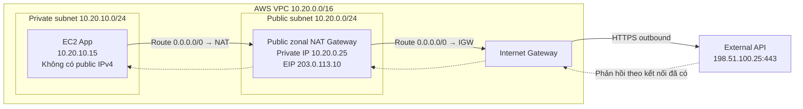
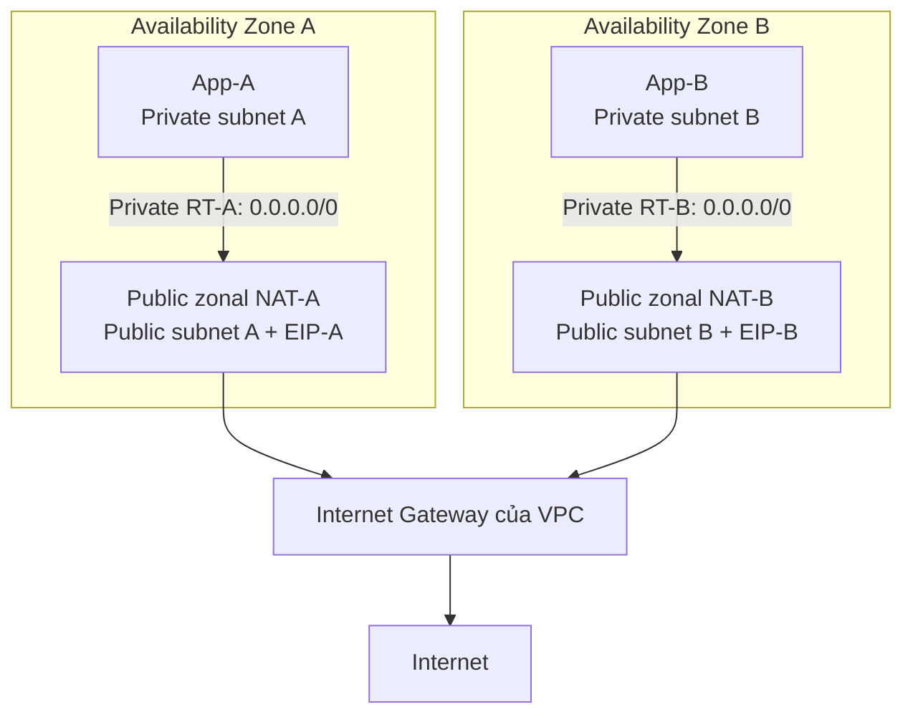
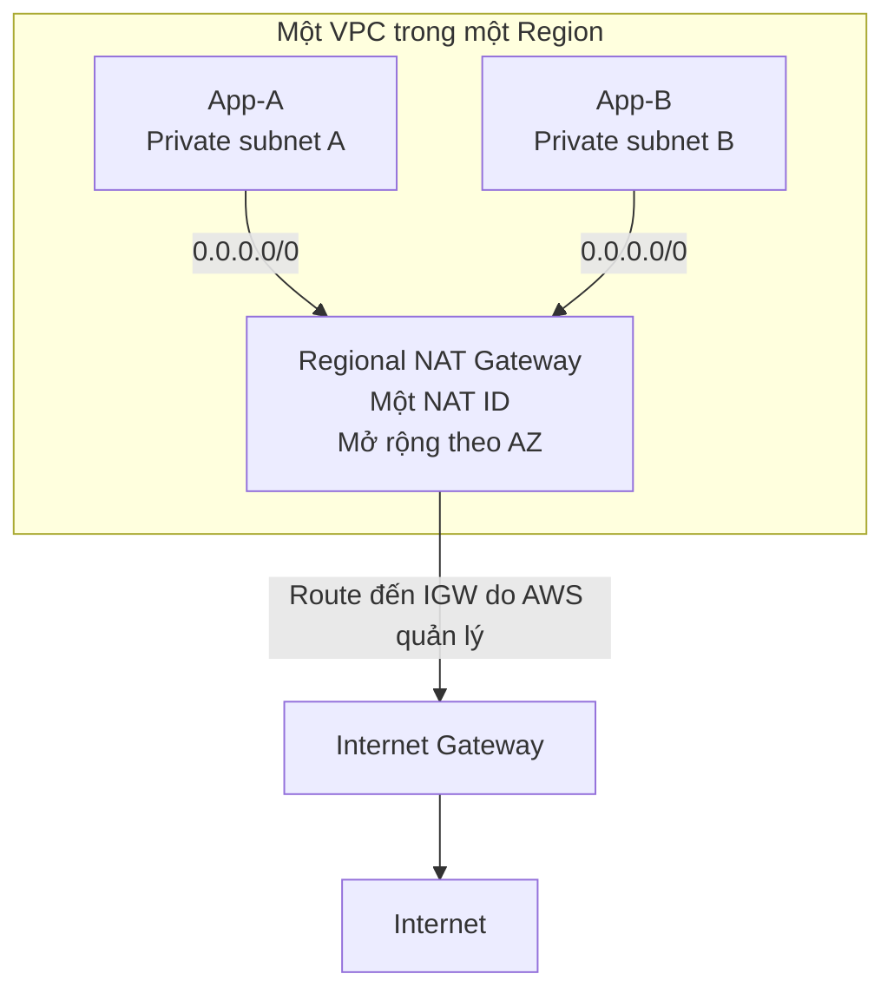

# NAT Gateway và truy cập Internet từ subnet riêng

## Mục tiêu học tập

Sau bài này, bạn có thể:

1. Giải thích tại sao máy chủ trong **private subnet** vẫn cần truy cập Internet theo chiều đi ra và NAT Gateway giải quyết nhu cầu đó như thế nào.
2. Đọc bảng định tuyến để phân biệt **public subnet**, **private subnet**, **Internet Gateway (IGW)** và **NAT Gateway**.
3. Mô tả luồng gói tin qua **public NAT Gateway** (IPv4), cách ánh xạ địa chỉ và giới hạn truy cập từ ngoài vào.
4. Phân biệt **public/private NAT Gateway** với **zonal/regional NAT Gateway**, lựa chọn phương án phù hợp với nhiều Availability Zone (AZ).
5. Cấu hình, kiểm tra, khắc phục lỗi và ước lượng chi phí egress từ private subnet; nhận biết khi nên dùng **VPC endpoint** hoặc **egress-only Internet Gateway** cho IPv6.

## 1. Vì sao private subnet vẫn cần Internet?

Hãy hình dung ứng dụng bán hàng chạy trên AWS:

- **Application server** (EC2 hoặc tác vụ container) đặt trong private subnet để giảm bề mặt truy cập trực tiếp từ Internet.
- **Cơ sở dữ liệu** đặt trong subnet riêng và chỉ nhận kết nối từ tầng ứng dụng.
- **Application Load Balancer** nhận HTTPS của khách hàng, rồi chuyển tiếp đến ứng dụng qua địa chỉ riêng.
- Ứng dụng đôi khi cần **gọi API thanh toán**, tải bản cập nhật, lấy thư viện, hoặc liên hệ một dịch vụ bên ngoài.

Máy chủ ứng dụng có thể cần gọi HTTPS ra Internet nhưng không nên có địa chỉ IPv4 công khai hoặc chấp nhận kết nối trực tiếp từ người dùng Internet. **NAT Gateway** hỗ trợ luồng truy cập đi ra như vậy.

NAT là viết tắt của **Network Address Translation**, tức chuyển đổi địa chỉ mạng. Với lưu lượng IPv4 đi ra Internet, NAT Gateway ánh xạ địa chỉ IP/port nguồn riêng của các máy trong VPC sang địa chỉ/port có thể dùng ở phía ngoài. Nó duy trì trạng thái của kết nối để chuyển gói phản hồi về đúng máy đã khởi tạo yêu cầu.

> **Cốt lõi:** NAT Gateway cho phép tài nguyên private **chủ động thiết lập kết nối ra ngoài và nhận phản hồi**. Nó không biến private subnet thành một public subnet và không mở cổng để Internet tự khởi tạo kết nối vào máy private.

Trong hệ sinh thái AWS, NAT Gateway là dịch vụ mạng do AWS quản lý, giúp ứng dụng dùng EC2, ECS/EKS, Lambda gắn VPC hoặc các dịch vụ khác truy cập các đích bên ngoài theo tuyến mạng và quyền bảo mật đã cấu hình. **Có NAT Gateway không đồng nghĩa mọi ứng dụng tự có Internet:** bảng định tuyến, Security Group, Network ACL, DNS và trạng thái dịch vụ vẫn phải phù hợp.

## 2. Kiến thức nền: VPC, subnet, route table và IGW

| Khái niệm | Vai trò | Liên quan đến NAT |
| --- | --- | --- |
| **VPC** | Mạng ảo riêng của bạn trong một AWS Region. | Chứa subnet, route table, gateway và các tài nguyên của workload. |
| **Subnet** | Dải địa chỉ IP thuộc một AZ trong VPC. | Workload nằm trong subnet; zonal NAT Gateway nằm trong một subnet. |
| **Route table** | Quy tắc xác định đích tiếp theo của gói tin dựa trên địa chỉ đích. | Private subnet cần route phù hợp tới NAT để truy cập IPv4 bên ngoài. |
| **Internet Gateway (IGW)** | Cổng kết nối VPC với Internet; hỗ trợ ánh xạ public IPv4. | Public NAT Gateway đi ra Internet qua IGW. |
| **Elastic IP (EIP)** | Địa chỉ public IPv4 tĩnh gắn với tài nguyên phù hợp. | Public **zonal** NAT Gateway cần EIP; đối tác có thể dùng IP này để allowlist. |
| **NAT Gateway** | Dịch vụ NAT do AWS quản lý. | Trung chuyển luồng outbound từ tài nguyên có địa chỉ riêng. |
| **Security Group (SG)** | Tường lửa stateful gắn với ENI/tài nguyên hỗ trợ. | Kiểm soát truy cập của máy nguồn; **không gắn SG trực tiếp vào NAT Gateway**. |
| **Network ACL (NACL)** | Kiểm soát lưu lượng stateless ở ranh giới subnet. | Có thể chặn gói yêu cầu hoặc gói phản hồi nếu cấu hình sai. |

### Khi nào một subnet được gọi là public?

Với mô hình IPv4 thông thường, **public subnet** có tuyến mặc định `0.0.0.0/0 → IGW` trong route table liên kết. Ngược lại, **private subnet** không có tuyến trực tiếp tới IGW cho Internet IPv4; nó có thể đi qua NAT Gateway hoặc không có đường ra Internet.

**Không có thuộc tính tên là “private” bảo đảm subnet được bảo vệ.** Tên subnet chỉ là nhãn. Cần kiểm tra tuyến mạng, public IP của tài nguyên và chính sách cho phép kết nối. Một EC2 ở public subnet vẫn cần public IPv4/EIP (hoặc đường IPv6 phù hợp), SG/NACL cho phép và IGW để trao đổi trực tiếp với Internet qua IPv4.

## 3. Luồng lưu lượng IPv4 qua public zonal NAT Gateway

Giả sử VPC có CIDR `10.20.0.0/16` tại `ap-southeast-1`:

| Thành phần | Địa chỉ giả định |
| --- | --- |
| EC2 ứng dụng trong private subnet | `10.20.10.15` |
| Zonal NAT Gateway trong public subnet | Private IP `10.20.0.25`; EIP minh họa `203.0.113.10` |
| Máy chủ API bên ngoài | `198.51.100.25:443` |
| Route của private subnet | `0.0.0.0/0 → nat-...` |
| Route của public subnet chứa NAT | `0.0.0.0/0 → igw-...` |

Các IP `203.0.113.10` và `198.51.100.25` thuộc dải dành cho tài liệu minh họa, không phải tài nguyên thật.



Luồng xử lý:

1. EC2 tại `10.20.10.15` tạo kết nối HTTPS tới `198.51.100.25:443`, ví dụ từ cổng nguồn tạm `53001`.
2. Route table của private subnet chọn NAT Gateway cho đích IPv4 bên ngoài VPC.
3. NAT Gateway ánh xạ IP/port nguồn sang private IP và port mà NAT quản lý, ghi nhận trạng thái ánh xạ.
4. Lưu lượng tiếp tục tới IGW. Với **public NAT Gateway**, IGW ánh xạ private IPv4 của NAT sang **EIP** của NAT khi gói đi ra Internet; hệ thống ngoài nhìn thấy địa chỉ EIP.
5. Phản hồi gửi về EIP được IGW và NAT Gateway dịch ngược, quay về `10.20.10.15` thông qua kết nối đã thiết lập.

Điều này thường được gọi là **source NAT** kết hợp chuyển đổi port. Các máy private có thể dùng chung một public EIP để chủ động gọi Internet; NAT theo dõi luồng để trả đúng phản hồi.

### NAT Gateway không phải inbound proxy

Một người bên ngoài không thể tự gửi kết nối HTTPS mới tới `10.20.10.15` bằng cách dùng EIP của NAT Gateway. NAT Gateway không có quy tắc DNAT/port forwarding tùy ý như một router do bạn tự quản trị.

Nếu cần ứng dụng **nhận yêu cầu từ người dùng Internet**, thiết kế thường dùng public **Application Load Balancer**, **API Gateway**, **CloudFront** hoặc điểm vào phù hợp, rồi chuyển tiếp đến workload private qua chính sách được cho phép. NAT Gateway không thay thế thành phần nhận lưu lượng đầu vào này.

## 4. Bảng định tuyến: điều kiện quyết định luồng đi ra

Xét kiến trúc một AZ:

- VPC: `10.20.0.0/16`.
- Public subnet: `10.20.0.0/24`, chứa public **zonal** NAT Gateway.
- Private subnet: `10.20.10.0/24`, chứa EC2 ứng dụng.
- IGW đã gắn vào VPC.

**Route table của public subnet** (`rtb-public-a`, tên minh họa):

| Destination | Target | Mục đích |
| --- | --- | --- |
| `10.20.0.0/16` | `local` | Giao tiếp nội bộ VPC. |
| `0.0.0.0/0` | `igw-xxxxxxxx` | Đưa lưu lượng từ NAT ra Internet. |

**Route table của private subnet** (`rtb-private-a`):

| Destination | Target | Mục đích |
| --- | --- | --- |
| `10.20.0.0/16` | `local` | Giao tiếp nội bộ VPC, không cần NAT. |
| `0.0.0.0/0` | `nat-xxxxxxxx` | Đưa lưu lượng Internet IPv4 qua NAT Gateway. |

Không thêm `0.0.0.0/0 → IGW` vào private route table nếu mục tiêu là buộc các tài nguyên private đi ra qua NAT. Mỗi subnet sử dụng một route table tại một thời điểm; nếu không liên kết tường minh, nó dùng **main route table** của VPC.

Khi có route cụ thể hơn, AWS chọn route dựa trên quy tắc khớp tiền tố dài nhất, cùng thứ tự ưu tiên khi cần. Ví dụ: route tới **S3 gateway endpoint** bằng prefix list có thể dẫn lưu lượng đến S3 qua endpoint thay vì theo route `0.0.0.0/0` đến NAT Gateway.

### Private subnet không tự động có Internet

Ba tình huống có thể xảy ra:

| Cấu hình private subnet | EC2 có thể chủ động đi ra Internet IPv4? |
| --- | --- |
| Không có route `0.0.0.0/0` và không có tuyến tới đích ngoài | Không. |
| `0.0.0.0/0 → NAT`, NAT phù hợp, IGW/route phía NAT và bảo mật đúng | Có thể kết nối ra theo lưu lượng được cho phép. |
| `0.0.0.0/0 → NAT` nhưng NAT đã bị xóa, lỗi hoặc không có đường Internet | Không; route có thể ở trạng thái `blackhole`. |

NAT chỉ xử lý **lưu lượng thực sự được route tới nó**. Việc tạo NAT Gateway mà quên cập nhật private route table không giúp máy private truy cập Internet.

## 5. Hai chiều phân loại NAT Gateway

Có **hai câu hỏi khác nhau** khi chọn NAT:

1. **Connectivity type:** NAT dùng để truy cập Internet công khai (`public`) hay để kết nối riêng giữa các mạng (`private`)?
2. **Availability mode:** NAT hoạt động trong một AZ (`zonal`) hay quản lý khả năng sẵn sàng trên nhiều AZ (`regional`)?

### 5.1. Public NAT và private NAT

| Đặc điểm | Public NAT Gateway | Private NAT Gateway |
| --- | --- | --- |
| Mục đích | Truy cập Internet IPv4 đi ra, hoặc kết nối các mạng khác theo tuyến được hỗ trợ. | Giao tiếp riêng giữa VPC/on-premises qua Transit Gateway hoặc Virtual Private Gateway. |
| Public EIP | Có EIP khi đi ra Internet; với zonal NAT phải chỉ định EIP. | Không có EIP. |
| Đi trực tiếp ra Internet qua IGW | Có, khi route và IGW được cấu hình đúng. | **Không**: IGW sẽ loại bỏ lưu lượng từ private NAT Gateway. |
| Ví dụ | EC2 private tải bản cập nhật từ Internet. | Các workload cần dịch địa chỉ khi kết nối mạng riêng. |

Đặc biệt: nếu **public NAT Gateway** gửi dữ liệu qua Transit Gateway/Virtual Private Gateway tới đích private, phía đích nhìn thấy **private IP của NAT**, không phải EIP. EIP được sử dụng khi lưu lượng public NAT đi qua **IGW trong chính VPC**.

Vì bài này tập trung vào **Internet từ private subnet**, ví dụ thực hành sẽ dùng **public NAT Gateway**.

### 5.2. Zonal NAT và Regional NAT: thông tin AWS hiện hành

Từ **19/11/2025**, AWS hỗ trợ **Regional NAT Gateway**, bên cạnh **Zonal NAT Gateway** truyền thống. Đây là lựa chọn quan trọng khi thiết kế hạ tầng AWS hiện đại.

| Tiêu chí | Zonal NAT Gateway | Regional NAT Gateway |
| --- | --- | --- |
| Phạm vi sẵn sàng | Gắn với **một Availability Zone**. | Một NAT Gateway cho nhiều AZ trong **một Region**. |
| Vị trí triển khai | Tạo tại một subnet; với public zonal NAT, chọn **public subnet**. | Tạo tại cấp **VPC**, không cần public subnet để chứa NAT. |
| Định tuyến outbound | Private subnet trỏ tới NAT ID tại AZ tương ứng. | Private subnets tại nhiều AZ có thể dùng **cùng NAT Gateway ID**. |
| EIP | Public zonal NAT dùng EIP được gắn khi tạo. | Có cơ chế quản lý public IP/EIP theo AZ, tự động hoặc thủ công. |
| High availability | AWS đảm bảo dự phòng trong AZ; để giảm rủi ro mất kết nối do AZ, tạo NAT mỗi AZ và route cùng AZ. | Tự mở rộng/thu hẹp theo AZ có workload ở chế độ automatic, duy trì tính sẵn sàng đa AZ. |
| Public/private connectivity | Hỗ trợ cả public và private NAT theo điều kiện dịch vụ. | **Không hỗ trợ private NAT**; dành cho outbound/public NAT use case. |
| Phù hợp | Cần tự kiểm soát NAT theo AZ, dùng private NAT hoặc yêu cầu thiết kế cụ thể. | Muốn giảm số NAT ID, route và thao tác vận hành khi mở rộng đa AZ. |

Regional NAT Gateway tự tạo **route table riêng** với tuyến đi IGW được AWS cấu hình trước. Người học vẫn phải kiểm tra **route từ private subnets đến NAT** và cấu hình kết nối Internet của VPC; không phải cứ tạo regional NAT là mọi subnet tự động có outbound.

Regional NAT có hai cách quản lý AZ/IP:

- **Automatic:** AWS quản lý vùng phủ và IP khi workload xuất hiện ở AZ mới; đây là lựa chọn thuận tiện cho phần lớn trường hợp.
- **Manual:** bạn chọn AZ và EIP; phải tự quản lý việc mở rộng/thu hẹp theo AZ.

Việc Regional NAT mở rộng tới AZ mới **có thể mất tới 60 phút**. Trong thời gian chờ, lưu lượng có thể được xử lý qua AZ đang có, làm phát sinh truyền dữ liệu liên AZ tùy trường hợp. Regional NAT không được hỗ trợ trong một số **constrained AZ**; cần kiểm tra Region/AZ và tính năng khả dụng trước khi triển khai.

> **Lưu ý khi đọc tài liệu cũ:** câu “NAT Gateway luôn nằm trong public subnet và cần một NAT mỗi AZ” áp dụng cho **public zonal NAT** theo mô hình truyền thống; **không đúng cho mọi Regional NAT Gateway**. Cũng không nhầm **regional** với “NAT dùng chung cho nhiều AWS Region”: mỗi regional NAT vẫn thuộc một Region.

## 6. Thiết kế nhiều AZ để tránh điểm lỗi đơn lẻ

### Phương án A — Zonal NAT tại mỗi AZ

Giả sử app triển khai ở hai AZ, mỗi AZ có một public subnet và một private subnet:



Đặt route **Private-A → NAT-A** và **Private-B → NAT-B**. Nếu AZ A gặp sự cố, khả năng outbound của app trong AZ B không phụ thuộc trực tiếp vào NAT-A. Cách này đồng thời giảm luồng **cross-AZ** và những khoản phí truyền dữ liệu liên AZ không cần thiết.

Nếu cả hai private subnet cùng trỏ tới **NAT-A**, app ở AZ B vẫn có thể truy cập Internet lúc bình thường nhưng phải đi qua AZ A. Khi AZ A hoặc NAT-A không khả dụng, app ở AZ B có thể mất outbound dù tài nguyên của AZ B vẫn hoạt động.

### Phương án B — Một Regional NAT Gateway



Bạn không phải tạo public subnet riêng để **chứa regional NAT**. AWS quản lý các thành phần NAT theo AZ tương ứng với vùng phủ, giúp giảm thao tác tạo NAT và thay route mỗi khi thêm AZ. Nếu lựa chọn này phù hợp, vẫn cần giám sát việc mở rộng tới AZ mới và kiểm tra giới hạn, Region, IP egress, chi phí.

**Quyết định lựa chọn:** với hệ thống mới muốn outbound Internet đa AZ, xem xét Regional NAT; với yêu cầu **private NAT** hoặc các ràng buộc kiến trúc không được regional NAT hỗ trợ, dùng Zonal NAT theo từng AZ.

## 7. Thực hành AWS CLI: cấu hình một public zonal NAT

Phần này minh họa luồng thao tác ở **một VPC thử nghiệm**. Các ID đều giả định và cần thay bằng ID thực tế. Việc tạo NAT/EIP phát sinh chi phí cho đến khi xóa/giải phóng; không chạy các lệnh thay đổi trên production khi chưa có kế hoạch.

### 7.1. Giả định đã có hạ tầng nền

- VPC `vpc-0123456789abcdef0`, Region `ap-southeast-1`.
- Public subnet `subnet-01111111111111111` và private subnet `subnet-02222222222222222` cùng AZ.
- Route table public `rtb-01111111111111111` đã gắn public subnet, có `0.0.0.0/0 → IGW`.
- Route table private `rtb-02222222222222222` đã gắn private subnet, chưa có tuyến ra Internet.
- EC2 private **không có public IPv4** và có SG outbound HTTPS phù hợp.
- AWS CLI đã xác thực vào account có quyền quản lý VPC/EC2/route/EIP.

Kiểm tra danh tính và bảng định tuyến trước:

```bash
aws sts get-caller-identity
aws ec2 describe-route-tables \
  --route-table-ids rtb-01111111111111111 rtb-02222222222222222 \
  --region ap-southeast-1
```

### 7.2. Cấp EIP, tạo NAT

```bash
aws ec2 allocate-address \
  --domain vpc \
  --region ap-southeast-1
```

Lấy `AllocationId` dạng `eipalloc-...` từ kết quả, thay ID giả định sau:

```bash
aws ec2 create-nat-gateway \
  --subnet-id subnet-01111111111111111 \
  --allocation-id eipalloc-03333333333333333 \
  --connectivity-type public \
  --availability-mode zonal \
  --region ap-southeast-1
```

Lấy `NatGatewayId` trả về, sau đó đợi NAT chuyển sang `available`:

```bash
aws ec2 wait nat-gateway-available \
  --nat-gateway-ids nat-04444444444444444 \
  --region ap-southeast-1
aws ec2 describe-nat-gateways \
  --nat-gateway-ids nat-04444444444444444 \
  --region ap-southeast-1
```

Nếu NAT báo `failed`, kiểm tra trạng thái EIP, subnet/AZ, quota và thông tin lỗi trước khi định tuyến lưu lượng tới nó.

### 7.3. Thêm route cho private subnet

```bash
aws ec2 create-route \
  --route-table-id rtb-02222222222222222 \
  --destination-cidr-block 0.0.0.0/0 \
  --nat-gateway-id nat-04444444444444444 \
  --region ap-southeast-1
```

Nếu route `0.0.0.0/0` **đã tồn tại**, `create-route` sẽ lỗi; hãy xem target hiện tại và sử dụng `replace-route` nếu việc thay tuyến đã được phê duyệt. Không thay route trên subnet khác ngoài phạm vi bài thực hành.

Xác minh:

```bash
aws ec2 describe-route-tables \
  --route-table-ids rtb-02222222222222222 \
  --query 'RouteTables[].Routes' \
  --region ap-southeast-1
```

Kết quả kỳ vọng có route `DestinationCidrBlock=0.0.0.0/0`, target là NAT Gateway vừa tạo và trạng thái `active`.

### 7.4. Kiểm thử từ EC2 private

Kết nối tới EC2 thông qua **AWS Systems Manager Session Manager**, EC2 Instance Connect Endpoint hoặc đường quản trị nội bộ phù hợp. Không cần gắn public IP và không cần mở SSH từ Internet chỉ để kiểm thử.

Trên EC2 có sẵn `curl`:

```bash
# Kiểm tra phân giải tên và kết nối HTTPS ra Internet
curl -I --connect-timeout 5 https://example.com

# Xem public IPv4 quan sát được từ bên ngoài (kết quả là IP NAT)
curl -4 --connect-timeout 5 https://checkip.amazonaws.com
```

Với **public zonal NAT**, địa chỉ IPv4 ở lệnh thứ hai thường là EIP của NAT. Nếu dùng regional NAT, public IP có thể thuộc tập IP AWS quản lý theo AZ và chế độ địa chỉ đã cấu hình.

Phân biệt:

- Truy cập **được** trang HTTPS chứng minh đường outbound và phản hồi hoạt động cho đích đó.
- Kết nối **không được** không luôn do NAT; kiểm tra DNS, SG, NACL, hệ điều hành, route, proxy, firewall dịch vụ đích.
- Địa chỉ public IP từ phép kiểm tra chỉ phản ánh điểm egress của **kết nối đang thực hiện**; không chứng minh mọi Region, AZ hoặc tuyến mạng đều giống nhau.

## 8. Thực hành thay thế: tạo Regional NAT Gateway

Với VPC phù hợp và Regional NAT khả dụng, có thể tạo một NAT tại cấp VPC:

```bash
aws ec2 create-nat-gateway \
  --vpc-id vpc-0123456789abcdef0 \
  --availability-mode regional \
  --region ap-southeast-1
```

Khi không cấu hình danh sách AZ/EIP thủ công, Regional NAT dùng chế độ mở rộng tự động. Lấy `NatGatewayId`, xác nhận trạng thái và cấu hình bằng `describe-nat-gateways`, sau đó hướng tuyến `0.0.0.0/0` từ **private subnet route tables** tới **regional NAT ID** tương tự bước 7.3.

```bash
aws ec2 describe-nat-gateways \
  --nat-gateway-ids nat-05555555555555555 \
  --region ap-southeast-1

# Ví dụ thêm tuyến cho private subnet A, dùng NAT ID regional thực tế
aws ec2 create-route \
  --route-table-id rtb-02222222222222222 \
  --destination-cidr-block 0.0.0.0/0 \
  --nat-gateway-id nat-05555555555555555 \
  --region ap-southeast-1
```

**Khác biệt quan trọng:** không truyền `--subnet-id` như khi tạo zonal NAT. Regional NAT có route table riêng và tuyến IGW do AWS cấu hình; người vận hành vẫn chịu trách nhiệm định tuyến từ workload đến NAT, kiểm tra VPC/IGW và các điều kiện bảo mật. Với nhu cầu dùng IP cố định được chỉ định riêng ở từng AZ, xem **manual mode** và tùy chọn `--availability-zone-addresses` trong tài liệu CLI thay vì dùng ví dụ automatic này.

## 9. Bảo mật: có NAT nhưng vẫn cần kiểm soát truy cập

### 9.1. Security Group

NAT Gateway **không hỗ trợ gắn Security Group trực tiếp**. SG đặt trên ENI của máy nguồn, ECS task hoặc các tài nguyên tương ứng:

- Ứng dụng chỉ cần gọi API HTTPS có thể mở **outbound TCP/443** đến đích thích hợp; với dịch vụ hỗ trợ prefix list/endpoint, ưu tiên giới hạn chính xác.
- Inbound SG của EC2 private **không cần mở từ 0.0.0.0/0** để nhận phản hồi của kết nối đã thiết lập; SG là **stateful**.
- Nếu ứng dụng cần được truy cập qua ALB nội bộ/public ở tầng trước, cấp inbound từ SG hoặc nguồn thích hợp của tầng trước, không mở tùy tiện cho toàn Internet.

### 9.2. Network ACL

NACL là **stateless**, nên nếu dùng quy tắc hạn chế, phải xét **cả hai chiều**. Ngoài các cổng ứng dụng, hãy kiểm tra cổng tạm (**ephemeral ports**) của client và gói phản hồi ở các subnet liên quan. NAT Gateway sử dụng các cổng `1024–65535` theo tài liệu AWS; phạm vi thực tế cần cho phép phải phù hợp với hệ điều hành/client và chính sách NACL.

Ví dụ: một NACL chỉ cho outbound TCP/443 nhưng chặn toàn bộ inbound ephemeral trên private subnet có thể làm kết nối HTTPS thất bại, dù SG cho phép.

### 9.3. NAT không phải firewall phân tích nội dung

NAT Gateway giúp xử lý địa chỉ và luồng kết nối; bản thân nó **không** kiểm tra nội dung HTTP, lọc URL/tên miền hay ngăn rò rỉ dữ liệu theo chính sách nghiệp vụ. Khi cần kiểm soát egress sâu, cân nhắc kiến trúc với **AWS Network Firewall**, DNS Firewall, proxy được quản trị hoặc giải pháp bảo mật phù hợp; cần thiết kế tuyến đối xứng và kiểm tra khả năng tương thích.

**NAT cũng không mã hóa dữ liệu.** Dùng HTTPS/TLS và xác thực ứng dụng cho kết nối tới dịch vụ ngoài.

## 10. Giám sát và xử lý lỗi outbound

### 10.1. Quy trình chẩn đoán theo lớp

Khi EC2 private không truy cập được HTTPS, kiểm tra theo thứ tự:

1. **DNS:** tên miền có phân giải được? Thử `nslookup example.com` hoặc công cụ tương đương. Kiểm tra VPC DNS settings/DHCP và resolver.
2. **Subnet/route:** EC2 nằm ở đúng subnet? Route table gắn thực tế (hoặc main route table) có `0.0.0.0/0` trỏ NAT đúng không? Route có bị `blackhole`?
3. **NAT:** trạng thái `available`, đúng VPC/AZ (nếu zonal), đúng connectivity/availability mode, đúng cấu hình public egress?
4. **Đường NAT ra Internet:** public zonal NAT có EIP và route subnet chứa NAT tới IGW? Regional NAT có tuyến AWS quản lý và VPC/IGW phù hợp?
5. **Bảo mật:** SG outbound, NACL hai chiều, luật ở hệ điều hành và đường mạng bổ sung có cho phép traffic?
6. **Đích/ứng dụng:** thử địa chỉ và endpoint khác; dịch vụ bên ngoài có chặn IP NAT, lỗi TLS, proxy hoặc rate limit?
7. **Sức chứa/chỉ số:** xem CloudWatch metrics, lưu lượng và lỗi cấp cổng nếu mất kết nối theo tải.

### 10.2. Những dấu hiệu thường gặp

| Dấu hiệu | Nguyên nhân thường gặp | Hướng xử lý |
| --- | --- | --- |
| `curl: Could not resolve host` | DNS/resolver sai hoặc không truy cập được DNS. | Kiểm tra resolver, VPC DNS và phân giải tên trước NAT. |
| Timeout trên mọi đích | Thiếu route, NAT không available, IGW/route sai, SG hoặc NACL chặn. | Đối chiếu route của EC2 và tuyến ra từ NAT. |
| Route `blackhole` | NAT Gateway đã mất/xóa hoặc target không còn hợp lệ. | Xác minh target và khôi phục tuyến đúng. |
| Chỉ EC2 ở AZ B mất Internet khi AZ A lỗi | Hai AZ cùng dùng zonal NAT tại AZ A. | Xem xét NAT riêng mỗi AZ hoặc regional NAT. |
| Kết nối giảm khi tải lớn | Cạn port hoặc vượt giới hạn lưu lượng/kết nối. | Xem metrics NAT, phân bố destination và phương án tăng năng lực. |
| API ngoài từ chối IP | Đối tác đang allowlist một IP egress khác. | Xác định EIP/địa chỉ egress thực tế, cập nhật allowlist. |
| Chỉ lỗi với IPv6 | Route IPv6 sai hoặc đích chỉ hỗ trợ IPv4. | Phân biệt native IPv6, egress-only IGW và NAT64/DNS64. |

### 10.3. Theo dõi chỉ số và lưu lượng

Các chỉ số NAT Gateway trong **Amazon CloudWatch** có thể gồm `BytesInFromSource`, `BytesOutToDestination`, `PacketsDropCount`, `ErrorPortAllocation` và `IdleTimeoutCount`. Hãy xác minh ý nghĩa/chế độ hỗ trợ của từng metric trước khi đặt cảnh báo.

Sử dụng **VPC Flow Logs** cho ENI/subnet/VPC phù hợp để kiểm tra địa chỉ nguồn/đích, cổng, giao thức, thông tin ACCEPT/REJECT và các vấn đề lưu lượng. Flow Logs không phải bản ghi nội dung HTTP, không thay thế application logs. Kết hợp CloudWatch, Flow Logs và log ứng dụng giúp tìm nguyên nhân thay vì chỉ khởi động lại NAT hay nới lỏng SG.

Với ứng dụng trọng yếu, theo dõi tỷ lệ lỗi gọi API, thời gian phản hồi, số request thất bại và độ trễ bên cạnh metrics mạng. Điều này liên hệ trực tiếp với khả năng giám sát và phục hồi của hệ thống chạy trên AWS.

## 11. NAT Gateway, VPC endpoint và IPv6: chọn đúng giải pháp

Không phải mọi kết nối “ra khỏi subnet” đều cần đi qua Internet hoặc NAT Gateway.

| Nhu cầu | Phương án thường phù hợp | Ghi chú |
| --- | --- | --- |
| EC2 private gọi một API công khai chỉ hỗ trợ IPv4 | **Public NAT Gateway** | Cần tuyến và các kiểm soát outbound. |
| EC2/ECS truy cập **Amazon S3** hoặc **DynamoDB** trong phạm vi hỗ trợ | **Gateway VPC endpoint** | Truy cập AWS service qua tuyến endpoint; giảm phụ thuộc NAT. |
| Ứng dụng private gọi AWS service có **interface endpoint** hỗ trợ | **AWS PrivateLink / interface endpoint** | ENI endpoint nằm trong VPC; lưu ý chi phí theo giờ/AZ và dữ liệu. |
| Workload dùng native IPv6, cần chỉ đi ra Internet | **Egress-only Internet Gateway** | Route IPv6 `::/0` tới egress-only IGW; không cần NAT IPv4 cho luồng IPv6 native. |
| Workload chỉ có IPv6 cần gọi dịch vụ **IPv4-only** | **NAT64 kết hợp DNS64** trên NAT Gateway hỗ trợ | Cần định tuyến và resolver hỗ trợ theo tài liệu AWS. |
| Mạng riêng giữa VPC/on-premises có nhu cầu NAT | **Private zonal NAT Gateway**, Transit Gateway/VGW | Không dùng private NAT Gateway để truy cập Internet qua IGW. |
| Tài nguyên không cần Internet | **Không tạo NAT route** | Hạn chế bề mặt egress và chi phí. |

**DNS64/NAT64** giải quyết trường hợp khác với IPv4 NAT truyền thống: client IPv6-only cần gọi endpoint chỉ có IPv4. Resolver có thể tổng hợp địa chỉ IPv6 cho đích IPv4 và NAT64 chuyển đổi lưu lượng tương ứng. Không nên áp dụng NAT64 khi workload đã có native IPv6 path tới đích IPv6: dùng tuyến IPv6 và egress-only IGW khi phù hợp.

Đối với các dịch vụ AWS hỗ trợ endpoint, **VPC endpoint thường là lựa chọn tốt hơn cho lưu lượng thường xuyên/khối lượng lớn**, nhưng cần so sánh chi phí dịch vụ, giờ endpoint, lưu lượng và yêu cầu mạng. Endpoint không tự giải quyết các yêu cầu Internet công khai tùy ý.

## 12. Chi phí, quy mô và tối ưu kiến trúc

### 12.1. Các thành phần có thể phát sinh chi phí

Với NAT Gateway, thông thường cần tính:

1. **Phí thời gian hoạt động** của NAT Gateway, theo đơn giá và cấu hình thực tế của Region.
2. **Phí dữ liệu được NAT Gateway xử lý**, tính theo khối lượng dữ liệu đi qua NAT.
3. **Phí truyền dữ liệu liên AZ**, nếu traffic phải đi qua NAT ở AZ khác, tùy đường đi.
4. **Phí public IPv4/EIP** và **phí truyền dữ liệu Internet**, theo bảng giá hiện hành.
5. Chi phí bổ sung nếu dùng dịch vụ kiểm soát lưu lượng hoặc interface endpoints.

Công thức minh họa **chỉ cho hai thành phần NAT chính**:

```text
NAT cost ≈ (số giờ sử dụng × đơn giá theo giờ)
         + (GB được NAT xử lý × đơn giá xử lý mỗi GB)
         + các khoản EIP / cross-AZ / Internet transfer liên quan
```

Ví dụ NAT hoạt động `730 giờ` và xử lý `200 GB` trong tháng: nếu gọi đơn giá theo giờ là `H`, đơn giá xử lý dữ liệu là `D`, phần NAT xấp xỉ `730 × H + 200 × D`. Không gán cố định một con số USD cho mọi Region vì bảng giá có thể thay đổi; xem **Amazon VPC Pricing** và công cụ dự toán của AWS.

### 12.2. Cách tối ưu

- **Đọc Cost Explorer** và đo traffic NAT thực tế trước khi quyết định gộp hoặc tách NAT.
- Với **zonal NAT**, đặt NAT và workload cùng AZ để tránh chuyển dữ liệu qua AZ khác nếu có thể.
- Cân nhắc **regional NAT** để giảm thao tác vận hành đa AZ; tính lại chi phí theo cấu hình regional và lưu lượng thực tế.
- Dùng **gateway endpoint** cho S3/DynamoDB nơi phù hợp; cân nhắc **interface endpoint** cho các AWS service được hỗ trợ.
- Nếu tải package, container image hoặc patch nhiều lần, cân nhắc cache, repository mirror, image strategy và lưu trữ trung gian phù hợp để giảm dữ liệu lặp.
- Không tự tạo NAT cho môi trường không cần outbound; xóa NAT thử nghiệm và giải phóng EIP không còn dùng theo quy trình.
- Với đích bị giới hạn IP, xác định chiến lược **EIP cố định** trước khi chuyển zonal sang regional; thay NAT/route có thể làm thay đổi địa chỉ egress và ngắt kết nối đang mở.

### 12.3. Lưu ý về giới hạn kết nối

Zonal NAT Gateway được thiết kế để mở rộng thông lượng và số kết nối trong phạm vi quota; mỗi IP nguồn của NAT có giới hạn số kết nối đồng thời tới cùng một tổ hợp `đích IP + đích port + giao thức`. Regional NAT có cơ chế mở rộng IP theo AZ với giới hạn khác. Nếu ứng dụng mở hàng chục nghìn kết nối tới **một endpoint duy nhất**, kiểm tra `ErrorPortAllocation` và các quota NAT thay vì chỉ nhìn tổng băng thông.

## 13. Tình huống thiết kế hoàn chỉnh

Một công ty có API đặt hàng chạy trên ECS ở private subnet tại hai AZ. API cần:

- Gọi hệ thống đối tác qua HTTPS public IPv4.
- Truy cập S3 để tải cấu hình ứng dụng.
- Kết nối RDS trong VPC.
- Không nhận kết nối trực tiếp từ Internet vào container.
- Có khả năng phục hồi khi một AZ bị gián đoạn và kiểm soát chi phí.

**Đề xuất kiến trúc:**

1. Đặt ALB ở các public subnets được phép nhận HTTPS; đặt ECS tasks trong các private subnets ở hai AZ, RDS theo thiết kế private database subnets.
2. Dùng **public zonal NAT mỗi AZ** hoặc **Regional NAT Gateway** theo Region hỗ trợ, nhu cầu EIP, giới hạn và chính sách vận hành. Route `0.0.0.0/0` từ private subnets về NAT phù hợp.
3. Dùng **S3 gateway endpoint** để lưu lượng S3 không phải đi vòng qua NAT; cấp IAM và endpoint policy nếu cần.
4. Kết nối ECS → RDS đi bằng route `local` trong VPC, **không cần NAT**; SG của RDS chỉ cho phép từ SG của ECS trên cổng database.
5. SG của ECS giới hạn inbound từ ALB, outbound theo các đích cần thiết. Ghi log ứng dụng, NAT metrics, Flow Logs và cảnh báo thất bại khi gọi API đối tác.
6. Xác minh từ từng AZ: gọi API đối tác, tải S3 và truy cập RDS. Sau đó kiểm thử tình huống mất một AZ với phương án khôi phục đã thiết kế.
7. Kiểm tra dự toán và chi phí sau triển khai: NAT-hours, NAT-GB, endpoint, public IPv4 và cross-AZ transfer.

**Vì sao không đặt NAT trước database?** Traffic ECS → RDS trong cùng VPC dùng các địa chỉ private và route `local`. NAT chủ yếu phục vụ những đích mà ứng dụng cần đi ra qua tuyến NAT; thêm NAT không tạo thêm lớp bảo mật có ý nghĩa cho lưu lượng nội bộ database.

## 14. Sai lầm thường gặp

**Sai lầm 1: “Đặt EC2 trong private subnet thì không thể truy cập Internet.”**  
Không đúng. EC2 có thể chủ động kết nối ra Internet qua NAT Gateway nếu bảng định tuyến, dịch vụ và lớp bảo mật phù hợp.

**Sai lầm 2: “Đã tạo NAT thì private subnet tự có Internet.”**  
Không đúng. Phải cấu hình private route table tới NAT; với public zonal NAT phải có đường ra IGW.

**Sai lầm 3: “NAT Gateway cho phép người ngoài truy cập SSH vào máy private.”**  
Không đúng. NAT không tiếp nhận kết nối mới không được khởi tạo từ phía private. Dùng đường quản trị chuyên dụng hoặc tầng ingress được bảo vệ.

**Sai lầm 4: “NAT Gateway có Security Group riêng.”**  
Không đúng. NAT Gateway không hỗ trợ gắn SG; dùng SG của nguồn, NACL và công cụ kiểm soát egress thích hợp.

**Sai lầm 5: “Một zonal NAT đủ sẵn sàng cao cho nhiều AZ.”**  
Không hẳn. Nếu các AZ khác phụ thuộc zonal NAT ở một AZ, lỗi tại AZ chứa NAT có thể ảnh hưởng outbound. Có thể dùng zonal NAT mỗi AZ hoặc Regional NAT tùy yêu cầu.

**Sai lầm 6: “NAT Gateway nào cũng phải nằm trong public subnet.”**  
Không còn đúng. Public **zonal** NAT thường nằm trong public subnet; **Regional NAT Gateway** mới không cần public subnet để chứa NAT.

**Sai lầm 7: “Private NAT Gateway có thể dùng để lướt Internet nếu thêm IGW.”**  
Không đúng. IGW loại bỏ lưu lượng từ private NAT Gateway. Để outbound Internet IPv4 phải chọn giải pháp **public NAT** phù hợp.

**Sai lầm 8: “Đi qua NAT thì dữ liệu đã được mã hóa và lọc an toàn.”**  
Không đúng. NAT không thay thế HTTPS, IAM, firewall chuyên dụng hoặc giám sát bảo mật.

## 15. Câu hỏi tự kiểm tra

**Câu 1.** EC2 không có public IPv4 trong private subnet cần tải một gói phần mềm từ Internet. Private route table cần thêm tuyến IPv4 nào?

**Đáp án:** Thông thường `0.0.0.0/0` hướng đến một **public NAT Gateway** phù hợp; đảm bảo NAT có đường đi ra IGW và bảo mật cho phép. Nếu dịch vụ có private endpoint chuyên dụng, có thể chọn route/endpoint khác.

**Câu 2.** Public zonal NAT có EIP nhưng public subnet chứa NAT không có route `0.0.0.0/0 → IGW`. EC2 private gọi API công khai được không?

**Đáp án:** Không thể đi Internet đúng theo mô hình này. EIP và NAT chưa đủ; public zonal NAT cần đường tới IGW.

**Câu 3.** Hai AZ đều đặt private ECS tasks nhưng chỉ có một zonal NAT tại AZ A. Rủi ro là gì?

**Đáp án:** Traffic AZ B có thể đi qua AZ A (tăng phụ thuộc/chi phí); khi AZ A gặp sự cố, ECS ở AZ B có thể mất outbound. Dùng zonal NAT mỗi AZ hoặc đánh giá Regional NAT.

**Câu 4.** Đối tượng nào có thể gắn Security Group: NAT Gateway hay EC2 gửi lưu lượng?

**Đáp án:** EC2/ENI của nguồn. NAT Gateway không hỗ trợ gắn SG trực tiếp.

**Câu 5.** Workload IPv6 native muốn chỉ đi ra Internet IPv6 và không nhận kết nối khởi tạo từ ngoài. Có bắt buộc dùng NAT Gateway IPv4 không?

**Đáp án:** Không. Có thể sử dụng **egress-only Internet Gateway** và tuyến `::/0` phù hợp; NAT64/DNS64 chỉ cần khi gọi đích chỉ có IPv4 trong tình huống thích hợp.

**Câu 6.** Sự khác nhau chính giữa public/private NAT và zonal/regional NAT là gì?

**Đáp án:** Public/private mô tả **kiểu kết nối**; zonal/regional mô tả **phạm vi sẵn sàng và cách triển khai**. Regional NAT hiện không hỗ trợ private NAT.

**Câu 7.** Có thể giảm GB đi qua NAT khi EC2 truy cập S3 thường xuyên bằng cách nào?

**Đáp án:** Nếu phù hợp, tạo **S3 gateway VPC endpoint** và đảm bảo route/endpoint policy đúng, để lưu lượng dùng endpoint thay vì NAT.

## Tài liệu tham khảo AWS chính thức

- [Amazon VPC — NAT gateways](https://docs.aws.amazon.com/vpc/latest/userguide/vpc-nat-gateway.html)
- [Amazon VPC — NAT gateway basics](https://docs.aws.amazon.com/vpc/latest/userguide/nat-gateway-basics.html)
- [Regional NAT gateways for automatic multi-AZ expansion](https://docs.aws.amazon.com/vpc/latest/userguide/nat-gateways-regional.html)
- [AWS announcement — Regional NAT Gateway (19/11/2025)](https://aws.amazon.com/about-aws/whats-new/2025/11/aws-nat-gateway-regional-availability/)
- [Amazon VPC — Internet gateways](https://docs.aws.amazon.com/vpc/latest/userguide/VPC_Internet_Gateway.html)
- [Amazon VPC — Routing for a NAT gateway](https://docs.aws.amazon.com/vpc/latest/userguide/route-table-options.html)
- [Amazon VPC — Egress-only internet gateway](https://docs.aws.amazon.com/vpc/latest/userguide/egress-only-internet-gateway.html)
- [Amazon VPC — Pricing for NAT gateways](https://docs.aws.amazon.com/vpc/latest/userguide/nat-gateway-pricing.html)
- [Amazon VPC — Gateway endpoints](https://docs.aws.amazon.com/vpc/latest/privatelink/gateway-endpoints.html)
- [AWS CLI — create-nat-gateway](https://docs.aws.amazon.com/cli/latest/reference/ec2/create-nat-gateway.html)

**Ghi nhớ:** Truy cập Internet IPv4 từ private subnet thường cần **private route → public NAT → Internet Gateway**, trong đó public zonal NAT ở public subnet, còn Regional NAT hoạt động ở cấp VPC và tự mở rộng đa AZ. Thiết kế đúng route, SG/NACL, DNS, điểm giám sát, vùng sẵn sàng và chi phí giúp ứng dụng AWS **truy cập ra ngoài khi cần mà vẫn hạn chế kết nối trực tiếp từ Internet vào workload private**.
