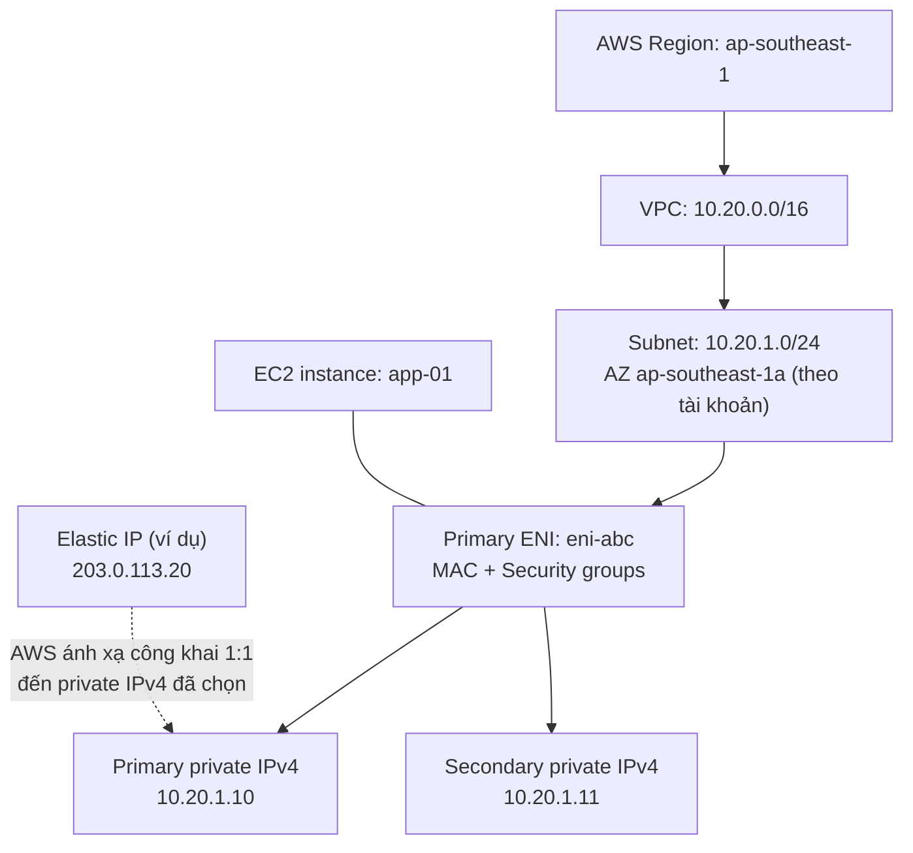
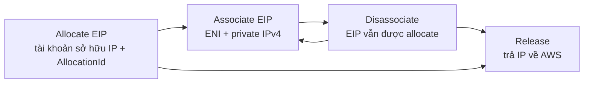
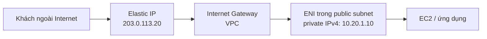
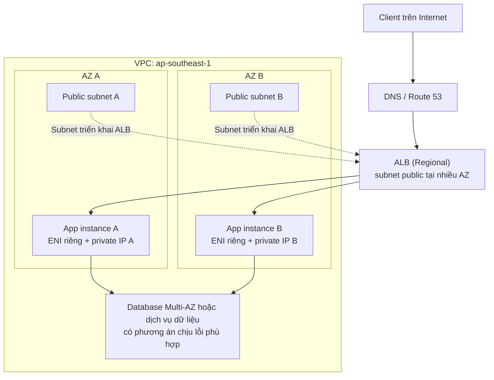

# Elastic Network Interface, private IP và Elastic IP trong Amazon VPC

> **Chương:** Mạng VPC  
> **Module:** CLOUD_PROVIDERS_AWS  
> **Mục tiêu:** hiểu cách AWS gắn danh tính mạng, địa chỉ IP và khả năng truy cập cho tài nguyên trong VPC; từ đó triển khai ứng dụng an toàn, có thể giám sát, phục hồi khi lỗi và kiểm soát chi phí.

## 1. Vì sao cần hiểu ENI và các loại địa chỉ IP?

Trong hệ sinh thái AWS, **Amazon Virtual Private Cloud (VPC)** cung cấp không gian mạng riêng theo **Region**; mỗi **subnet** thuộc một **Availability Zone (AZ)**. Khi đặt một EC2 instance vào VPC, nó phải có kết nối mạng qua **Elastic Network Interface (ENI)**. Địa chỉ IP của instance thường được gắn với ENI đó.

Hãy hình dung một ứng dụng đặt hàng:

- API chạy trên EC2 cần **private IP** để trao đổi với database và dịch vụ nội bộ.
- Một máy quản trị có thể cần địa chỉ **public IPv4 ổn định** để bên ngoài truy cập; Elastic IP (EIP) là một lựa chọn.
- Khi một EC2 hỏng, đội vận hành muốn **chuyển lưu lượng sang máy thay thế** mà không phải yêu cầu đối tác đổi IP.
- Dù đã gắn EIP, ứng dụng vẫn có thể không truy cập Internet do route table, security group hoặc network ACL không cho phép.
- Với nhiều máy chạy tự động trên nhiều AZ, dùng một EIP cho từng máy chưa chắc phù hợp; **Application Load Balancer (ALB)** hoặc **Network Load Balancer (NLB)** thường giải quyết tốt hơn yêu cầu truy cập ổn định.

Muốn xử lý đúng, cần tách ba đối tượng:

1. **ENI:** giao diện mạng ảo, mang cấu hình mạng.
2. **Private IP:** địa chỉ dùng để liên lạc qua hệ thống mạng riêng của VPC và các mạng được kết nối.
3. **Elastic IP:** địa chỉ **public IPv4 tĩnh**, được AWS cấp phát cho tài khoản theo phạm vi địa lý dịch vụ, rồi ánh xạ vào private IPv4 của ENI.

Ba thứ liên quan chặt chẽ nhưng không thay thế nhau.

## 2. ENI là gì?

**Elastic Network Interface** là một giao diện mạng ảo trong VPC. Đối với các instance EC2 thường gặp, ENI là điểm gắn kết giữa máy ảo và mạng VPC. Một số dịch vụ được AWS quản lý cũng sử dụng ENI để kết nối mạng; khi đó khả năng chỉnh sửa và tháo ENI do dịch vụ quyết định.

### 2.1. Những thuộc tính quan trọng của ENI

| Thuộc tính | Ý nghĩa |
|---|---|
| **Network interface ID** | Định danh dạng `eni-...`, dùng để tra cứu và quản lý |
| **VPC ID / Subnet ID** | ENI thuộc một subnet cụ thể; suy ra thuộc một VPC và một AZ cụ thể |
| **Primary private IPv4** | Địa chỉ IPv4 riêng chính trong subnet IPv4-capable |
| **Secondary private IPv4** | Các địa chỉ riêng bổ sung để phục vụ nhiều ứng dụng hoặc chuyển IP khi cần |
| **IPv6 addresses** | Các địa chỉ IPv6 nếu subnet/VPC và loại interface hỗ trợ; IPv6-only subnet có mô hình khác IPv4 |
| **MAC address** | Địa chỉ MAC của ENI |
| **Security groups** | Các quy tắc lọc lưu lượng có trạng thái áp dụng cho ENI trong VPC |
| **Attachment** | Thông tin instance đang gắn ENI, device index, trạng thái attachment |
| **Source/destination check** | Cơ chế kiểm tra EC2 có là nguồn/đích của lưu lượng; thường bật đối với máy chạy ứng dụng |

Một ENI có thể có nhiều private IP, nhưng những IP đó phải thuộc **dải địa chỉ phù hợp của subnet**. Không thể tự gắn IP bất kỳ từ subnet hoặc Region khác lên ENI.

### 2.2. Sơ đồ quan hệ



**Lưu ý:** `203.0.113.20` là địa chỉ IPv4 mẫu thuộc dải dành cho tài liệu; không phải EIP được cấp phát thực tế. Các ID `eni-abc` và địa chỉ private IP chỉ để minh họa.

Một EC2 có thể hỗ trợ nhiều ENI, phụ thuộc dòng instance và giới hạn mạng của kích thước instance. Mỗi ENI có thể mang nhiều địa chỉ IP tùy quota và khả năng hỗ trợ. Do đó “một EC2 = một ENI = một private IP” chỉ đúng với trường hợp đơn giản, **không phải quy tắc cố định**.

### 2.3. Primary ENI và secondary ENI

**Primary ENI**:

- Là giao diện tại device index `0`, thường thấy trong hệ điều hành như `eth0`/`ens...`.
- Được gắn vào EC2 khi khởi tạo và **không thể tháo khỏi instance** như cách tháo một secondary ENI.
- Khi EC2 bị chấm dứt (terminate), ENI thường bị xóa theo cơ chế `DeleteOnTermination` của attachment; cần kiểm tra cờ này nếu muốn dự tính vòng đời tài nguyên.
- Mang địa chỉ mạng chính để instance trao đổi nội bộ.

**Secondary ENI**:

- Có thể gắn thêm vào EC2 nếu loại instance hỗ trợ và trong giới hạn của nó.
- Có thể tháo và gắn vào EC2 khác **trong cùng AZ**, với điều kiện về attachment và tính tương thích được đáp ứng.
- Giữ thông tin mạng thuộc ENI, như private IP, MAC và security groups, khi được chuyển phù hợp; hữu ích cho một số phương án phục hồi hoặc thiết bị mạng ảo.
- Không làm cho instance tự động có nhiều đường truyền độc lập hay đạt HA; route, interface trong OS và ứng dụng vẫn cần cấu hình chính xác.

**Phạm vi:** ENI là tài nguyên **zonal**. Hai EC2 cùng Region nhưng thuộc hai AZ khác nhau **không thể trực tiếp chuyển cùng một ENI qua lại**.

## 3. Private IP: địa chỉ riêng của workload

### 3.1. Primary private IPv4

Trong một subnet hỗ trợ IPv4, primary private IPv4 được AWS chọn hoặc người triển khai chỉ định từ dải subnet. Ví dụ:

- VPC CIDR: `10.20.0.0/16`.
- Subnet A: `10.20.1.0/24`.
- Primary ENI: `eni-abc`.
- Primary private IPv4: `10.20.1.10`.

Địa chỉ này gắn với **ENI**, thường được instance giữ qua thao tác **stop/start**. Việc thay đổi máy chủ vật lý phía sau EC2 sau stop/start không làm private IP chính mất đi khi ENI vẫn tồn tại.

Private IPv4 không định tuyến trực tiếp trên Internet công cộng; để giao tiếp qua Internet cần cơ chế thích hợp như **public IPv4 kết hợp Internet Gateway**, **NAT Gateway**, proxy hoặc kết nối mạng khác tùy chiều lưu lượng. Ngược lại, các tài nguyên cùng VPC có thể kết nối với nhau bằng private IP khi route và bộ lọc mạng cho phép.

### 3.2. Secondary private IPv4

Một ENI có thể nhận **nhiều private IPv4 phụ**, ví dụ `10.20.1.11`, `10.20.1.12`. Địa chỉ phụ hữu ích khi:

- Chạy nhiều dịch vụ cần bind vào các IP khác nhau trên cùng máy.
- Chuẩn bị phương án thay đổi đích đến của một địa chỉ nội bộ.
- Cấp nhiều private IP cho workloads cần đáp ứng giới hạn thiết kế mạng.
- Liên kết các Elastic IP khác nhau đến những private IPv4 riêng biệt trên cùng ENI, nếu giới hạn cho phép.

Có thể **reassign secondary private IPv4** giữa các ENI hợp lệ **trong cùng subnet** theo cơ chế EC2, nhưng primary private IPv4 không thể chuyển như một secondary IP.

Không nhầm việc “AWS đã gán private IP cho ENI” với việc phần mềm trong guest OS đã tự dùng IP đó. Trên một số hệ điều hành hoặc AMI, cần kiểm tra cấu hình network interface, địa chỉ phụ và ứng dụng đang lắng nghe trên IP nào.

### 3.3. CIDR subnet và địa chỉ AWS dành riêng

Trong một subnet IPv4, AWS dành riêng **5 địa chỉ**: 4 địa chỉ đầu và địa chỉ cuối của dải. Ví dụ với `10.20.1.0/24`:

| Địa chỉ | Vai trò |
|---|---|
| `10.20.1.0` | Địa chỉ mạng |
| `10.20.1.1` | VPC router |
| `10.20.1.2` | DNS theo quy tắc AWS của subnet/VPC |
| `10.20.1.3` | AWS dành cho mục đích sử dụng tương lai |
| `10.20.1.255` | Địa chỉ cuối của dải, AWS dành riêng |

Những địa chỉ còn lại **có thể** dùng làm private IPv4 tùy trạng thái cấp phát. Ví dụ `/24` có \(2^{32-24}=256\) địa chỉ tất cả, về nguyên tắc có **251 địa chỉ khả dụng** sau khi trừ năm địa chỉ dành riêng; thực tế còn bị giới hạn bởi địa chỉ đã dùng và quota của tài nguyên.

Không suy từ số địa chỉ subnet ra số EC2 tối đa: một instance có thể dùng nhiều private IP và ENI, còn các managed service cũng dùng địa chỉ trong subnet.

### 3.4. Private IP và IPv6

AWS hỗ trợ IPv4, IPv6 và cấu hình dual-stack theo khả năng của VPC/subnet/dịch vụ. Một địa chỉ **IPv6 global unicast** có thể định tuyến toàn cầu; cách cho phép inbound/outbound phụ thuộc route, Internet Gateway hoặc egress-only Internet Gateway cùng bộ lọc mạng.

Cần phân biệt:

- **Private IPv4**: ví dụ `10.20.1.10`, dùng cho mạng riêng.
- **Public IPv4**: địa chỉ cho kết nối công cộng, có thể tự động cấp hoặc là EIP.
- **IPv6**: cơ chế địa chỉ khác, **không sử dụng Elastic IP IPv4** để tạo địa chỉ IPv6 tĩnh.

Đối với IPv6-only subnet, ENI có thể hoạt động không có private IPv4; không áp đặt quy tắc “mọi ENI đều có primary private IPv4” cho tất cả cấu hình IPv6-only.

## 4. Public IPv4 tự động và Elastic IP khác nhau thế nào?

EC2 có thể dùng địa chỉ **public IPv4 tự động cấp** hoặc **Elastic IP**. Cả hai là public IPv4, nhưng khác vòng đời và khả năng kiểm soát.

| Tiêu chí | Auto-assigned public IPv4 | Elastic IP (EIP) |
|---|---|---|
| Mục đích | Cung cấp địa chỉ public IPv4 cho tài nguyên tương ứng | Giữ địa chỉ public IPv4 ổn định để quản trị hoặc chuyển đích |
| Quản lý địa chỉ | AWS tự cấp theo cấu hình subnet hoặc lúc launch | Tài khoản **allocate** và quản lý cho tới khi **release** |
| Sau EC2 stop/start | Thường được cấp địa chỉ công cộng mới khi start | Vẫn giữ cùng địa chỉ khi EIP còn được allocate/associate |
| Chuyển qua instance khác | Không được chủ động điều chuyển địa chỉ tự động theo cách như EIP | Có thể **reassociate** đến ENI/private IPv4 hợp lệ trong phạm vi hỗ trợ |
| Phạm vi | Gắn với workload/network interface được AWS quản lý | **Regional**, có ràng buộc network border group |
| Chi phí | Public IPv4 được AWS tính phí theo chính sách hiện hành | EIP là public IPv4 và cũng chịu phí theo chính sách hiện hành |

Từ năm 2024, AWS áp dụng giá theo giờ đối với **public IPv4 đang được sử dụng lẫn chưa được sử dụng**, theo điều khoản và ngoại lệ hiện hành. Không nên giả định EIP “miễn phí nếu gắn EC2”. Giá, ưu đãi và cách tính hóa đơn có thể thay đổi; hãy kiểm tra **Amazon VPC Pricing** và **AWS Cost Explorer** cho Region, số lượng IP và khoảng thời gian cụ thể.

### 4.1. Vòng đời của Elastic IP

EIP có thể hình dung qua bốn thao tác:



Giải thích:

- **Allocate:** AWS cấp một EIP từ dải địa chỉ phù hợp; tài khoản nhận một `AllocationId` dạng `eipalloc-...`.
- **Associate:** ánh xạ EIP tới ENI và private IPv4 tương ứng, hoặc chỉ định instance trong những trường hợp API hỗ trợ.
- **Disassociate:** gỡ ánh xạ hiện tại; EIP **vẫn thuộc tài khoản**, có thể phát sinh chi phí và chưa bị trả về kho địa chỉ.
- **Release:** giải phóng EIP về pool; **không bảo đảm** có thể lấy lại đúng IP đó. Đây là thay đổi cần kiểm soát với hệ thống đang cho phép truy cập theo whitelist IP.
- **Reassociate:** đổi ánh xạ của EIP từ đích này sang đích khác phù hợp, không cần cấp một EIP mới.

**Elastic IP không phải resource global.** EIP thông thường được allocate trong một **Region** và phải tuân thủ phạm vi **network border group**; không thể giữ nguyên EIP của Singapore để associate vào ENI tại Tokyo.

### 4.2. EIP được ánh xạ vào private IP như thế nào?

Đối với EC2 trong VPC, public IPv4 có ánh xạ tới private IPv4 qua cơ chế mạng AWS. EIP **không nhất thiết xuất hiện như một địa chỉ public IPv4 trên giao diện mạng bên trong hệ điều hành**.



Sơ đồ thể hiện luồng khái niệm khi VPC có **Internet Gateway**, subnet có đường đi Internet hợp lệ và các chính sách mạng cho phép. Nó không mô tả EIP là card mạng riêng được gắn trực tiếp vào OS.

**Điều kiện quan trọng:** gắn EIP **không tự làm subnet thành public subnet**. Với truy cập Internet hai chiều trực tiếp cho EC2 qua EIP, cần kiểm tra route table có route phù hợp tới **Internet Gateway**, security group, network ACL và dịch vụ đang lắng nghe.

Trong môi trường có **NAT Gateway** hoặc **proxy**, đường đi và địa chỉ public dùng cho outbound sẽ khác. Một instance chỉ có private IP cũng có thể truy cập outbound qua public NAT Gateway nếu cấu hình đúng mà **không cần EIP riêng trên instance**.

## 5. Phạm vi địa lý và ràng buộc gắn tài nguyên

Đây là chỗ dễ gây lỗi khi hệ thống triển khai đa AZ hoặc đa Region.

| Đối tượng | Phạm vi | Điều cần nhớ |
|---|---|---|
| VPC | **Region** | Một VPC chỉ thuộc một Region |
| Subnet | **AZ** | Mỗi subnet nằm trong một AZ |
| ENI | **AZ / subnet** | Không di chuyển trực tiếp ENI sang AZ khác |
| Primary/secondary private IPv4 | **Subnet/ENI** | Phải nằm trong dải IPv4 hợp lệ của subnet |
| Elastic IP | **Region** (và network border group) | Có thể remap tới đích hợp lệ, không dùng xuyên Region |
| EC2 instance | **AZ** | ENI gắn vào instance phải phù hợp AZ và các giới hạn mạng |
| Security group | **VPC / Region** | Được gắn vào ENI, không biến ENI thành global |
| Internet Gateway | **VPC / Region** | Được attach vào VPC; route table và các bộ lọc quyết định kết nối |
| Public NAT Gateway | **AZ** | Thường đặt trong subnet public và dùng EIP cho địa chỉ public outbound |

**Bài toán:** ENI `eni-1` nằm trong subnet `subnet-a` ở AZ A, có private IPv4 `10.20.1.10`. EC2 dự phòng nằm ở AZ B. Khi AZ A lỗi:

- **Không thể** tháo `eni-1` rồi attach trực tiếp vào instance ở AZ B.
- **Không thể** chuyển private IP `10.20.1.10` như một địa chỉ của subnet A sang ENI ở subnet B nếu không thay đổi cấu trúc địa chỉ và phương án định tuyến.
- Nếu EIP là một địa chỉ phù hợp của cùng Region/network border group, có thể **reassociate EIP** tới private IP của ENI dự phòng ở AZ B. Việc này cần automation, quyền IAM và kiểm tra sức khỏe; **không tự động xảy ra** chỉ vì AZ A lỗi.

Đây là lý do cần chọn kỹ giữa **chuyển ENI**, **reassign secondary private IP**, **chuyển EIP** và **cân bằng tải đa AZ**.

## 6. Security Group và đường đi mạng gắn với ENI

### 6.1. Security group nằm ở đâu?

Security group là bộ lọc lưu lượng **stateful** gắn với ENI trong VPC. Một ENI có thể sử dụng nhiều security group trong giới hạn cấu hình; AWS đánh giá tập quy tắc phù hợp.

Ví dụ API đặt hàng chạy trên EC2:

- Inbound: cho phép TCP 443 từ nguồn cần thiết nếu EC2 trực tiếp nhận HTTPS.
- Outbound: cho phép đến endpoint database hoặc dịch vụ phụ thuộc phù hợp.
- Nếu database chỉ nhận từ security group của API, sử dụng **security group reference** có thể phù hợp hơn CIDR rộng.
- Nếu ứng dụng nằm sau ALB, thông thường inbound của EC2 chỉ cần cho phép từ **security group của ALB** trên cổng ứng dụng, không mở cho `0.0.0.0/0`.

Security group **không có câu lệnh Deny riêng trong rule** theo mô hình ingress/egress thông thường; các lưu lượng không được Allow hợp lệ sẽ bị chặn. Network ACL (NACL) lại là bộ lọc **stateless** có rule Allow/Deny ở cấp subnet.

### 6.2. Vì sao có EIP nhưng không kết nối được?

Khi người dùng bên ngoài truy cập `https://203.0.113.20`, hãy đi theo luồng:

1. EIP có thực sự đang được **associated** với đúng ENI và private IPv4 của ứng dụng?
2. VPC đã attach **Internet Gateway** chưa?
3. Route table của subnet có route mặc định hoặc route đích phù hợp qua Internet Gateway không?
4. Security group của ENI có inbound TCP 443 từ đúng nguồn không?
5. NACL của subnet có cho phép chiều vào và chiều trả lời (ephemeral port) không?
6. OS firewall có cho phép, ứng dụng có chạy và **listen** đúng cổng/interface không?
7. TLS certificate và DNS có được cấu hình cho tên miền? Certificate thường không xác thực trực tiếp cho một IP mẫu.

Nếu chỉ kiểm tra bước 1 rồi cho rằng vấn đề do AWS EIP, rất dễ mất thời gian. **EIP là địa chỉ công cộng được ánh xạ; kết nối thực tế vẫn phụ thuộc toàn bộ đường đi mạng.**

### 6.3. Source/destination check

EC2 thông thường là **nguồn hoặc đích** của lưu lượng đến/đi từ ENI. AWS bật cơ chế **source/destination check** theo thiết kế mặc định cho phần lớn trường hợp.

Khi instance được cố ý dùng như **router, NAT instance, firewall hoặc appliance chuyển tiếp**, nó có thể phải xử lý lưu lượng mà nguồn/đích cuối không phải chính mình. Khi đó cần hiểu và có thể **tắt source/destination check** trên các ENI liên quan, cùng việc cấu hình route table, bảo mật và hệ điều hành.

Không tắt kiểm tra này cho EC2 ứng dụng thông thường chỉ để “sửa lỗi mạng” khi chưa có bằng chứng.

## 7. Chọn thiết kế phù hợp: ENI, EIP, NAT hay Load Balancer?

### 7.1. Một máy quản trị cần địa chỉ IPv4 ổn định

Giả sử đối tác chỉ cho phép kết nối từ một IP cố định. Nếu máy quản trị dùng kết nối Internet trực tiếp, gắn **Elastic IP** có thể đáp ứng yêu cầu whitelist IP. Cần harden host, giới hạn cổng truy cập, bật log và quản lý phí public IPv4.

Trong nhiều môi trường doanh nghiệp, giải pháp an toàn hơn có thể là **AWS Systems Manager Session Manager**, VPN hoặc bastion được quản trị tập trung, tùy yêu cầu. Có EIP không đồng nghĩa nên mở cổng SSH/RDP ra Internet.

### 7.2. Hàng chục EC2 private cần ra Internet để cập nhật

Không nên allocate EIP riêng và mở public connectivity cho tất cả EC2 nếu chỉ cần outbound. Một thiết kế phổ biến:

- EC2 chạy trong **private subnet**.
- Route outbound đến **public NAT Gateway** ở subnet public tương ứng.
- NAT Gateway dùng EIP cho địa chỉ public outbound.
- Sử dụng **VPC endpoints** cho các dịch vụ AWS được hỗ trợ để giảm lưu lượng qua NAT và tăng khả năng kiểm soát.

Với thiết kế chịu lỗi một AZ, cân nhắc **NAT Gateway theo từng AZ** cùng route đúng để tránh phụ thuộc AZ chéo; đánh giá chi phí theo giờ của NAT, xử lý dữ liệu và cross-AZ transfer.

### 7.3. API web cần HA giữa nhiều AZ

Một EIP gắn vào **một EC2 duy nhất** không làm API chịu lỗi AZ. Kiến trúc thường phù hợp hơn:



ALB dùng endpoint DNS và cân bằng tải theo health check/target group; nên dùng DNS chính thức thay vì cố gắn một EIP trực tiếp cho ALB. Nếu đối tác yêu cầu **IP tĩnh cho inbound**, cân nhắc **NLB** với khả năng địa chỉ tĩnh theo AZ hoặc **AWS Global Accelerator** tùy bài toán. Chi tiết số IP/khả năng tích hợp cần được xác minh theo cấu hình và Region.

### 7.4. Thiết bị mạng ảo cần di chuyển nguyên cấu hình interface

Trong một số triển khai **network appliance** ở cùng AZ, có thể attach một secondary ENI vào EC2 thay thế để mang theo private IP, MAC và security groups. Điều này đòi hỏi kiểm soát thời điểm tháo/gắn, xử lý trạng thái kết nối và cấu hình network OS. Trong thiết kế đa AZ, lựa chọn này không còn trực tiếp phù hợp vì ENI bị ràng buộc vào AZ.

### 7.5. Ứng dụng hoạt động ở hai Region

EIP chỉ giải quyết phạm vi Region/network border group; không phải **Global IP**. Muốn failover từ Singapore sang Tokyo, có thể cần:

- Hệ thống ứng dụng và dữ liệu đã triển khai tại cả hai Region.
- DNS failover bằng Route 53 hoặc routing phù hợp qua Global Accelerator.
- Kiểm tra RTO/RPO, replication, health check, quyền IAM và đường đi mạng ở cả hai Region.

Không cố di chuyển cùng một ENI/private IPv4/EIP xuyên Region.

## 8. Vòng đời địa chỉ và những thao tác thường gặp

| Thao tác | Private IPv4 chính | Secondary private IPv4 | EIP |
|---|---|---|---|
| **Stop/start EC2** | Thường được giữ nguyên cùng ENI | Thường được giữ cùng ENI | Không đổi khi allocation/association được duy trì |
| **Reboot EC2** | Không đổi | Không đổi | Không đổi |
| **Terminate EC2** | Bị mất nếu ENI bị xóa theo lifecycle | Mất cùng ENI nếu ENI bị xóa | Thường vẫn được allocate cho tài khoản; cần kiểm tra association |
| **Detach secondary ENI** | IP gắn với ENI được tháo, không đi theo EC2 cũ | Vẫn gắn với ENI | Ánh xạ cần được kiểm tra theo trạng thái ENI/association |
| **Attach ENI sang EC2 khác trong cùng AZ** | IP theo ENI (nếu attachment hợp lệ) | IP theo ENI | EIP vẫn gắn với private IP đã associate nếu trạng thái ánh xạ cho phép |
| **Reassociate EIP sang ENI mới** | Không đổi private IP của ENI nguồn/đích | Không đổi trừ khi có thao tác IP riêng | Cùng public IPv4 chuyển sang private IP đích |
| **Release EIP** | Không đổi | Không đổi | Trả địa chỉ public về pool, khó hoặc không thể lấy lại đúng IP |

Một số hành động có quy tắc chi tiết, quota hoặc ngoại lệ tùy tài nguyên/dịch vụ được quản lý. Với môi trường đang phục vụ người dùng, nên kiểm tra trạng thái cụ thể và quy trình rollback trước khi thay đổi association.

### 8.1. Phân biệt hai cách “chuyển IP”

**Chuyển private IP phụ trong subnet:**

- Áp dụng cho **secondary private IPv4** khi được reassign hợp lệ.
- Hai ENI phải đáp ứng điều kiện AWS, trong đó **cùng subnet** là điều kiện quan trọng.
- Không giúp chuyển IP từ AZ A sang subnet AZ B.

**Chuyển Elastic IP:**

- Thay đổi ánh xạ **public IPv4** sang private IPv4 đích.
- Có thể hỗ trợ phục hồi sang ENI ở AZ khác **trong cùng Region/network border group** và các điều kiện dịch vụ.
- Không tự chuyển session, file, database hay trạng thái ứng dụng. Health check và quy trình failover vẫn cần triển khai.

## 9. Thực hành quan sát với AWS CLI

Các lệnh sau là **read-only**. Cần AWS CLI v2, credentials/profile có quyền xem EC2/VPC và Region đang dùng. Ví dụ chọn `ap-southeast-1`; thay bằng Region thực tế.

### 9.1. Xem danh sách ENI, subnet, IP và attachment

```bash
aws ec2 describe-network-interfaces \
  --region ap-southeast-1 \
  --query "NetworkInterfaces[].[NetworkInterfaceId,SubnetId,AvailabilityZone,PrivateIpAddress,Status]" \
  --output table
```

Tra cứu chi tiết ENI đã biết:

```bash
aws ec2 describe-network-interfaces \
  --region ap-southeast-1 \
  --network-interface-ids eni-0123456789abcdef0 \
  --query "NetworkInterfaces[0].{Id:NetworkInterfaceId,Subnet:SubnetId,AZ:AvailabilityZone,PrimaryIPv4:PrivateIpAddress,PrivateIPv4s:PrivateIpAddresses,IPv6s:Ipv6Addresses,Groups:Groups,Attachment:Attachment,SourceDestCheck:SourceDestCheck}" \
  --output json
```

Đặc điểm cần đọc:

- `PrivateIpAddresses`: liệt kê các private IPv4, trường `Primary` cho biết địa chỉ chính.
- `Association.PublicIp` hoặc các trường liên quan: có thể thể hiện public IPv4 đang được ánh xạ đến private IP tương ứng.
- `Attachment.InstanceId` và `DeviceIndex`: xem ENI gắn vào EC2 nào, vị trí thiết bị.
- `Groups`: security groups hiện tại.
- `AvailabilityZone` và `SubnetId`: nơi interface được đặt.

Nếu ID mẫu không tồn tại, CLI sẽ trả về lỗi. Hãy thay ID thật trong tài khoản trước khi thực hành.

### 9.2. Xem private IPv4 và public IPv4 của EC2

```bash
aws ec2 describe-instances \
  --region ap-southeast-1 \
  --query "Reservations[].Instances[].[InstanceId,Placement.AvailabilityZone,PrivateIpAddress,PublicIpAddress,State.Name]" \
  --output table
```

`PublicIpAddress` có thể rỗng nếu instance không có public IPv4. Một EC2 có nhiều ENI/secondary IP nên cần đọc thêm `NetworkInterfaces` để xem đầy đủ các ánh xạ.

### 9.3. Kiểm tra Elastic IP đã cấp phát

```bash
aws ec2 describe-addresses \
  --region ap-southeast-1 \
  --query "Addresses[].[PublicIp,AllocationId,AssociationId,NetworkInterfaceId,PrivateIpAddress]" \
  --output table
```

Giải thích:

- `PublicIp`: Elastic IPv4.
- `AllocationId`: ID cấp phát trong tài khoản.
- `AssociationId`: ID ánh xạ hiện tại; có thể không có nếu EIP chưa associate.
- `NetworkInterfaceId` và `PrivateIpAddress`: đích mà EIP đang ánh xạ, nếu có.

Muốn hiểu chi phí, đừng chỉ đếm EIP đã associate; hãy kiểm tra **toàn bộ public IPv4** đang sử dụng hoặc được cấp phát theo công cụ quản lý IP/cost hiện hành.

### 9.4. Xem subnet và route table

```bash
aws ec2 describe-subnets \
  --region ap-southeast-1 \
  --query "Subnets[].[SubnetId,VpcId,CidrBlock,AvailabilityZone,AvailableIpAddressCount]" \
  --output table

aws ec2 describe-route-tables \
  --region ap-southeast-1 \
  --query "RouteTables[].[RouteTableId,VpcId,Associations,Routes]" \
  --output json
```

Đối với route table, cần xét association của subnet và cả **main route table** nếu subnet không có association tường minh. Chỉ nhìn thấy một route đến Internet Gateway trong VPC chưa đủ để kết luận mọi subnet đang dùng route đó.

### 9.5. Kiểm tra loại EC2 có hỗ trợ bao nhiêu ENI/IP

```bash
aws ec2 describe-instance-types \
  --region ap-southeast-1 \
  --instance-types t3.micro \
  --query "InstanceTypes[0].NetworkInfo.{MaxENI:MaximumNetworkInterfaces,IPv4PerENI:Ipv4AddressesPerInterface,IPv6PerENI:Ipv6AddressesPerInterface}" \
  --output json
```

Khả năng hỗ trợ mạng còn tùy loại instance, giao diện và các giới hạn sử dụng thực tế. Không cố tạo quá số ENI hoặc IP được phép vì API sẽ từ chối.

### 9.6. Những thay đổi có thể dùng trong lab riêng

Các API tương ứng để thực hành gồm:

- `AllocateAddress`, `AssociateAddress`, `DisassociateAddress`, `ReleaseAddress` cho EIP.
- `CreateNetworkInterface`, `AttachNetworkInterface`, `DetachNetworkInterface`, `DeleteNetworkInterface` cho ENI.
- `AssignPrivateIpAddresses`, `UnassignPrivateIpAddresses` cho secondary IPv4.

Chỉ chạy trên tài nguyên thử nghiệm đã được cho phép. **Allocate EIP và chạy public IPv4 có thể phát sinh phí**; việc chuyển EIP hoặc detach ENI trên hệ thống thực có thể làm ngắt kết nối và làm sai whitelist IP của đối tác.

## 10. Xử lý sự cố theo triệu chứng

| Triệu chứng | Giả thuyết nên kiểm tra | Hướng xác minh |
|---|---|---|
| EC2 trong VPC không gọi được API nội bộ | Private IP, route VPC, SG, NACL, DNS | Kiểm tra ENI/subnet/SG và địa chỉ đích; dùng VPC Reachability Analyzer khi phù hợp |
| Có EIP nhưng không SSH/HTTPS được | Route thiếu Internet Gateway, SG/NACL, OS firewall, ứng dụng không listen | Xem EIP association; route table đúng của subnet; cổng inbound và đường trả lời |
| Public IPv4 thay đổi sau stop/start | Đang dùng auto-assigned public IPv4, không phải EIP | `describe-instances` và `describe-addresses` |
| Tháo ENI bị lỗi | Đang cố tháo primary ENI hoặc ENI do AWS managed service quản lý | Xem `Attachment.DeviceIndex`, chủ sở hữu, loại interface |
| Attach ENI sang EC2 khác thất bại | Hai tài nguyên khác AZ hoặc vượt quota/không tương thích | Kiểm tra AZ, loại instance, giới hạn ENI/IP |
| Secondary private IP không dùng được trong OS | AWS đã gán IP nhưng guest OS/app chưa cấu hình | Xem `PrivateIpAddresses` và cấu hình NIC/route của OS |
| EIP có trạng thái allocated nhưng không kết nối | EIP chưa associated hoặc associated sai đích | Kiểm tra `AssociationId`, `NetworkInterfaceId`, `PrivateIpAddress` |
| Lambda/managed service có ENI nhưng không thể detach | ENI do dịch vụ sở hữu và quản lý | Xác định dịch vụ nguồn, chỉnh cấu hình tại dịch vụ thay vì xóa trực tiếp |
| Hóa đơn public IPv4 tăng | Nhiều EIP nhàn rỗi hoặc public IPv4 trên instance, NAT/LB | Dùng Cost Explorer, IPAM Public IP Insights và bảng giá hiện hành |
| Chuyển EIP mà session TCP cũ vẫn lỗi | Connection state không được chuyển cùng EIP | Kiểm tra kế hoạch retry/reconnect; EIP remap không đồng bộ state của ứng dụng |

### 10.1. Dùng VPC Flow Logs để quan sát

**VPC Flow Logs** có thể ghi metadata lưu lượng ở cấp VPC, subnet hoặc ENI để phân tích mạng. Chúng có thể giúp thấy flow được chấp nhận hay từ chối trong phạm vi ghi nhận, nhưng không thay thế application logs và không ghi payload ứng dụng.

Khi điều tra:

1. Chọn ENI/traffic scope đúng.
2. Kiểm tra thời điểm, source/destination IP, port, protocol và action.
3. Đối chiếu với security group, NACL và route tại thời điểm lỗi.
4. Kiểm tra thêm **CloudWatch metrics, CloudTrail** và log của instance/ứng dụng nếu có.

Không suy đoán “mọi gói mạng đều được Flow Logs ghi lại”; phạm vi, độ trễ và các loại traffic ngoại lệ phụ thuộc cấu hình/dịch vụ. Flow Logs có thể phát sinh chi phí lưu trữ và ingest.

## 11. Bài tập thiết kế và đáp án tham khảo

### Bài 1 — Private subnet và truy cập Internet

EC2 `10.20.2.10` nằm trong private subnet; security group cho phép outbound TCP 443. Máy có tự truy cập Internet được không?

**Đáp án:** Chưa đủ dữ kiện. Cần route outbound và cơ chế như public NAT Gateway, NAT instance/proxy hoặc endpoint theo loại đích. Security group Allow không tự tạo đường đi Internet.

### Bài 2 — Chuyển ENI qua AZ

Ứng dụng dùng secondary ENI ở AZ A. EC2 dự phòng ở AZ B. Có thể detach ENI và attach sang EC2 dự phòng không?

**Đáp án:** Không, ENI thuộc subnet/AZ cụ thể. Chọn phương án thay thế như thiết lập ENI mới ở AZ B và chuyển EIP phù hợp, hoặc dùng load balancer và kiến trúc đa AZ.

### Bài 3 — EIP và địa chỉ trong OS

EC2 có private IP `10.20.1.10` được gắn EIP `203.0.113.20`. Lệnh `ip addr` chỉ hiển thị private IPv4. Có phải EIP cấu hình lỗi?

**Đáp án:** Không nhất thiết. Với EC2 trong VPC, EIP được ánh xạ ở lớp mạng AWS đến private IPv4; hệ điều hành thường không thấy EIP như địa chỉ gán trực tiếp lên NIC.

### Bài 4 — Public IPv4 cố định

Một đối tác chỉ whitelist một public IPv4. EC2 được cấu hình auto-assign public IPv4 và bị stop/start sau cập nhật. Có đáng tin cậy không?

**Đáp án:** Không. Địa chỉ public tự động thường thay đổi sau stop/start. EIP có thể đáp ứng nhu cầu IP cố định ở cùng Region, hoặc dùng phương án endpoint phù hợp để ổn định và tăng khả năng chịu lỗi.

### Bài 5 — Di chuyển IP nội bộ

Có secondary private IPv4 `10.20.1.11` tại ENI A, muốn gán cho ENI B **cùng subnet**. Có khả năng thực hiện không?

**Đáp án:** Có thể, thông qua cơ chế reassign secondary private IPv4 khi hai ENI và trạng thái của chúng đáp ứng điều kiện. Kiểm tra ứng dụng, route và khả năng kết nối sau thay đổi. Không dùng cơ chế tương tự để di chuyển primary private IPv4.

### Bài 6 — Scale API qua nhiều AZ

Một API chạy ở hai AZ với 10 EC2 do Auto Scaling group quản lý. Có nên publish từng EIP của từng EC2 cho khách hàng không?

**Đáp án:** Thường không. Instance có thể bị thay thế và scale; số EIP/chi phí và quản lý DNS phức tạp. Dùng **ALB** với DNS và health check cho HTTP(S) là cách phổ biến. Nếu đối tác bắt buộc allowlist IP tĩnh, đánh giá NLB hoặc Global Accelerator theo kiến trúc thực tế.

### Bài 7 — Giảm chi phí public IPv4

Một nhóm phát hiện nhiều EIP không associated nhưng vẫn được allocate. Việc gì cần làm?

**Đáp án:** Xác định chủ sở hữu, mục đích, khả năng còn dùng trong kế hoạch failover, sau đó release các EIP thực sự không cần thiết theo quy trình có thẩm quyền. Chỉ disassociate chưa giải phóng allocation và có thể vẫn phát sinh phí. Theo dõi chi phí bằng Cost Explorer.

### Bài 8 — Failover một AZ

EC2 ở AZ A sở hữu EIP; ứng dụng đã có bản sao ở AZ B. Có thể đảm bảo RTO = 0 chỉ bằng EIP remap?

**Đáp án:** Không. Cần phát hiện lỗi, thao tác chuyển association, xác nhận target khỏe, đồng bộ state/dữ liệu, reconnect từ client và kiểm thử. Một số kết nối hiện hữu sẽ bị gián đoạn; không coi EIP remap là cơ chế chuyển session liền mạch.

## 12. Checklist chọn và vận hành ENI/IP an toàn

1. **Xác định lớp mạng:** VPC thuộc Region, subnet/ENI thuộc AZ, private IP thuộc subnet, EIP thuộc Region/network border group.
2. **Gán IP có chủ đích:** dùng private IP cho giao tiếp nội bộ; chỉ cấp public IPv4 khi thực sự có đường truy cập công cộng cần thiết.
3. **Thiết kế tuyến đường:** kiểm tra Internet Gateway, NAT Gateway, route table, VPC endpoint, security group và NACL.
4. **Kiểm tra vòng đời:** phân biệt reboot, stop/start, terminate, detach ENI, disassociate và release EIP.
5. **Chọn cơ chế phục hồi:** secondary ENI phù hợp trong cùng AZ; EIP remap cho địa chỉ public tại Region; ALB/NLB và thiết kế multi-AZ cho ứng dụng cần HA.
6. **Bảo vệ truy cập:** tối thiểu hóa inbound, dùng IAM cho thao tác quản trị ENI/EIP, giám sát CloudTrail, Flow Logs và application logs.
7. **Kiểm soát chi phí:** rà soát EIP allocated và các public IPv4 khác, NAT Gateway, lưu lượng qua AZ và phí log, theo bảng giá hiện hành.
8. **Kiểm chứng bằng thực tế:** đọc trạng thái ENI/instance/EIP, kiểm tra đường đi và thử failover trong môi trường được kiểm soát.

Hiểu đúng **ENI – private IP – Elastic IP** giúp kết nối kiến thức **Region/AZ, IAM, VPC, EC2, lưu trữ, database, serverless, giám sát, phục hồi và chi phí** thành những quyết định kiến trúc cụ thể thay vì chỉ cấu hình địa chỉ theo thói quen.

## Tài liệu AWS tham khảo

- [Elastic network interfaces — Amazon EC2 User Guide](https://docs.aws.amazon.com/AWSEC2/latest/UserGuide/using-eni.html)
- [IP addressing for EC2 — Amazon EC2 User Guide](https://docs.aws.amazon.com/AWSEC2/latest/UserGuide/using-instance-addressing.html)
- [Elastic IP addresses — Amazon EC2 User Guide](https://docs.aws.amazon.com/AWSEC2/latest/UserGuide/elastic-ip-addresses-eip.html)
- [Subnet CIDR blocks — Amazon VPC User Guide](https://docs.aws.amazon.com/vpc/latest/userguide/subnet-sizing.html)
- [VPC security groups — Amazon VPC User Guide](https://docs.aws.amazon.com/vpc/latest/userguide/vpc-security-groups.html)
- [Internet gateways — Amazon VPC User Guide](https://docs.aws.amazon.com/vpc/latest/userguide/VPC_Internet_Gateway.html)
- [NAT gateways — Amazon VPC User Guide](https://docs.aws.amazon.com/vpc/latest/userguide/vpc-nat-gateway.html)
- [VPC Flow Logs — Amazon VPC User Guide](https://docs.aws.amazon.com/vpc/latest/userguide/flow-logs.html)
- [Amazon VPC pricing](https://aws.amazon.com/vpc/pricing/)
- [Elastic Load Balancing documentation](https://docs.aws.amazon.com/elasticloadbalancing/)
