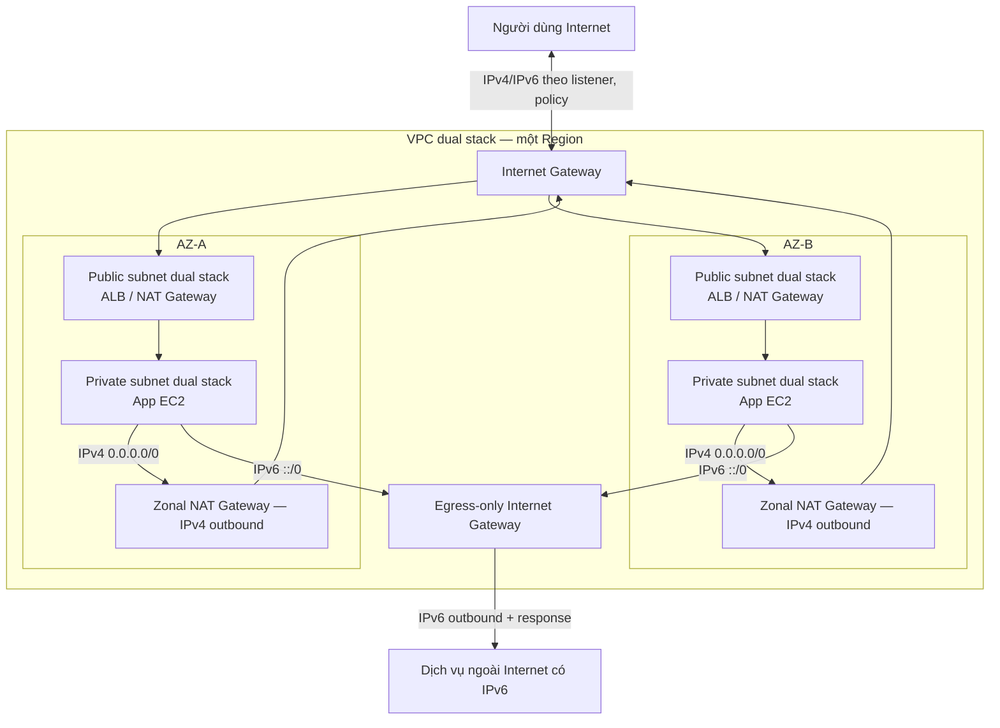

# IPv6, dual stack và egress-only Internet Gateway trong Amazon VPC

> **Chương:** Mạng VPC  
> **Module:** `CLOUD_PROVIDERS_AWS`  
> **Bối cảnh:** Kiến trúc mạng AWS có thể kết hợp IPv4 và IPv6 để triển khai ứng dụng an toàn, mở rộng, theo dõi được và có phương án phục hồi. Bài tập trung vào địa chỉ IPv6 trong VPC, mô hình dual stack và đường ra Internet chỉ chiều khởi tạo từ VPC bằng **egress-only Internet Gateway**.

## Mục tiêu học tập

Sau bài học, người học có thể:

1. Giải thích cách biểu diễn IPv6, IPv6 CIDR và sự khác biệt giữa IPv4-only, dual-stack, IPv6-only subnet.
2. Thiết kế VPC và subnet có IPv4/IPv6, cấp IPv6 cho tài nguyên phù hợp và hiểu vai trò của DNS record `A`/`AAAA`.
3. Phân biệt Internet Gateway, egress-only Internet Gateway và NAT Gateway theo giao thức, đường truyền và khả năng nhận kết nối từ Internet.
4. Cấu hình đúng route table cho **public subnet dual stack** và **private subnet dual stack**, kết hợp security group và network ACL.
5. Xác minh cấu hình bằng AWS CLI, phân tích lỗi kết nối IPv6 và cân nhắc tính sẵn sàng, giám sát, kiểm soát chi phí.

## 1. Vì sao VPC cần IPv6?

IPv4 sử dụng địa chỉ 32 bit, ví dụ `10.20.11.15`. IPv6 sử dụng địa chỉ 128 bit, ví dụ `2001:db8:1234:1211::15`. Không gian địa chỉ IPv6 rộng hơn rất nhiều, phù hợp nhu cầu kết nối của hệ thống phân tán và giảm phụ thuộc vào việc phân phối các địa chỉ IPv4 công khai khan hiếm.

Trong Amazon VPC, IPv6 giúp:

- Cấp địa chỉ IPv6 riêng cho nhiều tài nguyên mà không cần dựa vào NAT để truy cập **các đích IPv6**.
- Cung cấp đường kết nối IPv6 cho client, load balancer, máy chủ ứng dụng và những dịch vụ AWS có hỗ trợ.
- Tiến dần từ ứng dụng IPv4 hiện có sang **dual stack** trước khi cân nhắc workload IPv6-only.
- Tách yêu cầu **không cho Internet khởi tạo kết nối vào máy chủ ứng dụng** khỏi việc vẫn cho máy chủ truy cập các dịch vụ IPv6 bên ngoài, bằng egress-only Internet Gateway.

Điểm quan trọng: **Có địa chỉ IPv6 không đồng nghĩa tài nguyên sẽ tự động kết nối được Internet.** Khả năng kết nối còn phụ thuộc CIDR, địa chỉ gán cho interface, route table, security group, network ACL, DNS và khả năng hỗ trợ IPv6 ở hai đầu.

### 1.1 Cách đọc địa chỉ IPv6 và CIDR

IPv6 có tám nhóm 16 bit viết bằng hệ thập lục phân; ký hiệu `::` rút gọn một chuỗi nhóm `0000` liên tiếp và chỉ dùng một lần trong địa chỉ.

```text
Đầy đủ:   2001:0db8:1234:1211:0000:0000:0000:0015
Rút gọn:  2001:db8:1234:1211::15

CIDR:     2001:db8:1234:1211::/64
Default:  ::/0
Loopback: ::1
```

- `/64` nghĩa là 64 bit đầu làm tiền tố mạng; không giống `/24` của IPv4 về số địa chỉ.
- `::/0` là tuyến mặc định cho IPv6, tương tự `0.0.0.0/0` dành cho IPv4.
- Dải `2001:db8::/32` được dành cho **ví dụ tài liệu**. Các địa chỉ thuộc dải này **không dùng làm địa chỉ Internet thật**; toàn bộ CIDR IPv6 bên dưới là minh họa cho sơ đồ.
- Không nhầm `::/0` (toàn bộ không gian IPv6) với `::1` (loopback của chính host).

### 1.2 IPv6 có phải lúc nào cũng “public” không?

Với địa chỉ IPv6 **Amazon-provided public**, AWS có thể quảng bá prefix ra Internet. Nếu đường định tuyến và chính sách mạng cho phép, host có thể được tiếp cận qua IPv6 **mà không cần NAT**. Tuy vậy, AWS còn có các lựa chọn **private IPv6** thông qua VPC IP Address Manager (IPAM), không được quảng bá ra Internet từ AWS. Vì thế cần phân biệt **loại địa chỉ** với **khả năng truy cập thực tế**.

Ngay cả khi EC2 có IPv6 globally routable, việc đặt tuyến `::/0` tới egress-only Internet Gateway sẽ ngăn Internet tự mở phiên kết nối đi vào qua cổng đó. Security group và network ACL vẫn cần giới hạn đúng lưu lượng.

## 2. IPv4-only, dual stack và IPv6-only khác nhau thế nào?

AWS hỗ trợ các kiểu subnet IPv4-only, dual stack và IPv6-only. Với dual stack, VPC và subnet có cả hai dải CIDR; tài nguyên muốn sử dụng IPv6 cũng phải có IPv6 trên ENI và hỗ trợ giao thức.

| Kiểu subnet | Dải CIDR của subnet | Khả năng kết nối của workload |
|---|---|---|
| **IPv4-only** | IPv4 | Dùng IPv4; không thể dùng đường IPv6 trực tiếp khi chưa bổ sung hỗ trợ |
| **Dual stack** | IPv4 **và** IPv6 | Có thể sử dụng IPv4 hoặc IPv6, tùy địa chỉ được cấp, DNS, ứng dụng và đích |
| **IPv6-only** | IPv6, không cấp CIDR IPv4 thông thường cho subnet | Ứng dụng dùng IPv6; để kết nối đích chỉ có IPv4 thường cần NAT64/DNS64 hoặc giải pháp tương thích |

**Dual stack không phải một công cụ tự dịch IPv4 ↔ IPv6.** Hai giao thức có không gian địa chỉ và tuyến độc lập. Một host dual stack gọi đích IPv4 bằng IPv4, gọi đích IPv6 bằng IPv6; client hoặc thư viện sẽ lựa chọn dựa trên DNS và khả năng kết nối.

Ví dụ một ứng dụng Java chạy trên EC2 dual stack:

1. Tra DNS của `api.example.test`.
2. Nếu có record `AAAA`, ứng dụng có thể thử IPv6; nếu có record `A`, ứng dụng có thể thử IPv4.
3. Việc chọn thử kết nối, thứ tự ưu tiên và fallback phụ thuộc vào hệ điều hành, Java runtime, thư viện HTTP và cấu hình client.
4. Nếu đường IPv6 lỗi nhưng đường IPv4 hoạt động, một số client sẽ fallback; không nên mặc định mọi client đều có hành vi giống nhau.

Tên `api.example.test` và các IP trong bài là dữ liệu minh họa, không đại diện cho endpoint triển khai thật.

### 2.1 Prefix IPv6 tại VPC và subnet

VPC có thể nhận IPv6 CIDR do AWS cấp, từ pool IPAM hoặc theo cơ chế địa chỉ do tổ chức sở hữu (BYOIP) nếu đáp ứng điều kiện. Với lựa chọn **Amazon-provided IPv6 CIDR**, một block `/56` thường được cấp cho VPC. Các lựa chọn CIDR khác có thể khả dụng theo nguồn cấp và cấu hình IPAM/BYOIP; không nên mặc định mọi VPC đều bắt buộc `/56`.

Ví dụ địa chỉ chỉ dùng cho tài liệu:

| Cấp | IPv4 CIDR | IPv6 CIDR | Ý nghĩa |
|---|---|---|---|
| VPC `app-vpc` | `10.20.0.0/16` | `2001:db8:1234:1200::/56` | Không gian địa chỉ của một VPC |
| Public subnet AZ-A | `10.20.1.0/24` | `2001:db8:1234:1201::/64` | Ingress/load balancer, NAT gateway |
| Private subnet AZ-A | `10.20.11.0/24` | `2001:db8:1234:1211::/64` | App server |
| Public subnet AZ-B | `10.20.2.0/24` | `2001:db8:1234:1202::/64` | Khả năng phục hồi ở AZ khác |
| Private subnet AZ-B | `10.20.12.0/24` | `2001:db8:1234:1212::/64` | App server ở AZ khác |

Các subnet không được có dải CIDR trùng nhau trong cùng không gian được quản lý tương ứng. `/64` là cấu hình subnet IPv6 phổ biến, nhưng AWS có thể hỗ trợ các độ dài subnet IPv6 khác tùy trường hợp; phải kiểm tra quy định cấp phát khi thiết kế IPAM.

**Lưu ý:** Tạo IPv6 CIDR cho VPC và subnet chỉ là bước đầu. Muốn ENI/EC2 có IPv6, cần gán địa chỉ tường minh hoặc bật thuộc tính tự gán IPv6 khi tạo interface phù hợp; loại instance/dịch vụ và ứng dụng cũng phải hỗ trợ.

### 2.2 Region và Availability Zone

VPC có phạm vi **Region**; subnet nằm trong **một AZ**. Bạn có thể bố trí các subnet dual stack ở nhiều AZ để tăng khả năng chịu lỗi. Không được lấy việc có nhiều AZ làm bằng chứng mạng Internet sẽ sẵn sàng nếu mọi luồng IPv4 vẫn phụ thuộc vào một **zonal NAT Gateway** trong một AZ; cần đánh giá đường đi và điểm lỗi của từng giao thức.

## 3. Internet Gateway, egress-only Internet Gateway và NAT Gateway

Ba loại thành phần thường bị nhầm vì đều xuất hiện trong kiến trúc “đi ra Internet”.

| Thành phần | Giao thức phục vụ trong bài | Hướng kết nối Internet | Có dịch địa chỉ không? | Trường hợp phù hợp |
|---|---|---|---|---|
| **Internet Gateway (IGW)** | IPv4 và IPv6 | Cho phép kết nối đi ra và có thể cho phép Internet khởi tạo vào tài nguyên khi các điều kiện mạng/chính sách đáp ứng | Với IPv4, IGW thực hiện ánh xạ giữa IPv4 private và public của instance; với IPv6 thông thường không cần NAT | Public subnet, load balancer Internet-facing, EC2 public |
| **Egress-only Internet Gateway (EIGW)** | **Chỉ IPv6** | Tài nguyên trong VPC khởi tạo ra Internet; nhận lưu lượng trả lời; chặn kết nối mới khởi tạo từ Internet đi vào | **Không** thực hiện NAT66 cho lưu lượng IPv6 | EC2/workload private cần outbound IPv6 |
| **NAT Gateway** | IPv4 outbound; có thể thực hiện NAT64 cho IPv6 → IPv4 khi cấu hình tương ứng | Tài nguyên private khởi tạo kết nối tới đích phù hợp; cho phản hồi quay về | Có NAT cho IPv4, hỗ trợ NAT64 | IPv4 outbound từ private subnet; kết nối tới đích IPv4-only từ workload IPv6-only |

**EIGW không thay thế được NAT Gateway cho IPv4**. Tương tự, route IPv4 `0.0.0.0/0` trỏ tới NAT Gateway không mở đường Internet cho IPv6. Hai đường route phải được kiểm tra riêng.

**Hai chế độ NAT Gateway cần biết:** Zonal NAT Gateway hoạt động trong một AZ; trong thiết kế nhiều AZ thường dùng NAT Gateway riêng tại mỗi AZ để tránh phụ thuộc chéo. AWS cũng hỗ trợ **Regional NAT Gateway**: một NAT Gateway theo VPC có thể tự mở rộng hoạt động sang các AZ theo workload, giảm nhu cầu bố trí NAT theo từng AZ. Regional NAT Gateway phù hợp nhiều kịch bản Internet outbound nhưng có hạn chế riêng (ví dụ không hỗ trợ private NAT). Chọn chế độ dựa trên yêu cầu dự phòng, kết nối riêng, phạm vi khả dụng và chi phí; xem [AWS — Regional NAT gateways](https://docs.aws.amazon.com/vpc/latest/userguide/nat-gateways-regional.html).

### 3.1 Egress-only Internet Gateway thực sự làm gì?

Egress-only Internet Gateway là thành phần gắn với **VPC**, được AWS quản lý theo mô hình có khả năng mở rộng và sẵn sàng cao. Nó hoạt động **stateful**:

- Cho phép host bên trong VPC **khởi tạo** kết nối IPv6 ra ngoài theo route hợp lệ.
- Nhớ trạng thái của luồng để chuyển **lưu lượng phản hồi** trở lại đúng host.
- Không cho một host ngoài Internet mở **kết nối IPv6 mới không được khởi tạo từ phía VPC** qua EIGW.
- Không có security group gắn trực tiếp vào EIGW. Security group bảo vệ ENI/tài nguyên; network ACL bảo vệ ở cấp subnet.

Ví dụ EC2 dùng `2001:db8:1234:1211::15` truy cập một máy chủ bên ngoài qua HTTPS/IPv6:

```text
EC2 private dual stack                           Internet IPv6
2001:db8:1234:1211::15                           2001:db8:abcd::80
         |                                               ^
         |  kết nối TCP/443 khởi tạo từ EC2              |
         +----------> EIGW ------------------------------+
         <---------- EIGW <------------------------------+
                    lưu lượng phản hồi

Máy chủ Internet mở phiên TCP/22 mới tới EC2: EIGW từ chối.
```

IP ở đây là IP dành cho tài liệu; sơ đồ minh họa luồng logic. Mặc dù EIGW chặn kết nối mới khởi tạo từ Internet, vẫn phải bảo vệ tài nguyên trước các truy cập **bên trong VPC**, qua peering/VPN/Transit Gateway nếu có, hoặc các tuyến khác.

### 3.2 EIGW có tốn phí không?

AWS hiện không thu phí riêng cho việc sử dụng egress-only Internet Gateway, nhưng lưu lượng truyền dữ liệu của các tài nguyên liên quan vẫn có thể phát sinh **data transfer charges**. NAT Gateway thường có chi phí theo thời gian và lượng dữ liệu xử lý, cộng các khoản data transfer tùy đường đi. Khi chọn thiết kế, xem bảng giá Region thực tế và dùng AWS Budgets/Cost Explorer để theo dõi; không suy rằng “không tính phí EIGW” đồng nghĩa kết nối Internet IPv6 miễn phí.

## 4. Thiết kế route table cho VPC dual stack

Một route table có thể đồng thời chứa route IPv4 và IPv6; AWS chọn tuyến theo **địa chỉ đích** và quy tắc khớp prefix. Hai default route:

```text
0.0.0.0/0   -> Đích mặc định IPv4
::/0        -> Đích mặc định IPv6
```

Tuyến `local` nội bộ của VPC cho các CIDR liên kết với VPC được tạo/quản lý theo quy tắc AWS. Khi nhìn ví dụ, nhớ rằng các tuyến nội bộ này cùng tồn tại với tuyến tới gateway.

### 4.1 Public subnet dual stack

Để workload có kết nối Internet hai chiều theo chính sách (ví dụ internet-facing Application Load Balancer), route table gắn với public subnet thường như sau:

| Destination | Target | Giải thích |
|---|---|---|
| `10.20.0.0/16` | `local` | Lưu lượng IPv4 trong VPC |
| `2001:db8:1234:1200::/56` | `local` | Lưu lượng IPv6 trong VPC |
| `0.0.0.0/0` | `igw-example` | Internet bằng IPv4 |
| `::/0` | `igw-example` | Internet bằng IPv6 |

Tuyến ra IGW **chưa đủ** để ứng dụng IPv6 nhận request từ Internet. Tài nguyên cần IPv6 trên interface, DNS AAAA (nếu truy cập bằng tên), listener hỗ trợ IPv6 và security group/NACL cho phép đúng luồng. Với IPv4, EC2 cần public IPv4 hoặc Elastic IP nếu muốn truy cập Internet trực tiếp qua IGW; IPv6 không dùng cùng kiểu gán public IPv4 đó.

### 4.2 Private subnet dual stack

Nếu app server private cần cập nhật hệ thống, gọi API bên ngoài hoặc gửi thông điệp ra các đích Internet, kiến trúc phổ biến:

| Destination | Target | Giải thích |
|---|---|---|
| `10.20.0.0/16` | `local` | IPv4 trong VPC |
| `2001:db8:1234:1200::/56` | `local` | IPv6 trong VPC |
| `0.0.0.0/0` | `nat-example` | IPv4 đi ra thông qua NAT Gateway |
| `::/0` | `eigw-example` | IPv6 đi ra qua egress-only Internet Gateway |

Đây là đường đi riêng cho từng giao thức:



Sơ đồ cho biết **luồng logic** với phương án **zonal NAT Gateway theo AZ**, không biểu diễn đầy đủ route table của từng AZ và không yêu cầu mọi kiến trúc đều triển khai NAT theo mô hình này. Với NAT Gateway zonal, bố trí riêng theo AZ thường tăng khả năng chịu lỗi và tránh phụ thuộc chéo AZ ở nhánh IPv4. Regional NAT Gateway là phương án khác cần đánh giá theo yêu cầu; EIGW là tài nguyên cấp VPC được AWS quản lý, không phải NAT Gateway theo AZ.

Một ứng dụng **private** trong thiết kế này vẫn có thể nhận kết nối từ **ALB** hoặc nguồn được phép bên trong VPC. Từ “private” ở đây phản ánh đường Internet routing và kiểm soát ingress, không đồng nghĩa máy chủ tách biệt hoàn toàn với mọi mạng khác.

### 4.3 Đường đi của một kết nối HTTPS/IPv6 từ private EC2

1. Hệ điều hành/ứng dụng chọn địa chỉ IPv6 đích sau DNS (`AAAA`) hoặc cấu hình tường minh.
2. Host đã có địa chỉ IPv6 từ subnet.
3. **Security group outbound** cho phép lưu lượng phù hợp (ví dụ TCP/443).
4. **Network ACL outbound**, các điều kiện định tuyến và các chính sách mạng liên quan cho phép gói tin.
5. Route table của private subnet khớp `::/0` và gửi tới **EIGW**.
6. EIGW chuyển gói ra Internet, lưu trạng thái luồng và chuyển gói phản hồi trở về.
7. **Network ACL inbound** phải cho phép lưu lượng phản hồi; security group là stateful và cho phép phản hồi của kết nối đã được cho phép.

Nếu app dùng IPv4 để truy cập cùng đích và route IPv4 được cấu hình, lưu lượng sẽ đi theo đường **NAT Gateway IPv4**; việc có EIGW không thay đổi hành vi IPv4.

## 5. Kiểm soát truy cập IPv6 an toàn

### 5.1 Security group: tách quy tắc IPv4 và IPv6

Một rule mở cổng 443 từ `0.0.0.0/0` **chỉ** cho phép nguồn IPv4. Nếu muốn nhận request HTTPS từ mọi nguồn IPv6, cần rule nguồn `::/0` tương ứng. Trong sản xuất, chỉ dùng phạm vi mở rộng này ở thành phần cần internet-facing, và dùng source security group hoặc prefix cụ thể khi có thể.

Ví dụ:

| Tài nguyên | Inbound gợi ý | Outbound gợi ý |
|---|---|---|
| ALB công khai | TCP/443 từ phạm vi client IPv4/IPv6 cho phép | Tới app port thông qua security group đích |
| EC2 app private | App port chỉ từ **security group của ALB** | TCP/443 đến đích cần thiết, theo IPv4/IPv6 |
| DB private | DB port chỉ từ security group app | Chỉ tới đích cần thiết theo mô hình ứng dụng |

Security group hoạt động **stateful** và cho phép lưu lượng phản hồi của kết nối được phép. Điều đó không thay thế cho việc chọn đúng EIGW/IGW hoặc cấu hình policy trên dịch vụ.

**Tránh** mở `::/0` inbound trực tiếp vào SSH/22 hoặc các port quản trị chỉ vì IPv4 đã bị chặn. Nếu có lối quản trị, sử dụng phương án phù hợp như AWS Systems Manager Session Manager, bastion có kiểm soát hoặc truy cập mạng riêng.

### 5.2 Network ACL: rule hai chiều và return traffic

Network ACL (NACL) là **stateless**, áp dụng tại subnet. Rule IPv4 và IPv6 được đánh giá riêng; mở lưu lượng IPv4 không đồng nghĩa mở IPv6.

Trong ví dụ kết nối HTTPS từ EC2 private ra ngoài:

- Outbound cần cho phép TCP/443 đến đích IPv6 cần thiết.
- Inbound cần cho phép gói phản hồi trở lại **ephemeral port** được client sử dụng, theo quy tắc NACL.
- Khi chẩn đoán lỗi ngắt quãng, kiểm tra dải ephemeral port và các rule ICMPv6 phù hợp, đặc biệt lưu lượng **Packet Too Big** phục vụ Path MTU Discovery.

Không nên sao chép một dải ephemeral port cố định cho mọi hệ điều hành; đối chiếu hệ điều hành, hành vi kết nối và kiến trúc thực tế.

### 5.3 Vì sao ICMPv6 quan trọng?

Trong IPv6, các thông điệp ICMPv6 hỗ trợ chức năng mạng như phát hiện lỗi và Path MTU Discovery. Chặn không phù hợp thông điệp cần thiết, nhất là `Packet Too Big`, có thể gây hiện tượng **DNS phân giải được, bắt tay kết nối thành công nhưng truyền dữ liệu lớn bị treo**.

Cần phân biệt “cho ICMPv6 cần thiết để mạng hoạt động” với “mở toàn bộ ICMPv6 tới mọi nguồn”. Xây dựng rule theo chức năng và kiểm tra thực tế; đừng tắt hết ICMPv6 như cách xử lý lỗi đơn giản.

### 5.4 EIGW không thay thế lớp bảo vệ ứng dụng

EIGW không thực hiện xác thực người dùng, không thay thế IAM, AWS WAF, TLS hoặc bảo mật ứng dụng. Nó chặn **kết nối IPv6 mới từ Internet đi vào qua cổng EIGW**; lưu lượng có thể đi vào qua đường hợp lệ khác như ALB + IGW, VPN, Direct Connect, private network integration hoặc dịch vụ tích hợp nếu được cấu hình.

## 6. DNS, dịch vụ AWS và giới hạn của dual stack

### 6.1 Record A, AAAA và lựa chọn giao thức

| DNS record | Trả về | Ví dụ |
|---|---|---|
| `A` | IPv4 | `198.51.100.20` |
| `AAAA` | IPv6 | `2001:db8:abcd::20` |

Các địa chỉ trên chỉ là ví dụ dành cho tài liệu. Một hostname có thể có cả `A` và `AAAA` để client dual-stack lựa chọn. Nhưng việc DNS có AAAA chưa chứng minh endpoint phía sau hỗ trợ ứng dụng, route, TLS hoặc firewall đúng. Ứng dụng cũng cần có đường kết nối IPv6 thực tế.

Một số endpoint AWS có hostname dual-stack riêng hoặc cần bật tùy chọn hỗ trợ IPv6. Không mặc định mọi AWS service endpoint, VPC endpoint, load balancer hay backend đều hỗ trợ IPv6 giống nhau. Kiểm tra tài liệu của dịch vụ và từng loại tài nguyên trước khi triển khai.

### 6.2 Trường hợp IPv6-only muốn truy cập đích IPv4-only

EIGW **không dịch IPv6 thành IPv4**. Khi ứng dụng IPv6-only phải gọi API chỉ công bố địa chỉ IPv4, có thể cần phối hợp:

- **DNS64** (ví dụ bật trên subnet dùng Amazon Route 53 Resolver): tạo câu trả lời IPv6 tổng hợp khi đích chỉ có địa chỉ IPv4.
- **NAT64** trên NAT Gateway: chuyển gói từ IPv6 tới đích IPv4 tương ứng.
- Route prefix `64:ff9b::/96` tới **NAT Gateway**; route `::/0` tới **EIGW** cho các đích IPv6 thông thường.

```text
IPv6-only EC2
  |-- IPv6 website -> ::/0 -> EIGW -> Internet IPv6
  |
  +-- IPv4-only API -> DNS64 -> synthesized IPv6 (64:ff9b::/96)
                                      |
                                      v
                                NAT Gateway (NAT64)
                                      |
                                      v
                                Internet IPv4
```

Tuyến `64:ff9b::/96` cụ thể hơn `::/0` nên được chọn cho những địa chỉ tổng hợp này khi cấu hình đúng. DNS64/NAT64 phải được kiểm thử cho ứng dụng cụ thể; một số ứng dụng sử dụng IPv4 literal, giao thức đặc thù hoặc thao tác DNS riêng có thể cần thay đổi để tương thích.

**So sánh:** EC2 **dual stack** thường có thể dùng IPv4 trực tiếp qua NAT Gateway và IPv6 trực tiếp qua EIGW. EC2 **IPv6-only** cần NAT64/DNS64 khi có đích chỉ hỗ trợ IPv4. Do đó dual stack thường là bước chuyển tiếp có độ tương thích cao hơn.

### 6.3 Khi nào ưu tiên kết nối riêng?

Nếu ứng dụng private gọi S3, DynamoDB hoặc một dịch vụ AWS có hỗ trợ VPC endpoint phù hợp, hãy cân nhắc **gateway endpoint/interface endpoint** để giữ lưu lượng trên đường riêng theo khả năng hỗ trợ của từng dịch vụ và cấu hình IP family. Không phải mọi endpoint đều hỗ trợ IPv6 hoặc có cùng DNS option. EIGW là đường Internet outbound IPv6, không phải cách mặc định tốt nhất cho mọi giao tiếp dịch vụ AWS.

## 7. Quy trình triển khai một VPC dual stack với outbound IPv6

Các bước triển khai ở mức thiết kế; trước khi thao tác, lựa chọn tài khoản, Region, CIDR thật, quyền IAM và phương án rollback phù hợp.

### Bước 1 — Lập kế hoạch địa chỉ và khả năng hỗ trợ

Xác định CIDR IPv4, CIDR IPv6 từ nguồn cấp hợp lệ, số subnet theo AZ, nhóm workload dual stack/IPv6-only và dịch vụ cần sử dụng. Với dịch vụ serverless hoặc managed database, kiểm tra cụ thể hỗ trợ IPv6 ở nơi cần kết nối; việc subnet có IPv6 không ép mọi dịch vụ dùng IPv6.

### Bước 2 — Gắn IPv6 CIDR vào VPC và subnet

Trong VPC console, liên kết IPv6 CIDR (Amazon-provided/IPAM/BYOIP theo thiết kế) với VPC; sau đó chia subnet CIDR IPv6 không trùng nhau, thường dùng `/64`. Đối với EC2/ENI, gán IPv6 hoặc bật tự gán IPv6 cho interface khi tạo theo cấu hình được hỗ trợ.

### Bước 3 — Tạo EIGW và cấu hình IPv6 routing cho subnet private

Tạo **một EIGW thuộc VPC**, ghi nhận ID dạng `eigw-...`. Trên route table **đang được gắn đúng private subnet**, tạo route:

```text
Destination: ::/0
Target:      eigw-xxxxxxxxxxxxxxxxx
```

Nếu route `::/0` đã tồn tại, phải đánh giá target hiện tại rồi sửa có chủ đích, không thêm hai default route giống nhau. Public subnet sử dụng IGW cho `::/0` nếu yêu cầu nhận kết nối Internet IPv6; private subnet dùng EIGW cho outbound-only.

### Bước 4 — Hoàn thiện đường IPv4 nếu sử dụng dual stack

Đối với private subnet cần outbound IPv4, cấu hình `0.0.0.0/0` đến NAT Gateway phù hợp. Đối với public subnet, `0.0.0.0/0` đến IGW. Trong kiến trúc nhiều AZ, cân nhắc **zonal NAT Gateway theo AZ** và route table riêng, hoặc **regional NAT Gateway** nếu có hỗ trợ và phù hợp yêu cầu.

### Bước 5 — Kiểm tra security group, network ACL và DNS

Tạo rule IPv6 tương ứng nhu cầu inbound/outbound; kiểm tra source/destination CIDR, ephemeral return traffic trên NACL và ICMPv6. Xác nhận DNS trả về `AAAA` cho đích IPv6 và có đường đi phù hợp.

### Bước 6 — Theo dõi, thử lỗi và tài liệu hóa

Bật VPC Flow Logs phù hợp để quan sát luồng mạng, theo dõi lỗi kết nối và các khoản chi phí logging/transfer. Kiểm thử đường IPv4 và IPv6 độc lập; ghi rõ route table, EIGW ID, NAT Gateway, security group, NACL và các endpoint đang sử dụng.

## 8. AWS CLI: tra cứu và ví dụ cấu hình

> Các command dùng cú pháp AWS CLI v2. ID như `vpc-xxxxxxxxxxxxxxxxx`, `subnet-xxxxxxxxxxxxxxxxx`, `rtb-xxxxxxxxxxxxxxxxx` và `eigw-xxxxxxxxxxxxxxxxx` là placeholder. Phần tra cứu dùng API đọc; phần tạo và cập nhật là **lệnh làm thay đổi hạ tầng** và chỉ nên chạy sau khi đã kiểm tra tài khoản/Region, kế hoạch địa chỉ và ảnh hưởng đến hệ thống.

### 8.1 Xác nhận Account và Region

```bash
aws sts get-caller-identity
aws configure get region
```

Lệnh đầu giúp tránh thao tác nhầm tài khoản. Nếu profile AWS khác nhau, thêm `--profile` và `--region` trong các command phù hợp.

### 8.2 Tra cứu IPv6 CIDR của VPC và subnet

```bash
aws ec2 describe-vpcs \
  --vpc-ids vpc-xxxxxxxxxxxxxxxxx \
  --region ap-southeast-1 \
  --query 'Vpcs[].{VpcId:VpcId,IPv4:CidrBlock,IPv6:Ipv6CidrBlockAssociationSet[].Ipv6CidrBlock}'

aws ec2 describe-subnets \
  --subnet-ids subnet-xxxxxxxxxxxxxxxxx \
  --region ap-southeast-1 \
  --query 'Subnets[].{SubnetId:SubnetId,AZ:AvailabilityZone,IPv6:Ipv6CidrBlockAssociationSet[].Ipv6CidrBlock,AutoAssignIPv6:AssignIpv6AddressOnCreation}'
```

Nếu VPC có IPv6 CIDR mà subnet hoặc ENI chưa có IPv6, route `::/0` vẫn không làm host tự có địa chỉ IPv6.

### 8.3 Kiểm tra EIGW và các route

```bash
aws ec2 describe-egress-only-internet-gateways \
  --region ap-southeast-1 \
  --query 'EgressOnlyInternetGateways[].{Id:EgressOnlyInternetGatewayId,Attachments:Attachments}'

aws ec2 describe-route-tables \
  --route-table-ids rtb-xxxxxxxxxxxxxxxxx \
  --region ap-southeast-1 \
  --query 'RouteTables[].Routes[].{IPv4:DestinationCidrBlock,IPv6:DestinationIpv6CidrBlock,Gateway:GatewayId,EIGW:EgressOnlyInternetGatewayId,NAT:NatGatewayId,State:State}' \
  --output table
```

Cần kiểm tra **route table association** của subnet; xem một route table không được gắn vào subnet đang điều tra sẽ dẫn tới kết luận sai.

### 8.4 Ví dụ thay đổi hạ tầng: tạo EIGW và route outbound IPv6

```bash
# Tạo EIGW cho VPC (thay ID bằng VPC thật)
aws ec2 create-egress-only-internet-gateway \
  --vpc-id vpc-xxxxxxxxxxxxxxxxx \
  --region ap-southeast-1 \
  --query 'EgressOnlyInternetGateway.EgressOnlyInternetGatewayId' \
  --output text

# Sau khi nhận EIGW ID, thêm default IPv6 route
# vào đúng route table của PRIVATE subnet
aws ec2 create-route \
  --route-table-id rtb-xxxxxxxxxxxxxxxxx \
  --destination-ipv6-cidr-block '::/0' \
  --egress-only-internet-gateway-id eigw-xxxxxxxxxxxxxxxxx \
  --region ap-southeast-1
```

Lệnh `create-route` sẽ không được dùng để tạo thêm một default route trùng đích nếu route đó đã tồn tại. Khi định tuyến thay đổi, trước hết xác định tài nguyên đang dùng và cập nhật trong cửa sổ thay đổi phù hợp; có thể làm đứt kết nối hiện tại nếu thay sai target.

### 8.5 Kiểm tra địa chỉ IPv6 trên ENI

```bash
aws ec2 describe-network-interfaces \
  --network-interface-ids eni-xxxxxxxxxxxxxxxxx \
  --region ap-southeast-1 \
  --query 'NetworkInterfaces[].{Eni:NetworkInterfaceId,PrivateIPv4:PrivateIpAddress,IPv6:Ipv6Addresses[].Ipv6Address}'
```

Trên EC2 Linux, có thể quan sát tiếp:

```bash
ip -6 addr show
ip -6 route show

# Kiểm tra DNS của một hostname có hỗ trợ IPv6
dig AAAA ipv6.google.com

# Chỉ dùng sau khi đã xác nhận đích có IPv6 và được phép truy cập
curl -6 -I https://ipv6.google.com/
```

Ví dụ sử dụng hostname công khai hỗ trợ IPv6 tại thời điểm kiểm tra; có thể thay bằng endpoint do bạn quản lý. `curl -6` chỉ ép dùng IPv6; lỗi trả về vẫn cần phân tích DNS, TCP/TLS, proxy, route và policy.

## 9. Chẩn đoán sự cố kết nối IPv6

| Triệu chứng | Nguyên nhân thường gặp | Cách kiểm tra |
|---|---|---|
| EC2 có IPv4 nhưng không thấy IPv6 | Chưa liên kết IPv6 CIDR với subnet, chưa gán IPv6 cho ENI hoặc loại tài nguyên chưa hỗ trợ | `describe-subnets`, `describe-network-interfaces`, `ip -6 addr` |
| Có IPv6 nhưng không ra Internet IPv6 | Thiếu `::/0`, route table gắn sai subnet, EIGW chưa đúng VPC, SG/NACL chặn | `describe-route-tables`, kiểm tra associations, EIGW, rules |
| IPv4 ra Internet được nhưng `curl -6` lỗi | Đường `0.0.0.0/0` hoạt động; đường IPv6 độc lập bị thiếu hoặc đích không hỗ trợ IPv6 | Kiểm tra `AAAA`, `ip -6 route`, `::/0`, policy |
| Internet không truy cập trực tiếp được EC2 private qua IPv6 | EIGW được thiết kế để chặn phiên khởi tạo từ Internet | Dùng ALB/IGW hoặc kiến trúc ingress phù hợp nếu **thực sự cần** tiếp nhận public |
| DNS có AAAA, kết nối TCP vẫn timeout | SG/NACL, route, host firewall hoặc dịch vụ đích | Quan sát VPC Flow Logs, logs ứng dụng và kiểm tra kết nối theo từng lớp |
| HTTPS kết nối được nhưng truyền file lớn bị treo | Có thể chặn ICMPv6 Packet Too Big, lỗi Path MTU Discovery | Kiểm tra ICMPv6/NACL, MTU và network path |
| IPv6-only không gọi được API IPv4-only | Không có kết nối IPv4 trực tiếp, thiếu DNS64/NAT64 hoặc route `64:ff9b::/96` | Xác nhận AAAA tổng hợp, NAT Gateway, route và tương thích ứng dụng |
| App server nhận truy cập ngoài ý muốn | Route `::/0` trỏ IGW thay vì EIGW, rule inbound quá rộng hoặc có ingress path khác | Kiểm tra tất cả đường vào, SG, NACL, DNS/ALB và các kết nối riêng |
| Lưu lượng qua NAT Gateway tăng mạnh sau chuyển dual stack | Client/đích vẫn chọn IPv4 hoặc thiếu IPv6 ở một hop | Xem DNS A/AAAA, protocol của client, Flow Logs và metric NAT Gateway |

### 9.1 Trình tự điều tra hiệu quả

1. **Xác định giao thức:** đang kiểm tra IPv4 hay IPv6? Không gộp hai kết quả.
2. **Xác định địa chỉ:** đích có `AAAA` không, ENI nguồn có IPv6 không?
3. **Kiểm tra route:** subnet dùng route table nào, `::/0` đi IGW/EIGW hay chỗ khác?
4. **Kiểm tra quyền mạng:** security group, NACL, host firewall và khả năng phản hồi; chú ý ICMPv6.
5. **Kiểm tra tầng ứng dụng:** listener có bind IPv6 không, TLS/proxy/API endpoint có hỗ trợ không?
6. **Kiểm tra khả năng vận hành:** VPC Flow Logs, metric CloudWatch liên quan, các quota của VPC/ENI và trạng thái gateway nếu phù hợp.

VPC Flow Logs hỗ trợ điều tra luồng được cho phép/từ chối nhưng **không thay thế** packet capture hoặc log ứng dụng; độ chi tiết và khả năng giải thích nguyên nhân cần kết hợp nhiều nguồn.

## 10. Tình huống thiết kế: website thương mại điện tử hai Availability Zone

Đặt một website có ALB Internet-facing và hai nhóm EC2 ứng dụng private trong AZ-A/AZ-B. Website muốn phục vụ client có IPv6, nhưng máy chủ ứng dụng không được nhận kết nối Internet trực tiếp; các máy chủ vẫn cần truy cập kho package và API bên ngoài.

**Thiết kế đề xuất:**

1. VPC có IPv4/IPv6 CIDR; public/private subnet ở cả hai AZ đều cấu hình dual stack theo nhu cầu.
2. ALB công khai hỗ trợ IP address type phù hợp với IPv4/IPv6 và listener HTTPS. Public subnet route `0.0.0.0/0` cùng `::/0` tới IGW.
3. App EC2 đặt private subnet. Chỉ cấp quyền ingress từ ALB security group đến app port; không mở trực tiếp Internet vào instance.
4. Private subnet route IPv4 mặc định tới NAT Gateway phù hợp (zonal theo AZ hoặc regional theo thiết kế), route IPv6 mặc định tới EIGW.
5. DNS website có bản ghi theo chế độ hỗ trợ IP của ALB; kiểm tra đường IPv4/IPv6 thực tế từ client.
6. Xem xét VPC endpoints khi app gọi dịch vụ AWS có hỗ trợ, hạn chế lưu lượng Internet không cần thiết.
7. Theo dõi lỗi ở từng giao thức, chi phí NAT Gateway, data transfer và các thành phần giám sát.

**Vì sao cần hai đường?** IPv6 đến website phục vụ client là yêu cầu **inbound** trên ALB/IGW; IPv6 từ app ra ngoài là yêu cầu **outbound** trên EIGW. Một EIGW duy nhất không phục vụ vai trò internet-facing cho ALB. Mặt khác, nếu hệ sinh thái phụ thuộc còn chỉ hỗ trợ IPv4, private EC2 dual stack vẫn cần đường NAT Gateway IPv4 hoặc kết nối riêng tương thích.

### 10.1 Phục hồi và kiểm soát chi phí

- **Nhiều AZ:** bố trí app và thành phần phục vụ public ở các AZ khác nhau; đánh giá chế độ NAT Gateway (zonal/regional), route association và health check trong kịch bản một AZ mất kết nối.
- **Quan sát:** metric ALB, VPC Flow Logs, thông tin lỗi ứng dụng, DNS và NAT Gateway giúp phân biệt lỗi đường IPv4 với lỗi IPv6.
- **Chi phí:** kiểm tra data transfer, NAT Gateway, VPC endpoint, load balancer và log storage. Dùng AWS Budgets/Cost Explorer; không kết luận chuyển IPv6 sẽ tự động làm mọi chi phí bằng 0.
- **Bảo mật:** duy trì least privilege ở IAM và security group, mã hóa TLS, cập nhật hệ điều hành, kiểm tra listener/route công khai định kỳ. IPv6 làm thay đổi bề mặt kết nối nhưng không bỏ các yêu cầu bảo mật khác.

## 11. Bài tập thực hành và câu hỏi tự kiểm tra

**Bài 1 — Điền route table.** Một private subnet dual stack có app cần đi Internet bằng cả IPv4 và IPv6, đồng thời không cho Internet mở kết nối trực tiếp đến app. Với route `local` đã tồn tại, bạn sẽ điền target nào cho `0.0.0.0/0` và `::/0`?

**Bài 2 — Cấp địa chỉ.** VPC đã có IPv6 CIDR nhưng EC2 trong private subnet chỉ có IPv4. Trước khi kiểm tra EIGW, hai bước nào liên quan trực tiếp đến subnet và interface cần kiểm tra?

**Bài 3 — Security group.** ALB hiện cho phép HTTPS từ `0.0.0.0/0`. DNS và ALB được bật dual stack. Quy tắc đó đã đủ để client IPv6 truy cập hay chưa?

**Bài 4 — Phân tích kết nối.** Sau khi thêm EIGW, EC2 private truy cập thành công website IPv6, nhưng gọi một API IPv4-only từ một workload IPv6-only vẫn thất bại. Vì sao và có thể bổ sung thành phần gì?

**Bài 5 — Kiến trúc chịu lỗi.** Hai AZ dùng chung một **zonal NAT Gateway** nằm tại AZ-A, trong khi EIGW phục vụ outbound IPv6 toàn VPC. Khi AZ-A gặp sự cố, luồng nào cần xem là có nguy cơ gián đoạn và phương án điều chỉnh nào phù hợp?

<details>
<summary>Gợi ý đáp án</summary>

1. `0.0.0.0/0` → NAT Gateway cho IPv4 outbound; `::/0` → EIGW cho IPv6 outbound.
2. Kiểm tra subnet đã liên kết IPv6 CIDR; ENI/EC2 đã có IPv6 (gán trực tiếp hoặc tự gán khi tạo) và loại tài nguyên hỗ trợ.
3. Chưa. Cần inbound rule IPv6 phù hợp, chẳng hạn TCP/443 từ `::/0` nếu thật sự công khai cho mọi client IPv6, cùng rule khác trong chuỗi.
4. EIGW chỉ chuyển IPv6 tới đích IPv6. Với IPv6-only cần truy cập IPv4-only, có thể dùng DNS64 và NAT64 qua NAT Gateway cùng route `64:ff9b::/96`.
5. IPv4 outbound từ AZ-B phụ thuộc zonal NAT Gateway AZ-A có nguy cơ gián đoạn; cân nhắc zonal NAT Gateway theo AZ hoặc regional NAT Gateway nếu phù hợp, cùng route table và kiểm tra failover.

</details>

## 12. Checklist triển khai

- [ ] Đã chọn đúng Account, Region, VPC và CIDR IPv4/IPv6 không trùng.
- [ ] Đã xác định subnet IPv4-only, dual stack hay IPv6-only theo từng workload.
- [ ] Đã gán IPv6 thực tế cho những ENI/tài nguyên cần sử dụng.
- [ ] Public subnet dùng IGW đúng theo yêu cầu inbound; private subnet dùng EIGW nếu chỉ cần outbound IPv6.
- [ ] Route `0.0.0.0/0` và `::/0` đã được xác minh **riêng** trên route table thực sự gắn với subnet.
- [ ] Security group/NACL chứa rule IPv6 theo nguyên tắc quyền tối thiểu; không bỏ qua ICMPv6 và return traffic.
- [ ] DNS `A`/`AAAA`, endpoint và ứng dụng thực sự hỗ trợ các IP family cần dùng.
- [ ] Nếu có IPv6-only → IPv4-only, đã thiết kế NAT64/DNS64 và route cụ thể.
- [ ] Đã kiểm thử đường kết nối từng giao thức, nhiều AZ, log/metric và phản ứng khi một đường lỗi.
- [ ] Đã xem xét chi phí NAT Gateway, data transfer, logging và các giới hạn dịch vụ liên quan.

## Tài liệu AWS chính thức

- [Amazon VPC — Compare IPv4 and IPv6](https://docs.aws.amazon.com/vpc/latest/userguide/ipv4-ipv6-comparison.html)
- [Amazon VPC — Subnets for your VPC](https://docs.aws.amazon.com/vpc/latest/userguide/configure-subnets.html)
- [Amazon VPC — Add IPv6 support for your VPC](https://docs.aws.amazon.com/vpc/latest/userguide/vpc-migrate-ipv6-add.html)
- [Amazon VPC — Example dual-stack VPC configuration](https://docs.aws.amazon.com/vpc/latest/userguide/vpc-migrate-ipv6-example.html)
- [Amazon VPC — Enable outbound IPv6 traffic using an egress-only internet gateway](https://docs.aws.amazon.com/vpc/latest/userguide/egress-only-internet-gateway.html)
- [Amazon VPC — Internet gateways](https://docs.aws.amazon.com/vpc/latest/userguide/VPC_Internet_Gateway.html)
- [Amazon VPC — DNS64 and NAT64](https://docs.aws.amazon.com/vpc/latest/userguide/nat-gateway-nat64-dns64.html)
- [Amazon VPC — Regional NAT gateways for automatic multi-AZ expansion](https://docs.aws.amazon.com/vpc/latest/userguide/nat-gateways-regional.html)
- [Amazon VPC — IP addressing for your VPCs and subnets](https://docs.aws.amazon.com/vpc/latest/userguide/vpc-ip-addressing.html)
- [Amazon VPC — Network ACLs](https://docs.aws.amazon.com/vpc/latest/userguide/vpc-network-acls.html)

**Điểm cần ghi nhớ:** Trong VPC dual stack, IPv4 và IPv6 có địa chỉ, route, khả năng hỗ trợ và quy tắc kiểm soát riêng. Egress-only Internet Gateway giải quyết **outbound IPv6 có phản hồi** cho workload trong VPC, còn đường inbound công khai, IPv4 outbound và chuyển đổi giữa hai giao thức phải được thiết kế bằng thành phần phù hợp.

