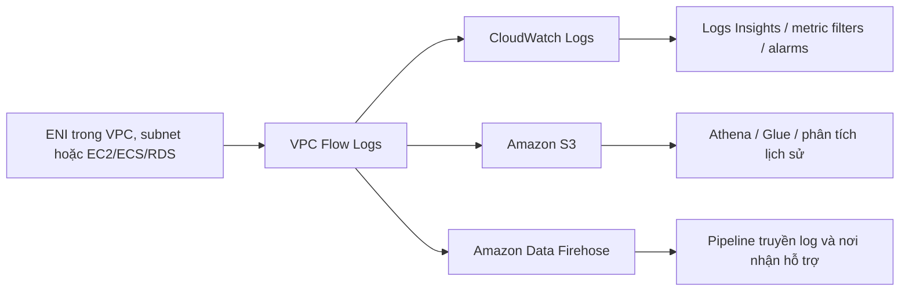
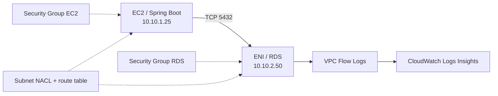
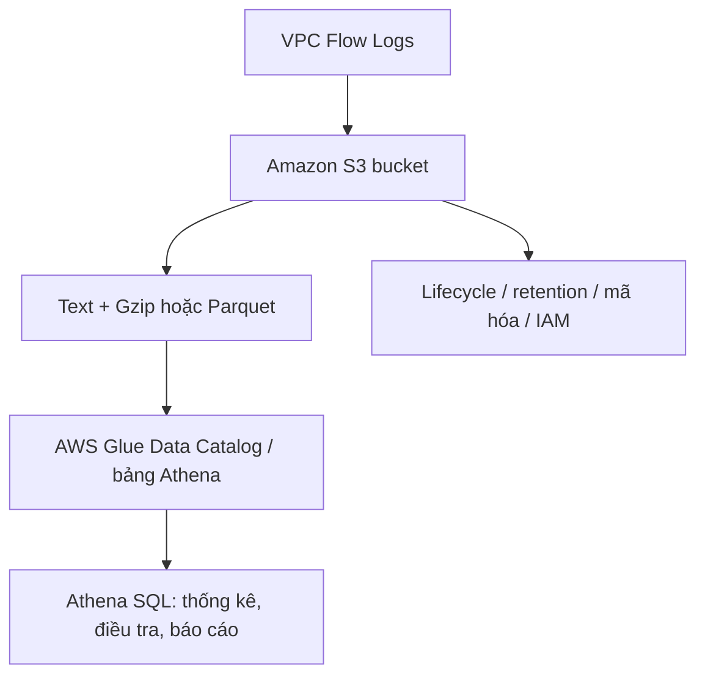
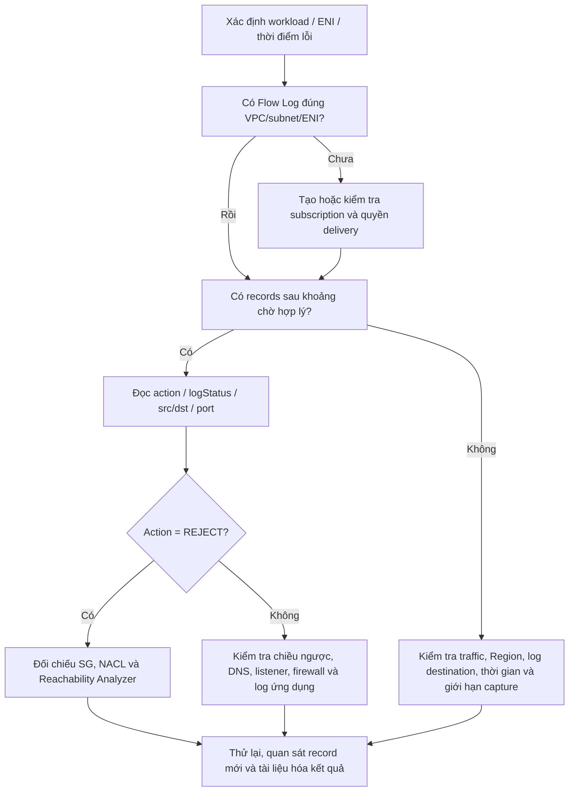

# VPC Flow Logs và phân tích lưu lượng

> **Học phần:** CLOUD_PROVIDERS_AWS  
> **Chương:** Mạng VPC  
> **Mục tiêu:** Thu thập, đọc và phân tích nhật ký lưu lượng IP của Amazon VPC để chẩn đoán kết nối, hỗ trợ kiểm soát an ninh, giám sát ứng dụng và quản lý chi phí quan sát hệ thống.

## 1. Vì sao cần VPC Flow Logs?

Hãy hình dung một ứng dụng Java/Spring Boot triển khai trong AWS:

- **Application Load Balancer (ALB)** nhận HTTPS từ Internet tại subnet công khai.
- Các instance **EC2** hoặc task **ECS** chạy ứng dụng trong subnet riêng tư.
- **Amazon RDS** nằm trong subnet cơ sở dữ liệu, chỉ cho phép truy cập từ lớp ứng dụng.
- Các workload gọi S3, dịch vụ tích hợp hoặc Internet qua VPC endpoint hay NAT gateway khi cần.

Ứng dụng không truy cập được RDS. Nhà phát triển kiểm tra log Spring Boot thấy lỗi kết nối, nhưng chưa biết vì security group, network ACL, route, cấu hình endpoint, firewall trong hệ điều hành, DNS hay dịch vụ cơ sở dữ liệu. Đó là lúc cần **dữ liệu mạng** để phân biệt giả thuyết.

**Amazon VPC Flow Logs** ghi thông tin tóm tắt về lưu lượng IP **đi vào và đi ra khỏi network interface (ENI)** trong VPC. Dữ liệu này hữu ích khi cần:

1. Tìm các cặp IP/port đang liên lạc và chiều lưu lượng.
2. Quan sát bản ghi `ACCEPT` hoặc `REJECT` liên quan tới việc cho phép/từ chối lưu lượng.
3. Xác định nguồn phát sinh nhiều bản ghi, nhiều packet hoặc lượng byte lớn.
4. Điều tra thay đổi kết nối trong môi trường nhiều subnet và Availability Zone (AZ).
5. Bổ sung bằng chứng cho giám sát bảo mật, xử lý sự cố và tối ưu kiến trúc mạng.

VPC Flow Logs là **quan sát lưu lượng**, không phải công cụ firewall, packet capture hoặc trình phân tích nội dung HTTP/TLS. Bật Flow Logs **không tự thay đổi quyết định định tuyến hay chính sách cho phép truy cập**. Việc thu thập diễn ra ngoài đường chuyển tiếp gói tin, do đó không làm giảm throughput hay tăng độ trễ của luồng ứng dụng theo thiết kế dịch vụ.

### Kết quả cần đạt

Sau bài học, bạn có thể:

- Chọn phạm vi ghi log **VPC, subnet hoặc ENI**, loại lưu lượng và nơi lưu trữ.
- Hiểu cấu trúc bản ghi mặc định, cách diễn giải `ACCEPT`, `REJECT`, `NODATA`, `SKIPDATA`.
- Tạo Flow Logs gửi tới **CloudWatch Logs** và kiểm tra dữ liệu bằng **CloudWatch Logs Insights**.
- Đọc các truy vấn phát hiện IP/port bị từ chối, nguồn có nhiều lưu lượng và lưu lượng đến database.
- Hiểu khi nào dùng **Amazon S3 + Amazon Athena** hoặc **Amazon Data Firehose**.
- Khoanh vùng sự cố kết nối bằng cách phối hợp Flow Logs với **Security Group, NACL, route table, Reachability Analyzer, ứng dụng và CloudWatch**.
- Kiểm soát IAM, lưu giữ log, quyền truy cập và chi phí phát sinh.

## 2. Cơ chế thu thập và kiến trúc dữ liệu

Flow Logs ghi nhận thông tin ở cấp **luồng lưu lượng IP**, thường được nhóm bởi bộ năm (*5-tuple*) trên mỗi ENI:

| Thành phần | Ví dụ | Ý nghĩa |
|---|---|---|
| Source IP | `10.10.1.25` | Địa chỉ nguồn nhìn thấy tại vị trí thu thập. |
| Destination IP | `10.10.2.50` | Địa chỉ đích nhìn thấy tại vị trí thu thập. |
| Source port | `53042` | Cổng nguồn của luồng. |
| Destination port | `5432` | Cổng dịch vụ đích, ví dụ PostgreSQL. |
| Protocol | `6` | Số giao thức IANA; `6` là TCP, `17` là UDP, `1` là ICMP. |

AWS tổng hợp các packet cùng luồng trong một **aggregation interval**. Một dòng Flow Logs **không đồng nghĩa một packet**, và cũng không nên mặc định bằng một request HTTP hoặc một kết nối TCP hoàn chỉnh. Một kết nối kéo dài có thể tạo nhiều bản ghi qua các khoảng thời gian; cùng một luồng cũng có thể được quan sát trên nhiều interface.

### 2.1. Chọn phạm vi ghi log

| Phạm vi | Ghi nhận ở đâu? | Trường hợp phù hợp |
|---|---|---|
| **VPC** | Các ENI được theo dõi trong VPC. | Muốn bao quát môi trường, điều tra lưu lượng giữa nhiều lớp hoặc thiết lập giám sát ban đầu. |
| **Subnet** | Các ENI trong subnet. | Tập trung vào subnet ứng dụng, database hoặc subnet công khai. |
| **Network interface (ENI)** | Một ENI chỉ định. | Phân tích mục tiêu đối với một workload hoặc đầu mối mạng. |

Chọn phạm vi có tác động trực tiếp đến **khối lượng log và chi phí**. VPC toàn bộ cho độ bao phủ lớn, nhưng phát sinh nhiều dữ liệu hơn nếu môi trường có lưu lượng cao. Với bài thực hành nhỏ, ghi tại subnet hoặc ENI thường dễ kiểm chứng. Các ENI có thể được tạo và quản lý bởi EC2, NAT gateway, load balancer hoặc dịch vụ khác; xác định ENI đích trước khi diễn giải dữ liệu.

### 2.2. Chọn loại lưu lượng

Khi tạo Flow Logs, lựa chọn:

| Bộ lọc | Ghi gì? | Sử dụng |
|---|---|---|
| **ACCEPT** | Lưu lượng được ghi nhận là được chấp nhận. | Phân tích giao tiếp hợp lệ, tổng lượng byte/packet quan sát được. |
| **REJECT** | Lưu lượng được ghi nhận là bị từ chối. | Điều tra trường hợp bị chặn, rà soát hành vi truy cập. |
| **ALL** | Cả lưu lượng ACCEPT và REJECT. | Khởi đầu điều tra để có đầy đủ ngữ cảnh, nếu chi phí cho phép. |

Lựa chọn `REJECT` **không chứng minh** mọi record đều do Security Group chặn: Network ACL, gói tin đến sau khi kết nối đã đóng và một số cơ chế/điều kiện mạng khác cũng có thể dẫn đến bản ghi bị từ chối. Ngược lại, `ACCEPT` chỉ phản ánh lưu lượng được chấp nhận tại điểm thu thập, **không chứng minh ứng dụng đích đã xử lý thành công** hoặc đã trả mã HTTP 200.

### 2.3. Chọn nơi xuất bản



| Đích | Ưu điểm | Cân nhắc |
|---|---|---|
| **CloudWatch Logs** | Dễ xem trực tiếp, chạy **Logs Insights**, kết hợp metric filter và alarm. | Tốn phí thu thập, lưu giữ, truy vấn; cần IAM role cho VPC Flow Logs ghi log. |
| **Amazon S3** | Lưu lâu dài, kiểm soát lifecycle, phù hợp phân tích nhiều ngày/tháng bằng Athena. | Cần bucket policy và quản lý quyền; muốn truy vấn phải có cấu trúc bảng/dữ liệu. |
| **Amazon Data Firehose** | Đưa dữ liệu vào pipeline xử lý, lưu trữ hoặc hệ thống phân tích hỗ trợ. | Cần cấu hình delivery stream, quyền và chi phí đường truyền dữ liệu log. |

Đích phù hợp với **học tập/điều tra tức thời** thường là CloudWatch Logs. S3 + Athena phù hợp với **phân tích lịch sử quy mô lớn**. Có thể tạo nhiều Flow Logs subscription khi cần gửi dữ liệu tới nhiều hệ thống; lưu ý trùng lặp dữ liệu và chi phí.

### 2.4. Aggregation interval và độ trễ

Khi tạo Flow Logs, có thể chọn thời gian tổng hợp tối đa **1 phút** hoặc **10 phút**. Khoảng ngắn tạo bản ghi chi tiết theo thời gian hơn nhưng thường nhiều dữ liệu hơn. Với ENI gắn vào instance dựa trên **Nitro**, khoảng tổng hợp thực tế luôn **1 phút hoặc ngắn hơn**, dù chọn tối đa 10 phút.

Sau khi thu thập, hệ thống còn phải xử lý và xuất bản dữ liệu. AWS mô tả thời gian giao đến CloudWatch Logs thường khoảng **5 phút**, S3 khoảng **10 phút**, nhưng việc giao log theo **best effort** và có thể trễ hơn. Flow Logs không phải hệ thống giám sát gói tin tức thời có thời gian phản hồi được bảo đảm.

**Hệ quả thực hành:** Nếu bạn thử kết nối rồi truy vấn ngay lập tức mà chưa thấy record, hãy kiểm tra đúng nguồn, đích, thời gian và chờ quá trình xử lý; đừng kết luận ngay là Flow Logs không hoạt động.

## 3. Cấu trúc bản ghi VPC Flow Logs

AWS hỗ trợ **default format** và **custom format**. Mặc định gồm các trường định nghĩa trong **version 2** theo thứ tự:

```text
version account-id interface-id srcaddr dstaddr srcport dstport protocol packets bytes start end action log-status
```

Ví dụ minh họa cho một luồng TCP được chấp nhận:

```text
2 123456789012 eni-0123456789abcdef0 10.10.1.25 10.10.2.50 53042 5432 6 12 1800 1795000000 1795000060 ACCEPT OK
```

**Đây là bản ghi giả lập.** Các giá trị thời gian Unix và số byte trong ví dụ chỉ để luyện đọc, không phải sự kiện thực tế.

| Field | Giá trị ví dụ | Diễn giải |
|---|---|---|
| `version` | `2` | Phiên bản các trường của format. |
| `account-id` | `123456789012` | AWS account ID của chủ sở hữu ENI. |
| `interface-id` | `eni-0123456789abcdef0` | Interface được theo dõi. |
| `srcaddr` / `dstaddr` | `10.10.1.25` / `10.10.2.50` | IP nguồn/đích nhìn thấy trong ngữ cảnh record. |
| `srcport` / `dstport` | `53042` / `5432` | Cổng nguồn và cổng đích. |
| `protocol` | `6` | TCP. |
| `packets` | `12` | Số packet được tổng hợp cho flow. |
| `bytes` | `1800` | Số byte được ghi nhận trong luồng. |
| `start` / `end` | `1795000000` / `1795000060` | Mốc Unix tính bằng giây trong khoảng tổng hợp. |
| `action` | `ACCEPT` | Lưu lượng được chấp nhận. |
| `log-status` | `OK` | Trạng thái ghi dữ liệu. |

Một bộ nhớ ngắn gọn: **ai → đến ai → cổng nào → giao thức gì → bao nhiêu → khi nào → được chấp nhận/từ chối**.

### 3.1. Phân biệt action và log-status

**`action`** là quyết định liên quan đến lưu lượng; **`log-status`** cho biết trạng thái ghi log.

| Trường | Giá trị | Ý nghĩa |
|---|---|---|
| `action` | `ACCEPT` | Flow được chấp nhận. |
| `action` | `REJECT` | Flow bị từ chối; chưa kết luận được chính xác SG hay NACL nào là nguyên nhân. |
| `log-status` | `OK` | Ghi dữ liệu bình thường. |
| `log-status` | `NODATA` | Không có traffic quan sát được trên ENI trong khoảng tổng hợp. |
| `log-status` | `SKIPDATA` | Một số bản ghi bị bỏ qua do giới hạn năng lực hoặc lỗi nội bộ trong quá trình thu thập. |

Với `NODATA` và `SKIPDATA`, nhiều cột có thể hiển thị dấu `-` vì không có dữ liệu để điền. **`SKIPDATA` không có nghĩa lưu lượng đã bị chặn**, mà là thiếu dữ liệu quan sát. Không suy ra tỷ lệ kết nối thành công/từ chối chính xác tuyệt đối khi có lượng dữ liệu bị bỏ qua.

Ví dụ record dạng thiếu dữ liệu:

```text
2 123456789012 eni-0123456789abcdef0 - - - - - - - 1795000000 1795000060 - NODATA
```

### 3.2. Chú ý đến địa chỉ IP khi đi qua NAT hoặc thiết bị trung gian

Với một số cấu hình IP thứ cấp, NAT gateway, thiết bị trung gian hoặc các dịch vụ quản lý ENI, `srcaddr`/`dstaddr` có thể phản ánh địa chỉ **gắn với ENI được theo dõi**, không luôn là địa chỉ IP gốc trong packet. Khi cần phân tích sâu, hãy tạo **custom format** có thêm:

- `pkt-srcaddr`, `pkt-dstaddr`: địa chỉ nguồn và đích ở cấp packet, hữu ích để phân biệt IP gốc với IP của lớp trung gian.
- `vpc-id`, `subnet-id`, `instance-id`, `interface-id`: đối chiếu tài nguyên.
- `flow-direction`: chiều ingress hoặc egress theo ngữ nghĩa của phiên bản field.
- `traffic-path`: thông tin về đường đi của lưu lượng egress trong những trường hợp AWS hỗ trợ.
- `tcp-flags`: bitmask các cờ TCP mà Flow Logs hỗ trợ.
- `region`, `az-id`: ngữ cảnh địa lý hạ tầng nếu cần.

Một số field phụ thuộc loại tài nguyên hoặc phiên bản định dạng và có thể có giá trị `-`. Metadata không lấy trực tiếp từ packet header là ước lượng **best effort**; cần đối chiếu thêm với ENI, route và log dịch vụ.

### 3.3. Dùng TCP flags đúng mức

Với custom format, trường `tcp-flags` có thể hữu ích khi phân tích tình huống TCP không hoàn thành kết nối:

| Flag được hỗ trợ | Giá trị bitmask điển hình |
|---|---|
| FIN | `1` |
| SYN | `2` |
| RST | `4` |
| SYN-ACK | `18` (SYN + ACK theo cách Flow Logs báo cáo) |

Đây là giá trị **tổng hợp bit** trong khoảng ghi log, không phải thứ tự packet đầy đủ. Các cờ không được Flow Logs hỗ trợ ghi nhận riêng như ACK/PSH có thể khiến kết quả `0` nếu không có cờ được hỗ trợ xuất hiện. Vì vậy, **không coi giá trị `tcp-flags` là thay thế cho packet capture**.

## 4. Thực hành tạo Flow Logs qua AWS Console

Ví dụ có VPC `vpc-0123456789abcdef0` tại Region `ap-southeast-1`, một subnet ứng dụng và một instance EC2 để tạo lưu lượng thử nghiệm. Toàn bộ ID và địa chỉ đều mang tính minh họa, phải thay bằng tài nguyên thật do bạn được phép quản lý.

### 4.1. Quy trình ở mức VPC

1. Đăng nhập **AWS Management Console**, chọn đúng **Region** và mở **VPC Console**.
2. Vào **Your VPCs**, chọn VPC bạn muốn theo dõi.
3. Chọn tab **Flow logs** hoặc **Actions → Create flow log** tùy phiên bản giao diện.
4. Ở **Filter**, chọn **ALL** để quan sát cả ACCEPT/REJECT; nếu chỉ điều tra bị từ chối, cân nhắc **REJECT** để giảm khối lượng.
5. Ở **Maximum aggregation interval**, chọn **1 minute** hoặc **10 minutes** phù hợp.
6. Ở **Destination**, chọn **Send to CloudWatch Logs**.
7. Tạo hoặc chọn log group, ví dụ `/aws/vpc/flowlogs/learning-demo`.
8. Chọn IAM **service role** đủ quyền để VPC Flow Logs xuất bản vào CloudWatch Logs, hoặc tạo role theo hướng dẫn Console.
9. Dùng **AWS default format** cho bài học đầu tiên; sau đó chọn **Custom format** ở một subscription khác nếu cần thêm field.
10. Kiểm tra tags, tạo Flow Log và ghi lại **Flow log ID**.
11. Mở **CloudWatch → Logs → Log groups** trong cùng Region để xem dữ liệu khi có lưu lượng.

**Lưu ý về quyền:** Danh tính tạo Flow Logs cần các quyền EC2 tương ứng như `ec2:CreateFlowLogs` và khi chỉ định service role cần được phép `iam:PassRole` đối với role đó. **Service role** cần quyền ghi CloudWatch Logs; quyền của người tạo và quyền của service là **hai lớp khác nhau**.

### 4.2. Điều kiện IAM cho service role xuất bản log

Trust policy tham khảo cho role gửi log tới CloudWatch:

```json
{
  "Version": "2012-10-17",
  "Statement": [
    {
      "Sid": "AllowVpcFlowLogsService",
      "Effect": "Allow",
      "Principal": {
        "Service": "vpc-flow-logs.amazonaws.com"
      },
      "Action": "sts:AssumeRole",
      "Condition": {
        "StringEquals": {
          "aws:SourceAccount": "123456789012"
        },
        "ArnLike": {
          "aws:SourceArn": "arn:aws:ec2:ap-southeast-1:123456789012:vpc-flow-log/*"
        }
      }
    }
  ]
}
```

Các giá trị Account ID/Region là ví dụ. Điều kiện `aws:SourceAccount` và `aws:SourceArn` giúp giảm rủi ro *confused deputy*. Khi đã có Flow log ID, có thể cân nhắc thu hẹp SourceArn theo Flow Log cụ thể.

Permissions policy gợi ý khi **log group đã được tạo trước**:

```json
{
  "Version": "2012-10-17",
  "Statement": [
    {
      "Sid": "PublishToVpcFlowLogsGroup",
      "Effect": "Allow",
      "Action": [
        "logs:CreateLogStream",
        "logs:PutLogEvents",
        "logs:DescribeLogStreams"
      ],
      "Resource": "arn:aws:logs:ap-southeast-1:123456789012:log-group:/aws/vpc/flowlogs/learning-demo:*"
    },
    {
      "Sid": "DescribeLogGroups",
      "Effect": "Allow",
      "Action": "logs:DescribeLogGroups",
      "Resource": "*"
    }
  ]
}
```

Nếu muốn Flow Logs **tạo log group mới**, role cần thêm `logs:CreateLogGroup` và phạm vi resource phù hợp. Hướng dẫn AWS thường liệt kê các quyền `CreateLogGroup`, `CreateLogStream`, `PutLogEvents`, `DescribeLogGroups`, `DescribeLogStreams`; hãy tùy chỉnh theo chính sách tổ chức và tài nguyên đã tồn tại. Khi troubleshooting lỗi delivery, kiểm tra cả trust, permissions, log group và quyền `iam:PassRole` của danh tính cấu hình.

### 4.3. Kiểm tra bằng AWS CLI

Lệnh minh họa sau tạo Flow Logs ở mức VPC, gửi **ALL** đến CloudWatch Logs:

```bash
aws ec2 create-flow-logs \
  --resource-type VPC \
  --resource-ids vpc-0123456789abcdef0 \
  --traffic-type ALL \
  --log-destination-type cloud-watch-logs \
  --log-group-name /aws/vpc/flowlogs/learning-demo \
  --deliver-logs-permission-arn arn:aws:iam::123456789012:role/VpcFlowLogsToCwl \
  --max-aggregation-interval 60 \
  --region ap-southeast-1
```

Phải tạo log group và service role phù hợp từ trước nếu lệnh dựa vào những tài nguyên đó. Không chạy nguyên lệnh với VPC ID/ARN ví dụ vì chúng không thuộc tài khoản của bạn.

Xem lại các Flow Logs đã tồn tại:

```bash
aws ec2 describe-flow-logs \
  --region ap-southeast-1 \
  --query 'FlowLogs[].{Id:FlowLogId,Resource:ResourceId,Status:FlowLogStatus,Delivery:DeliverLogsStatus}' \
  --output table
```

**Chỉ thực thi khi được phân quyền.** Nếu có lỗi liên quan IAM, kiểm tra service role của Flow Logs cùng quyền gọi API EC2/PassRole của danh tính hiện tại.

### 4.4. Tạo lưu lượng kiểm chứng an toàn

Bạn có thể thực hiện trong môi trường lab đã có tài nguyên và được phép truy cập:

- Từ EC2 ứng dụng, kiểm tra TCP tới một endpoint hợp lệ do bạn quản trị.
- Chạy `curl -I https://example.com` nếu subnet có đường ra Internet và DNS hoạt động.
- Gửi một yêu cầu đến dịch vụ nội bộ được cấp quyền, chẳng hạn cổng HTTP của ứng dụng test.
- Đối với tình huống REJECT, chỉ kiểm thử cổng đến tài nguyên **do nhóm sở hữu** với thay đổi/luồng kiểm thử đã được chấp thuận; không quét địa chỉ hoặc hệ thống ngoài phạm vi.

Sau đó mở CloudWatch Logs, chọn log group và log stream của ENI liên quan, đối chiếu khoảng thời gian. Có thể thấy khác biệt giữa thời điểm gửi request và thời điểm record được nhận.

## 5. Phân tích lưu lượng với CloudWatch Logs Insights

Đường dẫn trong Console: **CloudWatch → Logs Insights → chọn log group của Flow Logs**. Chọn khoảng thời gian truy vấn hẹp đủ chứa lần kiểm tra, ví dụ 15–60 phút gần nhất.

Với **default format** của VPC Flow Logs trong một log group được hỗ trợ, Logs Insights có thể tự khám phá các field như:

```text
@timestamp, @message, interfaceId, srcAddr, dstAddr,
srcPort, dstPort, protocol, packets, bytes, action, logStatus
```

Tên field trong **CloudWatch Logs Insights** theo kiểu `srcAddr`, `dstPort`, `logStatus`, trong khi định dạng raw record dùng `srcaddr`, `dstport`, `log-status`. **Không dùng lẫn tên** trong truy vấn. Với custom format hoặc log không được hệ thống tự nhận dạng, phải **parse `@message`** hay chuẩn hóa dữ liệu trước.

### 5.1. Truy vấn 1 — xem những record mới nhất

```sql
fields @timestamp, interfaceId, srcAddr, dstAddr,
       srcPort, dstPort, protocol, packets, bytes, action, logStatus
| sort @timestamp desc
| limit 50
```

**Mục tiêu:** Kiểm tra log đã đến hay chưa, có đúng ENI và địa chỉ kỳ vọng không. Trước khi gán ý nghĩa an ninh, cần biết record thuộc **interface nào**, chiều nào và khoảng thời gian nào.

### 5.2. Truy vấn 2 — tìm lưu lượng bị từ chối nhiều nhất

```sql
filter action = "REJECT" and logStatus = "OK"
| stats count(*) as rejectedRecords, sum(packets) as packetCount
  by srcAddr, dstAddr, dstPort
| sort rejectedRecords desc
| limit 20
```

**Cách đọc:** Kết quả cho biết cặp IP/port nào có nhiều **flow log records** mang action REJECT; `count(*)` **không phải số lần đăng nhập thất bại** hay số kết nối TCP riêng biệt. Kiểm tra tiếp Security Group, NACL, endpoint và log ứng dụng để biết nguyên nhân.

Ví dụ các đích cần quan sát: `22` (SSH), `3389` (RDP), `3306` (MySQL), `5432` (PostgreSQL), `443` (HTTPS). Port cho biết gợi ý về dịch vụ; nó **không chứng minh** đúng dịch vụ đó đang chạy.

### 5.3. Truy vấn 3 — nguồn/đích có lượng byte lớn

```sql
filter logStatus = "OK" and action = "ACCEPT"
| stats sum(bytes) as observedBytes, sum(packets) as observedPackets
  by srcAddr, dstAddr
| sort observedBytes desc
| limit 20
```

**Mục tiêu:** Tìm các cặp nguồn–đích có lưu lượng lớn, ví dụ ứng dụng gọi endpoint dữ liệu liên tục.

**Không quy đổi trực tiếp `sum(bytes)` thành hóa đơn data transfer của AWS.** Flow Logs quan sát bytes theo record; cách tính cước phụ thuộc dịch vụ, chiều truyền, AZ/Region, mạng Internet và nhiều yếu tố khác. Một packet có thể được ghi nhận ở nhiều ENI khác nhau, nên nếu tổng hợp toàn VPC, có nguy cơ **đếm trùng**. Để tính chi phí, đối chiếu thêm với **AWS Cost Explorer/Cost and Usage Report**.

### 5.4. Truy vấn 4 — lưu lượng tới cổng database

```sql
filter dstPort in [3306, 5432] and logStatus = "OK"
| stats count(*) as flowRecords, sum(bytes) as observedBytes
  by interfaceId, srcAddr, dstAddr, dstPort, action
| sort flowRecords desc
| limit 50
```

Kết hợp kết quả với danh sách ENI của application/RDS để xác nhận IP nguồn và IP đích có đúng trong kiến trúc mong muốn không. Một bản ghi `ACCEPT` tới cổng PostgreSQL vẫn chưa chứng minh ứng dụng đã xác thực cơ sở dữ liệu hoặc thực thi SQL thành công.

### 5.5. Truy vấn 5 — biểu đồ lưu lượng theo thời gian

```sql
filter logStatus = "OK"
| stats sum(bytes) as observedBytes, count(*) as flowRecords
  by bin(5m) as timeBucket, action
| sort timeBucket asc
```

Dùng tab biểu đồ của Logs Insights để quan sát các khoảng tăng mạnh. Với sự cố đột ngột, so sánh thời điểm triển khai ứng dụng, thay đổi route/security group, tăng số instance hoặc chuyển traffic sang AZ khác. **Độ phân giải biểu đồ** vẫn bị giới hạn bởi khoảng tổng hợp và độ trễ xuất bản log.

### 5.6. Đừng đánh đồng nhiều record với nhiều người dùng

Giả sử tổng hợp xuất ra `rejectedRecords = 900` đối với một IP nguồn. Đây là **900 bản ghi flow trong phạm vi truy vấn**, không phải 900 request HTTP, 900 người dùng, 900 packet hay 900 cuộc tấn công. Có thể là một ứng dụng tự retry nhiều lần, một scanner nội bộ được cho phép hoặc kết quả từ nhiều ENI/aggregation intervals.

Luồng phân tích tốt luôn hỏi thêm: **nguồn này là ai, giao thức gì, target ENI nào, truy vấn theo khoảng thời gian nào, có thay đổi policy gần đây không?**

## 6. Phân tích một sự cố thực tế: EC2 không kết nối được RDS

### 6.1. Bối cảnh lab

Ứng dụng Spring Boot ở EC2 nằm trong subnet riêng `10.10.1.0/24`. PostgreSQL RDS nằm trong subnet riêng khác `10.10.2.0/24`. Địa chỉ minh họa:

| Thành phần | IP hoặc cổng |
|---|---|
| EC2 application | `10.10.1.25` |
| RDS endpoint (IP tại thời điểm kiểm tra) | `10.10.2.50` |
| PostgreSQL port | `5432/TCP` |
| VPC CIDR | `10.10.0.0/16` |

Đây là ví dụ để học cách đối chiếu IP. Với RDS thật, ứng dụng nên kết nối bằng **DNS endpoint của RDS** thay vì hard-code IP; địa chỉ IP thực tế có thể đổi khi failover hoặc bảo trì.



### 6.2. Thu thập dữ kiện

1. Xác nhận ứng dụng thực sự thực hiện TCP connect đến RDS endpoint và port `5432`.
2. Xác nhận DNS của endpoint trả về địa chỉ phù hợp trong VPC và Region.
3. Xem Security Group trên ENI nguồn và đích; inbound của RDS thường giới hạn nguồn là **Security Group ứng dụng**, không mở cho toàn Internet.
4. Kiểm tra Network ACL hai subnet. NACL là **stateless**, nên phải xét cả luồng đi và luồng trả về, gồm **ephemeral ports**; Security Group thường là **stateful**.
5. Kiểm tra route table của các subnet; trong cùng VPC, local route thường phục vụ giao tiếp nội bộ, trừ trường hợp kiến trúc sử dụng middlebox/routing đặc biệt.
6. Thu thập Flow Logs ở subnet/ENI liên quan và chạy truy vấn lọc cổng `5432`.

Ví dụ câu truy vấn tập trung:

```sql
filter logStatus = "OK"
  and srcAddr = "10.10.1.25"
  and dstAddr = "10.10.2.50"
  and dstPort = 5432
| fields @timestamp, interfaceId, srcAddr, dstAddr,
         srcPort, dstPort, protocol, packets, bytes, action
| sort @timestamp desc
| limit 50
```

Nếu flow được quan sát ở nhiều ENI, cần kiểm tra **log stream/ENI** để tránh xem nhầm bản ghi trả về hoặc bản ghi của một thiết bị trung gian.

### 6.3. Diễn giải các khả năng

| Kết quả | Có thể suy ra | Tiếp tục kiểm tra |
|---|---|---|
| `REJECT` đến IP/port RDS | Lưu lượng bị từ chối trong ngữ cảnh thu thập. | Security Group, NACL, thứ tự/chiều rule và trạng thái kết nối. |
| `ACCEPT` đến RDS nhưng ứng dụng timeout | Lưu lượng được chấp nhận tại điểm quan sát, chưa chứng minh thông suốt hai chiều. | Luồng trả về, ephemeral port, listener DB, routing, thiết bị trung gian, CPU/RDS logs. |
| Không tìm được record | Có thể sai phạm vi, không phát traffic, sai IP/Region/time, hoặc log chưa được giao. | Kiểm tra ENI, Flow Log status, DNS, CloudWatch log group và độ trễ. |
| `SKIPDATA` xuất hiện | Một phần dữ liệu ghi log bị bỏ qua. | Không kết luận thiếu lưu lượng; mở rộng quan sát bằng các công cụ khác. |

Một `REJECT` **không chỉ ra trực tiếp Rule ID chính xác**. Để xác định nguyên nhân, đối chiếu cấu hình SG/NACL và dùng **VPC Reachability Analyzer** cho đường đi có thể kiểm tra, đồng thời xem hệ điều hành, firewall và log ứng dụng khi cần.

### 6.4. Đặc biệt quan trọng với Network ACL

Security Group theo dõi trạng thái kết nối, trong khi NACL đánh giá rule theo hướng ingress/egress và **không tự mở đường trả về** cho flow đã được cho phép theo chiều đi.

Ví dụ một NACL cho phép subnet ứng dụng gửi TCP `5432` đến subnet RDS, nhưng vô tình chặn các cổng ephemeral trong đường phản hồi. Flow Logs ở các interface hai đầu, kết hợp cấu hình NACL và Reachability Analyzer, có thể giúp khoanh vùng hiện tượng **gửi được nhưng không nhận được phản hồi**.

## 7. Phân tích lâu dài bằng Amazon S3 và Athena

Khi cần lưu nhiều tuần hoặc nhiều tháng, phân tích nhiều VPC và kiểm soát chính sách lưu giữ, có thể chọn đích **Amazon S3** rồi truy vấn qua **Amazon Athena**.

### 7.1. Dòng xử lý



Khi cấu hình Flow Logs đích S3:

1. Chọn bucket phù hợp Region, quyền và yêu cầu quản trị dữ liệu.
2. Kiểm tra **bucket policy** cho dịch vụ giao log; xác minh `aws:SourceAccount` và `aws:SourceArn` nếu áp dụng.
3. Chọn định dạng file **plain text** hoặc **Parquet** theo nhu cầu. Parquet là dạng cột, thường hiệu quả khi phân tích nhiều dữ liệu.
4. Cân nhắc **Hive-compatible S3 prefixes** và **hourly partitions** để hạn chế lượng dữ liệu quét khi truy vấn Athena.
5. Cấu hình mã hóa và lifecycle để giới hạn chi phí lưu trữ theo chính sách giữ log.
6. Tạo bảng Athena theo **schema đúng thứ tự field và định dạng của Flow Log**. Không dùng schema version 2 cho một custom format có thứ tự field khác.
7. Giới hạn khoảng thời gian/partition khi viết SQL để tránh quét toàn bộ bucket.

Ví dụ SQL sau giả định **đã tạo bảng Athena `vpc_flow_logs`** có các cột `srcaddr`, `dstaddr`, `dstport`, `action` và một cột phân vùng `day` ở định dạng `YYYY-MM-DD`:

```sql
SELECT
  srcaddr,
  dstaddr,
  dstport,
  COUNT(*) AS rejected_flow_records
FROM vpc_flow_logs
WHERE day = '2026-11-20'
  AND action = 'REJECT'
GROUP BY srcaddr, dstaddr, dstport
ORDER BY rejected_flow_records DESC
LIMIT 20;
```

**Lưu ý:** `day` và tên bảng là ví dụ do người triển khai tự thiết kế; tên phân vùng thực tế phụ thuộc cấu trúc dữ liệu của bảng. Nếu dùng prefix mặc định hoặc bảng khác, phải sửa điều kiện `WHERE`. Với S3 đích, có thể sử dụng tính năng **Athena integration for VPC Flow Logs** của AWS để sinh tài nguyên và truy vấn mẫu thay vì tự viết toàn bộ schema.

### 7.2. CloudWatch Logs hay S3 + Athena?

| Tiêu chí | CloudWatch Logs Insights | S3 + Athena |
|---|---|---|
| Phân tích gần thời điểm phát sinh sự cố | Thuận tiện để truy vấn nhanh trên log group. | Có thể dùng nhưng phụ thuộc quá trình giao S3, tổ chức schema/partition. |
| Khối lượng và thời gian giữ dữ liệu lớn | Cần tính phí ingest, retention và truy vấn. | Thích hợp cho lưu trữ và phân tích lịch sử có quản lý lifecycle. |
| Tích hợp alarm | Dễ phối hợp CloudWatch. | Thường cần hệ thống xử lý/giám sát riêng. |
| Quản lý schema | Mặc định có nhiều field tự khám phá. | Phải chọn schema, format và partition đúng. |
| Tối ưu chi phí | Giảm thời gian và dữ liệu quét khi truy vấn. | Dùng Parquet, partition pruning, lifecycle, tối ưu query. |

**Không mặc định S3 luôn rẻ hơn hoặc CloudWatch luôn nhanh hơn** trong mọi quy mô; so sánh dựa trên lượng log, thời gian giữ, tần suất truy vấn, Region và giá dịch vụ hiện hành.

## 8. Giới hạn của VPC Flow Logs và những hiểu lầm phổ biến

VPC Flow Logs chỉ chứa **metadata của luồng IP**, không chứa payload của packet. Bạn không thể đọc body JSON của request Spring Boot, URL HTTP đầy đủ, HTTP status code, nội dung câu lệnh SQL, TLS handshake chi tiết hay thông tin ứng dụng cấp cao chỉ bằng Flow Logs.

Một số lưu lượng AWS **không được VPC Flow Logs ghi nhận**. Ví dụ điển hình trong hướng dẫn AWS:

- Traffic từ instance đến **Amazon-provided DNS**; nếu sử dụng DNS tự triển khai, traffic đến DNS đó có thể được ghi.
- **DHCP** traffic.
- Traffic đến/từ **EC2 instance metadata** `169.254.169.254`.
- Traffic đến/từ **Amazon Time Sync Service** `169.254.169.123`.
- Một số traffic đặc thù khác như Windows license activation hoặc địa chỉ router dự trữ của VPC.

Không thấy các flow này **không có nghĩa** thiết lập DNS, thời gian hay metadata đã ngừng hoạt động. Danh sách giới hạn có thể được AWS bổ sung; cần đối chiếu tài liệu hiện hành khi phân tích trường hợp đặc biệt.

### 8.1. Những giới hạn quan trọng

1. **Không phải packet capture**: không thể suy ra trình tự chính xác từng packet hoặc nội dung request.
2. **Không phải real-time tuyệt đối**: dữ liệu có khoảng tổng hợp và độ trễ xuất bản.
3. **Có thể thiếu dữ liệu**: `SKIPDATA`; một số metadata là best effort và có thể là `-`.
4. **Không quy kết chính xác SG hay NACL từ một dòng `REJECT`**; phải đối chiếu policy, Reachability Analyzer và trạng thái kết nối.
5. **Không phản ánh toàn bộ nguyên nhân sự cố ứng dụng**: `ACCEPT` không có nghĩa endpoint trả về thành công.
6. **Không chỉnh sửa trực tiếp format của Flow Log đã tạo**: nếu muốn đổi destination, role hoặc trường record, thường phải tạo Flow Log mới theo cấu hình cần dùng.
7. **Không mặc định lấy đúng IP gốc ở mọi điểm quan sát**: cần kiểm tra `pkt-srcaddr`/`pkt-dstaddr` khi có IP thứ cấp hay NAT/middlebox.
8. **Không thay thế metric ứng dụng và billing**: số byte từ flow không đồng nghĩa số byte tính cước data transfer.

**Phân biệt nhanh các công cụ:**

| Công cụ | Trả lời câu hỏi gì? |
|---|---|
| VPC Flow Logs | Các flow IP tới/đi từ ENI có metadata, trạng thái như thế nào? |
| VPC Reachability Analyzer | Cấu hình network hiện tại có đường đi logic cho phép traffic từ nguồn đến đích không? |
| Traffic Mirroring | Cần quan sát gói tin chi tiết trên nguồn được hỗ trợ? |
| CloudWatch metrics | CPU, latency, network metrics hoặc hiệu năng dịch vụ có biến động? |
| CloudTrail | Ai thay đổi Security Group, route table, Flow Logs hoặc tài nguyên AWS? |
| Application/RDS/ALB logs | Ứng dụng trả lỗi gì, truy vấn DB hay HTTP request gặp vấn đề ở đâu? |
| AWS Cost Explorer | Chi phí thực tế theo dịch vụ/account/Region phát sinh bao nhiêu? |

## 9. Bảo mật, giám sát, lưu giữ và kiểm soát chi phí

Bật Flow Logs trong Production là quyết định **quan sát và vận hành dữ liệu**. Metadata IP/port có thể cho biết cấu trúc mạng, kết nối tới database, dịch vụ nội bộ và hành vi sử dụng, nên cần phân quyền phù hợp.

### 9.1. Nguyên tắc triển khai

- **IAM least privilege:** Người tạo Flow Logs có quyền thao tác EC2 ở phạm vi cần thiết; service role có quyền publish tới log group/bucket tương ứng.
- **Tách người quản trị và người phân tích:** Nhóm ứng dụng có thể đọc log cần thiết mà không phải sửa/cắt luồng thu thập.
- **Bảo vệ đích:** Dùng cấu hình mã hóa, bucket policy, IAM, CloudWatch log group retention phù hợp; hạn chế đọc công khai.
- **Gắn tag và mô tả mục đích:** Ví dụ `Environment=dev`, `Owner=platform`, `Purpose=network-observability`.
- **Theo dõi trạng thái giao log:** Kiểm tra Flow Log status/delivery và dấu hiệu `SKIPDATA`.
- **Phân tích theo phạm vi:** Query một khoảng thời gian và vài log group/partition cụ thể trước, mở rộng sau khi cần.
- **Không ghi thừa quá lâu:** Đặt retention/lifecycle theo yêu cầu vận hành, điều tra và tuân thủ của tổ chức.

### 9.2. Ví dụ ước lượng dung lượng và chi phí

Giả sử có **2 triệu flow log records/ngày**, kích thước trung bình giả định **150 byte/record** ở dạng text chưa nén:

```text
Dữ liệu thô giả định / ngày
= 2.000.000 × 150 byte
= 300.000.000 byte
≈ 300 MB (hệ thập phân)
```

Con số này là **bài toán minh họa**, không phải mức lưu lượng đặc trưng của AWS, không phải định mức tính phí. Chi phí thực tế còn tùy Region, mức giá thu thập/delivery, lưu trữ, thời gian giữ, nén, số lần query Athena/Logs Insights và các dịch vụ nhận log. Một Flow Logs subscription ghi cả ACCEPT/REJECT ở toàn VPC có thể tạo dữ liệu nhiều hơn tập REJECT ở một subnet.

Khi tính ngân sách, đừng chỉ tính phí S3 hoặc CloudWatch storage: có thể còn phí log delivery/ingestion, truy vấn, Amazon Athena, Firehose, KMS và thu thập dữ liệu tùy cấu hình. Cần so sánh với **AWS Pricing** và **Cost Explorer** hiện hành.

### 9.3. Gợi ý tín hiệu cảnh báo

Một dashboard hoặc alert có thể theo dõi:

1. Tỷ lệ **REJECT records** của một ENI/subnet so với mức nền trong khoảng thời gian.
2. Số lượng source IP khác nhau bị từ chối ở cổng quản trị hoặc database.
3. Thay đổi đột biến số byte theo cặp nguồn–đích hoặc VPC.
4. Dấu hiệu pipeline giao log lỗi, thiếu log hoặc có nhiều `SKIPDATA`.

Các chỉ số trên là **tín hiệu điều tra**, không mặc định là sự cố bảo mật. Việc xây dựng CloudWatch metric filter hoặc alarm cần xem xét cách log được parse, chuẩn hóa baseline và tránh cảnh báo giả khi tăng lưu lượng hợp lệ.

## 10. Troubleshooting khi không thấy log hoặc kết quả sai

| Hiện tượng | Nguyên nhân có thể | Hướng kiểm tra |
|---|---|---|
| Đã tạo Flow Log nhưng log group không có record | Chưa có traffic, sai Region/VPC, chưa đủ thời gian giao log. | Tạo traffic hợp lệ trong lab, kiểm tra ENI, thời gian và Region. |
| Flow Log status có lỗi delivery | Service role/bucket policy/KMS/log group không cho giao log. | Xem `DeliverLogsStatus`, kiểm tra trust và quyền destination. |
| Truy vấn Insights trả về trống dù raw log có dữ liệu | Dùng sai tên field, chưa chọn đúng log group/time range, custom format chưa được parse. | Kiểm tra `@message` và field discovery, sửa query. |
| Nhiều `REJECT` nhưng ứng dụng vẫn hoạt động | Luồng bị từ chối có thể là scan/retry/gói muộn không thuộc đường chính. | Đối chiếu src/dst, port, ENI, thời gian và metrics ứng dụng. |
| Không thấy traffic tới Amazon-provided DNS | Đây là loại traffic Flow Logs không ghi nhận. | Dùng công cụ quan sát DNS phù hợp; không đánh đồng với lỗi ghi log. |
| Truy vấn tổng `bytes` vượt kỳ vọng | Một flow có thể được quan sát tại nhiều ENI, format/aggregation khác nhau. | Chọn một điểm quan sát hoặc phân biệt ingress/egress trước khi cộng. |
| Thay format nhưng record vẫn theo format cũ | Cấu hình subscription cũ không thể thay đổi trực tiếp. | Tạo Flow Log mới và chuyển pipeline/query sau khi xác minh. |
| Chi phí logging tăng đột biến | Phạm vi ALL/VPC rộng, retention dài, query scan lớn, subscription trùng. | Đánh giá lại scope, giữ log, compression/Parquet, partition và nhu cầu query. |

### 10.1. Quy trình xử lý sự cố theo trình tự



## 11. Bài thực hành: điều tra kết nối của ứng dụng đa AZ

**Tình huống:** Một nhóm học AWS triển khai ứng dụng Spring Boot có hai EC2 instance trong hai Availability Zone, sau ALB. Database PostgreSQL được triển khai bằng Amazon RDS. Một tác vụ nền truy cập Amazon S3. Nhóm cần tìm nguyên nhân vì có thời điểm API chậm, trong khi một số client báo timeout khi truy cập dịch vụ.

**Yêu cầu:**

1. Vẽ sơ đồ VPC gồm public/private subnet, hai AZ, ALB, EC2, RDS và đường truy cập S3 phù hợp. Chỉ rõ **ENI hoặc subnet** nào cần ghi Flow Logs để điều tra cả inbound và outbound.
2. Giải thích vì sao chọn **ALL** cho giai đoạn đầu hoặc **REJECT** khi đã thu hẹp tình huống, và ảnh hưởng đến chi phí.
3. Tạo một Flow Log trong sandbox được cấp quyền, chọn CloudWatch Logs và lưu lại Flow Log ID, scope, log group, aggregation interval.
4. Quan sát một bản ghi mặc định và giải thích các field: `interface-id`, `srcaddr`, `dstaddr`, `dstport`, `packets`, `bytes`, `action`, `log-status`.
5. Viết truy vấn Logs Insights tìm **REJECT** tới cổng `5432` trong 30 phút kiểm tra, và truy vấn tìm top source/destination theo bytes.
6. Nếu Flow Logs hiển thị `ACCEPT` nhưng API vẫn timeout, liệt kê ít nhất **bốn kiểm tra tiếp theo**, bao gồm chiều phản hồi, NACL, ứng dụng và dịch vụ đích.
7. Đề xuất kiến trúc **S3 + Athena** nếu phải lưu dữ liệu trong 90 ngày; trình bày cách partition, quyền truy cập và quản lý lifecycle.
8. Phân biệt dữ liệu từ VPC Flow Logs, CloudTrail và application logs khi điều tra một sự cố.
9. Xác định ít nhất **ba thành phần chi phí logging** cần kiểm soát.

**Tiêu chí đánh giá:** Một bài làm tốt chỉ ra đúng scope/ENI, phân biệt trạng thái log với action, hiểu độ trễ và giới hạn capture, chọn câu truy vấn có ý nghĩa, không khẳng định REJECT cho biết chính xác rule chặn hoặc ACCEPT chứng minh ứng dụng thành công.

### Câu hỏi tự kiểm tra

**1. Flow Logs có cho biết URL hoặc nội dung HTTP request không?**  
Không. Flow Logs chỉ chứa thông tin lưu lượng IP được tổng hợp và metadata liên quan.

**2. Một dòng Flow Logs có tương đương một packet không?**  
Không. Bản ghi thường là tổng hợp các packet cùng flow trong một khoảng thời gian trên ENI.

**3. Khi `log-status=SKIPDATA`, ta có thể kết luận có packet bị Security Group chặn không?**  
Không. SKIPDATA cho biết dữ liệu ghi log không đầy đủ, không phải quyết định truy cập.

**4. Có thể bật Flow Logs trên subnet mà không bật toàn VPC không?**  
Có. AWS cho phép tạo ở phạm vi VPC, subnet hoặc ENI.

**5. `ACCEPT` có nghĩa database đã xử lý câu SQL thành công không?**  
Không. Cần xem ứng dụng, kết nối hai chiều, listener và log cơ sở dữ liệu.

**6. Logs Insights đang tìm field `srcaddr` nhưng trả trống; nguyên nhân?**  
Với các field tự khám phá ở default format, Logs Insights dùng `srcAddr`. Cần kiểm tra tên field và format thực tế.

**7. Có thể tính chính xác hóa đơn data transfer bằng cách cộng tất cả `bytes` của toàn VPC không?**  
Không. Có thể đếm trùng ở nhiều ENI và logic định giá data transfer khác dữ liệu ghi Flow Logs.

## 12. Tài liệu AWS tham khảo

Các tài liệu chính thức phù hợp để kiểm chứng hành vi dịch vụ và giao diện hiện hành:

- [Amazon VPC — Logging IP traffic using VPC Flow Logs](https://docs.aws.amazon.com/vpc/latest/userguide/flow-logs.html)
- [Amazon VPC — Flow logs basics](https://docs.aws.amazon.com/vpc/latest/userguide/flow-logs-basics.html)
- [Amazon VPC — Flow log records and available fields](https://docs.aws.amazon.com/vpc/latest/userguide/flow-log-records.html)
- [Amazon VPC — Flow log record examples](https://docs.aws.amazon.com/vpc/latest/userguide/flow-logs-records-examples.html)
- [Amazon VPC — Flow log limitations](https://docs.aws.amazon.com/vpc/latest/userguide/flow-logs-limitations.html)
- [Amazon VPC — Create a flow log to CloudWatch Logs](https://docs.aws.amazon.com/vpc/latest/userguide/flow-logs-cwl-create-flow-log.html)
- [Amazon VPC — IAM role for publishing Flow Logs to CloudWatch](https://docs.aws.amazon.com/vpc/latest/userguide/flow-logs-iam-role.html)
- [Amazon CloudWatch — Supported logs and discovered fields](https://docs.aws.amazon.com/AmazonCloudWatch/latest/logs/CWL_AnalyzeLogData-discoverable-fields.html)
- [Amazon CloudWatch — Logs Insights query language](https://docs.aws.amazon.com/AmazonCloudWatch/latest/logs/CWL_QuerySyntax.html)
- [Amazon VPC — Query flow logs using Athena](https://docs.aws.amazon.com/vpc/latest/userguide/flow-logs-athena.html)
- [Amazon VPC — Flow log files in S3](https://docs.aws.amazon.com/vpc/latest/userguide/flow-logs-s3-path.html)
- [Amazon VPC — Troubleshooting Flow Logs](https://docs.aws.amazon.com/vpc/latest/userguide/flow-logs-troubleshooting.html)

> **Ghi nhớ:** VPC Flow Logs hỗ trợ **nhìn thấy dấu vết lưu lượng IP**; phải kết hợp nhiều lớp bằng chứng mới xác định được nguyên nhân sự cố hoặc ý nghĩa bảo mật. Ưu tiên quan sát đúng phạm vi, bảo vệ dữ liệu log và chọn thời gian lưu giữ hợp lý để hệ thống AWS an toàn, dễ phục hồi và kiểm soát chi phí.
