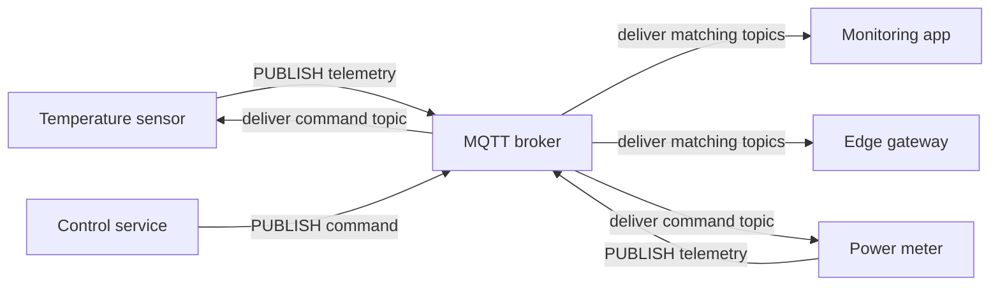
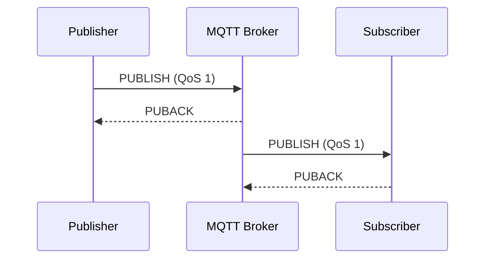
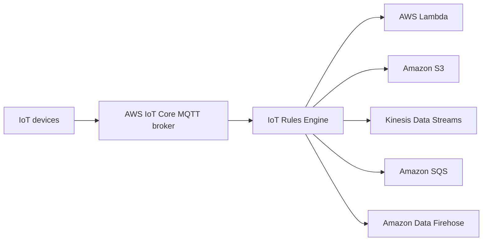
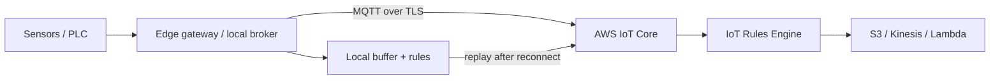

# MQTT topic, publish, subscribe và chất lượng dịch vụ

MQTT (Message Queuing Telemetry Transport) là giao thức nhắn tin nhẹ theo mô hình publish/subscribe, được thiết kế cho thiết bị có tài nguyên hạn chế và kết nối mạng không ổn định. Một thiết bị cảm biến có thể publish dữ liệu lên một topic; gateway, ứng dụng hoặc dịch vụ cloud subscribe topic đó để nhận dữ liệu mà không cần biết địa chỉ của từng bên nhận. Broker đứng giữa nhận message, kiểm tra quyền và định tuyến tới các subscriber phù hợp.

Trong AWS, Amazon IoT Core cung cấp MQTT message broker được quản lý, xác thực thiết bị, kiểm soát quyền theo topic, lưu retained messages và persistent sessions, phát sự kiện kết nối, cũng như định tuyến message bằng Rules Engine tới các dịch vụ khác. MQTT phù hợp với telemetry, trạng thái thiết bị, cảnh báo và lệnh điều khiển; nhưng hệ thống cần thiết kế topic namespace, QoS, session, retry và authorization cẩn thận để tránh mất dữ liệu, duplicate hoặc mở quyền quá rộng.

Bài học này thuộc module `CLOUD_PROVIDERS_AWS`, kết nối kiến thức về IoT, edge computing, IAM, VPC, streaming, lưu trữ và serverless. Sau bài học, bạn có thể:

- Giải thích broker, client, topic, publish, subscribe và message flow.
- Thiết kế topic hierarchy, topic filter và wildcard cho fleet thiết bị.
- Phân biệt QoS 0, QoS 1 và QoS 2 theo chuẩn MQTT, đồng thời hiểu giới hạn QoS của AWS IoT Core.
- Chọn retained message, persistent session, Last Will và Device Shadow theo use case.
- Cấp quyền publish, subscribe và receive bằng AWS IoT policies theo least privilege.
- Dùng MQTT Test Client, AWS IoT Device SDK hoặc Mosquitto để kiểm tra kết nối.
- Định tuyến message bằng AWS IoT Rules Engine tới Lambda, S3, Kinesis, SQS hoặc các đích được hỗ trợ.
- Thiết kế consumer idempotent, giám sát kết nối và xử lý thiết bị offline.

## 1. MQTT và mô hình publish/subscribe

MQTT là giao thức application-layer chạy trên một kết nối mạng có trạng thái. Client kết nối tới broker, sau đó publish message hoặc subscribe topic filter. Broker nhận message từ publisher và chuyển message tới các subscriber có filter khớp, theo QoS và quyền đã cấp.

Các thành phần chính:

| Thành phần | Vai trò |
|---|---|
| MQTT client | Phần mềm trên thiết bị, gateway, ứng dụng hoặc service kết nối broker |
| MQTT broker | Nhận kết nối, xác thực, kiểm tra quyền và định tuyến message |
| Publisher | Client gửi message lên một topic |
| Subscriber | Client đăng ký topic filter để nhận message |
| Topic | Tên phân cấp xác định loại message hoặc luồng dữ liệu |
| Topic filter | Mẫu topic mà subscriber muốn nhận, có thể dùng wildcard |
| QoS | Mức bảo đảm delivery ở từng chặng giao tiếp MQTT |
| Session | Trạng thái kết nối logic, subscription và message chờ gửi lại |

Một client có thể vừa publish vừa subscribe. Ví dụ gateway công nghiệp publish telemetry từ cảm biến và subscribe lệnh cấu hình từ cloud.



Publisher và subscriber không cần biết nhau. Publisher chỉ cần biết topic; broker quản lý việc phân phối. Cách tách rời này giúp thêm subscriber mà không phải sửa code của publisher, miễn là topic contract và quyền được thiết kế ổn định.

## 2. MQTT message và payload

Một MQTT PUBLISH packet mang topic name, payload và các thuộc tính giao thức như QoS, RETAIN flag và DUP flag. Với MQTT 5, packet còn có thể mang properties như message expiry, content type, payload format indicator, response topic, correlation data và user properties.

MQTT không bắt buộc payload phải là JSON. Payload có thể là:
- JSON cho event và telemetry dễ đọc.
- CBOR hoặc MessagePack cho thiết bị hạn chế băng thông.
- Protobuf hoặc Avro khi cần schema và payload gọn.
- Binary payload cho ảnh, firmware chunk hoặc dữ liệu chuyên dụng.

Ví dụ telemetry JSON:

```json
{
  "schemaVersion": 1,
  "deviceId": "sensor-001",
  "timestamp": "2026-11-20T08:15:30Z",
  "sequence": 1842,
  "temperatureC": 28.4,
  "humidityPct": 71.2,
  "batteryPct": 92
}
```

Topic cho biết message thuộc luồng nào; payload chứa nội dung. Tránh nhồi toàn bộ thông tin định tuyến vào payload nếu broker hoặc policy cần quyết định dựa trên topic. Đồng thời, không đưa password, private key, token hoặc dữ liệu cá nhân không cần thiết vào payload vì message có thể được lưu, log hoặc chuyển tới nhiều dịch vụ.

## 3. Topic là namespace của hệ thống IoT

MQTT topic là chuỗi phân cấp, các cấp được ngăn bằng dấu gạch chéo /. Topic name phân biệt chữ hoa/chữ thường. Ví dụ hai topic sau là khác nhau:

- `factory/site-01/device/pump-07/telemetry`
- `factory/site-01/device/Pump-07/telemetry`

Topic không phải URL và cũng không phải ARN. Trong AWS IoT Core, topic namespace được giới hạn theo AWS account và Region; cùng một topic name ở account hoặc Region khác là namespace riêng.

### 3.1. Thiết kế topic hierarchy

Một cấu trúc tham khảo:

```text
org/{tenantId}/site/{siteId}/device/{thingName}/telemetry
org/{tenantId}/site/{siteId}/device/{thingName}/event
org/{tenantId}/site/{siteId}/device/{thingName}/state
org/{tenantId}/site/{siteId}/device/{thingName}/command
org/{tenantId}/site/{siteId}/device/{thingName}/command/ack
org/{tenantId}/site/{siteId}/device/{thingName}/config
org/{tenantId}/site/{siteId}/device/{thingName}/availability
```

Topic hierarchy nên phản ánh cách hệ thống phân quyền và tiêu thụ dữ liệu. Một số nguyên tắc:

- Đặt tenant, site và device ở vị trí nhất quán.
- Tách telemetry, event, command, state và acknowledgement.
- Giữ tên cấp topic ổn định qua vòng đời thiết bị.
- Chọn độ sâu vừa đủ; topic quá phẳng khó phân quyền, topic quá sâu khó quản trị.
- Không dùng topic làm nơi chứa secret hoặc thông tin nhạy cảm.
- Tránh đổi topic thường xuyên vì policy, rule và subscriber đều phụ thuộc vào contract.
- Xác định ai sở hữu từng namespace và ai được tạo topic mới.

### 3.2. Topic contract

Một topic contract cần ghi:
- Topic name pattern.
- Publisher được phép.
- Subscriber được phép.
- Schema/payload version.
- QoS yêu cầu.
- RETAIN có được phép không.
- Message expiry hoặc retention kỳ vọng.
- Tần suất và kích thước message.
- Quy tắc xử lý duplicate và out-of-order.
- Owner và consumer downstream.

Ví dụ, thiết bị chỉ được publish telemetry của chính nó; control service chỉ được publish command; thiết bị chỉ subscribe command của chính nó; monitoring service được subscribe telemetry của cả site theo phạm vi được phê duyệt.

## 4. Publish và Subscribe

### 4.1. Publish

Publisher gửi một PUBLISH packet với topic name và payload. Broker xác thực client, kiểm tra quyền publish, tiếp nhận message và định tuyến tới các subscriber khớp filter.

Publisher không cần biết có bao nhiêu subscriber. Việc broker chấp nhận message không đồng nghĩa mọi subscriber đã xử lý thành công nghiệp vụ. QoS acknowledgement xác nhận delivery ở chặng MQTT tương ứng; nó không thay thế xác nhận giao dịch từ ứng dụng.

### 4.2. Subscribe

Subscriber gửi SUBSCRIBE packet kèm một hoặc nhiều topic filter và QoS tối đa mà nó muốn nhận. Broker kiểm tra quyền subscribe, sau đó chuyển message phù hợp khi có publish.

Một client có thể subscribe nhiều filter. Ví dụ:
- Một filter nhận telemetry của một thiết bị.
- Một filter nhận mọi thiết bị trong một site.
- Một filter nhận toàn bộ cảnh báo trong một tenant.

Khi không còn cần nhận message, client có thể unsubscribe filter. Trong persistent session, subscription có thể được broker lưu để khôi phục khi client reconnect.

### 4.3. Broker định tuyến như thế nào?

Giả sử publisher gửi message tới:

```text
org/acme/site-01/device/pump-07/telemetry
```

Các subscriber sau có thể khớp:

| Topic filter | Khớp? | Lý do |
|---|---|---|
| `org/acme/site-01/device/pump-07/telemetry` | Có | Khớp chính xác |
| `org/acme/site-01/device/+/telemetry` | Có | + khớp một cấp device |
| `org/acme/site-01/#` | Có | # khớp mọi cấp phía sau |
| `org/+/site-01/device/+/telemetry` | Có | Mỗi + khớp một cấp |
| `org/acme/site-02/#` | Không | Khác site |
| `org/acme/site-01/device/pump-07/event` | Không | Khác loại message |

## 5. Wildcard trong MQTT topic filter

MQTT có hai wildcard trong topic filter: `+` và `#`. Chúng chỉ dùng khi subscribe; publisher phải gửi tới một topic name cụ thể và không được dùng wildcard trong topic name.

| Wildcard | Ý nghĩa | Ví dụ |
|---|---|---|
| `+` | Khớp đúng một cấp topic | `site/+/temperature` |
| `#` | Khớp cấp hiện tại và mọi cấp phía sau | `site/site-01/#` |

Quy tắc:
- `+` phải chiếm toàn bộ một cấp.
- `#` phải chiếm toàn bộ một cấp và chỉ được đặt ở cuối filter.
- Có thể kết hợp nhiều dấu + trong filter.
- Filter `sensor/#` khớp `sensor/`, `sensor/temp`, `sensor/temp/room-1`, nhưng không khớp topic `sensor` không có dấu slash sau sensor.
- Wildcard ở cấp đầu tiên không khớp các topic bắt đầu bằng ký tự $ theo quy tắc MQTT.

Ví dụ:
- `factory/+/device/+/telemetry`: telemetry của mọi device ở mọi site.
- `factory/site-01/device/+/command/ack`: acknowledgement của mọi device trong site-01.
- `factory/site-01/#`: mọi topic dưới site-01.

Không cấp `#` cho mọi thiết bị nếu chỉ cần một số topic. Filter rộng có thể làm lộ dữ liệu tenant khác, tăng lưu lượng và khiến consumer khó phân loại message.

## 6. Topic name, topic filter và ARN trong AWS IoT Core

AWS IoT Core dùng các dạng ARN khác nhau cho topic name và topic filter:

- Topic ARN: `arn:aws:iot:region:account-id:topic/topic-name`
- Topic filter ARN: `arn:aws:iot:region:account-id:topicfilter/topic-filter`
- Client ARN: `arn:aws:iot:region:account-id:client/client-id`

Ví dụ:
- Topic: `org/acme/device/pump-07/telemetry`
- Topic filter: `org/acme/device/+/telemetry`

Đây là hai resource khác nhau. Trong IoT policy:
- `iot:Publish` dùng resource loại topic.
- `iot:Receive` dùng resource loại topic.
- `iot:Subscribe` dùng resource loại topicfilter.
- `iot:Connect` dùng resource loại client.

Một subscriber thường cần cả quyền Subscribe vào filter và Receive trên topic thực tế được gửi tới. Chỉ cấp Subscribe mà không cấp Receive có thể khiến client đăng ký được filter nhưng không nhận được message.

### 6.1. Wildcard trong policy không giống wildcard MQTT

Đây là lỗi cấu hình phổ biến:

| Ký tự | MQTT topic filter | AWS IoT policy resource |
|---|---|---|
| `+` | Wildcard một cấp | Ký tự literal, không phải policy wildcard |
| `#` | Wildcard nhiều cấp | Ký tự literal, không phải policy wildcard |
| `*` | Không phải MQTT wildcard | Policy wildcard |
| `?` | Không phải MQTT wildcard | Policy wildcard một ký tự |

Ví dụ topic filter MQTT `factory/+/telemetry` cần được biểu diễn trong policy resource theo cách phù hợp với wildcard của IAM ARN; không mặc định ký tự + trong ARN policy sẽ có nghĩa giống MQTT. Hãy kiểm tra policy examples và test với topic thật.

## 7. Chất lượng dịch vụ MQTT (QoS)

QoS (Quality of Service) xác định mức bảo đảm delivery của message qua MQTT. MQTT định nghĩa ba mức: QoS 0, QoS 1 và QoS 2.

| QoS | Tên thường gọi | Bảo đảm theo giao thức | Trade-off |
|---|---|---|---|
| 0 | At most once | Gửi tối đa một lần; có thể không tới | Ít overhead, độ trễ thấp |
| 1 | At least once | Gửi lại cho tới khi nhận PUBACK; có thể duplicate | Tin cậy hơn, cần idempotency |
| 2 | Exactly once | Handshake bốn bước để tránh duplicate ở mức giao thức | Nhiều packet và overhead hơn |

AWS IoT Core hỗ trợ QoS 0 và QoS 1; QoS 2 không được hỗ trợ. Không cấu hình client AWS IoT Core với QoS 2 và không diễn giải QoS 1 là exactly-once nghiệp vụ.

### 7.1. QoS 0 — At most once

Với QoS 0, publisher gửi PUBLISH mà không chờ PUBACK. Nếu packet bị mất do mạng gián đoạn hoặc client/broker không sẵn sàng, message có thể không tới.

Phù hợp với:
- Telemetry gửi liên tục và có thể chấp nhận mất một vài mẫu.
- Dữ liệu cảm biến tần suất cao, giá trị kế tiếp nhanh chóng thay thế giá trị trước.
- Thông tin không quan trọng hoặc được lấy lại từ nguồn khác.

Không nên dùng QoS 0 cho lệnh điều khiển quan trọng, sự kiện thanh toán hoặc cảnh báo cần xác nhận nếu hệ thống không có cơ chế bù.

### 7.2. QoS 1 — At least once

Với QoS 1, sender gửi PUBLISH và chờ PUBACK. Nếu chưa nhận được acknowledgement trong thời gian phù hợp, sender có thể gửi lại. Điều này giúp message có cơ hội tới nơi nhưng có thể tạo duplicate.

Luồng cơ bản:



PUBACK từ broker cho publisher biết broker đã nhận PUBLISH ở chặng publisher-to-broker. Nó không chứng minh subscriber đã xử lý thành công. PUBACK từ subscriber xác nhận chặng broker-to-subscriber theo giao thức; nó cũng không chứng minh database hoặc hành động nghiệp vụ đã commit nếu client library gửi ACK trước khi hoàn tất xử lý ứng dụng.

Consumer cần:
- Có event ID hoặc sequence number ổn định.
- Lưu dấu vết đã xử lý.
- Dùng transaction/unique constraint khi cập nhật dữ liệu.
- Không thực hiện side effect trùng khi nhận lại message.
- Theo dõi duplicate và out-of-order.

### 7.3. QoS 2 — Exactly once

MQTT chuẩn định nghĩa QoS 2 với handshake gồm PUBLISH, PUBREC, PUBREL và PUBCOMP. Mục tiêu là đảm bảo một lần giao ở mức giao thức giữa các MQTT endpoints.

Tuy nhiên, AWS IoT Core không hỗ trợ QoS 2. Ngay cả khi broker hỗ trợ QoS 2, điều đó cũng không tự bảo đảm một giao dịch đầu-cuối chỉ xảy ra một lần trong database, payment API hoặc hệ thống bên ngoài. Ứng dụng vẫn cần idempotency và transaction boundary.

### 7.4. QoS giữa publisher, broker và subscriber

QoS được thương lượng/áp dụng theo từng chặng:
- Publisher chọn QoS cho message gửi lên broker.
- Subscriber chọn QoS tối đa cho subscription.
- Broker chuyển message theo QoS được hỗ trợ và giới hạn bởi QoS của publish/subscription.

Do đó, một publisher publish QoS 1 không có nghĩa mọi subscriber đều xử lý message ở QoS 1 nếu subscription được đăng ký với QoS 0. Hãy cấu hình và kiểm tra QoS ở cả producer lẫn subscriber.

## 8. Chọn QoS theo nghiệp vụ

| Loại message | QoS gợi ý | Lý do |
|---|---|---|
| Telemetry nhiệt độ mỗi giây | 0 hoặc 1 | Chọn 0 nếu mất mẫu nhỏ chấp nhận được; 1 nếu cần thu thập đầy đủ hơn |
| Cảnh báo vượt ngưỡng | 1 | Cần tăng độ tin cậy, consumer xử lý duplicate |
| Lệnh bật/tắt máy | 1 | Cần xác nhận và idempotency ở thiết bị |
| Trạng thái pin định kỳ | 0 | Giá trị mới sẽ thay thế giá trị cũ |
| Sự kiện bảo trì hoặc lỗi nghiêm trọng | 1 | Cần khả năng retry và lưu nhận |
| Cấu hình mới nhất | 1 kết hợp retained message | Thiết bị mới kết nối có thể nhận trạng thái cấu hình gần nhất |

QoS cao hơn làm tăng traffic, state và chi phí. Chọn QoS dựa trên hậu quả khi mất message, tần suất, băng thông và khả năng xử lý duplicate. Đừng đặt QoS 1 cho mọi telemetry nếu hàng triệu thiết bị gửi dữ liệu tần suất cao và business chấp nhận mất mẫu.

## 9. Retained messages

Retained message là message được broker lưu lại theo topic khi publisher bật RETAIN flag. Subscriber mới đăng ký đúng topic có thể nhận ngay message retained mới nhất, ngay cả khi message được publish trước khi subscriber kết nối.

Use case:
- Cấu hình mới nhất cho thiết bị.
- Last-known state của cảm biến.
- Trạng thái hiện tại của một gateway.
- Thông tin phiên bản firmware đang được triển khai.

AWS IoT Core hỗ trợ retained messages. Mỗi topic chỉ lưu một retained message; message retained mới thay thế message trước đó trên cùng topic.

### 9.1. Tạo và cập nhật retained message

Publisher gửi message với RETAIN flag. Các subscriber hiện tại nhận message như bình thường; broker lưu bản mới nhất để subscriber tương lai có thể nhận.

Để xóa retained message, publisher gửi payload rỗng (0 byte) với RETAIN flag tới đúng topic. Message rỗng cũng được gửi tới các subscriber hiện tại của topic.

Một số lưu ý với AWS IoT Core:
- Subscriber cần subscribe chính xác topic name để nhận retained message ngay khi đăng ký.
- Wildcard filter có thể nhận message mới sau đó, nhưng retained message không nhất thiết được gửi ngay tại thời điểm subscribe wildcard.
- Thứ tự delivery giữa retained message và message mới không được bảo đảm.
- MQTT 5 hỗ trợ Message Expiry Interval; retained message hết hạn sẽ không được gửi cho subscriber mới.
- MQTT 3 retained message không có expiry interval chuẩn như MQTT 5; cần quản lý cập nhật/xóa theo quy trình.
- Không publish retained message vào reserved topic của AWS IoT Core.

### 9.2. Retained message khác persistent session

| Đặc điểm | Retained message | Persistent session |
|---|---|---|
| Mục tiêu | Cung cấp giá trị mới nhất của một topic | Giữ subscription và message QoS 1 chờ client offline |
| Lưu gì? | Một message mới nhất cho mỗi topic | Subscription và message QoS 1 chưa được xác nhận/được gửi khi offline |
| Subscriber mới | Nhận retained message khi subscribe đúng topic | Không nhận message lịch sử trước khi tạo session |
| Thiết bị reconnect | Subscribe lại và nhận retained nếu có | Có thể khôi phục subscription và message đã xếp hàng |
| Expiry | MQTT 5 Message Expiry; MQTT 3 không có expiry interval | Session expiry theo cấu hình |

Retained message phù hợp cho state/config mới nhất; persistent session phù hợp khi thiết bị offline cần nhận các message QoS 1 đã gửi trong thời gian vắng mặt. Cả hai không phải kho lưu trữ dài hạn.

### 9.3. Retained message khác AWS IoT Device Shadow

Device Shadow cung cấp một tài liệu JSON có cấu trúc gắn với Thing, hỗ trợ desired/reported state, version, timestamp và delta. Retained message là message tự do theo topic, không tự gắn với Thing và không có versioning/state reconciliation tương tự.

Dùng retained message khi chỉ cần giá trị gần nhất của topic. Dùng Device Shadow khi cloud và thiết bị cần đồng bộ trạng thái mong muốn/thực tế, xử lý thiết bị offline và phát hiện delta.

## 10. Persistent sessions và thiết bị offline

Thiết bị IoT có thể mất kết nối do di chuyển, sóng yếu, tiết kiệm pin hoặc lỗi mạng. Persistent session cho phép broker lưu trạng thái subscription và một số message trong thời gian client offline để gửi lại khi reconnect.

Với AWS IoT Core:
- MQTT 3 dùng cleanSession = 0 để tạo/resume persistent session.
- MQTT 5 dùng Clean Start và Session Expiry Interval.
- Session lưu subscription và message QoS 1 phù hợp; message QoS 0 không được lưu theo persistent-session delivery.
- Session có giới hạn lưu message và thời hạn; message vượt giới hạn có thể bị loại.
- Khi reconnect, client có thể kiểm tra sessionPresent trong CONNACK để biết session được khôi phục hay không.
- MQTT 3 và MQTT 5 persistent sessions không thể resume chéo phiên bản.

### 10.1. Khi nào dùng persistent session?

Dùng khi:
- Thiết bị thường xuyên offline nhưng cần nhận command QoS 1 đã gửi.
- Thiết bị cần giữ subscription sau khi reconnect.
- Mạng cellular hoặc vệ tinh có thời gian gián đoạn dài.
- Thiết bị chỉ bật radio theo chu kỳ để tiết kiệm năng lượng.

Không dùng persistent session như message queue không giới hạn. AWS IoT Core có quota và giới hạn lưu message; nếu thiết bị offline lâu hoặc cần giữ lệnh quan trọng dài hạn, hãy lưu command ở hệ thống backend có trạng thái và chỉ gửi notification qua MQTT.

### 10.2. Reconnect strategy

Một thiết bị nên:
1. Phát hiện mất kết nối.
2. Đợi theo exponential backoff có jitter.
3. Reconnect bằng client ID và session configuration ổn định.
4. Kiểm tra CONNACK/sessionPresent.
5. Chỉ resubscribe khi session không được khôi phục.
6. Xử lý message đang chờ và kiểm tra sequence/expiry.
7. Publish trạng thái online hoặc heartbeat.
8. Theo dõi reconnect loop và không tạo connection storm.

Không reconnect liên tục mỗi vài mili giây khi broker hoặc mạng lỗi. Hàng triệu thiết bị cùng reconnect có thể tạo connection storm và làm tăng áp lực lên hệ thống.

## 11. Last Will and Testament (LWT)

LWT là message do client đăng ký khi gửi CONNECT. Nếu client bị ngắt kết nối bất thường, broker sẽ publish Will Message tới Will Topic để thông báo cho các subscriber.

Ví dụ:
- Thiết bị kết nối và đăng ký Will payload `{"status":"offline"}`.
- Thiết bị hoạt động bình thường.
- Thiết bị mất nguồn hoặc mất mạng mà không gửi DISCONNECT.
- Broker phát LWT để subscriber biết thiết bị có thể đã offline.

LWT phù hợp cho availability signal, nhưng không phải bằng chứng tuyệt đối rằng thiết bị đã hỏng. Một mạng chập chờn hoặc timeout cũng có thể tạo disconnect bất thường.

Với AWS IoT Core:
- LWT được gửi khi broker phát hiện ungraceful disconnect.
- Client disconnect chủ động bằng MQTT DISCONNECT thì broker không gửi Will.
- Có thể đặt Will Retain để lưu trạng thái offline mới nhất.
- Thứ tự LWT và sự kiện reconnect có thể không được bảo đảm do xử lý bất đồng bộ.

Để xác định trạng thái kết nối chính xác hơn, kết hợp LWT với AWS IoT lifecycle events, timestamp, version và heartbeat. Consumer nên bỏ qua event cũ nếu version/timestamp cho thấy nó đến sau một trạng thái mới hơn.

## 12. MQTT 5 và các tính năng bổ sung

AWS IoT Core hỗ trợ MQTT 3.1.1 và MQTT 5. MQTT 5 bổ sung các tính năng giúp quản lý session, expiry, error và metadata tốt hơn.

Một số tính năng:
- Clean Start và Session Expiry Interval.
- Message Expiry Interval.
- Reason code trên các acknowledgement.
- Topic Alias để giảm kích thước topic lặp lại.
- User Properties để truyền metadata tùy chỉnh.
- Response Topic và Correlation Data cho request/response pattern.
- Shared subscriptions.
- Subscription Identifier và các tính năng khác theo mức hỗ trợ của AWS IoT Core.

Không phải mọi tính năng MQTT 5 trong specification đều được AWS IoT Core hỗ trợ giống hệt. Hãy kiểm tra supported features và differences documentation trước khi chọn property. Client MQTT 3 và MQTT 5 có thể giao tiếp qua broker, nhưng persistent session không resume chéo phiên bản.

### 12.1. Message expiry

Message Expiry Interval xác định thời gian message còn giá trị. Nếu command điều khiển có hạn 30 giây, thiết bị không nên thực hiện command khi reconnect sau vài giờ.

Expiry hữu ích cho:
- Lệnh điều khiển tức thời.
- Telemetry không còn giá trị sau một khoảng thời gian.
- Thông báo có deadline.
- Tránh backlog message cũ.

Expiry không thay thế kiểm tra timestamp ở ứng dụng. Với hành động an toàn hoặc công nghiệp, thiết bị cần tự xác minh command còn hợp lệ trước khi thực thi.

### 12.2. Request/response qua MQTT

MQTT 5 có Response Topic và Correlation Data để xây request/response pattern. Ví dụ cloud publish command với response topic riêng; thiết bị xử lý và publish kết quả kèm correlation ID. Cần giới hạn quyền publish/subscribe trên response topic và xử lý timeout/duplicate như một giao thức ứng dụng.

## 13. Shared subscriptions

Shared subscription cho phép một nhóm subscriber cùng chia tải message. Thay vì mọi subscriber nhận bản sao của mọi message, broker phân phối message cho một subscriber trong nhóm theo semantics được hỗ trợ.

Cú pháp phổ biến:

```text
$share/{groupName}/{topicFilter}
```

Ví dụ:

```text
$share/telemetry-workers/factory/+/device/+/telemetry
```

Use case:
- Nhiều worker cùng xử lý telemetry.
- Scale consumer horizontally.
- Phân tải tác vụ mà mỗi message chỉ cần một worker xử lý.

Shared subscription khác broadcast subscription. Nếu mọi consumer phải nhận mọi message, dùng các subscription riêng hoặc fan-out architecture. AWS IoT Core hỗ trợ shared subscriptions trong MQTT 5; hãy kiểm tra quota, session behavior và policy topic filter trước khi triển khai.

## 14. AWS IoT Core message broker

AWS IoT Core cung cấp broker được quản lý để thiết bị, gateway và ứng dụng trao đổi message qua MQTT. Dịch vụ hỗ trợ MQTT 3.1.1 và MQTT 5, MQTT over WSS, xác thực thiết bị, IoT policies, retained messages, persistent sessions và tích hợp với các dịch vụ AWS.

Một kết nối MQTT thường cần:
- AWS IoT data endpoint đúng account/Region.
- Client ID duy nhất trong phạm vi kết nối.
- X.509 certificate và private key hoặc phương thức xác thực được hỗ trợ.
- IoT policy gắn với certificate/identity.
- TLS và SNI theo yêu cầu endpoint.
- Topic namespace và quyền publish/subscribe phù hợp.

AWS IoT Device SDK là lựa chọn phù hợp để quản lý TLS, MQTT session và reconnect trên thiết bị. Có thể dùng MQTT over WSS với cơ chế xác thực phù hợp khi ứng dụng chạy trong môi trường web.

### 14.1. Client ID

Client ID định danh kết nối MQTT. AWS IoT Core không cho phép hai client đang kết nối đồng thời với cùng một client ID; kết nối thứ hai có thể làm kết nối hiện tại bị đóng. Vì vậy:
- Dùng client ID duy nhất cho từng thiết bị.
- Không dùng chung một client ID cho nhiều bản sao gateway.
- Bảo vệ client ID bằng policy để thiết bị không giả mạo thiết bị khác.
- Khi thay thiết bị phần cứng, cần quy trình chuyển identity và client ID có kiểm soát.

Client ID không phải cơ chế xác thực. Một client có thể biết tên thiết bị nhưng vẫn cần certificate/credential và policy hợp lệ.

## 15. AWS IoT policies cho Connect, Publish, Subscribe và Receive

AWS IoT policy kiểm soát các hành động MQTT. Bốn action cơ bản:

| Action | Ý nghĩa | Resource ARN |
|---|---|---|
| `iot:Connect` | Kết nối broker với client ID | `client/...` |
| `iot:Publish` | Publish tới topic | `topic/...` |
| `iot:Subscribe` | Đăng ký topic filter | `topicfilter/...` |
| `iot:Receive` | Nhận message trên topic | `topic/...` |

Các quyền này tách biệt. Cho phép subscribe filter không tự động cấp quyền receive trên mọi topic khớp. AWS IoT Core kiểm tra quyền Subscribe khi client gửi SUBSCRIBE và kiểm tra Receive khi message được gửi tới client.

### 15.1. Ví dụ policy giới hạn theo Thing

Policy minh họa dưới đây cho phép một thiết bị đã gắn với Thing tương ứng kết nối bằng ThingName, publish telemetry của chính nó và subscribe/receive command của chính nó.

```json
{
  "Version": "2012-10-17",
  "Statement": [
    {
      "Effect": "Allow",
      "Action": "iot:Connect",
      "Resource": "arn:aws:iot:ap-southeast-1:111122223333:client/${iot:Connection.Thing.ThingName}",
      "Condition": {
        "Bool": {
          "iot:Connection.Thing.IsAttached": "true"
        }
      }
    },
    {
      "Effect": "Allow",
      "Action": "iot:Publish",
      "Resource": "arn:aws:iot:ap-southeast-1:111122223333:topic/factory/site-01/device/${iot:Connection.Thing.ThingName}/telemetry"
    },
    {
      "Effect": "Allow",
      "Action": "iot:Subscribe",
      "Resource": "arn:aws:iot:ap-southeast-1:111122223333:topicfilter/factory/site-01/device/${iot:Connection.Thing.ThingName}/command"
    },
    {
      "Effect": "Allow",
      "Action": "iot:Receive",
      "Resource": "arn:aws:iot:ap-southeast-1:111122223333:topic/factory/site-01/device/${iot:Connection.Thing.ThingName}/command"
    }
  ]
}
```

Thay account, Region, site và Thing registration theo môi trường thực tế. Đây là ví dụ nguyên tắc, cần kiểm thử với certificate, Thing attachment và policy variables của thiết bị. Không cấp `iot:*` hoặc wildcard toàn namespace cho mọi certificate nếu không có lý do rõ ràng.

### 15.2. Quyền retained messages

AWS IoT Core có các policy action riêng như:
- `iot:RetainPublish`: cho phép publish message với RETAIN flag; cần có `iot:Publish` phù hợp.
- `iot:GetRetainedMessage`: đọc nội dung retained message cụ thể.
- `iot:ListRetainedMessages`: liệt kê thông tin retained message.

Không cấp quyền retained message rộng hơn quyền publish/receive thông thường nếu thiết bị không cần.

## 16. MQTT Test Client và kiểm tra topic

AWS IoT Console có MQTT test client giúp thử publish và subscribe mà không cần cài client riêng. Đây là cách nhanh để xác minh:
- Topic filter có khớp không.
- Payload có đúng schema không.
- QoS có được chọn đúng không.
- Message retained có được lưu/gửi lại không.
- Policy có cho phép subscribe/receive hay không.

Quy trình:
1. Mở AWS IoT Core Console ở đúng Region.
2. Chọn MQTT test client.
3. Subscribe một topic filter cụ thể.
4. Publish message từ tab hoặc client khác.
5. Kiểm tra topic, payload, QoS và timestamp.
6. Thử wildcard một cấp và nhiều cấp.
7. Kiểm tra quyền bằng một identity test có policy giới hạn.
8. Thử reconnect và retained/session behavior trong môi trường test.

Không dùng test client với topic production nhạy cảm nếu payload có dữ liệu khách hàng hoặc lệnh điều khiển thật.

## 17. Ví dụ dùng Mosquitto client

Mosquitto là bộ công cụ MQTT mã nguồn mở hữu ích để kiểm tra broker. Với AWS IoT Core, cần endpoint, CA certificate, client certificate, private key và policy cho phép kết nối/topic.

Subscribe telemetry:

```bash
mosquitto_sub \
  -h <aws-iot-data-endpoint> \
  -p 8883 \
  --cafile AmazonRootCA1.pem \
  --cert device-certificate.pem.crt \
  --key device-private.pem.key \
  -i sensor-001-monitor \
  -t 'factory/site-01/device/+/telemetry' \
  -q 1
```

Publish telemetry:

```bash
mosquitto_pub \
  -h <aws-iot-data-endpoint> \
  -p 8883 \
  --cafile AmazonRootCA1.pem \
  --cert device-certificate.pem.crt \
  --key device-private.pem.key \
  -i sensor-001 \
  -t 'factory/site-01/device/sensor-001/telemetry' \
  -m '{"temperatureC":28.4,"timestamp":"2026-11-20T08:15:30Z"}' \
  -q 1
```

Lưu ý:
- Endpoint lấy từ AWS IoT account settings, không tự đoán.
- Certificate phải active, gắn policy phù hợp và được attach vào Thing nếu policy dùng Thing context.
- Client ID phải khớp resource trong `iot:Connect`.
- Không chia sẻ private key hoặc commit vào repository.
- Mosquitto client cần hỗ trợ TLS và các tùy chọn phù hợp với endpoint.
- Nếu dùng MQTT over WSS, cách kết nối và xác thực khác với ví dụ TCP/TLS port 8883.

## 18. AWS IoT Rules Engine: định tuyến message

AWS IoT Rules Engine cho phép lọc message theo topic và nội dung, sau đó định tuyến tới dịch vụ AWS hoặc endpoint được hỗ trợ. Điều này giúp thiết bị chỉ cần publish lên broker; cloud backend không phải duy trì kết nối riêng tới từng thiết bị.

Ví dụ luồng:



Một rule SQL có thể chọn field và lọc event:

```sql
SELECT
  deviceId,
  timestamp,
  temperatureC,
  humidityPct
FROM 'factory/+/device/+/telemetry'
WHERE temperatureC > 80
```

Rule trên lọc telemetry có nhiệt độ vượt ngưỡng. Topic pattern và field phải khớp message thực tế. Rule action có thể ghi vào S3, gọi Lambda, gửi tới Kinesis, SQS, SNS hoặc đích khác được hỗ trợ.

### 18.1. Error action và xử lý lỗi

Nếu rule action thất bại, cần có cách phát hiện và xử lý:
- Cấu hình error action khi phù hợp.
- Theo dõi CloudWatch metrics/logs của rule.
- Thiết kế downstream idempotent.
- Tách lỗi parse/schema khỏi lỗi tạm thời.
- Đặt DLQ hoặc error destination nếu action hỗ trợ.
- Có quy trình replay từ nguồn lưu trữ nếu cần.

Không giả định rule engine sẽ tự giữ vô hạn mọi message khi downstream unavailable. Nếu yêu cầu durability cao, hãy đưa dữ liệu vào stream/queue hoặc lưu archive theo thiết kế.

## 19. Thiết kế command và acknowledgement

Điều khiển thiết bị cần phân biệt command đã gửi, command đã nhận và command đã thực thi. QoS 1 chỉ giúp delivery ở mức MQTT; nó không chứng minh thiết bị đã thực hiện hành động.

Một mẫu topic:

```text
factory/site-01/device/pump-07/command
factory/site-01/device/pump-07/command/ack
```

Command payload có thể gồm:
- commandId duy nhất.
- action và parameters.
- issuedAt và expiresAt.
- expected device state/version.
- correlationId.
- issuer hoặc source metadata đã được xác thực.

Thiết bị:
1. Nhận command.
2. Kiểm tra commandId đã xử lý chưa.
3. Kiểm tra expiry và trạng thái an toàn.
4. Thực thi nếu hợp lệ.
5. Ghi kết quả bền vững.
6. Publish acknowledgement kèm commandId và result.
7. Khi nhận lại command trùng, trả lại kết quả trước đó hoặc bỏ qua an toàn.

Đối với máy móc công nghiệp, lệnh điều khiển cần interlock và safety logic tại thiết bị/PLC. Không dựa vào MQTT broker hoặc cloud để bảo đảm an toàn vật lý trong mọi tình huống mất mạng.

## 20. Bảo mật MQTT trong AWS IoT Core

Một hệ thống MQTT bảo mật cần kiểm soát danh tính, kết nối, topic và payload.

- Dùng X.509 certificate riêng cho mỗi thiết bị hoặc identity phù hợp.
- Bảo vệ private key trong secure element/TPM khi phần cứng hỗ trợ.
- Dùng TLS và xác minh server certificate.
- Cấp IoT policy least privilege theo Thing/client/topic.
- Tách quyền publish telemetry khỏi quyền publish command.
- Không cho thiết bị subscribe toàn bộ tenant nếu chỉ cần topic riêng.
- Rotate/revoke certificate khi mất thiết bị hoặc nghi compromise.
- Không dùng client ID làm bằng chứng xác thực.
- Giới hạn kích thước và tần suất message.
- Không log private key, token hoặc payload nhạy cảm.
- Audit policy, certificate, Thing attachment và connection qua CloudTrail/IoT logs.

### 20.1. Topic ACL và tenant isolation

Với multi-tenant fleet, topic namespace cần chứa tenant hoặc site để dễ phân quyền. Policy cần bảo đảm thiết bị tenant A không thể:
- Publish dữ liệu vào namespace tenant B.
- Subscribe command của thiết bị khác.
- Giả mạo client ID của thiết bị khác.
- Nhận message từ topic nội bộ hoặc admin.

Hãy kiểm thử positive và negative cases. Kiểm tra rằng thiết bị được phép publish đúng topic của nó và bị từ chối khi publish sang topic khác; subscriber được phép nhận command đúng thiết bị và bị từ chối ở topic không thuộc phạm vi.

## 21. Observability và quản lý fleet

Theo dõi MQTT ở cả mức kết nối, message và nghiệp vụ.

| Nhóm | Signal cần theo dõi | Ý nghĩa |
|---|---|---|
| Connectivity | Connect/disconnect count, connection duration | Thiết bị có ổn định không? |
| Message flow | Publish/subscribe count, message size/rate | Lưu lượng có bất thường không? |
| QoS | Delivery failure, retry/duplicate pattern | Message có bị gửi lại hoặc lỗi không? |
| Session | Persistent session count, queued messages, expiry | Thiết bị offline có backlog không? |
| Rules Engine | Rule success/failure, action error | Dữ liệu có tới backend không? |
| Device health | Heartbeat, battery, firmware, last seen | Thiết bị có hoạt động bình thường không? |
| Security | Authorization denied, certificate status | Có lỗi policy hoặc hành vi bất thường không? |

AWS IoT Core cung cấp CloudWatch metrics/logs và lifecycle events để theo dõi kết nối. Có thể dùng Fleet Indexing, Device Defender và các cơ chế quản lý fleet theo nhu cầu. Cần phân biệt disconnect do thiết bị chủ động, timeout, mạng lỗi hoặc client ID bị dùng ở nơi khác.

### 21.1. Last seen và heartbeat

Thiết bị có thể publish heartbeat định kỳ, ví dụ mỗi 60 giây. Backend ghi nhận timestamp cuối cùng và đánh dấu stale khi quá ngưỡng. Ngưỡng cần tính tới:
- Chu kỳ sleep của thiết bị.
- Mạng di động hoặc vệ tinh.
- Thời gian bảo trì.
- Retry/backoff.
- Clock drift.

Không kết luận thiết bị offline chỉ từ một heartbeat bị trễ. Kết hợp lifecycle events, LWT và heartbeat để giảm false positive.

## 22. Hiệu năng, backpressure và chi phí

MQTT nhẹ nhưng fleet lớn vẫn có thể tạo tải đáng kể. Cần ước lượng:
- Số thiết bị kết nối đồng thời.
- Message/giây và kích thước payload.
- QoS distribution.
- Số subscriber/filter trên mỗi topic.
- Tần suất reconnect.
- Số retained messages.
- Persistent session duration và offline queue.
- Rule actions và downstream throughput.

Các biện pháp:
- Batch telemetry khi phù hợp.
- Giảm payload và loại field không cần.
- Dùng QoS 0 cho dữ liệu có thể mất.
- Dùng jitter khi reconnect.
- Phân vùng topic và consumer theo site/tenant.
- Buffer ở edge khi cloud mất kết nối.
- Đặt expiry cho command cũ.
- Dùng queue/stream downstream để hấp thụ burst.
- Theo dõi quota và request throttling.

QoS 1, retained message, persistent session và LWT đều có thể làm tăng message traffic hoặc chi phí. Chỉ bật khi use case cần. Persistent session đặc biệt cần quản lý expiration và backlog; message lưu cho client offline có giới hạn và có thể bị loại nếu vượt quota.

## 23. Kiến trúc edge khi mất kết nối

Thiết bị edge có thể tiếp tục thu thập dữ liệu khi mất kết nối tới AWS IoT Core. Một gateway cục bộ có thể:
- Nhận dữ liệu từ sensor qua MQTT hoặc protocol công nghiệp.
- Buffer message xuống disk.
- Gắn timestamp/sequence.
- Loại duplicate.
- Áp dụng local rules để cảnh báo nhanh.
- Gửi lại dữ liệu theo batch khi kết nối phục hồi.



Nếu gateway replay dữ liệu cũ, cần giữ timestamp gốc và phân biệt event time với ingestion time. Consumer nên xử lý duplicate/out-of-order. Với command, cần expiry và safety validation để không thực thi lệnh đã hết hạn khi thiết bị reconnect.

## 24. Tình huống thực tế: hệ thống giám sát bơm công nghiệp

Một nhà máy có 500 máy bơm, mỗi máy gửi nhiệt độ, rung động và áp suất. Hệ thống cần dashboard, cảnh báo, lệnh điều khiển và lưu dữ liệu phân tích.

### 24.1. Topic design

- Telemetry: `factory/plant-01/device/pump-007/telemetry`
- Alarm: `factory/plant-01/device/pump-007/alarm`
- Command: `factory/plant-01/device/pump-007/command`
- Acknowledgement: `factory/plant-01/device/pump-007/command/ack`
- Availability: `factory/plant-01/device/pump-007/availability`

### 24.2. QoS strategy

- Nhiệt độ/rung động định kỳ: QoS 0 nếu chấp nhận mất mẫu ngắn; QoS 1 nếu cần thu thập đáng tin hơn.
- Alarm vượt ngưỡng: QoS 1 và consumer idempotent.
- Command: QoS 1, có commandId, expiry và acknowledgement.
- Availability: LWT retained kết hợp heartbeat/lifecycle event.
- Cấu hình mới nhất: retained message hoặc Device Shadow tùy yêu cầu đồng bộ state.

### 24.3. Routing

AWS IoT Rules Engine:
- Gửi telemetry vào Kinesis Data Streams để phân tích near-real-time.
- Gửi alarm tới SNS/SQS hoặc Lambda để xử lý.
- Lưu dữ liệu lịch sử vào S3 qua Data Firehose.
- Ghi trạng thái thiết bị vào DynamoDB hoặc hệ thống trạng thái phù hợp.

### 24.4. Failure handling

Nếu nhà máy mất mạng:
- Gateway tiếp tục buffer dữ liệu.
- Thiết bị reconnect theo backoff.
- Persistent session có thể giữ subscription và một số message QoS 1 trong giới hạn.
- Gateway replay dữ liệu theo sequence.
- Backend deduplicate theo deviceId + sequence/eventId.
- Command hết hạn bị từ chối.
- Dashboard hiển thị last seen và trạng thái stale.

## 25. Những lỗi thường gặp

| Lỗi | Hậu quả | Cách khắc phục |
|---|---|---|
| Dùng QoS 1 nhưng không idempotent | Duplicate tạo side effect hai lần | Event ID, inbox/unique constraint |
| Nghĩ PUBACK là nghiệp vụ đã hoàn tất | Backend chưa commit nhưng sender đã nhận ACK | Business acknowledgement riêng |
| Cấp wildcard topic quá rộng | Thiết bị đọc/ghi dữ liệu tenant khác | Topic namespace và IoT policy least privilege |
| Nhầm +/# với */? trong policy | Policy không khớp như dự kiến | Phân biệt MQTT filter và IAM ARN wildcard |
| Dùng một client ID cho nhiều thiết bị | Kết nối cũ bị ngắt khi client mới kết nối | Client ID duy nhất |
| Chọn persistent session cho mọi thiết bị | Tăng backlog, storage/message charges và quota pressure | Chỉ bật cho thiết bị cần nhận message khi offline |
| Dùng retained như event history | Chỉ còn message cuối trên mỗi topic | Dùng Kinesis/S3/archive cho lịch sử |
| Dùng LWT làm trạng thái tuyệt đối | Có thể sai thứ tự hoặc báo offline trễ | Kết hợp heartbeat và lifecycle events |
| Command không có expiry | Thiết bị reconnect thực hiện lệnh cũ | Message expiry và kiểm tra expiresAt |
| Subscribe wildcard rộng để nhận retained | Không nhận retained ngay khi subscribe theo hành vi AWS IoT | Subscribe exact topic hoặc dùng cách lấy state phù hợp |
| Không theo dõi reconnect storm | Fleet tạo tải kết nối đột biến | Exponential backoff + jitter |
| Dựa vào MQTT để bảo đảm an toàn vật lý | Mất mạng có thể khiến điều khiển không an toàn | Interlock và safety logic local |

## 26. Checklist thiết kế MQTT trên AWS IoT Core

- [ ] Topic hierarchy phản ánh tenant, site, device và message type.
- [ ] Topic contract có owner, schema, QoS và retention/expiry.
- [ ] Publisher chỉ publish topic cụ thể, không dùng wildcard.
- [ ] Subscriber dùng filter hẹp nhất cần thiết.
- [ ] QoS 0/1 được chọn theo hậu quả khi mất message.
- [ ] Không thiết kế QoS 2 cho AWS IoT Core.
- [ ] Consumer idempotent và có event/command ID.
- [ ] Persistent session chỉ bật khi cần và có expiration policy.
- [ ] Retained message chỉ dùng cho state/config mới nhất.
- [ ] LWT kết hợp heartbeat/lifecycle events.
- [ ] Device Shadow được cân nhắc cho desired/reported state.
- [ ] IoT policy tách Connect, Publish, Subscribe và Receive.
- [ ] Topic ARN và topicfilter ARN dùng đúng loại resource.
- [ ] MQTT wildcard và IAM policy wildcard được phân biệt.
- [ ] Certificate/private key được bảo vệ và có quy trình revoke.
- [ ] IoT Rules Engine có error handling và CloudWatch monitoring.
- [ ] Thiết bị reconnect có exponential backoff và jitter.
- [ ] Edge gateway có buffer/replay khi mất cloud connectivity.
- [ ] Command có expiry, acknowledgement và safety validation.
- [ ] Đã kiểm thử duplicate, out-of-order, offline, reconnect và policy denial.

## 27. Tóm tắt kiến thức

MQTT là giao thức publish/subscribe nhẹ. Publisher gửi message tới topic; subscriber đăng ký topic filter; broker kiểm tra quyền và định tuyến message. Topic hierarchy là một phần của API contract, vì nó ảnh hưởng tới phân quyền, routing, khả năng mở rộng và cách consumer khám phá dữ liệu. Wildcard + khớp một cấp, # khớp các cấp còn lại và chỉ dùng trong subscription filter.

QoS 0 gửi tối đa một lần, có thể mất message; QoS 1 gửi ít nhất một lần và có thể duplicate; QoS 2 là cơ chế exactly-once ở mức giao thức MQTT nhưng AWS IoT Core không hỗ trợ. QoS acknowledgement không đồng nghĩa business transaction đã commit, vì vậy consumer và command handler cần idempotency.

Retained messages lưu giá trị mới nhất của topic; persistent sessions lưu subscription và một số message QoS 1 cho client offline; LWT thông báo disconnect bất thường; Device Shadow quản lý desired/reported state có version. Các cơ chế này phục vụ mục tiêu khác nhau và cần giới hạn thời gian, quyền truy cập và chi phí.

Trên AWS, AWS IoT Core kết hợp MQTT broker, X.509 identity, IoT policies, Rules Engine, CloudWatch và các dịch vụ lưu trữ/streaming. Hệ thống an toàn cần tách quyền Connect/Publish/Subscribe/Receive, giới hạn topic theo Thing, bảo vệ certificate, xử lý duplicate và giám sát fleet. Với edge computing, buffer cục bộ và replay có kiểm soát giúp hệ thống tiếp tục thu thập dữ liệu khi mất cloud connectivity.

## Tài liệu tham khảo

- [MQTT protocol overview in AWS IoT Core](https://docs.aws.amazon.com/iot/latest/developerguide/mqtt.html)
- [AWS IoT Core MQTT QoS options](https://docs.aws.amazon.com/iot/latest/developerguide/mqtt.html#mqtt-qos)
- [MQTT persistent sessions](https://docs.aws.amazon.com/iot/latest/developerguide/mqtt.html#mqtt-persistent-sessions)
- [MQTT retained messages](https://docs.aws.amazon.com/iot/latest/developerguide/mqtt.html#mqtt-retain)
- [MQTT Last Will and Testament](https://docs.aws.amazon.com/iot/latest/developerguide/mqtt.html#mqtt-will)
- [MQTT topics and topic filters](https://docs.aws.amazon.com/iot/latest/developerguide/topics.html)
- [AWS IoT Core policy actions](https://docs.aws.amazon.com/iot/latest/developerguide/iot-policy-actions.html)
- [Publish/Subscribe policy examples](https://docs.aws.amazon.com/iot/latest/developerguide/pub-sub-policy.html)
- [AWS IoT Core MQTT 5 supported features](https://docs.aws.amazon.com/iot/latest/developerguide/mqtt.html#mqtt5-features)
- [AWS IoT Rules Engine](https://docs.aws.amazon.com/iot/latest/developerguide/iot-rules.html)
- [AWS IoT Device Shadows](https://docs.aws.amazon.com/iot/latest/developerguide/iot-device-shadows.html)
- [AWS IoT lifecycle events](https://docs.aws.amazon.com/iot/latest/developerguide/life-cycle-events.html)
- [AWS IoT Device SDKs](https://docs.aws.amazon.com/iot/latest/developerguide/iot-sdks.html)

