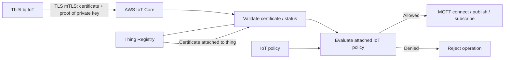
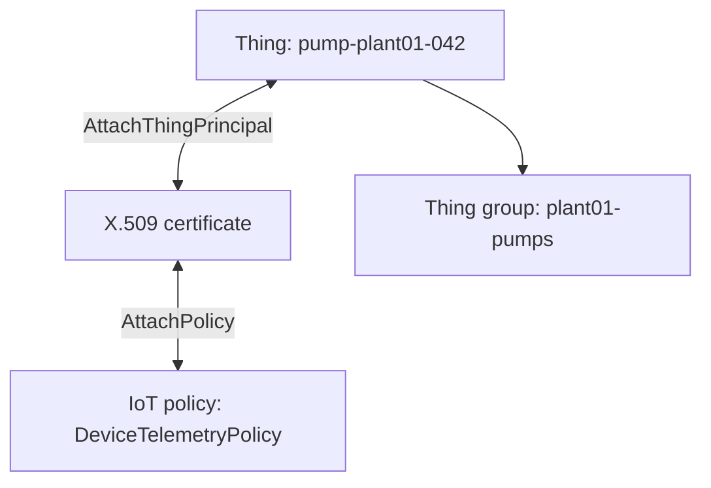
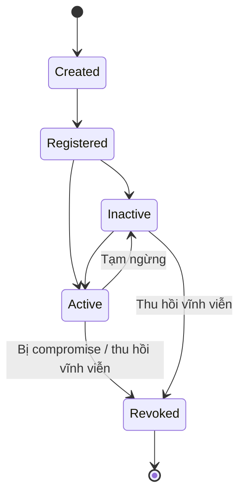

# Chứng chỉ X.509, IoT policy và danh tính thiết bị

Một hệ thống IoT có thể có hàng nghìn hoặc hàng triệu thiết bị kết nối đến cloud để gửi telemetry, nhận lệnh điều khiển và cập nhật trạng thái. Mỗi thiết bị phải chứng minh danh tính khi kết nối; hệ thống cần biết thiết bị nào được phép publish dữ liệu, subscribe topic nào và truy cập tài nguyên nào. Nếu dùng chung một credential cho cả fleet, việc lộ khóa của một thiết bị có thể ảnh hưởng toàn bộ hệ thống. Nếu policy quá rộng, thiết bị bị xâm nhập có thể đọc hoặc ghi dữ liệu của thiết bị khác.

AWS IoT Core hỗ trợ xác thực thiết bị bằng chứng chỉ client X.509 qua TLS mutual authentication (mTLS). Mỗi thiết bị có thể sở hữu một certificate và private key riêng; AWS IoT xác thực certificate, sau đó đánh giá AWS IoT policy gắn với certificate để quyết định thiết bị được thực hiện hành động MQTT/IoT nào. Thing Registry lưu thông tin thiết bị và mối liên hệ giữa thing với certificate, giúp quản lý fleet và áp dụng policy theo thuộc tính thiết bị.

Trong hệ sinh thái AWS, danh tính X.509 kết hợp AWS IoT Core, AWS IoT Device Management, Fleet Provisioning, AWS IoT Device Defender, AWS Certificate Manager Private CA (hoặc CA của doanh nghiệp), AWS Lambda, EventBridge, IAM, Secrets Manager và CloudWatch. Thiết kế đúng vòng đời certificate và policy giúp xác thực từng thiết bị, cô lập dữ liệu, xoay vòng khóa và thu hồi quyền khi thiết bị bị mất hoặc có dấu hiệu bị xâm nhập.

## Mục tiêu học tập

Sau bài học, bạn có thể:

- Phân biệt X.509 certificate, private key, certificate authority (CA), IoT thing và IoT policy.
- Giải thích TLS mutual authentication và yêu cầu SNI khi kết nối AWS IoT Core.
- Thiết kế một certificate riêng cho từng thiết bị và quản lý quan hệ certificate–thing–policy.
- Chọn đăng ký certificate thủ công, đăng ký qua CA, JITR, JITP, bulk registration hoặc Fleet Provisioning.
- Viết IoT policy giới hạn Connect, Publish, Subscribe và Receive theo thing/device.
- Sử dụng thing policy variables và certificate policy variables an toàn.
- Xoay vòng, deactivate và revoke certificate theo quy trình có kiểm soát.
- Bảo vệ CA, private key, provisioning claim và audit hoạt động của fleet.

## Danh tính thiết bị trong AWS IoT Core

AWS IoT Core tách việc xác thực kết nối khỏi việc cấp quyền hành động. Certificate chứng minh thiết bị sở hữu private key tương ứng; IoT policy quyết định thiết bị được phép làm gì sau khi xác thực. Thing Registry mô tả thiết bị trong fleet và liên kết certificate với một thực thể logic.

| Thành phần | Vai trò | Ví dụ |
|---|---|---|
| X.509 client certificate | Chứng minh danh tính client trong TLS mTLS | Certificate riêng cho cảm biến `sensor-042` |
| Private key | Chứng minh client sở hữu certificate | Lưu trong secure element hoặc TPM trên thiết bị |
| Certificate Authority (CA) | Ký và quản lý certificate cho thiết bị | Root CA hoặc intermediate CA của nhà sản xuất |
| AWS IoT thing | Đại diện logic cho thiết bị trong registry | Thing tên `sensor-042` |
| IoT policy | Cấp quyền IoT data plane | Cho phép publish telemetry của chính thiết bị |
| Thing group/type/attributes | Phân loại và quản lý fleet | `factory=HCM-01`, `deviceType=temperature-sensor` |
| Certificate status | Điều khiển certificate có được dùng để kết nối hay không | `ACTIVE`, `INACTIVE`, `REVOKED` |

Một certificate được đăng ký trong AWS IoT nhưng chưa gắn policy phù hợp có thể xác thực được ở lớp TLS nhưng không được phép thực hiện thao tác IoT. Tương tự, tạo thing không tự tạo certificate hoặc cấp quyền publish/subscribe. Các quan hệ này cần được cấu hình rõ ràng.



### Một thiết bị, một certificate

AWS khuyến nghị cấp certificate riêng cho từng thiết bị. Nếu 10.000 thiết bị dùng chung một certificate, khi một thiết bị bị mất hoặc private key bị lộ, tổ chức khó thu hồi riêng thiết bị đó. Với certificate riêng, có thể deactivate/revoke đúng certificate, xác định thing liên quan và điều tra lịch sử hoạt động.

Không dùng certificate của fleet claim như credential hoạt động dài hạn cho mọi thiết bị. Claim certificate chỉ nên dùng cho bước bootstrap provisioning với policy giới hạn nghiêm ngặt; sau khi provision, mỗi thiết bị nhận certificate riêng để kết nối thường xuyên.

### Certificate không thay thế Thing Registry

Certificate xác thực kết nối. Thing Registry lưu tên, loại, thuộc tính, group và quan hệ với principal. Một thiết bị có thể kết nối bằng certificate hợp lệ nhưng chưa gắn thing; nếu policy dùng thing policy variables hoặc yêu cầu `Thing.IsAttached`, kết nối/hành động có thể bị từ chối.

Với MQTT, thường dùng client ID bằng thing name và attach certificate vào thing theo quan hệ độc quyền. Quy ước này giúp policy dùng `${iot:Connection.Thing.ThingName}` để giới hạn tài nguyên theo từng thiết bị.

## X.509 và TLS mutual authentication

X.509 là chuẩn chứng chỉ số dựa trên hạ tầng khóa công khai (PKI). Certificate chứa public key, thông tin subject/issuer, thời hạn hiệu lực, serial number và chữ ký của CA. Private key tương ứng được giữ bí mật bởi chủ sở hữu.

Trong TLS mutual authentication:

1. Thiết bị kết nối đến endpoint AWS IoT Core và xác minh server certificate để chắc chắn đang nói chuyện với đúng dịch vụ.
2. AWS IoT yêu cầu client certificate.
3. Thiết bị gửi certificate chain theo yêu cầu TLS và chứng minh đang sở hữu private key bằng thao tác ký trong handshake.
4. AWS IoT xác minh certificate, chain/CA đã đăng ký, thời hạn và trạng thái certificate.
5. Sau TLS handshake, AWS IoT đánh giá IoT policy cho hành động kết nối hoặc thao tác MQTT.

Private key không được gửi qua mạng. Certificate chứa public key nên có thể được gửi trong TLS handshake; bí mật cần bảo vệ là private key.

### Client certificate và CA

CA ký certificate để xác nhận public key thuộc về thiết bị/đối tượng đã được kiểm tra. Mô hình PKI thường gồm:

- **Root CA:** gốc tin cậy, thường được giữ offline hoặc bảo vệ ở HSM.
- **Intermediate CA:** ký certificate cho một nhóm sản phẩm, nhà máy hoặc khu vực; giúp giới hạn blast radius và xoay vòng signer.
- **Device certificate:** certificate cuối cùng cấp cho một thiết bị.

AWS IoT Core hỗ trợ certificate do Amazon cấp hoặc certificate do tổ chức tự quản lý (BYOC). Nếu dùng CA riêng, cần đăng ký CA certificate với AWS IoT trong từng account/Region cần sử dụng để dịch vụ xác minh certificate thiết bị.

### SNI là yêu cầu kết nối quan trọng

Client kết nối AWS IoT Core qua TLS phải hỗ trợ Server Name Indication (SNI) và gửi hostname endpoint phù hợp trong TLS ClientHello. SNI giúp AWS IoT xác định endpoint/account và cấu hình xác thực tương ứng. Không kết nối bằng địa chỉ IP thay cho hostname endpoint.

Đối với MQTT qua TLS, port thường dùng là TCP 8883. AWS IoT Core cũng hỗ trợ MQTT qua port 443 với ALPN protocol phù hợp, ví dụ `x-amzn-mqtt-ca` cho mTLS MQTT. Cấu hình cụ thể phụ thuộc SDK, thiết bị và protocol. Hãy dùng endpoint được cấp cho account/Region và kiểm tra yêu cầu ALPN/SNI của phương thức kết nối.

### Thời hạn và thuộc tính certificate

Certificate có `Not Before` và `Not After`. Thiết bị cần đồng hồ đủ chính xác để kiểm tra thời hạn và cần có kế hoạch cập nhật certificate trước khi hết hạn. Certificate subject/issuer có thể chứa Common Name, Organization, Organizational Unit và các thuộc tính khác. AWS IoT policy có thể sử dụng một số thuộc tính này làm policy variables, nhưng không nên dùng một thuộc tính không duy nhất làm định danh duy nhất nếu chưa có quy ước kiểm soát.

## Đăng ký certificate với AWS IoT Core

AWS IoT Core cần biết certificate nào được tin cậy trước khi client có thể sử dụng certificate để kết nối. Có nhiều cách đăng ký, phù hợp với quy mô và quy trình sản xuất khác nhau.

| Phương pháp | Cách hoạt động | Khi phù hợp |
|---|---|---|
| Manual registration | Đăng ký từng certificate hoặc nhóm nhỏ bằng Console/API/CLI | Lab, pilot hoặc số lượng thiết bị nhỏ |
| CA registration + manual registration | Đăng ký CA, sau đó đăng ký từng certificate do CA ký | PKI riêng, muốn kiểm soát đăng ký từng thiết bị |
| Just-in-time registration (JITR) | Certificate ký bởi CA đã đăng ký được đăng ký tự động khi thiết bị kết nối lần đầu; workflow do khách hàng hoàn tất | Fleet lớn đã có certificate trong manufacturing |
| Just-in-time provisioning (JITP) | CA đã đăng ký liên kết provisioning template; lần kết nối đầu tự tạo thing/policy và activate certificate theo template | Fleet lớn có quy trình provisioning chuẩn hóa |
| Bulk registration | Đăng ký danh sách thiết bị đã biết qua template và file trong S3 | Sản xuất theo lô, có inventory trước khi thiết bị kết nối |
| Fleet Provisioning | Thiết bị nhận certificate riêng trong lần bootstrap qua claim hoặc trusted user | Thiết bị chưa có certificate riêng khi xuất xưởng hoặc cần tự provision |

### Đăng ký certificate thủ công

Với certificate đã có, có thể đăng ký qua AWS IoT Console hoặc `RegisterCertificate`. Khi đăng ký, cần chọn trạng thái phù hợp và sau đó gắn policy, attach thing nếu thiết kế yêu cầu. Không coi thao tác register là hoàn tất provisioning.

Ví dụ CLI minh họa:

```bash
aws iot register-certificate \
  --certificate-pem file://device-042-certificate.pem \
  --ca-certificate-pem file://intermediate-ca.pem \
  --set-as-active
```

Tên tham số và yêu cầu CA phụ thuộc trường hợp đăng ký; chỉ dùng `--ca-certificate-pem` khi quy trình và API tương ứng yêu cầu. Nếu certificate được đăng ký ở trạng thái inactive, phải activate sau khi hoàn tất kiểm tra và provisioning.

### Đăng ký CA certificate

Khi dùng CA riêng, AWS IoT cần xác minh quyền sở hữu CA trước khi cho phép đăng ký. Quy trình xác minh thường gồm tạo registration code trong AWS IoT, tạo một verification certificate được CA ký với registration code trong subject, rồi gọi `RegisterCACertificate` kèm CA certificate và verification certificate.

Hai chế độ đăng ký CA quan trọng:

- **DEFAULT:** CA certificate chỉ có thể được đăng ký ở chế độ này bởi một AWS account trong một Region.
- **SNI_ONLY:** CA certificate có thể được đăng ký ở nhiều accounts trong cùng một Region; client phải gửi SNI theo yêu cầu.

Certificate CA cần được bảo vệ chặt chẽ. Nếu CA bị compromise, attacker có thể ký certificate giả mạo thiết bị. Tách intermediate CA theo product/fleet, bảo vệ root key offline/HSM và có quy trình thay signer.

### Just-in-time registration (JITR)

JITR phù hợp khi thiết bị đã có certificate riêng do CA của nhà sản xuất ký. CA được đăng ký với AWS IoT và bật auto-registration. Khi thiết bị kết nối lần đầu, AWS IoT đăng ký client certificate ở trạng thái `PENDING_ACTIVATION` và phát sự kiện đăng ký. Hệ thống của doanh nghiệp xử lý sự kiện, kiểm tra thiết bị/serial/claim trong inventory, tạo thing, attach policy, attach certificate vào thing và activate certificate.

JITR cho phép dùng certificate đã được cài trong manufacturing nhưng cần workflow hậu xử lý do doanh nghiệp quản lý. Nếu workflow không hoàn tất, certificate không trở thành credential hoạt động đầy đủ.

### Just-in-time provisioning (JITP)

JITP liên kết một provisioning template với CA certificate. Khi thiết bị dùng certificate do CA đó ký kết nối lần đầu, AWS IoT dùng template để thực hiện `RegisterThing`, tạo thing và policy, gắn policy/certificate và chuyển certificate sang `ACTIVE` nếu quy trình thành công.

Template có thể tham chiếu các thuộc tính certificate như country, organization hoặc organizational unit. Nếu template yêu cầu thuộc tính không có trong certificate, provisioning có thể thất bại. Vì vậy, subject naming của certificate phải thống nhất với template và quy trình manufacturing.

JITP giảm phần workflow provisioning tự viết, nhưng vẫn cần giám sát lỗi, kiểm tra inventory và giới hạn quyền của provisioning role. Không dùng certificate subject do thiết bị tự khai báo mà không có quy trình CA xác thực.

### Fleet Provisioning by claim

Fleet Provisioning by claim dùng một claim certificate/claim private key được chia sẻ cho giai đoạn bootstrap của một nhóm thiết bị. Khi thiết bị kết nối bằng claim, nó gọi các reserved topics để yêu cầu provisioning. AWS IoT áp dụng provisioning template và cấp certificate riêng cho thiết bị; thiết bị lưu credential mới rồi dùng certificate riêng cho các kết nối sau.

Claim certificate là credential có rủi ro cao vì nhiều thiết bị có thể cùng dùng. Policy của claim chỉ nên cho phép:

- Kết nối với client ID có pattern được kiểm soát.
- Publish/subscribe các provisioning reserved topics cần thiết.
- Không được publish telemetry nghiệp vụ hoặc subscribe command topics của thiết bị khác.
- Không được gọi các API hoặc topic không liên quan đến provisioning.

Nếu claim certificate bị lộ, deactivate claim ngăn thiết bị mới tiếp tục provisioning bằng claim đó. Tuy nhiên, các thiết bị đã provision trước đó có certificate riêng vẫn có thể hoạt động; cần xử lý certificate từng thiết bị nếu bị ảnh hưởng.

### Fleet Provisioning by trusted user

By trusted user phù hợp khi end user hoặc kỹ thuật viên cài đặt dùng ứng dụng đã xác thực để bootstrap thiết bị tại nơi triển khai. Ứng dụng/backend kiểm tra quyền người dùng, gọi `CreateProvisioningClaim` và chuyển provisioning claim tạm thời (certificate cùng private key) cho thiết bị qua kênh cài đặt an toàn. Claim tạm thời hết hạn sau 5 phút; trong khoảng thời gian đó thiết bị dùng claim để hoàn tất provisioning và nhận certificate riêng có thời hạn dài hơn. Cách này tránh phải nhúng một claim private key dùng chung vào toàn bộ fleet, nhưng cần bảo vệ tài khoản trusted user, quyền gọi API, kênh chuyển claim và thời hạn ngắn.

### Chọn phương pháp provisioning

| Điều kiện sản xuất | Phương pháp nên đánh giá |
|---|---|
| Thiết bị đã có unique certificate và CA được kiểm soát; cần workflow kiểm tra riêng | JITR |
| Thiết bị đã có unique certificate và template đủ để tự động tạo tài nguyên | JITP |
| Danh sách thiết bị đã biết trước và có thể nạp từ S3 | Bulk registration |
| Thiết bị chưa có unique certificate và manufacturing không thể cài trước | Fleet Provisioning by claim hoặc trusted user |
| Lab/pilot số lượng nhỏ | Manual registration |

## Thing Registry và mối liên hệ certificate–thing–policy

Một thiết kế phổ biến tạo một thing cho mỗi thiết bị. Thing name là ID logic, ví dụ `pump-plant01-042`. Certificate được attach vào thing bằng `AttachThingPrincipal`; IoT policy được attach vào certificate bằng `AttachPolicy` hoặc API tương ứng.

Các quan hệ chính:



Thing group hỗ trợ quản lý theo tầng, ví dụ region, plant, device type hoặc firmware cohort. Có thể áp dụng job và policy quản trị fleet theo group. Không dùng thing group thay cho kiểm soát truy cập ở topic; policy vẫn phải giới hạn tài nguyên và hành động.

### Exclusive và non-exclusive thing association

Certificate có thể được gắn với thing theo mô hình độc quyền hoặc không độc quyền tùy API/thiết kế. Với non-exclusive association, cùng một certificate có thể gắn với nhiều thing; điều này dễ gây nhầm lẫn khi policy dùng thing variables. AWS khuyến nghị client ID trong MQTT Connect khớp thing name khi dùng thing policy variables và association không độc quyền. Đối với danh tính thiết bị rõ ràng, nên dùng một certificate riêng và một thing association được kiểm soát cho từng thiết bị.

### Điều kiện `Thing.IsAttached`

Thing policy variable `${iot:Connection.Thing.IsAttached}` có thể dùng trong điều kiện để chỉ cho phép hành động khi certificate/principal đã attach với thing trong registry. Cách này giúp ngăn certificate hợp lệ nhưng chưa được gắn vào thing thực hiện các quyền yêu cầu association.

Thing policy variables chỉ có sẵn trong các kết nối MQTT hoặc MQTT over WebSocket theo điều kiện tài liệu AWS. Client ID phải khớp thing name khi dùng biến thing name/type/attributes. Với HTTPS publish hoặc giao thức khác, không giả định các biến này luôn được đánh giá như MQTT.

## AWS IoT policies: xác thực xong mới cấp quyền

AWS IoT policy là tài liệu JSON có cấu trúc tương tự IAM policy nhưng dùng action và resource của AWS IoT data plane. Policy gắn với certificate quyết định certificate được phép kết nối, publish, subscribe hoặc nhận message trên topic nào.

Bốn action MQTT cơ bản:

| Action | Mục đích | Resource ARN |
|---|---|---|
| `iot:Connect` | Mở MQTT connection | `arn:aws:iot:region:account:client/client-id` |
| `iot:Publish` | Publish message vào topic | `arn:aws:iot:region:account:topic/topic-name` |
| `iot:Subscribe` | Đăng ký topic filter | `arn:aws:iot:region:account:topicfilter/filter` |
| `iot:Receive` | Nhận message từ topic | `arn:aws:iot:region:account:topic/topic-name` |

`Subscribe` và `Receive` là hai quyền riêng. Client có thể được phép subscribe nhưng không được nhận message nếu thiếu `iot:Receive`. Tương tự, cho phép `iot:Receive` không tự cấp quyền subscribe topic filter.

### Ví dụ policy theo từng thiết bị

Giả sử thing name và MQTT client ID đều là `sensor-042`. Thiết bị chỉ được connect với client ID trùng thing name, publish telemetry vào topic riêng và subscribe/receive command của chính nó.

```json
{
  "Version": "2012-10-17",
  "Statement": [
    {
      "Effect": "Allow",
      "Action": "iot:Connect",
      "Resource": "arn:aws:iot:ap-southeast-1:111122223333:client/${iot:Connection.Thing.ThingName}",
      "Condition": {
        "Bool": {
          "iot:Connection.Thing.IsAttached": "true"
        }
      }
    },
    {
      "Effect": "Allow",
      "Action": "iot:Publish",
      "Resource": "arn:aws:iot:ap-southeast-1:111122223333:topic/devices/${iot:Connection.Thing.ThingName}/telemetry"
    },
    {
      "Effect": "Allow",
      "Action": "iot:Subscribe",
      "Resource": "arn:aws:iot:ap-southeast-1:111122223333:topicfilter/devices/${iot:Connection.Thing.ThingName}/commands"
    },
    {
      "Effect": "Allow",
      "Action": "iot:Receive",
      "Resource": "arn:aws:iot:ap-southeast-1:111122223333:topic/devices/${iot:Connection.Thing.ThingName}/commands"
    }
  ]
}
```

Thay Region, account ID, topic naming và thing model bằng giá trị thực. Policy mẫu chỉ cho phép một topic command chính xác; nếu ứng dụng cần nhiều topic con, mở rộng pattern có kiểm soát và test từng action.

### Policy resource và MQTT wildcard

MQTT topic filter dùng `+` để đại diện một cấp và `#` để đại diện nhiều cấp. AWS IoT policy resource ARN lại dùng wildcard policy như `*` và `?` theo quy tắc policy. Không sao chép nguyên ký tự MQTT wildcard vào ARN mà không kiểm tra cách service đánh giá resource.

Ví dụ một topic filter MQTT `devices/+/commands/#` có thể cần resource ARN pattern tương ứng dùng wildcard policy `devices/*/commands/*`. Hãy kiểm tra policy simulator/test connection thực tế và không mở `topic/*` cho mọi thiết bị nếu không có yêu cầu.

### Tách quyền theo topic

Một topic convention rõ ràng giúp policy đơn giản:

```text
devices/{thingName}/telemetry
devices/{thingName}/state
devices/{thingName}/commands
devices/{thingName}/config
fleet/{groupName}/broadcast
```

Thiết bị thường chỉ publish telemetry/state của chính mình và subscribe command/config của chính mình. Quyền publish vào `fleet/...` hoặc subscribe broadcast cần được thiết kế riêng; tránh cho mọi thiết bị publish vào topic điều khiển chung.

### Policy variables từ Thing Registry

Thing policy variables giúp tái sử dụng một policy cho nhiều thiết bị:

- `${iot:Connection.Thing.ThingName}`: tên thing đang được liên kết với certificate.
- `${iot:Connection.Thing.ThingTypeName}`: thing type.
- `${iot:Connection.Thing.Attributes[attributeName]}`: giá trị attribute của thing.
- `${iot:Connection.Thing.IsAttached}`: trạng thái principal có được attach với thing hay không.

Ví dụ cùng một policy có thể giới hạn thiết bị theo `factory` attribute. Tuy nhiên, nếu certificate không attach với thing hoặc client ID không đáp ứng điều kiện, biến có thể không được thay thế như mong đợi và policy có thể từ chối quyền.

### Certificate policy variables

AWS IoT hỗ trợ một số thuộc tính X.509 làm policy variables, ví dụ:

- `${iot:Certificate.Subject.CommonName}`
- `${iot:Certificate.Subject.Organization}`
- `${iot:Certificate.Issuer.CommonName}`
- `${iot:Certificate.SerialNumber}`

Có thể dùng để ràng buộc client ID hoặc topic với thuộc tính certificate. Cần lưu ý:

- Nếu certificate không chứa thuộc tính được tham chiếu, biến có thể không được thay thế và policy evaluation có thể không như mong đợi.
- Serial number được biểu diễn dưới dạng số thập phân trong policy variable.
- Một số ký tự đặc biệt trong subject/issuer phải được escape theo quy tắc AWS.
- Certificate attributes có thể không duy nhất hoặc có thể được CA cấp theo quy tắc khác nhau; đừng dùng Common Name làm định danh duy nhất nếu không có kiểm soát.
- Có thể dùng condition `Null` để yêu cầu thuộc tính bắt buộc phải hiện diện trước khi cho phép hành động.

## Least privilege và các lỗi policy thường gặp

Một policy tốt chỉ cho phép thiết bị thực hiện các hành động cần thiết. Hãy áp dụng nguyên tắc:

- Giới hạn `iot:Connect` vào client ID cụ thể hoặc pattern theo thing name.
- Giới hạn `iot:Publish` vào topic telemetry/state của chính thiết bị.
- Giới hạn `iot:Subscribe` vào topic filter cần thiết.
- Cấp `iot:Receive` đúng các topic mà thiết bị cần nhận.
- Dùng `Thing.IsAttached` để yêu cầu certificate được gắn với thing nếu thiết kế dựa trên registry.
- Không cấp quyền `iot:*` hoặc resource `*` cho certificate thiết bị trong production.
- Không dùng cùng policy bootstrap rộng làm policy hoạt động dài hạn.

Các lỗi thường gặp:

| Lỗi | Hậu quả | Cách khắc phục |
|---|---|---|
| Chỉ cấp `iot:Subscribe`, thiếu `iot:Receive` | Subscribe thành công nhưng không nhận được message | Cấp cả hai action với resource tương ứng |
| `clientId` không khớp thing name | Thing policy variables không resolve như mong đợi | Đồng bộ client ID với thing name |
| Certificate chưa attach với thing | `Thing.IsAttached` false hoặc thing variables không có | AttachThingPrincipal và kiểm tra association |
| Resource ARN dùng sai `topic`/`topicfilter` | Publish/subscribe bị AccessDenied | Dùng ARN type đúng với action |
| Policy cho `topic/*` | Thiết bị có thể publish vào topic của thiết bị khác | Giới hạn theo thing name hoặc certificate identity |
| Dùng MQTT `+`/`#` trực tiếp trong policy ARN | Policy không match resource như dự kiến | Dùng wildcard ARN đúng quy tắc AWS IoT policy |
| Policy variable thiếu trong certificate | Policy evaluation bất ngờ hoặc bị deny | Bảo đảm attribute tồn tại và dùng `Null` condition |
| Dùng CN giống nhau cho cả fleet | Khó cô lập thiết bị | Dùng thing name/serial hoặc unique attribute đã kiểm soát |

## Vòng đời certificate

Certificate lifecycle cần được quản lý từ lúc tạo, đăng ký, kích hoạt, sử dụng, xoay vòng đến thu hồi. Trạng thái certificate và quan hệ policy/thing phải được đồng bộ với inventory thiết bị.



`REVOKED` là trạng thái thu hồi không thể chuyển lại thành `ACTIVE`. Nếu chỉ muốn tạm ngừng thiết bị để bảo trì, dùng `INACTIVE`; nếu private key bị lộ hoặc certificate cần bị vô hiệu hóa vĩnh viễn, dùng quy trình revoke.

### Tạo và bảo vệ private key

Ưu tiên tạo private key ngay trên thiết bị bằng secure element, TPM hoặc hardware-backed keystore khi phần cứng hỗ trợ. Thiết bị tạo CSR và gửi đến CA qua quy trình xác thực manufacturing để nhận certificate; private key không rời thiết bị.

Nếu dùng AWS IoT `CreateKeysAndCertificate`, private key được trả về một lần trong response. Ứng dụng phải lưu an toàn ngay tại thời điểm tạo; không thể yêu cầu AWS IoT trả lại private key sau này. Không ghi private key vào log, source control, image firmware dùng chung hoặc S3 bucket không được bảo vệ.

### Rotation certificate không gián đoạn

Quy trình rotation nên có giai đoạn overlap để thiết bị chuyển credential mà không mất kết nối:

1. Tạo key pair mới trên thiết bị hoặc secure provisioning system.
2. Phát hành và đăng ký certificate mới.
3. Attach policy và thing tương ứng; kiểm tra certificate mới ở trạng thái có thể sử dụng.
4. Cập nhật thiết bị để kết nối thử bằng certificate mới trong một cửa sổ chuyển đổi.
5. Xác nhận thiết bị publish/subscribe đúng quyền, telemetry đến hệ thống và lệnh điều khiển hoạt động.
6. Deactivate certificate cũ sau khi xác nhận thiết bị dùng certificate mới.
7. Theo dõi lỗi và thiết bị offline; chỉ xóa association/certificate cũ theo retention/audit policy.
8. Cập nhật inventory, ngày hết hạn và trạng thái rotation.

Không deactivate certificate cũ trước khi thiết bị có credential mới hoạt động, trừ khi cần phản ứng khẩn cấp với compromise. Thiết bị offline lâu ngày cần quy trình recovery hoặc provisioning lại.

### Deactivate và revoke

- **Deactivate:** tạm ngăn certificate được dùng để kết nối; có thể activate lại khi sự cố đã được xử lý.
- **Revoke:** thu hồi vĩnh viễn; certificate không thể được kích hoạt lại.
- **Deactivate CA:** ngăn certificate mới do CA đó ký được auto-register; các client certificates đã đăng ký và đang hoạt động vẫn tiếp tục hoạt động cho đến khi bị xử lý riêng.

Khi CA bị compromise, chỉ deactivate CA là chưa đủ. Cần xác định client certificates đã được ký bởi CA, revoke/deactivate các certificate bị ảnh hưởng, cấp CA mới và provision lại thiết bị theo kế hoạch.

## AWS IoT Fleet Provisioning và provisioning template

Provisioning template mô tả tài nguyên cần tạo khi thiết bị đăng ký, ví dụ thing, certificate, policy, thing group và các thuộc tính. Template có thể nhận parameters từ thiết bị hoặc từ certificate/claim context. Hãy xác thực parameters và không tin giá trị do thiết bị gửi nếu chúng ảnh hưởng tenant, quyền hoặc phân vùng dữ liệu.

### Template và provisioning role

Provisioning role là IAM role được AWS IoT assume để tạo các tài nguyên trong account. Role cần quyền tối thiểu như tạo/đăng ký thing, attach policy/certificate, thêm thing group và các thao tác cần thiết cho template. Trust policy chỉ cho phép dịch vụ AWS IoT assume role trong phạm vi phù hợp.

Không cấp `iot:*` toàn account nếu template chỉ cần tạo một tập tài nguyên. Tên thing và policy resource nên được tạo từ parameters đã validate, tránh cho thiết bị tự chọn policy có quyền rộng.

### Reserved topics cho Fleet Provisioning

Fleet Provisioning sử dụng các MQTT reserved topics dưới prefix `$aws/certificates/provisioning-templates/...` hoặc `$aws/provisioning-templates/...` tùy bước và API. Thiết bị cần subscribe/publish đúng các topic create/certificate/provisioning template được AWS công bố. Claim policy phải chỉ cho phép những topic này; không cấp wildcard toàn bộ `$aws/#` nếu không cần.

Tên topic và payload phụ thuộc flow (by claim/by trusted user) và API version. Dùng SDK/device SDK hoặc tài liệu AWS để tạo payload chính xác thay vì hard-code từ ví dụ cũ.

## Certificate authority và quản trị PKI

Một PKI thiết bị an toàn cần quy trình kiểm soát CA và issuance:

- Root CA private key được giữ offline hoặc trong HSM; không dùng trực tiếp root để ký mọi device certificate.
- Intermediate CA được phân tách theo product, manufacturing site hoặc môi trường.
- Mỗi thiết bị có key pair riêng; không clone private key trong firmware image.
- Certificate subject/serial/attributes có quy ước duy nhất và được ghi vào inventory.
- Có kiểm soát người/thiết bị được phép yêu cầu certificate và kiểm tra proof-of-possession.
- CA rotation có kế hoạch overlap: đăng ký CA mới, phát hành certificate mới, chuyển thiết bị, sau đó ngừng CA cũ.
- Audit issuance, renewal, activation, deactivation và revocation.

AWS IoT Core có thể dùng AWS IoT managed CA hoặc CA bên ngoài. AWS Certificate Manager Private CA hỗ trợ phát hành certificate cho workload cần CA riêng, nhưng cần thiết kế integration để cấp certificate cho thiết bị và quản lý private key ở thiết bị. Không nhầm ACM public certificate dành cho server endpoint với client certificate X.509 của từng thiết bị.

## Bảo vệ kết nối và dữ liệu thiết bị

Certificate chỉ là một lớp trong mô hình bảo mật thiết bị:

- Bảo vệ private key trong secure element/TPM; hạn chế debug port và firmware extraction.
- Bật secure boot và firmware signing để giảm nguy cơ firmware độc hại lấy credential.
- Dùng TLS mTLS và xác minh server certificate; không bỏ qua kiểm tra CA/hostname.
- Giới hạn IoT policy theo thing, topic và action.
- Không dùng MQTT topic như cơ chế xác thực; topic name có thể bị đoán nếu policy cho phép.
- Dùng device Defender audit để phát hiện policy/certificate quá rộng và detect để tìm hành vi bất thường.
- Dùng IoT Jobs để triển khai firmware/configuration theo cohort, theo dõi job execution và rollback.
- Bảo vệ provisioning claim và thu hồi khi lộ.
- Theo dõi certificate expiry, rotation coverage và thiết bị chưa cập nhật.

## Giám sát và audit

AWS IoT Core tích hợp CloudWatch Logs, CloudWatch metrics, CloudTrail và AWS IoT Device Defender.

### CloudWatch và lifecycle events

Theo dõi:

- Số lần kết nối thành công/thất bại.
- TLS/authentication failure và policy authorization failure.
- Certificate registration/provisioning success/failure.
- JITR/JITP/Fleet Provisioning error và throttling.
- Thiết bị online/offline, disconnect và reconnect rate.
- Số certificate sắp hết hạn, inactive hoặc bị revoke.
- Publish/subscribe throughput và message error theo fleet/thing group.

AWS IoT phát các lifecycle events cho một số thay đổi certificate/thing/connection; có thể route qua MQTT reserved topics hoặc tích hợp EventBridge theo loại sự kiện được hỗ trợ. Dùng Lambda/Step Functions để xử lý provisioning và notification, nhưng workflow phải idempotent vì event có thể được retry hoặc xử lý lại.

### AWS IoT Device Defender

Device Defender Audit kiểm tra cấu hình và policy của fleet, ví dụ policy quá rộng, certificate không được quản lý đúng, CA registration và các cấu hình bảo mật liên quan. Detect phân tích metric hành vi để tìm thiết bị có traffic hoặc hành vi khác baseline. Có thể gửi findings đến CloudWatch, SNS hoặc workflow phản ứng.

Ví dụ phản ứng:

1. Device Defender phát hiện thiết bị publish message bất thường.
2. Alert được chuyển đến EventBridge/SNS.
3. Lambda xác định thing/certificate liên quan và kiểm tra mức độ nghiêm trọng.
4. Nếu cần, workflow deactivate certificate hoặc cập nhật policy để cô lập thiết bị.
5. Lưu bằng chứng CloudTrail, log và ticket điều tra.
6. Sau khi khắc phục, cấp certificate mới và provision lại thiết bị theo phê duyệt.

Không tự động revoke vĩnh viễn chỉ dựa trên một metric đơn lẻ nếu chưa có điều kiện xác nhận. Với phản ứng tự động, định nghĩa ngưỡng, ngoại lệ, thời gian giữ và quy trình khôi phục.

### Audit trail

CloudTrail ghi lại control plane API như RegisterCertificate, UpdateCertificate, AttachPolicy, AttachThingPrincipal, CreatePolicy, UpdatePolicy, RegisterCACertificate và các thao tác provisioning. Bật logging phù hợp, lưu trữ theo retention và hạn chế quyền xóa log.

Không ghi private key, password hoặc payload nhạy cảm vào log. Nếu cần correlation, dùng certificate ID, thing name, serial number, client ID và request ID.

## Ví dụ AWS CLI quản lý certificate và policy

Các lệnh dưới đây minh họa thao tác control plane. Thay Region, account ID, endpoint, certificate ID, thing name và file bằng giá trị thật. IAM principal thực thi cần quyền phù hợp.

### Tạo thing

```bash
aws iot create-thing \
  --thing-name sensor-042 \
  --thing-type-name TemperatureSensor
```

### Tạo certificate và key pair do AWS IoT cấp

```bash
aws iot create-keys-and-certificate \
  --set-as-active
```

Response chứa certificate ARN/ID, certificate PEM, public key và private key. Lưu private key an toàn ngay lúc tạo; không in response ra log hoặc terminal dùng chung. Nếu dùng CA riêng, tạo CSR và phát hành certificate theo PKI của doanh nghiệp.

### Attach certificate vào thing và policy

```bash
aws iot attach-thing-principal \
  --thing-name sensor-042 \
  --principal arn:aws:iot:ap-southeast-1:111122223333:cert/CERTIFICATE_ID

aws iot attach-policy \
  --policy-name DeviceTelemetryPolicy \
  --target arn:aws:iot:ap-southeast-1:111122223333:cert/CERTIFICATE_ID
```

### Kiểm tra association và certificate status

```bash
aws iot list-thing-principals \
  --thing-name sensor-042

aws iot list-attached-policies \
  --target arn:aws:iot:ap-southeast-1:111122223333:cert/CERTIFICATE_ID

aws iot describe-certificate \
  --certificate-id CERTIFICATE_ID
```

### Tạm deactivate hoặc revoke

```bash
aws iot update-certificate \
  --certificate-id CERTIFICATE_ID \
  --new-status INACTIVE
```

Khi đã xác nhận certificate bị compromise và cần thu hồi vĩnh viễn:

```bash
aws iot update-certificate \
  --certificate-id CERTIFICATE_ID \
  --new-status REVOKED
```

Không thể chuyển certificate đã `REVOKED` về `ACTIVE`. Hãy xác nhận certificate ID và tác động đến thiết bị trước khi revoke.

## Tình huống thực tế: quản lý fleet cảm biến nhà máy

Một doanh nghiệp có 20.000 cảm biến nhiệt độ tại nhiều nhà máy. Mỗi thiết bị gửi telemetry mỗi 30 giây, nhận cấu hình ngưỡng và firmware update. Thiết bị được sản xuất bởi đối tác, mỗi thiết bị có secure element và có thể tạo CSR tại dây chuyền.

### Thiết kế danh tính

1. Doanh nghiệp giữ root CA trong HSM/offline và dùng intermediate CA riêng cho từng dòng sản phẩm.
2. Mỗi cảm biến tạo private key trong secure element; nhà máy gửi CSR đến CA issuance service sau khi kiểm tra serial/asset ID.
3. CA phát hành unique client certificate có serial/subject gắn với inventory.
4. CA certificate được đăng ký với AWS IoT trong Region triển khai; chọn DEFAULT hoặc SNI_ONLY theo mô hình account.
5. Với JITP, provisioning template tạo thing `sensor-{serial}`, policy và các association cần thiết; với JITR, sự kiện đăng ký kích hoạt workflow riêng để kiểm tra inventory, tạo thing, attach certificate/policy và activate certificate.

### Thiết kế policy

- Client ID phải khớp thing name.
- Thiết bị chỉ publish `devices/{thingName}/telemetry` và `devices/{thingName}/state`.
- Thiết bị chỉ subscribe/receive `devices/{thingName}/commands` và config được cấp.
- `Thing.IsAttached` phải true trước khi cho phép connect.
- Thing group `plant-{plantId}` dùng để quản lý firmware cohort và deployment.

### Rotation và sự cố

- Certificate có thời hạn được theo dõi trong inventory.
- Trước ngày hết hạn, thiết bị tạo key mới và nhận certificate mới.
- Thiết bị kết nối bằng certificate mới, xác minh telemetry và command, rồi certificate cũ bị deactivate.
- Nếu một cảm biến bị mất, đội vận hành deactivate/revoke certificate của đúng thing và điều tra các sự kiện.
- Nếu intermediate CA bị compromise, dừng auto-registration của CA, xác định toàn bộ certificate được ký bởi CA đó và triển khai CA/certificate thay thế.

### Giám sát

Device Defender phát hiện cảm biến publish vượt baseline; CloudWatch alarm thông báo nhóm vận hành. Workflow cô lập certificate khi có tín hiệu xác nhận, đồng thời giữ telemetry/log cần thiết cho điều tra. Việc cấp lại certificate cần kiểm tra thiết bị đã được làm sạch và private key cũ không còn được sử dụng.

## Thực hành tốt

- Dùng unique X.509 certificate cho từng thiết bị; không chia sẻ private key giữa các thiết bị.
- Tạo private key trên thiết bị hoặc secure provisioning environment và bảo vệ bằng secure element/TPM.
- Giữ root CA offline/HSM; dùng intermediate CA để giới hạn phạm vi phát hành.
- Đăng ký CA trong đúng account/Region và chọn DEFAULT/SNI_ONLY có chủ đích.
- Dùng JITP/JITR/Fleet Provisioning theo khả năng manufacturing và inventory.
- Giới hạn claim certificate chỉ cho provisioning reserved topics; chuyển sang unique certificate sau bootstrap.
- Attach certificate với thing và attach policy đúng certificate; kiểm tra cả hai quan hệ.
- Dùng `iot:Connect`, `iot:Publish`, `iot:Subscribe`, `iot:Receive` riêng biệt và giới hạn resource ARN.
- Dùng thing/certificate policy variables có kiểm tra thuộc tính tồn tại; không phụ thuộc CN không duy nhất.
- Dùng client ID khớp thing name nếu policy dựa trên thing policy variables.
- Dùng `Thing.IsAttached` khi cần bắt buộc principal gắn với registry.
- Có quy trình certificate rotation trước expiry và overlap để tránh downtime.
- Phân biệt `INACTIVE` tạm thời với `REVOKED` vĩnh viễn; revoke không thể đảo ngược.
- Deactivate CA không tự thu hồi các client certificates đã đăng ký.
- Bật CloudTrail, CloudWatch và Device Defender; theo dõi provisioning errors và certificate expiry.
- Kiểm thử policy bằng thiết bị thật hoặc simulator; thử cả publish/subscribe được phép và bị từ chối.

## Checklist triển khai production

- [ ] Xác định device identity, thing naming, client ID và inventory attributes.
- [ ] Chọn CA strategy, root/intermediate hierarchy và nơi bảo vệ private key.
- [ ] Chọn manual registration, JITR, JITP, bulk registration hoặc Fleet Provisioning.
- [ ] Đăng ký CA trong từng account/Region; xác minh ownership và chế độ DEFAULT/SNI_ONLY.
- [ ] Bảo đảm device client hỗ trợ TLS mTLS, SNI và ALPN/port theo protocol.
- [ ] Cấp unique certificate cho từng thiết bị và lưu serial/certificate ID vào inventory.
- [ ] Tạo thing, attach certificate và attach IoT policy.
- [ ] Viết policy Connect/Publish/Subscribe/Receive với resource ARN giới hạn theo thing.
- [ ] Kiểm tra `Thing.IsAttached`, client ID và policy variable attributes.
- [ ] Giới hạn claim policy và xóa/rotate claim sau bootstrap khi cần.
- [ ] Thiết kế certificate expiry monitoring, rotation, deactivation và revocation runbook.
- [ ] Bảo vệ provisioning role, Lambda và template với IAM least privilege.
- [ ] Bật CloudTrail, CloudWatch, lifecycle events và Device Defender.
- [ ] Kiểm thử certificate hết hạn, certificate sai CA, policy deny, device mất và CA compromise.
- [ ] Kiểm thử reconnect sau rotation và xác minh telemetry/command hoạt động.
- [ ] Rà soát định kỳ certificate không attach thing, policy quá rộng và thiết bị không rotate.

## Kết luận

X.509 certificate xác thực danh tính thiết bị bằng TLS mutual authentication; private key chứng minh quyền sở hữu và phải được bảo vệ ở thiết bị. AWS IoT policy quyết định thiết bị được connect, publish, subscribe và receive ở đâu; Thing Registry cung cấp ngữ cảnh để tái sử dụng policy theo từng thiết bị. CA registration, JITR, JITP và Fleet Provisioning hỗ trợ nhiều quy trình đưa thiết bị vào fleet. Vòng đời certificate cần có rotation, deactivation và revocation rõ ràng; CA compromise đòi hỏi xử lý cả CA lẫn các client certificates đã phát hành. Khi kết hợp least-privilege policy, secure key storage, provisioning có kiểm soát, CloudTrail và Device Defender, tổ chức có thể quản lý danh tính thiết bị ở quy mô lớn và giảm rủi ro truy cập trái phép.

## Tài liệu tham khảo

- [X.509 client certificates - AWS IoT Core](https://docs.aws.amazon.com/iot/latest/developerguide/x509-client-certs.html)
- [Register a client certificate](https://docs.aws.amazon.com/iot/latest/developerguide/register-device-cert.html)
- [Create your own client certificates](https://docs.aws.amazon.com/iot/latest/developerguide/device-certs-your-own.html)
- [Register a CA certificate](https://docs.aws.amazon.com/iot/latest/developerguide/manage-your-CA-certs.html)
- [Just-in-time registration (JITR)](https://docs.aws.amazon.com/iot/latest/developerguide/auto-register-device-cert.html)
- [Just-in-time provisioning (JITP)](https://docs.aws.amazon.com/iot/latest/developerguide/jit-provisioning.html)
- [Device provisioning options](https://docs.aws.amazon.com/iot/latest/developerguide/iot-provision.html)
- [Fleet provisioning by claim and by trusted user](https://docs.aws.amazon.com/iot/latest/developerguide/provision-wo-cert.html)
- [Attach a thing or policy to a client certificate](https://docs.aws.amazon.com/iot/latest/developerguide/attach-to-cert.html)
- [AWS IoT Core policies](https://docs.aws.amazon.com/iot/latest/developerguide/iot-policies.html)
- [Thing policy variables](https://docs.aws.amazon.com/iot/latest/developerguide/thing-policy-variables.html)
- [X.509 certificate policy variables](https://docs.aws.amazon.com/iot/latest/developerguide/use-policy-variables.html)
- [Revoke a client certificate](https://docs.aws.amazon.com/iot/latest/developerguide/revoke-ca-cert.html)
- [AWS IoT Device Defender](https://docs.aws.amazon.com/iot-device-defender/latest/devguide/what-is-device-defender.html)
- [Transport security in AWS IoT Core](https://docs.aws.amazon.com/iot/latest/developerguide/transport-security.html)
