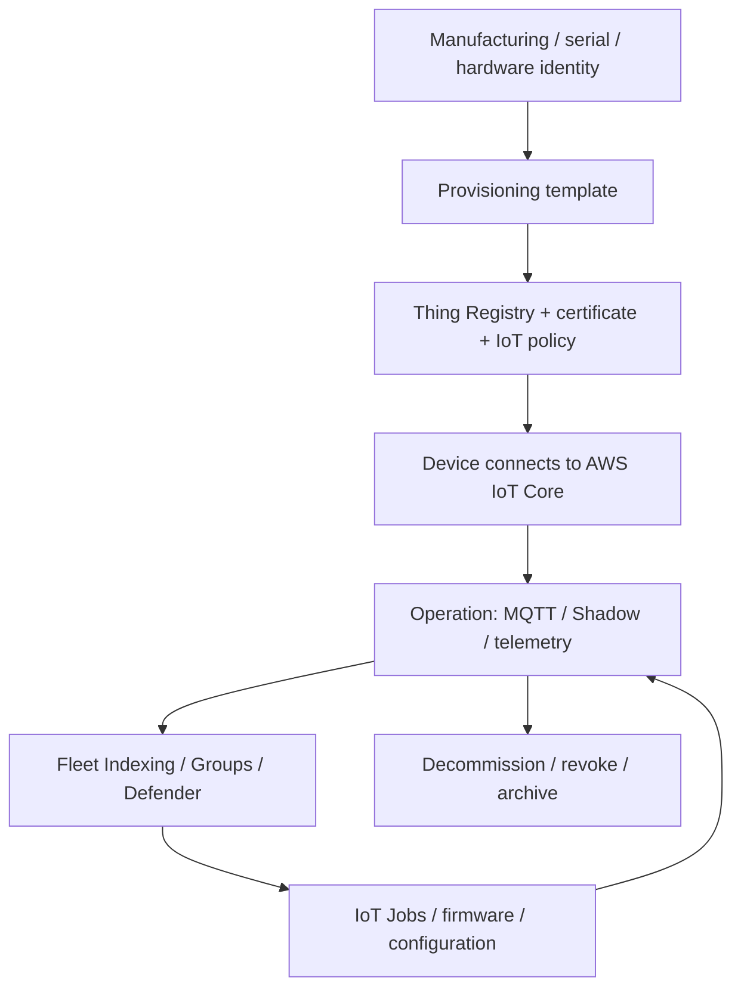

# Provisioning, device registry và quản lý fleet

Một hệ thống IoT có thể bắt đầu với vài cảm biến, nhưng khi triển khai hàng nghìn hoặc hàng triệu thiết bị, việc kết nối MQTT chỉ là bước đầu. Mỗi thiết bị cần một danh tính duy nhất, chứng thư để xác thực, policy giới hạn quyền, metadata để nhận diện model/vị trí/firmware và trạng thái vòng đời để đội vận hành biết thiết bị nào đang hoạt động, cần cập nhật hay phải thu hồi.

AWS IoT Core cung cấp Device Provisioning để đưa thiết bị mới vào hệ thống, Thing Registry để lưu danh tính logic và thuộc tính, Thing Groups để quản lý theo nhóm, Fleet Indexing để tìm kiếm/tổng hợp trạng thái và AWS IoT Jobs để triển khai tác vụ từ xa như cập nhật firmware. AWS IoT Device Defender bổ sung audit và phát hiện hành vi bất thường. Các thành phần này phối hợp tạo thành quy trình quản lý fleet từ nhà máy đến khi thiết bị ngừng hoạt động.

Một quy trình fleet tốt phải trả lời được: thiết bị này là gì và thuộc về ai; ai đã cấp danh tính; certificate nào đang hoạt động; thiết bị có quyền publish/subscribe tới topic nào; đang chạy firmware phiên bản nào; thuộc nhóm rollout nào; lần cuối kết nối khi nào; và khi bị mất, bị xâm nhập hoặc hết vòng đời thì phải thu hồi quyền ra sao.

## Mục tiêu học tập

Sau bài học, bạn có thể:

- Phân biệt provisioning, authentication, authorization, registry, shadow và fleet indexing.
- Thiết kế Thing Registry, thing types, attributes và naming convention.
- Chọn static thing groups hoặc dynamic thing groups theo mục tiêu quản lý.
- So sánh single-thing provisioning, bulk registration, JITP, JITR và Fleet Provisioning.
- Thiết kế provisioning template, provisioning role, pre-provisioning hook và quy trình claim certificate an toàn.
- Quản lý vòng đời X.509 certificate, IoT policy, thing association và thu hồi thiết bị.
- Dùng Fleet Indexing để tìm kiếm, tạo dynamic groups và theo dõi fleet metrics.
- Dùng AWS IoT Jobs và Software Package Catalog để triển khai firmware/configuration theo đợt.
- Kết hợp Device Defender Audit/Detect với quy trình incident response.
- Thiết kế onboarding, inventory reconciliation, decommissioning, observability và cost governance cho fleet quy mô lớn.

## 1. Vòng đời một thiết bị IoT

Một thiết bị thường đi qua các giai đoạn:

1. **Manufacturing**: tạo serial number, ghi nhận model/hardware revision và cài bootstrap credential hoặc unique certificate.
2. **Provisioning**: đăng ký thiết bị trong AWS IoT, tạo Thing, gắn certificate, policy và group.
3. **Activation**: thiết bị kết nối lần đầu, xác thực bằng certificate và nhận cấu hình ban đầu.
4. **Operation**: publish telemetry, nhận command, cập nhật Device Shadow và gửi health/status.
5. **Management**: tìm kiếm, phân nhóm, theo dõi firmware, triển khai Jobs và kiểm tra security posture.
6. **Maintenance**: rotate certificate, đổi group, thay cấu hình, cập nhật firmware hoặc xử lý thiết bị offline.
7. **Decommissioning**: ngừng quyền kết nối, detach/revoke certificate, xóa hoặc lưu trữ metadata và xử lý dữ liệu theo retention.



Điểm quan trọng là provisioning không đồng nghĩa với việc thiết bị đã được xác thực và cấp quyền an toàn. Provisioning tạo các resource và mối liên kết; certificate dùng cho mutual TLS authentication; IoT policy quyết định các MQTT/API action mà certificate được phép thực hiện.

## 2. Các resource cốt lõi trong AWS IoT Core

| Resource | Vai trò | Ví dụ |
|---|---|---|
| Thing | Đại diện logic cho một thiết bị hoặc entity | `pump-plant-a-00042` |
| Thing Type | Mô tả một loại/model thiết bị | `pressure-sensor-v2` |
| Thing Attribute | Metadata dạng key/value của Thing | `serialNumber`, `model`, `site` |
| Thing Group | Nhóm thiết bị để quản trị/chính sách/Jobs | `plant-a-production` |
| X.509 certificate | Danh tính mật mã dùng mutual TLS | Certificate riêng của thiết bị |
| IoT Policy | Quyền connect, publish, subscribe, receive | Chỉ cho phép topic thuộc Thing |
| Device Shadow | Trạng thái desired/reported của thiết bị | Cấu hình nhiệt độ, firmware state |
| Provisioning Template | Mô tả resource cần tạo khi onboard | Thing + certificate + policy |
| Fleet Index | Chỉ mục để search/aggregate dữ liệu fleet | `AWS_Things` |
| IoT Job | Tác vụ từ xa gửi đến Thing/group | OTA firmware hoặc đổi config |

Thing Registry không phải database telemetry và cũng không phải nơi lưu secret của thiết bị. Registry lưu thông tin nhận diện/metadata; telemetry thường đi qua MQTT Rules Engine tới S3, Timestream, Kinesis, DynamoDB hoặc dịch vụ downstream. Device Shadow lưu trạng thái đồng bộ giữa cloud và thiết bị, còn Fleet Indexing lập chỉ mục các nguồn dữ liệu được chọn để search/aggregate.

## 3. Thing Registry và naming convention

Thing là biểu diễn logic của một thiết bị vật lý hoặc entity liên quan. Một Thing có tên duy nhất trong account/Region và có thể có Thing Type, attributes, group membership, certificate/principal association và shadow.

Ví dụ metadata:

```json
{
  "thingName": "pump-plant-a-00042",
  "thingTypeName": "industrial-pump-v2",
  "attributes": {
    "serialNumber": "SN-000042",
    "model": "PX-200",
    "hardwareRevision": "B",
    "site": "plant-a",
    "environment": "production",
    "firmwareVersion": "2.4.1"
  }
}
```

Đây là ví dụ Thing metadata để quản lý inventory; không đưa password, private key, access token, PII hoặc dữ liệu nhạy cảm vào attributes.

### Thiết kế Thing name

Thing name nên ổn định trong suốt vòng đời thiết bị, có thể truy vết từ serial/manufacturing ID và không chứa thông tin cá nhân. Một convention phổ biến:

```text
<product-family>-<site-code>-<serial-number>
sensor-plant-a-000042
gateway-warehouse-03-000017
meter-building-07-000231
```

Không dùng IP address, firmware version hoặc tên người sở hữu làm Thing name vì các giá trị này có thể thay đổi. Firmware/site/model nên là attributes hoặc state phù hợp.

AWS IoT không bắt buộc Thing name phải trùng MQTT client ID, certificate ID hoặc shadow name. Tuy nhiên, dùng Thing name làm MQTT client ID giúp quản lý dễ hơn; một số tính năng như indexing connectivity status yêu cầu Thing name khớp client ID của kết nối. Khi thiết kế fleet, nên chọn một quy ước nhất quán và enforce ở firmware.

### Registry không bắt buộc để kết nối

Một client có thể kết nối AWS IoT bằng certificate hợp lệ và policy phù hợp mà không cần tạo Thing. Tạo Thing giúp inventory, search, group, Jobs và liên kết certificate/shadow thuận tiện hơn. Với fleet cần quản lý lâu dài, nên provision Thing cho từng thiết bị.

## 4. Thing Type và attributes

Thing Type giúp phân loại các Thing có cấu trúc hoặc đặc điểm chung, ví dụ `temperature-sensor-v3`, `gateway-linux-arm64` hoặc `industrial-pump-v2`. Type có thể định nghĩa tập thuộc tính dùng chung để mô tả đặc tính như `model`, `manufacturer` hoặc `hardwareRevision`. Thing Type là tùy chọn; một Thing chỉ gắn với một type tại một thời điểm. Theo giới hạn registry hiện hành, Thing có type có thể có tối đa 50 attributes, còn Thing không có type tối đa 3 attributes. Tên type không đổi được sau khi tạo; có thể deprecate type để ngăn Thing mới gắn vào type đó.

Attributes của Thing là cặp key/value, thường dùng để lưu metadata ít thay đổi. Một số nguyên tắc:

- Dùng attributes cho dữ liệu định danh, model, site, environment, installation batch hoặc owner team.
- Dùng Shadow cho trạng thái desired/reported thay đổi thường xuyên.
- Dùng telemetry store cho số đo thời gian thực và lịch sử.
- Dùng Fleet Indexing custom fields để search/aggregate các trường cần truy vấn.
- Định nghĩa kiểu và giá trị hợp lệ trong schema nội bộ; registry attributes không phải schema validation engine.

Thing Type không thay thế device identity hoặc policy. Hai thiết bị cùng Thing Type vẫn cần certificate và quyền truy cập được kiểm soát riêng.

Khi không còn muốn tạo Thing mới với một type cũ, có thể đánh dấu type là deprecated theo lifecycle hỗ trợ của registry. Trước khi thay type, kiểm tra các Thing đang tham chiếu và consumer phụ thuộc vào metadata.

## 5. Thing Groups: static và dynamic

Thing Groups giúp quản lý thiết bị theo site, product, customer segment, environment, rollout ring hoặc trạng thái vận hành.

### Static thing group

Static group có membership được quản trị tường minh qua Console, CLI hoặc API. Có thể tạo hierarchy cha/con và gắn policy ở parent để kế thừa cho child group và Things thuộc nhóm.

Ví dụ hierarchy:

```text
company-fleet
  ├── plant-a
  │    ├── production
  │    └── staging
  └── plant-b
       ├── production
       └── staging
```

Static groups phù hợp với nhóm có ý nghĩa tổ chức ổn định như site, customer hoặc môi trường. Cần thiết kế hierarchy trước vì group có tối đa một direct parent; parent của group con không thể đổi sau khi tạo. Một Thing không thể thuộc hai group trong cùng một hierarchy và số group membership bị giới hạn theo quota. Khi attach IoT policy vào static group, Thing name phải khớp MQTT client ID của kết nối để policy group áp dụng đúng.

Thing group policy giúp cập nhật quyền theo nhóm, nhưng vẫn cần kiểm tra effective policy của certificate/Thing. Policy group không áp dụng cho mọi thao tác Greengrass data plane; các quyền đó cần policy phù hợp gắn với certificate theo tài liệu Greengrass.

### Dynamic thing group

Dynamic group lấy membership từ search query của Fleet Indexing. Thiết bị tự vào/ra nhóm khi dữ liệu được index thay đổi.

Ví dụ use case:

- Tất cả thiết bị có `firmwareVersion` thấp hơn bản vá yêu cầu.
- Thiết bị mất kết nối trong một khoảng thời gian.
- Sensor có battery level trên 80% và đủ điều kiện nhận OTA.
- Thiết bị có Device Defender violation.
- Thiết bị thuộc model cụ thể và có reported state nhất định.

Dynamic groups yêu cầu Fleet Indexing. Chúng không có hierarchy và không thể gắn IoT policy trực tiếp như static group. Khi tạo group, trạng thái ban đầu có thể là `BUILDING` trong lúc backfill; chỉ dùng làm target rollout khi group đã `ACTIVE` và membership đã được kiểm tra.

### So sánh

| Tiêu chí | Static group | Dynamic group |
|---|---|---|
| Membership | Thêm/xóa tường minh | Từ query trên indexed data |
| Hierarchy | Có, một parent trực tiếp | Không |
| Policy gắn trực tiếp | Có thể | Không |
| Điều kiện | Theo tổ chức/site/owner | Theo trạng thái/attribute/connectivity/violation |
| Fleet indexing | Không bắt buộc cho membership tĩnh | Bắt buộc |
| Ví dụ | `plant-a-production` | `offline-more-than-24h` |

## 6. Certificate và IoT policy là ranh giới bảo mật

AWS IoT Core dùng X.509 client certificate để mutual TLS authentication. Mỗi thiết bị nên có certificate riêng và private key riêng được bảo vệ bằng secure element/TPM hoặc cơ chế phần cứng phù hợp. Không dùng chung một certificate dài hạn cho toàn bộ fleet.

Certificate có các trạng thái như `ACTIVE`, `INACTIVE` và `REVOKED`. Certificate `INACTIVE` không được dùng để kết nối; certificate bị revoke không thể được kích hoạt lại. Khi nghi ngờ bị compromise, cần thu hồi certificate và điều tra các session/topic/resource liên quan.

IoT policy gắn với certificate xác định action và resource được phép. Ví dụ, policy nên giới hạn thiết bị chỉ connect với client ID của chính nó và publish vào topic có namespace riêng.

Ví dụ policy minh họa dùng policy variables:

```json
{
  "Version": "2012-10-17",
  "Statement": [
    {
      "Effect": "Allow",
      "Action": "iot:Connect",
      "Resource": "arn:aws:iot:ap-southeast-1:111122223333:client/${iot:Connection.Thing.ThingName}"
    },
    {
      "Effect": "Allow",
      "Action": "iot:Publish",
      "Resource": "arn:aws:iot:ap-southeast-1:111122223333:topic/devices/${iot:Connection.Thing.ThingName}/telemetry"
    },
    {
      "Effect": "Allow",
      "Action": "iot:Subscribe",
      "Resource": "arn:aws:iot:ap-southeast-1:111122223333:topicfilter/devices/${iot:Connection.Thing.ThingName}/commands/*"
    },
    {
      "Effect": "Allow",
      "Action": "iot:Receive",
      "Resource": "arn:aws:iot:ap-southeast-1:111122223333:topic/devices/${iot:Connection.Thing.ThingName}/commands/*"
    }
  ]
}
```

Policy này là ví dụ cấu trúc; cần kiểm tra policy variable support, client ID/Thing association và topic ARN trong account thực tế. Không dùng `Resource: "*"` cho publish/subscribe trong production nếu có thể giới hạn theo Thing.

### Certificate principal association

Certificate có thể được attach vào Thing; provisioning template có thể dùng `EXCLUSIVE_THING` để ràng buộc principal với một Thing duy nhất. Nếu không chỉ định, quan hệ có thể là non-exclusive theo default của template. Với device identity riêng, exclusive association giúp tránh gắn cùng certificate vào nhiều Thing ngoài ý muốn.

## 7. Các phương pháp provisioning

AWS IoT hỗ trợ nhiều cách đưa thiết bị vào fleet. Chọn phương pháp dựa trên thời điểm thiết bị nhận unique certificate và ai có thể thực hiện onboarding.

| Phương pháp | Khi phù hợp | Cách hoạt động |
|---|---|---|
| Single-thing provisioning | Số lượng ít hoặc cần đăng ký từng thiết bị | Tạo Thing/certificate/policy bằng template/API hoặc Console |
| Bulk registration | Đã biết danh sách thiết bị và certificate trước | Đưa dữ liệu provisioning vào file S3 và đăng ký theo batch |
| JITP | Thiết bị đã có unique certificate do CA của nhà sản xuất ký | AWS IoT tự provision khi certificate signed by registered CA kết nối lần đầu |
| JITR | Đã có unique certificate và cần workflow kiểm soát tùy chỉnh | First connection kích hoạt event; Lambda/Rule thực hiện đăng ký/attach/activate |
| Fleet Provisioning by claim | Không thể cài unique certificate an toàn trước khi giao thiết bị | Thiết bị dùng claim certificate để xin permanent certificate |
| Fleet Provisioning by trusted user | Installer/end user dùng app để onboarding tại nơi lắp đặt | App cấp temporary claim trong phiên onboarding, device lấy permanent certificate |

### Chọn nhanh

- Nhà máy có HSM/secure provisioning station và có thể ghi unique certificate vào thiết bị: cân nhắc JITP/JITR hoặc bulk registration.
- Đã có inventory/certificate list đầy đủ: bulk registration phù hợp.
- Thiết bị đến tay người dùng chưa có unique certificate, có app/installer đáng tin cậy: trusted user.
- Thiết bị không có app onboarding và cần tự đăng ký khi bật nguồn: provisioning by claim, nhưng phải kiểm soát rủi ro shared claim key.

## 8. Provisioning template

Provisioning template là JSON mô tả resource cần tạo và các giá trị được truyền vào. Template thường có hai phần:

- `Parameters`: khai báo tên, kiểu và default value của tham số.
- `Resources`: khai báo Thing, certificate và IoT policy.

Template cho phép dùng một cấu hình chuẩn cho nhiều thiết bị, thay serial/model/site bằng parameters thay vì viết một template riêng cho từng thiết bị.

Ví dụ rút gọn:

```json
{
  "Parameters": {
    "SerialNumber": {"Type": "String"},
    "SiteCode": {"Type": "String"}
  },
  "Resources": {
    "thing": {
      "Type": "AWS::IoT::Thing",
      "Properties": {
        "ThingName": {
          "Fn::Join": ["-", ["pump", {"Ref": "SiteCode"}, {"Ref": "SerialNumber"}]]
        },
        "ThingTypeName": "industrial-pump-v2",
        "AttributePayload": {
          "serialNumber": {"Ref": "SerialNumber"},
          "site": {"Ref": "SiteCode"}
        },
        "ThingGroups": ["industrial-fleet"]
      },
      "OverrideSettings": {
        "AttributePayload": "MERGE",
        "ThingTypeName": "REPLACE",
        "ThingGroups": "DO_NOTHING"
      }
    },
    "certificate": {
      "Type": "AWS::IoT::Certificate",
      "Properties": {
        "CertificateId": {"Ref": "AWS::IoT::Certificate::Id"},
        "Status": "ACTIVE",
        "ThingPrincipalType": "EXCLUSIVE_THING"
      }
    },
    "policy": {
      "Type": "AWS::IoT::Policy",
      "Properties": {
        "PolicyName": "industrial-device-policy"
      }
    }
  }
}
```

Ví dụ giả định IoT policy `industrial-device-policy` và static group `industrial-fleet` đã được tạo trước. Template chỉ tham chiếu policy/group hiện có; provisioning role cần quyền tạo/attach đúng resource. `OverrideSettings` quyết định cách xử lý khi Thing đã tồn tại; chọn `MERGE`, `REPLACE`, `DO_NOTHING` hoặc `FAIL` theo semantics mong muốn để tránh vô tình ghi đè metadata hoặc group membership.

### Pre-provisioning hook

Có thể gắn Lambda pre-provisioning hook vào template để kiểm tra thiết bị trước khi cho phép đăng ký. Hook nhận thông tin provisioning request và trả về `allowProvisioning` cùng `parameterOverrides`.

Hook có thể kiểm tra:

- Serial number có trong manufacturing inventory không.
- Thiết bị có bị báo mất hoặc thu hồi trước đó không.
- Batch/lot/model có được phép onboarding không.
- Customer/site code có hợp lệ không.
- Số lượng thiết bị đã vượt quota/hợp đồng không.
- Serial có đang được đăng ký bởi thiết bị khác không.

Nếu không hợp lệ, hook từ chối provisioning. Lambda resource policy cần giới hạn principal `iot.amazonaws.com` bằng `source-arn` hoặc `source-account` để giảm confused deputy risk. Hook phải idempotent và chịu được retry/throttling; không nên phụ thuộc vào tác vụ chậm hoặc service ngoài không có timeout rõ.

## 9. Fleet Provisioning by claim

Provisioning by claim phù hợp khi thiết bị không thể nhận unique certificate tại nhà máy và không có trusted user app trong lúc cài đặt.

### Trước khi giao thiết bị

1. Tạo Fleet Provisioning template.
2. Tạo claim certificate và private key dùng cho onboarding.
3. Register claim certificate trong AWS IoT và attach IoT policy rất hạn chế.
4. Tạo provisioning IAM role cho AWS IoT service principal để tạo Thing/certificate/policy theo template.
5. Nhúng claim credential vào thiết bị bằng quy trình manufacturing an toàn.
6. Theo dõi việc sử dụng claim certificate bằng CloudWatch metrics/logs.

Claim policy chỉ nên cho phép connect và gọi các reserved provisioning MQTT topics cần thiết. Không cho claim certificate publish telemetry, subscribe command nghiệp vụ hoặc truy cập các topic của thiết bị khác.

Ví dụ policy rút gọn cho claim certificate (thay Region, account và template name):

```json
{
  "Version": "2012-10-17",
  "Statement": [
    {
      "Effect": "Allow",
      "Action": "iot:Connect",
      "Resource": "*"
    },
    {
      "Effect": "Allow",
      "Action": ["iot:Publish", "iot:Receive"],
      "Resource": [
        "arn:aws:iot:ap-southeast-1:111122223333:topic/$aws/certificates/create/*",
        "arn:aws:iot:ap-southeast-1:111122223333:topic/$aws/provisioning-templates/production-device-template/provision/*"
      ]
    },
    {
      "Effect": "Allow",
      "Action": "iot:Subscribe",
      "Resource": [
        "arn:aws:iot:ap-southeast-1:111122223333:topicfilter/$aws/certificates/create/*",
        "arn:aws:iot:ap-southeast-1:111122223333:topicfilter/$aws/provisioning-templates/production-device-template/provision/*"
      ]
    }
  ]
}
```

Đây là policy bootstrap; giữ `iot:Connect` và các topic resource ở phạm vi tối thiểu mà luồng Fleet Provisioning yêu cầu. Không tái sử dụng policy này cho certificate vận hành lâu dài.

### Khi thiết bị khởi động lần đầu

1. Device kết nối bằng claim certificate.
2. Device yêu cầu AWS IoT tạo certificate/key mới hoặc gửi CSR để private key được tạo và giữ trên thiết bị.
3. Device nhận certificate cùng `certificateOwnershipToken`.
4. Device gọi `RegisterThing` với template và parameters như serial/site/model.
5. AWS IoT tạo Thing, attach certificate và policy theo template.
6. Device lưu permanent certificate/private key an toàn.
7. Device disconnect khỏi claim session và reconnect bằng permanent certificate.

`certificateOwnershipToken` từ `CreateKeysAndCertificate` hoặc `CreateCertificateFromCsr` có thời hạn một giờ; phải gọi `RegisterThing` trước khi token hết hạn. Nếu certificate chưa được activate/attach đúng hạn, certificate có thể bị xóa.

### Rủi ro của shared claim certificate

Claim private key được chia sẻ cho nhiều thiết bị, vì vậy một thiết bị bị compromise có thể làm lộ khả năng onboarding của cả fleet. Biện pháp giảm thiểu:

- Dùng claim credential chỉ cho onboarding, không dùng vận hành lâu dài.
- Hạn chế IoT policy vào provisioning topics và đúng template.
- Dùng pre-provisioning hook xác minh serial/lot/inventory.
- Chia claim certificate theo batch/nhà máy nếu phù hợp để giới hạn blast radius.
- Bảo vệ private key trong secure storage và hạn chế debug interface.
- Theo dõi provisioning rate, serial bất thường và số lần onboarding thất bại.
- Khi compromise, deactivate claim certificate; việc này ngăn thiết bị mới dùng claim đó, nhưng không tự vô hiệu hóa các device certificate đã provision trước đó.

## 10. Provisioning by trusted user

Phương pháp này phù hợp khi installer hoặc end user dùng mobile app/web app để cấu hình thiết bị tại nơi lắp đặt.

1. Trusted user đăng nhập app bằng tài khoản đã xác thực.
2. Backend/app dùng IAM role được giới hạn để gọi `CreateProvisioningClaim` cho template được phép.
3. AWS IoT trả temporary claim certificate.
4. App chuyển claim credential và thông tin cấu hình cần thiết (ví dụ Wi-Fi) tới thiết bị qua BLE/local setup channel.
5. Device dùng claim tạm để kết nối AWS IoT.
6. Device tạo permanent certificate/key hoặc gửi CSR.
7. Device gọi `RegisterThing`, lưu credential mới và reconnect bằng permanent certificate.

Temporary provisioning claim từ `CreateProvisioningClaim` hết hạn sau 5 phút. App/backend phải hoàn thành luồng trong cửa sổ này. Cần kiểm soát chặt trusted user permission, chống app giả mạo, bảo vệ BLE/setup channel và ghi audit về người lắp đặt, thiết bị và thời điểm onboarding.

## 11. JITP và JITR với unique device certificate

JITP/JITR phù hợp khi nhà sản xuất có thể cài unique certificate/private key lên từng thiết bị trước khi giao hàng. Certificate được ký bởi CA đã đăng ký với AWS IoT.

### Just-in-time provisioning (JITP)

JITP tự động provision khi device lần đầu kết nối bằng certificate được ký bởi registered CA. CA được cấu hình automatic registration và provisioning template. AWS IoT dùng thông tin từ certificate subject để điền parameters và gọi `RegisterThing`. Thiết bị cần gửi TLS Server Name Indication (SNI) khi kết nối tới AWS IoT endpoint. AWS IoT có thể không yêu cầu device gửi toàn bộ trust chain trong lần kết nối đầu tiên khi JITP được cấu hình đúng; tuy nhiên, CA phải được đăng ký/xác minh theo quy trình AWS.

JITP có thể tạo Thing, policy, attach policy/certificate và chuyển certificate sang `ACTIVE` khi quy trình thành công. Các trường subject được tham chiếu trong template phải có trong certificate; thiếu thuộc tính có thể làm provisioning thất bại.

### Just-in-time registration (JITR)

JITR cũng dùng registered CA và unique device certificate. Khi certificate mới kết nối lần đầu, AWS IoT tự đăng ký certificate ở trạng thái `PENDING_ACTIVATION` và phát event tới topic `$aws/events/certificates/registered/<caCertificateId>`. Rule/Lambda hoặc workflow do tổ chức xây dựng sẽ xác minh certificate (ví dụ kiểm tra CRL/inventory), tạo Thing, attach policy/certificate và activate certificate. JITR phù hợp khi cần logic kiểm tra tùy chỉnh hoặc approval trước khi activate. Nếu workflow không activate certificate, thiết bị chưa thể dùng certificate đó để kết nối bình thường.

### So sánh

| Tiêu chí | JITP | JITR |
|---|---|---|
| Trigger | First connection bằng cert ký bởi registered CA | First connection bằng cert ký bởi registered CA |
| Logic provisioning | Template được AWS IoT thực thi tự động | Workflow do khách hàng triển khai sau event |
| Tùy chỉnh kiểm tra | Chủ yếu qua template/parameters | Có thể dùng Lambda/rules/database/approval |
| Vận hành | Ít thành phần custom hơn | Cần xử lý event, retry, idempotency và activation |
| Phù hợp | CA/manufacturing process chuẩn, metadata trong cert đủ | Cần kiểm tra inventory hoặc business policy phức tạp |

Không đăng ký một CA công khai/không kiểm soát làm CA provisioning. Phải xác minh quyền sở hữu CA bằng quy trình AWS, bảo vệ CA private key và có kế hoạch rotate/revoke CA.

## 12. Bulk registration và single-thing provisioning

### Single-thing provisioning

Phù hợp khi số lượng ít hoặc cần kiểm soát từng thiết bị. Có thể tạo Thing, certificate, policy và association bằng Console/API/CLI hoặc provisioning template.

### Bulk registration

Khi đã có inventory và unique certificate, có thể tạo danh sách template parameters theo file và dùng bulk registration. Phù hợp cho batch manufacturing lớn hoặc migration từ PKI hiện hữu.

Trước khi bulk registration:

- Kiểm tra serial/certificate ID không trùng.
- Xác minh certificate chain và CA ownership.
- Validate template parameters và Thing name convention.
- Chia batch theo factory/lot để dễ retry.
- Ghi trạng thái từng device: pending, registered, failed, quarantined.
- Có thể retry phần thất bại mà không tạo Thing/certificate trùng.
- Đối soát số thiết bị trong manufacturing system với số Thing/certificate trên AWS.

## 13. Registry, certificate và provisioning role: phân tách quyền

Provisioning template được thực thi bằng IAM role mà AWS IoT service assume. Role này không phải IoT policy của thiết bị. Cần phân biệt:

- **Provisioning IAM role**: cho AWS IoT tạo/cập nhật Thing, certificate, policy và group theo template.
- **IoT policy**: gắn với device certificate, kiểm soát MQTT action của thiết bị.
- **Installer IAM role**: cho trusted user/app gọi API tạo provisioning claim.
- **Backend application role**: đọc registry, inventory, job state hoặc gọi API quản trị fleet.
- **Device private key**: lưu trên thiết bị, không đưa vào IAM role hoặc backend database dạng plaintext.

Không dùng một IAM role quá rộng cho provisioning. Chỉ cho phép các thao tác cần thiết và kiểm soát resource ARN/tag/condition khi API hỗ trợ.

## 14. Fleet Indexing

Fleet Indexing lập chỉ mục các nguồn dữ liệu để tìm kiếm và tổng hợp thiết bị. Các nguồn có thể gồm:

- Thing Registry attributes và Thing Group metadata.
- Device Shadow state.
- Device connectivity status.
- AWS IoT Device Defender violations.
- Software Package Catalog/package version data khi được bật và cấu hình.

Index mặc định cho Thing là `AWS_Things`; index cho Thing Groups là `AWS_ThingGroups`. Sau khi bật indexing, AWS IoT cập nhật index theo dữ liệu được chọn. Có thể dùng query để tìm thiết bị và aggregation để thống kê theo field.

### Use case

- Tìm tất cả thiết bị model `PX-200` đang chạy firmware `2.4.1`.
- Tìm thiết bị offline để điều tra mạng.
- Tìm sensor có battery dưới ngưỡng.
- Thống kê số thiết bị theo site, model hoặc firmware.
- Tìm thiết bị có Device Defender violation.
- Tạo dynamic group để target một đợt OTA.

### Query minh họa

```text
thingTypeName:industrial-pump-v2 AND attributes.site:plant-a
```

```text
attributes.firmwareVersion:2.4.1 AND connectivity.connected:false
```

Với numeric value như battery, nên lưu số JSON trong Device Shadow, bật indexing cho named/unnamed shadow tương ứng và khai báo custom field kiểu `Number` nếu cần aggregation. Ví dụ query `shadow.reported.batteryPercent < 20` chỉ hoạt động khi shadow indexing và field được cấu hình đúng; registry Thing attributes vốn là metadata dạng name/value, không nên giả định mọi value được index như JSON number.

Query syntax và field path phụ thuộc indexing mode và data source đã bật. Không thể search một field chỉ vì nó có trong Shadow/Registry nếu nguồn đó chưa được bật indexing hoặc field chưa được cấu hình đúng.

### Custom fields và aggregation

Fleet Indexing cho phép khai báo custom fields để aggregate một số Thing attributes, Shadow data hoặc Device Defender data. Kiểu custom field hỗ trợ gồm `String`, `Number`, `Boolean`. Kiểu khai báo phải khớp giá trị thực tế; giá trị không tương thích có thể bị bỏ qua trong aggregation. Tránh index mọi trường không cần thiết vì tăng chi phí và độ phức tạp.

### Chi phí và quyền riêng tư

Fleet Indexing là tính năng có tính phí. Chỉ bật nguồn dữ liệu cần cho search/metrics. Không index hoặc đưa PII vào Thing name/group name/attributes nếu không cần thiết; áp dụng access control cho các API search và dữ liệu inventory.

Quyền `iot:SearchIndex` cho phép truy vấn dữ liệu trên index được cấp; người có quyền này có thể nhìn thấy dữ liệu của nhiều Thing trong fleet. Giới hạn quyền theo index ARN và tách vai trò fleet operator, support và auditor. Với API connectivity, giới hạn `iot:GetThingConnectivityData` theo Thing ARN khi phù hợp và kiểm soát riêng quyền lấy socket information.

## 15. Device Shadow và inventory state

Thing Registry lưu metadata tương đối ổn định; Device Shadow lưu trạng thái mong muốn và trạng thái được báo cáo.

Ví dụ Shadow:

```json
{
  "state": {
    "desired": {
      "samplingIntervalSeconds": 30,
      "targetFirmware": "2.5.0"
    },
    "reported": {
      "samplingIntervalSeconds": 60,
      "firmwareVersion": "2.4.1",
      "batteryPercent": 76
    }
  }
}
```

Cloud có thể cập nhật `desired`; device đọc delta và thực hiện; sau đó device cập nhật `reported`. Fleet Indexing có thể index Shadow fields để tìm thiết bị theo trạng thái. Không dùng Shadow như event history hoặc time-series database: Shadow chỉ biểu diễn trạng thái gần nhất và version của document.

### Registry hay Shadow?

| Dữ liệu | Nơi phù hợp |
|---|---|
| Serial number, model, manufacturer | Thing attributes |
| Site, installation batch, owner team | Thing attributes hoặc Thing Group |
| Firmware hiện đang chạy | Shadow reported / Software Package Catalog association |
| Firmware mong muốn | Shadow desired hoặc IoT Job |
| Battery hiện tại | Shadow reported |
| Lịch sử battery mỗi phút | Timestream/S3/Kinesis/DynamoDB theo nhu cầu |
| Lệnh cập nhật firmware có trạng thái tiến độ | IoT Jobs |

## 16. AWS IoT Jobs và quản lý tác vụ từ xa

AWS IoT Jobs định nghĩa một job document mô tả thao tác và target là một hoặc nhiều Thing/Thing Groups. Device nhận notification, tải job document, thực thi và báo trạng thái về AWS IoT.

Jobs phù hợp với:

- OTA firmware/OS update.
- Cập nhật cấu hình hoặc tham số vận hành.
- Chạy diagnostic, rotate certificate hoặc thu thập log theo quy trình an toàn.
- Chuyển thiết bị sang endpoint hoặc broker mới.
- Chạy tác vụ bảo trì theo maintenance window.

### Job execution lifecycle

Một execution có thể đi qua các trạng thái như `QUEUED`, `IN_PROGRESS`, `SUCCEEDED`, `FAILED`, `TIMED_OUT`, `REJECTED`, `REMOVED` hoặc `CANCELED` tùy luồng. Device cần báo tiến độ và failure reason để backend có thể điều tra.

### Rollout, abort, timeout và retry

AWS IoT Jobs có cấu hình:

- **Rollout**: giới hạn tốc độ gửi job tới thiết bị mỗi phút; có thể dùng constant hoặc exponential rollout.
- **Abort**: dừng rollout khi tỷ lệ lỗi/không nhận notification vượt ngưỡng.
- **Timeout**: đánh dấu execution không hoàn tất trong thời gian cho phép.
- **Retry**: gửi lại job execution khi device báo failure hoặc timeout theo cấu hình.
- **Scheduling**: chạy trong thời điểm/maintenance window đã định.

Đừng triển khai firmware mới tới toàn bộ fleet ngay lập tức. Dùng rollout ring: internal devices → canary → 1% → 10% → 50% → general fleet, kèm health metric và abort threshold. Device firmware phải hỗ trợ download resume, signature verification, safe install, reboot recovery và rollback firmware nếu boot health check thất bại.

### Idempotency và OTA safety

Job document cần có version, checksum, URL/manifest, minimum hardware revision, precondition và post-install validation. Device nên ghi nhận job ID/version đã thực hiện để tránh chạy lặp gây hỏng trạng thái. Không coi `SUCCEEDED` là bằng chứng firmware hoạt động ổn định nếu thiết bị chưa báo health sau reboot.

## 17. Software Package Catalog

AWS IoT Device Management Software Package Catalog giúp quản lý inventory phần mềm và phiên bản, gồm firmware, OS update, device application, configuration và security patch. Có thể liên kết package/version với Thing hoặc dynamic group, sau đó target job theo phiên bản đang cài.

Một package có thể có nhiều version; metadata version có thể chứa release notes, artifact location, checksum và compatibility information. Có thể dùng reserved named shadow `$package` để lưu package inventory trên device và cấu hình Fleet Indexing để query.

Ví dụ chiến lược:

1. Tạo package `pump-controller-firmware`.
2. Tạo version `2.5.0` với metadata tương thích hardware revision B/C.
3. Device báo package version hiện tại vào `$package` shadow.
4. Fleet Indexing xác định thiết bị đang chạy `2.4.x` và hardware revision phù hợp.
5. Tạo dynamic group cho cohort đủ điều kiện.
6. Tạo IoT Job triển khai version `2.5.0` tới cohort đó.
7. Job cập nhật `$package` shadow khi hoàn tất nếu đã cấu hình quyền và behavior tương ứng.

Software Package Catalog cần Fleet Indexing và named shadow `$package` được cấu hình làm data source để search package version. Việc bật indexing/package catalog phát sinh chi phí theo dịch vụ.

## 18. AWS IoT Device Defender

Device Defender giúp kiểm tra security posture và phát hiện hành vi bất thường của fleet.

### Audit

Audit kiểm tra cấu hình account/device theo các security best practices, ví dụ:

- IoT policy quá rộng cho phép một device đọc/ghi dữ liệu của nhiều device.
- Nhiều device dùng chung một identity/certificate ngoài chủ đích.
- Certificate sắp hết hạn hoặc đã revoke nhưng còn trạng thái không phù hợp.
- CA/policy/configuration có rủi ro.

Có thể chạy audit on-demand hoặc theo lịch. Kết quả cần được phân loại severity, giao owner và theo dõi remediation.

### Detect

Detect dùng security profile/behavior metrics để phát hiện hành vi bất thường, chẳng hạn message rate, connect/disconnect, authorization failures hoặc traffic pattern vượt baseline. Có thể gắn security profile vào Thing Group để áp dụng cho cohort thiết bị.

### Mitigation

Khi phát hiện thiết bị bị compromise, quy trình phản ứng có thể:

1. Xác định Thing/certificate/client ID liên quan.
2. Kiểm tra Device Defender violation, CloudWatch logs, CloudTrail và network evidence.
3. Cô lập thiết bị bằng cách thu hẹp policy hoặc deactivate/revoke certificate.
4. Chặn thiết bị nhận OTA/job nhạy cảm nếu chưa xác minh.
5. Xoay credential, kiểm tra firmware và tái provision nếu cần.
6. Khôi phục quyền sau khi security review hoàn tất.

Không tự động xóa Thing khi có violation; giữ metadata/audit evidence để điều tra. Cần cân bằng mitigation tự động với nguy cơ false positive gây ngừng hoạt động thiết bị hợp lệ.

## 19. Certificate rotation và decommissioning

Certificate lifecycle cần được thiết kế ngay từ manufacturing. Một thiết bị hoạt động nhiều năm có thể cần rotate certificate khi đến hạn, khi private key nghi ngờ bị lộ hoặc khi thay đổi PKI.

### Rotation strategy

1. Device tạo CSR/key mới trong secure element hoặc hardware-backed keystore.
2. Backend xác minh device/serial/authorization.
3. Cấp certificate mới và attach policy/Thing association theo thiết kế.
4. Device thử kết nối bằng certificate mới.
5. Backend xác nhận telemetry/health từ identity mới.
6. Deactivate certificate cũ sau thời gian overlap được phê duyệt.
7. Ghi lại rotation event và cập nhật inventory.

Không revoke certificate cũ trước khi certificate mới được kiểm tra thành công, trừ trường hợp compromise cần containment ngay. Nếu một certificate bị revoke, không thể activate lại certificate đó; phải provision certificate mới.

### Decommissioning

Khi thiết bị bị bán lại, mất, hỏng hoặc hết vòng đời:

- Ngừng nhận lệnh và đưa thiết bị vào trạng thái `RETIRING`/`DECOMMISSIONED` trong inventory nội bộ.
- Deactivate/revoke certificate để chặn kết nối.
- Detach association/policy theo runbook nếu cần.
- Dừng Jobs/OTA đang pending và xóa khỏi rollout groups.
- Xử lý Device Shadow, telemetry, log và dữ liệu người dùng theo retention.
- Lưu audit record gồm serial, certificate ID, thời điểm, lý do và người phê duyệt.
- Xóa Thing/registry resource chỉ khi không còn yêu cầu audit, billing, troubleshooting hoặc retention.

Không dùng delete Thing như thao tác đầu tiên để vô hiệu hóa thiết bị; cần chặn credential trước.

## 20. Greengrass và fleet quản lý edge gateway

Với thiết bị gateway có thể chạy local compute, AWS IoT Greengrass cung cấp runtime edge cho component, local messaging, deployment và xử lý dữ liệu tại chỗ. Thing Registry và certificate vẫn có thể là nền tảng identity/management cho gateway, còn Greengrass quản lý software component/runtime.

Một gateway fleet có thể có:

- Thing cho từng gateway và attributes như site, hardware model, region.
- Certificate riêng và IoT policy giới hạn kết nối.
- Thing Group theo site/customer/rollout ring.
- Greengrass deployment để phân phối component/config.
- Fleet Indexing để tìm gateway theo connectivity, reported state hoặc version.
- Device Defender để audit/detect posture.
- IoT Jobs cho tác vụ thiết bị không được quản lý qua Greengrass deployment.

Tránh triển khai hai cơ chế update độc lập cùng ghi vào một package/runtime mà không có source of truth. Chọn Greengrass deployment hoặc IoT Jobs theo loại artifact và cơ chế rollback.

## 21. Quy trình onboarding end-to-end

Một quy trình chuẩn cho nhà máy có thể gồm:

1. ERP/MES cấp serial number và ghi nhận model/hardware revision.
2. Secure provisioning station tạo key trong HSM/secure element và phát hành certificate.
3. Device certificate được ký bởi CA đã đăng ký hoặc được đưa vào bulk registration.
4. AWS IoT JITP/JITR/Fleet Provisioning tạo Thing, attach certificate và policy.
5. Pre-provisioning hook kiểm tra serial, batch, warranty và trạng thái inventory.
6. Device kết nối lần đầu, publish health/boot report và cập nhật Shadow.
7. Backend đối soát registry với manufacturing inventory.
8. Device được đưa vào static group theo site/customer và dynamic group theo trạng thái/firmware.
9. Fleet Indexing giúp kiểm tra coverage và fleet metrics.
10. Device Defender audit xác nhận policy/certificate posture.
11. Device được chuyển sang `ACTIVE` trong inventory nghiệp vụ.

### Idempotency trong onboarding

Provisioning có thể retry do network interruption hoặc thiết bị reboot. Dùng serial làm idempotency key ở inventory layer; đảm bảo cùng serial không tạo nhiều Thing/certificate ngoài chủ đích. Pre-provisioning hook/backend cần xử lý trường hợp Thing đã tồn tại, certificate đã được attach hoặc provisioning request trước đó đang pending.

### Reconciliation

Theo lịch, đối chiếu:

- Số serial trong ERP/MES với Thing Registry.
- Thing có certificate hợp lệ và đúng trạng thái không.
- Certificate đang active có Thing/owner tương ứng không.
- Thiết bị `ACTIVE` có kết nối/telemetry gần đây không.
- Thing group membership có khớp site/environment không.
- Firmware package version có khớp release policy không.
- Thiết bị đã decommission có còn credential active không.

Reconciliation phát hiện orphan certificate, Thing không còn tồn tại trong inventory, serial trùng, thiết bị chưa provision và thiết bị đã ngừng hoạt động nhưng vẫn có quyền.

## 22. Fleet segmentation và rollout ring

Một fleet lớn cần được phân nhóm theo nhiều chiều:

- Site/factory/Region.
- Product model/hardware revision.
- Customer/tenant/environment.
- Firmware/OS/software package version.
- Criticality và maintenance window.
- Connectivity/health/security posture.

Dùng static groups cho cấu trúc tổ chức ổn định; dynamic groups cho cohort dựa trên trạng thái/attribute. Không tạo một group cho mỗi device nếu không có use case rõ ràng.

Một rollout strategy an toàn:

| Ring | Phạm vi | Điều kiện mở rộng |
|---|---|---|
| Lab | Thiết bị thử nghiệm | Test chức năng và rollback pass |
| Internal | Thiết bị nội bộ/site kiểm thử | Không có lỗi nghiêm trọng |
| Canary | Một tỷ lệ nhỏ thiết bị production | Health/telemetry ổn định trong observation window |
| Regional | Một site hoặc Region | Error/failure rate dưới ngưỡng |
| General | Phần còn lại của fleet | Approval và dashboard đạt tiêu chí |

Không mở rộng ring khi cohort trước chưa đủ thời gian quan sát, kể cả khi tất cả job execution báo `SUCCEEDED`.

## 23. Monitoring và operational metrics

Theo dõi provisioning và fleet bằng nhiều nguồn:

| Nguồn | Thông tin cần quan sát |
|---|---|
| CloudWatch provisioning metrics | Provisioning success/failure, throttling và template errors |
| AWS IoT logs | Connect/auth/publish/subscribe errors và device behavior |
| Fleet Indexing | Registry, Shadow, connectivity, violation và package state |
| Fleet Metrics | Aggregate count/percentage theo query |
| IoT Jobs | Pending, in progress, succeeded, failed, timed out, rejected |
| Device Defender | Audit findings, behavior violations và mitigation |
| Application inventory | Manufacturing count, installed count, warranty và owner |
| Greengrass | Component deployment status và gateway health nếu dùng |

### KPI vận hành fleet

- Provisioning success rate theo batch/factory.
- Thời gian từ manufacturing tới first successful connect.
- Tỷ lệ certificate còn hạn và tỷ lệ rotation đúng hạn.
- Số Thing không có certificate hoặc certificate orphan.
- Tỷ lệ thiết bị online/offline theo site/model.
- Firmware compliance: tỷ lệ thiết bị chạy version được phê duyệt.
- OTA success/failure/timeout và rollback rate.
- Device Defender audit non-compliance và violation aging.
- Tỷ lệ inventory reconciliation mismatch.
- Cost per active device và cost per successful OTA.

### Alert

Tạo alert cho provisioning failure spike, claim certificate use bất thường, certificate expiry, fleet offline spike, job failure threshold, firmware drift và Defender critical finding. Alert cần có account/Region, Thing/group, batch/job ID và runbook link.

## 24. IAM, policy và bảo mật fleet

Phân tách quyền theo lớp:

- Manufacturing system chỉ được tạo/đọc inventory và yêu cầu provisioning theo batch được phép.
- Provisioning role chỉ tạo resource đúng loại/ARN theo template.
- Device role không tồn tại theo kiểu IAM user; thiết bị dùng X.509 certificate và IoT policy.
- Fleet operator có quyền search/describe/group/job trong phạm vi cần thiết.
- OTA publisher chỉ tạo job/package version đã được review.
- Security responder có quyền deactive/revoke certificate và isolate device theo incident policy.
- Auditor chỉ đọc registry, certificate metadata, job history và Defender findings.

Không cấp `iot:*` cho mọi operator. Tách quyền `CreateThing`, `UpdateThing`, `AttachPolicy`, `UpdateCertificate`, `CreateJob`, `CreateDynamicThingGroup` và quyền quản trị CA/template theo vai trò. Bảo vệ provisioning template version và review thay đổi policy trước khi áp dụng toàn fleet.

## 25. CLI quản lý Thing và group

Các ví dụ sau dùng AWS CLI với Region/account tương ứng. Đây là thao tác quản trị; chạy trong sandbox hoặc change window phù hợp.

### Tạo Thing

```bash
aws iot create-thing \
  --thing-name pump-plant-a-00042 \
  --thing-type-name industrial-pump-v2 \
  --attribute-payload '{"serialNumber":"SN-000042","site":"plant-a","model":"PX-200"}' \
  --region ap-southeast-1
```

### Tạo static group

```bash
aws iot create-thing-group \
  --thing-group-name plant-a-production \
  --region ap-southeast-1
```

### Thêm Thing vào group

```bash
aws iot add-thing-to-thing-group \
  --thing-name pump-plant-a-00042 \
  --thing-group-name plant-a-production \
  --region ap-southeast-1
```

### Xem Thing và group membership

```bash
aws iot describe-thing \
  --thing-name pump-plant-a-00042 \
  --region ap-southeast-1

aws iot list-thing-groups-for-thing \
  --thing-name pump-plant-a-00042 \
  --region ap-southeast-1
```

### Tạo dynamic group

```bash
aws iot create-dynamic-thing-group \
  --thing-group-name low-battery-devices \
  --query-string 'shadow.reported.batteryPercent < 20' \
  --region ap-southeast-1
```

Query string minh họa; trước đó cần bật Shadow indexing và bảo đảm `batteryPercent` được ghi dưới dạng JSON number trong reported state. Field phải được index và có kiểu dữ liệu tương thích. Sau khi tạo, kiểm tra group status là `ACTIVE` trước khi dùng làm target job.

## 26. Tạo IoT Job cho một Thing Group

Job document có thể chứa hướng dẫn update firmware và thông tin artifact. Ví dụ file `job-document.json`:

```json
{
  "operation": "install-firmware",
  "package": "pump-controller-firmware",
  "version": "2.5.0",
  "artifactUrl": "https://example.invalid/firmware/pump-2.5.0.bin",
  "sha256": "REPLACE_WITH_REAL_SHA256",
  "minimumHardwareRevision": "B",
  "rebootAfterInstall": true
}
```

URL và checksum là placeholder minh họa, không dùng trực tiếp trong production. Artifact cần được lưu trong S3 hoặc nơi phân phối được kiểm soát; thiết bị cần xác minh chữ ký/checksum trước khi cài.

Ví dụ tạo job:

```bash
aws iot create-job \
  --job-id pump-firmware-2-5-0-plant-a \
  --targets arn:aws:iot:ap-southeast-1:111122223333:thinggroup/plant-a-production \
  --document file://job-document.json \
  --description "Deploy pump controller firmware 2.5.0 to plant A" \
  --target-selection SNAPSHOT \
  --region ap-southeast-1
```

Job này minh họa target snapshot. Nếu cần continuous job cho dynamic group để thiết bị mới đủ điều kiện cũng nhận update, chọn target selection/continuous job phù hợp và xác minh semantics trước khi rollout. Production job cần rollout configuration, abort criteria, timeout/retry, scheduling và approval.

## 27. Cost và quota considerations

Quản lý fleet có chi phí ngoài MQTT message:

- Thing Registry operations và provisioning API calls.
- Fleet Indexing data sources, custom fields, dynamic groups và fleet metrics.
- Device Shadow operations và storage.
- IoT Jobs, job executions, retries và artifact transfer.
- Software Package Catalog và metadata.
- Device Defender Audit/Detect và metrics.
- CloudWatch Logs, metrics, alarms và data retention.
- Lambda pre-provisioning hooks, inventory database và API backend.
- S3 artifact storage, download traffic và cross-Region transfer.

Theo dõi service quotas cho Things, certificates, policies, Thing Groups, dynamic groups, jobs, concurrent executions, provisioning throughput và MQTT limits. Fleet provisioning/JITP có thể tạo nhiều control plane API calls; khi onboarding burst lớn, cần batch/rollout, backoff và quota planning để tránh throttling.

Không tạo dynamic group, custom field hoặc index source cho mọi thuộc tính nếu không có nhu cầu. Index đúng trường phục vụ search/metrics; lưu telemetry chi tiết ở data store chuyên dụng.

## 28. Troubleshooting provisioning và fleet

| Triệu chứng | Nguyên nhân có thể | Cách kiểm tra/xử lý |
|---|---|---|
| Device không kết nối bằng claim cert | Claim certificate inactive, policy sai, endpoint/Region sai hoặc thời gian thiết bị sai | Kiểm tra cert status, IoT policy, SNI, endpoint và NTP |
| `RegisterThing` thất bại | Template parameters thiếu/sai, group chưa tồn tại hoặc provisioning role thiếu quyền | Kiểm tra template version, CloudWatch provisioning metrics và IAM role |
| `certificateOwnershipToken` hết hạn | Device chậm gọi RegisterThing hoặc provisioning bị gián đoạn | Tạo certificate/token mới và hoàn tất luồng trong thời hạn |
| Thing được tạo nhưng không connect | Certificate chưa attach/active, IoT policy thiếu action hoặc client ID không khớp policy variable | Kiểm tra principal association, status, effective policy và client ID |
| Device có thể publish vào topic thiết bị khác | IoT policy dùng wildcard quá rộng hoặc policy variable sai | Giới hạn topic ARN theo Thing/client identity và test authorization |
| JITP fail với certificate hợp lệ | CA chưa allow auto-registration, subject thiếu field hoặc template lỗi | Kiểm tra CA registration/template và certificate subject |
| JITR certificate ở trạng thái pending | Event rule/Lambda không chạy hoặc workflow chưa attach/activate | Kiểm tra IoT lifecycle event, Lambda permission, retry và idempotency |
| Dynamic group không có thiết bị | Fleet Indexing chưa bật, field chưa index hoặc query sai | Kiểm tra indexing config, query syntax và group status/backfill |
| Dynamic group vẫn BUILDING | Backfill chưa hoàn tất hoặc fleet lớn | Theo dõi DescribeThingGroup và chờ ACTIVE trước rollout |
| Device connectivity không được index | Thing name không khớp MQTT client ID hoặc connectivity indexing chưa bật | Chuẩn hóa client ID và kiểm tra indexing configuration |
| OTA job không tới device | Device offline, policy thiếu Jobs topics hoặc target group rỗng | Kiểm tra group membership, Jobs policy, connectivity và execution status |
| OTA failure tăng đột biến | Artifact không tương thích, checksum/signature sai hoặc rollout quá nhanh | Abort job, giữ ring hiện tại, kiểm tra hardware/firmware logs |
| Certificate hết hạn hoặc bị compromise | Rotation process thiếu hoặc private key lộ | Isolate, revoke/deactivate, provision credential mới và audit |
| Registry lệch manufacturing inventory | Provisioning retry, serial trùng hoặc decommission chưa hoàn tất | Chạy reconciliation và xử lý orphan/duplicate theo approval |

## 29. Bài thực hành: provision và quản lý fleet cảm biến

Mục tiêu là onboard một nhóm sensor vào AWS IoT Core, phân nhóm theo site, tìm thiết bị bằng Fleet Indexing và tạo job cập nhật firmware cho một cohort.

### Chuẩn bị

1. AWS account sandbox và Region có AWS IoT Core.
2. Một Thing Type `temperature-sensor-v1`.
3. Static group `warehouse-a`.
4. IoT policy giới hạn connect/publish/subscribe theo Thing.
5. Provisioning template và provisioning role có quyền tối thiểu.
6. Hai hoặc ba thiết bị test hoặc MQTT client mô phỏng certificate.

### Thực hiện

1. Tạo Thing Type và static group.
2. Tạo provisioning template gồm Thing, certificate association và policy.
3. Chọn cách cấp certificate phù hợp: unique cert có sẵn hoặc Fleet Provisioning by claim trong sandbox.
4. Provision hai Thing với serial khác nhau và attributes `site`, `model`, `firmwareVersion`.
5. Xác nhận mỗi Thing có certificate riêng và policy được attach đúng.
6. Kết nối bằng MQTT client ID theo Thing name; publish telemetry vào topic riêng.
7. Bật Fleet Indexing cho registry và connectivity; chờ index cập nhật.
8. Query tất cả sensor thuộc `warehouse-a` và kiểm tra trạng thái online/offline.
9. Tạo dynamic group theo firmware version cũ hoặc battery threshold.
10. Chờ group `ACTIVE` và xác nhận membership.
11. Tạo job document test để cập nhật cấu hình/firmware giả lập.
12. Target một Thing Group, bật rollout/abort/timeout phù hợp và theo dõi execution status.
13. Chạy Device Defender audit và xử lý finding nếu có.
14. Deactivate certificate của một thiết bị test và xác nhận thiết bị không còn kết nối được.

### Kết quả cần đạt

- Mỗi thiết bị có Thing name ổn định, unique certificate và policy giới hạn quyền.
- Registry metadata khớp manufacturing inventory.
- Static/dynamic group phân loại đúng cohort.
- Fleet Indexing trả kết quả search/aggregate đúng.
- IoT Job có thể target và theo dõi từng device execution.
- Certificate deactivation/revocation có hiệu lực và audit được.
- Provisioning retry không tạo Thing/certificate trùng ngoài ý muốn.

## 30. Những hiểu lầm thường gặp

- **Thing Registry là bắt buộc để MQTT connect**: device có thể connect nếu certificate/policy hợp lệ; registry giúp quản lý fleet.
- **Thing name tự động gắn với client ID/certificate/shadow**: AWS không tự enforce mapping; cần convention và policy phù hợp.
- **Thing attributes là telemetry store**: attributes dành cho metadata; telemetry lịch sử cần data store khác.
- **Thing Type là schema validation**: Thing Type giúp phân loại, không thay validation trong firmware/backend.
- **Static và dynamic group giống nhau**: static có membership tường minh/hierarchy/policy; dynamic dựa trên indexed query và không có hierarchy/policy trực tiếp.
- **Fleet Indexing tự index mọi dữ liệu**: chỉ các source/field được bật và cấu hình mới được index.
- **Claim certificate dùng lâu dài cho thiết bị**: claim chỉ dành cho onboarding; thiết bị phải chuyển sang permanent certificate riêng.
- **Deactivate claim cert sẽ ngắt mọi device đã provision**: thao tác này ngăn onboarding mới bằng claim đó, không tự ngắt permanent certificates đã cấp.
- **JITP và JITR giống hệt nhau**: JITP dùng template tự động; JITR cần workflow custom xử lý lifecycle event.
- **Provisioning template tự kiểm tra serial hợp lệ**: cần inventory/pre-provisioning hook hoặc backend validation.
- **Job SUCCEEDED nghĩa là thiết bị khỏe**: cần post-install health check và quan sát sau reboot.
- **Dynamic group membership cập nhật tức thì**: indexing/backfill có độ trễ; kiểm tra trạng thái và query result.
- **Xóa Thing là cách thu hồi quyền nhanh nhất**: cần deactivate/revoke certificate trước để chặn kết nối.
- **Một certificate dùng chung cho toàn fleet là đơn giản và an toàn**: compromise một key có thể ảnh hưởng toàn bộ fleet; dùng unique device identity.

## 31. Checklist production

Trước khi vận hành fleet production, xác nhận:

- [ ] Có serial/inventory source of truth và quy tắc Thing name ổn định.
- [ ] Thing Type/attributes chỉ lưu metadata cần thiết, không chứa secret/PII.
- [ ] Mỗi thiết bị có unique X.509 certificate/private key được bảo vệ.
- [ ] CA và manufacturing PKI có quy trình rotate/revoke/audit.
- [ ] Provisioning method phù hợp manufacturing/install process.
- [ ] Provisioning template có version, parameters và override behavior được review.
- [ ] Provisioning role chỉ có quyền cần thiết; pre-provisioning hook kiểm tra inventory khi cần.
- [ ] Claim policy giới hạn đúng reserved topics và có monitoring/rotation.
- [ ] Device policy least privilege, giới hạn connect/publish/subscribe/receive theo Thing.
- [ ] Certificate association và Thing name/client ID convention được kiểm tra.
- [ ] Static/dynamic groups được thiết kế theo use case và quota.
- [ ] Fleet Indexing chỉ bật source/field cần thiết và có budget.
- [ ] Device Shadow chỉ lưu desired/reported state; telemetry đi vào data store phù hợp.
- [ ] Jobs có rollout, abort, timeout, retry, scheduling và post-update validation.
- [ ] Firmware được ký, checksum, kiểm tra compatibility và hỗ trợ rollback.
- [ ] Software Package Catalog và `$package` shadow được cấu hình nếu cần inventory version.
- [ ] Device Defender Audit/Detect có owner và incident runbook.
- [ ] Certificate rotation/decommission có approval và audit evidence.
- [ ] Reconciliation chạy định kỳ giữa ERP/MES và Thing Registry.
- [ ] CloudWatch metrics/logs/alarms theo dõi provisioning, connectivity, jobs và violations.
- [ ] Service quotas, burst onboarding và OTA traffic được load-test.
- [ ] Cost per active device, per provisioning và per OTA được theo dõi.

## Kết luận

Provisioning, Device Registry và fleet management là nền tảng để vận hành IoT ở quy mô lớn. Provisioning tạo Thing, certificate và policy theo một quy trình có thể lặp lại; Thing Registry lưu metadata định danh; Thing Groups phân chia cohort; Fleet Indexing giúp search/aggregate; IoT Jobs triển khai tác vụ/OTA; Device Defender kiểm tra và phát hiện rủi ro.

Hãy thiết kế identity riêng cho từng thiết bị, giới hạn claim credential vào onboarding, dùng template có version và kiểm tra inventory trước khi cấp quyền. Tách metadata khỏi telemetry, dùng static group cho cấu trúc ổn định và dynamic group cho điều kiện thay đổi. Rollout firmware theo ring với abort criteria, certificate rotation và decommission có audit. Khi kết hợp provisioning idempotent, fleet indexing, Jobs, Defender và reconciliation, tổ chức có thể kiểm soát toàn bộ vòng đời thiết bị từ nhà máy tới khi ngừng hoạt động.

## Tài liệu tham khảo

- [AWS IoT Core device provisioning](https://docs.aws.amazon.com/iot/latest/developerguide/iot-provision.html)
- [Fleet provisioning for devices without certificates](https://docs.aws.amazon.com/iot/latest/developerguide/provision-wo-cert.html)
- [Provisioning devices with existing certificates](https://docs.aws.amazon.com/iot/latest/developerguide/provision-w-cert.html)
- [AWS IoT provisioning templates](https://docs.aws.amazon.com/iot/latest/developerguide/provision-template.html)
- [Just-in-time provisioning (JITP)](https://docs.aws.amazon.com/iot/latest/developerguide/jit-provisioning.html)
- [Just-in-time registration (JITR)](https://docs.aws.amazon.com/iot/latest/developerguide/jit-registration.html)
- [Managing devices with AWS IoT Registry](https://docs.aws.amazon.com/iot/latest/developerguide/iot-thing-management.html)
- [Static thing groups](https://docs.aws.amazon.com/iot/latest/developerguide/thing-groups.html)
- [Dynamic thing groups](https://docs.aws.amazon.com/iot/latest/developerguide/dynamic-thing-groups.html)
- [AWS IoT Fleet Indexing](https://docs.aws.amazon.com/iot/latest/developerguide/iot-indexing.html)
- [Managing Fleet Indexing](https://docs.aws.amazon.com/iot/latest/developerguide/managing-fleet-index.html)
- [AWS IoT Jobs](https://docs.aws.amazon.com/iot/latest/developerguide/jobs-what-is.html)
- [AWS IoT Jobs rollout, abort, timeout and retry](https://docs.aws.amazon.com/iot/latest/developerguide/jobs-configurations.html)
- [AWS IoT Device Management Software Package Catalog](https://docs.aws.amazon.com/iot/latest/developerguide/software-package-catalog.html)
- [Preparing Fleet Indexing for Software Package Catalog](https://docs.aws.amazon.com/iot/latest/developerguide/preparing-fleet-indexing.html)
- [AWS IoT Device Defender Audit](https://docs.aws.amazon.com/iot-device-defender/latest/devguide/device-defender-audit.html)
- [AWS IoT Device Defender](https://docs.aws.amazon.com/iot-device-defender/latest/devguide/what-is-device-defender.html)
- [AWS IoT Thing Registry and Device Shadow concepts](https://docs.aws.amazon.com/iot/latest/developerguide/iot-device-shadows.html)
- [AWS IoT X.509 client certificates](https://docs.aws.amazon.com/iot/latest/developerguide/x509-client-certs.html)
- [AWS IoT policies and authorization](https://docs.aws.amazon.com/iot/latest/developerguide/iot-authorization.html)
