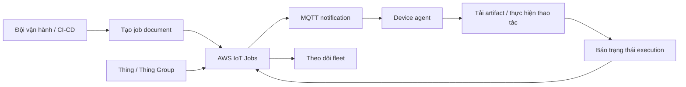
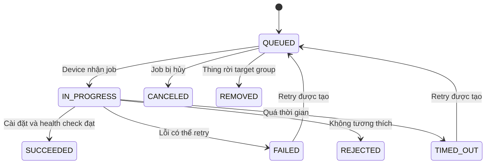
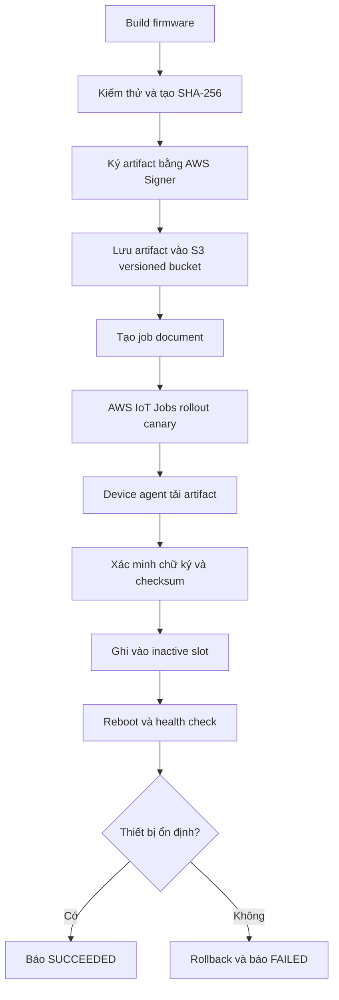

# IoT Jobs và cập nhật thiết bị từ xa

Một hệ thống IoT có thể quản lý từ vài thiết bị thử nghiệm đến hàng trăm nghìn thiết bị ở nhiều địa điểm. Khi cần cập nhật firmware, thay cấu hình, thu thập chẩn đoán hoặc chạy một thao tác bảo trì, việc kết nối thủ công đến từng thiết bị không còn khả thi. AWS IoT Jobs cung cấp cơ chế tạo, phân phối và theo dõi các tác vụ từ xa cho từng AWS IoT Thing hoặc Thing Group.

AWS IoT Jobs quản lý vòng đời triển khai và trạng thái thực thi. Thiết bị vẫn cần có phần mềm agent để nhận job document, tải artifact, kiểm tra tính toàn vẹn, thực hiện thao tác trên hệ điều hành hoặc phần cứng rồi báo kết quả. Với firmware update, bootloader hoặc OTA agent trên thiết bị chịu trách nhiệm ghi firmware, khởi động lại và rollback khi cần.

## Mục tiêu học tập

Sau bài học, bạn có thể:

- Giải thích vai trò của AWS IoT Jobs trong quản lý đội thiết bị từ xa.
- Phân biệt job, job document, target và job execution.
- Chọn snapshot job hoặc continuous job theo vòng đời thiết bị.
- Mô tả vòng đời job execution và các MQTT reserved topics.
- Tạo job bằng AWS Console, AWS CLI hoặc API với rollout, abort, timeout và retry.
- Thiết kế quy trình cập nhật firmware an toàn bằng Amazon S3, presigned URL và Code Signing for AWS IoT.
- Theo dõi tiến độ theo thiết bị, xử lý lỗi và triển khai theo từng đợt.
- Áp dụng nguyên tắc bảo mật, kiểm thử và rollback khi vận hành fleet.

## 1. AWS IoT Jobs giải quyết vấn đề gì?

AWS IoT Jobs định nghĩa một thao tác từ xa, xác định thiết bị cần thực hiện và gửi thông báo để các thiết bị lấy hướng dẫn. Job document chứa dữ liệu mô tả thao tác; target là một Thing hoặc Thing Group; job execution là lần thực thi job trên một thiết bị cụ thể.

Các trường hợp sử dụng phổ biến:

- Cập nhật firmware hoặc phần mềm trên gateway, cảm biến và thiết bị công nghiệp.
- Thay đổi cấu hình, endpoint hoặc tham số vận hành.
- Chạy lệnh bảo trì như xoay vòng chứng chỉ, dọn log hoặc kiểm tra dung lượng.
- Thu thập log, chẩn đoán và báo cáo trạng thái thiết bị.
- Cài đặt một phiên bản package hoặc ứng dụng lên các thiết bị tương thích.



Jobs quản lý việc phân phối và theo dõi. Dịch vụ không tự thực thi lệnh shell, ghi firmware vào flash hay quyết định cách thiết bị khởi động lại. Những hành động đó thuộc trách nhiệm của agent và phần mềm thiết bị.

## 2. Các thành phần cốt lõi

| Thành phần | Ý nghĩa | Ví dụ |
|---|---|---|
| Job | Bản triển khai được quản lý trong AWS IoT Jobs | `firmware-gateway-2-4-1` |
| Job document | JSON mô tả thao tác và tham số cho thiết bị | Tải firmware 2.4.1, kiểm tra SHA-256, cài vào slot dự phòng |
| Target | Thing hoặc Thing Group nhận job | `thing/plant-01-gateway-12` hoặc `thinggroup/gateways-v2` |
| Job execution | Một lần thực hiện job trên một Thing | Thiết bị `plant-01-gateway-12` đang cài firmware |
| Execution number | Số nhận diện một execution của job trên thiết bị | Dùng khi cập nhật hoặc truy vấn đúng lần thực thi |
| Status details | Các cặp key-value mô tả tiến độ hoặc lỗi | `phase=download`, `bytesDownloaded=1048576` |

Một job có thể nhắm đến nhiều thiết bị. Mỗi thiết bị có job execution riêng và tự báo tiến độ. Nhờ vậy, đội vận hành có thể biết thiết bị nào chưa nhận job, thiết bị nào đang tải artifact và thiết bị nào đã cài đặt thành công.

Job document có thể nằm trực tiếp trong yêu cầu tạo job hoặc được lưu trong Amazon S3. Nội dung document là hợp đồng giữa backend và device agent: AWS IoT Jobs chuyển tiếp document, còn agent phải hiểu các trường và thực hiện đúng giao thức mà nhóm phát triển quy định.

## 3. Snapshot job và continuous job

AWS IoT Jobs có hai kiểu target selection.

| Kiểu | Hành vi | Khi phù hợp |
|---|---|---|
| `SNAPSHOT` | Job áp dụng cho tập target tại thời điểm triển khai; hoàn tất khi các execution đã đạt trạng thái kết thúc | Một đợt cập nhật cố định, ví dụ triển khai firmware cho 500 gateway hiện có |
| `CONTINUOUS` | Job tiếp tục áp dụng cho thiết bị mới được thêm vào Thing Group mục tiêu | Duy trì một phiên bản chuẩn cho fleet, onboarding thiết bị mới hoặc nhóm động |

Ví dụ, doanh nghiệp triển khai firmware 2.4.1 cho nhóm gateway hiện tại. Nếu chỉ cần cập nhật một lần cho tập thiết bị đã chọn, dùng snapshot job. Nếu mọi gateway mới gia nhập nhóm cũng phải nhận phiên bản 2.4.1, dùng continuous job.

Với dynamic thing group, AWS khuyến nghị dùng continuous job. Dynamic group xác định membership bằng truy vấn trên registry, connectivity hoặc shadow; ví dụ chỉ chọn thiết bị có `model=GW-200` và `batteryLevel` lớn hơn 80%. Khi thiết bị thỏa điều kiện và gia nhập group, continuous job có thể tạo execution cho thiết bị đó.

Dynamic thing group yêu cầu bật Fleet Indexing. Nhóm động không có membership được khai báo thủ công, không thể nằm trong hierarchy và không thể gắn policy trực tiếp như static thing group. Hãy xem điều kiện membership là một phần của kế hoạch triển khai: nếu query group sai, phạm vi thiết bị nhận job cũng sai.

## 4. Job document: hợp đồng giữa cloud và thiết bị

Job document thường là JSON. Cấu trúc trường do ứng dụng định nghĩa, trừ những placeholder đặc biệt mà AWS IoT Jobs xử lý như S3 presigned URL. Một document cập nhật firmware có thể chứa operation, version, URL artifact, checksum và hướng dẫn cài đặt.

Ví dụ job document:

```json
{
  "operation": "installFirmware",
  "firmwareVersion": "2.4.1",
  "artifact": {
    "url": "${aws:iot:s3-presigned-url-v2:https://s3.ap-southeast-1.amazonaws.com/company-firmware/gateway/fw-2.4.1.bin}",
    "sha256": "0123456789abcdef0123456789abcdef0123456789abcdef0123456789abcdef",
    "sizeBytes": 16777216
  },
  "install": {
    "targetSlot": "inactive",
    "rebootAfterInstall": true
  }
}
```

Đây là schema ví dụ do ứng dụng thiết kế, không phải schema firmware bắt buộc của AWS IoT Jobs. Chuỗi SHA-256 trong ví dụ chỉ minh họa định dạng; giá trị thực phải được pipeline build tạo từ đúng artifact sẽ phát hành. Device agent cần biết cách đọc `operation`, tải `artifact.url`, xác minh checksum, ghi firmware vào `targetSlot` và xử lý `rebootAfterInstall`.

Một job document tốt nên:

- Có `operation` hoặc loại tác vụ rõ ràng để agent định tuyến.
- Có version hoặc revision để tránh cài nhầm phiên bản.
- Tham chiếu artifact bất biến, tốt nhất gắn với S3 object version.
- Có checksum hoặc chữ ký để xác minh artifact.
- Có tham số timeout, chế độ cài đặt hoặc yêu cầu reboot khi cần.
- Có thể chạy lại an toàn hoặc phát hiện trạng thái đã hoàn thành để tránh thao tác lặp nguy hiểm.
- Không chứa secret dài hạn, mật khẩu hay private key.

Nếu job document lớn hơn giới hạn payload MQTT (32 KB), lưu document trong S3 rồi dùng `documentSource` khi tạo job. AWS IoT Jobs lấy nội dung S3 tại thời điểm tạo job; sửa file nguồn sau đó không làm thay đổi document đã gắn với job hiện có.

## 5. Vòng đời job và job execution

### 5.1 Trạng thái của job

Job-level status mô tả trạng thái của toàn bộ deployment:

| Trạng thái | Ý nghĩa |
|---|---|
| `SCHEDULED` | Job đã được tạo với lịch chạy trong tương lai hoặc maintenance window |
| `IN_PROGRESS` | Job đang phân phối execution hoặc chờ các thiết bị hoàn tất |
| `COMPLETED` | Job snapshot đã kết thúc các execution; continuous job có lịch kết thúc cũng có thể hoàn tất |
| `CANCELED` | Job đã bị hủy hoặc abort configuration kích hoạt |
| `DELETION_IN_PROGRESS` | AWS IoT Jobs đang xóa job và các execution liên quan |

Continuous job không có cấu hình lịch kết thúc có thể ở trạng thái `IN_PROGRESS` lâu dài để tiếp tục áp dụng cho thành viên mới của group.

### 5.2 Trạng thái của từng job execution

| Trạng thái | Ai khởi tạo | Ý nghĩa |
|---|---|---|
| `QUEUED` | AWS IoT Jobs | Execution đã được tạo và chờ thiết bị nhận/xử lý |
| `IN_PROGRESS` | Thiết bị | Device agent đã nhận job và bắt đầu thao tác |
| `SUCCEEDED` | Thiết bị | Thao tác hoàn tất thành công |
| `FAILED` | Thiết bị | Thao tác thất bại; có thể được retry nếu cấu hình cho phép |
| `TIMED_OUT` | AWS IoT Jobs | Execution vượt quá thời gian cho phép |
| `REJECTED` | Thiết bị | Thiết bị không chấp nhận job, ví dụ không tương thích phần cứng |
| `REMOVED` | AWS IoT Jobs | Thiết bị bị loại khỏi target group trước khi thực thi |
| `CANCELED` | AWS IoT Jobs | Execution bị hủy theo yêu cầu hoặc cấu hình abort/cancel |

Các trạng thái `SUCCEEDED`, `FAILED`, `TIMED_OUT`, `REJECTED`, `REMOVED` và `CANCELED` là trạng thái kết thúc. Device agent không thể chuyển một execution đã kết thúc trở lại `IN_PROGRESS`; nếu cần thử lại, hãy dùng retry configuration hoặc tạo job/execution mới theo quy trình.

### 5.3 Luồng xử lý trên thiết bị



AWS IoT Jobs có thể tạo nhiều execution cho nhiều job cùng một Thing. MQTT không bảo đảm thứ tự phân phối của nhiều job; agent phải xử lý thứ tự, tính tương thích và xung đột thao tác. API `StartNextPendingJobExecution` ưu tiên execution đang `IN_PROGRESS` trước execution `QUEUED`, giúp thiết bị tiếp tục công việc dở dang sau khi mất kết nối.

## 6. MQTT reserved topics và giao tiếp với thiết bị

Device agent thường dùng MQTT Jobs API qua các reserved topics. Trong topic, `thingName` là tên Thing đã đăng ký; `jobId` là ID của job. Thiết bị cũng có thể dùng HTTP Signature Version 4 trên cổng 443 với IAM credentials, hoặc HTTP TLS trên cổng 8443 với X.509 certificate nếu client hỗ trợ giao thức này.

| Topic | Hướng | Mục đích |
|---|---|---|
| `$aws/things/{thingName}/jobs/notify` | Subscribe | Nhận thông báo danh sách job execution được thêm hoặc loại bỏ khỏi hàng đợi |
| `$aws/things/{thingName}/jobs/notify-next` | Subscribe | Nhận thông báo khi execution tiếp theo thay đổi |
| `$aws/things/{thingName}/jobs/get` | Publish | Yêu cầu danh sách execution đang chờ |
| `$aws/things/{thingName}/jobs/start-next` | Publish | Lấy và bắt đầu execution tiếp theo |
| `$aws/things/{thingName}/jobs/{jobId}/get` | Publish | Lấy chi tiết execution của một job |
| `$aws/things/{thingName}/jobs/{jobId}/update` | Publish | Cập nhật trạng thái và tiến độ execution |

Các lệnh MQTT có response topics như `/accepted` và `/rejected`. AWS IoT gửi response trực tiếp cho client đã phát lệnh; response này không đi qua message broker và không thể được client khác hoặc IoT Rule subscribe. Client vẫn phải lắng nghe và xử lý response tương ứng. Để hệ thống giám sát bên ngoài nhận event qua broker, cần bật job/job execution events và sử dụng các event topics thích hợp.

### 6.1 Bắt đầu execution

Khi nhận `notify` hoặc `notify-next`, agent có thể publish tới:

```text
$aws/things/gateway-001/jobs/start-next
```

Payload có thể chứa `clientToken` để ghép request với response:

```json
{
  "clientToken": "gateway-001-start-0007",
  "statusDetails": {
    "agentVersion": "1.8.0"
  }
}
```

Nếu có execution đang chờ, response chứa job ID, job document và trạng thái `IN_PROGRESS`. Nếu không có execution phù hợp, response không có trường `execution`. Agent cần xử lý cả hai trường hợp.

### 6.2 Báo tiến độ

Trong khi tải và cài firmware, agent publish tới:

```text
$aws/things/gateway-001/jobs/firmware-gateway-2-4-1/update
```

Ví dụ báo tiến độ tải:

```json
{
  "status": "IN_PROGRESS",
  "statusDetails": {
    "phase": "download",
    "bytesDownloaded": "8388608",
    "totalBytes": "16777216"
  },
  "clientToken": "gateway-001-progress-0042"
}
```

Khi đã cài, reboot và xác nhận thiết bị hoạt động ổn định, agent báo:

```json
{
  "status": "SUCCEEDED",
  "statusDetails": {
    "installedVersion": "2.4.1",
    "healthCheck": "passed"
  },
  "clientToken": "gateway-001-complete-0001"
}
```

Các trường trong `statusDetails` là metadata do ứng dụng tự quy định. AWS IoT Jobs không diễn giải chúng thành tiến độ phần trăm; hệ thống giám sát có thể đọc các giá trị này để hiển thị hoặc phân tích.

### 6.3 Version và cập nhật đồng thời

Mỗi lần cập nhật execution, version của execution tăng lên. Có thể gửi `expectedVersion` để ngăn cập nhật ghi đè khi trạng thái đã thay đổi ở nơi khác. Nếu version hiện tại không khớp, request bị từ chối với lỗi `VersionMismatch`; agent nên đọc trạng thái mới nhất rồi quyết định cập nhật lại.

Thing certificate và IoT policy phải giới hạn quyền publish/subscribe theo đúng Thing name và Jobs topic cần thiết. Không cấp wildcard rộng cho mọi Thing nếu mỗi chứng chỉ chỉ đại diện một thiết bị.

## 7. Rollout: triển khai theo từng đợt

Không nên gửi firmware mới cho toàn bộ fleet cùng một lúc. Rollout configuration kiểm soát tốc độ thiết bị nhận notification và job document.

### 7.1 Constant rollout rate

Constant rollout đặt số lượng thiết bị tối đa được thông báo mỗi phút bằng `maximumPerMinute`. Ví dụ, đặt 20 nghĩa là job được phân phối với tốc độ tối đa 20 Thing mỗi phút. Cách này dễ dự đoán tải lên mạng, tải xuống S3 và lượng thiết bị cùng reboot.

### 7.2 Exponential rollout rate

Exponential rollout bắt đầu ở `baseRatePerMinute` rồi tăng theo `incrementFactor` khi đạt tiêu chí như số Thing đã được thông báo hoặc số execution thành công. Có thể đặt `maximumPerMinute` để giới hạn tốc độ tối đa.

Ví dụ: bắt đầu 10 thiết bị/phút, tăng hệ số 2 sau mỗi 100 execution thành công và giới hạn tối đa 200 thiết bị/phút. Cách này cho phép triển khai chậm ở giai đoạn đầu rồi tăng tốc khi các thiết bị canary hoạt động ổn định.

### 7.3 Abort configuration

Abort configuration tự hủy job khi tỷ lệ lỗi vượt ngưỡng sau khi có đủ số execution được thực hiện. Failure type có thể là `FAILED`, `REJECTED`, `TIMED_OUT` hoặc `ALL`.

Ví dụ, sau khi ít nhất 20 thiết bị đã nhận execution, nếu 10% thiết bị báo `FAILED`, AWS IoT Jobs có thể hủy job để ngăn rollout tiếp tục. Cần chọn cả `minNumberOfExecutedThings` và `thresholdPercentage`; nếu chỉ dùng phần trăm với mẫu quá nhỏ, một lỗi đơn lẻ có thể làm dừng rollout quá sớm.

Abort configuration không thay thế monitoring. Hãy theo dõi log thiết bị, mã lỗi, nhóm model và phiên bản phần cứng để tìm nguyên nhân trước khi khởi tạo lại job.

## 8. Timeout, step timer và retry

### 8.1 In-progress timeout

`inProgressTimeoutInMinutes` là giới hạn thời gian chung cho mỗi execution, bắt đầu khi thiết bị chuyển trạng thái sang `IN_PROGRESS`. Giá trị hợp lệ từ 1 phút đến 7 ngày. Nếu thiết bị không đưa execution sang trạng thái kết thúc trước khi hết thời gian, AWS IoT Jobs chuyển trạng thái thành `TIMED_OUT`.

Đặt timeout dựa trên tổng thời gian tải artifact, xác minh, cài đặt, reboot và health check. Nếu firmware lớn hoặc thiết bị dùng mạng di động chậm, timeout quá ngắn sẽ tạo nhiều execution timeout dù bản thân firmware không có lỗi.

### 8.2 Step timer

Step timer là timer riêng cho một execution, có thể được đặt hoặc làm mới khi gọi `StartNextPendingJobExecution` hoặc `UpdateJobExecution`. Giá trị hợp lệ từ 1 đến 10.080 phút; giá trị `-1` có thể hủy step timer hiện tại. Step timer không kéo dài giới hạn tuyệt đối của in-progress timer được cấu hình ở cấp job.

Ví dụ, tổng execution có timeout 120 phút. Agent có thể đặt step timer 30 phút cho giai đoạn tải, sau đó cập nhật timer 45 phút cho giai đoạn cài đặt. Dù vậy, toàn bộ execution vẫn phải kết thúc trong giới hạn 120 phút.

### 8.3 Retry configuration

Retry configuration cho phép AWS IoT Jobs tạo lần thực thi lại khi thiết bị báo `FAILED` hoặc execution chuyển sang `TIMED_OUT`. Có thể cấu hình số lần retry theo từng failure type. Tài liệu AWS cho phép tối đa 10 lần retry cho một execution; cần đặt giới hạn dựa trên nguyên nhân lỗi và chi phí.

Không phải mọi lỗi đều nên retry:

- Lỗi mạng tạm thời hoặc tải artifact gián đoạn có thể retry.
- Thiết bị không tương thích phần cứng nên báo `REJECTED`, không retry.
- Firmware không vượt qua xác minh chữ ký hoặc checksum nên dừng và báo `FAILED`; cần điều tra artifact hoặc pipeline phát hành.
- Lỗi flash có thể retry nếu agent/bootloader xác nhận thiết bị vẫn ở trạng thái an toàn.

Mỗi lần retry có thể phát sinh thêm chi phí. Kết hợp retry với abort configuration để dừng triển khai khi nhiều thiết bị cùng lỗi. Số lần retry được xác định khi tạo job; không nên xem đây là tham số có thể tùy ý thay đổi giữa chừng.

## 9. Lập lịch và maintenance window

Scheduling configuration cho phép chọn thời điểm bắt đầu, thời điểm kết thúc và cách xử lý execution chưa hoàn tất khi hết lịch. Có thể dùng recurring maintenance window để thiết bị chỉ nhận job trong khung giờ bảo trì.

Các end behavior chính:

| Giá trị | Hành vi khi đến end time |
|---|---|
| `STOP_ROLLOUT` | Dừng phân phối cho thiết bị còn lại; execution `QUEUED` và `IN_PROGRESS` tiếp tục đến khi kết thúc |
| `CANCEL` | Dừng rollout và hủy execution đang `QUEUED`; execution `IN_PROGRESS` tiếp tục |
| `FORCE_CANCEL` | Dừng rollout và hủy cả execution `QUEUED` lẫn `IN_PROGRESS` |

Lịch bắt đầu có thể được đặt trước tối đa một năm; end time tối đa hai năm theo giới hạn hiện hành của API. Thời gian được chuẩn hóa theo UTC trong hệ thống. Khi thiết kế maintenance window, chú ý múi giờ, daylight saving time và thời gian thiết bị thực sự có thể mất kết nối.

Với cập nhật firmware cho thiết bị công nghiệp, có thể chọn cửa sổ bảo trì ban đêm, dừng rollout khi hết cửa sổ và để thiết bị đang cài hoàn tất. Chỉ dùng `FORCE_CANCEL` khi đã đánh giá rõ tác động của việc ngắt một thao tác đang chạy.

## 10. Tạo job bằng AWS CLI

Quy trình cơ bản:

1. Build firmware và lưu artifact trong S3.
2. Tạo job document tham chiếu artifact và checksum.
3. Chuẩn bị IAM role cho AWS IoT Jobs tạo presigned URL.
4. Tạo job với target, rollout, timeout, abort và retry phù hợp.
5. Theo dõi execution theo từng Thing.

Ví dụ tạo job snapshot cho nhóm gateway:

```bash
aws iot create-job \
  --job-id "gateway-fw-2-4-1-20261120" \
  --targets "arn:aws:iot:ap-southeast-1:111122223333:thinggroup/production-gateways" \
  --document file://firmware-job.json \
  --description "Deploy gateway firmware 2.4.1" \
  --target-selection SNAPSHOT \
  --presigned-url-config '{"roleArn":"arn:aws:iam::111122223333:role/IoTJobsS3DownloadRole","expiresInSec":3600}' \
  --job-executions-rollout-config '{"maximumPerMinute":20}' \
  --timeout-config '{"inProgressTimeoutInMinutes":120}' \
  --abort-config '{"criteriaList":[{"failureType":"FAILED","action":"CANCEL","thresholdPercentage":10,"minNumberOfExecutedThings":20}]}' \
  --job-executions-retry-config '{"criteriaList":[{"failureType":"FAILED","numberOfRetries":2},{"failureType":"TIMED_OUT","numberOfRetries":2}]}'
```

Account ID, Thing Group ARN, role ARN, job ID và artifact trong ví dụ là giá trị minh họa. Role phải cho phép `iot.amazonaws.com` assume role và chỉ cấp `s3:GetObject` trên bucket/prefix artifact cần tải. Trust policy nên giới hạn `aws:SourceAccount` và `aws:SourceArn` để giảm rủi ro confused deputy.

Nếu cần cập nhật thiết bị mới gia nhập group sau khi tạo job, đổi `--target-selection SNAPSHOT` thành `CONTINUOUS`. Với dynamic thing group, nên dùng continuous job.

### 10.1 Theo dõi job

Xem thông tin job:

```bash
aws iot describe-job \
  --job-id "gateway-fw-2-4-1-20261120"
```

Liệt kê execution của job:

```bash
aws iot list-job-executions-for-job \
  --job-id "gateway-fw-2-4-1-20261120"
```

Xem execution của một thiết bị:

```bash
aws iot describe-job-execution \
  --job-id "gateway-fw-2-4-1-20261120" \
  --thing-name "gateway-001"
```

Các lệnh này giúp phân biệt lỗi ở cấp job với lỗi riêng của thiết bị. Khi job còn `IN_PROGRESS`, hãy xem `isConcurrent` và tiến độ rollout; job có thể vẫn `IN_PROGRESS` dù đã phân phối hết execution và đang chờ thiết bị hoàn tất.

## 11. OTA firmware update an toàn

OTA (Over-The-Air) là cập nhật phần mềm hoặc firmware qua mạng. Một quy trình OTA tốt phải bảo đảm artifact đúng nguồn, không bị thay đổi, tương thích phần cứng và có thể phục hồi khi mất điện hoặc mất kết nối.

### 11.1 Luồng cập nhật đề xuất



Một thiết bị có A/B partition có thể tải firmware mới vào inactive slot, xác minh rồi yêu cầu bootloader chuyển sang slot mới. Nếu health check sau reboot thất bại, bootloader có thể quay về slot cũ. Cách này giảm nguy cơ thiết bị không thể khởi động do bản cập nhật bị lỗi.

### 11.2 S3 presigned URL

Job document có thể chứa placeholder cho S3 presigned URL:

```text
${aws:iot:s3-presigned-url-v2:https://s3.ap-southeast-1.amazonaws.com/company-firmware/gateway/fw-2.4.1.bin}
```

Khi thiết bị yêu cầu job document, AWS IoT Jobs thay placeholder bằng presigned URL có thời hạn. URL không được tạo cố định tại thời điểm soạn job document. Thời hạn có thể cấu hình từ 60 đến 3.600 giây; mặc định là 3.600 giây.

Khi dùng presigned URL, `presignedUrlConfig` cần IAM role cho phép AWS IoT tải object từ S3 và trust policy cho phép dịch vụ IoT assume role. Hạn chế role theo bucket/prefix và thêm `aws:SourceAccount`, `aws:SourceArn` trong trust policy. Không cấp quyền đọc toàn bộ S3 account nếu job chỉ cần một thư mục artifact.

Với artifact quan trọng, bật S3 Versioning và tham chiếu đúng object version. Khi upload firmware mới, S3 tạo version ID; job có thể gắn với đúng phiên bản artifact để việc triển khai có thể kiểm toán và tái lập.

### 11.3 Code signing và kiểm tra trên thiết bị

AWS khuyến nghị ký code trước khi gửi đến thiết bị để thiết bị phát hiện artifact bị sửa đổi. Với Code Signing for AWS IoT, bạn chuẩn bị chứng chỉ ký code và import vào AWS Certificate Manager (ACM), sau đó tạo signing job bằng AWS Signer. Chứng chỉ dùng cho code signing cần có `Digital Signature` trong Key Usage và `Code Signing` trong Extended Key Usage. Job document phải được lưu trong S3 bucket có bật Versioning khi dùng quy trình ký này.

AWS IoT Jobs hỗ trợ placeholder chữ ký dạng:

```text
${aws:iot:code-sign-signature:s3://region.bucket/code-file@code-file-version-id}
```

Pipeline lấy output của signing job và đưa chữ ký vào job document cùng presigned URL của artifact. Khi thiết bị nhận document, agent đọc phần `codesign`, xác minh chữ ký bằng trust anchor đã provision trên thiết bị rồi mới cài firmware. Hãy tham khảo đúng workflow Code Signing for AWS IoT; quy trình ký cho Lambda hoặc container image không thể thay thế trực tiếp quy trình ký firmware IoT.

Thiết bị cần xác minh chữ ký bằng trust anchor/public key đã được bảo vệ trong firmware hoặc bootloader. Ngoài chữ ký, checksum SHA-256 giúp phát hiện file tải thiếu hoặc lỗi bit. TLS bảo vệ kết nối khi truyền dữ liệu; chữ ký xác minh nguồn gốc và tính toàn vẹn artifact độc lập với đường truyền.

Không báo `SUCCEEDED` ngay khi tải xong. Chỉ báo thành công sau khi:

1. Tải đủ artifact và kiểm tra kích thước.
2. Xác minh checksum và chữ ký.
3. Cài đặt vào vị trí an toàn.
4. Reboot hoặc kích hoạt phiên bản mới.
5. Health check xác nhận thiết bị và các chức năng quan trọng hoạt động.

Nếu thiết bị không tương thích với phiên bản firmware, hãy báo `REJECTED` cùng lý do. Nếu tải hoặc cài đặt thất bại vì lỗi có thể phục hồi, báo `FAILED` để retry policy xử lý.

## 12. Bảo mật và quyền truy cập

AWS IoT Jobs có hai mặt quyền cần thiết kế riêng: quyền control plane của người tạo job và quyền data plane của thiết bị.

### 12.1 Quyền của người tạo job

IAM principal hoặc CI/CD role cần quyền AWS IoT phù hợp như `iot:CreateJob`, `iot:DescribeJob`, `iot:ListJobExecutionsForJob`, `iot:DescribeJobExecution`, `iot:CancelJob` và các thao tác quản trị khác theo quy trình. Nếu job dùng presigned URL, cần cấu hình role S3 download mà dịch vụ IoT có thể assume.

### 12.2 Quyền của thiết bị

Thiết bị kết nối AWS IoT Core bằng X.509 certificate và IoT policy. Policy cần cho phép đúng các hành động MQTT cần thiết:

- `iot:Connect` cho client ID gắn với Thing.
- `iot:Subscribe` trên response và notification topics cần dùng.
- `iot:Receive` trên response và notification topics.
- `iot:Publish` trên `jobs/get`, `jobs/start-next` và `jobs/{jobId}/update`.

Nên dùng policy variable hoặc resource ARN giới hạn theo Thing name, tránh để chứng chỉ của một thiết bị truy cập topic của thiết bị khác. Khi thiết bị bị thu hồi hoặc thanh lý, vô hiệu hóa certificate và loại khỏi target group theo quy trình fleet lifecycle.

### 12.3 Bảo vệ artifact và job document

- Dùng bucket riêng hoặc prefix riêng cho firmware release.
- Bật S3 Versioning để cố định artifact version.
- Dùng SSE-S3 hoặc SSE-KMS theo yêu cầu; cấp quyền KMS tối thiểu nếu dùng customer managed key.
- Ký firmware và xác minh chữ ký ở thiết bị.
- Không đặt secret dài hạn trong job document; presigned URL là credential tạm thời.
- Ghi nhận ai tạo job, target group, firmware version, checksum và kết quả rollout.
- Tách quyền tạo job production khỏi quyền build artifact thông thường.

## 13. Theo dõi fleet và xử lý sự cố

Một job thành công ở cấp dịch vụ không có nghĩa mọi thiết bị đã cài đặt thành công. Hãy theo dõi execution status và status details theo từng Thing.

| Triệu chứng | Nguyên nhân có thể | Hướng xử lý |
|---|---|---|
| Execution ở `QUEUED` lâu | Thiết bị offline, chưa subscribe notification hoặc không gọi start-next | Kiểm tra kết nối MQTT, topic permission và agent loop |
| Execution ở `IN_PROGRESS` lâu | Agent bị treo, thao tác tải/cài không có timeout hoặc mất kết nối | Xem device log, step timer và in-progress timeout |
| `REJECTED` tăng | Firmware không tương thích model/hardware hoặc agent từ chối job | Kiểm tra target group, device attributes và điều kiện tương thích |
| `FAILED` khi tải artifact | Presigned URL hết hạn, S3 permission, network hoặc checksum sai | Kiểm tra URL lifetime, role trust, bucket policy và log download |
| `TIMED_OUT` tăng | Timeout ngắn, tốc độ mạng thấp hoặc thao tác cài lâu | Đo thời gian thực tế rồi điều chỉnh timeout/step timer |
| `VersionMismatch` | Nhiều thành phần cùng cập nhật execution | Đọc execution mới nhất, kiểm tra `expectedVersion`, cập nhật lại có kiểm soát |
| Tạo job bị `LimitExceededException` | Đạt giới hạn concurrent jobs hoặc quota liên quan | Kiểm tra job `isConcurrent`, chờ rollout/cancel hoàn tất hoặc yêu cầu tăng quota |
| Job document không tải được | URL hoặc object S3 không hợp lệ, document vượt payload MQTT | Kiểm tra S3 URL, dùng `documentSource` cho document lớn hơn 32 KB |

Để điều tra theo thứ tự:

1. Xem `describe-job` để kiểm tra trạng thái job, rollout và abort configuration.
2. Liệt kê execution và nhóm theo `QUEUED`, `IN_PROGRESS`, `FAILED`, `REJECTED` hoặc `TIMED_OUT`.
3. Chọn một thiết bị lỗi đại diện và xem `describe-job-execution` cùng status details.
4. Đối chiếu log của device agent với thời điểm nhận notification, tải file, xác minh, cài đặt và reboot.
5. Kiểm tra IoT policy, S3 permission, presigned URL, KMS và network.
6. Chỉ retry hoặc tạo job mới sau khi đã hiểu nguyên nhân và xác nhận artifact/thiết bị an toàn.

## 14. Quota và giới hạn cần lập kế hoạch

Một số giới hạn quan trọng theo tài liệu AWS hiện hành:

| Giới hạn | Giá trị tham khảo | Ý nghĩa vận hành |
|---|---:|---|
| Inline job document | 32 KB | Document lớn hơn nên lưu S3 và dùng `documentSource` |
| Presigned URL expiration | 60–3.600 giây | URL cần đủ thời gian cho thiết bị tải artifact |
| In-progress timeout | 1 phút–7 ngày | Chọn theo thời gian thực thi dự kiến |
| Step timer | 1–10.080 phút | Đặt giới hạn riêng cho từng bước |
| Concurrent jobs | Mặc định 500 mỗi Region/account | Có thể yêu cầu tăng quota; job rollout đang concurrent tính vào giới hạn |
| Pending executions trong notification | Tối đa 15 | Thiết bị cần xử lý notification và hàng đợi theo API |

Quota có thể thay đổi theo Region, loại job và cấu hình scheduling. Hãy kiểm tra AWS Service Quotas trước khi triển khai fleet lớn. Với số lượng job lớn, tránh tạo/cancel hàng loạt cùng lúc nếu chưa tính đến concurrent job limit.

## 15. Case study: cập nhật firmware cho gateway công nghiệp

Một nhà máy có 2.000 gateway ở nhiều khu vực. Firmware 2.4.1 sửa lỗi kết nối và cải thiện độ ổn định. Một số gateway có phần cứng revision cũ nên không thể nhận bản firmware mới.

### Bước 1: Phân loại thiết bị

Thing Registry và Thing Shadow lưu thuộc tính như `model`, `hardwareRevision`, `firmwareVersion`, `site` và `batteryLevel`. Tạo Thing Group phù hợp theo model/revision. Với dynamic group, dùng query để chọn đúng thiết bị tương thích.

### Bước 2: Chuẩn bị artifact

Build pipeline tạo firmware, kiểm thử, tạo SHA-256, ký bằng Code Signing for AWS IoT và upload artifact vào S3 versioned bucket. Ghi lại version ID, checksum, code signing profile và build ID.

### Bước 3: Canary rollout

Tạo snapshot job cho 20 gateway ở phòng lab/canary. Đặt rollout rate thấp, timeout đủ dài và abort threshold. Theo dõi lỗi boot, mất kết nối, nhiệt độ và các chỉ số nghiệp vụ trong khoảng thời gian xác nhận.

### Bước 4: Mở rộng rollout

Nếu canary thành công, tạo job cho nhóm pilot 10% fleet rồi mở rộng các nhóm còn lại. Nếu tỷ lệ lỗi vượt ngưỡng, abort job, dừng đợt tiếp theo và phân tích nguyên nhân trước khi phát hành lại.

### Bước 5: Xác nhận và rollback

Thiết bị ghi firmware vào inactive slot, reboot và chạy health check. Nếu health check đạt, agent báo `SUCCEEDED` và cập nhật reported firmware version trong Device Shadow. Nếu không đạt, bootloader rollback về slot cũ và agent báo `FAILED` cùng mã lỗi. Đội vận hành dùng kết quả execution để quyết định tiếp tục, dừng hoặc tạo job rollback.

## 16. Nguyên tắc thiết kế production

- Chọn snapshot cho đợt triển khai cố định; chọn continuous cho thiết bị mới gia nhập group.
- Tạo Thing Group theo model, hardware revision, region hoặc điều kiện vận hành.
- Thử trên lab và canary trước khi tăng rollout rate.
- Cấu hình abort threshold, timeout và retry trước khi tạo job production.
- Dùng S3 Versioning, checksum và code signing cho firmware quan trọng.
- Thiết kế device agent có khả năng resume, idempotency và phục hồi sau mất điện/mất mạng.
- Dùng A/B partition hoặc recovery mechanism để thiết bị không bị brick khi update thất bại.
- Báo `SUCCEEDED` sau health check, không chỉ sau download.
- Giới hạn IoT policy theo Thing và Jobs topic cần thiết.
- Theo dõi cả job-level status và từng job execution.
- Ghi nhận firmware version thực tế trong registry/shadow sau khi cập nhật.
- Kiểm tra quota và chi phí trước các đợt rollout quy mô lớn.

## 17. Những nhầm lẫn thường gặp

| Nhầm lẫn | Cách hiểu đúng |
|---|---|
| Tạo job đồng nghĩa thiết bị đã cập nhật | Tạo job chỉ khởi tạo deployment; thiết bị còn phải nhận, thực thi và báo kết quả |
| Job document là lệnh shell mà AWS chạy trên thiết bị | Document là JSON; device agent tự diễn giải và thực hiện thao tác |
| Snapshot và continuous giống nhau | Snapshot nhắm tập target hiện tại; continuous tiếp tục áp dụng cho thiết bị mới trong group |
| `IN_PROGRESS` ở cấp job nghĩa là mọi thiết bị đang chạy | Job có thể đã rollout xong nhưng vẫn chờ execution của thiết bị kết thúc |
| Presigned URL là URL cố định trong job document | Placeholder được thay bằng URL có thời hạn khi thiết bị yêu cầu document |
| Retry xử lý mọi loại lỗi | `REJECTED` không retry; lỗi không tương thích cần sửa target hoặc firmware |
| TLS đủ để bảo vệ firmware | TLS bảo vệ đường truyền; code signing và checksum xác minh artifact |
| Báo `SUCCEEDED` ngay khi tải xong | Cần xác minh, cài đặt, reboot và health check thành công |
| Cancel job luôn dừng ngay mọi thiết bị | Execution đang chạy có thể tiếp tục tùy cách cancel/end behavior; `FORCE_CANCEL` có hành vi khác |
| Device Shadow thay thế Jobs | Shadow đồng bộ trạng thái mong muốn/đã báo; Jobs quản lý thao tác từ xa và tiến độ execution |

## Tài liệu tham khảo

- [What is AWS IoT Jobs?](https://docs.aws.amazon.com/iot/latest/developerguide/jobs-what-is.html)
- [Jobs key concepts](https://docs.aws.amazon.com/iot/latest/developerguide/key-concepts-jobs.html)
- [Jobs and job execution states](https://docs.aws.amazon.com/iot/latest/developerguide/iot-jobs-lifecycle.html)
- [Managing jobs](https://docs.aws.amazon.com/iot/latest/developerguide/create-manage-jobs.html)
- [How job configurations work](https://docs.aws.amazon.com/iot/latest/developerguide/jobs-configurations-details.html)
- [Jobs device MQTT API operations](https://docs.aws.amazon.com/iot/latest/developerguide/jobs-mqtt-api.html)
- [Devices and jobs](https://docs.aws.amazon.com/iot/latest/developerguide/jobs-devices.html)
- [Reserved topics used for Jobs](https://docs.aws.amazon.com/iot/latest/developerguide/reserved-topics.html)
- [Jobs events](https://docs.aws.amazon.com/iot/latest/developerguide/events-jobs.html)
- [Create and manage jobs by using the AWS CLI](https://docs.aws.amazon.com/iot/latest/developerguide/manage-job-cli.html)
- [AWS CLI create-job command reference](https://docs.aws.amazon.com/cli/latest/reference/iot/create-job.html)
- [Dynamic thing groups](https://docs.aws.amazon.com/iot/latest/developerguide/dynamic-thing-groups.html)
- [AWS IoT Jobs limits](https://docs.aws.amazon.com/iot/latest/developerguide/job-limits.html)
- [AWS IoT Device Management endpoints and quotas](https://docs.aws.amazon.com/general/latest/gr/iot_device_management.html)
- [Code signing for AWS IoT](https://docs.aws.amazon.com/signer/latest/developerguide/Welcome.html)
- [Sign Internet of Things (IoT) objects with AWS Signer](https://docs.aws.amazon.com/signer/latest/developerguide/iot-workflow.html)
- [OTA security and Code Signing for AWS IoT](https://docs.aws.amazon.com/freertos/latest/userguide/dev-guide-ota-security.html)
