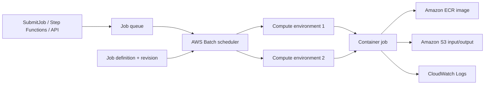

# AWS Batch compute environment, job queue và job definition

Một hệ thống xử lý dữ liệu thường có nhiều công việc chạy theo lô: chuyển mã video, tổng hợp báo cáo, xử lý ảnh, mô phỏng Monte Carlo, phân tích dữ liệu khoa học hoặc huấn luyện mô hình. Các job này không nhất thiết cần máy chủ chạy liên tục. Có job chỉ chạy vài phút, có job cần hàng giờ; có job cần GPU hoặc nhiều node giao tiếp với nhau. Nếu tự quản lý hàng trăm EC2 instances, đội ngũ phải xây dựng scheduler, theo dõi trạng thái, phân phối capacity, retry và xử lý máy chủ lỗi.

AWS Batch là dịch vụ lập lịch và điều phối batch jobs. Người dùng đóng gói chương trình thành container, khai báo tài nguyên và cách chạy trong job definition, gửi job vào job queue, rồi AWS Batch chọn compute environment phù hợp để chạy. Compute environment xác định loại hạ tầng và giới hạn capacity; job queue quyết định thứ tự và nơi job được đặt; job definition mô tả container, lệnh, CPU, memory, IAM roles, retry và timeout.

Trong hệ sinh thái AWS, AWS Batch kết hợp Amazon EC2, EC2 Spot, AWS Fargate, Amazon ECS Managed Instances, Amazon EKS, Amazon ECR, IAM, Amazon CloudWatch Logs, Amazon S3, EFS, FSx và Step Functions. Thiết kế đúng ba thành phần compute environment, job queue và job definition giúp tách yêu cầu ứng dụng khỏi hạ tầng, tối ưu chi phí và mở rộng xử lý từ vài job đến hàng nghìn job song song.

## Mục tiêu học tập

Sau bài học, bạn có thể:

- Giải thích vai trò của compute environment, job queue, job definition và job trong AWS Batch.
- Chọn managed hoặc unmanaged compute environment theo mức độ kiểm soát hạ tầng.
- Chọn EC2 On-Demand, EC2 Spot, Fargate, Fargate Spot hoặc ECS Managed Instances.
- Thiết kế job queue, compute environment order, queue priority và fair-share scheduling.
- Khai báo container image, command, parameters, CPU, memory, GPU, storage và network trong job definition.
- Phân biệt service-linked role, EC2 instance role, execution role và job role.
- Cấu hình retry strategy, timeout, job dependencies và parameter substitution.
- Sử dụng AWS CLI để tạo compute environment, queue, job definition và submit job.
- Theo dõi job state, xử lý job bị kẹt ở `RUNNABLE` và tối ưu capacity/chi phí.

## AWS Batch là gì?

AWS Batch là dịch vụ managed scheduler cho workload dạng batch. Ứng dụng không cần tự chọn máy chủ cho từng job. Người dùng mô tả yêu cầu tài nguyên và container; scheduler tìm compute capacity phù hợp trong các compute environments được gắn với queue.

AWS Batch quản lý vòng đời job: nhận job, kiểm tra dependency, xếp vào queue, chờ tài nguyên, khởi chạy container, theo dõi kết quả và áp dụng retry/timeout. Dịch vụ không tự viết chương trình xử lý dữ liệu, không thay thế container registry và không tự bảo đảm dữ liệu đầu vào/đầu ra bền vững. Ứng dụng vẫn phải đọc/ghi dữ liệu từ S3, EFS, FSx, database hoặc hệ thống phù hợp.

### Ba thành phần cốt lõi

| Thành phần | Câu hỏi nó trả lời | Nội dung cấu hình |
|---|---|---|
| Compute environment (CE) | Job chạy trên loại hạ tầng nào và capacity tối đa bao nhiêu? | EC2/Fargate/ECS Managed Instances/EKS, On-Demand/Spot, vCPU, instance types, subnet, security group, role |
| Job queue (JQ) | Job chờ ở đâu, được ưu tiên thế nào và CE nào được thử trước? | Queue priority, scheduling policy, CE order, trạng thái ENABLED/DISABLED |
| Job definition | Một job cần chạy container nào và cần tài nguyên/quyền gì? | Image, command, CPU, memory, GPU, IAM roles, volumes, environment, retry, timeout |



Job definition mô tả cách chạy; queue nhận và sắp xếp job; compute environment cung cấp capacity. Job queue có thể gắn nhiều compute environments, còn một compute environment có thể được dùng bởi nhiều queues. Job chỉ chạy khi queue, CE, job definition, tài nguyên, IAM và network đều đáp ứng yêu cầu.

## Compute environment: nơi cung cấp tài nguyên chạy job

Compute environment là tập hợp compute resources mà AWS Batch dùng để chạy jobs. Trước khi chọn CE, hãy xác định workload cần CPU, RAM, GPU, kiến trúc x86/ARM, filesystem, thời gian chạy, độ chịu gián đoạn và mức kiểm soát máy chủ.

### Managed và unmanaged compute environments

| Loại | AWS Batch quản lý | Người dùng quản lý | Khi phù hợp |
|---|---|---|---|
| Managed | Capacity và lifecycle compute resources theo cấu hình | Chọn compute type, giới hạn, instance types, network, storage và một số cấu hình AMI/launch template | Phần lớn workload batch; muốn tự động scale |
| Unmanaged | Scheduler và job lifecycle | Tự tạo, cấu hình, scale và cập nhật EC2/ECS hoặc EKS compute resources theo yêu cầu | Cần custom AMI, kiểm soát hạ tầng sâu hoặc tích hợp capacity management riêng |

Managed compute environment có thể sử dụng EC2 On-Demand, EC2 Spot, Fargate, Fargate Spot hoặc Amazon ECS Managed Instances tùy loại orchestration. Unmanaged compute environment không hỗ trợ Fargate; người dùng phải cung cấp compute resources đúng yêu cầu của AWS Batch/ECS/EKS.

Với unmanaged ECS, sau khi tạo CE, AWS Batch cung cấp ECS cluster liên quan; người vận hành tự khởi chạy container instances vào cluster và bảo đảm AMI, ECS agent, instance role, capacity và scaling đáp ứng yêu cầu. Với unmanaged EKS, người dùng quản lý cluster/node groups và cấu hình tích hợp tương ứng.

**Lưu ý vận hành:** AWS Batch tạo và quản lý nhiều tài nguyên nền như Auto Scaling groups, Launch Templates, Spot Fleet requests và ECS clusters. Không tự sửa trực tiếp các tài nguyên do Batch quản lý trừ khi tài liệu AWS chỉ rõ. Thay đổi ngoài API/console được hỗ trợ có thể làm CE chuyển sang `INVALID`, scale sai hoặc job bị trì hoãn.

### Các compute types phổ biến

| Compute type | Đặc điểm | Nên dùng khi |
|---|---|---|
| EC2 On-Demand | Capacity EC2 trả theo thời gian sử dụng, không bị Spot interruption | Job quan trọng, khó checkpoint hoặc deadline chặt |
| EC2 Spot | Dùng capacity EC2 nhàn rỗi với chi phí thấp hơn, có thể bị gián đoạn | Job có thể retry/checkpoint, chạy song song hoặc chịu được interruption |
| Fargate | Chạy container không cần quản lý EC2 instances | Job container thông thường, CPU/memory nằm trong giới hạn Fargate |
| Fargate Spot | Capacity Fargate với giá thấp hơn, có thể bị gián đoạn | Workload fault-tolerant, không cần GPU/host-level control |
| ECS Managed Instances | Amazon ECS tự provisioning, scale, patch và terminate EC2 instances | Cần GPU, instance family cụ thể, CPU/RAM lớn hoặc host-level features nhưng không muốn quản lý ASG/AMI |
| EKS compute environment | AWS Batch lập lịch jobs chạy dưới dạng Kubernetes pods | Tổ chức đã vận hành EKS và muốn tích hợp batch scheduling với Kubernetes |

Fargate phù hợp khi job có thể chạy trong giới hạn CPU/memory được hỗ trợ và không cần truy cập host. ECS Managed Instances phù hợp khi cần nhiều khả năng của EC2 hơn Fargate nhưng muốn ECS quản lý lifecycle. Multi-node parallel jobs cần compute environment EC2 tương thích; Fargate và ECS Managed Instances không hỗ trợ MNP.

### EC2 On-Demand và Spot

EC2 On-Demand phù hợp với job có deadline hoặc khó phục hồi. EC2 Spot phù hợp với job có thể bị dừng và chạy lại. Khi Spot interruption xảy ra, container có thể bị kết thúc; ứng dụng nên lưu checkpoint định kỳ vào S3/EFS/FSx và bảo đảm output ghi theo cách idempotent.

AWS Batch có allocation strategies để chọn instance type khi cần thêm capacity:

| Strategy | Cách chọn | Gợi ý |
|---|---|---|
| `BEST_FIT` | Ưu tiên instance type vừa đủ và chi phí thấp; có thể chờ đúng pool capacity | Dùng khi ưu tiên cost và workload có thể chờ; có một số giới hạn update |
| `BEST_FIT_PROGRESSIVE` | Mở rộng sang instance types đủ tài nguyên, ưu tiên cost trên mỗi vCPU | Hữu ích khi muốn scale linh hoạt hơn |
| `BEST_FIT_PROGRESSIVE_ORDERED` | Thử instance types theo thứ tự ưu tiên đã cấu hình | Dùng khi cần điều khiển thứ tự instance types; cần tránh over/under-provision |
| `SPOT_CAPACITY_OPTIMIZED` | Ưu tiên pool Spot ít khả năng bị interruption | Phù hợp ưu tiên tính sẵn sàng của Spot capacity |
| `SPOT_PRICE_CAPACITY_OPTIMIZED` | Cân bằng giá và khả năng có capacity, ưu tiên pool ít interruption với giá thấp | AWS khuyến nghị cho phần lớn workload Spot |
| `SPOT_CAPACITY_OPTIMIZED_PRIORITIZED` | Tối ưu capacity trước, áp dụng thứ tự instance types ở mức best effort | Dùng khi cần tác động đến lựa chọn instance type |

Allocation strategy không áp dụng cho Fargate hoặc ECS Managed Instances. Với ECS Managed Instances, ECS chọn instance dựa trên `instanceRequirements` và capacity configuration. Với Spot CE, chỉ định nhiều instance families/size tương thích giúp scheduler có thêm pool để lựa chọn. Đừng giới hạn quá hẹp vào một instance type nếu mục tiêu là tăng xác suất lấy được Spot capacity.

### Fargate và Fargate Spot

Fargate loại bỏ việc quản lý EC2 instances. Job definition khai báo CPU, memory, image, execution role, network và storage. Mỗi Fargate task có isolation boundary riêng. Fargate hỗ trợ x86_64 và ARM64; kiến trúc trong job definition phải khớp image.

Fargate có các giới hạn cần xem xét:

- CPU và memory phải dùng tổ hợp được Fargate hỗ trợ; không thể chọn tùy ý như EC2.
- Không hỗ trợ multi-node parallel jobs.
- Không hỗ trợ các cấu hình host volume/device hoặc privileged container như EC2.
- Job cần `executionRoleArn` để ECS agent kéo image, gửi log và lấy secret.
- Job queue Fargate chỉ được gắn các Fargate compute environments (`FARGATE`/`FARGATE_SPOT`); không trộn EC2 CE vào cùng queue.
- Fargate Spot không hỗ trợ Windows containers. Queue chỉ có Fargate Spot có thể bị blocked nếu submit Windows job.

Trong VPC, Fargate task thường dùng private subnets và NAT Gateway hoặc VPC endpoints để truy cập ECR, CloudWatch Logs, S3 và dịch vụ cần thiết. `assignPublicIp` mặc định là `DISABLED`; nếu subnet không có NAT và job cần outbound internet, phải thiết kế đường outbound phù hợp hoặc bật public IP theo chính sách mạng.

### Amazon ECS Managed Instances

ECS Managed Instances là lựa chọn nằm giữa Fargate và EC2 tự quản lý. ECS tự provisioning, scale, patch và terminate instances; người dùng cung cấp giới hạn capacity, networking, infrastructure role, instance profile và các ràng buộc instance types.

Đánh giá ECS Managed Instances khi job cần:

- GPU NVIDIA cho ML inference/training hoặc rendering.
- Nhiều hơn giới hạn CPU/memory của Fargate.
- Instance type/family cụ thể hoặc kiến trúc ARM64.
- Host devices, host volumes, privileged container hoặc cấu hình hệ thống đặc biệt.
- Capacity Reservation hoặc các tùy chọn EC2 capacity khác.

Job definition của ECS Managed Instances dùng `ecsProperties` và `platformCapabilities: MANAGED_INSTANCES`; không dùng legacy `containerProperties`. Nó không hỗ trợ MNP. Nếu queue có cả On-Demand và Spot ECS Managed Instances, phải đặt toàn bộ On-Demand CEs trước Spot CEs trong `computeEnvironmentOrder`.

Với job chạy trên Amazon EKS, job definition dùng `eksProperties` để mô tả pod; không khai báo `platformCapabilities`, `containerProperties` hoặc `nodeProperties` theo định dạng ECS container job. Hãy chọn đúng schema job definition theo orchestration platform của queue.

### Các giới hạn capacity EC2

Trong managed EC2 CE, những tham số quan trọng gồm:

- `minvCpus`: capacity tối thiểu giữ lại; giá trị khác 0 có thể phát sinh chi phí ngay cả khi queue không có job.
- `desiredvCpus`: capacity mong muốn tại thời điểm cấu hình; Batch có thể thay đổi khi scale.
- `maxvCpus`: giới hạn scale-out theo vCPU của CE.
- `instanceTypes`: tập instance types được phép dùng.
- `subnets` và `securityGroupIds`: vị trí mạng cho EC2 compute resources.
- `allocationStrategy`: cách chọn instance types khi cần capacity mới.

`maxvCpus` không bảo đảm một job lớn sẽ chạy được. Cần có instance type đủ CPU, RAM, GPU và architecture tương thích. Một job yêu cầu 64 vCPU có thể không chạy nếu CE chỉ cho phép instance tối đa 32 vCPU, dù tổng capacity còn trống.

## Job queue: nơi nhận và lập lịch job

Job queue là nơi job chờ trước khi được scheduler đặt vào compute environment. Một account có thể có nhiều queues để tách workload theo mức độ ưu tiên, chi phí, môi trường hoặc nhóm người dùng.

Ví dụ:

| Queue | Mục đích | Compute environment |
|---|---|---|
| `critical-ondemand` | Job quan trọng cần bắt đầu sớm | EC2 On-Demand |
| `standard-batch` | Báo cáo và ETL thông thường | EC2 On-Demand, có thể fallback sang CE khác cùng platform |
| `low-cost-spot` | Job có thể retry và chờ | EC2 Spot |
| `container-serverless` | Job nhỏ, không cần host tuning | Fargate/Fargate Spot |
| `gpu-managed` | ML hoặc rendering cần GPU | ECS Managed Instances hoặc EC2 GPU |

### Queue state và status

Hai thuộc tính cần phân biệt:

- `state`: `ENABLED` hoặc `DISABLED`. Queue `ENABLED` nhận job mới; queue `DISABLED` không nhận job mới nhưng các job đang chạy vẫn có thể hoàn tất.
- `status`: trạng thái vận hành như `CREATING`, `UPDATING`, `DELETING`, `DELETED`, `VALID` hoặc `INVALID`.

Chỉ gắn compute environment có status `VALID` vào queue. Queue phải có CE tương thích, được bật và có quyền/limit phù hợp mới có thể schedule job.

### Compute environment order

Một queue có thể gắn tối đa ba compute environments. Scheduler thử CE theo thứ tự tăng dần của `order`: giá trị `1` được thử trước `2`. Nếu CE đầu tiên không `VALID`, không có tài nguyên phù hợp hoặc không thể cung cấp capacity, scheduler có thể thử CE tiếp theo.

Ví dụ:

```text
order 1: EC2 On-Demand CE
order 2: EC2 Spot CE
```

Mô hình này cho phép ưu tiên capacity EC2 On-Demand rồi mới dùng EC2 Spot khi cần. Các CE trong một queue phải thuộc cùng nhóm platform và cùng kiến trúc: có thể kết hợp EC2 On-Demand với EC2 Spot, nhưng không trộn EC2 với Fargate. Fargate queue chỉ dùng Fargate CE. ECS Managed Instances queue chỉ dùng ECS Managed Instances CE. Với queue ECS Managed Instances có cả On-Demand và Spot, On-Demand phải đứng trước Spot.

### Queue priority

`priority` của queue quyết định queue nào được scheduler đánh giá trước khi nhiều queues dùng chung compute environment. Giá trị số cao hơn có ưu tiên cao hơn. Ví dụ queue priority `10` được đánh giá trước queue priority `1`.

Queue priority không phải cam kết job trong queue ưu tiên cao luôn chạy trước mọi job ở queue thấp. Scheduler đánh giá theo chu kỳ và chỉ dispatch khi có tài nguyên tại thời điểm queue được xét. Nếu queue ưu tiên cao không có job phù hợp hoặc không có capacity, scheduler có thể xét queue khác. Nếu cần thứ tự phụ thuộc chính xác giữa jobs, dùng job dependencies thay vì dựa vào queue priority.

### FIFO và fair-share scheduling

Nếu không gắn scheduling policy, AWS Batch mặc định dùng first-in, first-out (FIFO) trong queue. FIFO phù hợp workload đơn giản, nhưng một nhóm job dài hoặc cần nhiều tài nguyên có thể khiến job nhỏ phía sau chờ lâu.

Fair-share scheduling cho phép phân phối compute giữa nhiều nhóm workload bằng `shareIdentifier` và scheduling policy. Có thể cấu hình:

- `shareIdentifier`: xác định nhóm workload, ví dụ `team-finance` hoặc `tenant-42`.
- `weightFactor`: điều chỉnh tỷ trọng tài nguyên tương đối giữa các share; weight thấp có thể nhận tỷ lệ capacity lớn hơn theo cách scheduler tính.
- `shareDecaySeconds`: thời gian dùng để tính mức sử dụng gần đây; thời gian dài làm lịch sử sử dụng ảnh hưởng lâu hơn.
- `computeReservation`: giữ lại tỷ lệ capacity để tránh một share chiếm toàn bộ compute.
- `schedulingPriority` trong job definition/submission: chỉ có tác dụng với queue dùng fair-share scheduling.

Fair-share hữu ích khi một queue phục vụ nhiều team/tenant. Nó không thay thế job dependency; nó quyết định phân bổ công bằng tài nguyên, không biểu diễn quan hệ “job B phải chờ job A”.

### Resource-aware scheduling

AWS Batch có thể quản lý các consumable resources ngoài CPU, memory và GPU. Ví dụ: số license token của phần mềm thương mại, giới hạn số kết nối database hoặc số request được phép gửi đến API đối tác. Người vận hành khai báo tổng lượng resource và job khai báo lượng cần dùng; scheduler chỉ chạy job khi tài nguyên phụ trợ còn đủ.

Đây là cách tránh tình huống EC2 còn CPU nhưng job vẫn thất bại vì thiếu license hoặc vượt giới hạn downstream. Resource-aware scheduling hỗ trợ FIFO và fair-share, cùng các compute platforms được Batch hỗ trợ.

## Job definition: bản mô tả cách chạy container

Job definition là blueprint có version cho job. Nó chỉ định image, command, tài nguyên, IAM roles, environment variables, volumes, logging, retry strategy và timeout. Một job khi submit tham chiếu đến job definition name hoặc revision cụ thể.

### Revision và vòng đời

Khi đăng ký job definition lần đầu, revision bắt đầu từ `1`. Mỗi lần đăng ký cùng tên, AWS Batch tạo revision tăng dần. Ví dụ:

```text
image-convert:1
image-convert:2
image-convert:3
```

Job đang chạy dùng revision đã được submit; đăng ký revision mới không tự thay đổi job cũ. Có thể đánh dấu revision không còn dùng là `INACTIVE` để ngăn submit mới tham chiếu đến revision đó; các job đã submit không bị thay đổi. Dùng revision cụ thể trong production để bảo đảm khả năng tái lập và rollback.

### Container image và command

`image` trỏ đến container image, thường được lưu trong Amazon ECR. Image phải tương thích architecture và OS của compute environment. Với image private, execution role hoặc instance role cần quyền pull image theo mô hình compute.

`command` là mảng đối số được truyền vào container entrypoint/CMD. Nên dùng mảng argument, không ghép shell string dài nếu không cần shell. Nếu cần shell, khai báo rõ `/bin/sh -c` hoặc `/bin/bash -c` và escape tham số đúng cách.

### CPU, memory và GPU

Nên dùng `resourceRequirements` để khai báo tài nguyên:

```json
"resourceRequirements": [
  { "type": "VCPU", "value": "4" },
  { "type": "MEMORY", "value": "8192" },
  { "type": "GPU", "value": "1" }
]
```

`VCPU` là số vCPU yêu cầu; `MEMORY` là MiB; `GPU` là số GPU vật lý. GPU cần compute environment có instance GPU phù hợp. Với Fargate, GPU không được hỗ trợ và CPU/memory phải thuộc các cặp giá trị hợp lệ. Các trường `vcpus` và `memory` kiểu cũ được đánh dấu deprecated trong container properties; ưu tiên `resourceRequirements`.

Khai báo tài nguyên quá thấp có thể làm container bị kill do thiếu memory hoặc chạy rất chậm; khai báo quá cao làm giảm packing density và tăng chi phí. Benchmark bằng dữ liệu đại diện, theo dõi peak memory và CPU utilization rồi điều chỉnh.

### Environment variables và parameters

Job definition có thể khai báo environment variables dùng chung và parameters có thể thay đổi khi submit. Tránh lưu password, API key hoặc credential dạng plaintext environment variables. Dùng `secrets` để lấy giá trị từ AWS Secrets Manager hoặc Systems Manager Parameter Store; cấp quyền đọc cho execution role theo yêu cầu của cấu hình.

AWS Batch hỗ trợ parameter substitution trong `command` bằng cú pháp `Ref::parameterName`. Mỗi placeholder phải là một phần tử riêng trong mảng command; Batch không thay thế placeholder nằm giữa chuỗi dài.

Ví dụ:

```json
{
  "parameters": {
    "inputBucket": "company-data",
    "inputKey": "incoming/sample.csv"
  },
  "containerProperties": {
    "command": [
      "python",
      "/app/process.py",
      "--bucket",
      "Ref::inputBucket",
      "--key",
      "Ref::inputKey"
    ]
  }
}
```

Nếu cần tạo URI `s3://bucket/key`, hãy truyền bucket và key thành các đối số riêng rồi ghép trong ứng dụng hoặc shell script; `s3://Ref::inputBucket/Ref::inputKey` không được Batch thay thế bên trong một chuỗi.

### Volumes và persistent storage

Container filesystem tạm thời không phải nơi lưu output duy nhất nếu job có thể bị retry hoặc compute instance bị terminate. Các lựa chọn:

- S3 cho input/output object, checkpoint và kết quả bền vững.
- EFS cho shared POSIX filesystem giữa jobs/instances.
- FSx for Lustre hoặc filesystem hiệu năng cao cho HPC workload cần throughput và latency phù hợp.
- Host volume chỉ dùng khi hiểu rõ lifecycle của EC2 instance; dữ liệu không được bảo đảm tồn tại sau khi container/instance kết thúc.

Fargate không hỗ trợ host path volume như EC2; có thể dùng EFS theo cấu hình hỗ trợ. Job definition khai báo `volumes` và `mountPoints`, nhưng IAM/network/filesystem policy vẫn phải cho phép truy cập.

### Logging

Dùng `awslogs` log driver để gửi stdout/stderr container đến CloudWatch Logs. Đặt log group, Region và stream prefix rõ ràng; cấu hình retention để kiểm soát chi phí. Không ghi credential hoặc dữ liệu nhạy cảm vào log.

Với nhiều job, log stream thường chứa job ID/attempt để truy vết. Ghi thêm correlation ID, input object key, application version và processing stage để điều tra.

## IAM roles: phân biệt quyền của service, máy chủ và container

AWS Batch dùng nhiều IAM roles với mục đích khác nhau. Nhầm role là nguyên nhân phổ biến khiến job không pull được image, không ghi được S3 hoặc CE không tạo được capacity.

| Role | Ai assume/dùng? | Quyền điển hình |
|---|---|---|
| AWS Batch service-linked role (`AWSServiceRoleForBatch`) | AWS Batch service | Tạo/quản lý EC2, Auto Scaling, ECS, Launch Templates, Spot resources và logs |
| Compute environment service role (khi cần) | AWS Batch service | Cho phép Batch điều phối resources; managed CE thường dùng service-linked role tự tạo |
| EC2 instance role/profile | ECS agent và container instance trên EC2 | Đăng ký ECS instance, lấy thông tin cần thiết để host job; không nên cấp quyền ứng dụng quá rộng |
| ECS task execution role | ECS agent/runtime | Pull image từ ECR, gửi logs, lấy secrets/parameters khi container khởi chạy |
| Job role (`jobRoleArn`) | Code bên trong container | Quyền ứng dụng như đọc S3 input, ghi S3 output, gọi DynamoDB hoặc dịch vụ cần thiết |
| ECS infrastructure role cho Managed Instances | Amazon ECS | Quản lý EC2 instances và hạ tầng Managed Instances |

**Execution role và job role không giống nhau.** Execution role giúp nền tảng khởi chạy container; job role cấp quyền cho code bên trong container. Nếu ứng dụng cần đọc S3, cấp `s3:GetObject` cho job role; không cần cấp quyền đó cho toàn bộ EC2 instance profile.

Fargate job bắt buộc có execution role. ECS Managed Instances job cũng cần execution role. Với EC2, container execution/logging và quyền ứng dụng cần được thiết kế theo mô hình ECS/Batch tương ứng.

Với unmanaged CE, người dùng phải chỉ định service role theo yêu cầu; managed CE có thể tự tạo service-linked role khi cần. Không xóa `AWSServiceRoleForBatch` khi còn tài nguyên phụ thuộc. Dùng IAM least privilege và `iam:PassRole` có phạm vi giới hạn cho người tạo/submit job.

## Job retry, timeout và dependency

### Retry strategy

Job definition có thể khai báo `retryStrategy.attempts` từ 1 đến 10. Mặc định job chỉ có một attempt. Khi job thất bại do exit code khác 0, lỗi instance hoặc lỗi dịch vụ có thể retry tùy cấu hình.

`evaluateOnExit` cho phép quyết định `RETRY` hoặc `EXIT` theo `onExitCode`, `onReason` và `onStatusReason`. Ví dụ:

- Retry lỗi tạm thời như throttling, service unavailable hoặc instance bị terminate.
- Không retry lỗi dữ liệu không hợp lệ, schema sai hoặc thiếu tham số bắt buộc.
- Sau số lần retry giới hạn, chuyển sang xử lý lỗi/DLQ và thông báo.

Retry không bảo đảm exactly-once. Nếu job ghi một phần output rồi bị lỗi, attempt tiếp theo có thể ghi trùng. Dùng output key theo job ID/attempt, temporary prefix rồi atomic publish/manifest hoặc cơ chế idempotency phù hợp.

### Timeout

`timeout.attemptDurationSeconds` xác định thời gian tối đa một attempt được phép chạy. Giá trị tối thiểu là 60 giây. Khi job bị kết thúc do timeout, nó không được retry theo cơ chế timeout mặc định được mô tả trong tài liệu AWS; cần thiết kế timeout đủ lớn và kiểm tra trạng thái trước khi submit lại.

Với array jobs, timeout áp dụng cho từng child job; với multi-node parallel job, timeout áp dụng cho toàn job. Timeout khi submit có thể override giá trị trong job definition.

### Job dependencies

`dependsOn` giúp job chỉ chạy sau khi các job phụ thuộc thành công. Ví dụ:

```text
extract-data -> transform-data -> publish-report
```

Nếu dependency thất bại, job phụ thuộc có thể chuyển sang `FAILED`. Một job có thể phụ thuộc tối đa 20 job khác theo giới hạn tài liệu hiện hành. Với workflow phức tạp, có nhánh, retry và callback, có thể dùng AWS Step Functions để điều phối rồi gọi SubmitJob.

### Array jobs

Array job chạy nhiều child jobs có cùng job definition và tài nguyên chung nhưng khác index/parameter. Array size hiện hỗ trợ từ 2 đến 10.000 child jobs. Ví dụ Monte Carlo simulation có 5.000 parameter sets; một lần submit tạo parent job và nhiều child jobs. Mỗi child có `AWS_BATCH_JOB_ARRAY_INDEX` để xác định phần dữ liệu cần xử lý.

Array jobs phù hợp với workload embarrassingly parallel. Nếu các phần cần trao đổi trạng thái liên tục hoặc đồng bộ chặt chẽ, array jobs không thay thế MPI/MNP.

### Multi-node parallel jobs

Multi-node parallel (MNP) job là một job phân tán trên nhiều EC2 instances, còn gọi là gang scheduling. Job definition khai báo `nodeProperties` gồm `numNodes`, `mainNode` và node range groups. Main node khởi chạy trước; sau đó child nodes được tạo. Job hoàn tất theo trạng thái của main node; các child nodes được dừng khi job kết thúc.

MNP phù hợp MPI, distributed HPC hoặc workload cần các node giao tiếp qua IP. Ứng dụng phải có framework/library để đồng bộ giữa các nodes. MNP không được hỗ trợ trên Fargate hoặc ECS Managed Instances; chọn EC2 compute environment và kiểm tra networking, instance type, placement và quota.

## AWS CLI: tạo compute environment, queue và job definition

Các ví dụ dưới đây minh họa một pipeline EC2 managed. Thay account ID, Region, subnet, security group, instance profile, role ARN và ECR image bằng giá trị của môi trường thực tế. Các role phải được tạo trước với trust policy và permissions phù hợp.

### 1. Tạo compute environment

Tạo file `compute-environment.json`:

```json
{
  "computeEnvironmentName": "batch-ec2-ondemand",
  "type": "MANAGED",
  "state": "ENABLED",
  "computeResources": {
    "type": "EC2",
    "allocationStrategy": "BEST_FIT_PROGRESSIVE",
    "minvCpus": 0,
    "maxvCpus": 128,
    "desiredvCpus": 0,
    "instanceTypes": ["m7i.large", "m7i.xlarge", "c7i.xlarge"],
    "subnets": ["subnet-0123456789abcdef0", "subnet-0abcdef1234567890"],
    "securityGroupIds": ["sg-0123456789abcdef0"],
    "instanceRole": "arn:aws:iam::111122223333:instance-profile/BatchEcsInstanceProfile",
    "ec2Configuration": [
      { "imageType": "ECS_AL2023" }
    ],
    "tags": {
      "Workload": "batch",
      "Environment": "production"
    }
  }
}
```

Tạo CE:

```bash
aws batch create-compute-environment \
  --cli-input-json file://compute-environment.json
```

Managed CE cần `AWSServiceRoleForBatch` hoặc service role được hỗ trợ. CE sẽ chuyển qua trạng thái tạo; kiểm tra bằng `describe-compute-environments` cho đến khi `status` là `VALID`.

### 2. Tạo job queue

Tạo queue ưu tiên trung bình và gắn CE vừa tạo:

```bash
aws batch create-job-queue \
  --job-queue-name standard-batch-queue \
  --state ENABLED \
  --priority 10 \
  --compute-environment-order '[{"order":1,"computeEnvironment":"batch-ec2-ondemand"}]'
```

CE phải ở trạng thái `VALID` trước khi gắn vào queue. Nếu queue có nhiều CE, sắp xếp `order` tăng dần và bảo đảm cùng platform/architecture.

### 3. Đăng ký job definition

Tạo file `job-definition.json`:

```json
{
  "jobDefinitionName": "csv-transform",
  "type": "container",
  "platformCapabilities": ["EC2"],
  "parameters": {
    "inputBucket": "company-data",
    "inputKey": "incoming/sample.csv"
  },
  "containerProperties": {
    "image": "111122223333.dkr.ecr.ap-southeast-1.amazonaws.com/csv-transform:1.0.0",
    "command": [
      "python",
      "/app/transform.py",
      "--bucket",
      "Ref::inputBucket",
      "--key",
      "Ref::inputKey"
    ],
    "resourceRequirements": [
      { "type": "VCPU", "value": "2" },
      { "type": "MEMORY", "value": "4096" }
    ],
    "executionRoleArn": "arn:aws:iam::111122223333:role/BatchExecutionRole",
    "jobRoleArn": "arn:aws:iam::111122223333:role/CsvTransformJobRole",
    "logConfiguration": {
      "logDriver": "awslogs",
      "options": {
        "awslogs-group": "/aws/batch/csv-transform",
        "awslogs-region": "ap-southeast-1",
        "awslogs-stream-prefix": "job"
      }
    }
  },
  "retryStrategy": {
    "attempts": 3
  },
  "timeout": {
    "attemptDurationSeconds": 3600
  },
  "tags": {
    "Application": "data-platform"
  }
}
```

Đăng ký:

```bash
aws batch register-job-definition \
  --cli-input-json file://job-definition.json
```

Response trả về revision và ARN. Ghi lại revision để deploy/rollback có kiểm soát.

### 4. Submit job

```bash
aws batch submit-job \
  --job-name transform-orders-2026-11-20 \
  --job-queue standard-batch-queue \
  --job-definition csv-transform:1 \
  --parameters inputBucket=company-data,inputKey=incoming/orders-2026-11-20.csv
```

Lệnh trả về `jobId`. Dùng `describe-jobs` để xem trạng thái, container exit code, attempts, log stream và status reason.

### 5. Theo dõi và hủy job

```bash
aws batch describe-jobs --jobs JOB_ID

aws batch cancel-job \
  --job-id JOB_ID \
  --reason "Input file was invalid"

aws batch terminate-job \
  --job-id JOB_ID \
  --reason "Stop runaway processing"
```

`cancel-job` dùng cho job chưa chạy hoặc đang chờ; `terminate-job` dừng job đang chạy. Chọn thao tác theo state và cân nhắc tác động đến output/cleanup.

## Vòng đời job và xử lý job bị kẹt

Các trạng thái thường gặp:

| State | Ý nghĩa | Việc cần kiểm tra |
|---|---|---|
| `SUBMITTED` | Job vừa được nhận | Job definition/queue hợp lệ |
| `PENDING` | Đang chờ dependency hoặc điều kiện khác | Job phụ thuộc đã hoàn tất chưa |
| `RUNNABLE` | Đủ điều kiện chạy nhưng đang chờ scheduler/capacity | CE state, maxvCpus, instance capacity, quota, resource requirements |
| `STARTING` | Đang khởi tạo compute/container | Image pull, network, execution role, ENI/subnet IP, log config |
| `RUNNING` | Container đang thực thi | CloudWatch Logs, CPU/memory, application progress |
| `SUCCEEDED` | Job kết thúc với exit code thành công | Xác minh output và business result |
| `FAILED` | Job thất bại hoặc hết retry/timeout | Exit code, status reason, attempt history và logs |

### Job ở `RUNNABLE` quá lâu

Đây là tình huống thường gặp. Kiểm tra theo thứ tự:

1. Queue có `state=ENABLED` và `status=VALID` không?
2. Compute environment có `state=ENABLED`, `status=VALID` và còn được gắn vào queue không?
3. CE có `maxvCpus` đủ lớn và instance type đáp ứng vCPU/memory/GPU của job không?
4. Instance types có capacity trong Region/AZ không? Có EC2 service quota hoặc Spot capacity issue không?
5. Subnet còn IP, route/NAT/VPC endpoint và security group phù hợp không?
6. Job definition có architecture/platform capabilities tương thích CE không?
7. Fair-share policy, share identifier, resource-aware scheduling hoặc consumable resources có giới hạn job không?
8. Có queue order/priority khiến job chờ trong khi CE ưu tiên chưa có capacity không?

Job `RUNNABLE` chưa chắc là lỗi ứng dụng; thường là scheduler chưa tìm được capacity phù hợp. Không tăng `maxvCpus` một cách mù quáng nếu instance type không tương thích hoặc subnet thiếu IP.

### Job ở `STARTING` lâu

Kiểm tra:

- Container image tồn tại, tag/digest đúng và image architecture khớp compute architecture.
- Execution role/instance role có quyền pull ECR image và lấy secret.
- EC2/Fargate task có network path đến ECR, S3, CloudWatch Logs và dịch vụ cần thiết.
- Subnet có IP/ENI khả dụng; security group/NACL không chặn outbound.
- Log group và log configuration hợp lệ.
- Image lớn hoặc startup script mất thời gian.

### Job `FAILED`

Đọc `statusReason`, `container.exitCode`, attempt details và CloudWatch Logs. Phân loại lỗi thành input/data, application bug, permission, network, resource exhaustion, timeout hoặc infrastructure interruption. Chỉ retry lỗi có khả năng tạm thời; lỗi deterministic cần sửa nguyên nhân.

## Tối ưu chi phí và hiệu năng

### Tối ưu compute environment

- Chọn instance family phù hợp workload: compute optimized cho CPU-bound, memory optimized cho memory-bound, GPU instances cho CUDA/ML/rendering.
- Dùng nhiều instance types tương thích để tăng khả năng cấp capacity.
- Dùng Spot cho job chịu interruption; checkpoint và retry để giảm mất công việc.
- Đặt `minvCpus=0` cho workload không cần warm capacity; giữ min capacity chỉ khi startup latency quan trọng.
- Đặt `maxvCpus` làm guardrail ngân sách và kiểm soát concurrency.
- Với Fargate, chỉ trả tài nguyên theo task nhưng kiểm tra mức CPU/memory có phù hợp và có thể giảm thời gian chạy không.
- Với ECS Managed Instances, đặt `maxvCpus`, allowed instance types và scale-in behavior phù hợp; tránh giữ instance idle quá lâu.

### Tối ưu job definition

- Đo peak memory/CPU thay vì ước lượng theo máy developer.
- Không yêu cầu GPU nếu workload không sử dụng GPU.
- Chọn container image nhỏ, pin version/digest và giảm thời gian pull.
- Dùng S3 multipart hoặc streaming cho input/output lớn; tránh tải toàn bộ file vào memory nếu không cần.
- Tăng batch size trong ứng dụng để giảm overhead khi xử lý nhiều record nhỏ.
- Dùng retry hợp lý, không retry lỗi dữ liệu hoặc permission.
- Đặt timeout để tránh job treo vô hạn; cảnh báo khi job vượt thời gian kỳ vọng.

### Tối ưu queue và concurrency

- Tách queue theo SLA, môi trường và cost profile.
- Dùng fair-share để một team không chiếm toàn bộ capacity.
- Dùng resource-aware scheduling khi có giới hạn license hoặc downstream.
- Dùng array jobs cho các tác vụ độc lập có cùng definition.
- Dùng dependencies hoặc Step Functions cho pipeline có thứ tự.
- Giới hạn submit rate/concurrency để không làm quá tải database hoặc API đích.

### Theo dõi chi phí

Chi phí có thể bao gồm EC2 On-Demand/Spot, EBS, Fargate vCPU/memory/storage, ECS Managed Instances capacity, ECR storage/data transfer, S3, EFS/FSx, CloudWatch Logs, NAT Gateway, data transfer và dịch vụ phụ trợ. AWS Batch không thu phí scheduler riêng theo job; chi phí chính đến từ tài nguyên AWS được sử dụng.

Gắn tags cho CE, queue, job definition và job để phân bổ chi phí theo team, dự án, môi trường hoặc tenant. Theo dõi vCPU-hours, instance-hours, Fargate task duration, Spot savings, idle capacity, failed job runtime và log storage. Đo cost per successful job thay vì chỉ cost per submitted job.

## Tình huống thực tế: xử lý 50.000 ảnh sản phẩm

Một nền tảng thương mại điện tử cần tạo thumbnail và trích xuất metadata cho 50.000 ảnh mỗi ngày. Mỗi ảnh độc lập, thời gian xử lý trung bình 20 giây, có thể retry nếu Spot instance bị gián đoạn.

### Thiết kế

1. Ứng dụng upload ảnh gốc vào S3 prefix `raw/products/`.
2. Event hoặc workflow tạo array job với 50.000 child jobs, mỗi child nhận một object key qua parameter/index.
3. Job definition dùng image xử lý ảnh, 1 vCPU và 2 GiB memory; app đọc input từ S3 và ghi thumbnail vào `processed/products/`.
4. Job role chỉ có `s3:GetObject` trên raw prefix và `s3:PutObject` trên processed prefix.
5. Compute environment dùng EC2 Spot với nhiều instance families và allocation strategy `SPOT_PRICE_CAPACITY_OPTIMIZED`.
6. Job queue có fair-share policy để các nhóm khác vẫn có capacity.
7. Retry strategy xử lý lỗi hạ tầng; application dùng output key deterministic và ghi manifest để tránh duplicate.
8. CloudWatch Logs lưu stdout/stderr; metric theo dõi job success, processing duration và queue wait time.

### Vì sao thiết kế này phù hợp?

- Ảnh độc lập nên array jobs tận dụng song song hóa hiệu quả.
- Spot giảm chi phí cho workload chịu interruption.
- S3 giữ input/output bền vững qua các lần retry.
- Job role least privilege giới hạn phạm vi dữ liệu.
- Fair-share ngăn một đợt backfill chiếm toàn bộ capacity.
- Có thể tăng array size hoặc max vCPU theo nhu cầu, trong giới hạn quota và downstream.

Nếu ảnh cần xử lý GPU hoặc thư viện yêu cầu host access, cân nhắc EC2 GPU hoặc ECS Managed Instances. Nếu workload nhỏ, thời gian ngắn và không cần GPU/host control, Fargate có thể giảm công việc quản lý máy chủ.

## Những lỗi thiết kế thường gặp

| Lỗi | Hậu quả | Cách khắc phục |
|---|---|---|
| Không phân biệt CE, queue và job definition | Không biết cấu hình capacity, scheduling hay container ở đâu | Thiết kế ba lớp theo đúng trách nhiệm |
| Gắn CE `INVALID` vào queue | Job không được schedule | Chờ CE `VALID`, kiểm tra status reason và role/network |
| Trộn EC2 và Fargate trong cùng queue | Queue configuration không hợp lệ | Tách queues theo platform type |
| Chỉ cấu hình một instance type Spot | Thường xuyên thiếu capacity | Thêm instance families/size tương thích |
| Dùng Spot cho job không có checkpoint | Mất tiến trình khi bị interruption | Thiết kế checkpoint, idempotency và retry |
| Nhầm execution role với job role | Container pull image được nhưng không truy cập S3, hoặc ngược lại | Tách quyền runtime và quyền ứng dụng |
| Đưa secret vào environment plaintext | Credential lộ qua job definition/console/log | Dùng Secrets Manager/Parameter Store reference |
| Khai báo CPU/memory quá thấp | Container bị kill hoặc chạy chậm | Đo peak resource và điều chỉnh requirements |
| Job `RUNNABLE` nhưng chỉ tăng queue priority | Không giải quyết thiếu capacity hoặc instance mismatch | Kiểm tra CE, quota, instance type, subnet và resource request |
| Không cấu hình timeout | Job treo và tiếp tục tiêu thụ capacity | Đặt timeout theo SLA và cảnh báo |
| Retry mọi lỗi | Tăng chi phí và lặp lại lỗi deterministic | Dùng `evaluateOnExit`, phân loại lỗi và DLQ |
| Dùng host disk làm output bền vững | Mất dữ liệu khi instance bị terminate | Ghi kết quả/checkpoint vào S3/EFS/FSx |
| Dùng queue priority như dependency | Thứ tự thực thi không được bảo đảm | Dùng `dependsOn` hoặc Step Functions |
| Chạy workload ngoài Batch trên managed cluster | Can thiệp scale/scheduler và có thể bị dừng bất ngờ | Chỉ submit workload qua AWS Batch APIs |

## Checklist triển khai production

- [ ] Xác định workload CPU/memory/GPU, architecture, duration, SLA và khả năng retry.
- [ ] Chọn managed/unmanaged compute environment.
- [ ] Chọn EC2 On-Demand/Spot, Fargate, ECS Managed Instances hoặc EKS phù hợp.
- [ ] Đặt min/max vCPU, instance types, allocation strategy và capacity guardrails.
- [ ] Chọn VPC subnets, security groups, NAT/VPC endpoints và storage access.
- [ ] Tạo service-linked role, instance role, execution role, job role và infrastructure role đúng trách nhiệm.
- [ ] Chờ compute environment ở trạng thái `VALID` trước khi gắn vào queue.
- [ ] Tạo queue với priority, CE order và FIFO/fair-share policy phù hợp.
- [ ] Không trộn compute platforms hoặc architectures không tương thích trong cùng queue.
- [ ] Đăng ký job definition với image version cố định, command và resource requirements đã benchmark.
- [ ] Cấp quyền ứng dụng qua job role; lấy secrets từ Secrets Manager/Parameter Store.
- [ ] Cấu hình log driver, CloudWatch log group và retention.
- [ ] Thiết lập retry strategy, evaluateOnExit, timeout và idempotent output.
- [ ] Kiểm thử job dependencies, array jobs hoặc MNP nếu workload cần.
- [ ] Kiểm thử Spot interruption, instance capacity shortage, subnet IP exhaustion và downstream throttling.
- [ ] Theo dõi job state, queue wait time, vCPU utilization, job duration, retries và failed jobs.
- [ ] Gắn tags và phân tích cost per successful job.
- [ ] Viết runbook xử lý CE/queue `INVALID`, job `RUNNABLE` lâu, `STARTING` lâu và `FAILED`.

## Kết luận

AWS Batch tách việc cung cấp compute, lập lịch và mô tả cách chạy thành ba thành phần. Compute environment xác định loại hạ tầng, capacity và network; job queue quyết định nơi job chờ, độ ưu tiên và CE được thử; job definition mô tả image, command, tài nguyên, IAM roles, storage, retry và timeout. EC2 phù hợp workload cần kiểm soát instance hoặc MNP; Spot giảm chi phí cho job chịu interruption; Fargate đơn giản hóa container workload; ECS Managed Instances cung cấp thêm khả năng EC2 mà không phải tự quản lý lifecycle máy chủ. Khi kết hợp queue scheduling, least-privilege roles, checkpoint, observability và cost controls, AWS Batch có thể xử lý batch workloads và HPC ở quy mô lớn mà giảm đáng kể công việc tự xây dựng scheduler.

## Tài liệu tham khảo

- [AWS Batch components](https://docs.aws.amazon.com/batch/latest/userguide/batch_components.html)
- [Compute environments for AWS Batch](https://docs.aws.amazon.com/batch/latest/userguide/compute_environments.html)
- [Managed compute environments](https://docs.aws.amazon.com/batch/latest/userguide/managed_compute_environments.html)
- [Unmanaged compute environments](https://docs.aws.amazon.com/batch/latest/userguide/unmanaged_compute_environments.html)
- [Create a compute environment](https://docs.aws.amazon.com/batch/latest/userguide/create-compute-environment.html)
- [Instance type allocation strategies](https://docs.aws.amazon.com/batch/latest/userguide/allocation-strategies.html)
- [Fargate compute environments](https://docs.aws.amazon.com/batch/latest/userguide/fargate-compute-environments.html)
- [Amazon ECS Managed Instances compute environments](https://docs.aws.amazon.com/batch/latest/userguide/ecs_managed_instances.html)
- [Job queues](https://docs.aws.amazon.com/batch/latest/userguide/job_queues.html)
- [Fair-share scheduling policies](https://docs.aws.amazon.com/batch/latest/userguide/job_scheduling.html)
- [Resource-aware scheduling](https://docs.aws.amazon.com/batch/latest/userguide/resource-aware-scheduling.html)
- [Job definition parameters for ContainerProperties](https://docs.aws.amazon.com/batch/latest/userguide/job_definition_parameters.html)
- [Job definitions on Amazon ECS Managed Instances](https://docs.aws.amazon.com/batch/latest/userguide/ecs-managed-instances-job-definitions.html)
- [Using roles for AWS Batch](https://docs.aws.amazon.com/batch/latest/userguide/using-service-linked-roles-batch-general.html)
- [Automated job retries](https://docs.aws.amazon.com/batch/latest/userguide/job_retries.html)
- [Job dependencies](https://docs.aws.amazon.com/batch/latest/userguide/job_dependencies.html)
- [Array jobs](https://docs.aws.amazon.com/batch/latest/userguide/array_jobs.html)
- [Multi-node parallel jobs](https://docs.aws.amazon.com/batch/latest/userguide/multi-node-parallel-jobs.html)
- [AWS Batch pricing](https://aws.amazon.com/batch/pricing/)
