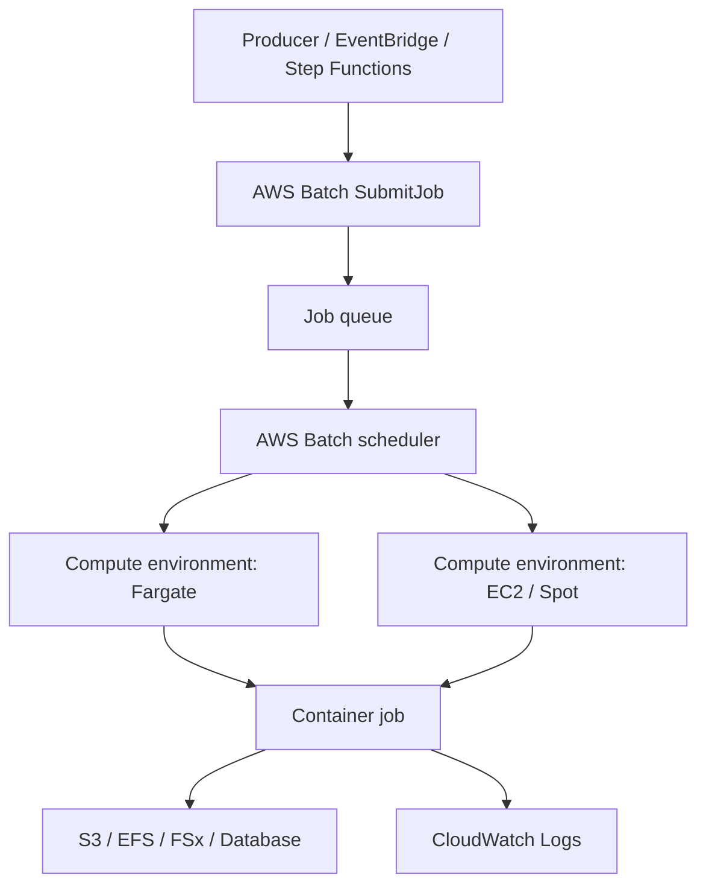
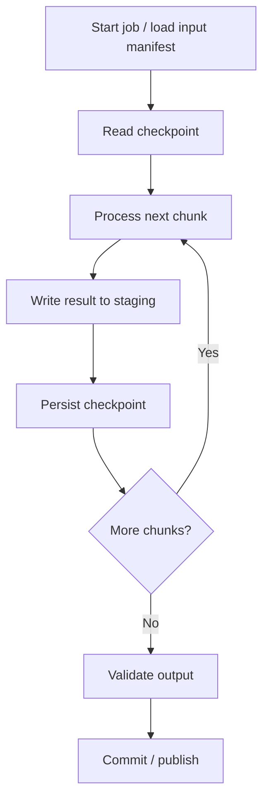
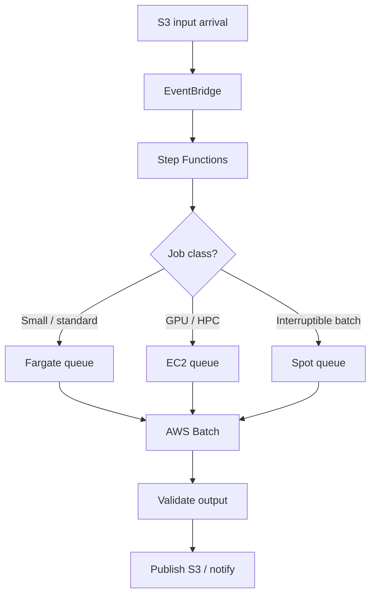

# Kết hợp Fargate, EC2 và Spot cho xử lý batch

Xử lý batch là cách chạy công việc trên một tập dữ liệu hoặc một nhóm tác vụ rồi kết thúc, thay vì duy trì một dịch vụ luôn hoạt động để phục vụ request liên tục. Ví dụ: chuyển đổi hàng triệu ảnh, tạo báo cáo cuối ngày, phân tích log, render video, mô phỏng khoa học, huấn luyện dữ liệu theo lô hoặc xử lý hàng nghìn file đến từ Amazon S3.

Trên AWS, **AWS Batch** điều phối việc xếp hàng, lập lịch và chạy container job trên các compute environment. Một job có thể chạy trên **AWS Fargate**, **Amazon EC2 On-Demand** hoặc **Amazon EC2 Spot**; với workload phù hợp, có thể dùng **Fargate Spot**. Mỗi mô hình có cách tính chi phí, khả năng tùy biến, giới hạn tài nguyên và mức độ chịu gián đoạn khác nhau.

Mục tiêu kiến trúc là ghép đúng loại compute với đặc tính công việc:
- Fargate phù hợp với container job cần triển khai nhanh, không muốn quản lý máy chủ và có yêu cầu tài nguyên trong giới hạn Fargate.
- EC2 On-Demand phù hợp với workload cần GPU, instance đặc thù, custom AMI, EFA, nhiều vCPU/RAM hoặc khả năng kiểm soát host.
- EC2 Spot phù hợp với tác vụ có thể checkpoint, retry hoặc chạy lại khi capacity bị thu hồi.
- Fargate Spot phù hợp với container job trên Fargate có thể chịu gián đoạn và muốn tận dụng capacity Spot.

Bài học thuộc module `CLOUD_PROVIDERS_AWS`, kết nối compute, container, IAM, VPC, S3, ECR, storage, monitoring và cost optimization. Sau bài học, bạn có thể:

- Mô tả kiến trúc AWS Batch gồm job definition, job queue, scheduler và compute environment.
- So sánh Fargate, EC2 On-Demand, EC2 Spot và Fargate Spot.
- Chọn compute theo CPU, RAM, GPU, storage, network, thời gian chạy và khả năng chịu gián đoạn.
- Thiết kế job queue, compute environment order và chiến lược fallback.
- Tạo job definition, submit job và cấu hình retry/timeout.
- Thiết kế checkpoint, idempotency và xử lý Spot interruption.
- Tổ chức storage, networking, IAM và logging cho batch workload.
- Ước lượng chi phí và vận hành pipeline batch có thể mở rộng.

## 1. Batch workload và đặc tính cần phân loại

Batch workload thường có đầu vào hữu hạn hoặc được chia thành các đơn vị xử lý độc lập. Một job đọc dữ liệu, thực hiện phép biến đổi, ghi kết quả rồi kết thúc. Khối lượng công việc có thể đến theo lịch, theo event hoặc do người dùng gửi.

Ví dụ:

| Workload | Đặc tính | Nhu cầu compute thường gặp |
|---|---|---|
| Resize ảnh hàng loạt | Nhiều task độc lập, CPU vừa | Fargate hoặc EC2 Spot |
| Tạo báo cáo cuối ngày | Chạy theo lịch, cần hoàn tất trước deadline | Fargate hoặc EC2 On-Demand |
| Render video | CPU/GPU cao, thời gian chạy dài | EC2, có thể Spot nếu hỗ trợ checkpoint |
| Mô phỏng khoa học | CPU/RAM/network cao, có thể MPI | EC2, EFA và FSx |
| Phân tích log | Nhiều file, workload co giãn | Fargate hoặc EC2 Spot |
| Xử lý ảnh ML inference | Có thể cần GPU | EC2 GPU |
| ETL theo từng partition | Nhiều task có thể retry độc lập | Fargate hoặc EC2 Spot |
| Công việc nhạy deadline | Cần capacity dễ dự đoán | EC2 On-Demand hoặc Fargate On-Demand |

Trước khi chọn compute, cần trả lời:

- Một job cần bao nhiêu vCPU và RAM?
- Có cần GPU, EFA, local NVMe, custom kernel/module hoặc privileged container không?
- Job chạy vài giây, vài phút hay nhiều giờ?
- Có thể chia thành nhiều task độc lập không?
- Nếu bị dừng giữa chừng, có thể tiếp tục từ checkpoint không?
- Deadline có cho phép chờ capacity Spot không?
- Dữ liệu đầu vào/đầu ra nằm ở S3, EFS, FSx hay database?
- Có cần truy cập Internet, endpoint nội bộ hoặc dịch vụ trong VPC?
- Có bao nhiêu job chạy đồng thời và mức burst lớn nhất là bao nhiêu?

Không chọn Spot chỉ vì giá thấp. Nếu một job không thể phục hồi sau khi bị dừng và có deadline cứng, chi phí retry hoặc trễ tiến độ có thể lớn hơn phần tiết kiệm compute.

## 2. AWS Batch gồm những thành phần nào?

AWS Batch là dịch vụ lập lịch và quản lý batch job. Người dùng định nghĩa container và yêu cầu tài nguyên, gửi job vào queue, sau đó scheduler chọn compute environment phù hợp để chạy.

Các thành phần chính:

| Thành phần | Vai trò |
|---|---|
| Job definition | Mô tả image, command, vCPU, RAM, role, volume, retry và timeout |
| Job | Một lần thực thi cụ thể được submit |
| Job queue | Nơi lưu job chờ scheduler xử lý |
| Scheduling policy | Điều khiển cách chia sẻ compute giữa workload/team |
| Compute environment (CE) | Tập tài nguyên chạy container, dùng EC2 hoặc Fargate |
| Scheduler | Đánh giá job, dependency, queue và capacity |
| Job state | Trạng thái SUBMITTED, PENDING, RUNNABLE, STARTING, RUNNING, SUCCEEDED hoặc FAILED |

Kiến trúc tổng quát:



AWS Batch có thể quản lý capacity cho managed compute environment. Với EC2, Batch khởi chạy và co giãn instance theo yêu cầu; với Fargate, Batch yêu cầu Fargate cung cấp task capacity. Người vận hành vẫn phải thiết kế image, IAM, networking, storage, retry và dữ liệu.

## 3. Compute environment và job queue

**Compute environment** xác định loại compute, vùng mạng và capacity mà Batch có thể sử dụng. **Job queue** nhận job và kết nối tới một hoặc nhiều compute environment theo thứ tự.

Trong managed compute environment, AWS Batch quản lý việc cấp và thu hồi capacity dựa trên cấu hình như loại compute, instance types, vCPU tối thiểu/tối đa, subnet và security group.

Các compute resource type thường dùng trong chủ đề này:

| Compute resource type | Mô hình |
|---|---|
| `EC2` | Amazon EC2 On-Demand |
| `SPOT` | Amazon EC2 Spot |
| `FARGATE` | AWS Fargate On-Demand |
| `FARGATE_SPOT` | AWS Fargate Spot |

EC2 và Spot là hai provisioning model trên nền EC2. Fargate và Fargate Spot là hai provisioning model trên nền Fargate. Chúng có thể được xếp thứ tự trong queue cùng nhóm provisioning model để scheduler thử capacity theo thứ tự.

### 3.1. Quy tắc tương thích của job queue

AWS Batch không cho phép trộn EC2 compute environment với Fargate compute environment trong cùng một job queue. Các compute environment gắn với một queue phải cùng nhóm: EC2/Spot hoặc Fargate/Fargate Spot. Các compute environment trong cùng queue cũng phải tương thích về kiến trúc CPU.

Vì vậy, nếu muốn dùng cả Fargate và EC2 trong một hệ thống:
- Tạo queue riêng cho Fargate workloads.
- Tạo queue riêng cho EC2 workloads.
- Dùng producer, Step Functions hoặc routing logic chọn queue theo loại job.
- Trong mỗi queue, dùng compute environment order để ưu tiên hoặc fallback giữa các capacity model tương thích.

Một queue Fargate có thể kết hợp Fargate Spot và Fargate On-Demand; một queue EC2 có thể kết hợp EC2 Spot và EC2 On-Demand. Không thiết kế một queue duy nhất chứa cả bốn loại.

### 3.2. Compute environment order

Khi queue có nhiều compute environment, scheduler thử theo thứ tự tăng dần của trường `order`. Ví dụ order 1 được thử trước order 2. Nếu compute environment đầu tiên không hợp lệ hoặc không cung cấp được tài nguyên phù hợp, scheduler có thể thử compute environment tiếp theo.

Ví dụ chiến lược:
- Fargate Spot order 1, Fargate On-Demand order 2: ưu tiên Spot, có capacity On-Demand làm lựa chọn tiếp theo.
- EC2 Spot order 1, EC2 On-Demand order 2: ưu tiên Spot, có On-Demand làm lựa chọn tiếp theo.
- EC2 On-Demand order 1, EC2 Spot order 2: ưu tiên capacity ổn định; Spot là lựa chọn sau nếu phù hợp.

Order không phải cam kết rằng job sẽ luôn chạy ở compute environment đầu tiên. Job definition phải tương thích với compute environment; architecture, tài nguyên và trạng thái CE đều ảnh hưởng tới placement.

## 4. AWS Fargate cho batch container

AWS Fargate là compute engine serverless cho container. Khi dùng Fargate trong AWS Batch, người dùng đóng gói ứng dụng thành image, khai báo CPU/RAM, network và IAM role. Không cần tạo EC2 cluster, quản lý AMI hoặc scale instance.

Fargate phù hợp khi:
- Job container độc lập, không cần host-level customization.
- Resource requirement nằm trong giới hạn Fargate.
- Muốn giảm công việc quản lý capacity.
- Workload không cần GPU, EFA hoặc Multi-node Parallel.
- Tải không liên tục và muốn tránh duy trì EC2 worker idle.
- Cần isolation giữa các task.

AWS Batch có thể khởi tạo Fargate capacity nhanh hơn việc chờ provision EC2 instance trong nhiều tình huống; thời gian thực tế còn phụ thuộc image size, network và số job.

### 4.1. Giới hạn quan trọng của Fargate

Theo tài liệu AWS Batch hiện hành, Fargate phù hợp với job tối đa 32 vCPU và 244 GiB memory. Các giới hạn/điều kiện quan trọng:

- Không hỗ trợ GPU cho Batch jobs trên Fargate.
- Không hỗ trợ custom AMI, EC2 launch template hoặc chọn EC2 instance type.
- Không hỗ trợ privileged container.
- Không cung cấp host-level devices, kernel tuning hoặc một số Linux parameters như EC2.
- Không phù hợp với Multi-node Parallel job cần nhiều node phối hợp.
- CPU/memory phải dùng các tổ hợp Fargate hỗ trợ.
- Job definition phải khai báo `platformCapabilities: ["FARGATE"]`.
- Cần khai báo `executionRoleArn` và resource requirements cho vCPU/memory.
- Fargate Spot không hỗ trợ Windows container.
- Không nên thiết kế một Fargate Batch job chạy dài hơn 14 ngày.

Nếu job cần GPU, custom AMI, EFA, hơn 32 vCPU hoặc hơn 244 GiB RAM, hãy đánh giá EC2 compute environment.

### 4.2. Storage trên Fargate

Mỗi Fargate task có ephemeral storage riêng. Dung lượng mặc định và khả năng tăng dung lượng phụ thuộc platform version; với platform version hỗ trợ, có thể cấu hình ephemeral storage lớn hơn. Dữ liệu trong ephemeral storage không phải nơi lưu trữ bền vững sau khi task kết thúc.

Các lựa chọn:
- Dùng ephemeral storage cho file tạm, scratch data và intermediate nhỏ.
- Dùng S3 cho input/output bền vững.
- Dùng EFS khi nhiều task cần truy cập file system dùng chung.
- Dùng database/object store cho trạng thái và checkpoint.

Không giả định dữ liệu trên filesystem của container còn sau khi task bị dừng hoặc chạy lại.

## 5. EC2 On-Demand cho batch

EC2 On-Demand cung cấp máy ảo theo instance type mà workload cần. Trong AWS Batch, compute environment có thể chọn một hoặc nhiều instance family, vCPU capacity, AMI và các cấu hình phù hợp.

EC2 phù hợp khi:
- Cần GPU hoặc instance family đặc biệt.
- Cần nhiều RAM hoặc vCPU hơn giới hạn Fargate.
- Cần custom AMI, launch template, kernel/module hoặc host-level access.
- Cần local NVMe/instance store hoặc tối ưu I/O đặc thù.
- Cần EFA, placement group hoặc MPI.
- Cần Multi-node Parallel job.
- Có số lượng job đồng thời lớn và cần throughput dispatch cao.
- Muốn kiểm soát instance placement và capacity chi tiết hơn.

### 5.1. Chọn instance family

| Workload | Instance family tham khảo | Lý do |
|---|---|---|
| CPU batch | C family | Tối ưu compute |
| Memory-heavy | R, X family | RAM lớn |
| General purpose | M family | Cân bằng CPU/RAM |
| GPU inference/rendering | G family | GPU cho đồ họa/inference |
| GPU training/HPC | P family | GPU hiệu năng cao |
| Storage intensive | I, D family tùy thế hệ | Local storage/IOPS phù hợp |
| Network/HPC | C/M/R có network/EFA phù hợp | Throughput và latency |

Tên family chỉ là điểm bắt đầu. Cần so sánh CPU generation, RAM/vCPU, network bandwidth, EBS bandwidth, local storage, GPU, EFA support, giá và Region availability.

### 5.2. Managed và unmanaged compute environment

Managed CE để AWS Batch quản lý capacity và vòng đời instance theo thông số cấu hình. Unmanaged CE dành cho trường hợp tổ chức muốn tự quản lý EC2 capacity và ECS container instances theo quy trình riêng.

Với phần lớn hệ thống batch, managed CE giảm công việc vận hành. Unmanaged CE chỉ nên dùng khi có yêu cầu kiểm soát hạ tầng đặc biệt và đội ngũ có khả năng duy trì capacity, AMI, ECS agent, instance registration, scaling và lifecycle.

## 6. EC2 Spot cho batch có thể chịu gián đoạn

EC2 Spot dùng capacity EC2 dư thừa của AWS với giá thay đổi theo Spot pool. Giá thường thấp hơn On-Demand đáng kể, nhưng AWS có thể thu hồi capacity khi cần.

Spot phù hợp với:
- Job có thể retry hoặc checkpoint.
- Tác vụ độc lập, stateless hoặc chia nhỏ.
- Workload có deadline linh hoạt.
- Batch có nhiều instance type/AZ thay thế.
- Render, ETL, log processing, simulation và data transformation không yêu cầu một tiến trình liên tục duy nhất.

Không phù hợp khi:
- Không thể khôi phục tiến độ sau interruption.
- Mất một lần chạy gây hậu quả lớn.
- Job cần capacity cố định vào thời điểm cụ thể.
- Workload có side effect không idempotent.
- Không có cách lưu output/checkpoint bền vững.

### 6.1. Spot interruption

Khi EC2 Spot capacity bị thu hồi, EC2 thường phát interruption notice khoảng hai phút trước khi terminate hoặc stop instance. Ứng dụng không nên coi khoảng thời gian này là bảo đảm luôn đủ để hoàn tất job; nó chỉ là cơ hội shutdown/checkpoint.

AWS Batch có thể retry job khi instance lỗi hoặc bị terminate nếu retry strategy còn lượt. Với compute environment dùng ECS orchestration và Spot Instances, AWS Batch bật Spot instance draining mặc định cho compute environments mới hoặc được cập nhật kể từ ngày 09-10-2026. Khi nhận notice, container instance được chuyển sang trạng thái DRAINING để ngừng nhận job mới và cho phép job đang chạy xử lý shutdown theo thời gian còn lại. Cần kiểm tra cấu hình launch template nếu đã override behavior này.

### 6.2. Diversify instance types và AZ

Spot capacity được chia theo instance type và Availability Zone. Chỉ chọn một instance type trong một AZ làm giảm số Spot pools có thể dùng.

Nên:
- Liệt kê nhiều instance type tương thích với job.
- Chọn nhiều Availability Zone phù hợp.
- Dùng instance family tương đương về kiến trúc và resource.
- Không khóa workload vào một kích thước instance nếu job có thể chạy trên nhiều kích thước.
- Theo dõi capacity error và interruption rate.

Diversification tăng cơ hội tìm capacity. Tuy nhiên, image và job definition phải tương thích với mọi instance type đã chọn.

## 7. Fargate Spot

Fargate Spot chạy task trên capacity Fargate dư thừa. Mô hình này giữ trải nghiệm serverless của Fargate nhưng có thể bị gián đoạn khi capacity thay đổi.

Phù hợp với:
- Container job stateless hoặc checkpointable.
- Workload có thể retry.
- Nhu cầu CPU/RAM nằm trong giới hạn Fargate.
- Batch có thể chờ khi Spot capacity tạm thời không có.
- Muốn tránh quản lý EC2 instance nhưng vẫn tối ưu chi phí.

Không phù hợp với:
- Windows container.
- GPU, EFA, host customization hoặc tài nguyên ngoài Fargate.
- Job không thể chịu interruption.
- Workload cần đảm bảo capacity bắt đầu đúng thời điểm.

Khi Fargate Spot task bị dừng do interruption, ECS gửi cảnh báo trước khoảng hai phút dưới dạng task state change event tới EventBridge và tín hiệu SIGTERM tới task đang chạy. Ứng dụng cần xử lý SIGTERM, ghi checkpoint và dừng gọn trong khoảng thời gian cho phép. Capacity Fargate Spot có thể không sẵn sàng, khiến job chờ lâu hơn.

### 7.1. Fargate Spot và Fargate On-Demand trong một queue

Một Fargate job queue có thể liên kết compute environment `FARGATE_SPOT` và `FARGATE`, miễn là các CE tương thích về provisioning model và architecture. Ví dụ:
- CE `fargate-spot`, order 1.
- CE `fargate-ondemand`, order 2.

Cách này ưu tiên Spot và cho scheduler một lựa chọn Fargate On-Demand tiếp theo khi CE đầu không thể cung cấp placement phù hợp. Cần theo dõi job ở trạng thái RUNNABLE và kiểm tra queue/CE status; đừng giả định fallback là tức thời trong mọi tình huống capacity.

## 8. So sánh Fargate, EC2 và Spot

| Tiêu chí | Fargate On-Demand | Fargate Spot | EC2 On-Demand | EC2 Spot |
|---|---|---|---|---|
| Quản lý máy chủ | AWS quản lý | AWS quản lý | AWS Batch quản lý instance nếu managed CE | AWS Batch quản lý Spot instance nếu managed CE |
| Gián đoạn do Spot reclaim | Không | Có | Không do Spot reclaim | Có |
| GPU | Không | Không | Có, tùy instance | Có, tùy instance |
| Custom AMI/host tuning | Không | Không | Có | Có |
| EFA/MPI/MNP | Không phù hợp/không hỗ trợ | Không | Có với cấu hình hỗ trợ | EFA có thể dùng trên instance phù hợp; AWS Batch MNP không hỗ trợ Spot |
| Resource ceiling | Giới hạn Fargate | Giới hạn Fargate | Theo instance | Theo instance có Spot capacity |
| Capacity planning | Ít hơn | Ít hơn nhưng Spot có thể thiếu | Cần chọn family/capacity | Cần diversify Spot pools |
| Chi phí | Theo vCPU/RAM và thời gian task | Giá Spot Fargate | Theo EC2 instance | Giá Spot biến động |
| Khả năng chịu lỗi | Ứng dụng tự xử lý lỗi job | Cần checkpoint/retry | Ứng dụng tự xử lý lỗi job | Cần checkpoint/retry |
| Phù hợp | Job container đơn giản, deadline rõ | Job linh hoạt, có thể retry | Job đặc thù/HPC/ổn định | Batch fault-tolerant, tối ưu chi phí |

### 8.1. Quy tắc chọn nhanh

- Chọn Fargate On-Demand nếu cần đơn giản, không cần host access và deadline tương đối rõ.
- Chọn Fargate Spot nếu job nằm trong giới hạn Fargate, có thể bị dừng và có thể retry.
- Chọn EC2 On-Demand nếu cần GPU, EFA, MNP, custom AMI, RAM/vCPU cao hoặc kiểm soát host.
- Chọn EC2 Spot nếu workload có thể checkpoint, đa dạng instance type và chấp nhận capacity interruption.
- Dùng nhiều queue khi workload khác nhau về compute platform hoặc SLA.

## 9. Allocation strategy cho EC2 Spot

AWS Batch chọn Spot instance type từ các pool được cấu hình. Allocation strategy ảnh hưởng việc cân bằng giá và khả năng có capacity.

Các chiến lược đáng chú ý:
- `SPOT_CAPACITY_OPTIMIZED`: ưu tiên pool có capacity sâu hơn để giảm nguy cơ bị interruption.
- `SPOT_PRICE_CAPACITY_OPTIMIZED`: xét cả capacity và giá, chọn pool có khả năng ít bị interruption trong nhóm giá phù hợp; AWS khuyến nghị chiến lược này cho phần lớn workload Spot.
- `SPOT_CAPACITY_OPTIMIZED_PRIORITIZED`: chiến lược nâng cao khi muốn ảnh hưởng thứ tự ưu tiên instance type nhưng vẫn ưu tiên capacity.

Không dùng giá Spot hiện tại làm dự báo cố định cho toàn bộ thời gian chạy. Capacity và giá có thể thay đổi theo Region, AZ, instance type và thời điểm.

### 9.1. Diversification quan trọng hơn chỉ chọn giá thấp

Một Spot pool rẻ nhất có thể có capacity hạn chế và tỷ lệ interruption cao hơn. Với batch, thời gian hoàn thành và chi phí retry cũng là một phần tổng chi phí.

Ví dụ:
- Workload A chọn một loại instance rẻ nhất nhưng thường bị reclaim.
- Workload B cho Batch chọn nhiều loại instance tương thích với capacity tốt hơn.
- Workload B có thể hoàn tất nhanh và ổn định hơn dù giá mỗi giờ cao hơn một chút.

Đánh giá bằng tổng chi phí hoàn thành batch, không chỉ giá instance/giờ.

## 10. Job definition: đóng gói công việc

Job definition mô tả cách chạy container:
- Container image và tag/digest.
- Command và parameters.
- vCPU, memory và GPU nếu nền tảng hỗ trợ.
- Execution role và job role.
- Environment variables.
- Volume/mount points.
- Network configuration.
- Retry strategy và timeout.
- Log configuration.
- Platform capabilities.

Nên dùng image immutable theo digest hoặc version tag; tránh tag `latest` trong production vì nội dung có thể thay đổi mà job definition không đổi.

### 10.1. Ví dụ job definition cho Fargate

```json
{
  "jobDefinitionName": "image-resize-fargate",
  "type": "container",
  "platformCapabilities": ["FARGATE"],
  "containerProperties": {
    "image": "111122223333.dkr.ecr.ap-southeast-1.amazonaws.com/image-worker:1.4.2",
    "executionRoleArn": "arn:aws:iam::111122223333:role/BatchTaskExecutionRole",
    "jobRoleArn": "arn:aws:iam::111122223333:role/ImageWorkerJobRole",
    "resourceRequirements": [
      {"type": "VCPU", "value": "1"},
      {"type": "MEMORY", "value": "2048"}
    ],
    "networkConfiguration": {
      "assignPublicIp": "DISABLED"
    },
    "logConfiguration": {
      "logDriver": "awslogs",
      "options": {
        "awslogs-group": "/aws/batch/image-worker",
        "awslogs-region": "ap-southeast-1",
        "awslogs-stream-prefix": "job"
      }
    }
  },
  "retryStrategy": {
    "attempts": 3
  },
  "timeout": {
    "attemptDurationSeconds": 3600
  }
}
```

Ví dụ sử dụng 1 vCPU và 2 GiB RAM. Các giá trị vCPU/memory phải là tổ hợp Fargate hỗ trợ. Với Fargate, khai báo vCPU và memory trong `resourceRequirements`; không dùng các trường `vcpus` và `memory` kiểu cũ trong containerProperties. Fargate cần execution role để agent pull image, ghi log và lấy secret theo cấu hình; job role dùng cho code bên trong container gọi AWS APIs.

### 10.2. Ví dụ job definition cho EC2

```json
{
  "jobDefinitionName": "video-render-ec2",
  "type": "container",
  "platformCapabilities": ["EC2"],
  "containerProperties": {
    "image": "111122223333.dkr.ecr.ap-southeast-1.amazonaws.com/video-renderer:3.1.0",
    "jobRoleArn": "arn:aws:iam::111122223333:role/VideoRenderJobRole",
    "vcpus": 8,
    "memory": 32768,
    "resourceRequirements": [
      {"type": "GPU", "value": "1"}
    ],
    "mountPoints": [
      {
        "sourceVolume": "scratch",
        "containerPath": "/scratch",
        "readOnly": false
      }
    ],
    "volumes": [
      {
        "name": "scratch",
        "host": {"sourcePath": "/local/scratch"}
      }
    ]
  },
  "retryStrategy": {
    "attempts": 2
  },
  "timeout": {
    "attemptDurationSeconds": 14400
  }
}
```

Ví dụ EC2 minh họa job cần GPU và host volume. Đường dẫn host phải tồn tại và được chuẩn bị trên compute instance; nên quản lý bằng AMI hoặc launch template. Không sao chép cấu hình host volume/GPU sang Fargate job definition.

## 11. Compute environment EC2 và Spot

Một EC2 managed compute environment thường xác định:
- Loại capacity: `EC2` hoặc `SPOT`.
- Allocation strategy.
- Danh sách instance types.
- Min/max/desired vCPU.
- Subnets và security groups.
- Instance profile role.
- Service role cho AWS Batch.
- Launch template/AMI nếu cần tùy chỉnh.
- Tags và cấu hình scaling.

Ví dụ cấu hình khái niệm cho EC2 Spot:

```json
{
  "type": "MANAGED",
  "computeResources": {
    "type": "SPOT",
    "allocationStrategy": "SPOT_PRICE_CAPACITY_OPTIMIZED",
    "spotIamFleetRole": "arn:aws:iam::111122223333:role/AmazonEC2SpotFleetTaggingRole",
    "minvCpus": 0,
    "maxvCpus": 256,
    "desiredvCpus": 0,
    "instanceTypes": ["c7i", "c7a", "m7i", "m7a"],
    "subnets": [
      "subnet-11111111",
      "subnet-22222222"
    ],
    "securityGroupIds": [
      "sg-0123456789abcdef0"
    ],
    "instanceRole": "arn:aws:iam::111122223333:instance-profile/BatchInstanceProfile"
  }
}
```

Đây là phần `computeResources` minh họa; khi tạo Spot CE cần cấu hình Spot Fleet IAM role và các service-linked roles theo hướng dẫn AWS, đồng thời bổ sung service role, Region, tags và các thuộc tính bắt buộc khác. `instanceRole` là instance profile ARN cho EC2 container instances, khác với `jobRoleArn` của container. Spot Fleet role cần policy hiện hành `AmazonEC2SpotFleetTaggingRole` để hỗ trợ gắn tag cho Spot Instances.

### 11.1. Fargate compute environment

Fargate CE dùng `type: MANAGED` và compute resource type `FARGATE` hoặc `FARGATE_SPOT`. Các trường EC2 như `instanceTypes`, `instanceRole`, `launchTemplate`, `minvCpus`, `desiredvCpus`, `placementGroup` và `allocationStrategy` không áp dụng cho Fargate CE.

Với Fargate, cần cấu hình subnet và security group; network configuration của job cần phù hợp. Nếu private subnet không có NAT gateway để ra Internet, cần endpoints phù hợp hoặc cấu hình public IP theo yêu cầu và policy mạng. Production thường ưu tiên private networking và VPC endpoints cho các dịch vụ cần thiết.

## 12. Job queue, priority và fair-share scheduling

Job queue xác định nơi job chờ. Có thể tạo queue theo:
- SLA: critical, standard, best-effort.
- Team hoặc business unit.
- Compute class: Fargate, EC2 GPU, EC2 Spot.
- Môi trường: dev, staging, production.
- Data domain hoặc pipeline.

Queue priority quyết định mức ưu tiên giữa các queue dùng chung compute environment. Scheduling policy có thể bật fair-share scheduling để tránh một workload chiếm hết capacity.

### 12.1. Fair-share scheduling

Fair-share scheduling dùng share identifier để phân chia compute giữa team hoặc workload. Các khái niệm:
- Share identifier: định danh workload/team.
- Weight factor: ảnh hưởng tỷ trọng tài nguyên.
- Share decay time: thời gian sử dụng trước đó còn ảnh hưởng tới tính công bằng trong bao lâu.
- Compute reservation: giữ lại một phần capacity cho share chưa hoạt động theo chính sách.

Fair-share hữu ích khi nhiều team dùng chung queue/compute. Nếu cần kiểm soát SLA chặt hơn, có thể dùng queue riêng và priority phù hợp. Không nhầm fair-share với compute environment order: fair-share điều khiển workload nào được chạy trước; CE order chọn capacity environment nào được thử.

## 13. Job arrays và dependencies

AWS Batch hỗ trợ job array để tạo nhiều child jobs từ một job definition. Ví dụ một dataset có 5.000 file, mỗi child job xử lý một file hoặc một partition.

Job array giảm nhu cầu submit từng job thủ công. Container có thể đọc biến môi trường `AWS_BATCH_JOB_ARRAY_INDEX` để xác định phần việc của child job. Job array phù hợp với workload embarrassingly parallel, nơi các phần việc ít phụ thuộc nhau.

Job dependencies cho phép job B chỉ chạy sau khi job A thành công. Có thể dùng `dependsOn` để tạo chuỗi hoặc dependency giữa các array jobs. Nếu job phụ thuộc thất bại, job downstream có thể chuyển sang FAILED thay vì tự chạy với dữ liệu thiếu.

Ví dụ:
- Job A tải manifest.
- Job B là array job xử lý các partition.
- Job C tổng hợp kết quả sau khi tất cả child jobs thành công.
- Job D publish dataset.

## 14. Submit job bằng AWS CLI

Sau khi tạo job definition, compute environment và queue, có thể submit job:

```bash
aws batch submit-job \
  --job-name resize-batch-2026-11-20 \
  --job-queue image-processing-queue \
  --job-definition image-resize-fargate \
  --parameters inputBucket=company-input,inputPrefix=images/2026-11-20/ \
  --region ap-southeast-1
```

CLI trả về job ID. Có thể theo dõi:

```bash
aws batch describe-jobs \
  --jobs <job-id> \
  --region ap-southeast-1
```

Hủy job đang chờ hoặc chạy:

```bash
aws batch cancel-job \
  --job-id <job-id> \
  --reason "Input batch was superseded"
```

Với job đang RUNNING, dùng `terminate-job` theo quy trình phù hợp. Cancel/terminate là hành động vận hành; không giả định job bị hủy sẽ tự retry.

## 15. Retry strategy và timeout

AWS Batch cho phép cấu hình retry strategy cho job. Số lần attempt có thể từ 1 tới 10. Có thể dùng `evaluateOnExit` để quyết định retry hay exit theo exit code, reason hoặc status reason.

Ví dụ:

```json
{
  "attempts": 4,
  "evaluateOnExit": [
    {
      "action": "RETRY",
      "onReason": "AGENT"
    },
    {
      "action": "RETRY",
      "onStatusReason": "Task failed to start"
    },
    {
      "action": "EXIT",
      "onExitCode": "2"
    },
    {
      "action": "EXIT",
      "onReason": "*"
    }
  ]
}
```

Ví dụ trên retry một số lỗi hạ tầng và thoát với lỗi ứng dụng cụ thể. Thứ tự rule và giá trị pattern cần được kiểm tra với error reason thực tế; nếu không có rule nào khớp, Batch có hành vi mặc định theo retry strategy.

### 15.1. Retry không thay thế checkpoint

Retry thường chạy lại container/job attempt. Nếu job đã xử lý 80% dữ liệu nhưng chưa lưu tiến độ, attempt mới có thể phải làm lại từ đầu. Vì vậy:
- Lưu checkpoint theo partition hoặc chunk.
- Ghi output theo staging path.
- Dùng idempotency key.
- Chỉ đánh dấu partition hoàn tất sau khi commit output.
- Ghi nhận attempt number và run ID.

AWS Batch đặt biến môi trường `AWS_BATCH_JOB_ATTEMPT` để container biết số attempt hiện tại. Không dùng attempt number làm business key vì attempt thay đổi qua retry.

### 15.2. Timeout

`attemptDurationSeconds` đặt giới hạn thời gian cho một job attempt; giá trị tối thiểu là 60 giây. Khi hết thời gian, Batch gửi SIGTERM để ứng dụng dừng gọn; nếu container vẫn chạy sau khoảng thời gian grace, Batch có thể gửi SIGKILL.

Một điểm quan trọng: job bị terminate do timeout không tự động được retry như job thất bại thông thường. Nếu muốn timeout có hành động tiếp theo, cần thiết kế orchestrator hoặc quy trình submit lại rõ ràng. Job chạy trên Fargate không nên kỳ vọng kéo dài hơn 14 ngày.

## 16. Xử lý Spot interruption và checkpoint

Một batch job nên được thiết kế theo nguyên tắc có thể dừng và tiếp tục. Không nên phụ thuộc hoàn toàn vào bộ nhớ hoặc filesystem tạm của instance.

### 16.1. Checkpoint pattern



Một checkpoint nên lưu:
- Job/batch ID.
- Input version hoặc S3 object version.
- Chunk/partition đã xử lý.
- Output location và checksum.
- Schema/code version.
- Thời điểm ghi.
- Trạng thái commit.

Nếu Spot interruption xảy ra, container có thể nhận SIGTERM hoặc instance draining. Ứng dụng nên dừng nhận thêm work, hoàn tất phần an toàn có thể hoàn tất, ghi checkpoint và flush output. Không bắt đầu một phép tính dài mới trong khoảng shutdown.

### 16.2. Idempotent output

Một lần retry có thể xử lý lại chunk. Để tránh nhân đôi:
- Ghi output vào key xác định theo batch/partition.
- Dùng manifest hoặc commit marker để xác nhận output hoàn chỉnh.
- Dùng conditional write hoặc transaction nếu dịch vụ hỗ trợ.
- Với database, dùng upsert theo business key hoặc transaction.
- Không publish kết quả downstream trước khi batch commit.
- Lưu attempt history riêng để audit.

S3 object key ổn định không tự bảo đảm atomic commit cho nhiều file. Với output gồm nhiều part file, có thể ghi staging prefix rồi ghi manifest/commit marker cuối cùng để consumer chỉ đọc batch đã hoàn tất.

## 17. Lưu trữ cho batch workload

Chọn storage theo độ bền, throughput, latency và khả năng chia sẻ.

| Storage | Dùng cho | Lưu ý |
|---|---|---|
| Amazon S3 | Input/output, dataset, checkpoint, archive | Object storage, phù hợp trao đổi dữ liệu giữa job |
| Amazon EBS | Block storage cho EC2 container instances | Có thể gắn volume và chọn performance |
| EC2 instance store/NVMe | Scratch tốc độ cao | Dữ liệu tạm, mất khi instance dừng |
| Amazon EFS | Shared file system cho nhiều task/instance | Phù hợp POSIX shared access |
| Amazon FSx for Lustre | HPC, throughput cao, parallel file access | Thường dùng với S3 data repository |
| Amazon FSx for OpenZFS/Windows File Server | Workload cần semantics file system chuyên biệt | Chọn theo protocol và performance profile |

Fargate hỗ trợ EFS volume trong các cấu hình phù hợp; không có host instance store để job tự quản lý. EC2 có thể dùng EBS hoặc local NVMe tùy instance type. Với HPC, FSx for Lustre có thể cung cấp shared high-performance file system cho nhiều compute nodes.

Không dùng local scratch làm nơi lưu kết quả duy nhất. Khi instance bị terminate hoặc Spot reclaim, dữ liệu local có thể mất.

## 18. Networking và bảo mật

AWS Batch jobs thường chạy trong VPC subnets và security groups được cấu hình trong compute environment hoặc job network configuration theo loại compute.

Các điểm cần thiết kế:
- Chọn private subnets ở nhiều AZ nếu workload cần khả năng phục hồi.
- Chỉ cấp egress tới các dịch vụ cần thiết.
- Dùng VPC endpoints cho S3, ECR, CloudWatch Logs, Secrets Manager và các dịch vụ hỗ trợ khi phù hợp.
- Nếu không có NAT và job cần truy cập Internet, phải thiết kế network path phù hợp; với Fargate, `assignPublicIp` và subnet configuration cần nhất quán.
- Hạn chế inbound rules; batch worker thường chỉ cần outbound tới dependency.
- Dùng KMS encryption cho dữ liệu nhạy cảm.
- Lưu secret trong Secrets Manager hoặc Systems Manager Parameter Store.

### 18.1. Phân biệt các IAM role

| Role | Ai dùng | Quyền điển hình |
|---|---|---|
| AWS Batch service-linked/service role | Dịch vụ AWS Batch | Quản lý compute environment và tài nguyên liên quan |
| EC2 instance profile | ECS container instance trên EC2 | Agent lấy image, đăng ký cluster và tác vụ hạ tầng |
| Task execution role | Fargate/ECS agent | Pull image ECR, gửi logs, lấy secret theo cấu hình |
| Job role | Code trong container | Đọc input S3, ghi output, gọi DynamoDB hoặc dịch vụ nghiệp vụ |

Không gộp mọi quyền vào một role admin. Job role nên chỉ đọc đúng input prefix và ghi đúng output prefix. Execution role không cần quyền xử lý nghiệp vụ nếu container code dùng job role riêng.

## 19. Image, logging và cấu hình ứng dụng

Container image thường lưu trong Amazon ECR. Pipeline CI/CD nên:
- Build image từ Dockerfile được review.
- Quét image và dependency.
- Gắn version/digest.
- Kiểm thử với CPU architecture tương ứng.
- Không nhúng secret vào image layer.
- Giữ image tương thích với runtime và compute environment.

AWS Batch có thể gửi container logs tới CloudWatch Logs qua log configuration. Nên ghi:
- Job ID và attempt.
- Batch ID/partition.
- Input/output URI.
- Checkpoint.
- Thời gian xử lý mỗi chunk.
- Exit code và error category.
- Metrics nghiệp vụ.

Không log toàn bộ payload nhạy cảm hoặc credential. Đặt retention cho log group và metric filter cho các lỗi quan trọng.

## 20. HPC và workload cần EC2

HPC (High Performance Computing) thường cần throughput cao, network latency thấp, compute node đồng bộ và storage song song. Một số workload như MPI simulation, molecular dynamics, computational fluid dynamics hoặc rendering phân tán cần nhiều node phối hợp.

EC2 On-Demand phù hợp hơn Fargate khi cần:
- GPU.
- Elastic Fabric Adapter (EFA).
- Placement group để tối ưu network locality.
- Custom AMI và kernel/module.
- Multi-node Parallel jobs.
- Instance memory/network bandwidth cao.
- Shared high-performance storage như FSx for Lustre.

### 20.1. EFA và MPI

EFA cung cấp giao tiếp mạng hiệu năng cao cho các workload HPC/ML phân tán được hỗ trợ. MPI workload thường cần:
- Các node có cùng cấu hình và placement phù hợp.
- EFA-capable instance types.
- Security group và network settings đúng.
- MPI library và driver tương thích.
- Shared filesystem hoặc cơ chế phân phối input/output.
- Job definition và multi-node parallel configuration tương ứng.

Không phải mọi MPI workload đều phù hợp với Spot. Nếu tiến trình phân tán đồng bộ bị dừng một node, toàn bộ job có thể thất bại. Cần checkpoint ở cấp ứng dụng hoặc chọn On-Demand khi chi phí restart quá cao.

### 20.2. Multi-node Parallel jobs

AWS Batch Multi-node Parallel (MNP) jobs chạy một job trên nhiều EC2 container instances, có node index và main node. MNP phù hợp với workload cần phối hợp giữa nhiều node; không dùng Fargate hoặc EC2 Spot cho loại job này. AWS Batch hiện không hỗ trợ MNP jobs trên Spot Instances.

Với MNP, cần quản lý:
- Số node và tài nguyên mỗi node.
- Placement và network.
- Coordination giữa main node và child nodes.
- Shared input/output.
- Failure behavior nếu một node bị mất.
- Checkpoint/restart ở cấp ứng dụng.

## 21. Orchestration: kết hợp Batch với Step Functions và EventBridge

AWS Batch tập trung vào scheduling và thực thi batch jobs. Step Functions phù hợp điều phối nhiều bước nghiệp vụ; EventBridge kích hoạt pipeline theo event hoặc lịch.

Một luồng ví dụ:
1. S3 nhận manifest mới.
2. EventBridge phát sự kiện.
3. Step Functions kiểm tra manifest và chọn queue.
4. Submit AWS Batch job.
5. Chờ job hoàn tất.
6. Kiểm tra output và quality.
7. Publish dataset hoặc gửi cảnh báo.



Step Functions có thể chờ AWS Batch job hoàn tất qua service integration pattern `.sync` trong Standard Workflow. Nếu dùng callback hoặc polling tự quản lý, cần xử lý timeout, cancel và job state rõ ràng.

Không submit hàng triệu child job bằng một execution state machine duy nhất nếu orchestration overhead trở thành bottleneck. Dùng job arrays, batch submit hoặc streaming/queue workers phù hợp với quy mô.

## 22. Cost model và tối ưu chi phí

Tổng chi phí batch không chỉ là giá compute. Cần tính:

- vCPU/RAM hoặc EC2 instance hours.
- Fargate task duration và ephemeral storage nếu cấu hình thêm.
- EBS, EFS, FSx và S3 storage/request.
- Data transfer giữa AZ, Region hoặc Internet.
- NAT Gateway processing và hourly cost.
- ECR image storage và data transfer.
- CloudWatch Logs ingestion/storage.
- Retry do interruption hoặc lỗi ứng dụng.
- Idle capacity trong EC2 compute environment.

### 22.1. Fargate cost

Fargate tính phí theo tài nguyên task được yêu cầu và thời gian chạy. Job nhỏ hoặc không thường xuyên có thể tránh chi phí EC2 idle. Nhưng nếu workload liên tục với utilization cao, EC2 instance có thể kinh tế hơn tùy packing và loại instance.

Giảm chi phí bằng cách:
- Khai báo vCPU/RAM sát nhu cầu.
- Giảm image size và startup overhead.
- Dùng ephemeral storage vừa đủ.
- Không giữ task chạy chờ dữ liệu.
- Batch nhiều file trong một job nếu overhead khởi chạy quá lớn.

### 22.2. EC2 Spot cost

Spot thường giảm chi phí compute so với On-Demand, nhưng cần cộng thêm:
- Xác suất interruption.
- Thời gian chạy lại.
- Chi phí checkpoint và storage.
- Thời gian chờ capacity.
- Tác động đến SLA.

Đa dạng instance types và AZ, chọn allocation strategy phù hợp, chia job thành chunk nhỏ và checkpoint định kỳ. Đo cost per completed job thay vì cost per instance-hour.

### 22.3. EC2 On-Demand cost

On-Demand phù hợp với job cần capacity dự đoán được. Tối ưu bằng:
- Scale minvCpus về 0 nếu không cần warm capacity.
- Chọn instance phù hợp resource profile.
- Tối ưu bin packing và concurrency.
- Dùng Savings Plans/commitment phù hợp với baseline ổn định theo chính sách tài chính.
- Tách queue critical và best-effort để tránh giữ capacity quá lớn cho tất cả workload.

## 23. Observability và vận hành

Theo dõi cả trạng thái job lẫn compute environment.

| Signal | Ý nghĩa |
|---|---|
| Job state counts | Job đang chờ, chạy, thành công hay thất bại |
| Time in RUNNABLE | Thời gian chờ capacity hoặc dependency |
| Job duration | Thời gian thực thi |
| Retry/attempt count | Mức độ không ổn định và interruption |
| CE status | Compute environment có VALID hay INVALID |
| Desired/min/max vCPU | Capacity scaling |
| Spot interruption | Tỷ lệ và workload bị reclaim |
| Queue backlog/age | Mức độ tắc nghẽn |
| CPU/RAM utilization | Resource sizing |
| Output completeness | Batch có đủ dữ liệu không |

Dùng CloudWatch metrics, logs, EventBridge job state change events và AWS Batch console để theo dõi. Với Spot, dùng dashboard/metric interruption phù hợp để đánh giá pool và chiến lược allocation.

### 23.1. Job state và xử lý RUNNABLE lâu

Job ở RUNNABLE nghĩa là job sẵn sàng chạy nhưng chưa được scheduler đặt lên compute. Nguyên nhân có thể:
- CE chưa đủ capacity.
- CE INVALID hoặc không tương thích.
- Job yêu cầu nhiều vCPU/RAM hơn capacity hiện có.
- Instance type không thể đáp ứng GPU hoặc resource requirement.
- Subnet hết IP.
- Service quota hoặc account quota.
- Spot capacity tạm thời không có.
- CE architecture hoặc platform không tương thích job definition.

Không chỉ tăng maxvCpus khi job RUNNABLE lâu. Kiểm tra CE status, job resource requirement, subnet IP, quota, instance family và queue order trước.

## 24. Troubleshooting thường gặp

| Triệu chứng | Nguyên nhân có thể | Hướng xử lý |
|---|---|---|
| Job RUNNABLE lâu | Thiếu capacity hoặc CE không phù hợp | Kiểm tra CE status, vCPU, memory, instance types và queue order |
| CE INVALID | Role, subnet, security group, launch template hoặc quota lỗi | Xem status reason và CloudTrail |
| Fargate job không start | CPU/memory combination không hợp lệ, subnet/IP hoặc quota | Kiểm tra job definition, subnet và Fargate quota |
| Fargate Spot job chờ lâu | Spot capacity không sẵn sàng | Thêm Fargate On-Demand CE cùng queue hoặc dùng queue khác theo SLA |
| EC2 Spot job fail | Instance bị reclaim hoặc agent lỗi | Retry strategy, checkpoint và diversify instance types |
| Container không pull image | ECR permissions/network | Kiểm tra execution/instance role, ECR endpoints/NAT |
| Không ghi được log | CloudWatch Logs permission/network | Kiểm tra execution role và log group |
| Job thiếu dữ liệu | S3 path/role/manifest sai | Kiểm tra job role, object version và input validation |
| Job chạy nhưng output trùng | Retry không idempotent | Dùng batch ID, staging và commit marker |
| GPU không được cấp | CE instance family không có GPU hoặc job definition sai | Kiểm tra GPU resource requirement và instance type |
| MNP không chạy trên Fargate | Nền tảng không hỗ trợ MNP | Dùng EC2 CE phù hợp |
| Job timeout không retry | Timeout termination không tự retry | Thiết kế timeout handling và resubmission rõ ràng |

## 25. Tình huống thực tế: xử lý 100.000 ảnh sản phẩm

Một cửa hàng thương mại điện tử cần tạo thumbnail, chuyển định dạng và kiểm tra chất lượng 100.000 ảnh sau mỗi đợt upload. Mỗi ảnh có thể xử lý độc lập, đầu vào và đầu ra nằm trong S3.

### 25.1. Chia workload

- Mỗi job xử lý một nhóm 100-500 ảnh.
- Input manifest xác định danh sách key.
- Job ghi thumbnail vào staging prefix.
- Mỗi chunk có batch ID và partition ID.
- Khi hoàn tất, job ghi manifest kết quả.
- Bước validation kiểm tra số ảnh, kích thước và format.
- Chỉ sau khi validation thành công mới publish prefix curated.

### 25.2. Chọn compute

- Job nhỏ, không cần host tuning: Fargate.
- Job có thể retry và deadline linh hoạt: Fargate Spot hoặc EC2 Spot.
- Nếu cần xử lý GPU/AI inference: EC2 GPU.
- Queue Fargate và queue EC2 được tách riêng; Step Functions chọn queue theo job class.

### 25.3. Retry và idempotency

Nếu job xử lý chunk bị Spot interruption:
- Batch retry theo retry strategy.
- Attempt mới đọc checkpoint hoặc chạy lại chunk.
- Output dùng key ổn định theo batch/chunk.
- Manifest chỉ được commit khi toàn bộ file của chunk đã hoàn tất.
- Validation loại duplicate và phát hiện file thiếu.

### 25.4. Cost và SLA

Đo:
- Thời gian hoàn tất toàn bộ 100.000 ảnh.
- Chi phí trên mỗi 1.000 ảnh thành công.
- Tỷ lệ retry/interruption.
- Thời gian chờ RUNNABLE.
- Chi phí S3 request, data transfer và log.

Nếu Spot làm giảm compute cost nhưng tăng thời gian hoàn tất vượt SLA, có thể chuyển một phần critical workload sang On-Demand và giữ Spot cho backlog best-effort.

## 26. Những lỗi thiết kế cần tránh

| Lỗi | Hậu quả | Cách khắc phục |
|---|---|---|
| Chọn Fargate cho GPU/HPC | Job không được hỗ trợ | Chọn EC2 phù hợp |
| Trộn EC2 và Fargate CE trong một queue | Queue không hợp lệ | Tách queue theo compute platform |
| Chỉ chọn một Spot instance type | Capacity pool hẹp, dễ chờ/interruption | Diversify instance types và AZ |
| Dùng Spot cho job không checkpoint | Mất tiến độ và tốn chi phí retry | Checkpoint hoặc chọn On-Demand |
| Dùng timeout nhưng kỳ vọng Batch tự retry | Job timeout chuyển FAILED | Thiết kế retry/resubmit riêng |
| Ghi output trực tiếp trước khi hoàn tất | Consumer đọc partial output | Staging và commit marker |
| Dùng local disk làm output duy nhất | Mất dữ liệu khi instance bị terminate | Lưu output bền vững |
| Cấp job role quyền S3 toàn bucket | Tăng blast radius | Least privilege theo prefix |
| Không theo dõi RUNNABLE age | Phát hiện capacity shortage muộn | Alarm theo queue age |
| Dùng một queue cho mọi SLA | Workload critical bị backlog best-effort | Tách queue/priority/fair share |
| Không tính NAT/data transfer/log cost | Tổng chi phí vượt dự toán | Đo end-to-end cost per job |

## 27. Checklist triển khai AWS Batch kết hợp Fargate, EC2 và Spot

- [ ] Phân loại workload theo CPU, RAM, GPU, network, storage và duration.
- [ ] Xác định job nào có thể retry/checkpoint.
- [ ] Chọn Fargate cho job container trong giới hạn và không cần host access.
- [ ] Chọn EC2 cho GPU, EFA, MNP, custom AMI hoặc resource lớn.
- [ ] Chọn Spot cho workload có khả năng chịu interruption.
- [ ] Tách EC2 queue và Fargate queue.
- [ ] Chỉ kết hợp CE cùng provisioning model trong một queue.
- [ ] Kiểm tra architecture compatibility của các CE.
- [ ] Cấu hình compute environment order cho fallback.
- [ ] Chọn allocation strategy và diversify Spot pools.
- [ ] Đóng gói image immutable trong ECR.
- [ ] Cấu hình job definition, execution role và job role riêng.
- [ ] Đặt retry strategy và hiểu rõ timeout behavior.
- [ ] Thiết kế checkpoint, idempotency và staging/commit.
- [ ] Dùng S3/EFS/FSx cho dữ liệu bền vững và shared storage.
- [ ] Cấu hình private subnet, endpoints/NAT và security groups.
- [ ] Đặt log, metric, alarm và EventBridge notifications.
- [ ] Theo dõi queue backlog, RUNNABLE age và CE status.
- [ ] Kiểm thử Spot interruption, capacity shortage và job retry.
- [ ] Đo cost per successful job và SLA end-to-end.

## 28. Tóm tắt kiến thức

AWS Batch điều phối container job thông qua job definition, job queue, scheduler và compute environment. Fargate giảm quản lý hạ tầng, phù hợp với job container có resource requirement trong giới hạn và không cần GPU/host customization. EC2 On-Demand phù hợp workload cần instance đặc thù, GPU, EFA, MNP, custom AMI hoặc tài nguyên lớn. EC2 Spot và Fargate Spot giảm chi phí cho batch có thể bị gián đoạn, nhưng cần checkpoint, retry và idempotency.

Có thể kết hợp On-Demand và Spot trong cùng nhóm compute platform bằng nhiều compute environment có order. AWS Batch không cho phép trộn EC2 và Fargate trong cùng một queue; hãy tách queue rồi dùng orchestrator chọn queue theo workload. Fargate queue có thể kết hợp Fargate Spot và Fargate On-Demand; EC2 queue có thể kết hợp EC2 Spot và EC2 On-Demand.

Một hệ thống batch đáng tin cậy cần job nhỏ có thể retry, output staging/commit, storage bền vững, IAM least privilege, networking đúng, monitoring và cost measurement. Với HPC hoặc workload cần GPU/EFA/MPI, EC2 thường là lựa chọn phù hợp. Với container job đơn giản và linh hoạt, Fargate giúp giảm vận hành. Chọn compute theo SLA, resource profile và khả năng phục hồi của ứng dụng thay vì chỉ nhìn giá mỗi giờ.

## Tài liệu tham khảo

- [AWS Batch compute environments](https://docs.aws.amazon.com/batch/latest/userguide/compute_environments.html)
- [Managed compute environments](https://docs.aws.amazon.com/batch/latest/userguide/managed_compute_environments.html)
- [AWS Batch job queues on Fargate](https://docs.aws.amazon.com/batch/latest/userguide/fargate-job-queues.html)
- [AWS Batch compute environments on Fargate](https://docs.aws.amazon.com/batch/latest/userguide/fargate-compute-environments.html)
- [AWS Batch job definitions on Fargate](https://docs.aws.amazon.com/batch/latest/userguide/fargate-job-definitions.html)
- [When to use Fargate](https://docs.aws.amazon.com/batch/latest/userguide/when-to-use-fargate.html)
- [Instance type allocation strategies for AWS Batch](https://docs.aws.amazon.com/batch/latest/userguide/allocation-strategies.html)
- [Use EC2 Spot best practices for AWS Batch](https://docs.aws.amazon.com/batch/latest/userguide/bestpractice6.html)
- [Amazon EC2 Spot Fleet IAM role for AWS Batch](https://docs.aws.amazon.com/batch/latest/userguide/spot_fleet_IAM_role.html)
- [Using service-linked roles for AWS Batch](https://docs.aws.amazon.com/batch/latest/userguide/using-service-linked-roles-batch-general.html)
- [Automated job retries](https://docs.aws.amazon.com/batch/latest/userguide/job_retries.html)
- [AWS Batch job timeouts](https://docs.aws.amazon.com/batch/latest/userguide/job_timeouts.html)
- [AWS Batch job dependencies](https://docs.aws.amazon.com/batch/latest/userguide/job_dependencies.html)
- [Fair-share scheduling policies](https://docs.aws.amazon.com/batch/latest/userguide/job_scheduling.html)
- [AWS Batch job definition parameters](https://docs.aws.amazon.com/batch/latest/userguide/job_definition_parameters.html)
- [AWS Batch submit job](https://docs.aws.amazon.com/batch/latest/userguide/submit_job.html)
- [Fargate Spot termination notices](https://docs.aws.amazon.com/AmazonECS/latest/developerguide/fargate-capacity-providers.html)
- [AWS Batch multi-node parallel jobs](https://docs.aws.amazon.com/batch/latest/userguide/multi-node-parallel-jobs.html)

