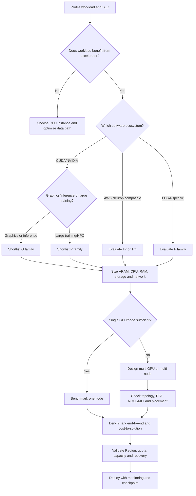

# GPU instance và lựa chọn tài nguyên tăng tốc

GPU instance là Amazon EC2 instance có một hoặc nhiều bộ xử lý đồ họa (GPU) hoặc bộ tăng tốc chuyên dụng để thực hiện các phép tính song song. Chúng phù hợp với deep learning, inference, xử lý ảnh/video, mô phỏng khoa học, rendering và một số workload HPC. Việc chọn instance cần dựa trên loại phép tính, dung lượng bộ nhớ tăng tốc, khả năng kết nối giữa GPU, CPU/RAM, network, storage, phần mềm và khả năng cung cấp capacity trong Region.

AWS có nhiều nhóm accelerated computing. G family thường phục vụ đồ họa, visualization, inference và workload tăng tốc ở quy mô nhỏ đến vừa. P family hướng tới training và HPC hiệu năng cao với NVIDIA GPU. AWS Trainium và Inferentia là accelerator chuyên dụng của AWS, không phải GPU NVIDIA; chúng sử dụng AWS Neuron SDK và có mô hình lập trình, thư viện, khả năng tương thích riêng. Không nên chọn một instance chỉ vì tên family có vẻ mới hơn hoặc số GPU lớn hơn.

Bài học tập trung vào cách đọc thông số EC2, xác định bottleneck, ước lượng GPU memory, lựa chọn một node hay nhiều node, thiết kế EFA/network và storage, chuẩn bị AMI/driver, chọn scheduler và kiểm soát chi phí. Mục tiêu là chọn cấu hình đáp ứng workload với hiệu năng đo được và tổng chi phí hợp lý.

Sau bài học, người học có thể:

- Phân biệt GPU instance với các accelerator như Trainium và Inferentia.
- Chọn G, P hoặc accelerator family theo training, inference, graphics và HPC.
- Đọc GPU count, GPU memory, CPU, system RAM, network bandwidth và local storage.
- Ước lượng bộ nhớ cần cho model, activation, optimizer, batch và KV cache.
- Quyết định single-GPU, multi-GPU trong một node hoặc distributed multi-node.
- Giải thích vai trò của NVLink/NVSwitch, EFA, NCCL, MPI và cluster placement group.
- Chọn AMI, NVIDIA driver, CUDA, framework và container tương thích.
- Lựa chọn AWS Batch, AWS ParallelCluster/Slurm hoặc EKS/EC2 để điều phối workload.
- Thiết kế checkpoint, fault tolerance, security, capacity planning và cost controls.

## 1. GPU instance trong kiến trúc AWS

### 1.1. GPU và accelerator giải quyết bài toán nào?

CPU được tối ưu cho nhiều loại tác vụ tuần tự, điều khiển và xử lý tổng quát. GPU có nhiều execution unit để xử lý lượng lớn phép toán song song, đặc biệt là matrix/vector operation. Deep learning dùng các phép nhân ma trận lớn cho forward pass, backward pass và optimizer; GPU có thể thực hiện các phép tính đó song song với throughput cao.

Một GPU instance thường bao gồm:

- CPU host để điều phối process, data loader, network và I/O.
- System memory (RAM) để giữ dữ liệu, cache và trạng thái ứng dụng.
- Một hoặc nhiều GPU với VRAM riêng cho model, activation, batch và workspace.
- GPU interconnect nội bộ như PCIe hoặc NVLink/NVSwitch tùy loại instance.
- Network interface ENA/EFA để trao đổi dữ liệu với storage, service hoặc node khác.
- Storage như EBS, instance store NVMe và filesystem dùng chung.

Không phải mọi workload cần GPU. Nếu ứng dụng bị giới hạn bởi CPU preprocessing, database, network hoặc storage, tăng GPU count có thể không cải thiện throughput. Trước khi chọn instance, hãy đo tỷ lệ thời gian dành cho compute, data loading, synchronization và I/O.

### 1.2. GPU instance và accelerator chuyên dụng

| Nhóm | Phần cứng | Workload điển hình | Hệ sinh thái |
|---|---|---|---|
| G family | NVIDIA GPU hoặc GPU khác tùy thế hệ | Graphics, visualization, inference, ML nhỏ/vừa | CUDA với NVIDIA; driver/framework theo GPU |
| P family | NVIDIA GPU hiệu năng cao | Large-scale training, multi-GPU, HPC | CUDA, cuDNN, NCCL, framework ML |
| Inf family | AWS Inferentia | Model inference tối ưu chi phí/throughput | AWS Neuron SDK, compiler/runtime |
| Trn family | AWS Trainium/Trainium2 | Model training và một số workload inference | AWS Neuron SDK, framework integration |
| F family | FPGA | Hardware acceleration chuyên biệt | FPGA toolchain và application-specific design |

Trainium và Inferentia là chip tăng tốc được thiết kế cho workload AI. Chúng không chạy CUDA như NVIDIA GPU. Khi cân nhắc, phải kiểm tra framework/operator support, model conversion, compiler, runtime và effort porting. Một benchmark chỉ có ý nghĩa nếu chạy trên đúng model, precision, batch, sequence length và phần mềm sẽ triển khai.

### 1.3. Training, inference và HPC có profile khác nhau

| Workload | Tài nguyên thường chi phối | Điều cần tối ưu |
|---|---|---|
| Training một model nhỏ | GPU compute, VRAM, data loader | GPU utilization, batch size, time-to-train |
| Training model lớn | VRAM tổng, GPU interconnect, EFA, storage | Scaling efficiency, tokens/s, checkpoint time |
| Online inference | VRAM, latency, concurrency, CPU | p50/p95/p99 latency, throughput, cost/request |
| Batch inference | GPU throughput, storage, queue depth | Cost per million records, completion time |
| Computer vision/video | GPU, decode/encode, storage bandwidth | Frames/s, resolution, pipeline balance |
| Scientific simulation | GPU/CPU ratio, memory, inter-node communication | Time-to-solution, MPI efficiency |
| Rendering/visualization | GPU graphics capability, display, memory | Frame rate, rendering time, session density |

Một workload inference có thể cần GPU memory lớn để chứa model nhưng không cần interconnect multi-node. Ngược lại, training phân tán có thể cần network và GPU-to-GPU communication rất nhanh; một GPU đơn mạnh nhưng kết nối node yếu có thể không đem lại hiệu năng mong muốn.

## 2. Đọc các EC2 accelerated instance family

### 2.1. G family: graphics, inference và workload tăng tốc

Các ví dụ family hiện có trong EC2 accelerated computing catalog:

| Family | Accelerator tiêu biểu | Hướng sử dụng |
|---|---|---|
| G4dn | NVIDIA T4 | Graphics, inference và ML workload nhỏ/vừa |
| G5 | NVIDIA A10G | Graphics, inference, training vừa |
| G6 | NVIDIA L4 | Inference, video, graphics và ML hiệu quả |
| G6e | NVIDIA L40S | Inference và workload graphics/AI cần VRAM cao hơn |
| G7 | NVIDIA RTX PRO 4500 | Graphics và accelerated workload thế hệ mới |
| G7e | NVIDIA RTX PRO Server 6000 | Graphics/AI workload cần VRAM lớn |

G family thường phù hợp khi cần tăng tốc cho một ứng dụng hoặc phục vụ nhiều inference request. G6 và G6e có nhiều kích cỡ; một số kích cỡ nhỏ chỉ có một GPU, trong khi instance lớn có nhiều GPU. Không suy ra VRAM của cả instance bằng cách cộng số GPU nếu ứng dụng không thể phân chia model hoặc batch qua các GPU.

### 2.2. P family: training và HPC hiệu năng cao

| Family | GPU tiêu biểu | Đặc điểm lựa chọn |
|---|---|---|
| P4d/P4de | NVIDIA A100 | Training/HPC multi-GPU thế hệ A100 |
| P5 | NVIDIA H100 | Training và inference model lớn |
| P5e/P5en | NVIDIA H200 | Workload cần GPU memory và bandwidth cao |
| P6-B200 | NVIDIA B200 | Training/inference quy mô lớn với Blackwell GPU |
| P6-B300 | NVIDIA B300 | Cấu hình accelerator thế hệ mới với GPU memory rất lớn |
| P6e-GB200 | NVIDIA GB200 Grace Blackwell | Hệ thống multi-GPU kết hợp CPU Grace và GPU Blackwell |

Các ví dụ cấu hình trong catalog hiện hành cho thấy sự khác biệt đáng kể về VRAM: P5.48xlarge có 8 H100 với 80 GiB mỗi GPU; P5e/P5en.48xlarge có 8 H200 với khoảng 141 GiB mỗi GPU; P6-B200.48xlarge có 8 B200 với khoảng 179 GiB mỗi GPU; P6-B300.48xlarge có 8 B300 với khoảng 268 GiB mỗi GPU. P6e-GB200.36xlarge có 4 GPU B200 với khoảng 185 GiB mỗi GPU. Đây là ví dụ để đọc bảng thông số, không phải khuyến nghị mặc định cho mọi model.

### 2.3. Inf và Trn: accelerator không dùng CUDA

| Family | Accelerator | Mục đích chính | Lưu ý |
|---|---|---|---|
| Inf1 | AWS Inferentia thế hệ đầu | Inference | Kiểm tra khả năng tương thích model cũ |
| Inf2 | AWS Inferentia2 | Deep learning inference | Dùng Neuron SDK và compiler/runtime |
| Trn1/Trn1n | AWS Trainium | Training | Dùng Neuron SDK; Trn1n tăng network cho distributed training |
| Trn2/Trn2u | AWS Trainium2 | Training quy mô lớn | Kiểm tra framework, topology và instance availability |

Nếu workload đã phụ thuộc thư viện CUDA custom, chuyển sang Trainium/Inferentia có thể đòi hỏi chuyển đổi code và kiểm thử. Nếu model/framework đã hỗ trợ Neuron tốt, accelerator chuyên dụng có thể mang lại hiệu quả giá/hiệu năng hấp dẫn. Hãy benchmark end-to-end thay vì chỉ so sánh thông số chip.

### 2.4. Không chọn theo thế hệ hoặc số GPU đơn lẻ

Hai instance có cùng số GPU có thể khác nhau về GPU architecture, VRAM, memory bandwidth, GPU interconnect, CPU/RAM, network và local NVMe. Một model có thể fit trên 4 GPU 80 GiB nhưng không fit trên 8 GPU 40 GiB nếu framework không shard model đúng cách hoặc mỗi process phải giữ bản sao model.

Trước khi shortlist, đọc EC2 instance type specification và kiểm tra availability trong Region/AZ thực tế. AWS liên tục bổ sung family, model và kích cỡ; tên family và cấu hình trong tài liệu có thể thay đổi. Luôn dùng catalog hiện hành hoặc `DescribeInstanceTypes` thay vì dựa vào bảng giá/bài viết cũ.

## 3. Xác định cấu hình GPU theo workload

### 3.1. Thu thập yêu cầu trước khi chọn instance

Tạo workload profile thay vì bắt đầu từ tên instance. Những thông tin tối thiểu:

| Nhóm | Cần đo hoặc xác định |
|---|---|
| Model/application | Framework, model architecture, số parameters, operator custom, precision |
| GPU compute | FLOPS cần thiết, utilization mục tiêu, batch throughput |
| GPU memory | Model weights, gradients, optimizer states, activations, KV cache, workspace |
| CPU | Data preprocessing, tokenization, decompression, orchestration |
| System RAM | Dataset cache, data loader workers, host-side buffers |
| Storage | Dataset size, read/write throughput, IOPS, metadata operations |
| Network | Bytes exchanged giữa node, storage throughput, latency |
| Parallelism | Data parallel, tensor parallel, pipeline parallel, model parallel |
| Availability | Region, AZ, service quota, On-Demand/Spot/capacity reservation |
| SLO | Time-to-train, p95 latency, throughput, deadline và budget |

Đo baseline trên cấu hình nhỏ hoặc GPU đang có. Nếu GPU utilization thấp trong khi CPU hoặc storage bận, hãy giải quyết data pipeline trước khi nâng GPU. Nếu GPU utilization cao nhưng VRAM gần đầy, giảm batch/context hoặc chọn GPU memory lớn hơn. Nếu mỗi GPU rảnh khi distributed training, đo network collective và synchronization.

### 3.2. Ước lượng memory cho model

VRAM phải chứa nhiều hơn model weights. Các thành phần thường gồm:

- Weights/parameters.
- Gradients khi training.
- Optimizer states như Adam moments.
- Master weights nếu dùng mixed precision.
- Activations cần giữ cho backward pass.
- Temporary workspace của CUDA/cuDNN/framework.
- Batch input, attention buffers và communication buffers.
- KV cache khi inference autoregressive.

Ước lượng sơ bộ dung lượng weights:

| Precision/format | Bytes/parameter gần đúng | Ghi chú |
|---|---:|---|
| FP32 | 4 | Độ chính xác đầy đủ, footprint lớn |
| FP16/BF16 | 2 | Phổ biến cho mixed precision |
| FP8 | 1 | Cần phần cứng/framework hỗ trợ và đánh giá độ chính xác |
| INT8 | 1 | Có scale/metadata bổ sung |
| INT4 | 0.5 | Có scale/metadata; chất lượng phụ thuộc quantization |

Ví dụ: model 7 tỷ parameters ở BF16 có weights khoảng 14 GB theo phép nhân 7e9 × 2 bytes, chưa tính activation, workspace và các buffer. Nếu model được shard qua nhiều GPU, phần weights mỗi GPU có thể giảm; nếu dùng data parallel với mỗi GPU giữ bản sao model, tổng VRAM của cluster không được cộng lại để xem như một bộ nhớ duy nhất.

### 3.3. Training cần nhiều memory hơn weights

Trong mixed-precision training với Adam, một ước lượng thô thường vào khoảng 12–20 bytes cho mỗi parameter trước khi cộng activation và workspace. Một cách tính minh họa phổ biến là 2 bytes weights + 2 bytes gradients + 4 bytes master weights + 8 bytes optimizer moments = 16 bytes/parameter. Thực tế phụ thuộc framework, precision, optimizer, sharding và implementation.

Do đó, model 7B có thể cần khoảng 112 GB cho các thành phần model/optimizer theo giả định 16 bytes/parameter, trước khi cộng activations, communication buffers và fragmentation. Một GPU 80 GiB sẽ không đủ cho toàn bộ trạng thái theo cấu hình này; cần sharding, model parallel, optimizer offload, quantization hoặc nhiều GPU.

Các kỹ thuật giảm memory:

- Mixed precision (BF16/FP16/FP8) khi phần cứng và model hỗ trợ.
- Activation checkpointing để tính lại một số activation thay vì giữ tất cả.
- Gradient accumulation để mô phỏng batch lớn với micro-batch nhỏ hơn.
- FSDP/ZeRO để shard weights, gradients và optimizer state.
- CPU/NVMe offload khi chấp nhận tăng latency/I/O.
- Quantization hoặc parameter-efficient fine-tuning khi phù hợp.

Mỗi kỹ thuật có trade-off. Ví dụ activation checkpointing giảm VRAM nhưng tăng compute; offload giảm VRAM nhưng có thể tạo bottleneck PCIe/network/storage. Benchmark toàn bộ training step.

### 3.4. KV cache và inference concurrency

Trong autoregressive inference, KV cache lưu key/value của token trước đó cho mỗi layer. Dung lượng tăng theo số layer, số token context, batch/concurrent sequences, số KV heads, head dimension và precision.

Một ước lượng đơn giản:

```text
KV cache bytes ≈
  2 × layers × batch × sequence_length
    × num_kv_heads × head_dim × bytes_per_value
```

Hệ số 2 đại diện cho key và value. Công thức là mô hình gần đúng; kiến trúc GQA/MQA, paged attention, sliding window, cache quantization và implementation có thể làm thay đổi kết quả.

Inference server có thể hết VRAM dù weights đã vừa GPU, vì nhiều request đồng thời cùng giữ KV cache. Khi đó hãy đo concurrency, context length và tokens generated; cân nhắc tăng VRAM, giảm max context/concurrency, dùng paged KV cache hoặc scale-out nhiều replica.

### 3.5. Chọn số GPU và kích thước instance

| Tình huống | Hướng lựa chọn |
|---|---|
| Model vừa VRAM, latency thấp, ít communication | Một GPU hoặc một GPU trên G family |
| Training cần nhiều compute nhưng model vừa một GPU | Multi-GPU data parallel trong một node |
| Model không vừa một GPU | Tensor/model parallel hoặc FSDP sharding |
| Training phân tán qua nhiều node | P family có EFA, NCCL và cluster placement group |
| Batch inference độc lập | Nhiều worker/replica một GPU; scale theo queue |
| HPC MPI tightly coupled | Instance có EFA, placement group và topology phù hợp |
| Model có thể port sang Neuron | Đánh giá Trn/Inf bằng benchmark và effort chuyển đổi |

Không phải cứ tăng GPU count là throughput tăng tuyến tính. Communication, synchronization, data loading, framework overhead và straggler có thể làm scaling efficiency giảm. Tính throughput thực tế trên mỗi USD hoặc thời gian hoàn tất workload, không chỉ so sánh peak TFLOPS.

## 4. Multi-GPU, interconnect và distributed computing

### 4.1. Single-node multi-GPU

Trong một EC2 instance có nhiều GPU, framework có thể phân chia workload theo data parallel, tensor parallel hoặc pipeline parallel. GPU-to-GPU communication có thể đi qua PCIe hoặc NVLink/NVSwitch tùy instance.

- Data parallel: mỗi GPU xử lý batch khác nhau; gradient được đồng bộ.
- Tensor parallel: chia tensor/ma trận giữa nhiều GPU; cần communication thường xuyên.
- Pipeline parallel: chia các layer thành stage và truyền activation giữa stage.
- Fully Sharded Data Parallel (FSDP): phân chia model state giữa GPU/worker để giảm memory mỗi GPU.

Trước khi mua multi-GPU instance, kiểm tra topology bằng `nvidia-smi topo -m`, số GPU, GPU memory, NVLink/NVSwitch và băng thông PCIe. Chạy `nccl-tests` hoặc benchmark framework để đo collective communication. Không giả định mọi GPU trên một instance có cùng topology hoặc băng thông peer-to-peer.

### 4.2. Multi-node và Elastic Fabric Adapter

Khi training trên nhiều EC2 instance, mỗi node cần trao đổi gradients, tensor hoặc activation. TCP/IP thông thường có thể tạo overhead và latency đáng kể. Elastic Fabric Adapter (EFA) là network interface cho workload AI/ML và HPC, cung cấp communication latency thấp và throughput cao với OS-bypass/Libfabric.

EFA tích hợp với:

- NVIDIA NCCL cho multi-GPU/distributed deep learning.
- MPI (Open MPI/Intel MPI) cho HPC.
- Libfabric để truy cập transport.
- Các tính năng RDMA và accelerator data transfer trên một số instance/driver được hỗ trợ.

Không phải mọi instance đều hỗ trợ EFA hoặc mọi tính năng RDMA. Kiểm tra instance type và Region; một số capability như RDMA write, GPUDirect RDMA hoặc accelerator-initiated transfer chỉ có trên các loại instance cụ thể.

### 4.3. Cluster placement group

Cluster placement group đặt các instance gần nhau trong cùng một Availability Zone, tạo điều kiện cho latency thấp và network throughput cao giữa các node. Đây là lựa chọn thường dùng cho tightly coupled HPC và distributed training.

Các giới hạn cần nhớ:

- Cluster placement group không trải qua nhiều AZ.
- EFA traffic không route qua AZ hoặc VPC khác.
- Capacity có thể khó lấy khi launch nhiều instance cùng lúc.
- Cùng instance type và một launch request thường tăng khả năng lấy đủ capacity.
- Có thể kết hợp On-Demand Capacity Reservation trong cluster placement group khi workload cần capacity có thể dự đoán.

Cluster placement group tối ưu network giữa node, nhưng làm failure domain tập trung hơn vào một AZ. Thiết kế checkpoint và recovery để workload có thể khởi chạy lại ở cluster/AZ khác khi cần.

### 4.4. Kiểm tra EFA và NCCL

Một số bước kiểm tra sau khi launch EFA-enabled instance:

```bash
echo "GPU inventory and topology"
nvidia-smi
nvidia-smi topo -m

# Verify EFA interface and libfabric provider
fi_info -p efa

# Run NCCL tests after installing a compatible NCCL test build
./build/all_reduce_perf -b 8M -e 1G -f 2 -g 8
```

Lệnh NCCL test minh họa cho node có 8 GPU và binary đã build tương thích với CUDA/NCCL. Với multi-node, cấu hình MPI/hostfile, EFA security group và network interface theo hướng dẫn AWS; không chạy nguyên lệnh single-node cho cluster nhiều node.

## 5. Storage và data pipeline cho GPU workload

### 5.1. Vì sao storage có thể làm GPU idle?

GPU cần được cung cấp batch liên tục. Nếu dataset nằm trên storage có throughput thấp, data loader không đọc đủ nhanh, GPU phải chờ I/O và utilization giảm. Với training, bottleneck có thể nằm ở việc đọc file nhỏ, metadata lookup, decompression, augmentation hoặc network thay vì bandwidth tuần tự.

Đo các yếu tố:

- Read/write throughput và IOPS.
- Latency của file open/stat và metadata operation.
- Kích thước file, số file và pattern truy cập.
- Số data loader worker, prefetch queue và CPU preprocessing.
- Cache hit rate, local NVMe usage và network traffic.
- Thời gian checkpoint ghi ra storage.

### 5.2. Chọn storage theo pattern

| Dịch vụ/storage | Đặc điểm | Cách dùng trong GPU/HPC |
|---|---|---|
| Amazon S3 | Object storage bền vững, scale lớn | Dataset source, checkpoint archive, artifact/model repository |
| EBS gp3 | Block storage linh hoạt, có thể cấu hình IOPS/throughput | Boot volume, package, dataset cache, checkpoint cục bộ |
| EBS io2 | Block storage hiệu năng cao và độ bền cao | Workload cần IOPS/latency block ổn định |
| EC2 instance store NVMe | Local ephemeral storage, throughput cao | Scratch data, cache, temporary shard và staging |
| Amazon FSx for Lustre | Parallel file system throughput cao | Shared dataset/checkpoint cho nhiều compute node |
| Amazon EFS | Shared NFS file system | Shared home/config hoặc workload file-based vừa phải; benchmark trước với dataset lớn |

Instance store mất dữ liệu khi instance bị stop/terminate hoặc host replacement theo semantics của loại instance. Không dùng instance store làm bản duy nhất của dataset, checkpoint hoặc model artifact. Hãy đồng bộ dữ liệu cần giữ sang S3/EBS/FSx theo kế hoạch.

### 5.3. FSx for Lustre cho dataset lớn

Amazon FSx for Lustre là managed parallel file system dành cho workload cần storage throughput cao như HPC, ML, video processing và financial modeling. Nhiều compute node có thể mount cùng file system. FSx for Lustre tích hợp với S3 data repository để import/export dữ liệu theo workflow.

Một pattern phổ biến:

1. Dataset gốc được quản lý trong S3.
2. Tạo FSx for Lustre và liên kết S3 data repository.
3. Stage dữ liệu cần thiết vào filesystem trước hoặc khi job truy cập.
4. Các GPU node mount filesystem và đọc shard dữ liệu song song.
5. Checkpoint/model output được ghi vào filesystem rồi export/sync về S3.
6. Sau job, đánh giá chi phí storage/throughput và xóa tài nguyên không còn cần.

Với file system có throughput lớn, EFA-enabled FSx for Lustre có thể cải thiện throughput từ client; một số cấu hình hỗ trợ GPUDirect Storage (GDS). Phải kiểm tra client instance, filesystem deployment, EFA/GDS support và software stack cụ thể trước khi bật.

### 5.4. Data loader và checkpoint

Tối ưu data pipeline theo thứ tự:

- Shard dataset để nhiều worker đọc song song.
- Dùng file format phù hợp, tránh hàng triệu file cực nhỏ nếu metadata là bottleneck.
- Prefetch batch và overlap I/O với GPU compute.
- Tận dụng local NVMe làm cache có thể tái tạo.
- Điều chỉnh số worker theo CPU, RAM và storage.
- Nén dữ liệu khi tiết kiệm network/storage lớn hơn chi phí giải nén CPU.
- Ghi checkpoint định kỳ và giữ nhiều generation để có thể khôi phục.

Checkpoint cần chứa model weights, optimizer/scheduler state, RNG state, training step, configuration và metadata về dataset position. Với distributed training, checkpoint phải nhất quán giữa rank/worker. Kiểm thử restore thực tế; một file checkpoint được ghi ra không có nghĩa training có thể resume đúng.

## 6. AMI, driver, CUDA và container

### 6.1. Chọn AMI phù hợp

AWS Deep Learning AMI (DLAMI) là machine image được cấu hình sẵn cho deep learning, có thể bao gồm NVIDIA driver, CUDA, cuDNN, framework, container tooling và thư viện tối ưu. DLAMI giúp giảm thời gian cài đặt ban đầu, nhưng cần kiểm tra phiên bản OS, kernel, driver, CUDA, framework và loại instance được hỗ trợ.

Các lựa chọn thường gặp:

- AWS Deep Learning Base GPU AMI: nền tảng GPU với driver và công cụ cơ bản; tự cài framework phù hợp.
- Deep Learning AMI có framework: môi trường có sẵn một số framework và package.
- AWS Neuron AMI: môi trường dành cho Trainium/Inferentia.
- Custom AMI: kiểm soát dependency, hardening, startup và benchmark đã được xác minh.

AMI mới nhất không nhất thiết tương thích với code hoặc container cũ. Pin phiên bản và chạy regression test trước khi thay AMI production.

### 6.2. Driver và CUDA compatibility

NVIDIA driver phải tương thích với GPU architecture, kernel và CUDA runtime mà framework/container sử dụng. Container thường đóng gói CUDA runtime/library, nhưng vẫn dựa vào NVIDIA driver trên host. Không cài nhiều driver khác nhau một cách tùy tiện giữa host và container.

Kiểm tra trên instance:

```bash
nvidia-smi
nvcc --version
python -c "import torch; print(torch.__version__); print(torch.cuda.is_available()); print(torch.cuda.device_count())"
```

`nvidia-smi` hiển thị GPU, driver và trạng thái sử dụng; `nvcc --version` hiển thị CUDA compiler toolkit nếu được cài. `torch.cuda.is_available()` xác nhận PyTorch có thể khởi tạo CUDA trong môi trường hiện tại. Các lệnh này không thay thế benchmark thực tế hoặc kiểm tra NCCL multi-node.

### 6.3. Container hóa GPU workload

Container giúp đóng gói framework, Python package, model code và dependency. Để container nhìn thấy GPU:

- Host cần NVIDIA driver phù hợp.
- NVIDIA Container Toolkit hoặc runtime tích hợp phải được cấu hình.
- Scheduler/container runtime phải cấp GPU device cho container.
- Container image phải chứa CUDA runtime và framework tương thích.
- Với multi-GPU, container cần quyền/device mapping phù hợp cho toàn bộ GPU được cấp.

Không đóng gói kernel driver vào container như một cách thay thế driver host. Pin image theo digest/version, scan vulnerability và lưu Dockerfile để tái tạo môi trường.

### 6.4. Neuron software stack

Trainium/Inferentia sử dụng AWS Neuron SDK, gồm compiler, runtime và framework integration. Kiểm tra version Neuron SDK với AMI, kernel, framework và instance family. Một số model/operator có thể chưa được hỗ trợ hoặc cần chuyển đổi graph; hãy chạy model compilation và benchmark trên đúng instance trước khi quyết định chuyển production.

## 7. Scheduling và orchestration

### 7.1. Chọn công cụ theo loại workload

| Công cụ | Phù hợp | Điểm cần lưu ý |
|---|---|---|
| EC2 trực tiếp/Auto Scaling | Một vài GPU node, service inference hoặc môi trường tùy biến | Tự quản lý lifecycle, scale và placement |
| AWS Batch | Batch job/container cần queue, retry và scale compute environment | GPU resource phải khai báo trong job definition; chọn đúng family được hỗ trợ |
| AWS ParallelCluster + Slurm | HPC, MPI, distributed training và cluster người dùng | Slurm quản lý partition, queue, node và job |
| Amazon EKS | GPU workload dạng Kubernetes deployment/job | Cần GPU driver/device plugin, node group và scheduler policy |
| SageMaker AI | Training/inference được quản lý theo job/endpoint | Phù hợp khi muốn abstraction managed ML, không cần tự quản lý toàn bộ EC2 cluster |

AWS Batch hỗ trợ job dùng NVIDIA GPU trên các instance family được liệt kê trong tài liệu hiện hành như P3/P4/P5/P6 và G3/G4/G5/G6/Gr6/G7/G7e. AWS Batch GPU scheduler không hỗ trợ GPU AMD của G4ad theo cơ chế GPU resource requirement chuẩn; custom AMI/launch template có thể cần cấu hình riêng. Luôn kiểm tra danh sách family hỗ trợ trước khi tạo compute environment.

AWS ParallelCluster hiện sử dụng Slurm là scheduler được khuyến nghị cho HPC. Từ ParallelCluster 3.16.0, AWS Batch scheduler không còn được hỗ trợ trong ParallelCluster; AWS Batch service độc lập vẫn hỗ trợ GPU job. Không nhầm hai cách tích hợp này.

### 7.2. AWS Batch GPU job definition

Với AWS Batch, khai báo số GPU cần pin cho job trong `resourceRequirements`. GPU được yêu cầu sẽ không được job khác sử dụng trong thời gian job chạy trên instance đó.

Ví dụ job definition:

```json
{
  "jobDefinitionName": "gpu-training",
  "type": "container",
  "platformCapabilities": ["EC2"],
  "containerProperties": {
    "image": "123456789012.dkr.ecr.ap-southeast-1.amazonaws.com/training:stable",
    "resourceRequirements": [
      { "type": "VCPU", "value": "16" },
      { "type": "MEMORY", "value": "65536" },
      { "type": "GPU", "value": "1" }
    ],
    "command": ["python", "train.py"]
  }
}
```

Ví dụ minh họa resource requirement, không phải job definition hoàn chỉnh cho mọi environment. Compute environment phải dùng instance family tương thích với GPU scheduling và đủ vCPU/memory. Nếu job yêu cầu GPU không có trong compute environment, job có thể nằm ở trạng thái `RUNNABLE` mà không được chạy.

### 7.3. Slurm trên AWS ParallelCluster

ParallelCluster triển khai HPC cluster với head node và compute node. Slurm cung cấp partition/queue, job submission, resource allocation, accounting và scale compute fleet theo cấu hình. Một partition có thể dành cho GPU node; partition khác dành cho CPU preprocessing hoặc high-memory job.

Ví dụ Slurm job script:

```bash
#!/bin/bash
#SBATCH --job-name=train-model
#SBATCH --partition=gpu
#SBATCH --nodes=2
#SBATCH --ntasks-per-node=8
#SBATCH --gres=gpu:8
#SBATCH --time=08:00:00
#SBATCH --output=logs/%x-%j.out

srun python -m torch.distributed.run --nnodes=2 --nproc_per_node=8 train.py
```

Các giá trị nodes, tasks và GPU phải khớp topology của compute resource. Với distributed training, cấu hình NCCL/EFA, host discovery, rendezvous endpoint và network interface theo framework. Job script này là khung minh họa; hãy kiểm tra Slurm GRES configuration và ParallelCluster queue config.

### 7.4. GPU scheduling trong Kubernetes

Với EKS, GPU node cần AMI/driver phù hợp và NVIDIA device plugin hoặc thành phần GPU operator tương thích. Pod khai báo GPU như extended resource `nvidia.com/gpu`. Scheduler chỉ đặt pod lên node có GPU resource khả dụng.

Cần quản lý:

- Node group/compute pool dành riêng cho GPU.
- Taint/toleration và node selector để job CPU không chiếm GPU node.
- GPU request/limit và mức chia sẻ GPU nếu nền tảng hỗ trợ.
- Autoscaling và thời gian khởi động node.
- Image pull, model download và dataset mount.
- GPU health monitoring, device plugin và driver upgrade.

## 8. Capacity, placement và khả năng cung cấp instance

### 8.1. Region, AZ và service quota

GPU capacity thường khan hiếm hơn instance phổ thông. Trước khi thiết kế production:

1. Xác định model instance được hỗ trợ ở Region/AZ.
2. Kiểm tra On-Demand/Spot quota theo instance family.
3. Kiểm tra subnet IP capacity và EFA/ENI limits.
4. Kiểm tra số lượng network interface, EBS bandwidth và storage quota.
5. Thử launch đúng instance type, AMI, subnet và placement group.
6. Nếu workload có deadline, lên kế hoạch capacity reservation hoặc Capacity Blocks nếu sản phẩm/instance/Region hỗ trợ.

Quota được cấp theo account và Region. Việc thấy instance type trong catalog không có nghĩa account chắc chắn launch được. Cần kiểm tra service quota, instance type offerings và capacity thực tế.

### 8.2. Kiểm tra GPU và EFA instance offerings

Có thể dùng EC2 API để liệt kê instance có GPU trong Region:

```bash
aws ec2 describe-instance-types --region <REGION> --query "InstanceTypes[?GpuInfo.Gpus != null].[InstanceType, GpuInfo.Gpus[].Name, GpuInfo.Gpus[].MemoryInfo.SizeInMiB]" --output table
```

Để tìm instance hỗ trợ EFA:

```bash
aws ec2 describe-instance-types --region <REGION> --filters Name=network-info.efa-supported,Values=true --query "InstanceTypes[*].InstanceType" --output text
```

Kết quả là thông tin type offering, không bảo đảm capacity đang trống ở AZ. Dùng `describe-instance-type-offerings` để kiểm tra offering theo AZ và kiểm tra quota/capacity bằng quy trình launch test hoặc reservation.

### 8.3. Placement và capacity reservation

Cluster placement group phù hợp cho cluster tightly coupled, nhưng launch nhiều GPU instance cùng lúc có thể gặp `InsufficientInstanceCapacity`. Để giảm rủi ro:

- Ưu tiên cùng instance type và một cluster placement group.
- Chuẩn bị On-Demand Capacity Reservation trong placement group nếu cần capacity xác định.
- Linh hoạt instance size/family khi framework có thể chạy trên nhiều cấu hình.
- Kiểm tra quota và capacity trước lịch training.
- Giữ cluster trong một AZ cho EFA traffic; thiết kế checkpoint/restore để phục hồi sang AZ khác nếu AZ gặp sự cố.

Không nhầm Savings Plans hoặc Reserved Instances với capacity reservation. Chúng có thể giảm chi phí nhưng không nhất thiết giữ sẵn đúng GPU capacity cần launch.

## 9. Reliability, security và vận hành

### 9.1. Checkpoint và khôi phục

GPU training có thể chạy hàng giờ hoặc nhiều ngày. Một interruption hoặc node failure có thể làm mất nhiều compute nếu không có checkpoint.

Thiết kế recovery:

- Ghi checkpoint theo thời gian hoặc theo số step.
- Lưu checkpoint ra storage bền vững như S3/FSx/EBS theo durability requirement.
- Với distributed training, đồng bộ checkpoint giữa ranks và ghi manifest hoàn tất.
- Ghi cả optimizer state, scheduler state, RNG state, epoch/step và data sampler position.
- Dùng atomic write/rename hoặc manifest để phân biệt checkpoint hoàn chỉnh với file đang ghi.
- Thử restore từ checkpoint trên instance/cluster mới.
- Đo checkpoint duration và ảnh hưởng đến training throughput.

### 9.2. Spot Instances cho GPU job

Spot có thể giảm chi phí cho batch job có thể chịu interruption. EC2 có thể phát interruption notice khoảng hai phút trước khi reclaim instance. Spot phù hợp với workload stateless, fault-tolerant, flexible và có checkpoint; không phù hợp với distributed training tightly coupled hoặc workload không thể chịu việc mất một node giữa collective operation.

Nếu dùng Spot:

- Tạo checkpoint thường xuyên hơn so với thời gian chấp nhận mất compute.
- Xử lý rebalance recommendation và interruption notice bằng EventBridge.
- Tách job thành nhiều task độc lập nếu có thể.
- Linh hoạt instance type và AZ để tăng cơ hội lấy capacity.
- Chọn allocation strategy ưu tiên capacity khi cost of interruption cao.
- Không giả định có thể tự động failover mọi GPU Spot node sang On-Demand cùng loại ngay lập tức.

Với distributed job nhiều node, mất một node có thể làm cả job fail. Chỉ dùng Spot khi framework/scheduler có cơ chế elastic recovery hoặc checkpoint/restart đủ nhanh và chi phí restart đã được tính.

### 9.3. Bảo mật workload và dữ liệu

- Gắn IAM instance/task role tối thiểu cần thiết; tránh access key dài hạn trong AMI/container.
- Bật IMDSv2 và giới hạn quyền truy cập instance metadata.
- Mã hóa EBS, S3 và FSx bằng AWS KMS theo policy của tổ chức.
- Giới hạn security group, subnet và outbound access; dùng VPC endpoint khi phù hợp.
- Với EFA, cấu hình security group theo yêu cầu OS-bypass: cho phép inbound/outbound giữa các interface cùng security group theo hướng dẫn AWS, đồng thời giới hạn membership vào các node của cluster.
- Không đưa dataset nhạy cảm vào log hoặc container image.
- Quét container image, pin dependency và cập nhật driver/AMI theo lịch kiểm soát.
- Tách development, training và production account/role khi cần isolation.
- Dùng CloudTrail, CloudWatch và audit trail cho hoạt động quản trị.

### 9.4. Monitoring GPU và cluster

Theo dõi ở cả cấp GPU, node, job và storage:

| Metric | Vì sao cần |
|---|---|
| GPU utilization | Xác định GPU có bận thực sự hay đang chờ CPU/I/O |
| GPU memory used/free | Phát hiện OOM và memory fragmentation |
| GPU temperature/power | Nhận biết thermal/power throttling |
| GPU ECC/Xid errors | Phát hiện lỗi phần cứng/driver |
| CPU/RAM utilization | Tìm bottleneck preprocessing hoặc host |
| Network/EFA throughput | Đo communication và collective bottleneck |
| NCCL collective time | Xác định thời gian synchronization |
| Storage throughput/latency | Xác định data loader bottleneck |
| Job queue wait time | Đo capacity và scheduler congestion |
| Checkpoint duration/failure | Đánh giá khả năng phục hồi |
| Cost per training step/inference | So sánh hiệu quả cấu hình |

Dùng CloudWatch cho metric/log hệ thống, NVIDIA DCGM hoặc exporter tương thích để thu thập GPU telemetry. Với FSx for Lustre, theo dõi throughput, metadata performance và client traffic. Với Slurm/AWS Batch, theo dõi queue depth, pending job, failed job và utilization compute environment.

### 9.5. Cost optimization

Tổng chi phí không chỉ là giá EC2 theo giờ:

- GPU instance hours và thời gian node idle.
- EBS, FSx for Lustre, S3 storage và request.
- Data transfer giữa AZ/Region hoặc ra Internet.
- EFA không thu thêm phí sử dụng interface, nhưng instance/network/storage vẫn có chi phí.
- Checkpoint/restart và thời gian GPU không tạo ra kết quả hữu ích.
- CloudWatch metrics/logs, snapshot và artifact retention.

Các biện pháp:

- Dùng GPU nhỏ hơn cho preprocessing, orchestration và inference traffic thấp.
- Dùng G family cho workload phù hợp thay vì P family nếu không cần interconnect/VRAM lớn.
- Scale-to-zero hoặc scale compute environment theo queue khi job không chạy.
- Dùng Spot cho job có thể checkpoint và chịu interruption.
- Dùng On-Demand Capacity Reservation khi cần capacity chắc chắn; đánh giá chi phí reservation.
- Tối ưu batch, precision, data loader và GPU utilization trước khi tăng node count.
- Theo dõi cost per epoch, cost per million tokens hoặc cost per completed job.

So sánh cấu hình theo cost-to-solution: chi phí để hoàn thành một lần training/inference với chất lượng và SLO đã định. Một instance có giá theo giờ cao hơn vẫn có thể rẻ hơn nếu hoàn thành job nhanh hơn đáng kể.

## 10. Ví dụ thực tế: chọn GPU cho training model thị giác máy tính

### 10.1. Bối cảnh

Một nhóm xây dựng hệ thống phát hiện lỗi sản phẩm từ ảnh dây chuyền. Dataset có hàng chục triệu ảnh; training cần nhiều epoch, batch lớn và augmentation. Nhóm cần lựa chọn giữa G6e, P5 và P5e, đồng thời chạy thử trên AWS trước khi mua capacity dài hạn.

### 10.2. Quy trình lựa chọn

**Bước 1 — Profile workload:** xác định model architecture, input resolution, batch size, precision, số parameters, activation memory và thời gian mỗi epoch trên GPU hiện có.

**Bước 2 — Xác định memory:** tính weights + gradients + optimizer + activations + workspace. Nếu một GPU không đủ, thử mixed precision, activation checkpointing hoặc FSDP/model parallel trước khi tăng số node.

**Bước 3 — Chọn shortlist:** G6e có thể phù hợp inference/graphics và training vừa; P5 phù hợp training cần H100 và multi-GPU; P5e có H200 với VRAM lớn hơn cho workload memory-bound. So sánh cả CPU, network và local NVMe.

**Bước 4 — Đo data pipeline:** stage dataset vào FSx for Lustre hoặc cache trên local NVMe; đo GPU utilization và storage throughput. Tăng data loader worker đến khi không còn bottleneck mà không làm CPU/RAM quá tải.

**Bước 5 — Đo scaling:** chạy một GPU, multi-GPU trong một node và multi-node với EFA nếu cần. Ghi samples/second, epoch duration, scaling efficiency và communication time.

**Bước 6 — Đánh giá chi phí:** so sánh cost/epoch và tổng thời gian training, bao gồm checkpoint, storage, data transfer và idle time.

**Bước 7 — Chốt production:** xác minh quota/capacity, AMI/driver, checkpoint restore, monitoring, security và runbook trước khi chạy workload dài.

### 10.3. Bảng quyết định mẫu

| Kết quả đo | Quyết định |
|---|---|
| Một GPU đủ VRAM và GPU utilization cao | Giữ single-GPU hoặc tăng batch đến SLO |
| VRAM thiếu nhưng compute còn dư | Chọn GPU memory lớn hơn hoặc sharding |
| GPU utilization thấp, CPU cao | Tối ưu preprocessing/data loader |
| GPU chờ dữ liệu, storage latency cao | Cache/stage dataset, cân nhắc FSx for Lustre |
| Multi-GPU scaling kém | Kiểm tra topology, NCCL, batch size và communication |
| Multi-node scaling kém | Kiểm tra EFA, placement group, network và synchronization |
| Spot interruption làm mất nhiều compute | Tăng checkpoint hoặc dùng On-Demand cho job tightly coupled |

## 11. Quy trình ra quyết định chọn GPU instance

### 11.1. Decision flow



### 11.2. Thứ tự đánh giá thực tế

Một quy trình ngắn gọn:

1. Xác định workload có thực sự cần accelerator hay không.
2. Chọn hệ sinh thái phần mềm: CUDA/NVIDIA, AWS Neuron hoặc FPGA.
3. Xác định VRAM mỗi GPU và tổng memory mà framework có thể sử dụng.
4. Tính CPU/RAM, storage throughput và network cần thiết.
5. Chọn một GPU, multi-GPU node hoặc multi-node.
6. Xác minh EFA, GPU interconnect, placement group và scheduler support.
7. Kiểm tra Region/AZ, quota, capacity, AMI và driver.
8. Benchmark end-to-end và tính cost-to-solution.
9. Thử interruption, checkpoint/restore và production monitoring.

## 12. Bài thực hành: lựa chọn GPU instance cho workload training

### Bối cảnh

Một nhóm data science huấn luyện mô hình vision transformer trên dataset ảnh lớn. Mô hình có 7 tỷ parameters, dùng BF16, batch size lớn và Adam optimizer. Training cần chạy trong thời gian giới hạn; dataset ban đầu nằm trong S3. Nhóm có thể chọn G6e, P5 hoặc P5e và cân nhắc multi-GPU.

### Nhiệm vụ

1. Xây workload profile: model, precision, input resolution, batch, epoch, data size và SLO.
2. Ước lượng weights, gradients, optimizer states, activations và workspace.
3. Tính sơ bộ VRAM cần thiết và xác định có cần FSDP/model parallel hay không.
4. So sánh G6e, P5 và P5e theo GPU type, VRAM/GPU, GPU count, CPU/RAM, network và local storage.
5. Xác định training có thể chạy trên một GPU, multi-GPU trong node hay multi-node.
6. Nếu chạy multi-node, kiểm tra EFA support, NCCL, cluster placement group và cùng-AZ requirement.
7. Thiết kế storage pipeline từ S3 sang FSx for Lustre hoặc local NVMe cache.
8. Chọn DLAMI/custom AMI, NVIDIA driver, CUDA và container version tương thích.
9. Chọn AWS Batch hoặc ParallelCluster/Slurm; viết job definition hoặc Slurm script.
10. Xác định checkpoint frequency, Spot suitability, failure recovery và cost budget.
11. Đề xuất CloudWatch/DCGM metrics để phát hiện GPU idle, OOM, network bottleneck và storage bottleneck.
12. Chạy benchmark với ít nhất hai cấu hình và báo cáo cost/epoch, time-to-train và scaling efficiency.

### Tiêu chí hoàn thành

- Quyết định instance dựa trên workload profile và benchmark.
- VRAM estimate tính cả activation/optimizer/cache, không chỉ model weights.
- GPU memory không bị coi là một pool thống nhất khi chưa có sharding.
- Network/interconnect được kiểm tra nếu workload phân tán.
- Storage có đủ throughput cho data loader.
- AMI/driver/CUDA/framework được pin và tương thích.
- Scheduler có khai báo GPU resource đúng.
- Checkpoint có thể restore trên node mới.
- Spot chỉ được chọn khi workload chịu được interruption.
- Báo cáo cost-to-solution và giới hạn của phép đo.

## 13. Câu hỏi tự kiểm tra

1. GPU instance khác CPU instance ở điểm nào?
2. Vì sao Trainium và Inferentia không thể được xem là NVIDIA GPU?
3. G family và P family thường phục vụ workload nào?
4. Vì sao GPU memory của nhiều GPU không tự động hợp thành một vùng memory duy nhất?
5. Những thành phần nào ngoài model weights tiêu thụ VRAM khi training?
6. KV cache tăng theo những yếu tố nào trong inference?
7. Data parallel khác tensor parallel ở điểm nào?
8. Khi nào EFA có thể cải thiện distributed training?
9. Vì sao EFA traffic phải nằm trong cùng AZ và VPC?
10. Cluster placement group giúp gì và giới hạn ra sao?
11. FSx for Lustre phù hợp với pattern storage nào?
12. Vì sao cần kiểm tra CUDA/driver/framework compatibility?
13. AWS Batch GPU job cần khai báo resource gì?
14. AWS ParallelCluster dùng scheduler nào cho HPC hiện nay?
15. Khi nào Spot phù hợp và khi nào không phù hợp với GPU training?
16. Những metric nào giúp phát hiện GPU đang chờ storage hoặc network?

### Gợi ý trả lời

1. GPU có nhiều execution unit cho phép tính song song; CPU phù hợp với điều khiển và xử lý tổng quát.
2. Trainium/Inferentia là accelerator AWS dùng Neuron SDK, không dùng CUDA/NVIDIA driver stack.
3. G thường cho graphics/inference và ML vừa; P hướng đến training/HPC hiệu năng cao.
4. Mỗi GPU có VRAM riêng; framework phải dùng model/tensor sharding hoặc cơ chế memory sharing được hỗ trợ.
5. Gradients, optimizer state, master weights, activations, workspace, communication buffer và KV cache.
6. Số layer, context length, batch/concurrency, KV heads, head dimension và precision.
7. Data parallel nhân bản model và chia batch; tensor parallel chia phép tính/tensor giữa GPU.
8. Khi node cần trao đổi lượng lớn gradient/tensor và latency/throughput network là bottleneck.
9. EFA transport không route qua AZ hoặc VPC khác; thiết kế cluster phải thỏa topology đó.
10. Nó đặt instance gần nhau trong cùng AZ để giảm latency/tăng throughput; không trải qua nhiều AZ và capacity có thể khan hiếm.
11. Dataset/checkpoint lớn cần parallel filesystem throughput cao cho nhiều client.
12. Driver host, CUDA runtime, framework và GPU architecture phải tương thích để kernel chạy ổn định.
13. Khai báo số GPU cùng vCPU và memory trong job definition.
14. Slurm là scheduler được khuyến nghị; AWS Batch service độc lập vẫn có thể chạy GPU job.
15. Spot phù hợp job độc lập, fault-tolerant và checkpointable; không phù hợp tightly coupled multi-node job không chịu được mất node.
16. GPU utilization, memory, CPU/RAM, EFA/network throughput, NCCL time, storage throughput/latency và data loader wait.

## 14. Checklist production readiness

- [ ] Workload profile có model, precision, batch, SLO và deadline.
- [ ] Đã xác định CPU, GPU, VRAM, RAM, storage và network bottleneck.
- [ ] GPU family được chọn theo software stack và workload.
- [ ] VRAM estimate tính cả weights, optimizer, gradients, activations, workspace và KV cache.
- [ ] Đã kiểm tra GPU count, memory per GPU, interconnect topology và network bandwidth.
- [ ] Multi-node workload đã xác minh EFA, NCCL/MPI và cluster placement group.
- [ ] EFA traffic được thiết kế trong cùng AZ/VPC.
- [ ] Region, AZ, quota, instance offering và capacity đã được xác minh.
- [ ] Capacity Reservation/Capacity Blocks được cân nhắc nếu workload có deadline.
- [ ] AMI, kernel, NVIDIA driver, CUDA, framework và container đã được pin/test.
- [ ] Trainium/Inferentia workload dùng Neuron SDK tương thích.
- [ ] Dataset pipeline đủ throughput; checkpoint nằm trên storage bền vững.
- [ ] AWS Batch job khai báo GPU resource đúng hoặc Slurm GRES đã được cấu hình.
- [ ] Spot chỉ dùng khi workload có checkpoint và chịu interruption.
- [ ] IAM role, IMDSv2, KMS, security group và container image được bảo vệ.
- [ ] CloudWatch/DCGM monitor GPU, network, storage, queue và job health.
- [ ] Có test restore checkpoint và runbook node failure/scale.
- [ ] Cost-to-solution được đo và budget/alarm được thiết lập.

## 15. Tài liệu tham khảo

- [Amazon EC2 accelerated computing instance specifications](https://docs.aws.amazon.com/ec2/latest/instancetypes/ac.html)
- [Get started with GPU accelerated instances](https://docs.aws.amazon.com/AWSEC2/latest/UserGuide/gpu-instances-started.html)
- [Elastic Fabric Adapter for AI/ML and HPC workloads](https://docs.aws.amazon.com/AWSEC2/latest/UserGuide/efa.html)
- [Create and attach an Elastic Fabric Adapter](https://docs.aws.amazon.com/AWSEC2/latest/UserGuide/create-efa.html)
- [Get started with EFA and MPI for HPC workloads](https://docs.aws.amazon.com/AWSEC2/latest/UserGuide/efa-start.html)
- [Placement strategies for EC2 placement groups](https://docs.aws.amazon.com/AWSEC2/latest/UserGuide/placement-strategies.html)
- [What are AWS Deep Learning AMIs?](https://docs.aws.amazon.com/dlami/latest/devguide/what-is-dlami.html)
- [Run GPU jobs with AWS Batch](https://docs.aws.amazon.com/batch/latest/userguide/gpu-jobs.html)
- [Slurm Workload Manager with AWS ParallelCluster](https://docs.aws.amazon.com/parallelcluster/latest/ug/slurm-workload-manager-v3.html)
- [AWS ParallelCluster scheduling configuration](https://docs.aws.amazon.com/parallelcluster/latest/ug/Scheduling-v3.html)
- [What is Amazon FSx for Lustre?](https://docs.aws.amazon.com/fsx/latest/LustreGuide/what-is.html)
- [Amazon FSx for Lustre performance](https://docs.aws.amazon.com/fsx/latest/LustreGuide/performance.html)
- [Working with EFA-enabled FSx for Lustre file systems](https://docs.aws.amazon.com/fsx/latest/LustreGuide/efa-file-systems.html)
- [Best practices for Amazon EC2 Spot](https://docs.aws.amazon.com/AWSEC2/latest/UserGuide/spot-best-practices.html)
- [Spot Instance interruptions](https://docs.aws.amazon.com/AWSEC2/latest/UserGuide/spot-interruptions.html)
