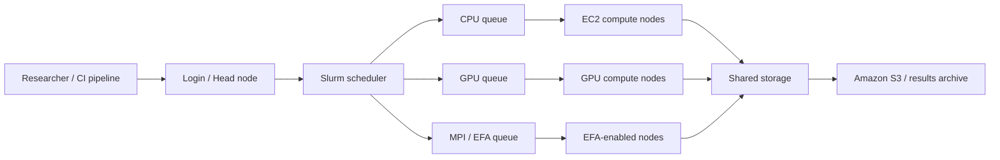

# AWS ParallelCluster và kiến trúc cụm HPC

High Performance Computing (HPC) giải quyết các bài toán cần nhiều tài nguyên tính toán và phối hợp giữa nhiều máy, chẳng hạn mô phỏng khí động học, mô hình thời tiết, phân tích gene, mô phỏng vật liệu và huấn luyện mô hình khoa học. Thay vì chạy một chương trình trên một máy chủ đơn lẻ, cụm HPC phân phối công việc lên nhiều compute node, dùng scheduler để cấp phát tài nguyên và dùng mạng tốc độ cao để trao đổi dữ liệu giữa các node.

AWS ParallelCluster là công cụ mã nguồn mở được AWS hỗ trợ để triển khai và quản lý cụm HPC trên AWS. Công cụ tạo các tài nguyên như head node, compute fleet, scheduler, mạng và shared storage dựa trên một file cấu hình. Bạn có thể xây dựng môi trường thử nghiệm, cụm nghiên cứu hoặc hạ tầng production có khả năng mở rộng theo nhu cầu công việc.

AWS ParallelCluster không phải dịch vụ HPC hoàn toàn được quản lý. Nhóm vận hành vẫn chịu trách nhiệm thiết kế cụm, quản lý scheduler, cập nhật AMI, quyền truy cập, dữ liệu, ứng dụng khoa học và chi phí của các tài nguyên AWS được tạo ra.

## Mục tiêu học tập

Sau bài học, bạn có thể:

- Giải thích vai trò của AWS ParallelCluster trong kiến trúc HPC trên AWS.
- Phân biệt head node, compute node, login node, queue/partition và compute resource.
- Mô tả cách Slurm lập lịch và cách ParallelCluster mở rộng compute fleet.
- Thiết kế VPC, subnet, security group, placement group và Elastic Fabric Adapter (EFA).
- Chọn Amazon EBS, Amazon EFS, Amazon FSx for Lustre và các hệ thống shared storage theo mẫu I/O.
- Đọc và xây dựng file cấu hình YAML cho AWS ParallelCluster v3.
- Tạo, theo dõi, cập nhật và xóa cluster bằng `pcluster` CLI.
- Tối ưu hiệu năng, khả năng phục hồi, bảo mật và chi phí cho workload HPC.
- Phân biệt AWS ParallelCluster với AWS Parallel Computing Service (AWS PCS).

## 1. HPC và vai trò của ParallelCluster

HPC thường xử lý các bài toán có thể chia thành nhiều tác vụ hoặc nhiều tiến trình chạy đồng thời. Có hai mẫu tính toán phổ biến:

- **Loosely coupled / embarrassingly parallel:** nhiều tác vụ độc lập, mỗi tác vụ xử lý một tập dữ liệu hoặc một tham số. Ví dụ chạy hàng nghìn mô phỏng với các điều kiện biên khác nhau.
- **Tightly coupled / MPI:** nhiều tiến trình chạy đồng thời và trao đổi dữ liệu thường xuyên qua mạng có độ trễ thấp. Ví dụ một mô phỏng CFD chia lưới không gian trên nhiều node.

Mẫu workload quyết định cách chọn compute, mạng và storage. Tác vụ độc lập thường ưu tiên throughput và chi phí trên mỗi job. MPI nhạy với latency, bandwidth, topology và khả năng giao tiếp giữa node; do đó cần xem xét EFA, placement group và instance family dành cho HPC.

AWS ParallelCluster tự động hóa việc tạo cluster và tích hợp scheduler với EC2. Bạn mô tả cấu hình bằng YAML, triển khai qua `pcluster` CLI hoặc API, sau đó người dùng đăng nhập và gửi job bằng lệnh của scheduler.



ParallelCluster tạo và điều phối tài nguyên AWS. Scheduler quyết định job nào được chạy và cần bao nhiêu tài nguyên; phần mềm HPC như OpenFOAM, GROMACS, LAMMPS, WRF hoặc ứng dụng nội bộ thực hiện phép tính trên compute node.

## 2. Thành phần của một cụm ParallelCluster

| Thành phần | Vai trò | Ghi chú thiết kế |
|---|---|---|
| Head node | Điểm quản trị và điều phối cụm; chạy Slurm controller và các daemon quản lý cluster | Không dùng làm compute node cho job khoa học; cần đủ CPU, RAM và network cho cluster lớn |
| Compute node | Chạy job của người dùng | Có thể là CPU, GPU hoặc instance tối ưu cho HPC; thường được tạo và kết thúc theo tải |
| Login node | Cung cấp môi trường đăng nhập và submit job tách biệt với head node | Hữu ích cho nhiều nhóm người dùng; cấu hình khi cần và giới hạn quyền truy cập |
| Scheduler | Xếp hàng, lập lịch, cấp phát CPU, RAM, GPU và node | AWS ParallelCluster v3 sử dụng Slurm cho cấu hình hiện hành |
| Queue / partition | Phân nhóm tài nguyên và chính sách lập lịch | Ví dụ `cpu`, `gpu`, `mpi`, `short` |
| Compute resource | Nhóm node cùng cấu hình instance trong một queue | Có thể đặt min/max, instance type, Spot hoặc capacity reservation |
| Shared storage | Chia sẻ home, input, output và checkpoint giữa các node | Chọn theo IOPS, throughput, latency, dung lượng và vòng đời |
| VPC và security groups | Cung cấp kết nối giữa node, storage và dịch vụ AWS | Thiết kế private subnet và luồng mạng tối thiểu |

### 2.1 Head node

Head node là thành phần quản trị quan trọng. Nó chạy scheduler controller, quản lý trạng thái compute fleet, hỗ trợ khởi tạo node và cung cấp điểm truy cập cho người vận hành. Head node cũng có thể phục vụ NFS khi dùng một số kiểu shared storage nội bộ dựa trên EBS.

Mặc dù head node không chạy job khoa học, hiệu năng của nó ảnh hưởng đến khả năng scale và quản lý cụm. Với cụm lớn, cần đủ CPU, RAM, network bandwidth và EBS bandwidth để quản lý nhiều node cùng lúc. Nếu dùng NFS từ head node, I/O shared storage cũng có thể tạo tải lên máy này.

### 2.2 Compute node và compute fleet

Compute node chạy tiến trình ứng dụng. Với Slurm, mỗi node chạy daemon `slurmd` để nhận và thực thi job allocation. Compute fleet là tập compute node do ParallelCluster quản lý.

Compute node thường được xem là tài nguyên có thể thay thế. Dữ liệu cần giữ lâu dài nên nằm trên shared storage hoặc S3; không nên chỉ lưu kết quả quan trọng trên instance store hoặc root volume của compute node.

ParallelCluster hỗ trợ node tĩnh và node động. Node tĩnh được duy trì theo cấu hình cluster. Node động được khởi chạy khi scheduler cần tài nguyên và có thể bị kết thúc khi rảnh theo thời gian scale-down. Đặt `MinCount: 0` cho compute resource là cấu hình phổ biến để cụm có thể scale từ zero; `MaxCount` giới hạn số node tối đa của resource.

### 2.3 Login node

Login node cung cấp môi trường cho người dùng đăng nhập, chuẩn bị input, biên dịch hoặc submit job. Tách login node khỏi head node giúp giảm số người dùng truy cập trực tiếp vào thành phần quản trị. Với môi trường nhiều nhóm, có thể tích hợp LDAP/Active Directory hoặc cơ chế danh tính phù hợp và áp dụng thư mục home dùng chung.

## 3. Slurm: scheduler và queue/partition

Slurm là workload manager mã nguồn mở thường dùng trong cụm HPC. Nó nhận job, kiểm tra yêu cầu tài nguyên, xếp hàng, cấp phát node và theo dõi trạng thái thực thi.

Một job có thể yêu cầu:

- Số node (`--nodes`).
- Số task hoặc MPI rank (`--ntasks`).
- Số CPU cho mỗi task (`--cpus-per-task`).
- Bộ nhớ (`--mem` hoặc `--mem-per-cpu`).
- GPU (`--gres=gpu:...` hoặc cú pháp GRES tương ứng).
- Thời gian tối đa (`--time`).
- Partition/queue (`--partition`).
- Tài nguyên hoặc constraint đặc biệt như loại CPU, GPU hoặc kiến trúc.

Ví dụ file batch Slurm:

```bash
#!/bin/bash
#SBATCH --job-name=weather-model
#SBATCH --partition=cpu
#SBATCH --nodes=4
#SBATCH --ntasks-per-node=32
#SBATCH --time=02:00:00
#SBATCH --output=logs/%x-%j.out

module load openmpi
module load wrf

srun ./wrf.exe
```

Lưu file thành `run-wrf.sbatch`, tạo thư mục `logs` rồi gửi job:

```bash
mkdir -p logs
sbatch run-wrf.sbatch
squeue --me
```

Các lệnh Slurm thường dùng:

| Lệnh | Mục đích |
|---|---|
| `sbatch` | Submit batch job |
| `srun` | Chạy job step hoặc lệnh song song trong allocation |
| `squeue` | Xem job đang chờ và đang chạy |
| `sinfo` | Xem partition và trạng thái node |
| `scancel` | Hủy job |
| `scontrol show job` | Xem chi tiết job |
| `sacct` | Xem accounting và lịch sử job nếu accounting được cấu hình |

### 3.1 Queue/partition

Một cluster có thể có nhiều queue/partition với cấu hình compute khác nhau. Ví dụ:

| Queue | Tài nguyên | Workload |
|---|---|---|
| `cpu` | EC2 general purpose hoặc compute optimized | ETL, preprocessing, mô phỏng CPU |
| `gpu` | EC2 GPU instances | CUDA, deep learning, mô phỏng GPU |
| `mpi` | HPC instance, EFA và placement group | MPI tightly coupled |
| `short` | Node nhỏ, thời gian chạy ngắn | Kiểm thử và tác vụ tương tác |

Queue là ranh giới lập lịch. Compute resource trong queue xác định loại EC2 và giới hạn node. Không nên tạo quá nhiều queue nếu không có khác biệt rõ về phần cứng, priority, capacity hoặc chính sách sử dụng.

### 3.2 Compute resource và capacity type

Trong cấu hình Slurm, một compute resource có thể dùng một `InstanceType` hoặc danh sách `Instances` theo schema được hỗ trợ. Có thể chọn:

- `ONDEMAND`: phù hợp workload cần độ sẵn sàng ổn định hoặc không chịu được gián đoạn.
- `SPOT`: giảm chi phí cho job có checkpoint, retry hoặc khả năng chịu gián đoạn.
- `CAPACITY_BLOCK`: dành cho một số nhu cầu capacity GPU/HPC đặt trước theo thời hạn và loại instance được hỗ trợ.

Với Spot, nên chọn allocation strategy theo ưu tiên availability hoặc giá. Dùng Spot cho job không có checkpoint hoặc thời gian chạy dài mà không có khả năng phục hồi có thể làm tăng tổng thời gian và chi phí thực tế.

### 3.3 Scale up và scale down

Slurm nhận biết tài nguyên cần thiết cho job. ParallelCluster tích hợp với cơ chế resume/suspend để khởi chạy compute node đáp ứng yêu cầu và kết thúc node động khi không còn job. `SlurmSettings/ScaledownIdletime` xác định số phút node không có job trước khi bị terminate; mặc định hiện hành là 10 phút.

ParallelCluster không tự quyết định job nào nên được ưu tiên về mặt nghiệp vụ. Scheduler và chính sách Slurm chịu trách nhiệm xếp lịch; ParallelCluster cung cấp tài nguyên AWS tương ứng với yêu cầu của scheduler. Nếu node không được khởi chạy, cần kiểm tra cả Slurm queue và log provisioning của ParallelCluster.

## 4. Kiến trúc mạng cho HPC

Một cluster thường chạy trong VPC do tổ chức quản lý hoặc VPC được ParallelCluster tạo theo cấu hình. Head node, compute node và login node kết nối qua subnet và security group. Shared storage cần network path riêng phù hợp với giao thức của file system.

### 4.1 Public và private subnet

Mô hình phổ biến đặt head node hoặc login node ở subnet có đường quản trị được kiểm soát, còn compute node nằm trong private subnet. Compute node không cần public IP nếu có NAT Gateway, VPC endpoints hoặc network path phù hợp để tải package, truy cập S3 và dịch vụ AWS.

Với môi trường production, ưu tiên:

- Đặt compute node trong private subnet.
- Hạn chế SSH vào head/login node theo CIDR quản trị hoặc dùng bastion/SSM theo kiến trúc được hỗ trợ.
- Dùng VPC endpoints cho S3, CloudWatch Logs và các API AWS khi phù hợp.
- Chỉ mở luồng giữa head, compute, login và storage theo port cần thiết.
- Tránh gán public IP cho toàn bộ compute fleet.

### 4.2 Security groups

Security groups mặc định do ParallelCluster tạo cho phép lưu lượng giữa các node trong cluster. Nếu môi trường yêu cầu kiểm soát chặt, có thể tự định nghĩa security group cho head, compute và login node. Khi tự thay thế security group mặc định, cần tự bảo đảm mọi luồng scheduler và storage vẫn hoạt động.

Một số port thường gặp trong cấu hình Slurm:

| Port | Hướng | Mục đích |
|---|---|---|
| TCP 22 | Inbound head từ IP quản trị; compute từ head/login | SSH |
| TCP 6817–6819 | Giữa head, compute và login | Slurm controller/daemon communication |
| TCP 8443 | Inbound head/login nếu bật DCV | Remote visualization |
| TCP/UDP 111, 2049 | Node đến NFS server hoặc NFS server đến node | NFS shared storage |
| TCP 443 outbound | Node đến AWS APIs khi không dùng VPC endpoints | HTTPS |

EFA cần luồng traffic giữa các compute node hỗ trợ EFA. Shared storage như FSx for Lustre có các port riêng; ví dụ FSx for Lustre yêu cầu TCP 988 và 1018–1023 theo cấu hình/phiên bản. Hãy dùng tài liệu của từng storage service để hoàn thiện security group. Không sao chép một danh sách port chung mà không xét giao thức đang dùng.

### 4.3 Placement group

Cluster placement group đặt các EC2 instance gần nhau về mặt vật lý trong một Availability Zone, giúp tối ưu latency và network throughput cho workload giao tiếp nhiều giữa node. Với Slurm, có thể cấu hình placement group ở cấp queue hoặc compute resource.

Nếu bật placement group do ParallelCluster quản lý, hãy kiểm tra cách áp dụng theo version. Từ ParallelCluster 3.3.0, bật placement group mà không đặt tên/ID ở queue có thể tạo placement group riêng cho từng compute resource; nếu muốn một group chung cho cả queue, cần cấu hình tên phù hợp.

Placement group có thể làm giảm khả năng tìm đủ capacity khi yêu cầu nhiều instance cùng lúc. Với MPI lớn, cần benchmark cả hiệu năng và khả năng cấp phát thực tế.

### 4.4 Elastic Fabric Adapter (EFA)

EFA là network interface dành cho workload HPC cần giao tiếp node-to-node với latency thấp và throughput cao. EFA hỗ trợ các ứng dụng sử dụng libfabric và các framework tương thích, chẳng hạn MPI và một số workload NCCL.

Để dùng EFA:

1. Chọn instance type hỗ trợ EFA trong Region/AZ mục tiêu.
2. Bật `Efa/Enabled` cho compute resource.
3. Dùng placement group khi workload cần topology mạng gần nhau.
4. Cho phép traffic EFA giữa các compute node trong security group.
5. Cài và kiểm tra đúng EFA driver, libfabric, MPI stack và thư viện ứng dụng.

EFA không hoạt động xuyên qua nhiều Availability Zone. Với MPI tightly coupled, thường đặt toàn bộ compute node và FSx for Lustre EFA-enabled trong cùng AZ. Multi-AZ có thể tăng lựa chọn capacity hoặc khả năng phục hồi nhưng làm tăng latency và data transfer giữa AZ; hãy chọn theo yêu cầu ứng dụng.

## 5. Chọn compute instance cho HPC

Không có một instance family tối ưu cho mọi bài toán. Hãy bắt đầu từ profile ứng dụng:

| Nhu cầu | Nhóm tài nguyên cần xem xét | Chỉ số cần benchmark |
|---|---|---|
| CPU scalar/vector | Compute optimized hoặc HPC instances | CPU throughput, memory bandwidth, scaling efficiency |
| Bộ nhớ lớn | Memory optimized hoặc HPC instance có RAM phù hợp | RAM per core, memory bandwidth, NUMA locality |
| GPU | GPU instances theo CUDA/ROCm/framework | GPU memory, inter-GPU bandwidth, GPU utilization |
| MPI tightly coupled | Instance hỗ trợ EFA, placement group | Latency, bandwidth, all-reduce, scaling efficiency |
| Nhiều job độc lập | Instance phù hợp throughput và chi phí | Jobs/hour, cost/job, queue wait |
| Workload burst | Spot hoặc compute fleet scale từ zero | Interruption handling, startup latency, retry cost |

### 5.1 CPU và NUMA

Các ứng dụng đa luồng cần được cấu hình phù hợp với số core, thread, NUMA topology và memory bandwidth. Nếu job dùng OpenMP, hãy đặt số thread phù hợp với CPU allocation. Nếu chạy MPI, cân nhắc số rank mỗi node và số thread mỗi rank.

Ví dụ:

```bash
export OMP_NUM_THREADS=8
srun --nodes=2 --ntasks-per-node=4 --cpus-per-task=8 ./solver
```

Trong ví dụ, mỗi node chạy bốn MPI task, mỗi task dùng tám CPU thread. Giá trị thực tế cần căn cứ vào topology và hướng dẫn của ứng dụng.

### 5.2 GPU

GPU workload cần kiểm tra số GPU, GPU memory, driver, CUDA version, EFA/NCCL support và khả năng phân phối GPU giữa job. Dùng GPU health checks trong cấu hình compute resource nếu phù hợp. Không cấp GPU instance cho job chỉ cần CPU; điều đó làm tăng chi phí mà không cải thiện hiệu năng.

### 5.3 Instance architecture

Các compute instance trong một cluster phải tương thích về processor architecture theo yêu cầu của cấu hình. Không trộn tùy ý `x86_64` và `arm64` trong cùng cluster. Nếu cần cả hai kiến trúc, có thể tách thành các cluster riêng hoặc thiết kế các môi trường được hỗ trợ rõ ràng.

## 6. Shared storage và dữ liệu HPC

HPC thường có ba kiểu dữ liệu:

- Input dataset: dữ liệu đầu vào dùng chung cho nhiều job.
- Scratch/intermediate: file tạm, checkpoint và kết quả trung gian có tốc độ truy cập cao.
- Output/archive: kết quả cần giữ lâu dài và chia sẻ với hệ thống khác.

Không nên ép tất cả dữ liệu vào cùng một filesystem. Hãy chọn storage theo IOPS, throughput, metadata operations, file size, concurrency và vòng đời dữ liệu.

### 6.1 So sánh storage

| Dịch vụ | Đặc điểm | Trường hợp phù hợp |
|---|---|---|
| Amazon EBS | Block storage gắn với EC2; EBS dùng chung trong ParallelCluster có thể được export từ head node qua NFS | Home nhỏ, package, dữ liệu ít node hoặc workload thử nghiệm |
| Amazon EFS | NFS managed, tự co giãn dung lượng, hỗ trợ mount từ nhiều node | Home directory, file nhỏ, dữ liệu dùng chung và workload cần chia sẻ rộng |
| Amazon FSx for Lustre | Parallel filesystem throughput cao, nhiều IOPS, latency thấp | Scratch và dataset lớn cho HPC, nhiều node đọc/ghi song song |
| FSx for ONTAP / OpenZFS | File storage với khả năng quản lý snapshot, NFS/SMB hoặc tính năng hệ thống file chuyên biệt | Môi trường đã dùng ONTAP/ZFS hoặc cần tích hợp dữ liệu hiện có |
| Amazon File Cache | Cache dữ liệu từ nguồn lưu trữ hỗ trợ | Workload cần cache dataset ở gần compute |
| Amazon S3 | Object storage bền vững, chi phí lưu trữ phù hợp dữ liệu lớn | Dataset gốc, archive và kết quả dài hạn; thường kết hợp với FSx for Lustre |

EBS chia sẻ qua NFS từ head node có thể là giải pháp tiết kiệm cho cụm nhỏ. Khi số compute node và nhu cầu I/O tăng, head node có thể trở thành bottleneck. EFS phù hợp hơn cho home/shared files cần scale. FSx for Lustre phù hợp với workload cần đọc/ghi song song trên dataset lớn.

### 6.2 FSx for Lustre và S3 data repository

FSx for Lustre có thể liên kết với S3 data repository. Dataset có thể được import vào namespace Lustre để compute node đọc với hiệu năng cao, còn dữ liệu gốc và kết quả có thể được đồng bộ với S3 theo cấu hình.

Mô hình thường gặp:

1. Lưu dataset gốc trong S3.
2. Liên kết S3 bucket/prefix với FSx for Lustre.
3. Import metadata hoặc dữ liệu cần thiết vào file system.
4. Chạy job HPC trên compute node và ghi scratch/output vào Lustre.
5. Export dữ liệu thay đổi hoặc kết quả về S3 theo policy.

Với workload EFA-enabled, file system và compute node phải đáp ứng yêu cầu cùng AZ và security group. FSx for Lustre EFA-enabled có thể cải thiện hiệu năng cho workload phù hợp, nhưng không phải mọi ứng dụng đều hưởng lợi; benchmark trên pattern I/O thật.

### 6.3 Managed storage và external storage

ParallelCluster hỗ trợ hai kiểu vòng đời storage:

- **Managed:** ParallelCluster tạo và có thể xóa volume/file system theo vòng đời cluster.
- **External:** file system đã tồn tại và do tổ chức quản lý độc lập với cluster.

Với managed shared storage, `DeletionPolicy` mặc định là `Delete`. Khi xóa cluster, đổi tên `SharedStorage/Name` hoặc bỏ storage khỏi cấu hình, file system và dữ liệu có thể bị xóa. Nếu cần giữ dữ liệu, đặt `DeletionPolicy: Retain` hoặc dùng external storage; đồng thời phải có backup độc lập.

Ví dụ gắn FSx for Lustre đã có:

```yaml
SharedStorage:
  - MountDir: /fsx
    Name: research-fsx
    StorageType: FsxLustre
    FsxLustreSettings:
      FileSystemId: fs-0123456789abcdef0
```

Khi dùng `FileSystemId`, cấu hình này tham chiếu file system bên ngoài; ParallelCluster không tạo hay xóa file system đó. Cần cấu hình security group và subnet phù hợp trước khi mount.

## 7. File cấu hình AWS ParallelCluster v3

ParallelCluster v3 dùng file YAML để mô tả cluster. Các phần chính thường gồm:

| Phần | Ý nghĩa |
|---|---|
| `Region` | AWS Region triển khai cluster |
| `Image` | Operating system hoặc AMI tương thích |
| `HeadNode` | Instance type, subnet, SSH, IAM và cấu hình head node |
| `Scheduling` | Scheduler, Slurm settings, queue và compute resources |
| `SharedStorage` | EBS/EFS/FSx và mount directory |
| `Monitoring` | CloudWatch Logs, dashboard, alarms và retention |

Ví dụ cấu hình nền tảng với một CPU queue:

```yaml
Region: ap-southeast-1
Image:
  Os: alinux2023

HeadNode:
  InstanceType: c7i.large
  Networking:
    SubnetId: subnet-0123456789abcdef0
  Ssh:
    KeyName: hpc-admin-key
    AllowedIps: 203.0.113.10/32

Scheduling:
  Scheduler: slurm
  SlurmSettings:
    ScaledownIdletime: 10
  SlurmQueues:
    - Name: cpu
      CapacityType: ONDEMAND
      Networking:
        SubnetIds:
          - subnet-0123456789abcdef0
      ComputeResources:
        - Name: c7i
          InstanceType: c7i.4xlarge
          MinCount: 0
          MaxCount: 32

Monitoring:
  Logs:
    CloudWatch:
      Enabled: true
      RetentionInDays: 90
      DeletionPolicy: Retain
  Dashboards:
    CloudWatch:
      Enabled: true
```

Các subnet ID, key pair và IP CIDR là giá trị minh họa; thay bằng tài nguyên của account. Đây là cấu hình khởi đầu để hiểu schema, chưa phải cấu hình production hoàn chỉnh. Cần bổ sung IAM, security group, shared storage, VPC endpoints, KMS và capacity limits theo yêu cầu.

### 7.1 Thêm queue GPU hoặc MPI

Có thể định nghĩa queue thứ hai với compute resource khác. Ví dụ khái quát:

```yaml
    - Name: mpi
      CapacityType: ONDEMAND
      Networking:
        SubnetIds:
          - subnet-0123456789abcdef0
        PlacementGroup:
          Enabled: true
      ComputeResources:
        - Name: hpc
          InstanceType: hpc7a.96xlarge
          MinCount: 0
          MaxCount: 16
          Efa:
            Enabled: true
```

Chỉ dùng instance type được hỗ trợ EFA trong Region/AZ mục tiêu; xác nhận instance family, quota, capacity và khả năng cấp phát placement group trước khi triển khai. Nếu dùng FSx for Lustre EFA-enabled, compute và file system phải cùng AZ. Khi dùng `Efa`, security group phải cho phép traffic cần thiết giữa các compute node.

### 7.2 Bật shared storage managed

Ví dụ tạo FSx for Lustre do ParallelCluster quản lý:

```yaml
SharedStorage:
  - MountDir: /scratch
    Name: scratch-lustre
    StorageType: FsxLustre
    FsxLustreSettings:
      StorageCapacity: 1200
      DeploymentType: SCRATCH_2
      DeletionPolicy: Retain
```

Dung lượng, deployment type, throughput, KMS và backup phải được chọn theo loại file system và Region. `SCRATCH_2` phù hợp dữ liệu xử lý tạm thời; dữ liệu quan trọng cần được đồng bộ/backup ra storage bền vững. `Retain` tránh xóa file system theo vòng đời cluster nhưng không thay thế backup và quy trình quản trị file system độc lập.

## 8. Triển khai cluster bằng `pcluster` CLI

### 8.1 Chuẩn bị

Trước khi tạo cluster:

1. Chọn Region có instance type, EFA, storage và ParallelCluster version cần dùng.
2. Cài AWS CLI và AWS ParallelCluster CLI phiên bản tương thích.
3. Cấu hình credential qua IAM Identity Center hoặc role/credential ngắn hạn.
4. Xác nhận IAM policy đủ quyền tạo CloudFormation, EC2, IAM role/profile, storage, networking và các tài nguyên liên quan.
5. Tạo hoặc chọn VPC, subnet, security group, key pair và storage.
6. Kiểm tra EC2 quota và capacity cho instance family mục tiêu.

ParallelCluster CLI có thể được cài từ PyPI. Nên ghim phiên bản CLI trong automation và dùng AMI chính thức tương ứng với đúng phiên bản ParallelCluster.

### 8.2 Tạo cấu hình và validate

```bash
pcluster version
pcluster configure --config cluster-config.yaml
```

Lệnh `configure` hướng dẫn chọn Region, key pair, scheduler, OS, head node, queue và network. Với production, hãy chỉnh sửa YAML bằng code review và quản lý phiên bản thay vì chỉ dựa vào wizard.

Có thể validate cấu hình trước khi tạo tài nguyên:

```bash
pcluster create-cluster \
  --cluster-name research-hpc \
  --cluster-configuration cluster-config.yaml \
  --region ap-southeast-1 \
  --dryrun true
```

Nếu validation thành công, tạo cluster:

```bash
pcluster create-cluster \
  --cluster-name research-hpc \
  --cluster-configuration cluster-config.yaml \
  --region ap-southeast-1
```

ParallelCluster dùng AWS CloudFormation để tạo tài nguyên. Theo dõi tiến độ:

```bash
pcluster describe-cluster \
  --cluster-name research-hpc \
  --region ap-southeast-1

pcluster describe-compute-fleet \
  --cluster-name research-hpc \
  --region ap-southeast-1
```

Đợi cluster ở trạng thái sẵn sàng và compute fleet ở trạng thái phù hợp trước khi submit job. Cluster có thể tạo xong trong khi dynamic compute fleet chưa có node nào; đó là hành vi bình thường khi `MinCount: 0`.

### 8.3 Kết nối và submit job

```bash
pcluster ssh \
  --cluster-name research-hpc \
  --region ap-southeast-1
```

Trên head/login node, kiểm tra scheduler:

```bash
sinfo
squeue
sbatch run-wrf.sbatch
```

### 8.4 Dừng và xóa compute fleet

Khi cần tạm dừng compute để giảm chi phí, yêu cầu dừng fleet:

```bash
pcluster update-compute-fleet \
  --cluster-name research-hpc \
  --status STOP_REQUESTED \
  --region ap-southeast-1
```

Đợi trạng thái `STOPPED`. Khi cần chạy lại:

```bash
pcluster update-compute-fleet \
  --cluster-name research-hpc \
  --status START_REQUESTED \
  --region ap-southeast-1
```

Xóa cluster khi không còn cần dùng:

```bash
pcluster delete-cluster \
  --cluster-name research-hpc \
  --region ap-southeast-1
```

Trước khi xóa, kiểm tra job còn chạy, shared storage managed/external, backup, log retention và tài nguyên có vòng đời độc lập. Nếu managed storage dùng `DeletionPolicy: Delete`, dữ liệu có thể bị xóa cùng cluster.

## 9. Custom AMI và bootstrap actions

Một số workload cần compiler, MPI library, CUDA, driver, solver hoặc package riêng. Có hai hướng tùy biến:

- **Custom bootstrap actions:** chạy script khi node khởi tạo hoặc cấu hình xong. Phù hợp cài package, mount thêm storage, tải cấu hình hoặc đăng ký agent.
- **Custom AMI:** đóng gói hệ điều hành và dependency vào image để giảm thời gian khởi tạo và bảo đảm môi trường nhất quán.

AWS ParallelCluster cung cấp `pcluster build-image`, sử dụng EC2 Image Builder để tạo custom AMI. Ví dụ:

```bash
pcluster build-image \
  --image-id research-hpc-al2023-v1 \
  --image-configuration image-config.yaml \
  --region ap-southeast-1
```

Custom AMI cần được xây lại hoặc kiểm tra lại khi nâng phiên bản ParallelCluster. AMI chính thức được xây cho phiên bản ParallelCluster tương ứng và không tự cập nhật bản vá OS. Vì vậy, phải có quy trình kiểm thử, build image, cập nhật cluster và rollback.

Ưu tiên bootstrap script khi thay đổi đơn giản và có thể lặp lại. Dùng custom AMI khi dependency phức tạp, thời gian khởi động quan trọng hoặc cần môi trường phần mềm đã kiểm thử. Tránh cài đặt thủ công khác nhau trên từng compute node vì làm mất tính tái lập.

## 10. Cấu hình hiệu năng cho workload HPC

### 10.1 Network và MPI

Đối với MPI, hiệu năng phụ thuộc số rank, topology, message size, collective operation và latency. EFA, placement group và instance family có network bandwidth phù hợp có thể cải thiện kết quả, nhưng cần benchmark theo ứng dụng.

Kiểm tra:

- MPI library có hỗ trợ libfabric/EFA không.
- EFA device có xuất hiện trên compute node không.
- Job allocation đặt đúng số node và task không.
- Rank có được pin vào CPU/NUMA phù hợp không.
- Security group và placement group có đúng phạm vi không.
- Tốc độ giao tiếp thực tế qua microbenchmark và ứng dụng đại diện.

### 10.2 Storage I/O

HPC có thể bị giới hạn bởi filesystem thay vì CPU/GPU. Đo read/write throughput, metadata operations, số file mở đồng thời và pattern truy cập. Nhiều file nhỏ có thể tạo tải metadata lớn; file lớn tuần tự có thể ưu tiên throughput.

Thực hành tốt:

- Đưa input dataset lớn lên FSx for Lustre hoặc storage phù hợp trước khi bắt đầu batch.
- Dùng local NVMe/instance store cho scratch tạm thời khi ứng dụng hỗ trợ và có thể tái tạo dữ liệu.
- Đưa checkpoint và kết quả quan trọng lên shared storage bền vững.
- Đồng bộ output về S3 theo batch, tránh hàng nghìn job đồng thời ghi vào một prefix nếu ứng dụng không cần.
- Dọn scratch sau khi job kết thúc theo policy.

### 10.3 Job sizing và scheduler

Job yêu cầu nhiều node hơn mức cần thiết có thể chiếm capacity và tăng queue wait. Job yêu cầu quá ít CPU hoặc RAM có thể chạy lâu hoặc thất bại do out-of-memory. Thu thập lịch sử job để điều chỉnh:

- CPU utilization và memory peak.
- GPU utilization và GPU memory.
- Elapsed time, queue wait và node count.
- I/O throughput và checkpoint duration.
- Scaling efficiency khi tăng số node.

Với job MPI, tăng số node không đảm bảo giảm thời gian theo tỷ lệ tuyến tính. Nếu communication overhead cao hoặc dữ liệu bị phân vùng không đều, hiệu năng có thể giảm khi scale out.

## 11. Bảo mật cụm HPC

### 11.1 IAM và instance role

Tách IAM role cho người triển khai cluster và instance role của head/compute node. Người triển khai cần quyền tạo và cập nhật tài nguyên. Node role chỉ nên được phép đọc input, ghi output, gửi log hoặc truy cập secret mà workload cần.

Trong cấu hình, có thể dùng `AdditionalIamPolicies` để bổ sung policy vào quyền mặc định ParallelCluster yêu cầu. AWS khuyến nghị cách này khi cần mở rộng quyền, vì dùng `InstanceRole` tùy chỉnh buộc bạn phải duy trì toàn bộ quyền mà ParallelCluster cần qua từng phiên bản.

Không lưu AWS access key dài hạn trên node. Dùng instance profile/role và credential tạm thời. Nếu ứng dụng cần truy cập S3, giới hạn bucket/prefix và quyền `GetObject`/`PutObject` theo nhiệm vụ.

### 11.2 SSH, login và danh tính

Giới hạn `Ssh/AllowedIps` theo IP hoặc prefix quản trị. Không để mặc định `0.0.0.0/0` trong môi trường production. Với nhiều người dùng, cân nhắc login node và tích hợp danh tính doanh nghiệp, kiểm soát quyền nhóm, quota và thư mục home.

### 11.3 Mã hóa và bảo vệ dữ liệu

- Bật EBS encryption cho root volume và shared EBS.
- Dùng KMS key policy phù hợp khi sử dụng customer managed key.
- Bật encryption at rest/in transit cho EFS/FSx theo yêu cầu.
- Giới hạn truy cập S3 và bật versioning/lifecycle cho dữ liệu quan trọng.
- Dùng Secrets Manager cho secret cần thiết; không đưa mật khẩu vào YAML hoặc bootstrap script.
- Bảo vệ kết quả nghiên cứu, dữ liệu bệnh nhân hoặc dữ liệu nhạy cảm theo yêu cầu tổ chức.

### 11.4 Network isolation

Compute node nên ở private subnet và chỉ mở luồng cần thiết đến head/login, storage và AWS APIs. Khi dùng custom security groups, xác minh port scheduler, NFS/Lustre, EFA và HTTPS. Một security group quá chặt có thể khiến node khởi tạo được nhưng không đăng ký thành công với Slurm hoặc không mount được filesystem.

## 12. Monitoring, logs và troubleshooting

ParallelCluster tích hợp CloudWatch metrics, CloudWatch Logs, CloudTrail và EventBridge. Có thể theo dõi trạng thái node, CPU, storage, log provisioning và các hoạt động API quản trị.

### 12.1 Các log quan trọng

| Log | Vị trí / mục đích |
|---|---|
| CloudFormation init | `/var/log/cfn-init.log` – lỗi khởi tạo instance và tài nguyên |
| Bootstrap/configuration | `/var/log/chef-client.log` – các bước cấu hình node |
| Slurm resume | `/var/log/parallelcluster/slurm_resume.log` – lỗi launch dynamic node |
| Slurm suspend | `/var/log/parallelcluster/slurm_suspend.log` – lỗi terminate dynamic node |
| Cluster manager | `/var/log/parallelcluster/clustermgtd` – quản lý launch/terminate và hoạt động cluster |
| Slurm controller | `/var/log/slurmctld.log` – scheduler, queue và allocation |
| Compute manager | `/var/log/parallelcluster/computemgtd` – quản lý trạng thái compute node |
| Slurm daemon | `/var/log/slurmd.log` – lỗi khởi tạo và thực thi trên compute node |
| Cloud-init | `/var/log/cloud-init-output.log` – script và lệnh khi boot node |

ParallelCluster tạo log group CloudWatch cho cluster và có thể giữ log sau khi xóa cluster. Hãy cấu hình retention và `DeletionPolicy` theo yêu cầu audit/chi phí.

### 12.2 Ma trận sự cố

| Triệu chứng | Nguyên nhân có thể | Hướng xử lý |
|---|---|---|
| Cluster tạo thất bại | IAM thiếu quyền, subnet/route sai, instance capacity thiếu | Xem CloudFormation events, `cfn-init.log`, IAM và subnet |
| Job ở trạng thái pending lâu | Partition không hoạt động, thiếu CPU/RAM/GPU hoặc node không launch | Dùng `squeue`, `sinfo`, `scontrol show job`, kiểm tra `slurm_resume.log` |
| `InsufficientInstanceCapacity` | EC2 không có đủ capacity cho loại instance/AZ | Thử subnet/AZ khác nếu phù hợp, instance alternatives, Spot strategy hoặc Capacity Reservation |
| Compute node khởi tạo rồi biến mất | Bootstrap, AMI, Slurm daemon hoặc network lỗi | Kiểm tra `cloud-init-output.log`, `slurmd.log`, `computemgtd` |
| Node không mount FSx/EFS | Security group, DNS, subnet hoặc mount target sai | Kiểm tra port, mount target AZ, DNS và filesystem status |
| MPI chạy chậm | EFA không dùng, placement group sai, rank/NUMA không phù hợp | Xác minh EFA/libfabric, benchmark network và pinning |
| CloudWatch không có log | Log config bị ghi đè hoặc agent không chạy | Kiểm tra Monitoring config và CloudWatch agent |
| Storage data biến mất sau xóa cluster | Managed storage dùng `DeletionPolicy: Delete` | Kiểm tra config, backup và chuyển sang external/Retain |

### 12.3 Quy trình chẩn đoán

1. Kiểm tra trạng thái cluster và compute fleet bằng `pcluster describe-cluster` và `describe-compute-fleet`.
2. Xem trạng thái queue và job bằng `sinfo`, `squeue`, `scontrol`.
3. Phân biệt lỗi scheduler với lỗi EC2 provisioning.
4. Tra log tương ứng trên head node và CloudWatch.
5. Kiểm tra subnet, security group, route, IAM, quota và EC2 capacity.
6. Nếu cluster đang lỗi và có thể phát sinh chi phí ngoài dự kiến, dừng compute fleet trước khi điều tra sâu.
7. Chỉ cập nhật AMI/config sau khi đã lưu log và dữ liệu cần thiết.

## 13. Cập nhật và vòng đời cluster

AWS ParallelCluster quản lý hạ tầng qua CloudFormation. Không nên chỉnh sửa trực tiếp các tài nguyên do cluster stack tạo ra nếu thay đổi đó không được hỗ trợ trong config; thay vào đó cập nhật YAML và chạy `pcluster update-cluster`.

Một số thay đổi yêu cầu compute fleet phải dừng trước, chẳng hạn thay đổi loại instance, subnet hoặc một số cấu hình storage/queue. Đọc update policy của từng field trước khi triển khai.

Compute node là ephemeral. Khi cập nhật AMI compute node, dừng fleet, thay `CustomAmi` trong cấu hình queue và chạy update. Kiểm thử ứng dụng và module trước khi rollout sang toàn bộ cluster.

Trước khi xóa cluster:

- Chờ hoặc hủy job theo quy trình nghiệp vụ.
- Lưu checkpoint và kết quả chưa đồng bộ.
- Kiểm tra shared storage managed/external và deletion policy.
- Lưu log, metrics, cấu hình YAML và phiên bản AMI.
- Xác nhận snapshot/backup có thể khôi phục.
- Xóa tài nguyên phụ trợ do người dùng tự tạo nếu không còn cần.

## 14. Chi phí và FinOps cho HPC

ParallelCluster không thu phí riêng cho công cụ CLI/API; chi phí đến từ tài nguyên AWS được tạo và sử dụng. Các thành phần chính:

- EC2 head node, login node và compute node.
- EBS root volume, EFS, FSx for Lustre và backup.
- Data transfer, đặc biệt khi truyền giữa AZ hoặc Region.
- NAT Gateway, VPC endpoints, CloudWatch Logs và monitoring.
- S3 storage, KMS và các dịch vụ phụ trợ.
- EC2 capacity reservation hoặc Capacity Blocks nếu sử dụng.

Biện pháp kiểm soát:

- Dùng dynamic compute fleet với `MinCount: 0` cho workload không chạy liên tục.
- Chọn `ScaledownIdletime` hợp lý để giảm node rảnh mà không làm job ngắn phải chờ khởi tạo liên tục.
- Dùng Spot cho job có checkpoint và khả năng retry.
- Chọn đúng instance family và kích thước theo benchmark, tránh cấp dư CPU/GPU/RAM.
- Dùng FSx for Lustre cho scratch có nhu cầu I/O cao và đồng bộ dữ liệu cần giữ về S3.
- Đặt CloudWatch retention, lifecycle S3 và backup retention.
- Gắn tag theo project, team, cost center và workload.
- Dùng AWS Budgets và cảnh báo trước khi chạy benchmark hoặc mô phỏng quy mô lớn.

Đo chi phí trên mỗi kết quả khoa học hoặc mỗi job hoàn tất, không chỉ nhìn giá EC2 theo giờ. Một instance đắt hơn nhưng hoàn thành job nhanh hơn có thể có cost-to-solution thấp hơn.

## 15. AWS ParallelCluster và AWS Parallel Computing Service

AWS cung cấp thêm AWS Parallel Computing Service (AWS PCS), dịch vụ quản lý cụm Slurm. Hai sản phẩm phục vụ nhu cầu HPC nhưng có ranh giới vận hành khác nhau.

| Tiêu chí | AWS ParallelCluster | AWS PCS |
|---|---|---|
| Mô hình | Công cụ quản lý cluster; bạn vận hành nhiều thành phần cluster | Dịch vụ quản lý Slurm controller và một phần lifecycle/operations |
| Scheduler | Slurm trong cấu hình v3 hiện hành | Slurm |
| Control plane | Head node và các thành phần ParallelCluster trong account của khách hàng | Slurm controller chạy trong account do AWS quản lý; compute chạy trong account khách hàng |
| Tùy biến | Kiểm soát sâu AMI, bootstrap, network và cluster components | Tập trung vào cấu hình được AWS PCS hỗ trợ; ít gánh nặng quản lý controller hơn |
| Vận hành | Khách hàng chịu trách nhiệm nhiều hơn về patching, controller và bảo trì | AWS quản lý controller, cập nhật và một số khả năng observability |
| Phù hợp | Cần kiểm soát hạ tầng, tùy biến sâu, môi trường self-managed hoặc workflow cluster riêng | Muốn Slurm managed, giảm vận hành controller và chuẩn hóa lifecycle |

Nếu tổ chức cần tự quản lý head node, bootstrap sâu hoặc tích hợp với mô hình cluster hiện có, ParallelCluster là lựa chọn phù hợp. Nếu muốn Slurm controller managed và giảm công việc bảo trì, hãy đánh giá AWS PCS. AWS PCS là dịch vụ riêng, không phải một chế độ managed bên trong ParallelCluster.

Lưu ý phiên bản: từ AWS ParallelCluster 3.16.0, AWS Batch không còn được hỗ trợ làm scheduler của ParallelCluster. Với thiết kế mới, hãy dùng Slurm; nếu cần scheduler cloud-native AWS Batch, triển khai AWS Batch theo kiến trúc riêng. Không sao chép cấu hình `Scheduler: awsbatch` từ tài liệu ParallelCluster cũ vào phiên bản 3.16 trở lên.

## 16. Case study: mô phỏng CFD trên cụm HPC

Một nhóm kỹ thuật cần chạy mô phỏng CFD cho nhiều thiết kế cánh turbine. Mỗi mô phỏng có thể chạy độc lập, nhưng mỗi mô phỏng cũng có thể dùng MPI trên nhiều node.

### Bước 1: Chia workload

- Queue `cpu` dùng cho preprocessing và các mô phỏng nhỏ.
- Queue `mpi` dùng cho mô phỏng lớn cần nhiều node và EFA.
- Shared home dùng EFS; scratch dùng FSx for Lustre.
- Dataset gốc và kết quả dài hạn nằm trên S3.

### Bước 2: Chuẩn bị dữ liệu

Đặt mesh, boundary conditions và input trong S3. Đồng bộ dataset cần dùng sang FSx for Lustre trước khi submit job. Tạo thư mục riêng theo experiment ID để tránh ghi đè kết quả giữa các job.

### Bước 3: Submit và theo dõi

Người dùng gửi job vào `cpu` hoặc `mpi`. Slurm xếp lịch; ParallelCluster mở rộng compute fleet theo nhu cầu. Theo dõi queue wait, node provisioning, CPU utilization, network và filesystem throughput.

### Bước 4: Checkpoint và lưu kết quả

Ứng dụng ghi checkpoint định kỳ lên storage bền vững hoặc đồng bộ từ scratch. Khi Spot interruption hoặc node failure xảy ra, job có thể được requeue/retry từ checkpoint. Kết quả cuối được đồng bộ về S3 và gắn metadata experiment, version solver, input dataset và cluster config.

### Bước 5: Tối ưu cost-to-solution

Benchmark số node, số MPI rank, EFA và FSx throughput. So sánh thời gian hoàn thành, queue wait và tổng chi phí. Dùng Spot cho những experiment có thể retry; giữ On-Demand cho job có deadline nghiêm ngặt.

## 17. Checklist production

- [ ] Chọn ParallelCluster hay AWS PCS dựa trên trách nhiệm vận hành và mức tùy biến.
- [ ] Chọn Region/AZ có instance, EFA, FSx và quota phù hợp.
- [ ] Xác định workload CPU, GPU, MPI, I/O và job duration.
- [ ] Thiết kế head node, login node, compute queues và compute resources.
- [ ] Chọn static/dynamic capacity, `MinCount`, `MaxCount`, Spot hoặc On-Demand.
- [ ] Thiết kế VPC, private subnet, security group, NAT/VPC endpoints và SSH access.
- [ ] Bật EFA/placement group cho workload cần communication hiệu năng cao.
- [ ] Chọn EBS/EFS/FSx for Lustre/S3 theo pattern I/O và vòng đời dữ liệu.
- [ ] Quy định managed/external storage và `DeletionPolicy` rõ ràng.
- [ ] Dùng IAM least privilege, instance role và KMS encryption.
- [ ] Chuẩn hóa AMI, compiler, MPI, GPU driver và bootstrap scripts.
- [ ] Kiểm thử Slurm queue, job submission, scaling và checkpoint/restore.
- [ ] Bật CloudWatch logs, dashboard, alarms và log retention.
- [ ] Thiết lập budget alert, tag và cost allocation.
- [ ] Kiểm thử quy trình update cluster, update AMI và xóa cluster an toàn.

## 18. Những nhầm lẫn thường gặp

| Nhầm lẫn | Cách hiểu đúng |
|---|---|
| Head node là máy chạy job HPC chính | Head node quản trị và điều phối; compute node chạy job |
| ParallelCluster tự viết hoặc tối ưu ứng dụng MPI | Dịch vụ tạo hạ tầng và scheduler; ứng dụng cần được build/benchmark riêng |
| Tăng số node luôn làm job nhanh hơn | Communication overhead, I/O và scaling efficiency có thể giới hạn lợi ích |
| EFA hoạt động giữa nhiều AZ | EFA không hỗ trợ giao tiếp xuyên AZ; tightly coupled MPI cần cùng AZ |
| EBS chia sẻ qua head node luôn đủ nhanh | NFS từ head node có thể trở thành bottleneck khi cluster lớn |
| Xóa cluster chỉ xóa compute node | Managed shared storage có thể bị xóa theo `DeletionPolicy`; cần kiểm tra dữ liệu |
| Spot luôn rẻ hơn On-Demand về tổng chi phí | Interruption, retry và checkpoint overhead có thể làm tăng cost-to-solution |
| ParallelCluster là dịch vụ Slurm managed hoàn toàn | Khách hàng vẫn vận hành nhiều thành phần; AWS PCS mới là lựa chọn Slurm managed |
| AWS Batch scheduler còn được hỗ trợ trong mọi ParallelCluster v3 | Từ ParallelCluster 3.16.0, AWS Batch không còn được hỗ trợ làm scheduler |

## Tài liệu tham khảo

- [What is AWS ParallelCluster?](https://docs.aws.amazon.com/parallelcluster/latest/ug/what-is-aws-parallelcluster.html)
- [Configure and create a cluster](https://docs.aws.amazon.com/parallelcluster/latest/ug/creating-the-cluster-v3.html)
- [Configure and create your first cluster with the CLI](https://docs.aws.amazon.com/parallelcluster/latest/ug/install-v3-configuring.html)
- [AWS ParallelCluster CLI commands](https://docs.aws.amazon.com/parallelcluster/latest/ug/commands-v3.html)
- [pcluster create-cluster](https://docs.aws.amazon.com/parallelcluster/latest/ug/pcluster.create-cluster-v3.html)
- [HeadNode section](https://docs.aws.amazon.com/parallelcluster/latest/ug/HeadNode-v3.html)
- [Scheduling section](https://docs.aws.amazon.com/parallelcluster/latest/ug/Scheduling-v3.html)
- [SharedStorage section](https://docs.aws.amazon.com/parallelcluster/latest/ug/SharedStorage-v3.html)
- [Shared storage](https://docs.aws.amazon.com/parallelcluster/latest/ug/shared-storage-quotas-integration-v3.html)
- [FSx for Lustre](https://docs.aws.amazon.com/parallelcluster/latest/ug/shared-storage-config-fsxlustre-v3.html)
- [Best practices](https://docs.aws.amazon.com/parallelcluster/latest/ug/best-practices-v3.html)
- [EFA-enabled FSx for Lustre tutorial](https://docs.aws.amazon.com/parallelcluster/latest/ug/tutorial-efa-enabled-fsx-lustre.html)
- [Security groups for restricted environments](https://docs.aws.amazon.com/parallelcluster/latest/ug/security-groups-configuration.html)
- [Monitoring AWS ParallelCluster and logs](https://docs.aws.amazon.com/parallelcluster/latest/ug/monitoring-overview.html)
- [CloudWatch Logs integration](https://docs.aws.amazon.com/parallelcluster/latest/ug/cloudwatch-logs-v3.html)
- [Troubleshooting scaling issues](https://docs.aws.amazon.com/parallelcluster/latest/ug/troubleshooting-v3-scaling-issues.html)
- [Building a custom AWS ParallelCluster AMI](https://docs.aws.amazon.com/parallelcluster/latest/ug/building-custom-ami-v3.html)
- [AMI patching and instance replacement](https://docs.aws.amazon.com/parallelcluster/latest/ug/instance-updates-ami-patch-v3.html)
- [What is AWS Parallel Computing Service?](https://docs.aws.amazon.com/pcs/latest/userguide/what-is-service.html)
- [AWS PCS clusters](https://docs.aws.amazon.com/pcs/latest/userguide/working-with_clusters.html)
