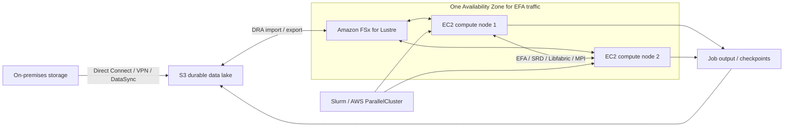

# FSx for Lustre, EFA và đường truyền dữ liệu HPC

## 1. Vì sao HPC cần storage và network chuyên dụng?

High Performance Computing (HPC) giải quyết các bài toán có nhiều tiến trình tính toán chạy song song: mô phỏng khí động học, dự báo thời tiết, mô hình phân tử, xử lý địa chấn, render và phân tích ảnh vệ tinh. Các tiến trình thường trao đổi dữ liệu liên tục và cùng đọc/ghi một tập file lớn.

Một cluster có hàng trăm compute nodes có thể gặp hai nút thắt:

- **Storage I/O:** nhiều node đọc cùng dataset, ghi checkpoint lớn hoặc tạo hàng triệu file nhỏ. Một file server thông thường có thể không đáp ứng throughput, metadata operations và concurrency.
- **Inter-node communication:** MPI ranks phải trao đổi message thường xuyên. Độ trễ và CPU overhead của mạng TCP/IP có thể giới hạn khả năng scale-out.

AWS cung cấp hai thành phần quan trọng để xử lý hai nút thắt này:

- **Amazon FSx for Lustre:** file system song song được quản lý, cung cấp shared POSIX storage với throughput cao cho compute nodes.
- **Elastic Fabric Adapter (EFA):** network interface tăng tốc giao tiếp giữa các EC2 instances bằng OS bypass và Scalable Reliable Datagram (SRD), tích hợp với Libfabric và middleware HPC.

Đường truyền dữ liệu hoàn chỉnh thường có thêm Amazon S3 làm durable data repository, AWS DataSync để di chuyển dữ liệu, AWS Direct Connect hoặc Site-to-Site VPN cho kết nối on-premises, cùng EC2/AWS ParallelCluster/Slurm để điều phối job.

FSx for Lustre và EFA giải quyết hai đường I/O khác nhau. FSx tăng tốc đọc/ghi file dùng chung; EFA tăng tốc giao tiếp giữa các tiến trình/instances và, với file system EFA-enabled phù hợp, tăng throughput từ client đến FSx. Ứng dụng chỉ hưởng lợi khi storage layout, MPI/runtime, instance type và network topology đều phù hợp.

## 2. Mục tiêu học tập

Sau bài học, người học có thể:

1. Giải thích kiến trúc song song của FSx for Lustre và vai trò của metadata/data servers.
2. Chọn Scratch hoặc Persistent, SSD, Intelligent-Tiering hay HDD theo workload.
3. Thiết kế S3 data repository association (DRA), automatic import/export và data repository tasks.
4. Phân biệt import metadata, lazy data access và export dữ liệu.
5. Hiểu file striping, Object Storage Targets (OSTs), Metadata Targets (MDTs) và metadata IOPS.
6. Giải thích EFA, ENA, Libfabric, MPI, SRD và OS bypass.
7. Thiết kế FSx for Lustre EFA-enabled với EC2 clients đúng AZ, subnet CIDR và security groups.
8. Chọn cluster placement group và instance types cho tightly coupled HPC.
9. Chọn đường truyền từ on-premises hoặc object storage vào HPC: Direct Connect, VPN, DataSync, S3 DRA.
10. Mount FSx for Lustre trên Linux EC2 và kiểm tra trạng thái.
11. Tối ưu I/O pattern, stripe count, metadata và checkpoint.
12. Bảo vệ dữ liệu bằng encryption, IAM, security groups, backup và lifecycle.
13. Theo dõi throughput, metadata, queue, network và chi phí.
14. Xây dựng quy trình ingest → compute → export → cleanup bằng AWS CLI.

## 3. Kiến trúc tham chiếu cho một HPC workload

Một pipeline điển hình có hai đường dữ liệu:

1. Đường bulk data: on-premises/object storage → S3 hoặc DataSync → FSx for Lustre → compute nodes → FSx → S3/results repository.
2. Đường communication: MPI ranks trên EC2 instances ↔ EFA/Libfabric ↔ MPI ranks khác.



FSx for Lustre có thể được mount bởi nhiều compute nodes như một file system chung. S3 giữ bản dữ liệu durable hoặc data lake; DRA giúp file system và S3 trao đổi file/metadata. EFA traffic có giới hạn topology riêng: không đi qua Availability Zones hoặc VPC khác. Direct Connect/VPN phục vụ luồng dữ liệu IP thông thường từ on-premises; không phải đường EFA MPI.

## 4. FSx for Lustre là gì?

Amazon FSx for Lustre là managed parallel file system dựa trên Lustre, thiết kế cho workloads cần nhiều client truy cập đồng thời và throughput cao. Các compute nodes mount cùng file system qua Lustre client, sau đó đọc/ghi file bằng POSIX APIs quen thuộc.

Khác với object storage, Lustre trình bày dữ liệu dưới dạng file và directory. Ứng dụng có thể dùng open/read/write/rename/stat và file locking. Nhiều clients truy cập song song vào các file hoặc vùng dữ liệu khác nhau.

Các đặc điểm quan trọng:

- Scale-out qua nhiều file servers và disks.
- Client truy cập trực tiếp các storage servers, tránh một head node đơn lẻ làm bottleneck.
- Có metadata path riêng để quản lý tên file, directory, permission và timestamp.
- Có thể liên kết S3 để import dữ liệu đầu vào và export kết quả.
- Có deployment/storage classes khác nhau cho scratch, persistent, SSD, Intelligent-Tiering và HDD.
- Có thể dùng với EC2, AWS ParallelCluster, containers được cấu hình phù hợp và on-premises clients qua network kết nối.

FSx for Lustre không thay thế S3 cho mọi dữ liệu. S3 phù hợp lưu trữ object bền vững, chia sẻ qua API và data lake; Lustre phù hợp vùng làm việc hiệu năng cao trong thời gian chạy job.

## 5. Cấu trúc song song: MDT, MDS, OST và OSS

Một Lustre file system phân chia công việc giữa metadata và file data.

| Thành phần | Vai trò |
|---|---|
| Metadata Server (MDS) | Xử lý metadata requests của client |
| Metadata Target (MDT) | Lưu directory entries, file names, permissions, timestamps và metadata |
| Object Storage Server (OSS) | Phục vụ file data trên các storage targets |
| Object Storage Target (OST) | Lưu các chunks dữ liệu file |
| Lustre client | Mount file system và gửi metadata/data requests |

Khi ứng dụng mở file, client cần metadata để tìm vị trí file và quyền truy cập. Khi đọc/ghi nội dung, dữ liệu được trao đổi với các OST tương ứng. Vì vậy, workload có thể bị giới hạn bởi metadata dù throughput đọc file lớn vẫn còn dư.

Ví dụ:

- Một job đọc 100 file lớn: thường cần throughput data cao.
- Một job tạo 10 triệu file nhỏ: có thể bị giới hạn bởi metadata IOPS và directory operations.
- Một job có nhiều ranks cùng append vào một file: có thể tạo lock contention hoặc serialization.
- Một job checkpoint đồng thời: cần bố trí file và stripe layout để nhiều OST cùng phục vụ.

Tách biệt hai dạng tải này giúp chọn đúng throughput capacity, metadata IOPS và layout.

## 6. Chọn deployment type và storage class

FSx for Lustre có hai deployment options và ba storage classes. Chọn deployment type và storage class khi tạo file system; availability và giới hạn phụ thuộc Region, Lustre version và cấu hình.

### 6.1. Scratch và Persistent

| Thuộc tính | Scratch | Persistent |
|---|---|---|
| Mục đích | Temporary storage, job ngắn hạn | Workload dài hạn hoặc nhạy với gián đoạn |
| Replication | Không replicate dữ liệu | Dữ liệu được replicate theo storage class |
| Khi file server lỗi | Dữ liệu trên server/disk lỗi có thể không còn truy cập được | FSx thay thế infrastructure lỗi; client request retry |
| Backup | Không hỗ trợ backup FSx | Có backup nếu file system không liên kết S3 DRA |
| Phù hợp | Intermediate files, scratch space, dữ liệu tái tạo được | Shared working data, production HPC data |

Scratch có thể cung cấp burst throughput cao cho workload ngắn hạn, nhưng không dùng làm nơi duy nhất lưu kết quả không thể tái tạo.

Persistent SSD/HDD replicate dữ liệu trong cùng AZ; Persistent Intelligent-Tiering replicate trên nhiều AZ theo tài liệu FSx. Điều này không biến mọi loại FSx for Lustre thành multi-AZ mount endpoint; EFA traffic và client placement vẫn có giới hạn riêng.

### 6.2. Storage classes

| Storage class | Đặc điểm | Khi cân nhắc |
|---|---|---|
| SSD | Low latency cho toàn dataset; throughput cao và ổn định | Metadata-heavy, random I/O hoặc latency-sensitive |
| Intelligent-Tiering | Elastic tiering; dữ liệu truy cập thường xuyên được phục vụ nhanh, có optional SSD read cache | Dataset lớn, access pattern thay đổi |
| HDD | Dung lượng/chi phí phù hợp một số workload tuần tự; có thể dùng SSD read cache trên cấu hình hỗ trợ | Dataset lớn, ít random I/O, latency không quá khắt khe |

Không chọn storage class chỉ dựa trên giá mỗi GiB. Đo random/sequential I/O, metadata operations, working-set size, read-cache hit rate và yêu cầu throughput.

### 6.3. Persistent 1 và Persistent 2

- Persistent 1 hỗ trợ SSD/HDD và phù hợp workload lâu dài không đòi hỏi mức IOPS/throughput cao nhất; deployment type này được tạo bằng AWS CLI hoặc API.
- Persistent 2 là thế hệ mới hơn, hỗ trợ SSD và Intelligent-Tiering, throughput/metadata performance cao hơn và có tùy chọn metadata configuration.
- Persistent 2 có thể bật EFA khi tạo file system và cấu hình metadata performance.
- Persistent 2 chỉ có ở một số Region; kiểm tra Region availability trước khi thiết kế.

Các throughput tiers theo storage class/deployment type cũng khác nhau: Persistent 1 SSD hỗ trợ 50/100/200 MB/s/TiB; Persistent 1 HDD hỗ trợ 12/40 MB/s/TiB; Persistent 2 SSD hỗ trợ 125/250/500/1,000 MB/s/TiB. Với Intelligent-Tiering, người dùng provision tổng throughput capacity thay vì throughput theo TiB.

## 7. Liên kết S3 bằng Data Repository Association

Data Repository Association (DRA) liên kết một directory trong FSx for Lustre với một S3 bucket hoặc prefix. DRA tạo ánh xạ 1:1 giữa file-system path và S3 object keys.

Ví dụ:

| FSx path | S3 path |
|---|---|
| `/input` | `s3://hpc-data/input/` |
| `/results` | `s3://hpc-data/results/` |
| `/reference` | `s3://hpc-data/reference/` |

DRA giúp đưa dataset từ S3 vào file-system namespace, tự động import thay đổi metadata từ S3, tự động export file mới/thay đổi/xóa từ FSx về S3 và chạy import/export data repository tasks theo yêu cầu.

Một file system có thể có tối đa 8 DRA; mỗi association cần FSx directory và S3 bucket/prefix riêng. DRA không hỗ trợ file systems dùng Intelligent-Tiering hoặc Scratch 1; DRA hỗ trợ các Lustre versions 2.12 và 2.15 được AWS liệt kê. Automatic export cũng không hỗ trợ Lustre 2.10 hoặc Scratch 1. Kiểm tra compatibility matrix trước khi chọn storage class và file-system version.

### 7.1. Metadata import và lazy data access

Khi liên kết S3, FSx import metadata để hiển thị file/directory. Nội dung object được truy xuất vào file system khi ứng dụng truy cập file lần đầu. Vì vậy, nhìn thấy tên file trong directory không đồng nghĩa toàn bộ bytes đã được preload vào Lustre.

Với workload cần thời gian khởi động ổn định, hãy pre-stage hoặc warm working set trước khi bắt đầu job. Có thể chạy import task và đọc trước dữ liệu cần thiết; theo dõi cache/throughput để tránh hàng nghìn compute ranks cùng tạo cold-start burst.

### 7.2. Automatic import/export

Import policy xác định sự kiện S3 nào được phản ánh vào FSx: New, Changed, Deleted hoặc kết hợp. Export policy xác định thay đổi từ FSx nào được ghi về S3.

Lưu ý:

- Automatic import yêu cầu S3 bucket và FSx file system ở cùng Region.
- Automatic export có thể ghi sang S3 bucket ở Region khác.
- Automatic import và export có thể cùng bật trên một DRA.
- Nếu cùng một file bị sửa ở cả S3 và Lustre, hai phía có thể ghi đè lẫn nhau; FSx không giải quyết conflict cho ứng dụng.
- Cần application-level coordination hoặc quy ước một bên là source of truth cho mỗi giai đoạn.
- Một số thay đổi do S3 Lifecycle expiration hoặc thao tác versioning không được automatic import đồng bộ như một S3 delete thông thường; kiểm tra giới hạn cụ thể của import policy.
- Không xóa S3 bucket khi vẫn còn file systems liên kết.

Đừng dùng DRA hai chiều như một distributed lock hoặc transaction system. Hãy thiết kế luồng ingest/compute/export có ownership rõ ràng.


## 8. Data repository tasks

Data repository task thực hiện import hoặc export file/metadata theo phạm vi được chỉ định.

- **Import task:** đồng bộ metadata và file changes từ S3 vào FSx.
- **Export task:** ghi file/metadata được tạo hoặc thay đổi trong FSx về S3.
- **Automatic import:** có thể chạy cùng import tasks.
- **Automatic export và export tasks:** không thể dùng đồng thời trên cùng file system theo tài liệu hiện hành.

Dùng task khi cần chủ động stage dataset trước một job, đồng bộ kết quả sau khi job hoàn thành hoặc reconcile metadata sau một đợt thay đổi lớn.

Task không phải real-time replication guarantee. Đưa task status, failure count và object count vào workflow; chỉ submit compute job khi dữ liệu đầu vào đã sẵn sàng.

## 9. Striping: chia file qua nhiều OST

Striping chia nội dung file thành các chunks lưu trên nhiều OST. Khi nhiều OST cùng phục vụ một file, aggregate throughput có thể cao hơn so với một OST.

Các tham số thường gặp:

- Stripe count: số OST tham gia lưu file.
- Stripe size: kích thước mỗi chunk trước khi chuyển sang OST tiếp theo.
- Stripe offset: OST bắt đầu, thường để hệ thống tự chọn.
- Progressive File Layout (PFL): thay đổi layout theo kích thước file.

Ví dụ, một file 8 GiB có stripe count 4 và stripe size 1 MiB sẽ phân phối các chunks luân phiên trên bốn OST. Nhiều storage servers có thể cùng phục vụ một lần đọc lớn.

### 9.1. Khi nào tăng stripe count?

Tăng stripe count có thể hữu ích với file lớn, nhiều clients đọc/ghi song song và cần tận dụng nhiều OST.

Không nên đặt stripe count lớn cho mọi file:

- File nhỏ có thể tạo metadata/network overhead không cần thiết.
- Các thao tác metadata trên layout nhiều OST có thể cần round-trip tới nhiều targets.
- Log file append-only thường không cần stripe count cao.
- Nhiều file lớn cùng dùng một stripe layout có thể tạo hot spots nếu phân bố không hợp lý.

Đo bằng workload thực tế trước khi thay đổi.

### 9.2. Lệnh kiểm tra và thiết lập striping

```bash
# Xem layout của một file
lfs getstripe /fsx/dataset/model.bin

# Xem OST và MDT usage
lfs df -h /fsx

# Tạo file mới với stripe count 8
lfs setstripe -c 8 /fsx/output/large-result.bin

# Thiết lập layout mặc định cho file mới trong một directory
lfs setstripe -c 8 /fsx/output/
```

`lfs setstripe` chỉ định layout cho file mới hoặc file được tạo trong directory đã đặt layout. Không tự đổi layout file đã tồn tại; dùng `lfs migrate` hoặc tạo file mới và copy dữ liệu khi cần thay đổi layout.

## 10. Metadata IOPS và workload nhiều file nhỏ

Metadata performance quyết định tốc độ tạo, mở, đóng, liệt kê, rename và xóa file/directory. Một pipeline tạo hàng triệu file nhỏ có thể chậm dù data throughput chưa đạt giới hạn.

Persistent 2 cho phép cấu hình Metadata IOPS độc lập với storage capacity. Có hai mode:

- AUTOMATIC: FSx tự provision theo storage capacity (SSD) hoặc throughput capacity (Intelligent-Tiering).
- USER_PROVISIONED: người dùng chỉ định metadata IOPS theo các giá trị hỗ trợ.

Ví dụ workload metadata-heavy:

- Nhiều ranks tạo một file nhỏ cho mỗi task.
- Directory có hàng triệu entries.
- Workflow repeatedly stat/open/close files.
- Job scheduler quét dataset trước khi compute.

Cải thiện bằng cách gom nhiều records vào file lớn hơn, chia directory theo shard, giảm số lần stat/open, tránh tạo file rỗng hàng loạt và chọn metadata IOPS phù hợp.

## 11. EFA là gì?

Elastic Fabric Adapter (EFA) là network interface dành cho ứng dụng cần communication giữa EC2 instances với latency thấp và throughput cao, đặc biệt HPC và distributed AI/ML.

EFA có thể cung cấp:

- OS bypass: user-space application/runtime giao tiếp trực tiếp với EFA device qua Libfabric, giảm overhead của kernel TCP/IP path.
- SRD transport: Scalable Reliable Datagram hỗ trợ reliable transport và congestion control.
- Tích hợp với MPI implementations và NCCL/NIXL theo cấu hình được hỗ trợ.
- Giao tiếp inter-instance trong topology AWS được EFA hỗ trợ.

ENA vẫn cung cấp IP networking thông thường trong VPC. EFA bổ sung đường giao tiếp hiệu năng cao cho middleware tương thích; nó không biến mọi TCP socket hoặc mọi ứng dụng thành EFA-aware.

EFA là EC2 networking feature và không tính thêm phí riêng, nhưng instance, compute, placement, storage và data transfer vẫn phát sinh chi phí.

## 12. EFA, Libfabric và MPI

Trong HPC, ứng dụng thường dùng MPI để gửi/nhận messages giữa ranks. MPI implementation có thể dùng Libfabric/OpenFabrics Interfaces (OFI) để truy cập transport provider.

Đường dữ liệu khái quát:

1. Ứng dụng gọi MPI_Send/MPI_Recv hoặc collective operation.
2. MPI library chọn transport/provider tương thích.
3. Libfabric cung cấp user-space API.
4. EFA provider dùng EFA device và SRD transport.
5. Remote rank nhận message qua EFA/Libfabric/MPI.

EFA tương thích với các MPI stacks được AWS hỗ trợ, ví dụ Open MPI 4.1+ và Intel MPI 2019 Update 5+ trong các cấu hình được tài liệu hóa. Cần kiểm tra phiên bản MPI, Libfabric, kernel, driver và instance type; không ghép tùy ý các phiên bản.

Một số ứng dụng MPI có thể cần build lại hoặc cấu hình runtime để dùng EFA provider. Nếu ứng dụng vẫn dùng TCP/ENA path, chỉ gắn EFA device chưa chắc cải thiện hiệu năng.

## 13. EFA cho FSx for Lustre

FSx for Lustre có thể được tạo ở chế độ EFA-enabled để tăng throughput từ một client instance tới file system. AWS khuyến nghị cân nhắc EFA khi file system có throughput capacity trên 10 GBps.

Điều kiện chính:

- File system phải dùng Persistent 2 và có metadata configuration.
- EFA phải được bật ngay khi tạo; không thể bật/tắt trên file system đã tồn tại.
- EFA clients và FSx file system phải ở cùng Availability Zone.
- Subnet của client và file system phải nằm trong cùng /16 CIDR range trong VPC.
- Client cần EC2 instance Nitro v4 trở lên có hỗ trợ EFA; trn2 bị loại trừ trong hướng dẫn FSx EFA hiện tại.
- OS client phải thuộc danh sách hỗ trợ, hiện gồm Amazon Linux 2023, RHEL 9.5+ hoặc Ubuntu 22.04+ với kernel 6.8+.
- Cài Lustre client, EFA modules/driver và cấu hình EFA interface.
- File system và client dùng EFA-enabled security groups đúng yêu cầu.

Một file system có giới hạn tối đa 8,192 EFA connections trên tất cả client instances. Mỗi EFA interface được cấu hình trên client tính là một connection; tính cả số interfaces trên mỗi node khi sizing cluster.

Metadata traffic giữa clients và FSx luôn dùng TCP, kể cả khi data path sử dụng EFA. EFA-enabled file system cũng có thể giao tiếp qua ENA hoặc ENA Express; việc chọn EFA chỉ có hiệu lực khi client và workload đáp ứng điều kiện.

Trong các cấu hình được tài liệu hóa, throughput tối đa tới một client có thể đạt 700 Gbps qua EFA và tới 1,200 Gbps khi dùng EFA cùng GPUDirect Storage. Đây là giới hạn cấu hình được hỗ trợ, không phải mức throughput bảo đảm cho mọi job; kết quả thực tế phụ thuộc instance, file system capacity, data layout và workload.

### 13.1. EFA, ENA Express và GPUDirect Storage

- **ENA:** IP networking truyền thống cho VPC.
- **EFA:** OS-bypass path cho ứng dụng dùng Libfabric.
- **ENA Express:** tối ưu đường truyền TCP/IP giữa các instances hỗ trợ.
- **GPUDirect Storage (GDS):** cho phép data path từ storage tới GPU memory giảm CPU involvement và memory copies trong cấu hình GPU/driver hỗ trợ.

Với FSx for Lustre EFA-enabled, GDS hiện hỗ trợ các instance family được AWS liệt kê như P5, P5e, P5en, P6-B200 và P6-B300; cần cài CUDA, NVIDIA driver và GDS driver đúng phiên bản. Không giả định mọi GPU instance đều có GDS support.

## 14. Placement groups và topology HPC

Cluster placement group đặt EC2 instances gần nhau trong một Availability Zone để giảm network latency và tăng throughput cho traffic giữa các instances. Đây là lựa chọn thường dùng cho tightly coupled MPI workloads.

Lưu ý:

- Cluster placement group chỉ nằm trong một AZ.
- EFA traffic không đi qua AZ hoặc VPC khác.
- EFA-enabled FSx client và file system có yêu cầu cùng AZ và cùng /16 CIDR.
- Placement group không bắt buộc để bật EFA, nhưng AWS khuyến nghị cho workloads nhạy với latency.
- Khi scale cluster, capacity có thể không đủ; cân nhắc On-Demand Capacity Reservation phù hợp.
- Không trộn quá nhiều instance types nếu điều đó làm giảm khả năng cấp đủ capacity.
- Traffic đi Internet hoặc Direct Connect trong cluster placement group có giới hạn riêng; không dùng cluster placement group như cách tăng tốc WAN.

Một cluster có thể dùng ENA/IP cho control plane, S3, package repositories và external data transfer; EFA dùng cho MPI communication nội bộ. Thiết kế subnet/AZ phải phục vụ cả hai đường.

## 15. Đường truyền dữ liệu HPC: chọn theo quy mô và cách truy cập

Không có một phương thức chuyển dữ liệu phù hợp cho mọi trường hợp. Chọn theo kích thước dataset, tần suất cập nhật, latency, khoảng cách mạng, số lượng file, metadata cần bảo toàn và yêu cầu kiểm chứng.

| Phương thức | Hướng sử dụng | Điểm mạnh | Lưu ý |
|---|---|---|---|
| S3 + FSx DRA | S3 ↔ FSx | Tích hợp file/object, import/export tự động | Không phải synchronous transaction; cần tránh concurrent conflicting writes |
| AWS DataSync | On-prem/NFS/SMB/object/S3/FSx | Managed transfer, verification, schedule, incremental sync | Dùng task/agent phù hợp location; không phải low-latency shared mount |
| Direct Connect | On-prem ↔ VPC/AWS | Private network path, bandwidth planning | Cần thiết kế routing, VLAN, DX gateway/VGW/TGW và redundancy |
| Site-to-Site VPN | On-prem ↔ VPC | Thiết lập nhanh, mã hóa IPsec | Throughput/latency phụ thuộc VPN tunnel và internet path |
| Mount FSx trực tiếp qua DX/VPN | On-prem client ↔ Lustre | POSIX access tới file system | Cần Lustre client, DNS, routing, ports và network đủ ổn định |
| Offline bulk transfer | Dataset cực lớn hoặc mạng hạn chế | Không phụ thuộc thời gian truyền qua WAN | Chuyển dữ liệu offline vào S3 trước, sau đó import vào FSx |

### 15.1. S3 làm durable landing zone

Một mô hình phổ biến là đưa dữ liệu đầu vào vào S3 trước. S3 là durable object store và phù hợp cho versioning, lifecycle, data lake, audit và chia sẻ qua nhiều dịch vụ. Sau đó, DRA import metadata/file vào FSx để compute nodes truy cập theo POSIX.

Khi job hoàn tất, export output từ FSx về S3. Có thể tách prefix theo job ID, dataset version và run date để tránh ghi đè output của job khác.

### 15.2. Mount trực tiếp từ on-premises

FSx for Lustre hỗ trợ on-premises clients truy cập qua Direct Connect hoặc Site-to-Site VPN. Mô hình này cho phép copy data vào file system hoặc truy cập shared file system từ máy chủ tại chỗ.

Tuy nhiên, Direct Connect/VPN chỉ cung cấp IP connectivity; không mang EFA OS-bypass traffic từ on-premises vào HPC. EFA dùng cho EC2 instances trong topology được hỗ trợ. Với on-premises transfer, dùng TCP/Lustre hoặc DataSync tùy yêu cầu.

### 15.3. Khi nào chọn DataSync?

Dùng DataSync cho migration một lần, recurring ingest, replication định kỳ hoặc copy dữ liệu giữa on-premises và AWS storage. DataSync hỗ trợ transfer tới/từ FSx for Lustre bằng location chuyên biệt.

Enhanced mode hỗ trợ FSx for Lustre Lustre version 2.12 trở lên; nếu file system dùng 2.10, cần Basic mode hoặc nâng version theo quy trình được hỗ trợ. DataSync mount FSx bằng Lustre client và cần quyền truy cập toàn bộ dữ liệu ở mount path.

## 16. Direct Connect, VPN và thiết kế network

Khi chọn Direct Connect hoặc VPN, cần xác định:

- Băng thông trung bình và burst của dữ liệu đầu vào/đầu ra.
- Số file, kích thước file và metadata operations.
- Latency và packet loss giữa on-premises và AWS.
- Redundancy của circuit/tunnel và routing failover.
- VPC/subnet, route tables, DNS resolution và security groups.
- Encryption in transit theo chính sách bảo mật.
- Giới hạn băng thông của client, router, firewall và thiết bị lưu trữ tại chỗ.

Direct Connect phù hợp khi cần kết nối private có bandwidth planning và traffic ổn định. VPN có thể phù hợp cho môi trường nhỏ hơn, kết nối dự phòng hoặc proof of concept. Có thể dùng VPN backup cùng Direct Connect tùy kiến trúc.

Nếu mount FSx trực tiếp từ on-premises, kiểm tra DNS name của file system được phân giải qua network, client Lustre tương thích và các cổng cần thiết. Tránh thiết kế EFA MPI traffic đi qua DX/VPN vì EFA không phải transport WAN.


## 17. Security groups và ports cho Lustre/EFA

FSx for Lustre truy cập qua network interface trong VPC gắn với file system. Chỉ resources trong VPC liên kết hoặc VPC được peering/network kết nối phù hợp mới có thể truy cập interface.

### 17.1. Lustre TCP traffic

Với client và file system thông thường, security groups cần cho phép traffic giữa Lustre clients và FSx trên:

| Protocol | Port | Mục đích |
|---|---:|---|
| TCP | 988 | Lustre LNet traffic |
| TCP | 1018–1023 | Lustre client/server communication |

Cần cấu hình inbound/outbound đúng chiều trên security groups của file system và clients; file servers cũng cần giao tiếp với nhau. Dùng source/destination là security group IDs hoặc CIDR subnet cụ thể theo tài liệu AWS và nguyên tắc least privilege.

### 17.2. EFA-enabled security groups

Với EFA-enabled FSx for Lustre, yêu cầu security group khác với TCP-only rules:

- File system SG phải cho phép all traffic inbound/outbound với chính SG đó và client SG.
- Client SG phải cho phép all traffic inbound/outbound với file system SG.
- EFA rules phải tham chiếu trực tiếp security group ID.
- CIDR rules, kể cả 0.0.0.0/0, không đáp ứng yêu cầu EFA dù mở mọi port.

Đây là lý do nên tạo SG riêng cho EFA file system và EFA clients, kiểm tra kỹ self-referencing rule và source/destination SG ID trước khi mount.

Không xóa hoặc sửa network interface do FSx quản lý. Việc thay đổi ENI của service có thể làm mất kết nối file system.

## 18. AWS DataSync: transfer, verification và scheduling

DataSync là managed service để di chuyển dữ liệu giữa on-premises storage, object storage và AWS storage services. Khi transfer tới/từ FSx for Lustre, tạo DataSync location trỏ tới file system và mount path.

Luồng cơ bản:

1. Tạo source location.
2. Tạo FSx for Lustre destination/source location.
3. Tạo DataSync task với filters và options.
4. Chạy task hoặc đặt schedule.
5. Theo dõi task execution, transferred bytes, files, skipped files và errors.
6. Kiểm tra verification status trước khi đưa dataset vào job.

### 18.1. Basic mode và Enhanced mode

- Basic mode hỗ trợ nhiều transfer scenarios và có thể dùng với FSx for Lustre.
- Enhanced mode xử lý số lượng file/object rất lớn song song, tối ưu listing/preparation/transfer/verification.
- Enhanced mode với FSx for Lustre yêu cầu Lustre version 2.12 trở lên.
- Chọn task mode khi tạo task; không thể đổi mode sau khi tạo.
- VPC dùng cho DataSync phải có default tenancy; dedicated tenancy không được hỗ trợ.

DataSync location cho FSx dùng Lustre client và mount file system bằng UID/GID 0 để có quyền truy cập toàn bộ dữ liệu. Cần đánh giá root access, security group và IAM role như một phần của security review.

### 18.2. Integrity verification

DataSync có thể kiểm tra checksum và metadata giữa source/destination. Enhanced mode xác minh dữ liệu đã transfer; Basic mode có các tùy chọn verify khác nhau, có thể verify toàn bộ data sau transfer và làm tăng thời gian chạy với dataset lớn.

Nếu file đang được ghi trong lúc DataSync transfer, task có thể phát hiện inconsistency ở giai đoạn verification. Để nhận phiên bản ổn định, chạy lại task sau khi ứng dụng hoàn tất ghi file.

Dùng include/exclude filters để giới hạn dataset; cân nhắc manifest khi cần kiểm soát chính xác danh sách file; không đồng bộ checkpoint đang ghi dở nếu workload chưa hỗ trợ snapshot/coordination.

## 19. Cài Lustre client và mount FSx trên EC2

EC2 client cần OS/kernel được FSx for Lustre hỗ trợ và Lustre client tương thích với file system version. Trên EFA clients, cài thêm EFA driver/modules và cấu hình EFA interface.

Quy trình mount:

1. Lấy DNS name và mount name từ FSx console hoặc DescribeFileSystems.
2. Cài Lustre client phù hợp với Linux distribution/kernel.
3. Kiểm tra security groups, route, DNS và ports.
4. Tạo mount point.
5. Mount file system và xác nhận bằng df/lfs commands.

Ví dụ:

```bash
sudo mkdir -p /fsx

sudo mount -t lustre -o relatime,flock \
  fs-0123456789abcdef0.fsx.us-east-1.amazonaws.com@tcp:/mountname \
  /fsx

df -h /fsx
lfs df -h /fsx
```

Thay DNS name và mount name bằng giá trị thật từ file system của mình. `relatime` giảm metadata updates so với atime chính xác; `flock` bật file locking. Nếu workload cần access time chính xác, cân nhắc atime và đo ảnh hưởng performance.

Để tự mount khi boot, cấu hình /etc/fstab theo hướng dẫn AWS, dùng _netdev và systemd automount phù hợp để tránh boot race khi network chưa sẵn sàng. Không copy mount options của EFA-enabled file system sang non-EFA hoặc ngược lại mà chưa kiểm tra tài liệu cho loại file system đó.

## 20. Tối ưu performance end-to-end

Hiệu năng thực tế phụ thuộc thành phần chậm nhất trong đường dữ liệu:

- Client instance network throughput.
- File system network throughput.
- Disk throughput/IOPS.
- Metadata IOPS.
- File striping và số OST.
- Application I/O pattern.
- Cache hit rate và working set.
- Số client/ranks cùng truy cập.

Nếu đọc dữ liệu đã nằm trong in-memory/SSD cache, network có thể là giới hạn. Khi ghi hoặc đọc data không nằm trong cache, throughput chịu giới hạn thấp hơn giữa network throughput và disk throughput.

### 20.1. Tối ưu file layout

- Striping file lớn qua nhiều OST khi cần throughput cao.
- Không stripe quá rộng cho file nhỏ.
- Tách workload small-file và large-file vào directory có layout phù hợp.
- Dùng PFL khi dataset có nhiều kích thước file.
- Dùng lfs getstripe và lfs df để quan sát layout và OST utilization.
- Cân nhắc imported file chunk size cho dataset được import từ S3 nếu cần phân bố file đều.

### 20.2. Tối ưu metadata

- Giảm số file nhỏ nếu có thể gom thành container/chunk lớn hơn.
- Chia directory lớn thành nhiều directory theo shard.
- Tránh hàng nghìn ranks cùng stat/open/close một directory nóng.
- Đánh giá metadata IOPS của Persistent 2.
- Theo dõi latency của metadata operations cùng data throughput.

### 20.3. Benchmark đúng workload

Dùng benchmark đại diện cho ứng dụng, ví dụ IOR cho parallel file I/O và mdtest cho metadata workloads. Kiểm tra cả read, write, random/sequential, file sizes, concurrency và checkpoint patterns.

Đừng chỉ benchmark một node hoặc một file lớn rồi suy ra hiệu năng của toàn cluster. So sánh scale-out theo số nodes/ranks và đo cả application runtime, không chỉ MB/s của storage.

## 21. Điều phối HPC jobs bằng Slurm và AWS ParallelCluster

AWS ParallelCluster có thể tạo cluster với head node, compute queue và shared storage như FSx for Lustre. Slurm scheduler phân phối job lên compute nodes; FSx cung cấp working directory/dataset chung.

Workflow gợi ý:

1. Người dùng submit job kèm dataset version và resource requirements.
2. Job prolog kiểm tra mount, input manifest và dung lượng scratch.
3. Stage dữ liệu cần thiết từ S3/FSx repository.
4. Khởi tạo MPI ranks trên các EC2 instances hỗ trợ EFA.
5. Ứng dụng đọc input và ghi checkpoint/output vào FSx.
6. Job epilog export kết quả về S3 hoặc data repository.
7. Ghi run metadata, exit code và performance metrics.
8. Dọn temporary files sau khi xác nhận export thành công.

Không để một job xóa directory mà job khác còn sử dụng. Tách prefix theo project/job ID và quản lý ownership/permissions.

## 22. Durability, backup và recovery

Chọn persistence theo khả năng tái tạo dữ liệu:

- Scratch phù hợp intermediate data có thể tạo lại; file server failure có thể làm mất dữ liệu trên server đó.
- Persistent replicate data và tự thay thế failed infrastructure.
- S3 DRA có thể dùng làm durable data repository cho input/output.
- Persistent file systems không liên kết S3 có thể dùng automatic daily backups hoặc user-initiated backups.
- FSx backups không hỗ trợ Scratch và không hỗ trợ file systems linked to an S3 data repository.

Automatic daily backup retention có thể cấu hình 0–90 ngày; mặc định 0 ngày nghĩa là automatic backups đang tắt. Backup incremental, file-system-consistent và có thể restore thành file system mới.

Với DRA-linked file system, S3 bucket là durable repository; backup FSx không khả dụng vì file system có thể chỉ chứa working set chứ không phải toàn bộ dataset. Thiết kế versioning, lifecycle, replication và recovery của S3 riêng biệt.

Recovery test cần xác minh dataset version đúng, DRA import hoặc restore hoàn tất, POSIX permissions/ownership đúng, Lustre clients mount lại được, EFA/MPI stack hoạt động và job có thể chạy lại từ checkpoint phù hợp.

## 23. Security và data protection

### 23.1. Encryption

FSx for Lustre mã hóa data at rest. Persistent file systems có thể chọn KMS key. Scratch file systems dùng AWS-managed keys. Scratch 2 và Persistent hỗ trợ encryption in transit khi truy cập từ EC2 instance types được hỗ trợ; kiểm tra Region/instance compatibility.

DataSync, Direct Connect/VPN và S3 DRA có encryption/security controls riêng. Xác định rõ nơi dữ liệu được mã hóa khi truyền và nơi lưu.

### 23.2. IAM và S3

- Tách role cho create/manage file system, mount clients, DRA import/export và DataSync tasks.
- Giới hạn S3 bucket policy theo prefix và role cần thiết.
- Dùng KMS key policy cho principal có nhiệm vụ đọc/ghi.
- Bật S3 Block Public Access.
- Không cấp quyền rộng cho compute node nếu chỉ cần đọc input hoặc ghi output prefix.
- Dùng tags theo project, environment, owner và cost center.

### 23.3. POSIX permissions và multi-tenant HPC

FSx for Lustre sử dụng POSIX ownership/permissions. Thiết kế UID/GID nhất quán giữa compute nodes, project groups và on-premises clients. Nếu UID/GID khác nhau giữa nodes, quyền truy cập file có thể không nhất quán theo kỳ vọng.

Tách directory theo team/project, áp dụng umask/default ACL theo policy và tránh dùng quyền 777 làm giải pháp mặc định.

## 24. Monitoring, metrics và troubleshooting performance

Theo dõi cả file system và client:

| Nhóm | Chỉ số cần xem | Câu hỏi |
|---|---|---|
| Throughput | DataReadBytes, DataWriteBytes, network throughput | Có chạm giới hạn file system/client không? |
| IOPS | DataReadOperations, DataWriteOperations | Có quá nhiều I/O nhỏ không? |
| Metadata | Metadata IOPS utilization/operations | Có bị metadata bottleneck không? |
| Capacity | Storage utilization, free space, OST usage | Có OST nào đầy hoặc mất cân bằng không? |
| S3 DRA | Import/export backlog, task status, errors | Dataset đã đồng bộ chưa? |
| DataSync | Bytes/files transferred, errors, verification | Transfer có hoàn tất và integrity pass không? |
| EC2/EFA | Network throughput, retransmits, CPU, MPI timings | Application có dùng đúng EFA path không? |
| Scheduler | Queue wait, job duration, node failures | Cluster có đủ capacity không? |

Các tình huống thường gặp:

- **Mount timeout:** kiểm tra DNS, route, security groups, ports 988/1018-1023, Lustre client/kernel.
- **EFA không được sử dụng:** kiểm tra instance support, EFA driver, Libfabric provider, MPI runtime, AZ và subnet /16.
- **Metadata chậm:** đo file count/directory hot spots, metadata IOPS và pattern open/stat/rename.
- **Một vài OST quá tải:** kiểm tra stripe layout và phân bố file.
- **S3 data chưa xuất hiện trong FSx:** kiểm tra DRA lifecycle, import policy, S3 event configuration và import task status.
- **Export không cập nhật S3:** kiểm tra export policy/task, quyền bucket và object conflict.
- **DataSync task fail:** xem location mount path, SG, IAM role, file permissions và verification logs.
- **MPI scale kém:** đo communication time, rank placement, instance type, EFA provider và collective algorithms.


## 25. Chi phí và capacity planning

Chi phí HPC thường gồm compute, storage, network/data transfer và orchestration. Tính theo workload hoàn chỉnh, không chỉ giá mỗi GiB của file system.

| Thành phần | Yếu tố tính phí cần xem |
|---|---|
| EC2 compute | Instance hours, Spot/On-Demand, Capacity Reservations |
| FSx for Lustre | Storage capacity, storage class, throughput capacity, metadata IOPS |
| FSx backups | Backup storage và retention (nếu file system đủ điều kiện backup) |
| S3 | Storage class, requests, data retrieval, replication và lifecycle |
| DataSync | Data processed, agent/transfer mode và task frequency |
| Direct Connect | Port hours, data transfer và circuit/provider charges |
| VPN | VPN connection hours và data transfer |
| EBS/AMI | Boot volumes, scratch volumes và snapshots |
| CloudWatch | Metrics, logs, dashboards và alarms |

### 25.1. Provision throughput đúng với workload

Với Persistent SSD, throughput capacity thường được tính theo storage capacity nhân với throughput per TiB đã provision. Tăng storage capacity có thể đồng thời tăng throughput capacity theo tier. Persistent 2 hỗ trợ các tier SSD cao hơn Persistent 1.

Intelligent-Tiering dùng throughput capacity được provision độc lập với storage capacity; các lựa chọn gồm 1,000 MBps, 2,000 MBps hoặc các bội số 4,000 MBps, và có thể dùng SSD read cache. EFA trên Intelligent-Tiering yêu cầu throughput capacity 4,000 MBps hoặc bội số của 4,000 MBps theo tài liệu hiện hành.

Không provision cao nhất ngay từ đầu nếu chưa có benchmark. Dùng test workload, tăng dần capacity và quan sát throughput, metadata IOPS, client network và application runtime.

### 25.2. Giảm chi phí transfer

- Giữ compute và FSx trong cùng Region/AZ topology phù hợp để tránh data movement không cần thiết.
- Dùng S3 DRA cho data repository pattern thay vì copy toàn bộ dataset qua WAN nhiều lần.
- Chỉ stage working set cần thiết vào FSx.
- Export kết quả và checkpoint cần giữ; xóa intermediate data sau khi xác minh.
- Dùng DataSync incremental/filters cho recurring sync.
- Tránh chạy đồng thời nhiều job copy lớn tranh bandwidth với MPI/storage traffic.
- Đo chi phí per job hoặc per TB processed và gắn tags cho project/team.

## 26. Ví dụ AWS CLI: tạo FSx for Lustre EFA-enabled

Ví dụ dưới đây tạo Persistent 2 SSD file system với metadata configuration và EFA. Với EFA-enabled Persistent 2 SSD, storage capacity được chọn theo increment gắn với throughput tier; ví dụ tier 1,000 MB/s/TiB dùng increment 4.8 TiB. Đây là cấu hình minh họa; kiểm tra Region availability, storage-capacity increment, throughput tier, instance support và EFA security groups trước khi chạy.

```bash
aws fsx create-file-system \
  --file-system-type LUSTRE \
  --file-system-type-version 2.15 \
  --storage-capacity 4800 \
  --storage-type SSD \
  --subnet-ids subnet-0123456789abcdef0 \
  --security-group-ids sg-0123456789abcdef0 \
  --lustre-configuration '{
    "DeploymentType": "PERSISTENT_2",
    "PerUnitStorageThroughput": 1000,
    "MetadataConfiguration": {
      "Mode": "AUTOMATIC"
    },
    "EfaEnabled": true
  }' \
  --tags Key=Project,Value=hpc-simulation Key=Environment,Value=prod \
  --region us-east-1
```

Trong production, dùng subnet/AZ, security group, KMS key, backup window, storage capacity và throughput đã được thiết kế. EFA-enabled setting không thể bật/tắt sau khi file system được tạo; muốn thay đổi phải tạo file system mới và migrate data.

### 26.1. Kiểm tra file system

```bash
aws fsx describe-file-systems \
  --file-system-ids fs-0123456789abcdef0 \
  --region us-east-1
```

Kiểm tra Lifecycle, DNSName, MountName, DeploymentType, StorageType, PerUnitStorageThroughput, MetadataConfiguration, EfaEnabled và NetworkInterfaceIds trước khi cấu hình clients.

### 26.2. Tạo DRA liên kết S3

```bash
aws fsx create-data-repository-association \
  --file-system-id fs-0123456789abcdef0 \
  --file-system-path /input \
  --data-repository-path s3://hpc-data-prod/input/ \
  --s3 "AutoImportPolicy={Events=[NEW,CHANGED,DELETED]},AutoExportPolicy={Events=[NEW,CHANGED,DELETED]}" \
  --region us-east-1
```

DRA được tạo bất đồng bộ. Kiểm tra lifecycle state trước khi job phụ thuộc vào nó chạy. Bucket policy/IAM role cần cho phép FSx service access đúng bucket/prefix.

### 26.3. Tạo DataSync location cho FSx

```bash
aws datasync create-location-fsx-lustre \
  --fsx-filesystem-arn arn:aws:fsx:us-east-1:111122223333:file-system/fs-0123456789abcdef0 \
  --security-group-arns arn:aws:ec2:us-east-1:111122223333:security-group/sg-0123456789abcdef0 \
  --subdirectory /input \
  --region us-east-1
```

Lệnh trả LocationArn. Tạo task giữa source/destination locations phù hợp, chọn mode và verification options, sau đó start task:

```bash
aws datasync start-task-execution \
  --task-arn arn:aws:datasync:us-east-1:111122223333:task/task-0123456789abcdef0 \
  --region us-east-1
```

Lưu TaskExecutionArn để theo dõi status, bytes/files transferred, errors và verification.

## 27. Bài thực hành: chạy một HPC data pipeline

### 27.1. Mục tiêu

Tạo môi trường FSx for Lustre chia sẻ cho compute nodes, đưa dataset từ S3 vào, chạy một workload song song, ghi output và export kết quả về S3.

### 27.2. Chuẩn bị

- AWS account lab và Region hỗ trợ Persistent 2/EFA nếu thực hành EFA.
- VPC, subnet và security groups cho FSx và EC2 clients.
- S3 bucket input/output.
- EC2 instance types hỗ trợ Lustre; nếu test EFA, chọn Nitro/EFA supported instances.
- Lustre client và EFA driver phù hợp OS/kernel.
- AWS ParallelCluster/Slurm nếu thực hành scheduler.
- Bộ dataset test đủ lớn để quan sát throughput, nhưng không chứa dữ liệu nhạy cảm.

### 27.3. Các bước thực hành

1. Tạo S3 bucket với Block Public Access, encryption và prefix riêng cho input/results.
2. Chuẩn bị EFA security groups với SG-ID references; nếu chỉ test TCP Lustre, cấu hình ports 988 và 1018–1023.
3. Tạo FSx for Lustre file system với deployment/storage class phù hợp.
4. Nếu test EFA-enabled FSx, tạo Persistent 2 có metadata configuration và EFA ngay từ đầu.
5. Tạo DRA cho prefix input và chọn import policy phù hợp.
6. Chờ DRA AVAILABLE; chạy import task nếu cần.
7. Tạo EC2 compute nodes cùng AZ và /16 CIDR với EFA-enabled file system khi dùng EFA.
8. Cài Lustre client; cài EFA driver/modules và MPI/Libfabric stack nếu test EFA.
9. Mount FSx và kiểm tra bằng df, lfs df và lfs getstripe.
10. Chạy IOR để đo parallel read/write; chạy mdtest để đo metadata performance.
11. Thử nhiều stripe counts với file lớn; so sánh throughput và OST utilization.
12. Chạy MPI workload qua EFA và xác minh runtime/provider đang dùng EFA.
13. Ghi checkpoint/output vào directory riêng của job.
14. Export output về S3 bằng DRA automatic export hoặc export task.
15. Xác minh object trên S3 và checksum/metadata theo yêu cầu.
16. Dọn intermediate files, stop/terminate compute resources và kiểm tra chi phí.

### 27.4. Tiêu chí hoàn thành

- Compute nodes mount được FSx for Lustre.
- Dataset từ S3 xuất hiện đúng file-system path.
- DRA import/export hoạt động theo policy đã chọn.
- EFA clients đáp ứng AZ, subnet /16, instance, OS và SG prerequisites.
- Benchmark đo được throughput và metadata performance.
- MPI job chạy trên EFA path nếu test EFA.
- Output được export và xác minh trên S3.
- Job state, error và cost được ghi lại.

## 28. Troubleshooting chi tiết

| Triệu chứng | Nguyên nhân có thể | Hướng xử lý |
|---|---|---|
| FSx file system không chuyển sang AVAILABLE | SG, subnet, quota hoặc cấu hình không hợp lệ | Kiểm tra service events, subnet/AZ và FSx quota |
| Mount báo timeout | DNS, route, SG hoặc ports sai | Kiểm tra DNS, TCP 988/1018–1023, route và client |
| Lustre client không tương thích | Kernel/client version không được hỗ trợ | Dùng OS/kernel và client version trong compatibility matrix |
| EFA không attach/không hoạt động | Instance/OS/driver không hỗ trợ hoặc SG sai | Kiểm tra Nitro generation, EFA support, driver và SG-ID rules |
| EFA FSx không tạo được | Không phải Persistent 2 hoặc thiếu metadata config | Kiểm tra DeploymentType và MetadataConfiguration |
| EFA path không dùng | MPI/Libfabric provider không đúng | Kiểm tra libfabric, MPI build/runtime và EFA device |
| Throughput thấp | Network/disk tier, stripe count hoặc cache miss | Đo từng lớp, điều chỉnh layout và throughput |
| Metadata operations chậm | Quá nhiều file nhỏ hoặc metadata IOPS thấp | Dùng mdtest, gom file, tăng metadata IOPS nếu phù hợp |
| S3 import chậm | Metadata backlog hoặc nhiều events | Kiểm tra AgeOfOldestQueuedMessage, S3 event rate và import task |
| DRA state MISCONFIGURED | S3 event notification FSx bị thay đổi/xóa | Khôi phục DRA config và chạy import task để reconcile |
| Export ghi đè file | Cùng object được sửa từ cả S3 và FSx | Thiết kế single-writer ownership và output prefixes |
| DataSync access denied | SG/IAM/location permissions thiếu | Kiểm tra FSx SG, DataSync role, mount path và S3 permissions |
| DataSync verification fail | File thay đổi trong lúc transfer hoặc metadata khác | Chạy lại khi source ổn định và kiểm tra task options |


## 29. Ví dụ thiết kế: mô phỏng địa chấn theo batch

Một nhóm nghiên cứu nhận các bộ dữ liệu địa chấn nhiều terabyte từ thiết bị thu thập tại hiện trường. Họ cần chạy nhiều simulation jobs trên EC2, mỗi job đọc chung dataset và ghi checkpoint/output riêng.

| Giai đoạn | Dịch vụ/thành phần | Thiết kế |
|---|---|---|
| Ingest | Direct Connect + DataSync | Copy dữ liệu từ on-premises storage lên S3 |
| Durable landing | S3 | Versioned prefixes theo survey ID và dataset version |
| Stage | FSx for Lustre DRA | Import metadata, warm working set cần dùng |
| Compute | EC2 + Slurm/ParallelCluster | Chạy MPI jobs trong cluster placement group |
| Interconnect | EFA | MPI communication giữa compute nodes |
| Shared I/O | FSx for Lustre | Đọc input, ghi checkpoint và intermediate files |
| Export | DRA/DataSync | Đưa output đã hoàn tất về S3 |
| Archive | S3 lifecycle | Chuyển kết quả cũ sang storage class phù hợp |
| Observability | CloudWatch/CloudTrail | Theo dõi job, storage, network và access |

Quy ước dữ liệu:

- Input prefix bất biến theo survey/version.
- Mỗi job có output prefix riêng theo job ID.
- Checkpoint được ghi theo chu kỳ và có manifest chỉ rõ checkpoint hoàn tất.
- Chỉ export checkpoint đã đóng file/hoàn tất write.
- Scheduler không cấp cùng output directory cho hai job độc lập.
- Job có thể resume từ checkpoint gần nhất nếu compute node bị gián đoạn.

Kiến trúc này giúp S3 giữ bản durable, FSx phục vụ I/O song song và EFA phục vụ communication nội bộ. Direct Connect/DataSync đảm nhiệm ingest và egress qua WAN.

## 30. Anti-patterns thường gặp

| Anti-pattern | Hậu quả | Cách cải thiện |
|---|---|---|
| Dùng Scratch làm bản lưu duy nhất của kết quả | Có thể mất dữ liệu khi file server/disk lỗi | Export về S3 hoặc dùng Persistent |
| Dùng FSx làm object archive dài hạn | Tốn chi phí file system provisioned và metadata | Dùng S3 làm durable repository |
| Chọn Persistent SSD lớn nhất mà chưa benchmark | Provision dư storage/throughput | Đo I/O và scale theo workload |
| Bật EFA nhưng MPI vẫn dùng TCP | Không hưởng OS-bypass path | Cấu hình Libfabric/MPI provider và xác minh runtime |
| Đặt EFA client ở AZ khác file system | EFA path không hoạt động | Đồng vị trí AZ và /16 CIDR |
| Dùng CIDR 0.0.0.0/0 thay cho SG ID trong EFA rules | EFA security group validation không đạt | Dùng SG-ID references theo yêu cầu |
| Stripe tất cả file nhỏ qua mọi OST | Tăng metadata/network overhead | Dùng layout theo file size và I/O pattern |
| Tạo hàng triệu file nhỏ | Metadata bottleneck | Gom file hoặc shard directory |
| Coi DRA là synchronous bidirectional database | Race và ghi đè file | Single-writer ownership, versioning và job orchestration |
| Sửa cùng file đồng thời ở S3 và Lustre | Last-writer/conflict không được bảo đảm | Application-level coordination |
| Chạy DataSync trong lúc checkpoint đang ghi | Verification failure hoặc copy phiên bản không ổn định | Chỉ transfer file đã đóng hoặc checkpoint hoàn tất |
| Poll import/export status mà không có alarm | Không phát hiện backlog kéo dài | Theo dõi DRA lifecycle và CloudWatch metrics |
| Đặt compute, FSx và EFA client tùy tiện qua nhiều AZ | Latency cao hoặc EFA không dùng được | Thiết kế placement/AZ ngay từ đầu |
| Dùng EFA cho traffic on-premises qua DX/VPN | Sai topology, không có EFA WAN path | Dùng IP/Lustre/DataSync cho WAN; EFA cho EC2 nội bộ |
| Không tính DataSync, S3 requests và data transfer | Cost estimate thiếu | Tính end-to-end cost per job |

## 31. Câu hỏi tự kiểm tra

### Câu 1

FSx for Lustre giải quyết vấn đề gì trong HPC?

**Đáp án:** Cung cấp shared parallel file system để nhiều compute nodes đọc/ghi dữ liệu đồng thời với throughput cao và POSIX interface.

### Câu 2

Scratch khác Persistent như thế nào?

**Đáp án:** Scratch tối ưu cho dữ liệu tạm và không replicate; Persistent dành cho workload dài hạn, replicate dữ liệu theo storage class và tự thay thế failed infrastructure.

### Câu 3

MDS/MDT và OSS/OST đảm nhiệm vai trò gì?

**Đáp án:** MDS/MDT quản lý metadata; OSS/OST phục vụ nội dung file. Workload nhiều file nhỏ có thể bị giới hạn metadata dù data throughput còn dư.

### Câu 4

DRA có đồng nghĩa toàn bộ object data đã được copy vào FSx ngay khi liên kết không?

**Đáp án:** Không. Metadata được import để trình bày file/directory; nội dung object được truy xuất khi file được access hoặc khi workload pre-stage dữ liệu.

### Câu 5

Có thể bật EFA sau khi tạo FSx for Lustre không?

**Đáp án:** Không. EFA-enabled setting phải được chọn khi tạo file system.

### Câu 6

EFA traffic có thể đi qua Availability Zones hoặc VPC khác không?

**Đáp án:** Không. EFA data traffic cần topology được hỗ trợ; với FSx EFA, client và file system phải cùng AZ và cùng /16 CIDR range.

### Câu 7

Tại sao EFA không tự động tăng tốc mọi ứng dụng?

**Đáp án:** Ứng dụng hoặc middleware cần dùng Libfabric/EFA provider tương thích. Nếu MPI/runtime vẫn chạy TCP path, EFA device có thể không được dùng.

### Câu 8

Khi nào cần tăng stripe count?

**Đáp án:** Với file lớn và workload đọc/ghi song song cần nhiều OST cùng phục vụ. File nhỏ thường không nên stripe rộng.

### Câu 9

DataSync Enhanced mode yêu cầu gì với FSx for Lustre?

**Đáp án:** File system cần Lustre version 2.12 trở lên; với 2.10 phải dùng Basic mode hoặc nâng version theo hướng dẫn hỗ trợ.

### Câu 10

Vì sao không nên backup FSx file system đã liên kết S3 DRA bằng FSx backup?

**Đáp án:** FSx backup không hỗ trợ file systems linked to S3 data repositories; S3 đóng vai trò durable repository và FSx có thể chỉ chứa working set.

### Câu 11

EFA security groups cần tham chiếu như thế nào?

**Đáp án:** Dùng security group IDs giữa file system SG và client SG, cùng self-referencing rules cho file system SG; CIDR rules không đáp ứng EFA requirements.

### Câu 12

Đường truyền nào phù hợp để ingest dataset on-premises vào HPC?

**Đáp án:** Có thể dùng Direct Connect/VPN để kết nối mạng và DataSync để transfer có kiểm chứng; dữ liệu có thể vào S3 trước rồi stage qua DRA vào FSx.

## 32. Checklist production

### Storage architecture

- [ ] Scratch/Persistent được chọn theo durability và thời gian tồn tại dữ liệu.
- [ ] SSD/Intelligent-Tiering/HDD được chọn theo I/O pattern và working set.
- [ ] Throughput capacity và Metadata IOPS dựa trên benchmark.
- [ ] S3 DRA paths không overlap và có ownership rõ ràng.
- [ ] DRA lifecycle AVAILABLE trước khi job dùng dữ liệu.
- [ ] Import/export policy và conflict handling được xác định.
- [ ] Backup/recovery strategy phù hợp với DRA và deployment type.

### EFA and compute topology

- [ ] EC2 instance types hỗ trợ EFA.
- [ ] Client OS/kernel và Lustre/EFA drivers tương thích.
- [ ] EFA được bật khi tạo FSx Persistent 2 và metadata configuration hợp lệ.
- [ ] Client và FSx cùng AZ, cùng /16 CIDR range.
- [ ] EFA security groups dùng SG-ID references.
- [ ] MPI/Libfabric runtime được xác minh dùng EFA provider.
- [ ] Cluster placement group và capacity plan đáp ứng workload.
- [ ] EFA chỉ dùng cho traffic nội bộ trong topology được hỗ trợ.

### Data transfer

- [ ] Direct Connect/VPN routing và redundancy được kiểm tra.
- [ ] DataSync locations/task mode phù hợp Lustre version.
- [ ] Verification mode và filters được cấu hình.
- [ ] Checkpoint/output chỉ transfer khi ổn định.
- [ ] S3 prefixes tách input, output, checkpoint và job ID.
- [ ] Import/export backlog và DataSync failures có alarms.

### Security and operations

- [ ] S3 Block Public Access, bucket policy và KMS policy theo least privilege.
- [ ] FSx encryption at rest và in transit được kiểm tra.
- [ ] POSIX UID/GID và project permissions đồng nhất.
- [ ] CloudWatch dashboards cho throughput, metadata, storage và jobs.
- [ ] CloudTrail audit API changes và access.
- [ ] Runbook cho mount, EFA, DRA, DataSync và MPI failures.
- [ ] Cost allocation tags theo project/owner/cost center.
- [ ] Có cleanup và retention cho intermediate/checkpoint data.

## 33. Tài liệu tham khảo chính thức

### Amazon FSx for Lustre

- [What is Amazon FSx for Lustre?](https://docs.aws.amazon.com/fsx/latest/LustreGuide/what-is.html)
- [Deployment and storage class options](https://docs.aws.amazon.com/fsx/latest/LustreGuide/using-fsx-lustre.html)
- [FSx for Lustre performance](https://docs.aws.amazon.com/fsx/latest/LustreGuide/performance.html)
- [Working with EFA-enabled file systems](https://docs.aws.amazon.com/fsx/latest/LustreGuide/efa-file-systems.html)
- [Configuring EFA clients](https://docs.aws.amazon.com/fsx/latest/LustreGuide/configure-efa-clients.html)
- [Linking your file system to an S3 bucket](https://docs.aws.amazon.com/fsx/latest/LustreGuide/create-dra-linked-data-repo.html)
- [Overview of data repositories](https://docs.aws.amazon.com/fsx/latest/LustreGuide/overview-dra-data-repo.html)
- [Automatically import updates from S3](https://docs.aws.amazon.com/fsx/latest/LustreGuide/autoimport-data-repo-dra.html)
- [Automatically export updates to S3](https://docs.aws.amazon.com/fsx/latest/LustreGuide/autoexport-data-repo-dra.html)
- [File system access control with Amazon VPC](https://docs.aws.amazon.com/fsx/latest/LustreGuide/limit-access-security-groups.html)
- [Mounting from an EC2 instance](https://docs.aws.amazon.com/fsx/latest/LustreGuide/mounting-ec2-instance.html)
- [Protecting your data with backups](https://docs.aws.amazon.com/fsx/latest/LustreGuide/using-backups-fsx.html)

### EFA, EC2 và HPC

- [Elastic Fabric Adapter for AI/ML and HPC](https://docs.aws.amazon.com/AWSEC2/latest/UserGuide/efa.html)
- [Get started with EFA and MPI](https://docs.aws.amazon.com/AWSEC2/latest/UserGuide/efa-start.html)
- [Placement strategies for EC2 placement groups](https://docs.aws.amazon.com/AWSEC2/latest/UserGuide/placement-strategies.html)
- [AWS HPC FAQs](https://aws.amazon.com/hpc/faqs/)
- [AWS ParallelCluster shared storage](https://docs.aws.amazon.com/parallelcluster/latest/ug/shared-storage-quotas-integration-v3.html)

### Data transfer and operations

- [Configuring DataSync transfers with FSx for Lustre](https://docs.aws.amazon.com/datasync/latest/userguide/create-lustre-location.html)
- [How DataSync works](https://docs.aws.amazon.com/datasync/latest/userguide/how-datasync-transfer-works.html)
- [Choosing a DataSync task mode](https://docs.aws.amazon.com/datasync/latest/userguide/choosing-task-mode.html)
- [Using Amazon FSx with on-premises data](https://docs.aws.amazon.com/fsx/latest/LustreGuide/fsx-on-premises.html)
- [Amazon FSx for Lustre pricing](https://aws.amazon.com/fsx/lustre/pricing/)
- [AWS DataSync pricing](https://aws.amazon.com/datasync/pricing/)
