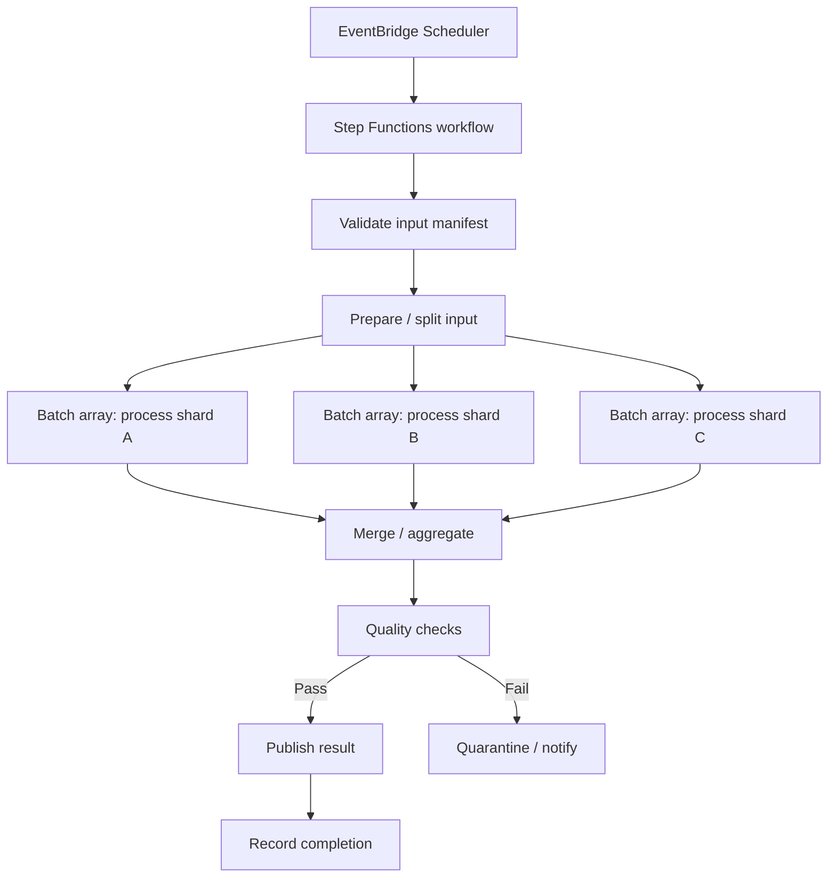
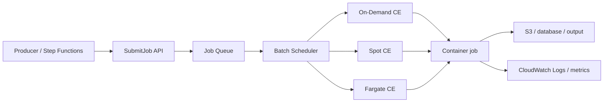

# Điều phối batch pipeline và kiểm soát chi phí tính toán

Nhiều workload không cần trả kết quả ngay khi người dùng gửi request. Chúng có thể chạy theo lịch, xử lý một tập dữ liệu lớn, tạo báo cáo cuối ngày, mô phỏng nhiều kịch bản hoặc tính toán khoa học trong nhiều giờ. Những workload này phù hợp với batch computing: gom công việc thành các job, xếp hàng, cấp compute khi cần, theo dõi trạng thái và thu hồi tài nguyên khi hoàn tất.

AWS Batch quản lý việc lập lịch và chạy containerized batch jobs trên compute environment. Amazon EventBridge Scheduler kích hoạt pipeline theo cron/rate hoặc thời điểm một lần. AWS Step Functions điều phối các bước có dependency, retry, branching, parallelism và xử lý lỗi. Các dịch vụ như AWS Glue, Amazon EMR, ECS/Fargate, Lambda, S3, FSx for Lustre và ECR có thể đảm nhiệm những phần việc chuyên biệt trong cùng pipeline.

Điều phối tốt giúp pipeline chạy đúng thứ tự, xử lý được lỗi và không tạo tài nguyên lãng phí. Kiểm soát chi phí đòi hỏi chọn đúng compute platform, khai báo CPU/RAM/GPU sát nhu cầu, tận dụng Spot cho workload chịu gián đoạn, giới hạn concurrency, scale down khi rảnh, tối ưu dữ liệu và đo chi phí theo workload.

## Mục tiêu học tập

Sau bài học, bạn có thể:

- Phân biệt vai trò của EventBridge Scheduler, Step Functions và AWS Batch.
- Mô hình hóa pipeline thành DAG gồm job, dependency, parallel branch và bước tổng hợp.
- Chọn AWS Batch array jobs, job dependencies, Step Functions Map/Distributed Map hoặc multi-node jobs.
- Thiết kế job definition, job queue, compute environment và scheduling policy.
- Chọn EC2 On-Demand, EC2 Spot, Fargate hoặc compute option phù hợp.
- Thiết kế retry, timeout, checkpoint, idempotency, cancellation và failure handling.
- Giới hạn compute capacity bằng vCPU/GPU/memory request, max vCPU, concurrency và fair-share scheduling.
- Tối ưu chi phí bằng Spot, right-sizing, scale-to-zero, scale-down delay, Savings Plans và storage/network controls.
- Theo dõi job state, CloudWatch metrics/logs, Step Functions execution và chi phí theo tag.
- Xây dựng pipeline batch có khả năng phục hồi, kiểm toán và kiểm soát ngân sách.

## 1. Batch computing và pipeline orchestration

Batch computing xử lý một tập công việc hữu hạn mà không cần tương tác đồng bộ với người dùng. Mỗi job thường nhận input, chạy một chương trình/container, ghi output và kết thúc với trạng thái thành công hoặc thất bại.

Ví dụ workload:

- Xử lý hàng triệu ảnh/video theo lô.
- Tạo báo cáo doanh thu, đối soát giao dịch hoặc tính hóa đơn cuối ngày.
- ETL/ELT dữ liệu từ S3, database hoặc data warehouse.
- Mô phỏng Monte Carlo, parameter sweep, rendering hoặc scientific computing.
- Huấn luyện/scoring model, feature generation và xử lý dữ liệu lớn.
- Chạy tác vụ định kỳ như backup validation, log compaction và archive.

Một pipeline thường gồm nhiều job có quan hệ phụ thuộc. Ví dụ, job tổng hợp không được chạy trước khi toàn bộ shard xử lý xong; job publish không được chạy nếu validation thất bại.

### DAG là gì?

DAG (Directed Acyclic Graph) là đồ thị có hướng không chứa chu trình. Mỗi node là một bước xử lý; edge thể hiện dependency. Pipeline DAG cho phép chạy song song những bước độc lập và chỉ chờ ở điểm cần đồng bộ.



Orchestration quyết định *khi nào* và *theo thứ tự nào* job chạy. Batch scheduler quyết định *job nào* có thể được cấp tài nguyên và *ở đâu* job được thực thi. Hai lớp này bổ sung cho nhau.

## 2. Chọn dịch vụ điều phối phù hợp

| Thành phần | Trách nhiệm chính | Khi phù hợp |
|---|---|---|
| Amazon EventBridge Scheduler | Kích hoạt API theo cron, rate hoặc one-time schedule; retry và DLQ | Bắt đầu pipeline theo lịch hoặc thời điểm cụ thể |
| AWS Step Functions | Điều phối workflow, state, dependency, branch, retry, timeout và parallelism | Pipeline có nhiều bước, điều kiện, approval hoặc cần execution history |
| AWS Batch | Queue, scheduling, compute capacity và thực thi container batch jobs | Job cần CPU/RAM/GPU, chạy dài hoặc chạy song song quy mô lớn |
| AWS Glue | ETL serverless, Spark, Data Catalog và data quality | Pipeline dữ liệu có connector/format và ETL semantics phù hợp |
| Amazon EMR | Spark/Hadoop/Trino và distributed data processing | Cần kiểm soát framework/cluster hoặc workload big data đặc thù |
| Amazon ECS/Fargate | Chạy container service/task mà không cần quản lý EC2 | Tác vụ container nhỏ/vừa, thời gian ngắn hoặc event-driven |
| AWS Lambda | Xử lý event/task ngắn trong giới hạn dịch vụ | Điều phối nhẹ, validation, notification hoặc glue logic |
| AWS ParallelCluster / HPC stack | Cấp cluster và scheduler HPC như Slurm | Nhóm nghiên cứu cần môi trường HPC tương tác/cluster lâu dài |

Không dùng AWS Batch chỉ để chạy một Lambda ngắn. Không dùng Step Functions làm scheduler CPU/GPU. Không dùng EventBridge Scheduler để mô tả DAG phức tạp bằng hàng chục schedule độc lập nếu pipeline cần dependency và error handling tập trung.

## 3. Kiến trúc tổng thể AWS Batch

AWS Batch gồm các thành phần chính:

| Thành phần | Vai trò |
|---|---|
| Job definition | Mô tả container image, command, vCPU, memory, GPU, role, environment, retry và timeout |
| Job queue | Nơi job chờ được scheduler đánh giá; có priority và scheduling policy |
| Compute environment (CE) | Tập compute resources để chạy job: EC2, Spot, Fargate hoặc platform được hỗ trợ |
| Batch scheduler | Đánh giá job, dependency, queue, capacity và placement |
| Job | Một lần submit cụ thể với parameters, overrides, tags và target queue |
| Job attempt | Một lần thực thi container; có thể retry theo strategy |
| Scheduling policy | Điều khiển fair-share hoặc cách chia tài nguyên giữa workload |
| Consumable resource | Tài nguyên logic ngoài CPU/RAM, ví dụ license token hoặc API concurrency |

Một job được submit vào queue. Scheduler kiểm tra dependency và tài nguyên yêu cầu, sau đó đặt job lên compute environment phù hợp. Managed compute environment có thể tự tạo/scale/terminate EC2 capacity hoặc sử dụng Fargate; AWS Batch quản lý các resource nền tảng theo cấu hình.



AWS Batch không tính phí dịch vụ điều phối riêng; khách hàng trả tiền cho tài nguyên AWS mà job dùng như EC2, EBS, Fargate, S3, FSx, CloudWatch và data transfer. Đây là điểm quan trọng khi lập ngân sách: chi phí nằm chủ yếu ở compute và các dịch vụ phụ trợ, không phải số lượng job definition hay queue. <https://aws.amazon.com/batch/pricing/>

## 4. Job definition: khai báo tài nguyên và môi trường chạy

Job definition là bản mô tả có version của workload. Nó xác định image, command, resource requirements, environment variables, execution role, volumes, logging, retry strategy và timeout.

### Container image

Đóng gói code và runtime vào container image, lưu trong Amazon ECR hoặc registry được hỗ trợ. Nên:

- Pin image bằng version/tag bất biến hoặc digest.
- Không dùng `latest` cho production vì nội dung image có thể thay đổi giữa các lần chạy.
- Scan image, cập nhật base image và loại bỏ package không cần thiết.
- Giữ image nhỏ để giảm thời gian pull và chi phí lưu trữ/transfer.
- Dùng multi-stage build để tách build tools khỏi runtime image.

### Resource requirements

Khai báo vCPU, memory và GPU đúng nhu cầu. Với container job hiện đại, dùng `resourceRequirements` thay vì legacy `vcpus`/`memory` khi API yêu cầu.

Ví dụ job definition rút gọn:

```json
{
  "jobDefinitionName": "daily-transform",
  "type": "container",
  "platformCapabilities": ["EC2"],
  "containerProperties": {
    "image": "111122223333.dkr.ecr.ap-southeast-1.amazonaws.com/daily-transform:1.4.2",
    "command": ["python", "main.py", "--input", "Ref::inputPrefix"],
    "resourceRequirements": [
      {"type": "VCPU", "value": "2"},
      {"type": "MEMORY", "value": "4096"}
    ],
    "jobRoleArn": "arn:aws:iam::111122223333:role/DailyTransformJobRole",
    "executionRoleArn": "arn:aws:iam::111122223333:role/BatchTaskExecutionRole",
    "environment": [
      {"name": "LOG_LEVEL", "value": "INFO"}
    ],
    "readonlyRootFilesystem": true
  },
  "parameters": {
    "inputPrefix": "s3://example-data/input/"
  },
  "retryStrategy": {"attempts": 2},
  "timeout": {"attemptDurationSeconds": 3600},
  "propagateTags": true
}
```

Ví dụ minh họa cho EC2 compute environment; thay account, image, role và input. Với Fargate/EKS/ECS Managed Instances, cấu trúc job definition và các trường được hỗ trợ có thể khác. `executionRoleArn` cho ECS/Fargate agent pull image/log; `jobRoleArn` là quyền AWS API của code bên trong container. Không gộp hai role nếu không cần.

### Resource request phải sát thực tế

Nếu job yêu cầu 8 vCPU/32 GiB nhưng chỉ dùng 1 vCPU/4 GiB, scheduler sẽ giữ capacity không cần thiết và giảm số job có thể chạy đồng thời. Nếu request quá thấp, job có thể bị OOM, throttling hoặc chạy chậm. Đo CPU/memory peak theo nhiều loại input rồi đặt request với headroom hợp lý.

GPU job cần khai báo loại/số accelerator phù hợp và compute environment có instance GPU tương thích. Không cấp GPU cho job chỉ dùng CPU.

## 5. Job queue và compute environment

### Job queue

Job queue là hàng đợi của workload. Queue có state, priority và có thể gắn scheduling policy. Có thể tách queue theo:

- Production và development.
- SLA cao và best-effort.
- CPU, memory-intensive và GPU workloads.
- On-Demand và Spot preference.
- Team/tenant hoặc cost center.

Queue priority quyết định queue nào được scheduler xem xét trước giữa các queue liên quan. Priority không thay thế dependency; muốn job B chờ job A thì phải khai báo dependency hoặc dùng Step Functions.

### Compute environment

Compute environment xác định loại compute, instance types, VPC/subnet/security groups, min/desired/max vCPU, Spot configuration và allocation strategy.

- **Managed CE**: AWS Batch quản lý capacity và scaling; phù hợp phần lớn workload.
- **Unmanaged CE**: khách hàng quản lý compute resources; chỉ chọn khi cần cấu hình đặc biệt và chấp nhận trách nhiệm vận hành.
- **EC2 On-Demand**: capacity có giá theo mức On-Demand, phù hợp workload cần độ ổn định cao.
- **EC2 Spot**: tận dụng capacity EC2 dư thừa, giá thấp hơn nhưng có thể bị reclaim.
- **Fargate/Fargate Spot**: chạy container không cần quản lý EC2; có giới hạn về instance/GPU/network/volume và platform.
- **ECS Managed Instances / EKS compute**: lựa chọn platform theo kiến trúc container và khả năng dịch vụ hiện hành.

Một queue có thể gắn nhiều compute environments theo thứ tự. Scheduler thử CE đầu tiên có trạng thái hợp lệ và đủ capacity; nếu không đáp ứng thì xét CE tiếp theo theo cấu hình. Điều này cho phép ưu tiên On-Demand trước, sau đó fallback sang Spot hoặc dùng CE theo loại instance.

### Không sửa tài nguyên managed bằng tay

AWS Batch quản lý các Auto Scaling Groups, launch templates, ECS clusters và instance thuộc managed CE. Không tự thêm ECS service/task hoặc thay đổi ASG/instance ngoài các API được AWS hỗ trợ. Việc sửa trực tiếp có thể làm CE `INVALID`, scaling sai hoặc phát sinh chi phí ngoài dự kiến.

## 6. Thiết kế queue theo SLA và mức độ quan trọng

Không nên gom mọi job vào một queue nếu chúng có SLA và tài nguyên khác nhau.

Ví dụ:

| Queue | Priority | Compute | Mục đích |
|---|---:|---|---|
| `critical-ondemand` | Cao | EC2 On-Demand | Báo cáo/regulatory close có deadline |
| `standard-batch` | Trung bình | On-Demand + Spot fallback | ETL định kỳ và xử lý đơn hàng |
| `best-effort-spot` | Thấp | EC2 Spot | Backfill, reprocessing, simulation |
| `gpu-research` | Theo quota | GPU CE | Training/scientific workloads |
| `dev-sandbox` | Thấp | Fargate hoặc CE giới hạn | Test, CI và development |

Đặt queue riêng giúp áp dụng max vCPU, fair-share, IAM, tag và budget theo workload. Tuy nhiên, quá nhiều queue/CE làm tăng độ phức tạp và phân mảnh capacity. Bắt đầu với vài queue có ý nghĩa rõ ràng rồi mở rộng khi có số liệu.

## 7. Job state và cách theo dõi tiến trình

AWS Batch job thường đi qua các trạng thái:

| State | Ý nghĩa |
|---|---|
| `SUBMITTED` | Job vừa được submit, chưa đánh giá xong |
| `PENDING` | Đang chờ job dependency hoàn tất; job chờ consumable resource theo resource-aware scheduling có thể vẫn ở `RUNNABLE` |
| `RUNNABLE` | Đã sẵn sàng chạy nhưng chờ compute capacity |
| `STARTING` | Đã được schedule, container đang khởi tạo/pull image |
| `RUNNING` | Container đang thực thi |
| `SUCCEEDED` | Container kết thúc với exit code 0 |
| `FAILED` | Job hết số attempt hoặc kết thúc thất bại |

Job ở `RUNNABLE` lâu thường là dấu hiệu capacity, quota, instance type, CE state hoặc resource request không phù hợp. Job ở `STARTING` lâu có thể do image lớn, ECR/network, container dependencies hoặc init container. Với `attemptDurationSeconds`, bộ đếm timeout bắt đầu khi job vào `RUNNING`; thời gian chờ queue và `STARTING` không nằm trong thời lượng này. Vì vậy, đo riêng queue wait, startup time và runtime khi tính SLA end-to-end.

Job `FAILED` được giữ lại trong AWS Batch trong một khoảng thời gian để điều tra; logs mặc định gửi tới CloudWatch Logs group `/aws/batch/job`. Đặt retention rõ ràng để tránh lưu log vô hạn hoặc xóa log quá sớm khi còn cần audit.

## 8. Dependency và DAG trong AWS Batch

AWS Batch hỗ trợ job dependency. Job phụ thuộc chỉ chuyển sang `RUNNABLE` sau khi các job cần thiết hoàn tất thành công. Nếu dependency thất bại, dependent job có thể chuyển sang `FAILED`.

Ví dụ DAG:

```text
Extract-A ─┐
Extract-B ─┼─> Aggregate ─> Validate ─> Publish
Extract-C ─┘
```

`SubmitJob` có thể nhận `dependsOn` để khai báo job ID và loại dependency. Một job có thể phụ thuộc tối đa 20 job theo quota hiện hành. Dùng Batch dependencies cho DAG đơn giản nằm trong phạm vi Batch; dùng Step Functions khi cần branch, condition, callback, approval, timeout tổng thể hoặc tích hợp nhiều dịch vụ.

Không dùng priority để mô phỏng dependency. Priority chỉ ảnh hưởng thứ tự scheduler xem xét; nó không bảo đảm một job chỉ chạy sau khi job khác thành công.

## 9. Array jobs cho tác vụ song song độc lập

Array job tạo nhiều child jobs có chung job definition và resource configuration. Mỗi child nhận `AWS_BATCH_JOB_ARRAY_INDEX` để xử lý một phần dữ liệu khác nhau. Kích thước array hiện hỗ trợ từ 2 đến 10.000 child jobs.

Phù hợp với:

- Monte Carlo simulation.
- Parameter sweeps.
- Render từng frame hoặc nhóm frame.
- Chạy cùng một transform trên nhiều partition.
- Scoring nhiều shard độc lập.
- Xử lý file/object theo manifest.

Ví dụ code trong container:

```python
import os

index = int(os.environ["AWS_BATCH_JOB_ARRAY_INDEX"])
manifest_path = os.environ["INPUT_MANIFEST"]

with open(manifest_path, "r", encoding="utf-8") as stream:
    partitions = [line.strip() for line in stream if line.strip()]

partition = partitions[index]
process_partition(partition)
```

Ví dụ giả định manifest có ít nhất số dòng bằng array size và mỗi child xử lý một partition duy nhất. Với manifest lớn, không nên tải toàn bộ danh sách vào mọi child; dùng S3 object/partition naming có thể tính trực tiếp theo index hoặc lưu mapping compact.

Array job hỗ trợ dependency `SEQUENTIAL` và `N_TO_N` trong các trường hợp phù hợp. Parent array là resource quản lý các child; nếu một child fail, parent có thể fail khi tất cả child kết thúc. Hãy theo dõi child-level failures thay vì chỉ xem parent status.

### Array job hay Step Functions Distributed Map?

| Tiêu chí | AWS Batch Array Job | Step Functions Distributed Map |
|---|---|---|
| Mục tiêu | Nhiều child container cùng một job definition | Điều phối mỗi item bằng child workflow |
| Scale | Tối đa 10.000 child jobs/array | Tối đa 10.000 child workflow executions song song theo giới hạn mặc định/được cấu hình |
| Input | Array index/parameters và ứng dụng tự ánh xạ input | JSON array hoặc S3 ItemReader (CSV/JSON/manifest được hỗ trợ) |
| Orchestration | Batch job lifecycle và dependencies | Workflow state, retry/catch, branching, result writer |
| Phù hợp | Tác vụ đồng dạng, container nặng, Monte Carlo | Item có workflow nhiều bước hoặc cần execution history riêng |
| Chi phí điều phối | AWS Batch không tính phí riêng; trả compute | Step Functions tính theo workflow type và cách sử dụng |

Distributed Map phù hợp khi cần xử lý dataset lớn từ S3, concurrency cao hoặc execution history vượt giới hạn Inline Map. Inline Map phù hợp khi tối đa 40 iteration đồng thời và lịch sử workflow không vượt giới hạn. Distributed Map chạy trong Standard workflow; child execution có thể chọn Standard hoặc Express theo cấu hình. Giới hạn concurrency phải phù hợp capacity downstream, không đặt 10.000 chỉ vì dịch vụ cho phép.

## 10. Multi-node parallel jobs và HPC

Một số bài toán HPC cần nhiều node phối hợp trong cùng một job, ví dụ MPI simulation, computational fluid dynamics, genomics hoặc scientific modeling. AWS Batch hỗ trợ multi-node parallel (MNP) jobs trong compute environment/platform phù hợp.

MNP job định nghĩa số node, main node và child nodes. Main node điều phối; các node khác tham gia tính toán. AWS Batch cung cấp thông tin node và địa chỉ private của main node qua environment variables như `AWS_BATCH_JOB_MAIN_NODE_PRIVATE_IPV4_ADDRESS`.

Khi thiết kế HPC:

- Chọn instance family phù hợp CPU, memory, GPU và network bandwidth.
- Kiểm tra placement/network topology và khả năng sử dụng Elastic Fabric Adapter (EFA) cho workload MPI cần low-latency/high-throughput communication.
- Chọn FSx for Lustre, EFS hoặc S3 theo I/O pattern; không giả định S3 là shared POSIX filesystem.
- Đo checkpoint interval, restart cost và parallel efficiency.
- Kiểm tra quota EC2, GPU, EFA, ENI và capacity trong Region/AZ.
- Dùng queue riêng cho MNP để tránh một job nhiều node chiếm toàn bộ capacity của workload khác.

Với MNP kiểu ECS/EC2, AWS Batch yêu cầu managed compute environment; không hỗ trợ unmanaged CE hoặc Spot CE. Fargate cũng không hỗ trợ MNP. Nên tạo CE riêng cho MNP, dùng cluster placement group trong một Availability Zone và bảo đảm `maxvCpus`/EC2 quota đủ cho toàn bộ node. AWS Batch cũng hỗ trợ MNP trên Amazon EKS; hãy kiểm tra riêng các ràng buộc networking và job definition của EKS.

Để dùng EFA, ngoài instance type và OS được hỗ trợ, AMI phải có EFA driver; các instance phải ở cùng cluster placement group; security group cần cho phép traffic nội bộ giữa các member; job definition phải pass-through device `/dev/infiniband/uverbs0` vào container theo hướng dẫn AWS. Nếu thiếu một điều kiện, MPI có thể chạy qua network path không mong muốn hoặc không khởi tạo EFA.

MNP không phù hợp với tác vụ độc lập dễ chia shard; array job hoặc Distributed Map thường đơn giản hơn. Kiểm tra support matrix hiện hành cho compute platform, instance type, networking và job definition trước khi chốt kiến trúc.

## 11. Step Functions điều phối Batch job

Step Functions có thể gọi AWS Batch bằng optimized integration `arn:aws:states:::batch:submitJob.sync`. Hậu tố `.sync` khiến Standard workflow chờ Batch job hoàn tất rồi mới chuyển state.

Ví dụ state machine tối giản. Execution input có `runDate` và `manifestUri`; job `PrepareInput` ghi manifest vào S3 theo URI đã thống nhất. AWS Batch integration trả metadata của job, không tự trả stdout hoặc kết quả tùy ý từ container, vì vậy workflow truyền URI manifest qua state input:

```json
{
  "Comment": "Daily batch pipeline",
  "StartAt": "PrepareInput",
  "States": {
    "PrepareInput": {
      "Type": "Task",
      "Resource": "arn:aws:states:::batch:submitJob.sync",
      "Parameters": {
        "JobName": "prepare-input",
        "JobQueue": "arn:aws:batch:ap-southeast-1:111122223333:job-queue/standard-batch",
        "JobDefinition": "arn:aws:batch:ap-southeast-1:111122223333:job-definition/prepare-input:3",
        "Parameters": {
          "runDate.$": "$.runDate"
        },
        "RetryStrategy": {"Attempts": 2},
        "PropagateTags": true,
        "Tags": {
          "Application": "daily-report",
          "Environment": "production"
        }
      },
      "ResultPath": "$.prepareResult",
      "Next": "ProcessPartitions"
    },
    "ProcessPartitions": {
      "Type": "Task",
      "Resource": "arn:aws:states:::batch:submitJob.sync",
      "Parameters": {
        "JobName": "process-partitions",
        "JobQueue": "arn:aws:batch:ap-southeast-1:111122223333:job-queue/standard-batch",
        "JobDefinition": "arn:aws:batch:ap-southeast-1:111122223333:job-definition/process-partition:5",
        "ArrayProperties": {"Size": 100},
        "Parameters": {
          "manifest.$": "$.manifestUri"
        },
        "RetryStrategy": {"Attempts": 2}
      },
      "ResultPath": "$.processResult",
      "Next": "Publish"
    },
    "Publish": {
      "Type": "Task",
      "Resource": "arn:aws:states:::batch:submitJob.sync",
      "Parameters": {
        "JobName": "publish-results",
        "JobQueue": "arn:aws:batch:ap-southeast-1:111122223333:job-queue/critical-ondemand",
        "JobDefinition": "arn:aws:batch:ap-southeast-1:111122223333:job-definition/publish-results:2"
      },
      "End": true
    }
  }
}
```

Ví dụ minh họa cú pháp ASL JSONPath; cần điều chỉnh input/result path và parameters theo output thực tế của workflow. `ResultPath` giữ metadata job của state trong execution data; không truyền manifest lớn qua state payload nếu có thể lưu trong S3 và chỉ truyền URI.

### Standard hay Express workflow?

Standard workflow phù hợp pipeline batch dài, cần `.sync`, execution history và thời gian chạy dài. Express workflow tối ưu throughput cao/thời gian ngắn; thời lượng tối đa 5 phút. Asynchronous Express có semantics at-least-once nên execution có thể chạy hơn một lần; Synchronous Express có semantics at-most-once. Cả hai đều cần chọn đúng theo cách invoke và thiết kế side effect phù hợp. Express chỉ hỗ trợ request-response service integration, không hỗ trợ `.sync` cho Batch. Vì vậy, pipeline chờ Batch job hoàn tất thường dùng Standard workflow.

### IAM cho `.sync`

Execution role của Step Functions cần quyền submit/describe/terminate Batch job và quyền EventBridge liên quan để theo dõi completion theo optimized integration. Cấp quyền theo job definition/queue ARN khi API/resource policy hỗ trợ; không copy wildcard policy mẫu vào production mà không review.

### Lưu ý DescribeJobs throttling

Với một số job như multi-node hoặc job dùng ECS/EKS properties, Step Functions có thể phát hiện completion bằng `DescribeJobs` polling. Nếu API bị throttling, state có thể ở trạng thái running dù job đã kết thúc. Với workload phù hợp, có thể dùng task token callback để job tự gọi `SendTaskSuccess`/`SendTaskFailure`, nhưng phải bảo vệ token và xử lý callback idempotent.

## 12. EventBridge Scheduler khởi chạy pipeline

EventBridge Scheduler là lựa chọn ưu tiên cho lịch cron/rate và one-time schedule. Scheduler có execution role để gọi target API, retry policy, maximum event age, flexible time window và SQS DLQ.

Ví dụ lịch hàng ngày:

```text
cron(0 1 * * ? *)
```

Biểu thức trên chạy lúc 01:00 UTC mỗi ngày. Nếu business dùng giờ Việt Nam, cần quy đổi sang UTC hoặc cấu hình timezone IANA `Asia/Ho_Chi_Minh` nếu schedule API/console hỗ trợ timezone. Không giả định cron mặc định dùng giờ địa phương.

### Scheduler target nên là gì?

- Gọi `states:StartExecution` để bắt đầu Step Functions khi pipeline có nhiều bước.
- Gọi `batch:SubmitJob` trực tiếp khi chỉ có một job độc lập, không cần DAG orchestration.
- Gọi Lambda để validate/prepare input trước khi khởi chạy workflow.

Đặt retry policy và SQS DLQ cho invocation thất bại. DLQ chỉ bắt lỗi không giao được target sau retry; nó không thay thế failure handling bên trong Step Functions hoặc AWS Batch. Xử lý message DLQ bằng quy trình redrive có kiểm soát, tránh khởi chạy trùng logical batch.

### Tránh lịch chạy chồng lấn

Nếu batch trước có thể kéo dài qua thời điểm chạy tiếp theo, chọn một trong các cách:

- Dùng Step Functions/lock table trong DynamoDB để chỉ cho phép một execution cho mỗi business date.
- Kiểm tra manifest/batch state trước khi submit.
- Đưa request vào SQS và giới hạn consumer concurrency.
- Cho phép overlap nhưng partition input/output và idempotency key phải độc lập.

Không chỉ dựa vào flexible time window để ngăn overlap; flexible window phân phối thời điểm invoke, không khóa business batch.

## 13. Retry, timeout và failure handling

Retry cần được thiết kế ở đúng tầng. AWS Batch retry container attempt; Step Functions retry state; EventBridge Scheduler retry việc gọi target. Bật retry ở cả ba tầng mà không có giới hạn có thể nhân số lần chạy và chi phí.

### AWS Batch retry strategy

AWS Batch hỗ trợ từ 1 đến 10 attempts. Có thể dùng `evaluateOnExit` để retry lỗi transient và dừng ngay lỗi permanent.

Ví dụ:

```json
{
  "attempts": 3,
  "evaluateOnExit": [
    {
      "onStatusReason": "Host EC2*",
      "action": "RETRY"
    },
    {
      "onReason": "AGENT",
      "action": "RETRY"
    },
    {
      "onExitCode": "2",
      "action": "EXIT"
    },
    {
      "onReason": "*",
      "action": "EXIT"
    }
  ]
}
```

Pattern trên chỉ minh họa; `onStatusReason`, `onReason` và `onExitCode` cần khớp failure reason thực tế. Thêm rule `EXIT` cuối để tránh retry vô hạn các lỗi không xác định.

### Timeout

Đặt `attemptDurationSeconds` theo thời gian tối đa một attempt. Timeout cần đủ dài cho input lớn nhưng ngắn hơn mức mà job có thể tiêu tốn ngân sách ngoài kiểm soát. Pipeline cũng cần timeout tổng thể ở Step Functions và timeout/maximum age cho Scheduler.

### Retry matrix

| Lỗi | Xử lý gợi ý |
|---|---|
| EC2/Spot interruption | Retry job từ checkpoint hoặc bắt đầu lại shard nhỏ |
| Throttling API | Exponential backoff với jitter |
| S3/network transient | Retry có giới hạn, log request ID |
| Invalid input/schema | Fail fast, quarantine và thông báo owner |
| IAM AccessDenied | Không retry mù; sửa policy/configuration |
| Out-of-memory | Điều chỉnh partition/resource request hoặc code |
| Business validation fail | Dừng pipeline, không publish output |
| Output đã ghi nhưng workflow timeout | Kiểm tra batch state/idempotency trước khi chạy lại |

## 14. Idempotency và exactly-once semantics

Batch job có thể bị retry do Spot interruption, host failure, timeout hoặc lỗi mạng. Một job có thể ghi output xong nhưng mất kết nối trước khi báo success; lần retry tiếp theo có thể xử lý cùng input lần nữa.

Do đó, không giả định AWS Batch/Step Functions tự cung cấp exactly-once cho side effects. Thiết kế idempotent:

- Gán `batchId` duy nhất cho logical run, ví dụ `billing-2026-11-20`.
- Ghi output vào staging prefix theo `batchId` và shard ID.
- Dùng DynamoDB conditional write hoặc transaction để claim/commit batch state.
- Ghi manifest gồm input version/ETag, output path, row count và checksum.
- Chỉ publish pointer/manifest khi toàn bộ shard đã validate.
- Dùng idempotency key cho API downstream hoặc thiết kế consumer deduplicate.
- Xóa/expire staging bằng lifecycle policy sau khi đã publish và hết retention.

### Ví dụ batch manifest

```json
{
  "batchId": "billing-2026-11-20",
  "input": "s3://finance-raw/billing/date=2026-11-20/manifest.json",
  "inputVersion": "source-snapshot-2026-11-20T00:00Z",
  "expectedShards": 100,
  "outputPrefix": "s3://finance-curated/_staging/batchId=billing-2026-11-20/",
  "status": "PROCESSING"
}
```

Manifest giúp reconcile run bị gián đoạn. Nếu cùng batch ID đã `COMPLETED`, workflow có thể bỏ qua hoặc trả kết quả đã publish. Nếu đang `PROCESSING`, kiểm tra lease/heartbeat và job state trước khi quyết định resume.

## 15. Spot Instances cho batch workload

EC2 Spot tận dụng capacity EC2 dư thừa với giá thấp hơn On-Demand, nhưng AWS có thể reclaim khi cần capacity. Spot phù hợp workload có thể retry, checkpoint, chia shard hoặc chấp nhận hoàn tất muộn.

### Workload phù hợp Spot

- Monte Carlo simulation với mỗi sample độc lập.
- Backfill/reprocessing có thể chia shard.
- Rendering, transcoding và media processing có thể retry.
- Data transformation không giữ state duy nhất trên instance.
- Training/compute job có checkpoint thường xuyên.

### Workload nên dùng On-Demand hoặc hybrid

- Job có deadline nghiêm ngặt và không thể retry.
- Workload giữ state trong local disk mà không có checkpoint.
- Tác vụ giao dịch không idempotent.
- License/hardware dependency không dễ khởi tạo lại.
- Job ngắn đến mức chi phí startup/retry lớn hơn khoản tiết kiệm.

### Allocation strategy

AWS Batch hỗ trợ allocation strategies khác nhau. Với Spot, `SPOT_PRICE_CAPACITY_OPTIMIZED` thường là lựa chọn khuyến nghị vì cân bằng giá và khả năng có capacity; `SPOT_CAPACITY_OPTIMIZED` ưu tiên pool ít khả năng bị interrupt hơn. Với On-Demand EC2, strategy như `BEST_FIT_PROGRESSIVE` có thể giúp chọn instance phù hợp và mở rộng qua nhiều loại size. `BEST_FIT` có thể giữ chi phí thấp nhưng có thể chờ capacity nếu instance type đã chọn không có sẵn.

Chọn nhiều instance types/families tương thích để mở rộng Spot capacity pool. Chỉ giới hạn một loại instance có thể làm queue chờ lâu hoặc tăng interruption risk. Không đưa instance family không tương thích CPU architecture, memory, GPU hoặc network vào cùng pool.

### Spot interruption handling

Thiết kế job để:

- Lưu checkpoint vào S3/EFS/FSx hoặc storage bền vững theo chu kỳ.
- Chia workload dài thành các unit nhỏ hơn.
- Xử lý SIGTERM/termination notice khi runtime nhận được.
- Ghi progress trước khi kết thúc container.
- Retry từ checkpoint và xác minh output chưa bị duplicate.
- Không lưu dữ liệu duy nhất trên instance store.

AWS khuyến nghị giảm thời gian job hoặc checkpoint thường xuyên; các unit khoảng 30 phút hoặc ngắn hơn có thể giảm rủi ro gián đoạn so với một job dài không có checkpoint. Đây là hướng dẫn thực hành, không phải bảo đảm Spot sẽ không bị reclaim.

## 16. Hybrid queue: On-Demand trước, Spot sau

Một kiến trúc phổ biến là gắn nhiều CE vào một queue:

1. CE On-Demand đứng trước cho workload cần SLA.
2. CE Spot đứng sau để hấp thụ phần tải bổ sung hoặc workload best-effort.
3. Job queue có priority/fair-share phù hợp.
4. Job definition và container xử lý retry/checkpoint.

Hoặc tách queue riêng:

- `critical-ondemand`: chỉ On-Demand, deadline chặt.
- `flexible-spot`: chỉ Spot, backfill và simulation.
- `standard-hybrid`: On-Demand + Spot theo CE order.

Không giả định mọi job tự động chuyển sang Spot khi CE On-Demand hết capacity; hành vi phụ thuộc queue/CE mapping, allocation strategy và khả năng CE đáp ứng resource request. Test bằng workload representative và quan sát queue state.

## 17. Right-sizing compute và bin packing

Chi phí compute phụ thuộc số instance, loại instance, thời gian chạy và mức utilization. Right-sizing giúp giảm phần CPU/RAM/GPU cấp thừa.

Quy trình:

1. Chạy baseline với input đại diện nhỏ/vừa/lớn.
2. Ghi CPU utilization, memory peak, disk I/O, network và duration.
3. Thử các mức vCPU/memory request.
4. Đo số job có thể pack trên một instance và queue wait time.
5. Kiểm tra OOM/throttling và runtime variance.
6. Chọn request nhỏ nhất vẫn đáp ứng SLA với headroom phù hợp.

### Bin packing

Nếu instance có 16 vCPU và 64 GiB RAM, các job request 4 vCPU/16 GiB có thể đóng gói bốn job nếu không có overhead/constraint khác. Nếu mỗi job request 8 vCPU/40 GiB, chỉ một job có thể vừa dù tổng vCPU còn nhiều. Vì vậy, resource ratio CPU/memory quan trọng hơn chỉ nhìn vCPU.

### Max vCPU và scale to zero

Đặt `maxvCpus` để giới hạn compute scale-out và bảo vệ ngân sách. Với EC2 managed CE có thể scale về 0, đặt `minvCpus` bằng 0 nếu workload chấp nhận cold start; Fargate không dùng các tham số min/desired/max vCPU theo cùng cách. Dùng `maxvCpus` theo budget/quota và lưu ý: với On-Demand EC2, các allocation strategies khác `BEST_FIT` có thể vượt `maxvCpus` tối đa một instance để đáp ứng capacity requirement.

Không giữ `minvCpus` cao nếu queue thường xuyên rỗng. Capacity giữ sẵn giúp giảm startup latency nhưng vẫn tính phí khi instance idle.

## 18. Scale-down delay và cold-start trade-off

Với EC2 managed compute environment, AWS Batch có thể giữ instance sau khi job kết thúc để job tiếp theo dùng lại, giảm thời gian khởi động và pull image. `minScaleDownDelayMinutes` điều khiển khoảng thời gian tối thiểu giữ instance sau job cuối.

- Delay dài: giảm cold start, có thể cải thiện throughput cho workload liên tục; đổi lại trả tiền cho idle instance.
- Delay ngắn/0: thu hồi capacity nhanh, giảm idle cost; job tiếp theo phải chờ instance launch và image pull.
- Fargate không có cùng tham số scale-down delay như EC2 managed CE; chi phí phụ thuộc task resources/duration theo pricing model.

Đo inter-arrival time giữa các batch. Nếu job đến liên tục mỗi vài phút, giữ một phần capacity có thể tiết kiệm tổng thời gian và chi phí. Nếu job chạy một lần mỗi đêm, scale-to-zero thường hợp lý hơn.

## 19. Fair-share scheduling và resource-aware scheduling

### FIFO và fair share

Nếu không gắn scheduling policy, AWS Batch mặc định dùng FIFO. Một job lớn ở đầu queue có thể làm job nhỏ phía sau chờ lâu. Fair-share scheduling phân chia compute giữa share identifiers như team, tenant hoặc workload class.

Các khái niệm:

- `shareIdentifier`: định danh nhóm workload.
- `weightFactor`: trọng số chia sẻ; giá trị thấp có thể được cấp tỷ lệ compute lớn hơn so với share có weight cao.
- `shareDecaySeconds`: thời gian scheduler tính lịch sử sử dụng để chia fair share.
- `computeReservation`: giữ phần capacity cho các share khác, tránh một share chiếm hết tài nguyên.

Fair share giúp kiểm soát fairness và tránh một tenant chiếm queue, nhưng không thay thế quota/budget. Đặt share identifier từ application/team và gắn tag tương ứng để đối soát chi phí.

### Resource-aware scheduling

Một job có thể cần tài nguyên không phải CPU/RAM, ví dụ license token, database connection slot hoặc quota gọi API bên thứ ba. AWS Batch consumable resources cho phép khai báo số lượng tài nguyên logic cần cho job; scheduler chỉ chạy job khi đủ cả compute và consumable resource.

Ví dụ, nếu tổ chức có 20 license token của phần mềm mô phỏng, khai báo mỗi job cần 1 token để không chạy 100 container nhưng chỉ 20 container có thể làm việc. Resource-aware scheduling giảm job thất bại và compute idle do thiếu license.

## 20. Storage và data locality

Compute không phải thành phần chi phí duy nhất. Storage/network thường trở thành bottleneck khi job đọc hàng triệu file hoặc ghi dữ liệu lớn.

| Dịch vụ | Đặc điểm | Dùng khi |
|---|---|---|
| Amazon S3 | Object storage bền vững, tách khỏi compute | Input/output, checkpoint, manifest và archive |
| Amazon EBS | Block storage gắn với EC2 instance | Scratch volume, database hoặc workload cần block I/O |
| Amazon EFS | Shared NFS filesystem | Nhiều job cần POSIX shared path và metadata/file sharing |
| FSx for Lustre | Parallel file system throughput cao, tích hợp S3 | HPC, ML và workload đọc/ghi file song song |
| Instance store | Local ephemeral disk | Scratch/intermediate data có thể tái tạo |

### Data locality

Đặt compute và data cùng Region; chọn subnet/AZ và storage phù hợp để giảm latency/data transfer. Với FSx for Lustre, benchmark metadata operation và throughput; với S3, dùng prefix/partition/file size hợp lý. Tránh tải toàn bộ input qua NAT Gateway nếu có thể dùng VPC endpoint cho S3/ECR và dịch vụ AWS phù hợp.

### Small files và compaction

Hàng triệu file nhỏ làm tăng S3 request, listing và overhead của application. Gom file thành shard lớn hơn, dùng manifest, compaction và columnar format phù hợp. File size tối ưu phụ thuộc engine và pattern; benchmark thay vì áp dụng một kích thước cứng cho mọi workload.

## 21. Network cost và private connectivity

Job có thể tạo chi phí network từ:

- NAT Gateway hourly/data processing.
- Data transfer giữa AZ/Region hoặc ra Internet.
- S3/ECR/API traffic qua NAT.
- Direct Connect/VPN và data egress.
- Transfer từ FSx/EFS hoặc database.

Các biện pháp:

- Dùng S3 Gateway VPC Endpoint cho S3 traffic trong VPC khi phù hợp.
- Dùng Interface VPC Endpoints cho ECR API/DKR, CloudWatch Logs, STS và service cần thiết theo pricing/architecture.
- Đặt job trong subnet/route phù hợp; không gán public IP nếu không cần.
- Giảm cross-AZ data shuffle bằng placement/data locality khi có thể.
- Nén dữ liệu và tránh transfer intermediate dataset qua Region.
- Theo dõi NAT bytes, VPC Flow Logs và Cost Explorer data transfer dimensions.

VPC endpoint cũng có chi phí riêng; so sánh chi phí endpoint với NAT/data processing theo lưu lượng và số AZ trước khi triển khai.

## 22. Tối ưu container và startup time

Thời gian job ở `STARTING` vẫn có thể kéo dài dù container chưa xử lý dữ liệu. Các nguyên nhân phổ biến là image pull, dependency download, init container và volume mount.

- Dùng base image gọn, layer cache hợp lý và multi-stage build.
- Đưa dependency vào image thay vì cài từ Internet mỗi lần chạy.
- Pin image digest và đặt image gần compute Region.
- Dùng ECR lifecycle policy để dọn image cũ nhưng giữ version cần rollback.
- Tránh mount hàng nghìn file riêng lẻ khi có thể dùng archive/object manifest.
- Khởi tạo connection/client lazy khi job thực sự cần.
- Theo dõi `STARTING` duration riêng với `RUNNING` duration.

Nếu job chạy 30 giây nhưng mất 90 giây pull image, tối ưu compute size sẽ không giải quyết bottleneck. Cần giảm startup overhead hoặc batch nhiều item trong một container.

## 23. Chi phí Step Functions và EventBridge Scheduler

AWS Batch không có phí điều phối riêng, nhưng Step Functions và các dịch vụ phụ trợ có pricing riêng.

### Step Functions

- Standard workflow thường tính theo số state transitions.
- Express workflow tính theo số execution, duration và memory consumed.
- Distributed Map có chi phí workflow/child execution/result processing và dịch vụ được gọi.
- `.sync` kéo dài state cho đến khi Batch job hoàn tất; cần tính state transition và workflow duration.

Với Standard, thời gian chờ `.sync` là metric SLA/operational; pricing dựa trên state transitions, không tính theo thời gian chờ như Express. Giảm chi phí bằng cách tránh state lặp không cần thiết, không đưa từng record nhỏ thành một execution riêng nếu có thể batch, dùng array job khi task đồng dạng và chọn Standard/Express đúng semantics. Không chọn Express chỉ vì giá thấp nếu workflow cần `.sync`, chạy lâu hoặc không idempotent.

### EventBridge Scheduler

Chi phí phụ thuộc số invocation và tính năng/Region theo bảng giá hiện hành. Tránh tạo schedule per-record/per-device nếu một schedule có thể kích hoạt batch theo manifest. Xóa/disable schedule thử nghiệm khi không còn dùng; one-time schedule có thể được cấu hình tự xóa sau khi hoàn tất.

## 24. Tagging và chargeback theo workload

Tag giúp phân bổ chi phí compute và dịch vụ phụ trợ cho team/application/project.

Tag đề xuất:

| Tag | Ví dụ |
|---|---|
| `Application` | `daily-billing` |
| `Workload` | `backfill` / `production-etl` / `simulation` |
| `Environment` | `prod` / `dev` |
| `CostCenter` | `FIN-042` |
| `Owner` | `data-platform` |
| `BatchId` | `billing-2026-11-20` |
| `Priority` | `critical` / `best-effort` |

AWS Batch hỗ trợ tag cho jobs, job definitions, queues, compute environments và scheduling policies. Có thể bật `propagateTags` để truyền tag từ job definition sang ECS task hoặc từ job sang task theo API/platform được hỗ trợ. Tag compute environment không tự động propagate tới tất cả tài nguyên bên dưới; cần kiểm tra tài nguyên được tag khi tạo CE. EKS jobs có khác biệt về tag propagation.

Để xem cost allocation, activate user-defined cost allocation tags trong Billing/Cost Management, sau đó dùng Cost Explorer/CUR 2.0. Không phải mọi phí network/storage đều mang tag workload trực tiếp; có thể cần Cost Category, shared cost allocation hoặc metric như cost per job/GB.

## 25. Budgets, Cost Explorer và anomaly detection

FinOps cho batch nên có cả budget tổng và metric đơn vị.

- **AWS Budgets**: đặt ngân sách theo account, service, tag hoặc Cost Category; cấu hình alert theo actual/forecasted spend.
- **Cost Explorer**: xem chi phí theo service, Region, usage type, linked account và activated cost allocation tag.
- **Cost and Usage Report (CUR) 2.0 / Data Exports**: phân tích line item, usage quantity, resource/tag và charge type.
- **Cost Anomaly Detection**: phát hiện chi phí bất thường theo service/account/cost monitor.
- **Compute Optimizer**: nhận khuyến nghị right-sizing cho tài nguyên được hỗ trợ; không thay thế profiling workload container.
- **Pricing Calculator**: ước tính scenario trước khi scale.

### Savings Plans cho baseline ổn định

Nếu workload có phần compute On-Demand ổn định, có thể cân nhắc Compute Savings Plans hoặc EC2 Instance Savings Plans để giảm giá phần usage đủ điều kiện. Compute Savings Plans áp dụng cho EC2, Fargate và Lambda; EC2 Instance Savings Plans áp dụng cho họ instance/Region đã cam kết. Savings Plans không cung cấp capacity reservation và không áp dụng cho Spot usage. Vì vậy, thường nên ước lượng baseline On-Demand ổn định trước khi cam kết 1 hoặc 3 năm; để phần burst/biến động chạy Spot hoặc On-Demand linh hoạt. Không mua commitment dựa trên peak batch ngắn hạn nếu usage có thể giảm mạnh theo mùa.

### Unit economics

Đừng chỉ nhìn tổng bill. Tính thêm:

- Cost per completed job.
- Cost per GB processed.
- Cost per million records.
- Cost per simulation run/result.
- Cost per successful pipeline, bao gồm retry/failure.
- Queue wait time và cost of lateness.

Một cấu hình rẻ theo giờ có thể đắt hơn theo kết quả nếu chạy lâu, retry nhiều hoặc tạo nhiều output dư thừa.

## 26. Budget guardrails và kiểm soát runaway jobs

Đặt guardrail ở nhiều lớp:

1. `maxvCpus` của CE giới hạn scale-out.
2. Queue tách workload critical và best-effort.
3. Fair-share giới hạn mức sử dụng tương đối giữa team.
4. Job timeout chặn job treo.
5. Step Functions timeout/heartbeat kiểm soát workflow.
6. EventBridge Scheduler retry/maximum age/DLQ giới hạn việc invoke lặp.
7. Application-level budget check chặn batch quá lớn hoặc vượt quota nghiệp vụ.
8. AWS Budgets alert và optional actions để cảnh báo/kiểm soát chi tiêu.

AWS Budgets alert không phải circuit breaker tức thời. Có độ trễ dữ liệu billing; không dùng budget alert làm cơ chế duy nhất để dừng một job đang chạy. Muốn ngăn runaway, cần giới hạn compute/job ngay trong cấu hình và application.

## 27. Monitoring và observability

Theo dõi ba lớp: orchestration, Batch compute và business result.

### AWS Batch

- Job count theo state: `SUBMITTED`, `PENDING`, `RUNNABLE`, `STARTING`, `RUNNING`, `SUCCEEDED`, `FAILED`.
- Queue depth và thời gian ở `RUNNABLE`.
- CE desired/min/max vCPU, utilization và scaling activity.
- Job attempts, exit reason, timeout và Spot interruption.
- GPU utilization, memory peak, disk/network I/O nếu workload cần.
- `STARTING` duration và image pull time.

### Step Functions

- Execution count, duration, failed/timed-out/aborted execution.
- State retry count, error/cause và execution history.
- Distributed Map Run: total/succeeded/failed/timed-out items và concurrency.
- Workflow input/output reference, batch ID và job ID.

### Business metrics

- Input records/GB và output records/GB.
- Data quality/reject count.
- Processing throughput và cost per unit.
- Batch freshness, deadline miss và completion time.
- Duplicate/late input, retry recovery và output reconciliation.

CloudWatch Logs retention nên theo audit/incident policy. Gắn job ID, attempt, batch ID, shard ID và trace/correlation ID trong structured log. Tránh log secret hoặc dữ liệu cá nhân nguyên bản.

## 28. Bảo mật và phân tách quyền

Một pipeline batch thường có nhiều IAM role:

- **Step Functions execution role**: gọi Batch, EventBridge, Lambda và dịch vụ orchestration cần thiết.
- **Batch service role**: cho AWS Batch quản lý compute environment.
- **Task execution role**: cho ECS/Fargate agent pull ECR image, ghi log và lấy secret theo cấu hình.
- **Job role**: quyền AWS API của application code trong container.
- **Scheduler execution role**: gọi target API như `states:StartExecution` hoặc `batch:SubmitJob`.

Tách role theo workload, giới hạn S3 prefix, KMS key, queue/job definition ARN và secret. Dùng Secrets Manager/Parameter Store thay vì đưa credential vào environment/job parameters. Bật encryption at rest/in transit, scan image và không chạy container privileged nếu không cần.

Với multi-tenant batch, tách queue/role/data prefix theo tenant; không chỉ dựa vào job parameters do caller truyền. Validate input manifest và authorize tenant trước khi submit.

## 29. AWS CLI: submit, inspect và cancel job

### Submit job

```bash
aws batch submit-job \
  --job-name daily-transform-2026-11-20 \
  --job-queue standard-batch \
  --job-definition daily-transform:3 \
  --parameters inputPrefix=s3://example-data/input/date=2026-11-20/ \
  --retry-strategy attempts=2 \
  --timeout attemptDurationSeconds=3600 \
  --tags Application=daily-report,Environment=production,CostCenter=FIN-042 \
  --region ap-southeast-1
```

### Submit array job

```bash
aws batch submit-job \
  --job-name monte-carlo-2026-11-20 \
  --job-queue best-effort-spot \
  --job-definition monte-carlo:5 \
  --array-properties size=500 \
  --retry-strategy attempts=3 \
  --region ap-southeast-1
```

### Xem job details

```bash
aws batch describe-jobs \
  --jobs 11111111-2222-3333-4444-555555555555 \
  --region ap-southeast-1
```

### Liệt kê job trong queue

```bash
aws batch list-jobs \
  --job-queue standard-batch \
  --job-status RUNNABLE \
  --region ap-southeast-1
```

### Hủy job chưa chạy hoặc terminate job đang chạy

```bash
aws batch cancel-job \
  --job-id 11111111-2222-3333-4444-555555555555 \
  --reason "Input manifest invalid" \
  --region ap-southeast-1

aws batch terminate-job \
  --job-id 66666666-7777-8888-9999-000000000000 \
  --reason "Budget guardrail triggered" \
  --region ap-southeast-1
```

`cancel-job` dùng cho job chưa bắt đầu chạy; `terminate-job` dùng cho job đang chạy. Cả hai cần được tích hợp với batch state/idempotency để không để lại output nửa chừng.

## 30. Troubleshooting batch pipeline và chi phí

| Triệu chứng | Nguyên nhân có thể | Hướng xử lý |
|---|---|---|
| Job ở `RUNNABLE` lâu | Không đủ instance/capacity, CE `INVALID`, quota hoặc resource request không vừa instance | Kiểm tra queue snapshot, CE state, vCPU/GPU/memory, EC2 quota và instance type |
| Job ở `STARTING` lâu | Image lớn, ECR/network chậm, init container hoặc volume mount | Tối ưu image, VPC endpoint, subnet/route và startup dependencies |
| Job thường xuyên OOM | Memory request thấp, skew hoặc leak | Profiling memory, chia shard, tăng memory đúng mức |
| CPU utilization thấp nhưng bill cao | Job chờ I/O, request CPU quá lớn hoặc startup overhead | Tối ưu I/O/image, right-size CPU và batch input |
| Spot job fail nhiều | Capacity pool hẹp, job dài không checkpoint | Mở rộng instance types, dùng price-capacity optimized, checkpoint và retry |
| Queue critical bị starve | Queue priority/fair-share/CE order chưa phù hợp | Rà soát priority, share identifier, CE capacity và max vCPU |
| Hai batch cùng ghi output | Scheduler overlap hoặc thiếu idempotency key | Dùng lock/manifest, batch ID và staging/publish |
| Step Functions chờ mãi | `.sync` polling throttled hoặc Batch job state chưa terminal | Kiểm tra DescribeJobs quota, job state, event permissions và callback option |
| Retry làm bill tăng mạnh | Retry nhiều tầng, lỗi permanent hoặc output side effect | Giới hạn retry, evaluateOnExit, idempotency và alarm attempt count |
| Compute không scale về 0 | minvCpus > 0, delay hoặc job còn pending/running | Kiểm tra CE scaling config, queue depth và scale-down delay |
| Chi phí tăng do NAT | Job pull image/download dependency/đọc S3 qua NAT | VPC endpoints, private ECR, dependency baking và traffic locality |
| CloudWatch Logs tăng đột biến | Debug log quá nhiều hoặc retention không giới hạn | Giảm log volume, retention, sampling và structured log |
| Output thiếu shard | Một array child fail nhưng chỉ xem parent summary | Kiểm tra child execution, manifest completeness và retry shard lỗi |

## 31. Bài thực hành: pipeline ETL chia shard và kiểm soát ngân sách

Mục tiêu là xây pipeline chạy theo lịch, chuẩn bị manifest, xử lý 100 shard bằng AWS Batch array job, validate output và publish khi toàn bộ shard thành công.

### Chuẩn bị

1. AWS account sandbox và Region có AWS Batch, Step Functions, EventBridge Scheduler.
2. S3 prefixes cho input, staging và curated output.
3. ECR image có script `prepare`, `process-shard`, `validate` và `publish`.
4. Job definitions và job queues cho On-Demand/Spot.
5. Managed compute environments có max vCPU phù hợp ngân sách.
6. IAM roles riêng cho Scheduler, Step Functions, Batch execution và job.
7. CloudWatch log group/alarms và AWS Budget.

### Thực hiện

1. Upload dataset test và tạo input manifest có 100 shard.
2. Tạo job definition `process-shard` với vCPU/memory đo được từ baseline.
3. Tạo queue `standard-batch` gắn On-Demand và Spot CE theo policy.
4. Submit array job size 100; mỗi child đọc shard theo `AWS_BATCH_JOB_ARRAY_INDEX`.
5. Ghi mỗi shard vào staging prefix có `batchId` và shard ID.
6. Dùng Step Functions `.sync` để chờ prepare và array job hoàn tất.
7. Chạy validate job, kiểm tra đủ 100 shard và business totals.
8. Chỉ publish manifest/pointer khi validation pass.
9. Thêm Retry/Catch và test một shard fail để quan sát retry/recovery.
10. Tạo EventBridge Scheduler chạy workflow theo cron UTC.
11. Thêm DLQ cho Scheduler invocation và quy trình redrive.
12. Gắn tags Application/Environment/CostCenter/BatchId.
13. Đo queue wait, startup time, runtime, CPU/memory, Spot retry và cost per GB.
14. Giảm/tăng worker và max vCPU để so sánh SLA với cost.
15. Kiểm tra CE scale down sau khi queue rỗng và đặt budget alarm.

### Kết quả cần đạt

- Pipeline chạy theo lịch và có execution history.
- Job dependency bảo đảm thứ tự prepare → process → validate → publish.
- Array children xử lý đúng shard và không ghi đè nhau.
- Retry cùng batch không tạo duplicate.
- Lỗi validation chặn publish.
- Spot interruption có thể resume/retry từ checkpoint.
- Compute scale về mức tối thiểu sau batch.
- Dashboard hiển thị job state, queue wait, runtime, retry và cost/unit.
- Budget/guardrail ngăn workload vượt capacity đã phê duyệt.

## 32. Những hiểu lầm thường gặp

- **AWS Batch là orchestrator DAG đầy đủ**: Batch quản lý queue/scheduling/job; Step Functions phù hợp workflow nhiều bước/branch/approval.
- **Queue priority là dependency**: priority không bảo đảm job B chờ job A thành công.
- **Job `RUNNABLE` nghĩa là đang chạy**: nó chỉ sẵn sàng nhưng đang chờ compute.
- **Tăng max vCPU luôn giảm thời gian hoàn thành**: có thể tăng chi phí mà bottleneck nằm ở storage/network/license.
- **Spot luôn rẻ hơn theo tổng workload**: interruption/retry/checkpoint overhead có thể làm tổng cost cao hơn.
- **Retry nhiều lần luôn tăng độ tin cậy**: retry lỗi permanent chỉ nhân chi phí.
- **Step Functions Express có thể chờ Batch job bằng `.sync`**: `.sync` cho Batch dùng Standard workflow.
- **Array job và Distributed Map giống nhau**: một bên tạo child container jobs, một bên tạo child workflow executions.
- **AWS Batch service có phí riêng**: không có phí AWS Batch riêng; tài nguyên underlying vẫn tính phí.
- **Tag compute environment tự lan xuống mọi EC2/ECS resource**: propagation có giới hạn; cần kiểm tra resource-level tags.
- **Budget alarm dừng job tức thời**: billing data có độ trễ; dùng max vCPU/timeout/concurrency làm guardrail.
- **S3 là filesystem dùng chung**: S3 là object storage; workload cần POSIX shared filesystem nên xem EFS/FSx.
- **Job success nghĩa là pipeline publish thành công**: cần validation và publish step riêng.
- **Xóa schedule sẽ hủy job đã submit**: schedule dừng invocation mới; job đã submit phải cancel/terminate riêng.

## 33. Checklist production

Trước khi đưa batch pipeline vào production, xác nhận:

- [ ] Mỗi job có owner, input contract, output contract và SLA.
- [ ] DAG/dependency được mô tả rõ; chọn đúng EventBridge, Step Functions và Batch.
- [ ] Job definition pin image version/digest và khai báo CPU/RAM/GPU sát nhu cầu.
- [ ] Job queue tách workload theo priority/SLA/cost center hợp lý.
- [ ] Compute environment có min/max vCPU, instance types và scaling policy phù hợp.
- [ ] Spot chỉ dùng cho workload retry/checkpoint/idempotent.
- [ ] Array job/Distributed Map concurrency không vượt capacity downstream.
- [ ] Retry strategy phân biệt lỗi transient và permanent.
- [ ] Timeout cho attempt, workflow và schedule được cấu hình.
- [ ] Batch ID, idempotency key, staging, manifest và publish state được thiết kế.
- [ ] Output validation và reconciliation chạy trước publish.
- [ ] Container image được scan, tối ưu và lưu trong ECR phù hợp Region.
- [ ] S3/EFS/FSx/EBS được chọn theo I/O pattern; lifecycle/retention rõ ràng.
- [ ] VPC endpoint/NAT/data transfer được tối ưu theo lưu lượng.
- [ ] IAM roles tách biệt, least privilege; secret không nằm trong job parameters.
- [ ] CloudWatch logs/metrics/alarms và Step Functions execution history có owner.
- [ ] Tag Application/Workload/Environment/CostCenter/Owner được gắn và propagate đúng.
- [ ] Cost allocation tags được activate; CUR 2.0/Cost Explorer có báo cáo workload.
- [ ] Budget alert, max vCPU, timeout và concurrency guardrail đã kiểm thử.
- [ ] Queue wait, runtime, retry, Spot interruption và cost per unit được theo dõi.
- [ ] Có runbook cancel/terminate, DLQ redrive, replay/backfill và rollback publish.
- [ ] Có load test, failure injection và diễn tập Spot interruption trước khi mở rộng.

## Kết luận

Điều phối batch pipeline trên AWS cần phân vai rõ ràng: EventBridge Scheduler kích hoạt theo lịch; Step Functions quản lý DAG và error handling; AWS Batch xếp hàng, cấp compute và thực thi container job. Dùng Batch dependency cho luồng đơn giản, array jobs cho tác vụ đồng dạng, Distributed Map cho workflow song song nhiều bước và MNP cho HPC cần nhiều node phối hợp.

Kiểm soát chi phí bắt đầu từ resource request đúng, queue/CE phù hợp, giới hạn max vCPU, scale-to-zero khi có thể và sử dụng Spot cho workload chịu gián đoạn. Tối ưu image, storage, data locality và network để tránh chi phí ẩn. Cuối cùng, dùng batch ID/idempotency, checkpoint, retry có chọn lọc, tagging, Cost Explorer/CUR và budget guardrails để mỗi lần chạy có thể truy vết, phục hồi và đo chi phí theo kết quả nghiệp vụ.

## Tài liệu tham khảo

- [AWS Batch User Guide](https://docs.aws.amazon.com/batch/latest/userguide/what-is-batch.html)
- [Components of AWS Batch](https://docs.aws.amazon.com/batch/latest/userguide/batch_components.html)
- [Compute environments for AWS Batch](https://docs.aws.amazon.com/batch/latest/userguide/compute_environments.html)
- [Managed compute environments](https://docs.aws.amazon.com/batch/latest/userguide/managed_compute_environments.html)
- [Job queues](https://docs.aws.amazon.com/batch/latest/userguide/job_queues.html)
- [Job definitions and container properties](https://docs.aws.amazon.com/batch/latest/userguide/job_definition_parameters.html)
- [AWS Batch job states](https://docs.aws.amazon.com/batch/latest/userguide/job_states.html)
- [AWS Batch job dependencies](https://docs.aws.amazon.com/batch/latest/userguide/job_dependencies.html)
- [AWS Batch array jobs](https://docs.aws.amazon.com/batch/latest/userguide/array_jobs.html)
- [Multi-node parallel jobs](https://docs.aws.amazon.com/batch/latest/userguide/multi-node-parallel-jobs.html)
- [Compute environment considerations for multi-node parallel jobs](https://docs.aws.amazon.com/batch/latest/userguide/mnp-ce.html)
- [Elastic Fabric Adapter with AWS Batch](https://docs.aws.amazon.com/batch/latest/userguide/efa.html)
- [AWS Batch allocation strategies](https://docs.aws.amazon.com/batch/latest/userguide/allocation-strategies.html)
- [AWS Batch fair-share scheduling](https://docs.aws.amazon.com/batch/latest/userguide/job_scheduling.html)
- [AWS Batch resource-aware scheduling](https://docs.aws.amazon.com/batch/latest/userguide/resource-aware-scheduling.html)
- [AWS Batch automated job retries](https://docs.aws.amazon.com/batch/latest/userguide/job_retries.html)
- [AWS Batch Spot best practices](https://docs.aws.amazon.com/batch/latest/userguide/bestpractice6.html)
- [AWS Batch scaling updates](https://docs.aws.amazon.com/batch/latest/userguide/scaling-updates.html)
- [AWS Batch tagging](https://docs.aws.amazon.com/batch/latest/userguide/tag-resources.html)
- [AWS Batch pricing](https://aws.amazon.com/batch/pricing/)
- [Run AWS Batch workloads with Step Functions](https://docs.aws.amazon.com/step-functions/latest/dg/connect-batch.html)
- [Step Functions service integration patterns](https://docs.aws.amazon.com/step-functions/latest/dg/connect-to-resource.html)
- [Choosing Step Functions workflow type](https://docs.aws.amazon.com/step-functions/latest/dg/choosing-workflow-type.html)
- [Distributed Map for large-scale parallel workloads](https://docs.aws.amazon.com/step-functions/latest/dg/state-map-distributed.html)
- [Amazon EventBridge Scheduler](https://docs.aws.amazon.com/scheduler/latest/UserGuide/what-is-scheduler.html)
- [EventBridge Scheduler retry and DLQ](https://docs.aws.amazon.com/scheduler/latest/UserGuide/managing-schedule.html)
- [AWS Cost Explorer](https://docs.aws.amazon.com/cost-management/latest/userguide/ce-what-is.html)
- [AWS Budgets](https://docs.aws.amazon.com/cost-management/latest/userguide/budgets-managing-costs.html)
- [AWS Cost and Usage Report 2.0 / Data Exports](https://docs.aws.amazon.com/cur/latest/userguide/what-is-data-exports.html)
- [Savings Plans: eligible services and usage](https://docs.aws.amazon.com/savingsplans/latest/userguide/sp-services.html)
