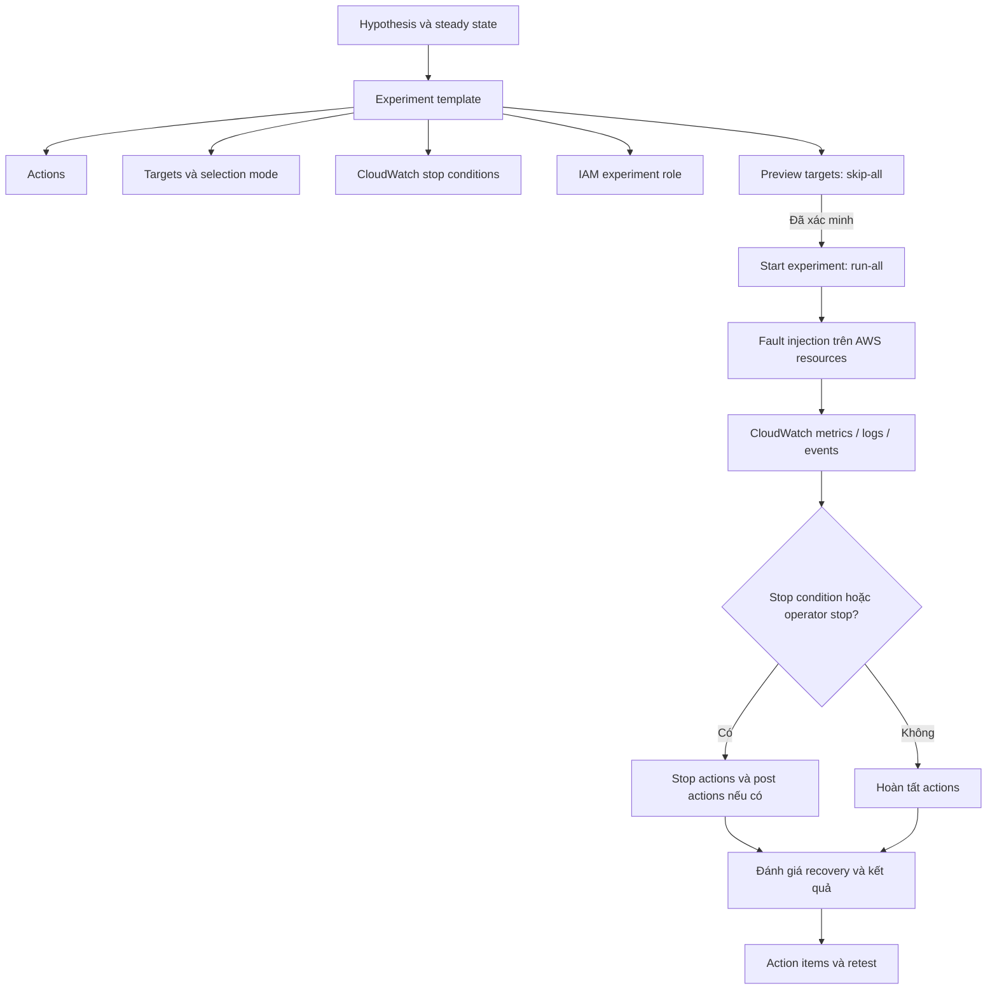

# AWS Fault Injection Service và thí nghiệm hỗn loạn

Một hệ thống phân tán có thể hoạt động tốt khi mọi thành phần khỏe mạnh nhưng thất bại khi một Availability Zone mất kết nối, EC2 instance bị dừng, database failover chậm hoặc API trả về lỗi throttling. Các tình huống này thường khó tái hiện bằng unit test hay integration test thông thường. Nếu chỉ chờ sự cố thật mới quan sát hành vi, tổ chức có thể phát hiện quá muộn rằng retry storm, timeout, queue backlog hoặc cơ chế failover không hoạt động như kỳ vọng.

AWS Fault Injection Service (AWS FIS) là dịch vụ được quản lý để chạy các thí nghiệm fault injection trên tài nguyên AWS thật. FIS cho phép tạo điều kiện gián đoạn có kiểm soát, chẳng hạn dừng EC2 instance, gây lỗi API, tạo độ trễ mạng, làm mất packet, dừng ECS task hoặc kích hoạt Aurora failover. Nhóm vận hành quan sát tác động lên ứng dụng, so sánh với giả thuyết và cải thiện khả năng phục hồi trước khi sự cố tương tự ảnh hưởng người dùng.

Trong hệ sinh thái AWS, AWS FIS kết hợp Amazon CloudWatch alarms, CloudTrail, EventBridge, IAM, Amazon S3, EC2, ECS, EKS, RDS/Aurora, EBS, Lambda, Kinesis và các dịch vụ mạng. Một thí nghiệm an toàn cần xác định rõ mục tiêu, phạm vi tài nguyên, hành động, thời lượng, quyền thực thi, điều kiện dừng và cách khôi phục. FIS cung cấp công cụ thực hiện và guardrails; đội ngũ ứng dụng vẫn chịu trách nhiệm về giả thuyết, giám sát, quy trình vận hành và đánh giá kết quả.

## Mục tiêu học tập

Sau bài học, bạn có thể:

- Giải thích chaos engineering, fault injection, hypothesis và steady state.
- Phân biệt AWS FIS experiment, experiment template, action, target và stop condition.
- Chọn hành động FIS phù hợp với EC2, ECS, EKS, RDS, EBS, Lambda và network.
- Thiết kế target bằng resource ID, tag, filter, parameter và selection mode.
- Cấu hình experiment role với IAM least privilege và service-linked role.
- Tạo CloudWatch alarm làm stop condition và sử dụng Safety Lever để dừng toàn bộ thí nghiệm trong một Region.
- Phân biệt action duration, post action, rollback và những lỗi không thể tự phục hồi.
- Tạo, xem trước, chạy, theo dõi và dừng experiment bằng AWS Console hoặc CLI.
- Sử dụng logging, CloudTrail, EventBridge và experiment report để thu thập bằng chứng.
- Thiết kế multi-account experiments và game day có kiểm soát.
- Đánh giá kết quả theo SLO, RTO/RPO, error rate, latency và hành vi phục hồi.

## Chaos engineering và fault injection

Chaos engineering là phương pháp kiểm chứng khả năng phục hồi của hệ thống bằng cách chủ động tạo ra các điều kiện gián đoạn có kiểm soát. Mục tiêu không phải gây lỗi ngẫu nhiên để xem hệ thống có sập hay không; mục tiêu là kiểm tra một giả thuyết cụ thể về hành vi của hệ thống và dùng kết quả để cải thiện thiết kế.

Ví dụ giả thuyết:

> Nếu một EC2 instance trong Auto Scaling group bị dừng, Application Load Balancer và Auto Scaling sẽ chuyển traffic sang các instance khỏe mạnh; tỷ lệ request lỗi không vượt 1% và p95 latency không vượt 800 ms trong quá trình thay thế instance.

Một thí nghiệm cần có:

1. **Hypothesis:** dự đoán rõ điều gì sẽ xảy ra khi một fault được tạo.
2. **Steady state:** trạng thái bình thường của ứng dụng được mô tả bằng metric kỹ thuật và nghiệp vụ.
3. **Blast radius:** phạm vi tài nguyên bị tác động, ví dụ một instance hoặc một phần trăm task.
4. **Fault injection:** hành động tạo ra điều kiện gián đoạn.
5. **Observation:** đo hành vi của hệ thống trong và sau thí nghiệm.
6. **Stop/rollback:** dừng thí nghiệm hoặc phục hồi khi vượt ngưỡng.
7. **Learning:** ghi nhận điểm yếu, hành động khắc phục và kiểm thử lại.

### Fault injection khác với kiểm thử chức năng

| Loại kiểm thử | Câu hỏi chính | Ví dụ |
|---|---|---|
| Unit test | Một hàm có xử lý đúng input/output không? | Hàm retry tăng backoff theo cấu hình |
| Integration test | Các thành phần có giao tiếp đúng không? | Service ghi dữ liệu vào DynamoDB |
| Load/stress test | Hệ thống chịu được tải bao nhiêu? | Tăng request lên 5.000 RPS |
| Failover test | Cơ chế chuyển sang thành phần dự phòng có hoạt động không? | Aurora failover sang reader instance |
| Fault injection/chaos experiment | Hệ thống phản ứng thế nào khi phụ thuộc gặp lỗi? | Chặn kết nối giữa subnet và S3 |
| Game day | Con người, runbook và hệ thống phối hợp ra sao trong sự cố? | Diễn tập mất một AZ cùng đội on-call |

Các phương pháp bổ trợ cho nhau. Fault injection không thay thế unit test, load test hoặc disaster recovery test; nó kiểm chứng một lớp giả định khác về độ bền vững.

## AWS Fault Injection Service là gì?

AWS FIS là dịch vụ managed giúp tạo và điều phối các fault injection experiments trên tài nguyên AWS. Dịch vụ cung cấp thư viện actions được định nghĩa sẵn theo từng loại tài nguyên, cơ chế target selection, IAM role để thực thi, CloudWatch stop conditions và khả năng theo dõi tiến trình.

FIS thực hiện hành động trên tài nguyên AWS thật. Dừng EC2 instance, chặn network, dừng ECS task hoặc failover database đều có thể ảnh hưởng workload thực tế. Vì vậy, nên bắt đầu ở môi trường test/pre-production, với phạm vi nhỏ và giám sát đầy đủ trước khi mở rộng sang môi trường production có kiểm soát.

### Các khái niệm chính

| Khái niệm | Ý nghĩa | Ví dụ |
|---|---|---|
| Experiment template | Blueprint mô tả toàn bộ thí nghiệm | Dừng một EC2 instance trong 3 phút |
| Experiment | Một lần chạy cụ thể từ template | Lần chạy ngày 20/11 với các target đã resolve |
| Action | Hoạt động gây fault hoặc hỗ trợ thí nghiệm | `aws:ec2:stop-instances` |
| Target | Nhóm tài nguyên mà action tác động | Một instance có tag `ChaosEligible=true` |
| Selection mode | Chọn bao nhiêu tài nguyên trong tập target | `COUNT(1)`, `PERCENT(25)`, `ALL` |
| Stop condition | CloudWatch alarm khiến FIS dừng experiment | Alarm tỷ lệ HTTP 5xx vượt 2% |
| Experiment role | IAM role FIS assume để thực hiện action | Role chỉ có quyền stop/start instance đã chỉ định |
| Post action | Hành động phục hồi sau khi fault kết thúc | Khởi động lại EC2 sau thời gian dừng |
| Safety Lever | Công tắc dừng tất cả experiments trong account/Region | Engage khi ứng dụng gặp sự cố ngoài dự kiến |



Một experiment template có thể chạy actions tuần tự hoặc song song. Action có thể tham chiếu action khác bằng `startAfter`; nếu không khai báo, action có thể bắt đầu ngay khi experiment bắt đầu. FIS resolve toàn bộ targets trước khi chạy action set. Nếu target không resolve được, experiment có thể thất bại theo cấu hình `emptyTargetResolutionMode`.

## Thành phần của experiment template

### Actions

Action là hành động FIS thực hiện trên target. Mỗi action có:

- `actionId`: tên action được AWS FIS hỗ trợ, ví dụ `aws:ec2:stop-instances`.
- `parameters`: tham số như duration, percentage, port hoặc loại lỗi.
- `targets`: tên target tương ứng với resource type của action.
- `startAfter`: danh sách actions phải hoàn thành trước khi action hiện tại bắt đầu.
- `description`: mô tả mục đích action để người vận hành hiểu tác động.

Các action có thể chạy tuần tự hoặc song song. Một action ID chỉ được dùng một lần trong một experiment; nếu cần chạy cùng action nhiều lần, thêm nhiều action entries với tên khác nhau.

### Targets

Target mô tả tập tài nguyên FIS được phép tác động. Có thể chỉ định:

- Resource ARN/ID cụ thể.
- Resource tags.
- Resource filters dựa trên thuộc tính như VPC, trạng thái hoặc Availability Zone.
- Resource parameters do action hỗ trợ.
- Selection mode để chọn toàn bộ hoặc một phần tài nguyên đã xác định.

Target được resolve ở đầu experiment và tập target được giữ cho toàn bộ experiment. Nếu không tìm thấy target nào, experiment mặc định thất bại. Không nên dùng tag quá rộng như `Environment=production` mà thiếu điều kiện giới hạn ứng dụng hoặc khả năng chịu fault.

### Selection mode

| Mode | Ý nghĩa | Ví dụ |
|---|---|---|
| `ALL` | Tác động tất cả tài nguyên được resolve | Dừng toàn bộ 3 test instances |
| `COUNT(n)` | Chọn ngẫu nhiên đúng n tài nguyên | `COUNT(1)` chọn một instance |
| `PERCENT(n)` | Chọn ngẫu nhiên tỷ lệ phần trăm | `PERCENT(25)` chọn 25% target |

Khi số lượng tài nguyên lẻ, FIS làm tròn xuống cho `PERCENT`. Ví dụ 50% của 5 instances sẽ chọn 2. Nếu tỷ lệ nhỏ hơn một tài nguyên, không có target được chọn và experiment có thể thất bại. Nếu nhiều target definitions cùng loại resource, cùng một resource có thể được chọn nhiều lần trong một số cấu hình; hãy kiểm tra thiết kế target trước khi chạy.

### Stop conditions

Stop condition tham chiếu CloudWatch alarm. Khi alarm ở trạng thái ALARM trong experiment, FIS dừng experiment. Ví dụ:

- HTTP 5xx rate vượt ngưỡng.
- p95/p99 latency vượt SLO.
- Số lượng healthy targets giảm dưới mức tối thiểu.
- Queue age hoặc retry count tăng vượt giới hạn.
- Database connections, replication lag hoặc error rate vượt ngưỡng.

Alarm phải được xây dựng từ metric đại diện cho steady state và có evaluation periods phù hợp. Alarm quá nhạy có thể dừng mọi thí nghiệm do nhiễu ngắn hạn; alarm quá chậm có thể để fault kéo dài hơn khả năng chịu đựng. FIS hỗ trợ tối đa 5 stop conditions trong mỗi template theo quota mặc định hiện hành.

Ví dụ cấu hình stop condition:

```json
{
  "stopConditions": [
    {
      "source": "aws:cloudwatch:alarm",
      "value": "arn:aws:cloudwatch:ap-southeast-1:111122223333:alarm/checkout-high-error-rate"
    }
  ]
}
```

Nếu template không dùng stop condition, cấu hình `source: none`. Với experiment có khả năng ảnh hưởng dịch vụ quan trọng, nên tạo alarm và xác nhận alarm hoạt động trước khi chạy.

## Các nhóm action thường dùng

AWS FIS cung cấp actions cho nhiều dịch vụ. Danh sách action, resource type, tham số và quyền IAM có thể thay đổi; dùng `list-actions` và `get-action` để xác minh trước khi xây template.

| Dịch vụ/nhóm | Action ví dụ | Điều có thể kiểm chứng |
|---|---|---|
| EC2 | `aws:ec2:stop-instances`, `reboot-instances`, `terminate-instances`, Spot interruptions | Auto Scaling, health checks, failover, checkpoint và phục hồi instance |
| Auto Scaling | Inject `InsufficientInstanceCapacity` vào launch requests | Khả năng xử lý thiếu capacity và scale-out failure |
| ECS | `aws:ecs:stop-task`, `aws:ecs:drain-container-instances`, `aws:ecs:task-cpu-stress`, `aws:ecs:task-network-latency` | Service scheduler, task replacement, circuit breaker và health checks |
| EKS | `aws:eks:pod-delete`, `aws:eks:pod-cpu-stress`, `aws:eks:pod-memory-stress`, `aws:eks:pod-network-packet-loss` | Kubernetes probes, replica scheduling, PDB, autoscaling và service mesh |
| RDS/Aurora | `aws:rds:failover-db-cluster`, reboot DB instance | Retry kết nối, DNS refresh, failover, connection pool và recovery time |
| EBS | `aws:ebs:pause-volume-io`, `aws:ebs:volume-io-latency` | Timeout storage, queueing, application behavior khi volume chậm |
| Network | Disrupt subnet connectivity, VPC endpoint hoặc cross-Region route | Resilience với mất kết nối, dependency fallback và retry |
| Lambda | `aws:lambda:invocation-add-delay`, `aws:lambda:invocation-error`, `aws:lambda:invocation-http-integration-response` | Retry, DLQ/destination, timeout, API integration và idempotency |
| Kinesis | Expired iterator hoặc provisioned throughput exception | Consumer recovery, retry/backoff và checkpoint |
| DynamoDB/MemoryDB | Pause replication ở global/multi-Region tables | Replication lag, consistency và failover behavior |
| IAM/API | Inject API internal, throttling hoặc unavailable errors vào request của target role | SDK retry, backoff, circuit breaker và quota handling |
| Systems Manager | `aws:ssm:send-command` với document phù hợp | Fault tùy chỉnh trên EC2/managed nodes theo phạm vi cho phép |

### Ví dụ EC2 stop và restart

Action `aws:ec2:stop-instances` gọi API StopInstances trên target EC2 instances. Có thể đặt `startInstancesAfterDuration` để FIS tự khởi động lại sau một khoảng thời gian từ 1 phút đến 12 giờ. Nếu EBS volume mã hóa, experiment role cần quyền KMS phù hợp để khởi động lại instance.

Không phải action nào cũng tự phục hồi. `terminate-instances` là hành động phá hủy instance; không thể khôi phục instance đã terminate bằng post action. Spot interruption có thể để instance ở trạng thái stopped tùy interruption behavior; tài liệu action quy định trạng thái sau interruption. Phải đọc action reference trước khi giả định cleanup.

### Ví dụ network disruption

Action `aws:network:disrupt-connectivity` tạo bản sao Network ACL, thêm deny rules rồi gắn ACL đó vào subnet trong thời gian action. Khi action hoàn tất, FIS xóa ACL bản sao và khôi phục association ban đầu. Các scope có thể gồm traffic trong AZ, DynamoDB, S3, VPC hoặc prefix list theo tham số hỗ trợ.

Đây là action có phạm vi ảnh hưởng rộng nếu target subnet chứa nhiều workload. Cần target subnet dành riêng cho ứng dụng thử nghiệm, kiểm tra NACL quotas và chuẩn bị đường truy cập quản trị độc lập để tránh tự khóa đường vận hành.

### Ví dụ RDS failover

`aws:rds:failover-db-cluster` gọi FailoverDBCluster trên Aurora DB cluster (và loại cluster tương thích được action reference liệt kê). Thí nghiệm kiểm tra:

- Application reconnect khi writer endpoint chuyển sang instance mới.
- DNS cache và connection pool có cập nhật endpoint không.
- Retry có tránh tạo request storm không.
- Giao dịch đang chạy được xử lý thế nào khi connection bị ngắt.
- Recovery time có đáp ứng RTO không.

Không dùng failover test thay thế kiểm thử backup/restore hoặc disaster recovery toàn Region. Đây là một tình huống failover của database cluster.

### Custom fault qua Systems Manager

AWS FIS có action `aws:ssm:send-command` để gửi SSM document đến managed nodes. Cách này hỗ trợ custom fault khi action dựng sẵn không bao phủ tình huống cần kiểm tra. Tuy nhiên, cần bảo đảm node được Systems Manager quản lý, document đã được review, command có thời hạn, có cleanup và IAM role chỉ cho phép document/targets cần thiết. Không dùng command tùy ý có thể xóa dữ liệu hoặc mở rộng quyền vượt mục tiêu experiment.

## Thiết kế experiment an toàn

AWS FIS thực hiện hành động thật trên tài nguyên thật. Quy trình an toàn bắt đầu từ phạm vi nhỏ và chỉ mở rộng khi có bằng chứng.

### 1. Xác định mục tiêu và giả thuyết

Mô tả câu hỏi cần trả lời, ví dụ: “Nếu một ECS task bị dừng, service có duy trì ít nhất 2 healthy tasks và p95 latency dưới 500 ms không?” Tránh mục tiêu mơ hồ như “kiểm tra độ bền của hệ thống”.

### 2. Xác định steady state

Ghi nhận baseline trước thí nghiệm:

- Request rate và error rate.
- p50/p95/p99 latency.
- Healthy host/task/pod count.
- CPU, memory, disk I/O và network.
- Queue depth/age, retry count và timeout.
- Database connection count, replication lag và failover metrics.
- Business metrics như checkout success, login success hoặc số giao dịch hoàn tất.

Chọn metrics phản ánh tác động người dùng và có thể tạo CloudWatch alarm. Một thí nghiệm chỉ quan sát CPU mà không đo tỷ lệ giao dịch thành công có thể bỏ lỡ ảnh hưởng nghiệp vụ.

### 3. Chọn môi trường và blast radius

Bắt đầu ở sandbox hoặc pre-production có cấu hình gần production. Dùng tags riêng như `ChaosEligible=true`, `Application=orders`, `Environment=staging` để target chính xác. Bắt đầu với `COUNT(1)` hoặc `PERCENT(5)` thay vì `ALL`. Xác minh target preview trước khi chạy.

Nếu chạy production, cần change approval, thông báo on-call, thời gian ít rủi ro, customer impact criteria, runbook rollback và điều kiện dừng. Không chạy thí nghiệm trong incident đang diễn ra trừ khi incident commander chủ động quyết định sử dụng FIS như một phần của xử lý sự cố.

### 4. Chuẩn bị recovery và rollback

Trước khi chạy, xác định:

- Action tự hết hiệu lực sau duration hay cần post action.
- Có hành động không thể đảo ngược như terminate instance hoặc xóa resource không.
- Dữ liệu có được checkpoint/snapshot/backup không.
- Người vận hành có thể truy cập hệ thống nếu network fault xảy ra không.
- Có thao tác thủ công cần thiết để khôi phục hay không.
- Safety Lever của account/Region có sẵn và ai được quyền engage.

FIS có post actions cho một số action; post action chạy sau thời gian action. Không phải action nào cũng hỗ trợ. Dừng experiment hoặc engage Safety Lever không tự động hoàn tác mọi side effect; cần kiểm tra action-specific cleanup và runbook.

### 5. Chuẩn bị alarms và logging

Tạo CloudWatch dashboard cho baseline, injection và recovery. Tạo stop-condition alarms trước. Bật experiment logging đến CloudWatch Logs hoặc S3 nếu cần trace chi tiết. Logging của FIS mặc định tắt; log destination có thể phát sinh chi phí.

### 6. Preview target và kiểm tra quyền

Chạy experiment ở `actionsMode=skip-all` để xem target resolution và kiểm tra cấu hình logging. Preview không thực hiện fault injection và không chứng minh experiment role có đủ quyền thực thi action. Cần review IAM policy và có thể kiểm thử bằng một experiment nhỏ trong môi trường test.

### 7. Chạy, quan sát và dừng đúng lúc

Theo dõi action state, target, CloudWatch metrics, log và business SLO. Nếu stop condition kích hoạt hoặc operator nhận thấy tác động vượt ngưỡng, dừng experiment và kích hoạt recovery runbook. Không đợi đến khi experiment hoàn tất mới xem metrics.

### 8. Đánh giá và cải thiện

So sánh steady state với dữ liệu trong và sau experiment. Ghi rõ giả thuyết pass/fail, thời gian phát hiện, thời gian phục hồi, tác động người dùng, nguyên nhân và action items. Sau khi sửa hệ thống, chạy lại cùng template hoặc version đã cập nhật để xác nhận cải thiện.

## IAM và quyền thực thi

AWS FIS sử dụng hai lớp role khác nhau:

- **Service-linked role `AWSServiceRoleForFIS`:** cho phép FIS quản lý monitoring và resource selection. FIS sử dụng managed policy `AmazonFISServiceRolePolicy`.
- **Experiment role:** được khai báo trong experiment template (`roleArn`), cho phép FIS thực hiện actions trên target resources.

Experiment role cần trust policy cho phép `fis.amazonaws.com` assume role. Nên thêm điều kiện `aws:SourceAccount` và `aws:SourceArn` để giảm rủi ro confused deputy. Permission policy chỉ cấp các action cần thiết cho experiment, giới hạn theo ARN/tag và action condition keys khi có hỗ trợ.

Ví dụ trust policy rút gọn:

```json
{
  "Version": "2012-10-17",
  "Statement": [
    {
      "Effect": "Allow",
      "Principal": { "Service": "fis.amazonaws.com" },
      "Action": "sts:AssumeRole",
      "Condition": {
        "StringEquals": {
          "aws:SourceAccount": "111122223333"
        },
        "ArnLike": {
          "aws:SourceArn": "arn:aws:fis:ap-southeast-1:111122223333:experiment/*"
        }
      }
    }
  ]
}
```

Ví dụ minh họa trust relationship; điều kiện source ARN cần khớp loại ARN và cách FIS assume role theo tài liệu hiện hành. Permission policy cho action cần được xây dựng riêng theo action reference. Không gắn một managed policy bao phủ mọi dịch vụ nếu experiment chỉ dừng một EC2 instance.

Người tạo hoặc khởi chạy experiment cần quyền FIS phù hợp và `iam:PassRole` để truyền experiment role. Giới hạn `iam:PassRole` vào role cụ thể và service `fis.amazonaws.com`. Với action cần KMS, SSM, ECS, EKS hoặc network permissions, kiểm tra thêm quyền phụ thuộc trong action reference.

### Quyền cho multi-account experiment

Multi-account experiment có orchestrator account sở hữu template/experiment và target accounts chứa tài nguyên bị tác động. FIS sử dụng role chaining:

1. Experiment role ở orchestrator được FIS assume.
2. Orchestrator role được phép assume target account roles.
3. Target account roles có quyền thực hiện action trên tài nguyên của account đó.
4. Trust policies giữa các account và FIS phải khớp.

Dùng tag nhất quán giữa accounts để target cùng loại workload. Với target theo Availability Zone trong nhiều accounts, dùng AZ ID thay vì AZ name vì AZ name có thể ánh xạ khác nhau giữa accounts. Stop conditions cross-account cần cấu hình CloudWatch cross-account alarms.

## Stop conditions và Safety Lever

### Stop condition

Stop condition là guardrail gắn với từng experiment template. Khi CloudWatch alarm đạt trạng thái ALARM, FIS dừng experiment. Stop condition phù hợp với ngưỡng ứng dụng cụ thể, ví dụ error rate hoặc latency của một service.

Stop condition không thay thế operator monitoring. Alarm có thể bị thiếu metric, cấu hình sai hoặc chậm hơn tốc độ fault lan truyền. Hãy kiểm tra alarm bằng cách tạo trạng thái test phù hợp và xác nhận FIS nhận được trạng thái alarm.

### Safety Lever

Mỗi AWS account có một Safety Lever cho mỗi Region. Khi lever ở trạng thái `engaged`:

- Các experiments đang chạy trong account/Region bị dừng.
- Các experiment mới không được phép bắt đầu và có thể kết thúc ở trạng thái `cancelled`.
- Experiment đã stopped/cancelled không thể resume; sau khi disengage, cần tạo lần chạy mới từ template.

Safety Lever hữu ích khi xảy ra incident ngoài dự kiến hoặc tổ chức cần đóng băng mọi chaos experiments trong một Region. Quyền engage/disengage nên giới hạn cho incident commander hoặc nhóm vận hành được ủy quyền. Safety Lever dừng experiment nhưng không bảo đảm đảo ngược các hành động không thể hoàn tác; vẫn cần kiểm tra resource state và runbook phục hồi.

CLI ví dụ:

```bash
# Xem trạng thái Safety Lever
aws fis get-safety-lever --id default

# Engage: dừng các experiment và chặn lần chạy mới
aws fis update-safety-lever-state \
  --id default \
  --state "status=engaged,reason=application-incident"

# Disengage sau khi incident đã được xử lý
aws fis update-safety-lever-state \
  --id default \
  --state "status=disengaged,reason=incident-resolved"
```

## Experiment logging, monitoring và report

### Theo dõi trạng thái

Experiment states thường gặp:

| State | Ý nghĩa |
|---|---|
| `pending` | Experiment đang chờ khởi chạy |
| `initiating` | FIS đang chuẩn bị experiment và resolve target |
| `running` | Actions đang được thực thi |
| `completed` | Tất cả actions hoàn tất thành công |
| `stopping` | Experiment đang dừng do alarm hoặc yêu cầu operator |
| `stopped` | Các action đang chạy/chờ đã được dừng |
| `failed` | Experiment thất bại do lỗi cấu hình, quyền, target hoặc dịch vụ phụ thuộc |
| `cancelled` | Experiment bị hủy, ví dụ Safety Lever đã engaged |

Action states có thể gồm `pending`, `initiating`, `running`, `completed`, `cancelled`, `skipped`, `stopping`, `stopped` và `failed`. Experiment `completed` chỉ có nghĩa actions hoàn tất theo template; không tự động chứng minh giả thuyết resilience đã pass. Cần đọc metrics và business outcome.

### CloudWatch và EventBridge

CloudWatch dùng để đo tác động lên ứng dụng và theo dõi usage/quota của FIS. Tạo dashboard với mốc thời gian trước, trong và sau experiment. EventBridge phát event khi experiment state thay đổi; có thể route sang SNS, Lambda hoặc workflow để thông báo và tự động tạo ticket.

CloudTrail ghi lại API calls của FIS và các thay đổi control plane liên quan. Với multi-account experiments, kiểm tra CloudTrail ở orchestrator và target accounts.

### Experiment logging

Experiment logging mặc định tắt. Có thể gửi log đến CloudWatch Logs hoặc S3. Log chứa sự kiện experiment start/end, target resolution, action start/end/error, resolved targets và trạng thái. Log schema hiện hành là version 2; các field chi tiết phụ thuộc `log_type` và `target_type`.

Log delivery đến S3/CloudWatch Logs phát sinh phí theo dịch vụ đích. Nếu bucket S3 dùng customer managed KMS key, experiment role cần quyền KMS phù hợp. Giới hạn quyền truy cập log vì log có thể tiết lộ ARN, tên tài nguyên và cấu trúc hạ tầng.

### Experiment report

FIS có thể tạo PDF report sau experiment thành công. Report tóm tắt actions và có thể chứa snapshot của một CloudWatch dashboard, đánh dấu thời gian bắt đầu/kết thúc cùng cửa sổ metric trước/sau experiment. Report được lưu vào S3 và có thể tải từ FIS console. Chỉ một CloudWatch dashboard được đưa vào report; bucket report phải cùng Region với experiment.

Report không được tạo cho experiment `cancelled` hoặc target preview với `actionsMode=skip-all`. Dùng experiment logs để điều tra experiment lỗi; report chủ yếu phục vụ bằng chứng và tổng kết experiment đã chạy. Có thể dùng S3 Object Lock để bảo vệ report theo chính sách audit.

## Tạo và chạy experiment bằng AWS CLI

Ví dụ dưới đây kiểm tra Auto Scaling recovery bằng cách dừng ngẫu nhiên một EC2 instance được gắn tag `ChaosEligible=true` trong môi trường staging. Action tự khởi động instance sau 3 phút. Template có stop condition CloudWatch alarm.

### 1. Tạo experiment template JSON

Tạo file `ec2-stop-experiment.json`:

```json
{
  "description": "Stop one staging instance and verify application recovery",
  "targets": {
    "testInstances": {
      "resourceType": "aws:ec2:instance",
      "resourceTags": {
        "Environment": "staging",
        "ChaosEligible": "true"
      },
      "selectionMode": "COUNT(1)"
    }
  },
  "actions": {
    "stopOneInstance": {
      "actionId": "aws:ec2:stop-instances",
      "description": "Stop one tagged staging EC2 instance",
      "parameters": {
        "startInstancesAfterDuration": "PT3M"
      },
      "targets": {
        "Instances": "testInstances"
      }
    }
  },
  "stopConditions": [
    {
      "source": "aws:cloudwatch:alarm",
      "value": "arn:aws:cloudwatch:ap-southeast-1:111122223333:alarm/staging-high-5xx-rate"
    }
  ],
  "roleArn": "arn:aws:iam::111122223333:role/FISStagingExperimentRole",
  "tags": {
    "Application": "orders",
    "Environment": "staging",
    "Owner": "platform-team"
  },
  "experimentOptions": {
    "accountTargeting": "single-account",
    "emptyTargetResolutionMode": "fail"
  }
}
```

Thay account ID, Region, alarm ARN, role ARN và tag theo môi trường. Resource tags trong ví dụ được kết hợp theo AND: instance phải có cả hai tag. Không dùng tag selector nếu tagging chưa được quản trị; preview target là bước bắt buộc trong quy trình vận hành.

### 2. Tạo template

```bash
aws fis create-experiment-template \
  --cli-input-json file://ec2-stop-experiment.json
```

Response trả về `experimentTemplate.id`. Ghi lại ID và kiểm tra template bằng `get-experiment-template` trước khi chạy.

### 3. Preview target mà không inject fault

```bash
aws fis start-experiment \
  --experiment-template-id EXTxxxxxxxxxxxxxxx \
  --experiment-options actionsMode=skip-all
```

`skip-all` chạy target resolution nhưng bỏ qua tất cả actions. Kiểm tra danh sách resolved targets và logging. Preview không xác nhận experiment role có đủ quyền thực hiện fault injection; vẫn phải review IAM và thử trong test environment.

### 4. Chạy experiment thật

```bash
aws fis start-experiment \
  --experiment-template-id EXTxxxxxxxxxxxxxxx \
  --experiment-options actionsMode=run-all
```

Lưu `experiment.id` từ response để theo dõi. `run-all` là mode mặc định nếu không chỉ định; ghi rõ trong automation để tránh nhầm với preview.

### 5. Theo dõi và dừng experiment

```bash
aws fis get-experiment --id EXPxxxxxxxxxxxxxxx

aws fis list-experiments \
  --experiment-template-id EXTxxxxxxxxxxxxxxx

aws fis stop-experiment \
  --id EXPxxxxxxxxxxxxxxx
```

Khi stop experiment, FIS hoàn tất các post actions chưa hoàn thành trước khi dừng nếu action có cấu hình post action. Không thể resume experiment đã stopped hoặc failed; có thể tạo một experiment mới từ cùng template sau khi xử lý nguyên nhân.

### 6. Liệt kê action và kiểm tra chi tiết

```bash
aws fis list-actions

aws fis get-action \
  --id aws:ec2:stop-instances
```

Trong PowerShell, JSON argument cần escape theo cú pháp shell; có thể dùng file JSON hoặc quoting phù hợp. `get-action` cho biết resource type, parameters và permissions hiện hành. Đây là cách kiểm tra tốt trước khi dùng action mới hoặc cập nhật template.

## Multi-account experiments

Ứng dụng lớn có thể trải trên nhiều AWS accounts: account mạng, account database, account application và account observability. Multi-account experiment cho phép orchestrator account chạy một template tác động đến tài nguyên trong nhiều target accounts.

Mô hình gồm:

- **Orchestrator account:** sở hữu template/experiment và điều phối.
- **Target account:** chứa resource bị tác động.
- **Target account configuration:** khai báo account ID, role ARN và mô tả cho từng account.
- **Role chaining:** FIS assume orchestrator role; orchestrator role assume target account role; target role thực hiện action.

Best practices:

- Dùng tag naming thống nhất trên các target accounts.
- Dùng AZ ID thay cho AZ name khi target theo AZ trên nhiều accounts.
- Cấp quyền riêng cho từng target account và action.
- Bật CloudTrail ở tất cả accounts.
- Cấu hình CloudWatch cross-account alarms nếu dùng stop condition tổng hợp.
- Thông báo cho đội ngũ sở hữu target accounts; FIS có thể hiển thị thông báo trong AWS Health dashboard của target accounts bị ảnh hưởng.

Multi-account experiments phù hợp với game day cho hệ thống nhiều account, nhưng cần chuẩn bị IAM trust và quyền dừng ở từng account. Safety Lever ở account/Region nơi experiment chạy mới có tác dụng dừng experiment đó; muốn dừng experiments độc lập tại target accounts, cần xem xét Safety Lever tương ứng ở các account/Region liên quan.

## Tình huống thực tế: kiểm tra khả năng chịu lỗi của ứng dụng đặt hàng

Một hệ thống đặt hàng gồm Application Load Balancer, ECS service chạy trên EC2, Aurora cluster, ElastiCache và Kinesis Data Streams. Nhóm vận hành muốn kiểm chứng ứng dụng vẫn phục vụ khi một task dừng, database failover hoặc kết nối tới một dependency bị gián đoạn.

### Experiment A: dừng một ECS task

**Giả thuyết:** Nếu một task bị dừng, ECS service scheduler sẽ tạo task thay thế; healthy task count không giảm dưới hai và p95 latency vẫn dưới 700 ms.

Thiết kế:

1. Target ECS tasks có tag/criteria dành riêng cho staging.
2. Dùng `aws:ecs:stop-task` với `COUNT(1)`.
3. Stop condition là alarm 5xx rate hoặc healthy task count thấp hơn ngưỡng.
4. Theo dõi ECS service desired/running count, deployment events, ALB target health và p95 latency.
5. Kiểm tra task replacement time và các request đang xử lý khi task dừng.

### Experiment B: Aurora failover

**Giả thuyết:** Nếu writer failover, ứng dụng reconnect trong 30 giây, retry không tạo storm và giao dịch không bị ghi trùng.

Thiết kế:

1. Chọn Aurora cluster staging có writer/reader topology tương tự production.
2. Chạy `aws:rds:failover-db-cluster`.
3. Theo dõi failover events, connection errors, database connections, application retry, transaction rollback và API latency.
4. Kiểm tra connection pool có refresh DNS và loại bỏ stale connection.
5. Đối chiếu số giao dịch hoàn tất với source of truth để phát hiện duplicate/lost writes.

### Experiment C: mất kết nối đến S3

**Giả thuyết:** Nếu subnet của một nhóm worker mất đường tới S3, worker sẽ retry có backoff, không tạo retry storm và chuyển request lỗi vào durable queue.

Thiết kế:

1. Dùng subnet riêng cho staging workers.
2. Chạy `aws:network:disrupt-connectivity` với scope `s3` trong thời gian ngắn.
3. Theo dõi S3 request errors, worker retry, queue age, dead-letter count và throughput.
4. Stop condition khi queue age vượt SLA hoặc error rate vượt ngưỡng.
5. Xác nhận NACL association gốc được phục hồi khi action kết thúc và worker tiếp tục xử lý backlog.

### Đánh giá kết quả

| Chỉ số | Kỳ vọng | Kết quả cần ghi |
|---|---|---|
| HTTP 5xx | Không vượt ngưỡng đã đặt | Peak, duration và recovery time |
| p95 latency | Trong SLO hoặc phục hồi trong RTO | Thời điểm bắt đầu tăng và trở về baseline |
| Healthy tasks/targets | Luôn trên mức tối thiểu | Số lượng thấp nhất và thời gian replacement |
| Database reconnect | Trong 30 giây | Connection errors, retry count và failover duration |
| Queue age | Không vượt SLA | Backlog peak và drain time |
| Duplicate/lost transaction | Không có giao dịch trùng/mất | Đối soát với source of truth |

Kết quả không chỉ là “experiment completed”. Nếu giả thuyết thất bại, cần tạo action item: điều chỉnh health check, timeout, retry, connection pool, queue durability, autoscaling hoặc dependency fallback. Sau khi sửa, chạy lại experiment với cùng điều kiện để chứng minh cải thiện.

## Chi phí, quota và giới hạn

AWS FIS tính phí theo thời lượng action chạy và số target accounts theo pricing hiện hành. Ngoài phí FIS, thí nghiệm có thể làm phát sinh chi phí EC2, EBS, network, CloudWatch Logs, S3, database hoặc dịch vụ khác. Logging và PDF reports cũng có thể tạo chi phí cho CloudWatch/S3.

Một số quota mặc định theo Region được tài liệu AWS công bố hiện tại:

| Quota | Mức mặc định |
|---|---:|
| Experiment templates | 500 |
| Active experiments đồng thời | 5 |
| Actions trong một experiment template | 20 |
| Actions chạy song song trong một experiment | 10 |
| Stop conditions trong một template | 5 |
| Thời lượng một action | Tối đa 12 giờ |
| Thời lượng một experiment | Tối đa 12 giờ |
| Retention dữ liệu experiment hoàn tất trong FIS | 120 ngày |

Đây là quota tham khảo theo tài liệu tại thời điểm biên soạn; kiểm tra Service Quotas và FIS quotas theo account/Region trước khi lập kế hoạch. Một số giới hạn target riêng phụ thuộc action và resource type.

## Troubleshooting

| Triệu chứng / lỗi | Nguyên nhân thường gặp | Cách xử lý |
|---|---|---|
| `AuthorizationFailure` | Experiment role thiếu quyền action/target; không tạo được service-linked role do SCP | Kiểm tra action permissions, trust policy, `iam:PassRole`, SCP và `AWSServiceRoleForFIS` |
| `InvalidTarget` | ARN sai, tag không match, resource đã bị xóa hoặc action chưa gắn target | Kiểm tra resolved targets, tag key/value và resource type |
| `ConfigurationFailure` | Action parameter sai, target type không tương thích hoặc cấu hình template lỗi | Dùng `get-action`, đọc `location`/error details và sửa schema |
| `DependentServiceFailure` | API của dịch vụ đích lỗi hoặc throttled | Kiểm tra service health, CloudTrail và thử lại sau khi xác định nguyên nhân |
| `QuotaExceededFailure` | Vượt quota FIS hoặc quota dịch vụ đích | Kiểm tra FIS quotas, EC2/RDS/CloudWatch quotas và giới hạn action |
| Experiment `failed` ngay khi bắt đầu | Target resolution rỗng hoặc role không assume được | Preview bằng `skip-all`, kiểm tra role và target scope |
| Experiment `running` nhưng action `pending` | Action đang chờ `startAfter` hoặc action trước chưa hoàn tất | Kiểm tra dependency graph và duration của action trước |
| Stop condition không kích hoạt | Alarm sai metric/dimension, alarm không ở ALARM hoặc thiếu cross-account access | Kiểm tra alarm history, metric dimensions và cross-account sharing |
| Network action không phục hồi | NACL association/cleanup có lỗi hoặc thay đổi ngoài FIS xen vào | Kiểm tra ACL có tag `managedByFIS=true`, association và experiment logs; chạy recovery runbook |
| EC2 dừng nhưng không khởi động lại | Không cấu hình `startInstancesAfterDuration`, KMS quyền thiếu hoặc instance đã bị ASG terminate | Kiểm tra action parameters, KMS grants, instance state và Auto Scaling activity |
| Experiment `cancelled` | Safety Lever đang engaged | Kiểm tra Safety Lever, incident reason và chỉ chạy lại sau khi được cho phép |

Khi điều tra, ưu tiên experiment logs, action state, resolved targets và CloudTrail. Không chỉ dựa vào trạng thái tổng của experiment vì một action có thể thất bại trong khi các action khác đã hoàn tất.

## Thực hành tốt

- Bắt đầu ở test/pre-production và dùng một target nhỏ.
- Viết hypothesis định lượng trước khi tạo template.
- Xác định steady state bằng cả technical metrics và business metrics.
- Dùng tags dành riêng cho chaos experiments và kiểm tra target preview trước mỗi lần chạy.
- Ưu tiên `COUNT(1)` hoặc tỷ lệ nhỏ trước khi tăng blast radius.
- Gắn CloudWatch stop conditions và kiểm thử alarm trước experiment.
- Dùng experiment role least privilege; không cấp quyền sửa mọi tài nguyên trong account.
- Dùng post action khi action hỗ trợ; lập runbook cho action không thể rollback.
- Phân biệt dừng experiment, Safety Lever và phục hồi tài nguyên; chúng không tương đương.
- Bật experiment logging và lưu report khi cần bằng chứng audit.
- Dùng AZ IDs trong multi-account experiments.
- Không chạy fault injection trong incident đang hoạt động nếu incident commander chưa phê duyệt.
- Đánh giá recovery time, error budget, retry storm, queue backlog và duplicate/lost data.
- Ghi action items có owner, deadline và retest sau khắc phục.
- Kiểm tra action reference, Region support, IAM permissions, pricing và quotas trước khi dùng action mới.

## Checklist triển khai production

- [ ] Xác định application owner, incident commander, on-call và người phê duyệt experiment.
- [ ] Review kiến trúc, dependency map, outage history và recovery runbook.
- [ ] Viết hypothesis có ngưỡng định lượng và steady-state metrics.
- [ ] Chọn target deployment, tag, filter và selection mode với blast radius nhỏ.
- [ ] Kiểm tra target preview bằng `actionsMode=skip-all`.
- [ ] Xác nhận experiment role trust policy, least privilege và `iam:PassRole`.
- [ ] Kiểm tra service-linked role `AWSServiceRoleForFIS` và SCP.
- [ ] Tạo CloudWatch stop-condition alarms và xác nhận alarm history.
- [ ] Xác định action duration, post action, cleanup và phương án phục hồi thủ công.
- [ ] Xác nhận Safety Lever trong account/Region và quyền engage/disengage.
- [ ] Bật experiment logging, CloudTrail, dashboard và thông báo EventBridge/SNS.
- [ ] Chạy ở test environment, sau đó staging; chỉ mở rộng production theo phê duyệt.
- [ ] Theo dõi action state, resolved targets, latency, error rate và business metrics.
- [ ] Dừng experiment nếu vượt ngưỡng hoặc có incident ngoài dự kiến.
- [ ] Lưu PDF report/log, ghi pass/fail hypothesis và action items.
- [ ] Retest sau khi khắc phục; cập nhật template/version và runbook.
- [ ] Kiểm tra FIS quotas, action quotas, service quotas và chi phí trước khi mở rộng.

## Kết luận

AWS Fault Injection Service giúp kiểm chứng khả năng phục hồi bằng cách thực hiện các fault injection actions có kiểm soát trên tài nguyên AWS thật. Experiment template kết hợp actions, targets, stop conditions và IAM experiment role; target selection quyết định blast radius; CloudWatch alarms và Safety Lever cung cấp cơ chế dừng. FIS hỗ trợ nhiều nhóm tài nguyên như EC2, ECS, EKS, RDS, EBS, Lambda, Kinesis và network, nhưng khả năng rollback phụ thuộc từng action. Một quy trình tốt bắt đầu bằng giả thuyết định lượng, baseline, môi trường test, target preview, least-privilege IAM, giám sát và recovery plan. Sau experiment, nhóm phải đánh giá SLO/RTO, ghi nhận điểm yếu và chạy lại sau khi khắc phục để biến kết quả thành cải thiện độ tin cậy.

## Tài liệu tham khảo

- [What is AWS Fault Injection Service?](https://docs.aws.amazon.com/fis/latest/userguide/what-is.html)
- [Planning your AWS FIS experiments](https://docs.aws.amazon.com/fis/latest/userguide/getting-started-planning.html)
- [AWS FIS experiment template components](https://docs.aws.amazon.com/fis/latest/userguide/experiment-templates.html)
- [Actions for AWS FIS](https://docs.aws.amazon.com/fis/latest/userguide/action-sequence.html)
- [AWS FIS Actions reference](https://docs.aws.amazon.com/fis/latest/userguide/fis-actions-reference.html)
- [Targets for AWS FIS](https://docs.aws.amazon.com/fis/latest/userguide/targets.html)
- [Stop conditions for AWS FIS](https://docs.aws.amazon.com/fis/latest/userguide/stop-conditions.html)
- [Safety Levers for AWS FIS](https://docs.aws.amazon.com/fis/latest/userguide/safety-lever.html)
- [Experiment options for AWS FIS](https://docs.aws.amazon.com/fis/latest/userguide/experiment-options.html)
- [IAM roles for AWS FIS experiments](https://docs.aws.amazon.com/fis/latest/userguide/getting-started-iam-service-role.html)
- [Use service-linked roles for AWS FIS](https://docs.aws.amazon.com/fis/latest/userguide/using-service-linked-roles.html)
- [Monitoring AWS FIS experiments](https://docs.aws.amazon.com/fis/latest/userguide/monitoring-experiments.html)
- [Experiment logging for AWS FIS](https://docs.aws.amazon.com/fis/latest/userguide/monitoring-logging.html)
- [Experiment report configurations](https://docs.aws.amazon.com/fis/latest/userguide/experiment-report-configuration.html)
- [Working with multi-account experiments](https://docs.aws.amazon.com/fis/latest/userguide/multi-account.html)
- [Quotas and limitations for AWS FIS](https://docs.aws.amazon.com/fis/latest/userguide/fis-quotas.html)
- [Troubleshooting AWS FIS](https://docs.aws.amazon.com/fis/latest/userguide/troubleshooting.html)
- [AWS Fault Injection Service pricing](https://aws.amazon.com/fis/pricing/)
