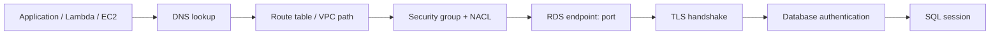

# Chẩn đoán kết nối RDS, khóa truy vấn và DynamoDB throttling

Khi ứng dụng truy cập cơ sở dữ liệu trên AWS, lỗi thường xuất hiện dưới ba dạng: không thể mở kết nối tới Amazon RDS, truy vấn bị chờ do transaction hoặc lock, và request tới Amazon DynamoDB bị throttling. Ba triệu chứng có thể cùng làm API chậm hoặc thất bại nhưng nguyên nhân và cách xử lý khác nhau.

Chẩn đoán hiệu quả cần xác định chính xác lớp gây lỗi trước khi thay đổi cấu hình. Với RDS, kiểm tra trạng thái instance, endpoint, DNS, port, VPC route, security group, network ACL, TLS, xác thực và giới hạn connection. Khi kết nối đã thành công nhưng query chậm, phân biệt lock wait với CPU, I/O hoặc execution plan. Với DynamoDB, đọc `ThrottlingReasons` và resource ARN để biết request bị giới hạn ở partition key range, provisioned throughput, account quota hay maximum throughput do người dùng cấu hình.

Bài học thuộc module `CLOUD_PROVIDERS_AWS`, kết nối RDS, DynamoDB, VPC, IAM, CloudWatch, Database Insights và ứng dụng phân tán. Sau bài học, bạn có thể:

- Phân loại lỗi RDS thành network, DNS, TLS, authentication, connection exhaustion và engine availability.
- Kiểm tra đường đi từ ứng dụng tới RDS bằng AWS CLI, DNS lookup và TCP/TLS probes.
- Dùng metric, log và Database Insights để phân biệt query chậm với lock contention.
- Tìm blocking session trong RDS for PostgreSQL và RDS for MySQL/Aurora MySQL.
- Chọn cách xử lý lock wait, deadlock và idle-in-transaction an toàn.
- Đọc `ThrottlingReasons` và ARN trong DynamoDB exception.
- Phân biệt hot partition, provisioned throughput, account quota và on-demand maximum throughput.
- Theo dõi CloudWatch metrics, dùng Contributor Insights và thiết kế retry/backoff.
- Xây dựng runbook có bước xác minh, khắc phục và kiểm tra sau sự cố.

## 1. Bắt đầu bằng phân loại triệu chứng

Không nên bắt đầu bằng việc tăng instance size, mở rộng security group hoặc tăng throughput ngay. Trước tiên xác định lỗi thuộc nhóm nào.

| Triệu chứng | Nhóm nguyên nhân cần kiểm tra | Bằng chứng đầu tiên |
|---|---|---|
| Timeout khi mở socket tới RDS | DNS, route, SG, NACL, firewall, endpoint/port | DNS lookup, TCP test, VPC config |
| Kết nối được nhưng login thất bại | Username/password, IAM DB auth, TLS, database/user grants | Error code, auth logs, TLS settings |
| Connection refused hoặc too many connections | DB status, port listener, max_connections, connection churn | RDS events, DatabaseConnections, engine process list |
| Query chạy lâu, session ở trạng thái waiting | Lock, CPU, I/O, network hoặc plan | Wait events, active sessions, blocking query |
| Transaction bị deadlock | Thứ tự lock không nhất quán, concurrent writes | Deadlock log/engine diagnostics |
| DynamoDB trả throttling exception | Partition, table/GSI capacity, account quota hoặc configured maximum | `ThrottlingReasons`, resource ARN |
| DynamoDB chỉ lỗi ở một số key | Hot partition hoặc skewed access pattern | Contributor Insights và key distribution |
| Batch write trả UnprocessedItems | Capacity hoặc partition pressure | Unprocessed count, retry metrics |

Thu thập cùng một khoảng thời gian cho application logs, CloudWatch metrics, RDS events và DynamoDB exceptions. Ghi lại timestamp UTC, Region, account, DB identifier/table name, request ID, query fingerprint, client identity và deployment gần nhất. Không ghi password, token hoặc dữ liệu nhạy cảm vào incident log.

## 2. Chẩn đoán kết nối Amazon RDS theo từng lớp

Một kết nối tới RDS phải đi qua nhiều lớp:

1. Ứng dụng dùng đúng endpoint và port.
2. DNS phân giải endpoint thành IP.
3. Route table đưa traffic tới đúng VPC/subnet hoặc kết nối liên VPC.
4. Security group cho phép traffic tới database port.
5. Network ACL và firewall không chặn chiều đi/về.
6. TLS handshake thành công nếu được yêu cầu.
7. Database nhận kết nối và xác thực user.
8. Database còn khả năng nhận connection và phục vụ workload.



Nếu TCP chưa thiết lập được, chưa nên điều tra SQL grants hoặc lock. Nếu TCP/TLS thành công nhưng login bị từ chối, chuyển sang authentication. Nếu login thành công nhưng query bị chậm, chuyển sang query performance và lock diagnosis.

## 3. Xác minh trạng thái, endpoint và port

Lấy endpoint và trạng thái từ RDS thay vì dùng IP cố định. Endpoint DNS có thể trỏ tới địa chỉ khác sau failover hoặc thay đổi hạ tầng.

AWS CLI:

```bash
aws rds describe-db-instances \
  --db-instance-identifier orders-db \
  --region ap-southeast-1 \
  --query 'DBInstances[0].{Status:DBInstanceStatus,Endpoint:Endpoint.Address,Port:Endpoint.Port,Public:PubliclyAccessible,AZ:AvailabilityZone,SecurityGroups:VpcSecurityGroups[*].VpcSecurityGroupId}'
```

Với Aurora DB cluster, lấy writer/reader endpoint từ `describe-db-clusters`:

```bash
aws rds describe-db-clusters \
  --db-cluster-identifier orders-cluster \
  --region ap-southeast-1 \
  --query 'DBClusters[0].{Status:Status,WriterEndpoint:Endpoint,ReaderEndpoint:ReaderEndpoint,Port:Port}'
```

Kiểm tra:
- `DBInstanceStatus` có ở trạng thái sẵn sàng không.
- Endpoint có đúng DB instance/cluster và môi trường không.
- Port có khớp engine và cấu hình thực tế không.
- Instance có được đặt public hay private theo thiết kế.
- Security group nào đang gắn vào DB.
- Subnet group và AZ có phù hợp không.

Một số port mặc định thường gặp:

| Engine | Port mặc định thường dùng |
|---|---:|
| RDS for PostgreSQL | 5432 |
| RDS for MySQL / MariaDB | 3306 |
| RDS for SQL Server | 1433 |
| RDS for Oracle | 1521 |

Port có thể được thay đổi khi tạo DB. Luôn dùng giá trị `Endpoint.Port` từ RDS API hoặc console.

## 4. Kiểm tra DNS và TCP từ đúng vị trí ứng dụng

Thử kết nối từ cùng subnet, security group và runtime với ứng dụng gặp lỗi. Kiểm tra từ laptop quản trị có thể cho kết quả khác nếu laptop đi qua VPN, Direct Connect hoặc public network.

Trên Linux:

```bash
nslookup orders-db.abcdefghijk.ap-southeast-1.rds.amazonaws.com
nc -vz orders-db.abcdefghijk.ap-southeast-1.rds.amazonaws.com 5432
```

Trên Windows PowerShell:

```powershell
Resolve-DnsName orders-db.abcdefghijk.ap-southeast-1.rds.amazonaws.com
Test-NetConnection orders-db.abcdefghijk.ap-southeast-1.rds.amazonaws.com -Port 5432
```

Diễn giải:
- DNS lookup thất bại: kiểm tra endpoint, VPC DNS resolution/hostnames, resolver và cấu hình DNS của mạng client.
- DNS thành công nhưng TCP timeout: kiểm tra route, SG, NACL, firewall, peering/TGW/VPN và subnet.
- TCP báo connection refused: xác minh endpoint/port, DB status và listener; cũng cần xem có proxy hoặc firewall trả reset không.
- TCP thành công nhưng TLS/login thất bại: kiểm tra CA, hostname verification, auth và database grants.

Không dùng ping làm bằng chứng duy nhất. ICMP có thể bị chặn trong khi TCP database port vẫn hoạt động.

## 5. Security group, NACL và route table

### 5.1. Security group

Security group là stateful firewall. Với DB private, thường tạo inbound rule cho database port với source là security group của application tier, thay vì mở CIDR rộng.

Ví dụ:
- RDS PostgreSQL inbound TCP 5432 từ `sg-app`.
- RDS MySQL inbound TCP 3306 từ `sg-worker`.
- Application security group có outbound phù hợp tới DB port.

Security group của DB không cần mở inbound từ `0.0.0.0/0` để giải quyết lỗi kết nối. Mở rộng source chỉ làm tăng phạm vi truy cập và có thể che giấu lỗi route hoặc source identity.

### 5.2. Network ACL

NACL là stateless. Cần cho phép cả chiều request và response, gồm port DB ở chiều tới và ephemeral port ở chiều trả về theo cấu hình mạng. Một NACL chỉ cho phép DB port chiều inbound nhưng chặn ephemeral return traffic vẫn có thể làm kết nối thất bại.

### 5.3. Route table và kết nối liên VPC

Nếu application và RDS ở hai VPC khác nhau, kiểm tra:
- VPC peering hoặc Transit Gateway attachment đang active.
- Route table của cả hai phía có route tới CIDR đối diện.
- CIDR không bị overlap.
- SG/NACL cho phép đúng source/destination.
- DNS resolution qua peering được cấu hình nếu dùng endpoint private DNS.
- Không giả định VPC peering có tính transitive.

Với VPN hoặc Direct Connect, kiểm tra route propagation, BGP, on-prem firewall và return path. Network path phải hai chiều.

## 6. Public accessibility và private connectivity

`PubliclyAccessible=true` chỉ là một phần của khả năng truy cập từ Internet; vẫn cần subnet route qua Internet Gateway, security group cho phép source và các điều kiện mạng khác. Với database production, thông thường nên giữ RDS trong private subnets và truy cập từ application tier, VPN, bastion được kiểm soát hoặc network kết nối riêng.

Không chuyển DB sang public accessibility chỉ để “test nhanh”. Nếu cần kiểm tra từ máy quản trị, dùng VPN/SSM/bastion hoặc một compute instance tạm trong VPC với quyền giới hạn. Xóa hoặc thu hồi đường truy cập tạm sau khi hoàn tất.

## 7. TLS, chứng thư và xác thực

Một kết nối TCP thành công chưa chứng minh TLS và database authentication đúng.

Kiểm tra:
- Client có dùng CA bundle phù hợp với RDS CA hiện tại không.
- Hostname trong connection string có khớp endpoint certificate không.
- Client có bật hostname verification thay vì chỉ mã hóa mà không xác minh server không.
- DB parameter/engine có yêu cầu SSL/TLS không.
- Secret trong Secrets Manager có đúng username/password hiện hành không.
- Nếu dùng IAM database authentication, token được tạo cho đúng endpoint, port, Region và user; token có thời hạn ngắn và phải dùng như password trong quá trình kết nối.

Ví dụ PostgreSQL yêu cầu xác minh TLS:

```bash
psql "host=orders-db.abcdefghijk.ap-southeast-1.rds.amazonaws.com port=5432 dbname=orders user=app_user sslmode=verify-full sslrootcert=global-bundle.pem connect_timeout=5"
```

Ví dụ MySQL:

```bash
mysql --host=orders-db.abcdefghijk.ap-southeast-1.rds.amazonaws.com \
  --port=3306 --user=app_user \
  --ssl-mode=VERIFY_IDENTITY --ssl-ca=global-bundle.pem
```

Không tắt TLS verification như một giải pháp lâu dài. Nếu lỗi xuất hiện sau certificate rotation, cập nhật trust store và client driver theo kế hoạch thay vì bỏ xác minh hostname.

## 8. Connection exhaustion và giới hạn kết nối RDS

Ứng dụng có thể kết nối đúng mạng nhưng vẫn không lấy được session vì database đã gần hoặc chạm giới hạn `max_connections`. Mỗi connection tiêu thụ tài nguyên; tăng giới hạn quá cao có thể làm tăng memory pressure và context switching.

Các nguyên nhân thường gặp:
- Mỗi request mở connection mới rồi không đóng.
- Lambda concurrency tăng đột ngột và mỗi execution environment tạo pool riêng.
- Connection pool đặt max quá cao.
- Transaction/connection giữ lâu hoặc idle.
- Worker tăng số lượng mà DB không được scale tương ứng.
- Sau failover, client reconnect đồng loạt tạo connection storm.

### 8.1. PostgreSQL kiểm tra connection

```sql
SELECT
    current_setting('max_connections')::int AS max_connections,
    count(*) AS current_connections,
    count(*) FILTER (WHERE state = 'idle') AS idle_connections,
    count(*) FILTER (WHERE state = 'idle in transaction') AS idle_in_transaction
FROM pg_stat_activity;
```

Tìm session giữ transaction lâu:

```sql
SELECT
    pid,
    usename,
    application_name,
    client_addr,
    state,
    now() - xact_start AS transaction_age,
    wait_event_type,
    wait_event,
    left(query, 200) AS recent_query
FROM pg_stat_activity
WHERE xact_start IS NOT NULL
ORDER BY xact_start;
```

### 8.2. MySQL kiểm tra connection

```sql
SHOW GLOBAL STATUS LIKE 'Threads_connected';
SHOW GLOBAL STATUS LIKE 'Max_used_connections';
SHOW VARIABLES LIKE 'max_connections';
SHOW FULL PROCESSLIST;
```

So sánh số connection hiện tại và peak với giới hạn. Xác định user, host và trạng thái connection để biết pool nào đang chiếm session. Không tăng `max_connections` nếu chưa xem memory và workload concurrency.

### 8.3. Connection pooling và RDS Proxy

Dùng connection pool trong application để tái sử dụng session. Với workload tạo nhiều kết nối ngắn, đặc biệt Lambda hoặc microservices có burst, Amazon RDS Proxy có thể pool và chia sẻ backend database connections.

RDS Proxy giúp giảm connection churn và bảo vệ DB khỏi oversubscription. Nó không làm query chậm chạy nhanh hơn, không giải quyết lock contention và không tăng khả năng xử lý SQL của DB.

Các metric/setting cần theo dõi:
- `ClientConnections`: kết nối client tới proxy.
- `DatabaseConnections`: kết nối proxy tới database.
- `MaxDatabaseConnectionsAllowed`: giới hạn backend connections mà proxy cho workload sử dụng.
- `DatabaseConnectionsBorrowLatency`: thời gian client chờ mượn backend connection.
- `MaxConnectionsPercent`, `MaxIdleConnectionsPercent`, `ConnectionBorrowTimeout`.

Nếu borrow latency tăng và pool chạm max, xem lại connection utilization, transaction duration, pinning, concurrency và headroom. Đừng chỉ tăng `MaxConnectionsPercent`; database vẫn có giới hạn tài nguyên.

## 9. Dùng CloudWatch và Database Insights cho RDS

Khi đã xác nhận kết nối hoạt động, kiểm tra các metric cùng khung thời gian với sự cố:

| Metric/signal | Dùng để phát hiện |
|---|---|
| `DatabaseConnections` | Connection count tăng hoặc gần giới hạn |
| `CPUUtilization` | CPU saturation hoặc query CPU-heavy |
| `FreeableMemory` | Áp lực bộ nhớ |
| `FreeStorageSpace` | Storage gần cạn |
| `ReadLatency`, `WriteLatency` | Độ trễ I/O |
| `ReadIOPS`, `WriteIOPS` | Mức hoạt động đọc/ghi |
| `DiskQueueDepth` | I/O queue tăng |
| Database load / wait events | Session đang chờ CPU, lock, I/O hoặc resource khác |
| RDS events | Failover, reboot, maintenance hoặc trạng thái DB |

Database Insights/Performance Insights giúp phân tích DB load theo wait event và SQL. Một wait event riêng lẻ không nhất thiết là sự cố; hãy xem tỷ lệ, thời lượng, xu hướng và top SQL. Nếu DB load cao nhưng CPU thấp, nhiều session có thể đang chờ lock hoặc I/O.

Enhanced Monitoring cung cấp góc nhìn OS-level như CPU, memory, process và disk. Dùng kết hợp với engine statistics thay vì suy ra nguyên nhân chỉ từ một metric.

## 10. Phân biệt lock wait với query chậm

Lock là cơ chế đảm bảo tính nhất quán khi nhiều transaction truy cập cùng dữ liệu. Lock wait là tình trạng transaction phải chờ một transaction khác nhả lock tương thích. Lock wait không đồng nghĩa deadlock.

| Hiện tượng | Dấu hiệu | Hướng điều tra |
|---|---|---|
| Lock wait | Session chờ lock do transaction khác giữ | Blocking PID/thread, lock type, transaction age |
| Deadlock | Hai hoặc nhiều transaction tạo vòng chờ | Deadlock log và thứ tự thao tác |
| CPU-bound query | Active sessions chờ CPU hoặc CPU cao | SQL plan, index, cardinality, parallelism |
| I/O-bound query | Wait event I/O, latency/queue tăng | Storage, scan volume, cache, query plan |
| Connection pressure | Nhiều session idle/active, lỗi too many connections | Pool sizing, leak, concurrency |
| Client/network wait | DB chờ client hoặc client chậm nhận kết quả | Network, result size, client processing |

Một query có thể vừa giữ lock vừa chờ I/O hoặc client. Điều quan trọng là xác định session nào đang block và session nào đang bị block, thời gian transaction, SQL và application owner.

## 11. Chẩn đoán khóa truy vấn trong RDS for PostgreSQL

PostgreSQL dùng MVCC. Reader thông thường không block writer và writer không block reader; xung đột row-level thường liên quan các thao tác ghi hoặc khóa tường minh như `UPDATE`, `SELECT ... FOR UPDATE` và `SELECT ... FOR KEY SHARE`.

Wait event `Lock:transactionid` cho biết transaction đang chờ row-level lock được transaction khác giữ. Một nguyên nhân phổ biến là session ở trạng thái `idle in transaction`: câu SQL trước đã chạy xong nhưng transaction chưa COMMIT/ROLLBACK, nên lock vẫn được giữ.

### 11.1. Tìm blocked session và blocking session

```sql
SELECT
    blocked.pid AS blocked_pid,
    blocked.usename AS blocked_user,
    now() - blocked.query_start AS blocked_query_age,
    blocked.wait_event_type,
    blocked.wait_event,
    left(blocked.query, 200) AS blocked_query,
    blocker.pid AS blocker_pid,
    blocker.usename AS blocker_user,
    now() - blocker.xact_start AS blocker_transaction_age,
    blocker.state AS blocker_state,
    left(blocker.query, 200) AS blocker_query
FROM pg_stat_activity AS blocked
JOIN LATERAL unnest(pg_blocking_pids(blocked.pid)) AS p(blocker_pid)
    ON true
JOIN pg_stat_activity AS blocker
    ON blocker.pid = p.blocker_pid
WHERE blocked.wait_event_type = 'Lock'
ORDER BY blocked.query_start;
```

Đọc kết quả:
- `blocked_pid`: session không thể tiếp tục.
- `blocker_pid`: session đang giữ lock cản trở.
- `blocker_state = idle in transaction`: transaction đã mở nhưng ứng dụng chưa commit/rollback.
- `blocker_transaction_age`: transaction càng lâu, lock có thể bị giữ càng lâu.

Một blocker có thể chặn nhiều session. Tìm root blocker trong chain trước khi kết thúc session.

### 11.2. Kiểm tra lock và transaction lâu

```sql
SELECT
    pid,
    locktype,
    mode,
    granted,
    relation::regclass AS relation,
    transactionid
FROM pg_locks
WHERE NOT granted
ORDER BY pid;
```

Để xem session đang hoạt động, thời gian transaction và trạng thái chờ, dùng `pg_stat_activity`. Kết hợp `pg_locks` với `pg_blocking_pids` giúp tránh phải tự suy luận toàn bộ lock graph.

### 11.3. Xử lý blocker trong PostgreSQL

Ưu tiên:
1. Xác định application owner và transaction đang giữ lock.
2. Nếu ứng dụng còn hoạt động, yêu cầu hoàn tất COMMIT/ROLLBACK hoặc sửa code để transaction ngắn hơn.
3. Nếu query cụ thể đang chạy quá lâu nhưng transaction cần giữ, cân nhắc hủy query sau khi hiểu tác động.
4. Chỉ terminate backend khi đã xác định rõ session và chấp nhận rollback.

`pg_cancel_backend(pid)` yêu cầu hủy query hiện tại; session có thể tiếp tục tồn tại. Nếu query nằm trong explicit transaction, transaction có thể ở trạng thái aborted và ứng dụng phải ROLLBACK để giải phóng transaction locks. `pg_terminate_backend(pid)` kết thúc session và transaction chưa commit sẽ rollback, việc rollback có thể mất thời gian và gây thêm tải. Cần quyền phù hợp; không chạy lệnh terminate hàng loạt theo cảm tính.

## 12. Chẩn đoán khóa trong RDS for MySQL và Aurora MySQL

InnoDB sử dụng row-level locking và metadata locks. Một transaction có thể chờ row lock khi transaction khác cập nhật cùng row; DDL hoặc thao tác metadata có thể chờ metadata lock.

### 12.1. Kiểm tra trạng thái InnoDB

```sql
SHOW ENGINE INNODB STATUS\G
```

Tìm phần `TRANSACTIONS`, `LATEST DETECTED DEADLOCK` và thông tin lock wait. Kết quả giúp xác định transaction nào đang chờ, loại lock, bảng/index và câu query liên quan.

### 12.2. Xem lock waits trong Performance Schema

Trên phiên bản MySQL hỗ trợ Performance Schema lock tables:

```sql
SELECT
    w.REQUESTING_ENGINE_TRANSACTION_ID AS waiting_trx,
    rl.OBJECT_SCHEMA,
    rl.OBJECT_NAME,
    rl.INDEX_NAME,
    rl.LOCK_MODE AS waiting_lock_mode,
    w.BLOCKING_ENGINE_TRANSACTION_ID AS blocking_trx,
    bl.LOCK_MODE AS blocking_lock_mode,
    bl.LOCK_TYPE AS blocking_lock_type
FROM performance_schema.data_lock_waits AS w
JOIN performance_schema.data_locks AS rl
    ON w.ENGINE = rl.ENGINE
   AND w.REQUESTING_ENGINE_LOCK_ID = rl.ENGINE_LOCK_ID
JOIN performance_schema.data_locks AS bl
    ON w.ENGINE = bl.ENGINE
   AND w.BLOCKING_ENGINE_LOCK_ID = bl.ENGINE_LOCK_ID;
```

Cần quyền đọc Performance Schema và kiểm tra tên/cột theo engine version. Với phiên bản cũ hơn, cấu trúc lock instrumentation có thể khác. Nếu bảng không có hoặc không đủ quyền, bắt đầu bằng `SHOW ENGINE INNODB STATUS`, `SHOW FULL PROCESSLIST` và Performance Insights/Database Insights.

### 12.3. Xử lý blocker trong MySQL

- `KILL QUERY <processlist_id>` dừng câu query hiện tại nhưng giữ connection; nếu đang ở explicit transaction, cần kiểm tra và COMMIT/ROLLBACK phù hợp vì transaction có thể vẫn giữ lock.
- `KILL CONNECTION <processlist_id>` đóng connection; transaction chưa commit có thể rollback.
- `innodb_lock_wait_timeout` kiểm soát thời gian chờ row lock trong InnoDB.
- Deadlock được InnoDB phát hiện và chọn một transaction làm victim; ứng dụng phải retry toàn bộ transaction đã rollback.

Không tăng lock wait timeout để che giấu blocker lâu. Điều tra transaction owner, index access path, thứ tự update và phạm vi transaction trước khi thay đổi timeout.

## 13. Nguyên nhân thường gặp của lock contention

- Transaction mở quá lâu hoặc giữ transaction trong lúc gọi API bên ngoài.
- Nhiều request cập nhật cùng một row nóng như inventory counter hoặc account balance.
- Các transaction cập nhật nhiều bảng theo thứ tự khác nhau, dễ tạo deadlock.
- Thiếu index khiến câu UPDATE/DELETE khóa hoặc quét nhiều row hơn dự kiến.
- Batch update quá lớn, giữ lock trong thời gian dài.
- `SELECT ... FOR UPDATE` dùng trên phạm vi rộng.
- DDL, `VACUUM FULL`, refresh materialized view hoặc maintenance cạnh tranh lock.
- Connection ở trạng thái idle-in-transaction do application quên commit/rollback.

### 13.1. Giảm contention

- Giữ transaction ngắn và không gọi network/API trong transaction.
- Cập nhật row theo thứ tự nhất quán giữa các luồng.
- Dùng index phù hợp với điều kiện UPDATE/DELETE.
- Chia batch lớn thành chunk có commit boundary.
- Giảm concurrency trên cùng business key.
- Dùng optimistic locking/version column nếu phù hợp.
- Dùng queue để tuần tự hóa các thao tác cần thứ tự theo entity.
- Thiết lập transaction/statement/idle-in-transaction timeout theo SLA.
- Đo lại lock wait và deadlock rate sau thay đổi.

Không xóa lock bằng cách terminate session trước khi biết session đó có đang thực hiện nghiệp vụ quan trọng hay không.

## 14. Deadlock và lock timeout

Deadlock xảy ra khi transaction A giữ lock mà B cần, đồng thời B giữ lock mà A cần. Database phát hiện vòng chờ và hủy một transaction để phá vòng lặp.

Ví dụ:
- Transaction A cập nhật account 1 rồi account 2.
- Transaction B cập nhật account 2 rồi account 1.
- Hai transaction có thể chờ nhau.

Cách giảm deadlock:
- Luôn cập nhật resource theo thứ tự khóa thống nhất.
- Giữ transaction nhỏ.
- Dùng index và predicate chính xác.
- Tránh tương tác người dùng hoặc network call trong transaction.
- Retry toàn bộ transaction bị rollback với số lần giới hạn và jitter.
- Ghi deadlock details để tìm cặp SQL gây xung đột.

Lock timeout thường chỉ cho biết transaction đã chờ quá thời gian cho phép; nó không nhất thiết là deadlock. Tăng timeout chỉ làm request chờ lâu hơn và có thể giữ nhiều connection hơn. Hãy xử lý blocker hoặc giảm contention.

## 15. DynamoDB throttling là gì?

DynamoDB throttling xảy ra khi request vượt quá giới hạn throughput hoặc giới hạn bảo vệ của bảng/index/partition/account. DynamoDB chủ động throttle để bảo vệ hiệu năng và kiểm soát mức tiêu thụ.

Throttling có thể xảy ra với:
- Bảng dùng provisioned capacity.
- Bảng dùng on-demand capacity.
- Global Secondary Index (GSI).
- Một key range/partition cụ thể.
- Giới hạn throughput tối đa do người dùng cấu hình.
- Account-level quota trong Region.

Điểm quan trọng: tổng capacity của table còn dư không có nghĩa mọi partition key range đều có thể hấp thụ một traffic spike. Một hot key có thể bị throttle trong khi các partition khác ít tải.

## 16. Đọc ThrottlingReasons và resource ARN

Các DynamoDB throttling exceptions mới có thể chứa danh sách `ThrottlingReasons`. Mỗi phần tử cung cấp:
- `reason`: mã ghép resource type, operation type và limit type.
- `resource`: ARN của table hoặc index bị ảnh hưởng.

Cấu trúc reason:

```text
<ResourceType><OperationType><LimitType>
```

| Thành phần | Giá trị | Ý nghĩa |
|---|---|---|
| ResourceType | `Table` hoặc `Index` | Bảng hay GSI bị throttle |
| OperationType | `Read` hoặc `Write` | Đọc hay ghi |
| LimitType | `KeyRangeThroughputExceeded` | Partition/key range quá tải |
| LimitType | `ProvisionedThroughputExceeded` | Vượt provisioned RCU/WCU |
| LimitType | `AccountLimitExceeded` | Vượt account-level throughput quota |
| LimitType | `MaxOnDemandThroughputExceeded` | Vượt maximum throughput đã cấu hình cho on-demand |

Ví dụ:
- `TableWriteKeyRangeThroughputExceeded`: ghi vào một key range của table bị giới hạn.
- `IndexWriteProvisionedThroughputExceeded`: ghi vào GSI vượt provisioned WCU của index.
- `TableReadAccountLimitExceeded`: đọc table on-demand chạm account quota.
- `IndexReadMaxOnDemandThroughputExceeded`: đọc GSI vượt maximum throughput do người dùng đặt.

Resource ARN giúp biết chính xác table hoặc index. Đừng chỉ nhìn exception class như `ProvisionedThroughputExceededException`; hãy đọc từng reason và ARN, nhất là khi request cập nhật base table cùng một hoặc nhiều GSI.

## 17. Bốn nhóm nguyên nhân throttling và cách xử lý

| Nhóm | Khi nào xảy ra | Hướng khắc phục |
|---|---|---|
| Key range throughput exceeded | Một partition/key range nhận traffic tập trung | Tìm hot key, thiết kế lại partition key, write sharding, phân tán truy cập |
| Provisioned throughput exceeded | Tổng read/write vượt RCU/WCU đã provision | Tăng capacity, bật/tune auto scaling, giảm request/bytes |
| Account limit exceeded | Table/GSI on-demand chạm quota throughput cấp account trong Region | Kiểm tra quota, phân bổ tải hoặc yêu cầu tăng quota |
| On-demand maximum throughput exceeded | Workload vượt maximum throughput do người dùng cấu hình | Điều chỉnh maximum throughput nếu ngân sách và quota cho phép |

Tăng RCU/WCU không sửa hot key. Chuyển sang on-demand cũng không loại bỏ partition-level throughput limit. Tăng maximum throughput không vượt qua account quota. Chọn biện pháp theo đúng `LimitType`.

## 18. Phát hiện hot partition và hot key

Hot partition thường do một partition key có quá nhiều request hoặc key distribution lệch. Ví dụ:
- Tất cả thiết bị ghi vào partition key `status=ACTIVE`.
- Mọi lượt xem trang tăng counter cho một item duy nhất.
- Một tenant lớn tạo phần lớn traffic.
- Một partition key dùng chung với sort key tăng tuần tự, hoặc key phân bố lệch, có thể làm truy cập dồn vào một key range.

Dùng CloudWatch Contributor Insights for DynamoDB để xác định các key được truy cập hoặc bị throttle nhiều nhất. Chọn chế độ hiển thị throttled keys để tập trung vào key gây lỗi; dùng accessed and throttled keys để so sánh traffic và throttling.

### 18.1. Thiết kế partition key tốt hơn

Một partition key tốt phân phối traffic đều và phù hợp access pattern. Biện pháp:
- Dùng high-cardinality key có phân bố tốt.
- Tránh một giá trị cố định cho phần lớn write.
- Phân vùng theo tenant/device/entity khi access pattern cho phép.
- Dùng write sharding khi một logical key bắt buộc nhận nhiều ghi.
- Phân tán đọc bằng cache hoặc materialized aggregate.
- Đánh giá riêng partition key của GSI; base table có thể phân bố tốt nhưng GSI vẫn hot.

Ví dụ write sharding:
- Thay `PK = DAILY_COUNTER#2026-11-20`
- Bằng `PK = DAILY_COUNTER#2026-11-20#SHARD#00..15`

Ứng dụng chọn shard cho write và đọc/aggregate nhiều shard khi cần. Đổi lại, logic query và tổng hợp phức tạp hơn. Chọn số shard theo throughput thực tế và khả năng mở rộng.

### 18.2. Khi nào tăng capacity không giúp?

Nếu `ThrottlingReason` là `KeyRangeThroughputExceeded`, tăng tổng table capacity có thể không giải quyết được vấn đề. Cần phân tán key/access pattern. Với workload scan theo key range tuần tự, giới hạn tốc độ scan và dùng parallel segmented scan khi phù hợp để phân phối tải.

## 19. Provisioned throughput, on-demand và GSI

### 19.1. Provisioned mode

Nếu `ProvisionedThroughputExceeded` xuất hiện:
- So sánh `ConsumedReadCapacityUnits` với `ProvisionedReadCapacityUnits`.
- So sánh `ConsumedWriteCapacityUnits` với `ProvisionedWriteCapacityUnits`.
- Kiểm tra table hay GSI bị ảnh hưởng.
- Xem auto scaling policy, target utilization, scale-out delay và lịch tải.
- Giảm số lần đọc/ghi không cần thiết bằng query/key design, projection, cache và batch API.

Auto scaling cần thời gian phản ứng; một burst đột ngột có thể đến trước khi capacity tăng.

### 19.2. On-demand mode

On-demand tự điều chỉnh capacity theo traffic, nhưng vẫn có account-level quota, key range limit và maximum throughput nếu đã cấu hình. Đọc reason:
- `AccountLimitExceeded`: xem Service Quotas và giới hạn trong Region.
- `MaxOnDemandThroughputExceeded`: kiểm tra setting maximum throughput trên table/GSI.
- `KeyRangeThroughputExceeded`: quay lại partition key/access pattern.

Không chuyển provisioned sang on-demand chỉ vì có throttling mà chưa biết nguyên nhân. Mode change không sửa hot partition hoặc query pattern kém hiệu quả.

### 19.3. GSI throttling

Mỗi GSI có partition key, projection và capacity/access pattern riêng. Khi ghi item vào base table, DynamoDB cũng phải cập nhật các GSI liên quan. GSI có thể trở thành bottleneck dù base table còn capacity.

Kiểm tra:
- ARN trong exception có kết thúc bằng `/index/<index-name>` không.
- Read/write throttle metric của GSI.
- GSI partition key có cardinality thấp không.
- Projection có lưu quá nhiều attribute không cần thiết không.
- GSI backfill hoặc index creation có tiêu thụ write capacity không.
- Query có thể dùng index khác hoặc key condition hiệu quả hơn không.

Không chỉ tăng WCU của base table khi exception chỉ ra index bị throttle.

## 20. CloudWatch metrics cho DynamoDB

Các metric thường dùng trong namespace `AWS/DynamoDB`:

| Metric | Ý nghĩa |
|---|---|
| `ThrottledRequests` | Số request có ít nhất một event bị throttle |
| `ReadThrottleEvents` | Sự kiện read bị throttle |
| `WriteThrottleEvents` | Sự kiện write bị throttle |
| `ReadKeyRangeThroughputThrottleEvents` | Read throttle do partition/key range |
| `WriteKeyRangeThroughputThrottleEvents` | Write throttle do partition/key range |
| `ReadAccountLimitThrottleEvents` | Read chạm account quota |
| `WriteAccountLimitThrottleEvents` | Write chạm account quota |
| `ReadMaxOnDemandThroughputThrottleEvents` | Read vượt on-demand maximum |
| `WriteMaxOnDemandThroughputThrottleEvents` | Write vượt on-demand maximum |
| `ConsumedReadCapacityUnits` / `ConsumedWriteCapacityUnits` | Mức tiêu thụ capacity |
| `ProvisionedReadCapacityUnits` / `ProvisionedWriteCapacityUnits` | Capacity đã provision |

`ThrottledRequests` tăng một lần cho một request nếu có ít nhất một event bên trong request bị throttle; vì vậy metric này có thể không phản ánh tổng số event bị throttle. Đối chiếu với `ReadThrottleEvents`, `WriteThrottleEvents` và cause-specific metrics. Với GSI, chọn đúng dimensions gồm TableName và GlobalSecondaryIndexName khi xem metric.

Ví dụ lấy metric `ThrottledRequests`:

```bash
aws cloudwatch get-metric-statistics \
  --namespace AWS/DynamoDB \
  --metric-name ThrottledRequests \
  --dimensions Name=TableName,Value=CustomerOrders \
  --start-time 2026-11-20T00:00:00Z \
  --end-time 2026-11-20T01:00:00Z \
  --period 60 \
  --statistics Sum \
  --region ap-southeast-1
```

Chọn time window trùng với lỗi ứng dụng. Với metric có dimension GSI, thêm dimension index name phù hợp.

## 21. Retry, exponential backoff và idempotency

Throttling thường là tín hiệu tạm thời hoặc capacity/access pattern chưa phù hợp. Retry có thể giúp request thành công sau khi tải giảm, nhưng retry ngay lập tức làm tăng áp lực và khuếch đại sự cố.

Dùng exponential backoff với jitter:
1. Nhận throttling exception.
2. Kiểm tra retryable error và giới hạn retry.
3. Chờ khoảng thời gian tăng dần theo attempt.
4. Thêm random jitter để client không retry đồng loạt.
5. Giới hạn tổng thời gian và số lần retry.
6. Nếu vẫn lỗi, ghi reason/resource ARN và chuyển sang xử lý hoặc queue lại.

AWS SDK có retry mode và backoff tích hợp; ưu tiên cấu hình SDK phù hợp thay vì tự viết retry lặp vô hạn. Kiểm tra retry mode, max attempts và behavior của SDK version đang dùng.

### 21.1. BatchWriteItem và UnprocessedItems

`BatchWriteItem` có thể trả `UnprocessedItems` khi một phần thao tác chưa được xử lý. Ứng dụng phải retry đúng phần còn lại với exponential backoff. Không gửi lại toàn bộ batch nếu chỉ một phần chưa xử lý, trừ khi thao tác được thiết kế idempotent.

Tương tự, `BatchGetItem` có thể trả `UnprocessedKeys`. Hãy tiếp tục với key chưa xử lý và dừng sau giới hạn retry. Theo dõi tỷ lệ unprocessed để phát hiện capacity hoặc hot key issue.

### 21.2. Idempotency và side effects

Retry có thể khiến cùng một request được gửi nhiều lần. Với ghi dữ liệu:
- Dùng deterministic primary key hoặc request ID.
- Dùng conditional expression khi cần chỉ tạo mới một lần.
- Thiết kế update idempotent.
- Với giao dịch nhiều item, cân nhắc `TransactWriteItems` và client request token trong giới hạn hỗ trợ.
- Không gửi notification hoặc thanh toán lần nữa chỉ vì DynamoDB request retry.

Backoff xử lý triệu chứng tạm thời; idempotency bảo vệ tính đúng đắn khi request được gửi lại.

## 22. Kiểm tra table và index bằng AWS CLI

Xem trạng thái, capacity mode và GSI:

```bash
aws dynamodb describe-table \
  --table-name CustomerOrders \
  --region ap-southeast-1 \
  --query 'Table.{Status:TableStatus,BillingMode:BillingModeSummary.BillingMode,Provisioned:ProvisionedThroughput,GSIs:GlobalSecondaryIndexes[*].{Name:IndexName,Status:IndexStatus,Provisioned:ProvisionedThroughput}}'
```

Khi nhận throttling:
1. Lấy exception đầy đủ từ application log.
2. Đọc tất cả `ThrottlingReasons`.
3. Đối chiếu resource ARN để biết table/GSI.
4. Xem CloudWatch metrics đúng resource và time window.
5. Nếu là key range, bật Contributor Insights và tìm key nóng.
6. Nếu là provisioned, so sánh consumed/provisioned capacity.
7. Nếu là account limit, xem Service Quotas.
8. Nếu là max on-demand, kiểm tra setting maximum throughput.
9. Triển khai thay đổi nhỏ, đo lại và xác nhận throttling giảm.

## 23. Runbook xử lý sự cố kết nối RDS

### Giai đoạn A — Xác định phạm vi

- Một ứng dụng hay tất cả client đều lỗi?
- Chỉ một AZ/subnet hay toàn Region?
- Chỉ sau deploy, secret rotation, failover hoặc maintenance?
- Lỗi DNS, TCP timeout, TLS, authentication hay too many connections?
- RDS instance/cluster có ở trạng thái sẵn sàng không?

### Giai đoạn B — Kiểm tra network

- Lấy endpoint/port từ RDS API.
- Resolve DNS từ runtime gặp lỗi.
- Test TCP tới port DB.
- Kiểm tra SG source/destination.
- Kiểm tra NACL hai chiều và ephemeral ports.
- Kiểm tra route table, peering/TGW/VPN và CIDR overlap.
- Kiểm tra public accessibility chỉ khi kiến trúc yêu cầu public access.

### Giai đoạn C — Kiểm tra database

- Xác nhận TLS CA và hostname.
- Xác nhận credentials/IAM DB auth.
- Kiểm tra current connections và max_connections.
- Kiểm tra RDS events, failover và maintenance.
- Kiểm tra connection pool, RDS Proxy và borrow latency.
- Sau khi login được, chạy query đơn giản như `SELECT 1`.

### Giai đoạn D — Khôi phục và xác minh

- Sửa đúng lớp cấu hình bị sai.
- Không mở SG rộng hoặc tắt TLS như workaround lâu dài.
- Kiểm tra lại từ đúng application runtime.
- Xác nhận pool tạo được connection và query thành công.
- Theo dõi connection count, latency và error rate sau khắc phục.

## 24. Runbook xử lý lock contention RDS

1. Xác định engine/version và khoảng thời gian query chậm.
2. Xem Database Insights/Performance Insights: top SQL và wait events.
3. Lấy danh sách active sessions, transaction age và wait state.
4. Dùng `pg_blocking_pids` với PostgreSQL hoặc Performance Schema/InnoDB diagnostics với MySQL.
5. Xác định root blocker, application owner và transaction age.
6. Kiểm tra idle-in-transaction, transaction dài, batch update và thứ tự lock.
7. Chỉ cancel/terminate session khi hiểu tác động và được phép.
8. Sửa transaction boundary, index, concurrency hoặc query plan.
9. Đo lock wait, deadlock rate, query latency và DB load sau deploy.

Không terminate mọi session đang chờ lock. Hủy nhầm transaction có thể gây rollback lớn hoặc làm gián đoạn nghiệp vụ.

## 25. Runbook xử lý DynamoDB throttling

1. Lấy exception và đọc `ThrottlingReasons`.
2. Ghi resource ARN và xác định table hay GSI.
3. Phân loại `KeyRangeThroughputExceeded`, `ProvisionedThroughputExceeded`, `AccountLimitExceeded` hoặc `MaxOnDemandThroughputExceeded`.
4. Đối chiếu cause-specific CloudWatch metrics.
5. Với key range, bật Contributor Insights và tìm hot key/key range.
6. Với provisioned, xem consumed/provisioned, auto scaling và burst.
7. Với account limit, kiểm tra quota theo Region.
8. Với on-demand maximum, kiểm tra cấu hình maximum throughput.
9. Thêm bounded retry/backoff/jitter và xử lý UnprocessedItems.
10. Thay đổi key/index/capacity theo nguyên nhân, rồi xác minh throttle events và latency giảm.

## 26. Tình huống thực tế: API đơn hàng chậm đồng thời RDS và DynamoDB lỗi

Một API checkout dùng RDS PostgreSQL lưu đơn hàng và DynamoDB lưu trạng thái giỏ hàng. Sau một đợt traffic tăng, API có latency cao, một số request timeout và log ghi nhận DynamoDB throttling.

Điều tra:
- RDS TCP test thành công, nhưng DatabaseConnections tăng gần giới hạn.
- Database Insights cho thấy nhiều session chờ `Lock:transactionid`.
- `pg_stat_activity` cho thấy một session `idle in transaction` đang giữ row lock.
- DynamoDB exception cho biết `TableWriteKeyRangeThroughputExceeded` với ARN của Cart table.
- Contributor Insights chỉ ra một partition key `tenant#global` nhận phần lớn write.

Khắc phục:
- Sửa application transaction để commit/rollback sớm, không giữ transaction khi gọi service bên ngoài.
- Giảm concurrency trên cùng order row và thêm connection pool/RDS Proxy nếu phù hợp.
- Thiết kế lại DynamoDB key để phân tán write; nếu một logical aggregate bắt buộc tập trung, dùng write sharding và tổng hợp khi đọc.
- Giữ retry bounded với exponential backoff và jitter.
- Kiểm tra lại lock wait, DB connection utilization, hot key và throttling metrics.

Bài học: tăng RDS instance class không tự giải phóng transaction lock; tăng DynamoDB table capacity không tự chia một hot key. Mỗi triệu chứng cần xử lý đúng lớp.

## 27. Những sai lầm thường gặp

| Sai lầm | Vì sao không hiệu quả | Cách xử lý |
|---|---|---|
| Mở RDS SG cho mọi IP | Tăng rủi ro và không sửa route/DNS sai | Chỉ cho phép source security group/CIDR cần thiết |
| Dùng IP RDS cố định | Có thể lỗi sau failover hoặc endpoint change | Dùng endpoint DNS và client re-resolution |
| Tắt TLS verification | Che giấu lỗi CA/hostname và giảm bảo mật | Cập nhật CA bundle và cấu hình verify |
| Tăng max_connections ngay | Tăng memory pressure và context switching | Pooling, giảm connection churn và sizing |
| Dùng RDS Proxy để sửa query chậm | Proxy không tăng SQL execution capacity | Phân tích plan, wait events và DB load |
| Terminate mọi blocker | Có thể gây rollback lớn và mất giao dịch | Xác định root blocker và impact trước |
| Chỉ xem ThrottledRequests | Metric tổng có thể che số event bị throttle | Xem cause-specific metrics và exception |
| Tăng RCU/WCU khi hot key | Partition vẫn có thể quá tải | Thiết kế lại partition key/shard |
| Chuyển sang on-demand để hết mọi throttle | Không loại bỏ partition/account/max limits | Đọc ThrottlingReason trước |
| Retry ngay không giới hạn | Khuếch đại tải và tạo retry storm | Bounded exponential backoff + jitter |
| Chỉ kiểm tra base table | GSI có thể là resource bị throttle | Dùng ARN và metric của đúng index |
| Không kiểm tra sau thay đổi | Không biết lỗi đã được xử lý chưa | Theo dõi metrics và business success rate |

## 28. Checklist vận hành

### RDS connectivity

- [ ] Xác nhận instance/cluster status, endpoint và port.
- [ ] Kiểm tra DNS từ đúng application runtime.
- [ ] Test TCP tới database port.
- [ ] Kiểm tra security group, NACL và route table hai chiều.
- [ ] Xác minh VPC peering/TGW/VPN và CIDR không overlap.
- [ ] Kiểm tra TLS CA, hostname verification và authentication.
- [ ] Theo dõi DatabaseConnections, CPU, memory và RDS events.
- [ ] Kiểm tra pool sizing, connection leaks và RDS Proxy nếu có.
- [ ] Dùng endpoint DNS để chịu failover và reconnect.

### RDS locks and query contention

- [ ] Xác định engine/version và top wait events.
- [ ] Xem active sessions và transaction age.
- [ ] PostgreSQL: dùng `pg_stat_activity`, `pg_blocking_pids`, `pg_locks`.
- [ ] MySQL: dùng `SHOW ENGINE INNODB STATUS`, Performance Schema và process list.
- [ ] Xác định root blocker trước khi cancel/terminate.
- [ ] Kiểm tra idle-in-transaction và transaction dài.
- [ ] Kiểm tra index, query plan và transaction ordering.
- [ ] Có retry toàn transaction cho deadlock với giới hạn.

### DynamoDB throttling

- [ ] Ghi nhận exception, `ThrottlingReasons` và resource ARN.
- [ ] Phân biệt table với GSI, read với write.
- [ ] Đọc cause-specific CloudWatch metrics.
- [ ] Bật Contributor Insights khi nghi hot key.
- [ ] Kiểm tra partition key distribution và GSI key design.
- [ ] Kiểm tra provisioned capacity/auto scaling hoặc on-demand limits/quota.
- [ ] Retry với exponential backoff, jitter và giới hạn.
- [ ] Xử lý `UnprocessedItems`/`UnprocessedKeys`.
- [ ] Đảm bảo ghi idempotent và đo lại sau thay đổi.

## 29. Tóm tắt kiến thức

Lỗi kết nối RDS cần được chẩn đoán từ ngoài vào trong: endpoint/DNS, route, security group, NACL, TLS, authentication, connection limit và trạng thái database. Test từ đúng runtime giúp phân biệt network timeout với login error. Connection pooling và RDS Proxy có thể giảm connection pressure nhưng không sửa query plan hoặc lock contention.

Lock wait là session phải chờ transaction khác nhả lock; deadlock là vòng chờ giữa nhiều transaction. PostgreSQL cung cấp `pg_stat_activity`, `pg_locks` và `pg_blocking_pids`; MySQL cung cấp InnoDB status và Performance Schema lock tables. Giữ transaction ngắn, thứ tự cập nhật nhất quán, index phù hợp và xử lý blocker có kiểm soát.

DynamoDB throttling có bốn nhóm chính: key range, provisioned throughput, account-level limit và on-demand maximum throughput. Đọc `ThrottlingReasons` cùng resource ARN để xác định đúng table/GSI và nguyên nhân. Contributor Insights giúp tìm hot key; capacity scaling xử lý thiếu tổng throughput, còn key redesign/write sharding xử lý partition nóng. Retry phải có backoff, jitter, giới hạn và idempotency.

Một runbook tốt không kết thúc khi cấu hình đã thay đổi. Hãy xác minh lại bằng metric, query latency, lock waits, throttle events và tỷ lệ request thành công; lưu nguyên nhân gốc và biện pháp phòng ngừa để lần xử lý tiếp theo nhanh hơn.

## Tài liệu tham khảo

- [Troubleshooting connection issues to your Amazon RDS DB instance](https://docs.aws.amazon.com/AmazonRDS/latest/gettingstartedguide/connecting-troubleshooting.html)
- [Troubleshooting for Amazon RDS](https://docs.aws.amazon.com/AmazonRDS/latest/UserGuide/CHAP_Troubleshooting.html)
- [Initial troubleshooting for common PostgreSQL performance issues in RDS for PostgreSQL](https://docs.aws.amazon.com/AmazonRDS/latest/UserGuide/PostgreSQL.InitialTroubleshooting.html)
- [RDS for PostgreSQL wait event: Lock:transactionid](https://docs.aws.amazon.com/AmazonRDS/latest/UserGuide/wait-event.locktransactionid.html)
- [RDS for PostgreSQL wait events](https://docs.aws.amazon.com/AmazonRDS/latest/UserGuide/PostgreSQL.Tuning.concepts.waits.html)
- [Aurora MySQL row lock wait](https://docs.aws.amazon.com/AmazonRDS/latest/AuroraUserGuide/ams-waits.row-lock-wait.html)
- [Aurora MySQL wait events](https://docs.aws.amazon.com/AmazonRDS/latest/AuroraUserGuide/AuroraMySQL.Reference.Waitevents.html)
- [Amazon RDS Proxy](https://docs.aws.amazon.com/AmazonRDS/latest/UserGuide/rds-proxy.html)
- [RDS Proxy connection considerations](https://docs.aws.amazon.com/AmazonRDS/latest/UserGuide/rds-proxy-connections.html)
- [Troubleshooting for RDS Proxy](https://docs.aws.amazon.com/AmazonRDS/latest/UserGuide/rds-proxy.troubleshooting.html)
- [Diagnosing throttling in Amazon DynamoDB](https://docs.aws.amazon.com/amazondynamodb/latest/developerguide/throttling-diagnosing-workflow.html)
- [DynamoDB throttling resolution guide](https://docs.aws.amazon.com/amazondynamodb/latest/developerguide/troubleshooting-throttling-diagnostics.html)
- [Troubleshooting throttling in Amazon DynamoDB](https://docs.aws.amazon.com/amazondynamodb/latest/developerguide/TroubleshootingThrottling.html)
- [CloudWatch throttling metrics for DynamoDB](https://docs.aws.amazon.com/amazondynamodb/latest/developerguide/TroubleshootingThrottling-cloudwatch.html)
- [Identifying hot keys using CloudWatch Contributor Insights](https://docs.aws.amazon.com/amazondynamodb/latest/developerguide/contributorinsights_HowItWorks.html)
- [Best practices for designing and using partition keys effectively](https://docs.aws.amazon.com/amazondynamodb/latest/developerguide/bp-partition-key-design.html)

