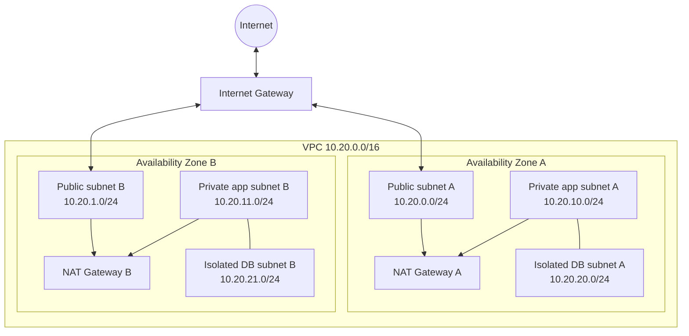

# Dựng VPC hai AZ với subnet công khai và riêng tư

Trong bài thực hành này, bạn sẽ xây dựng một Amazon VPC trải trên hai Availability Zone (AZ), gồm hai public subnet, hai private application subnet và hai isolated database subnet. Public subnet sử dụng Internet Gateway (IGW) cho lưu lượng Internet trực tiếp. Private application subnet sử dụng NAT Gateway đặt cùng AZ để chủ động kết nối outbound khi cần cập nhật package hoặc gọi dịch vụ công cộng. Database subnet chỉ có route nội bộ của VPC, không có default route ra Internet.

Kiến trúc này là nền tảng phổ biến cho ứng dụng nhiều tầng trên AWS: load balancer hoặc bastion được kiểm soát có thể nằm ở public subnet; application server nằm trong private subnet; database nằm trong isolated subnet. Trong môi trường production, nên cân nhắc AWS Systems Manager Session Manager thay cho mở SSH, VPC endpoints cho các dịch vụ AWS và các kiểm soát bảo mật theo yêu cầu tổ chức.

Bài học thuộc chương **Bài thực hành nền tảng** trong module AWS. Người học sẽ thao tác với Region/AZ, CIDR, subnet, route table, IGW, NAT Gateway và security group; hiểu cách các thành phần mạng kết hợp để tạo đường đi cho packet.

Sau bài thực hành, bạn có thể:

- Giải thích vai trò của VPC, AZ, subnet, CIDR, route table và gateway.
- Thiết kế địa chỉ IP không chồng lấn cho hai AZ.
- Tạo public, private application và isolated database subnet.
- Cấu hình IGW và NAT Gateway theo AZ.
- Gắn route table đúng subnet và xác minh đường đi.
- Phân biệt public subnet với public IP của EC2 instance.
- Áp dụng security group theo luồng ứng dụng.
- Kiểm tra cấu hình bằng AWS CLI và dọn tài nguyên sau lab.

## 1. Kiến trúc mục tiêu

### 1.1. Sơ đồ mạng



Sơ đồ thể hiện các tuyến mặc định và quan hệ mạng ở mức logic. NAT Gateway được đặt trong public subnet; private application subnet của AZ A route outbound qua NAT Gateway A, AZ B qua NAT Gateway B. Database subnet không route Internet. Các đường nối app/database thể hiện khả năng liên lạc nội bộ qua route `local` của VPC; security group vẫn phải cho phép port cần thiết.

### 1.2. Vai trò từng subnet

| Subnet | AZ A | AZ B | Mục đích | Default route |
|---|---|---|---|---|
| Public | `10.20.0.0/24` | `10.20.1.0/24` | Load balancer, NAT Gateway, tài nguyên thực sự cần public IP | `0.0.0.0/0` → IGW |
| Private application | `10.20.10.0/24` | `10.20.11.0/24` | EC2/ECS/EKS application node | `0.0.0.0/0` → NAT Gateway cùng AZ |
| Isolated database | `10.20.20.0/24` | `10.20.21.0/24` | RDS/database private endpoint hoặc data tier | Không có default route Internet |

Một subnet được gọi là public khi route table của nó có route tới Internet Gateway. Instance trong public subnet vẫn cần public IPv4 hoặc Elastic IP cùng security group phù hợp để giao tiếp Internet trực tiếp. Chỉ bật auto-assign public IPv4 không tự tạo đường Internet nếu route table thiếu IGW.

Private subnet không có route trực tiếp tới IGW. NAT Gateway cho phép instance khởi tạo kết nối outbound tới Internet; kết nối inbound mới từ Internet không được NAT Gateway chuyển tiếp. Isolated subnet không có NAT/IGW default route, phù hợp với database tier không cần Internet trực tiếp.

### 1.3. Vì sao dùng hai NAT Gateway?

NAT Gateway có tính sẵn sàng cao trong một AZ, nhưng là tài nguyên theo AZ. Đặt một NAT Gateway ở AZ A rồi cho private subnet của cả hai AZ dùng chung sẽ tạo dependency liên AZ và làm mất outbound của AZ B nếu AZ A gặp sự cố. Nó cũng có thể phát sinh phí data transfer liên AZ.

Lab tạo một NAT Gateway cho mỗi AZ và route private subnet tới NAT Gateway cùng AZ. Cách này tăng chi phí theo giờ và dữ liệu xử lý, nhưng cải thiện tính độc lập AZ. Một NAT Gateway dùng chung có thể là lựa chọn tiết kiệm cho sandbox; phải chấp nhận trade-off về availability, chi phí liên AZ và failure domain.

## 2. Chuẩn bị trước khi tạo VPC

### 2.1. Tài khoản và quyền IAM

Bạn cần:

- AWS account dùng cho lab và quyền thao tác Amazon VPC/EC2 networking.
- AWS CLI v2 đã cài trên máy.
- Credentials cấu hình qua IAM Identity Center, role hoặc phương thức được tổ chức cho phép.
- Quyền tạo/xóa VPC, subnet, route table, Internet Gateway, NAT Gateway, Elastic IP và security group.
- Quyền đọc Availability Zone và gọi STS để xác nhận danh tính.

Không dùng root access key. Không ghi access key/secret key vào script, file cấu hình hoặc Git. Nếu dùng AWS IAM Identity Center, đăng nhập bằng `aws sso login --profile <PROFILE>` và thêm `--profile` vào các lệnh nếu cần.

### 2.2. Chọn Region và hai AZ

Ví dụ sử dụng Region `ap-southeast-1`. Hãy xác minh Region được tổ chức cho phép và có ít nhất hai AZ khả dụng:

```bash
aws sts get-caller-identity

aws ec2 describe-availability-zones   --region ap-southeast-1   --filters Name=state,Values=available   --query "AvailabilityZones[].{Name:ZoneName,State:State,OptIn:OptInStatus}"   --output table
```

Chọn hai AZ từ kết quả và gán vào biến `AZ_A`, `AZ_B`. Tên AZ có thể ánh xạ tới vị trí vật lý khác nhau giữa các AWS account; nếu phối hợp nhiều account, dùng AZ ID để xác định cùng một vị trí vật lý.

### 2.3. Công cụ và biến môi trường

Các lệnh tiếp theo dùng Bash trên Linux/macOS, WSL hoặc CloudShell. Thay AZ bằng hai tên được trả về cho account của bạn:

```bash
export AWS_REGION="ap-southeast-1"
export AZ_A="ap-southeast-1a"
export AZ_B="ap-southeast-1b"
export NAME="vpc-two-az-lab"
export VPC_CIDR="10.20.0.0/16"
```

Kiểm tra biến:

```bash
printf 'Region=%s\nAZ_A=%s\nAZ_B=%s\nVPC=%s\n'   "$AWS_REGION" "$AZ_A" "$AZ_B" "$VPC_CIDR"
```

CIDR trong lab phải không chồng lấn với mạng on-premises, VPC peering, Transit Gateway hoặc VPC khác mà bạn dự kiến kết nối. VPC dùng IPv4 CIDR `/16`; mỗi subnet dùng `/24`. VPC IPv4 subnet không thể mở rộng sau khi tạo, vì vậy cần quy hoạch địa chỉ trước.

## 3. Thiết kế địa chỉ IP

### 3.1. Address plan

| Subnet | CIDR | AZ | Số IPv4 có thể gán cho workload |
|---|---|---|---:|
| Public A | `10.20.0.0/24` | AZ A | 251 |
| Public B | `10.20.1.0/24` | AZ B | 251 |
| App private A | `10.20.10.0/24` | AZ A | 251 |
| App private B | `10.20.11.0/24` | AZ B | 251 |
| DB isolated A | `10.20.20.0/24` | AZ A | 251 |
| DB isolated B | `10.20.21.0/24` | AZ B | 251 |

AWS giữ lại 5 địa chỉ IPv4 đầu/cuối trong mỗi subnet, nên subnet `/24` có 251 địa chỉ có thể gán cho interface. Không gán các CIDR con chồng lấn. Khi cần thêm AZ hoặc tier, dành sẵn dải địa chỉ có quy tắc rõ ràng, ví dụ `/20` cho mỗi AZ hoặc mỗi nhóm workload.

### 3.2. Route table dự kiến

| Route table | Subnet associations | Routes |
|---|---|---|
| Public RT | Public A, Public B | VPC local; `0.0.0.0/0` → IGW |
| App RT A | App private A | VPC local; `0.0.0.0/0` → NAT A |
| App RT B | App private B | VPC local; `0.0.0.0/0` → NAT B |
| DB isolated RT | DB A, DB B | Chỉ VPC local |

Route table quyết định next hop theo địa chỉ đích. Security group và network ACL quyết định traffic có được phép đi qua hay không. Route tồn tại không có nghĩa kết nối chắc chắn thành công; cần cả route hai chiều và policy cho phép.

## 4. Tạo VPC và subnet

### 4.1. Tạo VPC

Tạo VPC với CIDR 10.20.0.0/16, bật DNS resolution và DNS hostnames để workload có thể dùng DNS nội bộ:

```bash
VPC_ID=$(aws ec2 create-vpc   --region "$AWS_REGION"   --cidr-block "$VPC_CIDR"   --query 'Vpc.VpcId' --output text)

aws ec2 create-tags --region "$AWS_REGION"   --resources "$VPC_ID"   --tags Key=Name,Value="$NAME-vpc"

aws ec2 modify-vpc-attribute --region "$AWS_REGION"   --vpc-id "$VPC_ID" --enable-dns-support '{"Value":true}'

aws ec2 modify-vpc-attribute --region "$AWS_REGION"   --vpc-id "$VPC_ID" --enable-dns-hostnames '{"Value":true}'

echo "VPC_ID=$VPC_ID"
```

enable-dns-support cho phép DNS resolution trong VPC; enable-dns-hostnames cho phép gán DNS hostname cho instance có public IPv4 khi các điều kiện liên quan được đáp ứng. Hai thuộc tính này thường cần cho nhiều dịch vụ AWS và private DNS của VPC endpoint.

### 4.2. Tạo sáu subnet

Tạo mỗi subnet trong AZ đã chọn. Mỗi lần chạy lệnh, lưu subnet ID vào biến để dùng ở các bước tiếp theo:

```bash
PUB_A=$(aws ec2 create-subnet --region "$AWS_REGION"   --vpc-id "$VPC_ID" --availability-zone "$AZ_A"   --cidr-block 10.20.0.0/24 --query 'Subnet.SubnetId' --output text)

PUB_B=$(aws ec2 create-subnet --region "$AWS_REGION"   --vpc-id "$VPC_ID" --availability-zone "$AZ_B"   --cidr-block 10.20.1.0/24 --query 'Subnet.SubnetId' --output text)

APP_A=$(aws ec2 create-subnet --region "$AWS_REGION"   --vpc-id "$VPC_ID" --availability-zone "$AZ_A"   --cidr-block 10.20.10.0/24 --query 'Subnet.SubnetId' --output text)

APP_B=$(aws ec2 create-subnet --region "$AWS_REGION"   --vpc-id "$VPC_ID" --availability-zone "$AZ_B"   --cidr-block 10.20.11.0/24 --query 'Subnet.SubnetId' --output text)

DB_A=$(aws ec2 create-subnet --region "$AWS_REGION"   --vpc-id "$VPC_ID" --availability-zone "$AZ_A"   --cidr-block 10.20.20.0/24 --query 'Subnet.SubnetId' --output text)

DB_B=$(aws ec2 create-subnet --region "$AWS_REGION"   --vpc-id "$VPC_ID" --availability-zone "$AZ_B"   --cidr-block 10.20.21.0/24 --query 'Subnet.SubnetId' --output text)

echo "PUB_A=$PUB_A PUB_B=$PUB_B"
echo "APP_A=$APP_A APP_B=$APP_B"
echo "DB_A=$DB_A DB_B=$DB_B"
```

Gắn Name tag để dễ nhận diện trên console và trong lệnh describe:

```bash
aws ec2 create-tags --region "$AWS_REGION"   --resources "$PUB_A" "$PUB_B" "$APP_A" "$APP_B" "$DB_A" "$DB_B"   --tags Key=Project,Value="$NAME"

aws ec2 create-tags --region "$AWS_REGION" --resources "$PUB_A" --tags Key=Name,Value="$NAME-public-a"
aws ec2 create-tags --region "$AWS_REGION" --resources "$PUB_B" --tags Key=Name,Value="$NAME-public-b"
aws ec2 create-tags --region "$AWS_REGION" --resources "$APP_A" --tags Key=Name,Value="$NAME-app-a"
aws ec2 create-tags --region "$AWS_REGION" --resources "$APP_B" --tags Key=Name,Value="$NAME-app-b"
aws ec2 create-tags --region "$AWS_REGION" --resources "$DB_A" --tags Key=Name,Value="$NAME-db-a"
aws ec2 create-tags --region "$AWS_REGION" --resources "$DB_B" --tags Key=Name,Value="$NAME-db-b"
```

### 4.3. Bật auto-assign public IPv4 cho public subnet

Public subnet thường bật auto-assign public IPv4 nếu instance trong subnet cần được gán public IPv4 mặc định. Private application và DB subnet giữ mặc định không tự gán public IPv4:

```bash
aws ec2 modify-subnet-attribute --region "$AWS_REGION"   --subnet-id "$PUB_A" --map-public-ip-on-launch

aws ec2 modify-subnet-attribute --region "$AWS_REGION"   --subnet-id "$PUB_B" --map-public-ip-on-launch
```

Thuộc tính này chỉ quyết định việc tự gán public IPv4 khi launch instance. Nó không thay thế route tới IGW, security group hoặc network ACL.

## 5. Kết nối public subnet với Internet Gateway

### 5.1. Tạo và attach IGW

Internet Gateway là thành phần theo VPC, cung cấp target route cho lưu lượng Internet của tài nguyên có public IPv4/EIP. Một VPC có thể attach một IGW tại một thời điểm:

```bash
IGW_ID=$(aws ec2 create-internet-gateway --region "$AWS_REGION"   --query 'InternetGateway.InternetGatewayId' --output text)

aws ec2 create-tags --region "$AWS_REGION"   --resources "$IGW_ID" --tags Key=Name,Value="$NAME-igw"

aws ec2 attach-internet-gateway --region "$AWS_REGION"   --internet-gateway-id "$IGW_ID" --vpc-id "$VPC_ID"

echo "IGW_ID=$IGW_ID"
```

### 5.2. Tạo public route table

Tạo route table dùng chung cho hai public subnet, thêm default route tới IGW và associate từng subnet:

```bash
PUBLIC_RT=$(aws ec2 create-route-table --region "$AWS_REGION"   --vpc-id "$VPC_ID" --query 'RouteTable.RouteTableId' --output text)

aws ec2 create-tags --region "$AWS_REGION"   --resources "$PUBLIC_RT" --tags Key=Name,Value="$NAME-public-rt"

aws ec2 create-route --region "$AWS_REGION"   --route-table-id "$PUBLIC_RT"   --destination-cidr-block 0.0.0.0/0   --gateway-id "$IGW_ID"

aws ec2 associate-route-table --region "$AWS_REGION"   --route-table-id "$PUBLIC_RT" --subnet-id "$PUB_A"

aws ec2 associate-route-table --region "$AWS_REGION"   --route-table-id "$PUBLIC_RT" --subnet-id "$PUB_B"
```

Public subnet A và B giờ có route mặc định tới IGW. Tuy nhiên, chỉ instance có public IPv4/EIP và security group cho phép mới có thể nhận kết nối Internet trực tiếp. Route table không tự mở inbound port.

### 5.3. Xác minh public route

```bash
aws ec2 describe-route-tables --region "$AWS_REGION"   --route-table-ids "$PUBLIC_RT"   --query 'RouteTables[0].{Routes:Routes,Associations:Associations}'   --output json
```

Kiểm tra có route 10.20.0.0/16 với target local, route 0.0.0.0/0 với target là IGW ID và associations của cả hai public subnet. Nếu route ở trạng thái blackhole, kiểm tra IGW đã attach và resource target còn tồn tại.

## 6. Tạo NAT Gateway cho private application subnet

### 6.1. Cấp Elastic IP

NAT Gateway public cần Elastic IP để thực hiện source network address translation cho traffic đi ra Internet. Tạo một EIP trong mỗi AZ:

```bash
EIP_A=$(aws ec2 allocate-address --region "$AWS_REGION"   --domain vpc --query 'AllocationId' --output text)

EIP_B=$(aws ec2 allocate-address --region "$AWS_REGION"   --domain vpc --query 'AllocationId' --output text)

echo "EIP_A=$EIP_A EIP_B=$EIP_B"
```

### 6.2. Tạo NAT Gateway trong public subnet tương ứng

NAT Gateway phải nằm trong public subnet đã có route mặc định tới IGW. Tạo NAT A trong public A và NAT B trong public B:

```bash
NAT_A=$(aws ec2 create-nat-gateway --region "$AWS_REGION"   --subnet-id "$PUB_A" --allocation-id "$EIP_A"   --connectivity-type public   --query 'NatGateway.NatGatewayId' --output text)

NAT_B=$(aws ec2 create-nat-gateway --region "$AWS_REGION"   --subnet-id "$PUB_B" --allocation-id "$EIP_B"   --connectivity-type public   --query 'NatGateway.NatGatewayId' --output text)

aws ec2 create-tags --region "$AWS_REGION"   --resources "$NAT_A" --tags Key=Name,Value="$NAME-nat-a"

aws ec2 create-tags --region "$AWS_REGION"   --resources "$NAT_B" --tags Key=Name,Value="$NAME-nat-b"

echo "NAT_A=$NAT_A NAT_B=$NAT_B"
```

NAT Gateway cần thời gian để chuyển sang trạng thái available. Chờ trước khi thêm route:

```bash
aws ec2 wait nat-gateway-available --region "$AWS_REGION"   --nat-gateway-ids "$NAT_A"

aws ec2 wait nat-gateway-available --region "$AWS_REGION"   --nat-gateway-ids "$NAT_B"
```

Nếu NAT Gateway không đạt trạng thái available, kiểm tra subnet, EIP, quota và trạng thái NAT trong EC2 console hoặc API. Không thêm default route tới NAT đang failed/deleted.

### 6.3. Tạo private route table riêng cho từng AZ

Tách route table theo AZ để app subnet luôn dùng NAT Gateway cùng AZ:

```bash
APP_RT_A=$(aws ec2 create-route-table --region "$AWS_REGION"   --vpc-id "$VPC_ID" --query 'RouteTable.RouteTableId' --output text)

APP_RT_B=$(aws ec2 create-route-table --region "$AWS_REGION"   --vpc-id "$VPC_ID" --query 'RouteTable.RouteTableId' --output text)

aws ec2 create-tags --region "$AWS_REGION"   --resources "$APP_RT_A" --tags Key=Name,Value="$NAME-app-rt-a"

aws ec2 create-tags --region "$AWS_REGION"   --resources "$APP_RT_B" --tags Key=Name,Value="$NAME-app-rt-b"

aws ec2 create-route --region "$AWS_REGION"   --route-table-id "$APP_RT_A"   --destination-cidr-block 0.0.0.0/0 --nat-gateway-id "$NAT_A"

aws ec2 create-route --region "$AWS_REGION"   --route-table-id "$APP_RT_B"   --destination-cidr-block 0.0.0.0/0 --nat-gateway-id "$NAT_B"

aws ec2 associate-route-table --region "$AWS_REGION"   --route-table-id "$APP_RT_A" --subnet-id "$APP_A"

aws ec2 associate-route-table --region "$AWS_REGION"   --route-table-id "$APP_RT_B" --subnet-id "$APP_B"
```

Khi app instance ở private A gọi ra Internet, route table gửi traffic tới NAT A. NAT A dịch source address thành EIP của nó rồi gửi qua public route table và IGW. Response quay về EIP, NAT Gateway ánh xạ lại tới private instance. Private instance không cần public IPv4.

### 6.4. Tạo isolated route table cho database subnet

Database subnet chỉ cần route nội bộ của VPC. Tạo route table riêng và associate với cả hai DB subnet; không thêm route 0.0.0.0/0:

```bash
DB_RT=$(aws ec2 create-route-table --region "$AWS_REGION"   --vpc-id "$VPC_ID" --query 'RouteTable.RouteTableId' --output text)

aws ec2 create-tags --region "$AWS_REGION"   --resources "$DB_RT" --tags Key=Name,Value="$NAME-db-isolated-rt"

aws ec2 associate-route-table --region "$AWS_REGION"   --route-table-id "$DB_RT" --subnet-id "$DB_A"

aws ec2 associate-route-table --region "$AWS_REGION"   --route-table-id "$DB_RT" --subnet-id "$DB_B"
```

Mọi route table trong VPC có route local để liên lạc giữa các CIDR của VPC. DB subnet vẫn có thể nhận traffic từ app subnet nếu route local và security group cho phép. Không có default route Internet giúp giảm đường outbound trực tiếp, nhưng không thay thế security group, database authentication, encryption hoặc kiểm soát truy cập ở tầng ứng dụng.

## 7. Cấu hình security group theo tầng ứng dụng

### 7.1. Tạo security group

Security group là stateful virtual firewall gắn với network interface. Inbound/outbound rule được đánh giá ở cấp interface; response traffic của kết nối được cho phép tự động. Tạo security group cho application và database:

```bash
APP_SG=$(aws ec2 create-security-group --region "$AWS_REGION"   --group-name "$NAME-app-sg"   --description "Application tier in private subnets"   --vpc-id "$VPC_ID" --query 'GroupId' --output text)

DB_SG=$(aws ec2 create-security-group --region "$AWS_REGION"   --group-name "$NAME-db-sg"   --description "Database tier in isolated subnets"   --vpc-id "$VPC_ID" --query 'GroupId' --output text)

echo "APP_SG=$APP_SG DB_SG=$DB_SG"
```

### 7.2. Chỉ cho database nhận traffic từ application

Ví dụ database PostgreSQL lắng nghe TCP 5432. Chỉ cho phép nguồn là application security group:

```bash
aws ec2 authorize-security-group-ingress --region "$AWS_REGION"   --group-id "$DB_SG"   --protocol tcp --port 5432   --source-group "$APP_SG"
```

Nếu dùng MySQL, thay port thành TCP 3306; với SQL Server là TCP 1433. Không mở database port tới 0.0.0.0/0. Trong production, nên giới hạn outbound của application SG theo các destination/port cần thiết thay vì mặc định allow all nếu yêu cầu security baseline đòi hỏi.

### 7.3. Luồng traffic dự kiến

| Nguồn | Đích | Port | Kiểm soát |
|---|---|---:|---|
| Internet client | Public ALB/NLB | 443 | ALB SG chỉ cho HTTPS từ client CIDR phù hợp |
| ALB SG | App SG | 8080/8443 | App SG chỉ nhận từ ALB SG |
| App SG | DB SG | 5432 | DB SG chỉ nhận từ App SG |
| App subnet | Internet qua NAT | 443/80 | Route tới NAT; outbound SG/NACL cho phép |
| DB subnet | Internet | Không có route mặc định | Không có NAT/IGW route |

Lab chưa tạo ALB hoặc EC2 instance; bảng trên mô tả rule pattern cho ứng dụng nhiều tầng. Nếu triển khai thực tế, tạo ALB SG, thêm inbound HTTPS theo CIDR được duyệt và thêm rule inbound app SG với source là ALB SG. Không thêm SSH/RDP public chỉ để tiện kiểm tra.

## 8. Thêm VPC endpoint cho truy cập dịch vụ AWS (tùy chọn)

### 8.1. S3 Gateway Endpoint

Private application subnet có thể cần đọc model artifact hoặc dataset từ S3. Nếu không dùng endpoint, traffic có thể đi qua NAT Gateway và phát sinh NAT processing/data transfer charges. S3 Gateway Endpoint tạo route tới S3 prefix list trong các route table được chỉ định, không cần NAT hoặc public IP cho traffic S3.

```bash
S3_ENDPOINT=$(aws ec2 create-vpc-endpoint --region "$AWS_REGION"   --vpc-id "$VPC_ID"   --service-name "com.amazonaws.$AWS_REGION.s3"   --vpc-endpoint-type Gateway   --route-table-ids "$APP_RT_A" "$APP_RT_B"   --query 'VpcEndpoint.VpcEndpointId' --output text)

echo "S3_ENDPOINT=$S3_ENDPOINT"
```

Gateway endpoint không có hourly charge. Policy endpoint và bucket policy vẫn quyết định principal/bucket nào được truy cập. S3 Gateway Endpoint không phải interface endpoint và không cung cấp private DNS hostname. Nếu cần truy cập dịch vụ AWS khác như Systems Manager, ECR hoặc CloudWatch từ private subnet, kiểm tra interface endpoint tương ứng, endpoint security group, private DNS và chi phí.

### 8.2. Khi nào cần interface endpoint?

Interface VPC endpoint tạo network interface riêng trong subnet và dùng AWS PrivateLink để truy cập service mà không cần route Internet. Ví dụ, EC2 private cần Systems Manager có thể cần các endpoint phù hợp cho `ssm`, `ssmmessages` và `ec2messages` tùy Region/agent version. ECR image pull, CloudWatch Logs và Secrets Manager cũng có endpoint riêng.

Interface endpoint có phí theo giờ và dữ liệu; cần security group cho phép TCP 443 từ client subnet/SG. Private DNS cần VPC DNS support và DNS hostnames phù hợp. Thiết kế endpoint theo service thật sự cần, không tạo hàng loạt endpoint trong lab.

## 9. Xác minh cấu hình mạng

### 9.1. Kiểm tra VPC và subnet

Xác nhận VPC có CIDR đúng và DNS attributes đã bật:

```bash
aws ec2 describe-vpcs --region "$AWS_REGION"   --vpc-ids "$VPC_ID"   --query 'Vpcs[0].{VpcId:VpcId,Cidr:CidrBlock,State:State,IsDefault:IsDefault}'   --output table

aws ec2 describe-vpc-attribute --region "$AWS_REGION"   --vpc-id "$VPC_ID" --attribute enableDnsSupport

aws ec2 describe-vpc-attribute --region "$AWS_REGION"   --vpc-id "$VPC_ID" --attribute enableDnsHostnames
```

Liệt kê sáu subnet cùng AZ, CIDR và public IPv4 mapping:

```bash
aws ec2 describe-subnets --region "$AWS_REGION"   --filters Name=vpc-id,Values="$VPC_ID"   --query 'Subnets[].{SubnetId:SubnetId,Cidr:CidrBlock,AZ:AvailabilityZone,PublicIPv4:MapPublicIpOnLaunch,State:State}'   --output table
```

Kết quả mong đợi: sáu subnet ở hai AZ; chỉ public A/B có PublicIPv4=true. App và DB subnet có false.

### 9.2. Kiểm tra route table

Kiểm tra lần lượt public, app A, app B và DB route table:

```bash
for RT in "$PUBLIC_RT" "$APP_RT_A" "$APP_RT_B" "$DB_RT"; do
  echo "=== $RT ==="
  aws ec2 describe-route-tables --region "$AWS_REGION"     --route-table-ids "$RT"     --query 'RouteTables[0].{Routes:Routes,Associations:Associations}'     --output json
done
```

Đối chiếu kết quả với bảng:

| Route table | Route mặc định mong đợi |
|---|---|
| Public RT | 0.0.0.0/0 → IGW |
| App RT A | 0.0.0.0/0 → NAT A |
| App RT B | 0.0.0.0/0 → NAT B |
| DB isolated RT | Không có 0.0.0.0/0 |

Tất cả route table đều có route local cho CIDR VPC. Nếu route table không có explicit association, subnet sẽ dùng main route table của VPC. Trong lab này, cả sáu subnet phải được associate rõ ràng với route table tương ứng.

### 9.3. Kiểm tra NAT Gateway và IGW

```bash
aws ec2 describe-nat-gateways --region "$AWS_REGION"   --filter Name=vpc-id,Values="$VPC_ID"   --query 'NatGateways[].{NatId:NatGatewayId,Subnet:SubnetId,State:State,Addresses:NatGatewayAddresses}'   --output table

aws ec2 describe-internet-gateways --region "$AWS_REGION"   --filters Name=attachment.vpc-id,Values="$VPC_ID"   --query 'InternetGateways[].{IGW:InternetGatewayId,Attachments:Attachments}'   --output json
```

Hai NAT Gateway phải ở trạng thái available, mỗi NAT ở public subnet khác AZ và có Elastic IP. IGW phải có attachment với VPC. Nếu NAT ở pending, chờ thêm; nếu failed, xem failure message và kiểm tra EIP/subnet/quota.

### 9.4. Kiểm tra security group

```bash
aws ec2 describe-security-groups --region "$AWS_REGION"   --group-ids "$APP_SG" "$DB_SG"   --query 'SecurityGroups[].{GroupId:GroupId,Name:GroupName,VpcId:VpcId,Ingress:IpPermissions,Egress:IpPermissionsEgress}'   --output json
```

DB SG phải có ingress TCP 5432 với source là APP SG. Không có rule inbound từ 0.0.0.0/0. App SG mới tạo không có inbound rule; cần thêm source là ALB SG nếu triển khai application sau lab.

### 9.5. Kiểm tra đường đi bằng workload thực tế

Lab này tạo network resource nhưng không launch EC2 hoặc RDS, do đó chưa phát sinh test packet end-to-end. Khi bổ sung một EC2 test instance:

- Public test instance phải ở public subnet, có public IPv4/EIP, public route table và SG cho phép đúng port từ IP nguồn được duyệt.
- Private app test instance phải ở app subnet, không có public IPv4; có thể dùng Systems Manager Session Manager nếu instance role, SSM agent và VPC endpoints/NAT đã được cấu hình.
- Từ private app instance, kiểm tra DNS và outbound HTTPS tới endpoint cần thiết; nếu route NAT đúng, response quay về qua NAT.
- DB test instance không nên được expose Internet; kiểm tra chỉ application SG có thể truy cập port database.

Có thể dùng VPC Reachability Analyzer để phân tích đường đi giữa source và destination ENI, route table, security group và network ACL. Công cụ phân tích cấu hình mạng; nó không thay thế test ứng dụng thực tế hoặc xác minh firewall ở tầng host.

## 10. Dọn dẹp tài nguyên sau lab

NAT Gateway và Elastic IP có thể phát sinh chi phí khi còn tồn tại. Hãy xóa tài nguyên ngay sau khi hoàn thành bài thực hành nếu không cần giữ VPC. Lưu các biến ID trong cùng terminal session hoặc ghi chúng vào nơi an toàn để cleanup đúng resource.

### 10.1. Xóa VPC endpoint nếu đã tạo

Nếu đã tạo S3 Gateway Endpoint, xóa endpoint trước khi xóa subnet/route table:

```bash
aws ec2 delete-vpc-endpoints --region "$AWS_REGION"   --vpc-endpoint-ids "$S3_ENDPOINT"
```

Chờ endpoint chuyển sang trạng thái deleted trước khi xóa route table liên quan. Gateway endpoint không tạo network interface (ENI). Nếu không tạo endpoint ở phần tùy chọn, bỏ qua bước này.

### 10.2. Gỡ route NAT và xóa NAT Gateway

Xóa default route trỏ tới NAT Gateway trước, sau đó xóa hai NAT Gateway:

```bash
aws ec2 delete-route --region "$AWS_REGION"   --route-table-id "$APP_RT_A" --destination-cidr-block 0.0.0.0/0

aws ec2 delete-route --region "$AWS_REGION"   --route-table-id "$APP_RT_B" --destination-cidr-block 0.0.0.0/0

aws ec2 delete-nat-gateway --region "$AWS_REGION" --nat-gateway-id "$NAT_A"
aws ec2 delete-nat-gateway --region "$AWS_REGION" --nat-gateway-id "$NAT_B"

aws ec2 wait nat-gateway-deleted --region "$AWS_REGION"   --nat-gateway-ids "$NAT_A"

aws ec2 wait nat-gateway-deleted --region "$AWS_REGION"   --nat-gateway-ids "$NAT_B"

aws ec2 release-address --region "$AWS_REGION" --allocation-id "$EIP_A"
aws ec2 release-address --region "$AWS_REGION" --allocation-id "$EIP_B"
```

Chỉ release EIP sau khi NAT Gateway đã deleted. Nếu EIP đang được dùng bởi resource khác, AWS sẽ từ chối release; xác minh allocation ID trước khi tiếp tục.

### 10.3. Xóa security group, subnet và route table

Database SG đang tham chiếu application SG, vì vậy xóa DB SG trước rồi mới xóa APP SG:

```bash
aws ec2 delete-security-group --region "$AWS_REGION" --group-id "$DB_SG"
aws ec2 delete-security-group --region "$AWS_REGION" --group-id "$APP_SG"

aws ec2 delete-subnet --region "$AWS_REGION" --subnet-id "$DB_A"
aws ec2 delete-subnet --region "$AWS_REGION" --subnet-id "$DB_B"
aws ec2 delete-subnet --region "$AWS_REGION" --subnet-id "$APP_A"
aws ec2 delete-subnet --region "$AWS_REGION" --subnet-id "$APP_B"
aws ec2 delete-subnet --region "$AWS_REGION" --subnet-id "$PUB_A"
aws ec2 delete-subnet --region "$AWS_REGION" --subnet-id "$PUB_B"

aws ec2 delete-route-table --region "$AWS_REGION" --route-table-id "$DB_RT"
aws ec2 delete-route-table --region "$AWS_REGION" --route-table-id "$APP_RT_A"
aws ec2 delete-route-table --region "$AWS_REGION" --route-table-id "$APP_RT_B"
```

Nếu security group đang gắn với ENI/instance hoặc được security group khác tham chiếu, AWS sẽ không cho xóa. Xóa workload/ENI và rule tham chiếu trước. Route table chỉ xóa được khi không còn association; xóa subnet sẽ gỡ association tương ứng.

### 10.4. Detach IGW và xóa VPC

Xóa default route public, detach IGW rồi xóa IGW và VPC:

```bash
aws ec2 delete-route --region "$AWS_REGION"   --route-table-id "$PUBLIC_RT" --destination-cidr-block 0.0.0.0/0
aws ec2 delete-route-table --region "$AWS_REGION" --route-table-id "$PUBLIC_RT"

aws ec2 detach-internet-gateway --region "$AWS_REGION"   --internet-gateway-id "$IGW_ID" --vpc-id "$VPC_ID"

aws ec2 delete-internet-gateway --region "$AWS_REGION"   --internet-gateway-id "$IGW_ID"

aws ec2 delete-vpc --region "$AWS_REGION" --vpc-id "$VPC_ID"
```

Sau khi xóa route mặc định, xóa public route table rồi mới detach IGW. Nếu VPC vẫn còn dependency, dùng `describe-network-interfaces`, `describe-vpc-endpoints`, `describe-nat-gateways` và `describe-internet-gateways` để xác định resource còn tồn tại. Không xóa nhầm VPC khác.

## 11. Troubleshooting

| Triệu chứng | Nguyên nhân thường gặp | Cách kiểm tra |
|---|---|---|
| Tạo subnet báo CIDR conflict | CIDR chồng lấn với subnet đã có | Describe subnet trong VPC và chọn CIDR chưa sử dụng |
| Không tạo được NAT Gateway | Thiếu EIP, quota, subnet không hợp lệ hoặc AZ capacity | Kiểm tra EIP allocation, subnet state, NAT quota và failure message |
| NAT Gateway ở pending lâu | NAT đang được provision | Chờ trạng thái available; không tạo route cho tới khi sẵn sàng |
| Private instance không ra Internet | Thiếu route NAT, NAT không available, SG/NACL chặn hoặc NAT public subnet không route IGW | Kiểm tra route app RT, NAT state, public RT và egress rules |
| Public instance không truy cập Internet | Thiếu public IPv4/EIP, route IGW hoặc inbound/outbound SG/NACL | Kiểm tra cả public IP, route table và firewall |
| Public subnet không gán public IPv4 | MapPublicIpOnLaunch tắt hoặc instance đã launch trước khi bật | Bật thuộc tính cho subnet; instance cũ cần gán EIP hoặc launch lại |
| App không kết nối database | DB SG không cho phép source APP SG, sai port hoặc database chưa ready | Kiểm tra SG source/port, route local và trạng thái database |
| DB subnet vẫn có Internet route | Đã associate nhầm main/public/app route table | Kiểm tra association và gắn DB isolated RT |
| Route có trạng thái blackhole | NAT/IGW target đã xóa hoặc không còn hợp lệ | Sửa route sang target đúng hoặc xóa route cũ |
| Không xóa được VPC | Còn NAT, endpoint, ENI, subnet, IGW hoặc dependency | Liệt kê resource trong VPC, xóa theo thứ tự dependency |

### 11.1. Phân biệt route, security group và network ACL

- Route table chọn next hop cho traffic.
- Security group là stateful firewall ở network interface; response traffic được cho phép tự động.
- Network ACL là stateless firewall ở subnet; phải cho phép cả chiều đi và chiều về, bao gồm ephemeral port cho response.
- NAT Gateway cung cấp outbound address translation; nó không tự mở inbound từ Internet.
- Internet Gateway cung cấp target cho route Internet; instance vẫn cần public IPv4/EIP và security group phù hợp.

Nếu route đã đúng mà kết nối vẫn thất bại, kiểm tra security group, NACL, DNS, OS firewall, application listener và health status của destination.

## 12. Chi phí và giới hạn của lab

Lab tạo hai NAT Gateway public, hai Elastic IP, một VPC, sáu subnet, bốn route table và hai security group. NAT Gateway tính phí theo thời gian tồn tại và lượng dữ liệu xử lý; public IPv4 cũng có thể phát sinh phí theo bảng giá hiện hành. Vì vậy, không để NAT Gateway chạy qua đêm nếu không cần.

| Tài nguyên | Yếu tố chi phí | Lưu ý |
|---|---|---|
| VPC, subnet, route table, IGW | Không có hourly charge riêng cho các thành phần cơ bản này | Workload gắn vào VPC vẫn có chi phí riêng |
| NAT Gateway | Phí theo giờ và dữ liệu xử lý | Hai AZ có hai NAT Gateway nên chi phí cao hơn một NAT dùng chung |
| Elastic IP/public IPv4 | Phí public IPv4 theo chính sách hiện hành | Release EIP sau khi xóa NAT |
| Data transfer | Phụ thuộc đường đi, AZ/Region và dịch vụ đích | NAT/traffic liên AZ có thể làm tăng tổng chi phí |
| Interface VPC endpoint | Phí theo giờ và dữ liệu | Không tạo endpoint nếu không cần |
| S3 Gateway Endpoint | Không có hourly charge riêng cho gateway endpoint | S3 request/storage/transfer vẫn theo giá S3 áp dụng |

Giá thay đổi theo Region và thời điểm. Kiểm tra AWS Pricing Calculator hoặc trang pricing trước khi chạy lab lâu dài. Không có EC2/RDS trong bài cơ bản nên lab không tạo compute/database charge; nếu mở rộng bằng instance, ALB hoặc RDS, phải tính thêm chi phí đó.

## 13. Bài mở rộng: kiểm thử ứng dụng ba tầng

Sau khi dựng thành công network, mở rộng bài thực hành bằng một application tier và database tier. Đây là phần tùy chọn, có thể phát sinh thêm chi phí EC2, ALB và RDS.

### 13.1. Mục tiêu mở rộng

- Tạo Application Load Balancer trong hai public subnet.
- Tạo EC2 hoặc ECS task trong hai private application subnet.
- Gắn application SG chỉ nhận traffic từ ALB SG.
- Tạo RDS DB subnet group từ hai isolated DB subnet.
- Gắn DB SG chỉ nhận port database từ APP SG.
- Dùng Session Manager hoặc phương thức quản trị được phê duyệt để truy cập private instance.
- Kiểm tra app truy cập database qua private IP/DNS; database không có public accessibility.
- Kiểm tra health check của ALB và khả năng chuyển traffic khi một AZ không healthy.

### 13.2. Điều kiện thiết kế

RDS DB subnet group thường cần subnet ở ít nhất hai AZ cho cấu hình Multi-AZ. Khi tạo RDS, đặt Publicly accessible là No và gắn DB SG. Không dùng isolated route table làm cách duy nhất bảo vệ database; security group, database authentication, encryption at rest/in transit và backup policy vẫn phải được cấu hình.

Với ALB internet-facing, chọn hai public subnet ở hai AZ. ALB SG nhận HTTPS từ client CIDR được duyệt; app SG nhận port ứng dụng chỉ từ ALB SG. Không cho app SG nhận traffic từ Internet trực tiếp.

### 13.3. Tiêu chí kiểm thử

| Kiểm thử | Kết quả mong đợi |
|---|---|
| Client truy cập ALB qua HTTPS | Thành công khi listener/certificate/SG đúng |
| ALB truy cập app target | Health check healthy ở hai AZ |
| App kết nối DB | Thành công qua port DB đã cấu hình |
| Internet truy cập trực tiếp app instance | Thất bại vì app không có public IP và SG không mở public |
| Internet truy cập DB | Thất bại vì DB subnet không có Internet route và DB SG chỉ nhận từ APP SG |
| App tải artifact từ S3 qua gateway endpoint | Route qua S3 prefix list, không đi qua NAT |
| NAT A bị unavailable | App A mất outbound qua NAT A; app B vẫn dùng NAT B nếu AZ B hoạt động |

## 14. Câu hỏi tự kiểm tra

1. Điều kiện nào làm một subnet trở thành public subnet?
2. Vì sao instance trong public subnet vẫn cần public IPv4 hoặc Elastic IP?
3. Internet Gateway và NAT Gateway có vai trò khác nhau như thế nào?
4. Vì sao private application subnet trong hai AZ nên route qua NAT Gateway cùng AZ?
5. Vì sao DB isolated subnet không có default route Internet?
6. Route table quyết định điều gì? Security group quyết định điều gì?
7. Security group khác network ACL ở trạng thái connection như thế nào?
8. AWS giữ lại bao nhiêu IPv4 address trong mỗi subnet?
9. Vì sao CIDR của subnet không được chồng lấn?
10. S3 Gateway Endpoint giúp private subnet truy cập S3 theo cách nào?
11. Interface endpoint khác gateway endpoint ở điểm nào?
12. Nếu route đúng nhưng EC2 private không ra Internet, cần kiểm tra những gì?
13. Vì sao một NAT Gateway dùng chung có thể tạo dependency liên AZ?
14. Tại sao database nên được đặt trong private/isolated subnet và chỉ nhận traffic từ app SG?

### Gợi ý trả lời

1. Subnet có route table với route tới Internet Gateway.
2. Route tới IGW không tự cấp địa chỉ public; instance cần public IPv4/EIP và SG/NACL phù hợp.
3. IGW cho phép resource có public address giao tiếp Internet theo route; NAT Gateway cho phép private resource khởi tạo outbound và nhận response.
4. Giảm dependency liên AZ, tránh data transfer liên AZ và giữ outbound của AZ còn hoạt động khi AZ khác gặp sự cố.
5. Giảm đường outbound Internet trực tiếp cho database; database vẫn liên lạc nội bộ theo route local và security group.
6. Route table chọn next hop; security group kiểm soát traffic được phép ở network interface.
7. Security group stateful; network ACL stateless và cần rule cho cả chiều request/response.
8. AWS giữ lại 5 IPv4 address trong mỗi subnet.
9. CIDR chồng lấn làm định tuyến mơ hồ và không thể tạo subnet/peering đúng.
10. Endpoint thêm route tới S3 prefix list trong route table; traffic S3 không cần NAT hoặc public IP.
11. Gateway endpoint dùng route table cho S3/DynamoDB; interface endpoint tạo ENI và dùng PrivateLink cho service được hỗ trợ.
12. Route private RT, NAT state, public RT/IGW, SG egress, NACL, DNS và OS/application firewall.
13. Private subnet ở AZ khác phải phụ thuộc NAT ở AZ đó; NAT/AZ lỗi có thể làm mất outbound và phát sinh transfer liên AZ.
14. Giảm exposure; chỉ application tier được truy cập database port theo rule SG.

## 15. Checklist hoàn thành lab

- [ ] Đã xác minh AWS account, Region và hai AZ.
- [ ] VPC CIDR không chồng lấn với các mạng cần kết nối.
- [ ] VPC có DNS support và DNS hostnames.
- [ ] Có đủ sáu subnet với CIDR và AZ đúng address plan.
- [ ] Chỉ public subnet bật auto-assign public IPv4.
- [ ] IGW được attach vào đúng VPC.
- [ ] Public route table có route 0.0.0.0/0 tới IGW và associate hai public subnet.
- [ ] Có một NAT Gateway/EIP trong public subnet của mỗi AZ.
- [ ] NAT Gateway ở trạng thái available.
- [ ] App private subnet A/B route qua NAT cùng AZ.
- [ ] DB isolated subnet A/B associate DB route table chỉ có local route.
- [ ] DB SG chỉ nhận port database từ APP SG.
- [ ] S3 Gateway Endpoint (nếu tạo) chỉ gắn vào app route table cần thiết.
- [ ] Đã xác minh route table, subnet association, NAT state và IGW attachment.
- [ ] Đã ghi nhận các resource ID cần cho cleanup.
- [ ] Đã xóa NAT Gateway, release EIP và dọn VPC khi hoàn thành.

## 16. Tài liệu tham khảo

- [What is Amazon VPC?](https://docs.aws.amazon.com/vpc/latest/userguide/what-is-amazon-vpc.html)
- [VPC and subnet sizing](https://docs.aws.amazon.com/vpc/latest/userguide/subnet-sizing.html)
- [Subnet route tables](https://docs.aws.amazon.com/vpc/latest/userguide/subnet-route-tables.html)
- [Internet gateways](https://docs.aws.amazon.com/vpc/latest/userguide/VPC_Internet_Gateway.html)
- [NAT gateways](https://docs.aws.amazon.com/vpc/latest/userguide/vpc-nat-gateway.html)
- [Route tables for NAT gateways](https://docs.aws.amazon.com/vpc/latest/userguide/route-table-options.html)
- [Security groups](https://docs.aws.amazon.com/vpc/latest/userguide/vpc-security-groups.html)
- [Network ACLs](https://docs.aws.amazon.com/vpc/latest/userguide/vpc-network-acls.html)
- [Gateway VPC endpoints](https://docs.aws.amazon.com/vpc/latest/privatelink/gateway-endpoints.html)
- [Interface VPC endpoints](https://docs.aws.amazon.com/vpc/latest/privatelink/interface-endpoints.html)
- [VPC Reachability Analyzer](https://docs.aws.amazon.com/vpc/latest/reachability/what-is-reachability-analyzer.html)
- [AWS CLI reference for Amazon EC2](https://docs.aws.amazon.com/cli/latest/reference/ec2/index.html)
- [Amazon VPC pricing](https://aws.amazon.com/vpc/pricing/)

