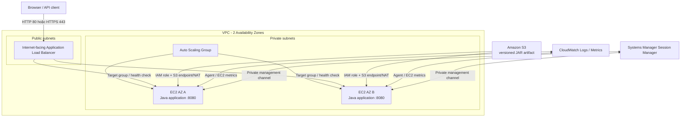

# Chạy ứng dụng Java trên EC2 sau ALB và Auto Scaling

Một ứng dụng Java chạy trên một EC2 instance có thể phục vụ thử nghiệm nhanh, nhưng sẽ trở thành điểm lỗi đơn khi đưa vào production. Nếu instance hỏng, ứng dụng ngừng phục vụ; nếu traffic tăng, một máy chủ có thể không đủ CPU hoặc memory; nếu cập nhật thủ công từng máy, các instance dễ chạy những phiên bản khác nhau. Một kiến trúc phổ biến trên AWS đặt Application Load Balancer (ALB) trước một nhóm EC2 instances do EC2 Auto Scaling quản lý. ALB nhận HTTP/HTTPS request và định tuyến đến các instance khỏe mạnh; Auto Scaling Group (ASG) duy trì số lượng instance mong muốn, thay thế instance không khỏe và điều chỉnh capacity theo tải.

Trong bài thực hành này, bạn sẽ đóng gói một ứng dụng Java 21/Spring Boot thành executable JAR, lưu artifact trong Amazon S3, sau đó triển khai trên Amazon Linux 2023 EC2 instances. ALB nằm trong public subnets; EC2 instances nằm trong private subnets và chỉ nhận traffic từ security group của ALB. Launch template mô tả cách khởi tạo instance, user data cài Java và khởi chạy ứng dụng bằng systemd, target group kiểm tra health endpoint, còn ASG tự đăng ký/deregister instances với ALB.

Bài lab thuộc module AWS Cloud Providers: người học thực hành chọn dịch vụ, triển khai ứng dụng an toàn, giám sát, phục hồi và kiểm soát chi phí. Kiến trúc dùng IAM instance profile để tải artifact từ S3, Systems Manager Session Manager để quản trị máy chủ mà không cần SSH public, CloudWatch để quan sát log/metric và target tracking để mở rộng capacity.

## Mục tiêu thực hành

Hoàn thành bài lab, bạn có thể:

- Build một ứng dụng Java/Spring Boot thành executable JAR.
- Tạo hoặc chuẩn bị VPC có public/private subnets trên ít nhất hai Availability Zones.
- Thiết kế security groups theo luồng ALB → EC2, giới hạn port ứng dụng chỉ nhận traffic từ ALB.
- Tạo IAM role/instance profile cho EC2 với quyền đọc đúng artifact trong S3 và quyền dùng Systems Manager.
- Tạo Application Load Balancer, target group và listener.
- Tạo launch template với Amazon Linux 2023, IMDSv2, EBS encryption và user data.
- Tạo Auto Scaling Group gắn target group, bật ELB health checks và đặt health check grace period.
- Kiểm tra health, phân phối request, thay thế instance lỗi và scale out/in.
- Cập nhật phiên bản ứng dụng qua launch template version và instance refresh.
- Đọc CloudWatch logs/metrics và xử lý các lỗi bootstrap, health check, IAM hoặc network.
- Dọn dẹp tài nguyên sau khi hoàn tất để tránh chi phí phát sinh.

## Kiến trúc và luồng request



Luồng request:

1. Client gọi DNS name của ALB.
2. Listener nhận request trên port 80 (lab) hoặc 443 (production).
3. Listener rule chuyển request đến target group.
4. ALB chọn target đang `healthy` và chuyển request đến port 8080 trên EC2.
5. Ứng dụng Java xử lý request và trả response qua ALB.
6. ALB gửi health check định kỳ đến readiness endpoint của từng target.
7. ASG dùng EC2 health checks và ELB health checks để quyết định instance có cần thay thế hay không.

Luồng bootstrap:

1. ASG tạo EC2 instance từ launch template.
2. EC2 khởi chạy user data, cài Amazon Corretto 21 và AWS CLI, tải JAR từ S3 bằng instance profile.
3. systemd khởi chạy Spring Boot application.
4. Ứng dụng mở port 8080 và trả HTTP 200 tại `/actuator/health/readiness`.
5. ALB đánh dấu target healthy sau khi đạt số lần health check thành công.

## Tài nguyên cần chuẩn bị

| Tài nguyên | Cấu hình lab |
|---|---|
| AWS Region | Chọn một Region hỗ trợ các dịch vụ sử dụng; dùng cùng Region cho VPC, ALB, ASG, S3 và CloudWatch khi thuận tiện |
| VPC | Một VPC có DNS resolution và DNS hostnames bật |
| Public subnets | Ít nhất 2 subnets ở 2 AZ, route đến Internet Gateway |
| Private subnets | Ít nhất 2 subnets ở 2 AZ, route đến NAT Gateway hoặc VPC endpoints phù hợp |
| EC2 AMI | Amazon Linux 2023 x86_64 |
| Instance type | `t3.small` hoặc loại tương đương cho ứng dụng lab |
| Java | Amazon Corretto 21 headless |
| Application port | TCP 8080 |
| ALB listener | HTTP 80 cho lab; HTTPS 443 với ACM certificate cho production |
| ASG | Minimum 2, desired 2, maximum 4 |
| Health check grace period | 300 giây, điều chỉnh theo thời gian bootstrap thực tế |
| Artifact | `orders-api-1.0.0.jar` trong S3 private bucket |

### Chi phí và giới hạn lab

ALB, EC2, EBS, NAT Gateway, S3, CloudWatch Logs và data transfer có thể phát sinh phí. Hai EC2 instances cùng ALB chạy liên tục sẽ tạo chi phí theo thời gian. Nếu dùng NAT Gateway, chi phí theo giờ và data processing có thể đáng kể; VPC endpoints cũng có chi phí riêng với interface endpoints. Hoàn tất lab thì thực hiện phần cleanup.

Không dùng tài khoản production hoặc dữ liệu khách hàng thật cho lần thực hành đầu tiên. Chọn instance type nhỏ, giới hạn ASG `max=4`, đặt budget/alert và dùng tag `Project=java-alb-asg-lab` để nhận diện tài nguyên.

## Bước 1 — Tạo ứng dụng Java/Spring Boot

Ứng dụng trả về thông tin instance để quan sát ALB phân phối request, đồng thời cung cấp Spring Boot Actuator readiness endpoint cho target group health check.

### 1.1. Cấu trúc project

```text
orders-api/
  pom.xml
  src/
    main/
      java/
        com/example/orders/
          OrdersApplication.java
          StatusController.java
      resources/
        application.properties
```

### 1.2. Maven `pom.xml`

Ví dụ dùng Spring Boot 3.5.x và Java 21. Khi triển khai thật, pin patch version đã được kiểm thử trong tổ chức thay vì dùng version động.

```xml
<?xml version="1.0" encoding="UTF-8"?>
<project xmlns="http://maven.apache.org/POM/4.0.0"
         xmlns:xsi="http://www.w3.org/2001/XMLSchema-instance"
         xsi:schemaLocation="http://maven.apache.org/POM/4.0.0
         https://maven.apache.org/xsd/maven-4.0.0.xsd">
    <modelVersion>4.0.0</modelVersion>

    <groupId>com.example</groupId>
    <artifactId>orders-api</artifactId>
    <version>1.0.0</version>
    <name>orders-api</name>

    <parent>
        <groupId>org.springframework.boot</groupId>
        <artifactId>spring-boot-starter-parent</artifactId>
        <version>3.5.0</version>
        <relativePath/>
    </parent>

    <properties>
        <java.version>21</java.version>
    </properties>

    <dependencies>
        <dependency>
            <groupId>org.springframework.boot</groupId>
            <artifactId>spring-boot-starter-web</artifactId>
        </dependency>
        <dependency>
            <groupId>org.springframework.boot</groupId>
            <artifactId>spring-boot-starter-actuator</artifactId>
        </dependency>
    </dependencies>

    <build>
        <plugins>
            <plugin>
                <groupId>org.springframework.boot</groupId>
                <artifactId>spring-boot-maven-plugin</artifactId>
            </plugin>
        </plugins>
    </build>
</project>
```

### 1.3. Main application

`src/main/java/com/example/orders/OrdersApplication.java`:

```java
package com.example.orders;

import org.springframework.boot.SpringApplication;
import org.springframework.boot.autoconfigure.SpringBootApplication;

@SpringBootApplication
public class OrdersApplication {
    public static void main(String[] args) {
        SpringApplication.run(OrdersApplication.class, args);
    }
}
```

### 1.4. Status endpoint

`src/main/java/com/example/orders/StatusController.java`:

```java
package com.example.orders;

import java.net.InetAddress;
import java.time.Instant;
import java.util.Map;

import org.springframework.beans.factory.annotation.Value;
import org.springframework.web.bind.annotation.GetMapping;
import org.springframework.web.bind.annotation.RestController;

@RestController
public class StatusController {
    @Value("${app.version:local}")
    private String appVersion;

    @GetMapping("/")
    public Map<String, Object> index() throws Exception {
        return Map.of(
                "service", "orders-api",
                "version", appVersion,
                "instance", InetAddress.getLocalHost().getHostName(),
                "timestamp", Instant.now().toString()
        );
    }

    @GetMapping("/api/version")
    public Map<String, String> version() {
        return Map.of("service", "orders-api", "version", appVersion);
    }
}
```

### 1.5. `application.properties`

`src/main/resources/application.properties`:

```properties
spring.application.name=orders-api
server.port=8080
server.shutdown=graceful
spring.lifecycle.timeout-per-shutdown-phase=30s

management.endpoints.web.exposure.include=health,info
management.endpoint.health.probes.enabled=true
management.endpoint.health.show-details=never

info.app.name=orders-api
info.app.description=Java application behind ALB and Auto Scaling
```

Spring Boot tạo readiness endpoint tại `/actuator/health/readiness` khi probes được bật. Endpoint này trả HTTP 200 khi ứng dụng sẵn sàng. Không đưa thông tin cấu hình nhạy cảm vào Actuator; không bật `show-details=always` trên endpoint có thể truy cập từ client.

### 1.6. Build và chạy thử local

Từ thư mục project:

```bash
mvn clean package
java -jar target/orders-api-1.0.0.jar
```

Kiểm tra ở terminal khác:

```bash
curl -i http://localhost:8080/
curl -i http://localhost:8080/actuator/health/readiness
```

Kết quả mong đợi:

- `/` trả HTTP 200 và JSON có `service`, `version`, `instance`, `timestamp`.
- `/actuator/health/readiness` trả HTTP 200 với status `UP`.
- Ứng dụng lắng nghe port 8080.

Nếu endpoint readiness trả 404, kiểm tra dependency `spring-boot-starter-actuator` và `management.endpoint.health.probes.enabled=true`.

## Bước 2 — Đưa artifact lên Amazon S3

S3 giữ JAR versioned để các EC2 instances mới có thể tải cùng một artifact khi ASG scale out hoặc thay instance. Không public bucket và không nhúng AWS access key vào user data.

### 2.1. Tạo bucket

Tên bucket phải duy nhất toàn cầu. Bật Block Public Access và encryption. Với production, bật versioning và dùng bucket policy giới hạn quyền theo prefix.

```bash
export AWS_REGION=ap-southeast-1
export ACCOUNT_ID=$(aws sts get-caller-identity --query Account --output text)
export ARTIFACT_BUCKET="orders-api-artifacts-${ACCOUNT_ID}-${AWS_REGION}"

aws s3api create-bucket \
  --bucket "$ARTIFACT_BUCKET" \
  --region "$AWS_REGION" \
  --create-bucket-configuration LocationConstraint="$AWS_REGION"

aws s3api put-public-access-block \
  --bucket "$ARTIFACT_BUCKET" \
  --public-access-block-configuration BlockPublicAcls=true,IgnorePublicAcls=true,BlockPublicPolicy=true,RestrictPublicBuckets=true

aws s3api put-bucket-encryption \
  --bucket "$ARTIFACT_BUCKET" \
  --server-side-encryption-configuration '{"Rules":[{"ApplyServerSideEncryptionByDefault":{"SSEAlgorithm":"AES256"}}]}'

aws s3api put-bucket-versioning \
  --bucket "$ARTIFACT_BUCKET" \
  --versioning-configuration Status=Enabled
```

Lệnh trên minh họa Region `ap-southeast-1`. Nếu bucket được tạo ở `us-east-1`, bỏ `--create-bucket-configuration LocationConstraint=...`; với các Region khác, chỉ định LocationConstraint tương ứng. Nếu bucket dùng SSE-KMS customer managed key, role của EC2 phải có `kms:Decrypt` và key policy phải cho phép role đó.

### 2.2. Upload JAR và checksum

```bash
export ARTIFACT_KEY=orders-api/1.0.0/orders-api.jar
export JAR_PATH=target/orders-api-1.0.0.jar

sha256sum "$JAR_PATH"
aws s3 cp "$JAR_PATH" "s3://${ARTIFACT_BUCKET}/${ARTIFACT_KEY}" \
  --region "$AWS_REGION" \
  --sse AES256
```

Ghi lại SHA-256 của file để đưa vào user data. Với mỗi bản phát hành, dùng version/prefix mới thay vì ghi đè cùng một key. Ví dụ `orders-api/1.0.1/orders-api.jar`.

Trên macOS không có `sha256sum` mặc định, dùng `shasum -a 256 "$JAR_PATH"` để lấy cùng loại checksum SHA-256.

### 2.3. Kiểm tra object

```bash
aws s3api head-object \
  --bucket "$ARTIFACT_BUCKET" \
  --key "$ARTIFACT_KEY" \
  --region "$AWS_REGION"
```

Kiểm tra `ContentLength`, `LastModified`, encryption và version ID. Không dùng ETag như SHA-256 mặc định vì multipart upload hoặc encryption có thể làm ETag không phải hash của nội dung.

## Bước 3 — Chuẩn bị VPC và security groups

### 3.1. VPC và subnet layout

Sử dụng một VPC có ít nhất hai Availability Zones:

| Subnet | AZ | Route table | Resource |
|---|---|---|---|
| `public-a` | AZ A | `0.0.0.0/0` đến Internet Gateway | ALB node |
| `public-b` | AZ B | `0.0.0.0/0` đến Internet Gateway | ALB node |
| `private-app-a` | AZ A | NAT Gateway hoặc VPC endpoints | EC2 ASG |
| `private-app-b` | AZ B | NAT Gateway hoặc VPC endpoints | EC2 ASG |

Đặt các ID subnet/VPC vào biến môi trường để dùng trong các lệnh tiếp theo:

```bash
export VPC_ID=vpc-REPLACE_ME
export PUBLIC_SUBNET_A=subnet-public-a
export PUBLIC_SUBNET_B=subnet-public-b
export PRIVATE_SUBNET_A=subnet-private-a
export PRIVATE_SUBNET_B=subnet-private-b
```

ALB internet-facing cần public subnets ở ít nhất hai AZ. EC2 instances nằm trong private subnets, không cần public IPv4. Đảm bảo subnet có đủ IP cho ALB, EC2, ENI và scale-out.

Nếu chưa có VPC, tạo VPC/subnets/route tables/Internet Gateway/NAT Gateway theo bài thực hành networking của module. Bài này giả định network đã tồn tại để tập trung vào Java, ALB và Auto Scaling.

### 3.2. Đường outbound cho private instances

EC2 cần tải Java package và artifact, gửi log, nhận lệnh quản trị. Có hai lựa chọn:

- **NAT Gateway:** đơn giản cho lab, cho phép private instances truy cập các endpoint bên ngoài và repository cần thiết. Cần route private subnet đến NAT Gateway trong public subnet.
- **VPC endpoints:** giảm phụ thuộc NAT và giữ traffic AWS trong network AWS. Tạo S3 Gateway Endpoint cho artifact/repository; Interface Endpoints phù hợp cho `ssm`, `ssmmessages`, `ec2messages` khi cần, `logs`, `monitoring` hoặc dịch vụ khác. Endpoint security group phải cho phép TCP 443 từ private instances.

Với private subnet không có NAT, cần xác nhận mọi dependency bootstrap đều truy cập được qua VPC endpoints. Nếu `dnf` không truy cập được Amazon Linux repository hoặc CloudWatch agent không gửi log, user data có thể thất bại dù S3 endpoint đã có.

### 3.3. Tạo security group cho ALB

Tạo security group `orders-alb-sg` trong VPC:

| Direction | Protocol/port | Source/destination | Mục đích |
|---|---|---|---|
| Inbound | TCP 80 | `0.0.0.0/0` | HTTP cho lab |
| Inbound | TCP 443 | `0.0.0.0/0` | Chỉ cần khi cấu hình HTTPS |
| Outbound | TCP 8080 | `orders-ec2-sg` | Forward request và health check đến ứng dụng |

Security group stateful nên response traffic được cho phép tự động. Nếu giới hạn outbound, cho phép ALB đến instance listener port và health check port.

### 3.4. Tạo security group cho EC2

Tạo security group `orders-ec2-sg`:

| Direction | Protocol/port | Source/destination | Mục đích |
|---|---|---|---|
| Inbound | TCP 8080 | Security group `orders-alb-sg` | Chỉ ALB được gọi ứng dụng |
| Inbound | Không có SSH 22 | — | Quản trị qua Session Manager |
| Outbound | TCP 443 | NAT/VPC endpoints theo network design | S3, SSM, CloudWatch và package repositories |

Không đặt source inbound port 8080 là `0.0.0.0/0`. Khi security group của ALB là source, EC2 chỉ nhận traffic từ ENI thuộc ALB security group. Không mở SSH public chỉ để tiện debug; dùng Systems Manager Session Manager.

Ví dụ tạo hai security groups bằng CLI:

```bash
export ALB_SG_ID=$(aws ec2 create-security-group \
  --group-name orders-alb-sg \
  --description "Public listener for orders ALB" \
  --vpc-id "$VPC_ID" \
  --query GroupId --output text)

export EC2_SG_ID=$(aws ec2 create-security-group \
  --group-name orders-ec2-sg \
  --description "Allow application traffic only from orders ALB" \
  --vpc-id "$VPC_ID" \
  --query GroupId --output text)

aws ec2 authorize-security-group-ingress \
  --group-id "$ALB_SG_ID" \
  --protocol tcp --port 80 --cidr 0.0.0.0/0

aws ec2 authorize-security-group-ingress \
  --group-id "$EC2_SG_ID" \
  --protocol tcp --port 8080 --source-group "$ALB_SG_ID"
```

Security group mới mặc định có outbound allow-all. Đây là cấu hình đơn giản cho lab; production nên giới hạn outbound theo S3 gateway endpoint, interface endpoints, NAT/proxy và các dependency thực tế. Nếu bật HTTPS listener, thêm inbound TCP 443 vào ALB security group. Không thêm SSH inbound vào EC2 security group.

## Bước 4 — Tạo IAM role và instance profile cho EC2

EC2 instance profile cấp credential tạm thời qua Instance Metadata Service. Không tạo IAM user/access key để nhúng vào user data hoặc file trên instance.

### 4.1. Trust policy

Tạo file `ec2-trust-policy.json`:

```json
{
  "Version": "2012-10-17",
  "Statement": [
    {
      "Effect": "Allow",
      "Principal": { "Service": "ec2.amazonaws.com" },
      "Action": "sts:AssumeRole"
    }
  ]
}
```

### 4.2. Tạo role và permissions

```bash
aws iam create-role \
  --role-name OrdersApiEc2Role \
  --assume-role-policy-document file://ec2-trust-policy.json

aws iam attach-role-policy \
  --role-name OrdersApiEc2Role \
  --policy-arn arn:aws:iam::aws:policy/AmazonSSMManagedInstanceCore

aws iam attach-role-policy \
  --role-name OrdersApiEc2Role \
  --policy-arn arn:aws:iam::aws:policy/CloudWatchAgentServerPolicy
```

Tạo inline policy chỉ cho phép đọc đúng artifact object:

```json
{
  "Version": "2012-10-17",
  "Statement": [
    {
      "Sid": "ReadOrdersApiArtifact",
      "Effect": "Allow",
      "Action": ["s3:GetObject"],
      "Resource": "arn:aws:s3:::YOUR_ARTIFACT_BUCKET/orders-api/1.0.0/orders-api.jar"
    }
  ]
}
```

Lưu thành `orders-artifact-read.json`, thay bucket name rồi gắn:

```bash
aws iam put-role-policy \
  --role-name OrdersApiEc2Role \
  --policy-name ReadOrdersApiArtifact \
  --policy-document file://orders-artifact-read.json
```

Nếu cần tải nhiều version, có thể cấp quyền trên prefix `orders-api/*`, nhưng giữ phạm vi hẹp nhất có thể. Nếu artifact mã hóa SSE-KMS, bổ sung `kms:Decrypt` trên đúng key ARN và cập nhật key policy. S3 bucket policy cũng có thể cần cho phép role nếu bucket ở account khác.

### 4.3. Tạo instance profile

```bash
aws iam create-instance-profile \
  --instance-profile-name OrdersApiInstanceProfile

aws iam add-role-to-instance-profile \
  --instance-profile-name OrdersApiInstanceProfile \
  --role-name OrdersApiEc2Role
```

Đợi IAM propagation trước khi tạo EC2. Gắn instance profile vào launch template. Role này chỉ dành cho ứng dụng/host; user không cần quyền `iam:PassRole` trên role đó nếu không có nhiệm vụ tạo hạ tầng.

## Bước 5 — Tạo Application Load Balancer và target group

### 5.1. Target group

Target group dùng target type `instance`, protocol HTTP và port 8080. Health check gọi readiness endpoint của Spring Boot.

```bash
aws elbv2 create-target-group \
  --name orders-api-tg \
  --protocol HTTP \
  --port 8080 \
  --target-type instance \
  --vpc-id "$VPC_ID" \
  --health-check-protocol HTTP \
  --health-check-port traffic-port \
  --health-check-path /actuator/health/readiness \
  --health-check-interval-seconds 15 \
  --health-check-timeout-seconds 5 \
  --healthy-threshold-count 2 \
  --unhealthy-threshold-count 3 \
  --matcher HttpCode=200
```

Lưu `TargetGroupArn` trong response. Health check của ALB gửi HTTP GET đến từng registered target. Target cần được register, AZ của target phải được ALB enable và target phải vượt qua health check ban đầu trước khi nhận traffic.

### 5.2. Tạo ALB

```bash
aws elbv2 create-load-balancer \
  --name orders-api-alb \
  --type application \
  --scheme internet-facing \
  --ip-address-type ipv4 \
  --subnets "$PUBLIC_SUBNET_A" "$PUBLIC_SUBNET_B" \
  --security-groups "$ALB_SG_ID"
```

Lưu `LoadBalancerArn` và `DNSName`. ALB phải ở cùng VPC với target group. Chờ ALB chuyển sang trạng thái `active`.

### 5.3. Tạo listener HTTP cho lab

```bash
aws elbv2 create-listener \
  --load-balancer-arn "$ALB_ARN" \
  --protocol HTTP \
  --port 80 \
  --default-actions Type=forward,TargetGroupArn="$TARGET_GROUP_ARN"
```

Đối với production, tạo ACM certificate cho domain, cấu hình listener HTTPS 443 với certificate, rồi tạo listener HTTP 80 redirect sang HTTPS. Không gửi credential hoặc dữ liệu nhạy cảm qua HTTP.

## Bước 6 — Viết user data cài Java và chạy ứng dụng

User data chạy khi EC2 instance được khởi tạo lần đầu. ASG dùng cùng launch template để mọi instance mới bootstrap theo một quy trình. Bootstrap nên idempotent ở mức cần thiết, ghi log và kết thúc lỗi nếu không thể cài/khởi chạy ứng dụng.

### 6.1. User data script

Tạo file `user-data.sh`; thay `YOUR_ARTIFACT_BUCKET`, object key và SHA-256 bằng giá trị đã chuẩn bị:

```bash
#!/bin/bash
set -Eeuo pipefail

exec > >(tee -a /var/log/user-data.log | logger -t user-data -s 2>/dev/console) 2>&1

ARTIFACT_BUCKET="YOUR_ARTIFACT_BUCKET"
ARTIFACT_KEY="orders-api/1.0.0/orders-api.jar"
EXPECTED_SHA256="REPLACE_WITH_SHA256"

TOKEN=$(curl -fsS -X PUT \
  "http://169.254.169.254/latest/api/token" \
  -H "X-aws-ec2-metadata-token-ttl-seconds: 21600")
AWS_REGION=$(curl -fsS \
  -H "X-aws-ec2-metadata-token: ${TOKEN}" \
  http://169.254.169.254/latest/meta-data/placement/region)

dnf install -y java-21-amazon-corretto-headless awscli-2 amazon-cloudwatch-agent

id orders-api >/dev/null 2>&1 || \
  useradd --system --home-dir /opt/orders-api --shell /sbin/nologin orders-api

install -d -o orders-api -g orders-api /opt/orders-api
install -d -o orders-api -g orders-api /var/log/orders-api

aws s3 cp \
  "s3://${ARTIFACT_BUCKET}/${ARTIFACT_KEY}" \
  /opt/orders-api/app.jar \
  --region "${AWS_REGION}"

echo "${EXPECTED_SHA256}  /opt/orders-api/app.jar" | sha256sum --check --status
chown orders-api:orders-api /opt/orders-api/app.jar
chmod 0440 /opt/orders-api/app.jar

cat >/etc/systemd/system/orders-api.service <<'UNIT'
[Unit]
Description=Orders API - Spring Boot application
After=network-online.target
Wants=network-online.target

[Service]
Type=simple
User=orders-api
Group=orders-api
WorkingDirectory=/opt/orders-api
Environment=SERVER_PORT=8080
Environment=APP_VERSION=1.0.0
ExecStart=/usr/bin/java -XX:MaxRAMPercentage=75 -jar /opt/orders-api/app.jar
Restart=on-failure
RestartSec=5
SuccessExitStatus=143
KillSignal=SIGTERM
TimeoutStopSec=40
StandardOutput=append:/var/log/orders-api/app.log
StandardError=inherit

[Install]
WantedBy=multi-user.target
UNIT

cat >/opt/aws/amazon-cloudwatch-agent/etc/amazon-cloudwatch-agent.json <<'CWCONFIG'
{
  "logs": {
    "logs_collected": {
      "files": {
        "collect_list": [
          {
            "file_path": "/var/log/orders-api/app.log",
            "log_group_name": "/aws/ec2/orders-api",
            "log_stream_name": "{instance_id}",
            "timezone": "UTC"
          },
          {
            "file_path": "/var/log/user-data.log",
            "log_group_name": "/aws/ec2/orders-api-bootstrap",
            "log_stream_name": "{instance_id}",
            "timezone": "UTC"
          }
        ]
      }
    }
  }
}
CWCONFIG

systemctl daemon-reload
systemctl enable --now orders-api.service

amazon-cloudwatch-agent-ctl \
  -a fetch-config \
  -m ec2 \
  -c file:/opt/aws/amazon-cloudwatch-agent/etc/amazon-cloudwatch-agent.json \
  -s

for attempt in $(seq 1 60); do
  if curl -fsS http://127.0.0.1:8080/actuator/health/readiness >/dev/null; then
    echo "Orders API is ready"
    exit 0
  fi
  sleep 5
done

echo "Orders API did not become ready" >&2
systemctl status orders-api.service --no-pager || true
exit 1
```

### 6.2. Vì sao user data dùng các cấu hình này?

- `set -Eeuo pipefail` giúp script dừng khi có lỗi để tránh instance được xem là bootstrap thành công trong khi thiếu artifact.
- IMDSv2 token được dùng để lấy Region; launch template sẽ yêu cầu IMDSv2.
- `dnf` cài Amazon Corretto 21 headless, AWS CLI v2 và CloudWatch Agent.
- Ứng dụng chạy bằng Linux user riêng, không chạy bằng root.
- JAR được tải bằng instance profile và xác minh SHA-256 trước khi chạy.
- systemd tự khởi động ứng dụng sau reboot và restart khi process lỗi.
- Spring Boot graceful shutdown cho phép hoàn tất request đang xử lý trong giới hạn timeout.
- CloudWatch Agent gửi application/bootstrap logs đến CloudWatch Logs.
- Readiness loop giúp user data báo lỗi nếu ứng dụng không khởi động được.

User data không phải cơ chế deployment hoàn chỉnh cho mọi production workload. Với ứng dụng lớn, cân nhắc bake AMI bằng EC2 Image Builder/Packer hoặc dùng CodeDeploy/Systems Manager State Manager để giảm thời gian bootstrap và quản lý release tốt hơn.

## Bước 7 — Tạo EC2 launch template

Launch template định nghĩa AMI, instance type, IAM instance profile, security group, EBS, metadata options và user data. ASG dùng template này mỗi khi tạo instance mới.

### 7.1. Lấy AMI Amazon Linux 2023

```bash
export AMI_ID=$(aws ssm get-parameter \
  --name /aws/service/ami-amazon-linux-latest/al2023-ami-kernel-default-x86_64 \
  --region "$AWS_REGION" \
  --query Parameter.Value \
  --output text)

echo "$AMI_ID"
```

Đảm bảo AMI architecture khớp instance type và Java package. Nếu dùng Graviton, chọn AMI ARM64 và image/application dependency tương thích.

### 7.2. Encode user data

Trong Linux/macOS:

```bash
base64 -w 0 user-data.sh > user-data.b64
```

Trên macOS nếu `base64 -w` không được hỗ trợ:

```bash
base64 < user-data.sh | tr -d '\n' > user-data.b64
```

Trên PowerShell:

```powershell
$bytes = [System.IO.File]::ReadAllBytes("user-data.sh")
$encoded = [Convert]::ToBase64String($bytes)
Set-Content -NoNewline -Path user-data.b64 -Value $encoded
```

### 7.3. Launch template data

Tạo `launch-template-data.json`, thay các placeholder:

```json
{
  "ImageId": "ami-REPLACE_ME",
  "InstanceType": "t3.small",
  "IamInstanceProfile": {
    "Name": "OrdersApiInstanceProfile"
  },
  "SecurityGroupIds": [
    "sg-REPLACE_EC2_SG"
  ],
  "MetadataOptions": {
    "HttpEndpoint": "enabled",
    "HttpTokens": "required",
    "HttpPutResponseHopLimit": 1
  },
  "BlockDeviceMappings": [
    {
      "DeviceName": "/dev/xvda",
      "Ebs": {
        "VolumeSize": 12,
        "VolumeType": "gp3",
        "Encrypted": true,
        "DeleteOnTermination": true
      }
    }
  ],
  "Monitoring": {
    "Enabled": true
  },
  "UserData": "BASE64_ENCODED_USER_DATA",
  "TagSpecifications": [
    {
      "ResourceType": "instance",
      "Tags": [
        { "Key": "Name", "Value": "orders-api" },
        { "Key": "Project", "Value": "java-alb-asg-lab" },
        { "Key": "Environment", "Value": "lab" }
      ]
    },
    {
      "ResourceType": "volume",
      "Tags": [
        { "Key": "Project", "Value": "java-alb-asg-lab" }
      ]
    }
  ]
}
```

Chèn nội dung của `user-data.b64` vào trường `UserData`. Không đưa access key, password hoặc secret vào user data; user data có thể được đọc bởi principal có quyền xem launch template/instance metadata. Dữ liệu cấu hình trong ví dụ chỉ gồm tên bucket/object, version và checksum.

### 7.4. Tạo launch template

```bash
aws ec2 create-launch-template \
  --launch-template-name orders-api-lt \
  --version-description orders-api-1.0.0 \
  --launch-template-data file://launch-template-data.json
```

Lưu `LaunchTemplateId`. Metadata options yêu cầu IMDSv2 (`HttpTokens=required`), EBS volume mã hóa và detailed monitoring được bật. ASG sẽ chỉ định private subnets nên không cần public IP trong launch template.

## Bước 8 — Tạo Auto Scaling Group và gắn target group

ASG duy trì desired capacity và tự đăng ký/deregister instance với target group. Khi target group báo instance unhealthy và ELB health checks được bật cho ASG, Auto Scaling có thể thay instance đó.

### 8.1. Tạo ASG

```bash
aws autoscaling create-auto-scaling-group \
  --auto-scaling-group-name orders-api-asg \
  --launch-template LaunchTemplateId=lt-REPLACE_ME,Version='$Latest' \
  --min-size 2 \
  --max-size 4 \
  --desired-capacity 2 \
  --vpc-zone-identifier "$PRIVATE_SUBNET_A,$PRIVATE_SUBNET_B" \
  --target-group-arns "$TARGET_GROUP_ARN" \
  --health-check-type ELB \
  --health-check-grace-period 300 \
  --default-instance-warmup 180 \
  --tags Key=Project,Value=java-alb-asg-lab,PropagateAtLaunch=true Key=Environment,Value=lab,PropagateAtLaunch=true
```

Thay `lt-REPLACE_ME`, subnet IDs và target group ARN. Với AWS CLI, health check grace period mặc định là 0 giây nếu không chỉ định; vì vậy lệnh đặt rõ 300 giây để ứng dụng có thời gian bootstrap. Giá trị thực tế cần dựa trên thời gian khởi động đo được.

`DefaultInstanceWarmup` giúp target tracking chờ instance mới hoàn tất khởi tạo trước khi tính vào metric tổng hợp. Nếu mở rộng lab sang mixed instances policy có Spot capacity, cân nhắc bật capacity rebalancing và thiết kế checkpoint/retry cho ứng dụng.

### 8.2. Kiểm tra ASG

```bash
aws autoscaling describe-auto-scaling-groups \
  --auto-scaling-group-names orders-api-asg

aws autoscaling describe-scaling-activities \
  --auto-scaling-group-name orders-api-asg \
  --max-records 20
```

Chờ hai instances chuyển sang `InService`. Target group có thể hiển thị `initial` trong thời gian health check đầu tiên. Sau khi vượt qua health checks, trạng thái target phải là `healthy`.

### 8.3. Kiểm tra target health

```bash
aws elbv2 describe-target-health \
  --target-group-arn "$TARGET_GROUP_ARN"
```

Nếu target `unhealthy`, xem `Reason` và `Description`. Không chỉ nhìn EC2 instance state `running`; instance running không có nghĩa Java application đã sẵn sàng hoặc ALB kết nối được.

## Bước 9 — Kiểm tra ứng dụng qua ALB

Lấy DNS name của ALB:

```bash
aws elbv2 describe-load-balancers \
  --names orders-api-alb \
  --query 'LoadBalancers[0].DNSName' \
  --output text
```

Gọi endpoint:

```bash
curl -i http://ALB_DNS_NAME/
curl -i http://ALB_DNS_NAME/actuator/health/readiness
```

Gửi nhiều request để quan sát hostname instance thay đổi:

```bash
for i in $(seq 1 20); do
  curl -fsS http://ALB_DNS_NAME/
  echo
done
```

Do ALB phân phối theo connection/flow và keep-alive, không bảo đảm mỗi request luân phiên qua một instance. Nếu luôn thấy cùng hostname, gửi thêm request với kết nối mới và kiểm tra cả hai targets đang healthy.

## Bước 10 — Cấu hình Auto Scaling policy

ASG có thể scale theo CPU utilization, ALB request count per target, custom CloudWatch metric hoặc lịch cố định. Với lab, dùng target tracking theo CPU trung bình 50%.

### 10.1. Tạo target tracking policy

Tạo file `cpu-target-tracking.json`:

```json
{
  "TargetValue": 50.0,
  "PredefinedMetricSpecification": {
    "PredefinedMetricType": "ASGAverageCPUUtilization"
  },
  "DisableScaleIn": false
}
```

Áp dụng:

```bash
aws autoscaling put-scaling-policy \
  --auto-scaling-group-name orders-api-asg \
  --policy-name orders-api-cpu-50 \
  --policy-type TargetTrackingScaling \
  --target-tracking-configuration file://cpu-target-tracking.json
```

AWS tạo và quản lý CloudWatch alarms cho target tracking policy. Không sửa các alarm do Auto Scaling quản lý trực tiếp. Target value 50% là mục tiêu thử nghiệm; cần điều chỉnh theo CPU profile và latency thực tế.

### 10.2. Tạo tải thử nghiệm

Từ máy client hoặc môi trường test, dùng công cụ như `hey` hoặc `ab` để tạo tải vừa phải:

```bash
hey -z 5m -c 30 http://ALB_DNS_NAME/
```

Theo dõi desired capacity, in-service instances, CPU và ALB request count. ASG cần thời gian để đánh giá metric, khởi chạy instance và đợi health checks; scale-out không diễn ra tức thì. Dừng load test sau khi quan sát được hành vi.

### 10.3. Điều chỉnh capacity thủ công để quan sát

```bash
aws autoscaling set-desired-capacity \
  --auto-scaling-group-name orders-api-asg \
  --desired-capacity 3
```

Chờ instance thứ ba vào `InService` và target group `healthy`. Sau đó trả về desired capacity 2:

```bash
aws autoscaling set-desired-capacity \
  --auto-scaling-group-name orders-api-asg \
  --desired-capacity 2
```

ASG không scale dưới `min-size=2`. Trong lab, không tăng desired vượt max-size=4.

## Bước 11 — Kiểm tra self-healing và health checks

### 11.1. Phân biệt ba lớp health

| Health signal | Ai kiểm tra? | Ví dụ |
|---|---|---|
| EC2 status checks | EC2 | System reachability và instance reachability |
| ALB target health | ALB | HTTP GET `/actuator/health/readiness` trên port 8080 |
| ASG health | Auto Scaling | EC2 checks và, khi bật, ELB health status |

Khi ASG chỉ dùng EC2 health checks, một instance có thể vẫn được coi là khỏe ở lớp EC2 dù ứng dụng Java bị treo. Bật `--health-check-type ELB` để ASG có thể thay instance mà ALB báo unhealthy.

### 11.2. Thử làm ứng dụng unhealthy

Từ Systems Manager Session Manager hoặc Run Command, dừng service trên một instance lab:

```bash
sudo systemctl stop orders-api.service
```

Theo dõi:

1. Target group chuyển instance thành `unhealthy` sau số lần health check thất bại.
2. ASG ghi nhận ELB health failure.
3. ASG terminate/replace instance không khỏe theo desired capacity.
4. Instance mới chạy user data, tải JAR và khởi động Java.
5. Target mới chuyển `healthy` sau khi readiness endpoint trả HTTP 200.

Không thực hiện trên production. Nếu muốn khôi phục nhanh instance trước khi ASG thay thế, có thể chạy `sudo systemctl start orders-api.service`, nhưng mục tiêu của bài là quan sát self-healing nên hãy theo dõi hoạt động thay thế trước.

### 11.3. Thử terminate một instance qua Auto Scaling

Chọn một instance ID thuộc ASG và chạy:

```bash
aws autoscaling terminate-instance-in-auto-scaling-group \
  --instance-id i-REPLACE_ME \
  --no-should-decrement-desired-capacity
```

ASG sẽ duy trì desired capacity và tạo instance thay thế. Không dùng EC2 `terminate-instances` một cách tùy tiện trong bài lab vì lệnh Auto Scaling mô tả rõ ý định terminate instance mà không giảm desired capacity.

## Bước 12 — Cập nhật ứng dụng an toàn bằng instance refresh

Khi build phiên bản `1.0.1`, upload JAR vào S3 key mới, tạo launch template version mới với `ARTIFACT_KEY` và checksum mới, sau đó cập nhật ASG và chạy instance refresh.

Quy trình:

1. Build và test JAR `1.0.1`.
2. Upload `orders-api/1.0.1/orders-api.jar` lên S3.
3. Cập nhật IAM policy để cho phép đọc key mới nếu policy đang giới hạn chính xác object.
4. Tạo `user-data-v2.sh` trỏ đến artifact mới và checksum mới.
5. Encode user data, cập nhật `launch-template-data-v2.json`.
6. Tạo launch template version mới.
7. Cập nhật ASG dùng version mới.
8. Chạy instance refresh với minimum healthy percentage phù hợp.
9. Theo dõi target health, error rate và version endpoint.

Ví dụ:

```bash
aws ec2 create-launch-template-version \
  --launch-template-id "$LAUNCH_TEMPLATE_ID" \
  --source-version '$Latest' \
  --version-description orders-api-1.0.1 \
  --launch-template-data file://launch-template-data-v2.json

aws autoscaling update-auto-scaling-group \
  --auto-scaling-group-name orders-api-asg \
  --launch-template LaunchTemplateId="$LAUNCH_TEMPLATE_ID",Version='$Latest'

aws autoscaling start-instance-refresh \
  --auto-scaling-group-name orders-api-asg \
  --preferences '{"MinHealthyPercentage":100,"MaxHealthyPercentage":150,"InstanceWarmup":180,"SkipMatching":true}'
```

Instance refresh thay thế dần instances theo launch template version mới. `MinHealthyPercentage=100` giữ đủ desired capacity healthy trong quá trình thay; `MaxHealthyPercentage=150` cho phép tạm tăng từ 2 lên tối đa 3 instances để launch replacement trước khi terminate instance cũ. Điều này cần thêm capacity/quota và có thể phát sinh chi phí ngắn hạn. Điều chỉnh các tỷ lệ và warmup theo bootstrap time, capacity headroom và availability target thực tế.

Nếu version mới lỗi, dừng refresh và cập nhật ASG về launch template version trước đó, sau đó chạy instance refresh lần nữa. Giữ artifact cũ trong S3 cho đến khi rollback window kết thúc.

## Bước 13 — Giám sát logs và metrics

### 13.1. CloudWatch Logs

Mở CloudWatch Logs và kiểm tra log groups:

- `/aws/ec2/orders-api`: stdout/stderr của Spring Boot.
- `/aws/ec2/orders-api-bootstrap`: user data log.

Mỗi instance tạo một log stream theo instance ID. Tìm các thông báo:

- `Orders API is ready`.
- Spring Boot startup completed.
- Exception, OutOfMemoryError hoặc port binding failure.
- S3 `AccessDenied`, timeout hoặc checksum mismatch.
- DNF package installation failure.

### 13.2. CloudWatch metrics

Theo dõi các metric chính:

| Metric | Nguồn | Ý nghĩa |
|---|---|---|
| `CPUUtilization` | EC2 | Mức dùng CPU trên instance |
| `HealthyHostCount` | ALB/Target Group | Số targets healthy |
| `UnHealthyHostCount` | ALB/Target Group | Số targets unhealthy |
| `RequestCount` | ALB | Số request nhận được |
| `TargetResponseTime` | ALB | Thời gian target phản hồi |
| `HTTPCode_ELB_5XX_Count` | ALB | Lỗi 5xx do load balancer tạo |
| `HTTPCode_Target_5XX_Count` | ALB | Lỗi 5xx từ ứng dụng target |
| `GroupInServiceInstances` | Auto Scaling | Số instances đang InService |
| `GroupDesiredCapacity` | Auto Scaling | Capacity mong muốn của ASG |
| `GroupPendingInstances` | Auto Scaling | Instances đang khởi chạy |

ALB metrics có dimension theo LoadBalancer, TargetGroup hoặc AvailabilityZone tùy metric. Auto Scaling group metrics cần bật collection nếu metric không xuất hiện. EC2 basic monitoring có chu kỳ dài hơn detailed monitoring; chọn mức phù hợp với SLA và chi phí.

### 13.3. Tạo alarm cơ bản

Tạo CloudWatch alarm cho `UnHealthyHostCount > 0` hoặc `HTTPCode_Target_5XX_Count` vượt ngưỡng. Kết hợp SNS để thông báo nhóm vận hành. Tránh tạo alarm quá nhạy trên một datapoint đơn lẻ nếu ứng dụng có traffic thấp; chọn period/evaluation periods phù hợp.

## Troubleshooting

| Triệu chứng | Nguyên nhân thường gặp | Cách kiểm tra/khắc phục |
|---|---|---|
| ALB DNS không truy cập được | ALB chưa active, public subnet route thiếu IGW, SG không mở listener | Kiểm tra ALB state, subnet mapping, route table, NACL và ALB SG |
| Target `unhealthy` với `Target.Timeout` | EC2 SG không cho ALB vào port 8080, app không lắng nghe, route/network lỗi | Kiểm tra SG source là ALB SG, `ss -lntp`, curl localhost và curl private IP từ mạng VPC |
| `Target.ResponseCodeMismatch` | Health path sai hoặc endpoint trả status khác 200 | Gọi trực tiếp `/actuator/health/readiness`, kiểm tra matcher/path và Spring configuration |
| Target `unused` | AZ chưa enable trên ALB, target chưa register hoặc listener không forward đến target group | Kiểm tra enabled AZ, ASG attachment, listener rules và target registration |
| EC2 chạy nhưng không có target healthy | User data lỗi, app chưa start, health grace period quá ngắn | Xem `/var/log/user-data.log`, `systemctl status`, CloudWatch Logs và tăng grace period theo số đo |
| User data `AccessDenied` khi tải JAR | Instance profile thiếu `s3:GetObject`, bucket/KMS policy chặn | Kiểm tra instance profile, role policy, bucket policy và KMS key policy |
| User data không tải được package | Private subnet thiếu NAT/S3 route/VPC endpoints hoặc DNS | Kiểm tra route table, endpoint policy, SG endpoint, DNS và DNF logs |
| SSM instance không online | Thiếu SSM role policy, endpoint/egress hoặc SSM Agent | Kiểm tra `AmazonSSMManagedInstanceCore`, `ssm`/`ssmmessages` endpoints và agent status |
| Java process thoát ngay | JAR sai, Java version không khớp, thiếu memory hoặc config lỗi | `journalctl -u orders-api`, `java -version`, kiểm tra JAR và application logs |
| Port 8080 không listen | Ứng dụng bind `localhost` hoặc port khác | Spring Boot mặc định bind all interfaces; kiểm tra `server.address`, `server.port` và `ss -lntp` |
| ASG không thay instance unhealthy | ASG chỉ dùng EC2 health checks hoặc target group chưa attach | Đặt `HealthCheckType=ELB`, kiểm tra target group ARN và scaling activities |
| ASG thay instance liên tục | Health path sai, grace period quá ngắn, bootstrap chậm hoặc app crash | Xem health reason, activity history, bootstrap logs; sửa nguyên nhân trước khi tăng grace period |
| ASG không scale out | Scaling policy chưa gắn, metric không đủ, max capacity đạt hoặc cooldown | Kiểm tra scaling activities, policy, CloudWatch alarm, max size và quota |
| Instance refresh bị chậm/thất bại | Không đủ healthy capacity, launch template sai, subnet thiếu IP hoặc bootstrap lỗi | Kiểm tra refresh status, target health, ASG activity và launch template version |

### Các lệnh điều tra trên instance

Qua Session Manager:

```bash
sudo systemctl status orders-api.service
sudo journalctl -u orders-api.service -n 100 --no-pager
sudo tail -n 100 /var/log/user-data.log
sudo tail -n 100 /var/log/orders-api/app.log
sudo ss -lntp | grep 8080
curl -i http://127.0.0.1:8080/actuator/health/readiness
java -version
aws sts get-caller-identity
```

Các lệnh này giúp phân biệt lỗi application, port, bootstrap, IAM và network. Không đưa output chứa credential/token hoặc dữ liệu nhạy cảm vào ticket công khai.

## Bảo mật và vận hành production

- Dùng HTTPS listener với ACM certificate; redirect HTTP sang HTTPS.
- Giữ EC2 instances trong private subnets, không gán public IP nếu không cần.
- Chỉ cho phép port ứng dụng từ ALB security group.
- Bắt buộc IMDSv2 trong launch template; không dùng metadata hop limit lớn hơn nhu cầu.
- Dùng IAM instance profile least privilege và không lưu access key trong user data.
- Mã hóa EBS, S3 artifacts và log; quản lý KMS key policy/rotation.
- Dùng SSM Session Manager thay SSH public; bật audit/logging theo chính sách.
- Pin AMI, Java runtime và application artifact version; cập nhật có kiểm thử.
- Dùng launch template version và instance refresh cho rollout; giữ rollback artifact.
- Cấu hình health check path chỉ báo readiness, không phụ thuộc một endpoint ngoài có thể làm mọi instance unhealthy đồng loạt nếu dependency ngắn hạn gặp lỗi.
- Đặt health check grace period theo bootstrap measurement, không đặt quá lớn để che giấu lỗi.
- Cấu hình deregistration delay và Spring graceful shutdown để giảm request bị cắt khi scale-in.
- Dùng multiple AZs, ASG minimum capacity và ALB cross-zone behavior theo yêu cầu availability.
- Giám sát HealthyHostCount, 5xx, target response time, CPU, ASG activities và bootstrap failures.
- Dùng lifecycle hooks nếu cần chặn instance vào `InService` cho đến khi bootstrap/registration hoàn tất.
- Kiểm thử backup, recovery, deployment rollback và AZ failure theo runbook.

## Checklist hoàn thành lab

- [ ] Ứng dụng Java build thành executable JAR và chạy local thành công.
- [ ] S3 bucket private, bật encryption và artifact được upload đúng version.
- [ ] VPC có 2 public subnets và 2 private subnets trên ít nhất 2 AZ.
- [ ] ALB security group chỉ mở listener cần thiết.
- [ ] EC2 security group chỉ nhận port 8080 từ ALB security group.
- [ ] IAM role/instance profile có quyền S3 read, SSM và CloudWatch cần thiết.
- [ ] Launch template dùng AL2023, Corretto 21, IMDSv2 required và EBS encryption.
- [ ] User data tải đúng JAR, kiểm tra checksum và tạo systemd service.
- [ ] Target group health check dùng `/actuator/health/readiness` và HTTP 200.
- [ ] ALB active, listener forward đến target group.
- [ ] ASG có min 2, desired 2, max 4, gắn target group và bật ELB health checks.
- [ ] Cả hai targets chuyển `healthy` và ALB trả JSON ứng dụng.
- [ ] Đã thử scale capacity và quan sát request đến nhiều instances.
- [ ] Đã thử instance failure và xác nhận ASG tạo replacement.
- [ ] Đã xem CloudWatch application/bootstrap logs và metrics.
- [ ] Đã tạo hoặc kiểm tra target tracking policy.
- [ ] Đã hiểu quy trình launch template version và instance refresh.
- [ ] Đã xóa tài nguyên lab sau khi hoàn tất.

## Dọn dẹp tài nguyên

Thực hiện cleanup theo thứ tự để tránh dependency errors:

1. Đặt ASG desired capacity về 0 hoặc xóa ASG với force delete sau khi xác nhận không còn workload cần giữ.
2. Xóa scaling policies và scheduled actions nếu đã tạo.
3. Xóa ALB listener.
4. Xóa ALB.
5. Chờ target group không còn được gắn rồi xóa target group.
6. Xóa launch template nếu không còn ASG nào dùng.
7. Xóa security groups sau khi không còn ENI/load balancer/instance sử dụng.
8. Xóa S3 artifact object và bucket nếu bucket chỉ dùng cho lab; với versioned bucket phải xóa các object versions/delete markers.
9. Xóa IAM instance profile, detach managed policies, xóa inline policies và IAM role.
10. Xóa CloudWatch log groups hoặc đặt retention ngắn nếu không cần lưu audit.
11. Chỉ xóa NAT Gateway, VPC endpoints, subnets và VPC nếu chúng được tạo riêng cho lab và không có workload khác sử dụng.

Ví dụ lệnh cleanup cần thay ID chính xác:

```bash
aws autoscaling delete-auto-scaling-group \
  --auto-scaling-group-name orders-api-asg \
  --force-delete

aws elbv2 delete-listener --listener-arn LISTENER_ARN
aws elbv2 delete-load-balancer --load-balancer-arn LOAD_BALANCER_ARN
aws elbv2 delete-target-group --target-group-arn TARGET_GROUP_ARN

aws ec2 delete-launch-template --launch-template-id LAUNCH_TEMPLATE_ID
```

Không xóa VPC/subnet/route table dùng chung. Nếu bucket bật versioning, `aws s3 rb --force` không xóa mọi object version trong mọi tình huống; cần liệt kê và xóa versions/delete markers trước khi xóa bucket.

## Kết luận

Ứng dụng Java chạy sau ALB và Auto Scaling cần phối hợp đúng application bootstrap, network, health checks, IAM và capacity management. Launch template tạo các EC2 instances nhất quán; user data cài Java và khởi chạy ứng dụng; target group kiểm tra readiness; ALB chỉ định tuyến đến targets khỏe mạnh; ASG duy trì số lượng instances và thay thế instance không khỏe. Khi bổ sung SSM, CloudWatch, IMDSv2, EBS/S3 encryption, scaling policy và instance refresh, kiến trúc có thể vận hành an toàn hơn và cập nhật ứng dụng có kiểm soát.

## Tài liệu tham khảo

- [Amazon Corretto 21 on Amazon Linux 2023](https://docs.aws.amazon.com/corretto/latest/corretto-21-ug/amazon-linux-install.html)
- [Run commands on an EC2 Linux instance at launch](https://docs.aws.amazon.com/AWSEC2/latest/UserGuide/user-data.html)
- [Create an EC2 launch template](https://docs.aws.amazon.com/autoscaling/ec2/userguide/create-launch-template.html)
- [Configure launch template metadata options](https://docs.aws.amazon.com/autoscaling/ec2/userguide/advanced-settings-for-your-launch-template.html)
- [Require IMDSv2 for new EC2 instances](https://docs.aws.amazon.com/AWSEC2/latest/UserGuide/configuring-IMDS-new-instances.html)
- [Target groups for Application Load Balancers](https://docs.aws.amazon.com/elasticloadbalancing/latest/application/load-balancer-target-groups.html)
- [Health checks for ALB target groups](https://docs.aws.amazon.com/elasticloadbalancing/latest/application/target-group-health-checks.html)
- [Security groups for Application Load Balancers](https://docs.aws.amazon.com/elasticloadbalancing/latest/application/load-balancer-update-security-groups.html)
- [Attach a target group to an Auto Scaling group](https://docs.aws.amazon.com/autoscaling/ec2/userguide/attach-load-balancer-asg.html)
- [Set the Auto Scaling health check grace period](https://docs.aws.amazon.com/autoscaling/ec2/userguide/health-check-grace-period.html)
- [Troubleshoot unhealthy Auto Scaling instances](https://docs.aws.amazon.com/autoscaling/ec2/userguide/ts-as-healthchecks.html)
- [Update Auto Scaling instances with instance refresh](https://docs.aws.amazon.com/autoscaling/ec2/userguide/instance-refresh-overview.html)
- [Systems Manager VPC endpoints](https://docs.aws.amazon.com/systems-manager/latest/userguide/setup-create-vpc.html)
- [Install the CloudWatch agent using Systems Manager](https://docs.aws.amazon.com/AmazonCloudWatch/latest/monitoring/installing-cloudwatch-agent-ssm.html)
- [Amazon Linux 2023 package management](https://docs.aws.amazon.com/linux/al2023/ug/package-management.html)
