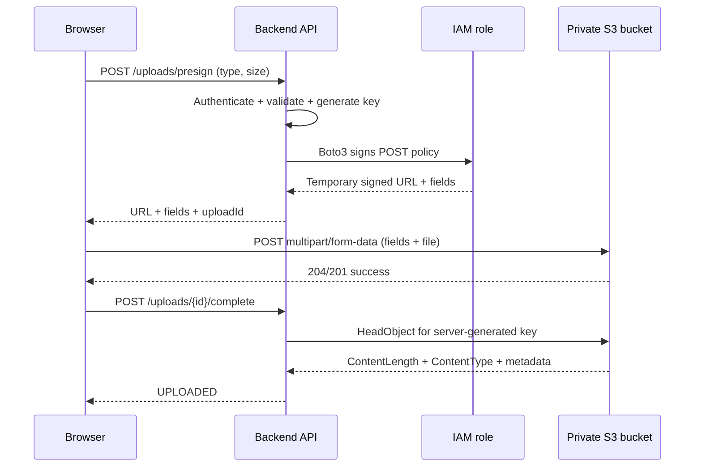

# Tạo luồng upload S3 riêng tư bằng presigned URL

Một ứng dụng web thường cần cho người dùng tải ảnh, tài liệu hoặc tệp dữ liệu lên Amazon S3. Cách đơn giản nhưng không phù hợp là đưa AWS access key vào trình duyệt hoặc chuyển toàn bộ nội dung tệp qua backend. Access key phía client có thể bị lộ và backend trở thành điểm nghẽn khi nhiều người tải tệp lớn.

Với presigned URL, backend xác thực người dùng, quyết định object key và tạo một quyền truy cập S3 có thời hạn bằng IAM role của backend. Trình duyệt gửi tệp trực tiếp tới S3 bằng quyền tạm thời đó. Bucket vẫn giữ private; người tải không cần AWS credentials và không được cấp quyền truy cập các object khác.

Trong bài thực hành này, bạn sẽ tạo một bucket riêng tư, giới hạn quyền IAM, cấu hình CORS cho frontend, xây API Python dùng Boto3 để cấp presigned POST, upload trực tiếp từ trình duyệt và xác minh object ở backend. Ta dùng presigned POST để policy có thể giới hạn kích thước tệp bằng `content-length-range`. Cuối bài sẽ so sánh với presigned PUT và mở rộng sang multipart upload.

## Mục tiêu học tập

Sau bài học, bạn có thể:

- Giải thích presigned URL hoạt động dựa trên quyền của IAM principal ký request.
- Phân biệt presigned PUT và presigned POST, hiểu giới hạn của từng cách.
- Tạo bucket S3 private với Block Public Access, Bucket owner enforced, mã hóa mặc định và HTTPS-only policy.
- Cấp quyền IAM tối thiểu cho backend tạo upload và xác minh object.
- Tạo presigned POST với object key do server sinh và policy giới hạn kích thước/content type.
- Upload trực tiếp từ browser bằng `FormData` và xử lý CORS.
- Xác minh object bằng `HeadObject`, kiểm tra size/type và quản lý trạng thái upload.
- Nhận diện rủi ro của presigned URL như bearer token, replay, overwrite và expiration.
- Thiết kế luồng production có authentication, quarantine, malware scan, audit và cleanup.
- Biết khi nào cần multipart upload, checksum, SSE-KMS hoặc S3 event notification.

## 1. Kiến trúc cần xây dựng

Luồng upload gồm ba bước:

1. Browser gửi metadata của tệp tới backend, ví dụ MIME type và kích thước.
2. Backend xác thực người dùng, kiểm tra metadata, sinh object key ngẫu nhiên và tạo presigned POST có thời hạn ngắn.
3. Browser gửi file trực tiếp tới S3 bằng URL và form fields được ký. Sau khi upload, browser gọi backend để xác minh object.



Backend không nhận byte của file trong luồng chính. Nó chỉ ký quyền upload và xác minh kết quả. S3 không cần public bucket policy: presigned request được xác thực bằng chữ ký của IAM principal tạo URL. <https://docs.aws.amazon.com/AmazonS3/latest/userguide/using-presigned-url.html>

### Thành phần sử dụng

| Thành phần | Vai trò |
|---|---|
| Amazon S3 | Lưu object trong bucket private |
| IAM role | Quyền của backend để ký upload và đọc metadata |
| Boto3 | Tạo presigned POST và gọi `HeadObject` |
| FastAPI | API cấp quyền upload và xác nhận hoàn tất |
| Browser `FormData` | Gửi file trực tiếp tới S3 |
| S3 CORS | Cho phép frontend origin gọi S3 từ browser |
| CloudWatch / CloudTrail | Log backend và audit API control plane/data events khi cấu hình |

## 2. Presigned URL là gì?

Presigned URL là request S3 được ký trước bằng credentials của IAM user hoặc IAM role. URL/form fields chứa thông tin chữ ký, action, resource và thời hạn. Người nhận có thể thực hiện đúng request được ký mà không cần có AWS credentials riêng.

Backend có quyền `s3:PutObject` trên một prefix có thể ký quyền upload vào object key thuộc prefix đó. Người nhận URL chỉ có thể thực hiện thao tác được ký, ví dụ upload một object tại key đã xác định. Họ không tự động có quyền list bucket, đọc object khác hoặc xóa object.

Presigned URL là bearer capability: ai có URL/fields đều có thể dùng chúng trong thời hạn còn hiệu lực. Không log URL đầy đủ, không gửi qua analytics, không lưu vào public storage và không đặt URL trong query string của trang có thể bị ghi vào browser history/referrer. Trả URL qua HTTPS và chỉ gửi cho user đã xác thực.

### Thời hạn

- AWS SDK/CLI có thể tạo presigned URL với thời hạn cấu hình tối đa 7 ngày theo SigV4.
- URL ký bằng temporary credentials của IAM role sẽ hết hạn khi credentials hết hạn, kể cả khi `ExpiresIn` dài hơn.
- Backend thường dùng role credentials được tự động rotate; vì vậy URL 5 phút có thể là lựa chọn thực tế cho upload nhỏ.
- Credential bị revoke/deactivate hoặc quyền bị thay đổi cũng có thể làm request không còn hợp lệ.
- S3 kiểm tra expiration khi request bắt đầu. Request đã bắt đầu trước khi hết hạn có thể tiếp tục, nhưng lần retry sau khi hết hạn sẽ thất bại.

Trong lab, ta đặt expiration 300 giây. Không dùng URL sống nhiều giờ chỉ để người dùng có thời gian tìm file; hãy tạo URL ngay trước khi upload và cấp URL mới khi cần retry. <https://docs.aws.amazon.com/AmazonS3/latest/userguide/using-presigned-url.html>

### Presigned URL có thể được dùng lại

Presigned URL không mặc định là one-time token. Người giữ URL có thể gửi lại request tới cùng key trong thời hạn còn hiệu lực. Với upload, lần PUT/POST tiếp theo tới cùng key có thể thay object trước đó. Do đó:

- Mỗi lần upload sinh một key ngẫu nhiên mới.
- Thời hạn ngắn và không tái sử dụng URL sau khi upload hoàn tất.
- Backend lưu trạng thái upload và từ chối tạo lại URL cho một upload intent đã hoàn tất.
- Dùng S3 Versioning hoặc conditional workflow nếu yêu cầu bảo vệ object trước overwrite.
- Không coi việc xóa object là thu hồi URL; URL còn hạn có thể upload lại object cùng key.

## 3. Chọn presigned PUT hay presigned POST

| Tiêu chí | Presigned PUT | Presigned POST |
|---|---|---|
| HTTP request | `PUT` object body trực tiếp | `POST multipart/form-data` gồm fields và file |
| Client | Dùng `fetch`/XHR với body là File/Blob | Dùng `FormData` |
| Signed constraints | Method, key, headers, checksum và parameters được ký | POST policy có conditions như exact key, content type, prefix và content-length-range |
| Giới hạn kích thước | Không có policy `content-length-range` như POST; cần kiểm tra sau upload hoặc dùng flow khác | Có thể giới hạn kích thước file trong POST policy |
| Content-Type | Phải gửi đúng header đã ký | Có thể ràng buộc field `Content-Type` trong policy |
| Phù hợp | Upload đơn giản, client cần PUT, tích hợp SDK | Browser form upload và cần policy conditions, đặc biệt file-size range |

Bài thực hành dùng presigned POST vì muốn giới hạn file tối đa 10 MiB ngay tại S3. Presigned PUT cũng hợp lệ cho upload riêng tư, nhưng việc backend kiểm tra `size_bytes` trước khi ký PUT chỉ kiểm tra lời khai từ client; nó không tự buộc request PUT có đúng kích thước. Nếu dùng PUT, cần kiểm tra object sau upload và xóa/quarantine object vượt giới hạn, hoặc chọn presigned POST khi cần hard limit trong policy. <https://docs.aws.amazon.com/AmazonS3/latest/developerguide/sigv4-HTTPPOSTConstructPolicy.html>

## 4. Chuẩn bị môi trường thực hành

Bạn cần:

- AWS account sandbox có quyền tạo S3 bucket, IAM policy/role và cấu hình CORS.
- AWS CLI v2 đã cài đặt và đăng nhập bằng AWS IAM Identity Center/SSO hoặc credential provider được tổ chức phê duyệt.
- Python 3.10+.
- Một frontend chạy ở `http://127.0.0.1:5173` hoặc một trang HTML local có HTTP server.
- Region ví dụ `ap-southeast-1` (Singapore).

Không tạo access key trong mã nguồn, frontend hoặc file `.env` được commit. Khi chạy local, dùng AWS profile/SSO; khi deploy backend lên AWS, gắn IAM role cho compute service để SDK tự lấy temporary credentials.

Kiểm tra danh tính CLI:

```bash
aws sts get-caller-identity
aws configure get region
```

Nếu dùng AWS IAM Identity Center:

```bash
aws configure sso
aws sso login --profile aws-lab
```

Đặt profile/Region cho terminal backend:

```bash
export AWS_PROFILE=aws-lab
export AWS_REGION=ap-southeast-1
```

Trên PowerShell:

```powershell
$env:AWS_PROFILE = "aws-lab"
$env:AWS_REGION = "ap-southeast-1"
```

## 5. Tạo bucket S3 private

Đặt tên bucket duy nhất toàn cầu. Ví dụ dùng `my-private-upload-lab-<unique-suffix>`; thay suffix bằng chuỗi ngẫu nhiên của bạn.

```bash
export AWS_REGION=ap-southeast-1
export BUCKET=my-private-upload-lab-20261120-a7f3c9

aws s3api create-bucket \
  --bucket "$BUCKET" \
  --region "$AWS_REGION" \
  --create-bucket-configuration LocationConstraint="$AWS_REGION"
```

Với `us-east-1`, lệnh `create-bucket` không dùng `--create-bucket-configuration LocationConstraint`. Region và endpoint của Boto3 phải khớp Region của bucket để tránh lỗi signature/redirect.

### Bật Block Public Access

Giữ cả bốn tùy chọn chặn public access:

```bash
aws s3api put-public-access-block \
  --bucket "$BUCKET" \
  --public-access-block-configuration \
  BlockPublicAcls=true,IgnorePublicAcls=true,BlockPublicPolicy=true,RestrictPublicBuckets=true
```

### Tắt ACL bằng Bucket owner enforced

```bash
aws s3api put-bucket-ownership-controls \
  --bucket "$BUCKET" \
  --ownership-controls 'Rules=[{ObjectOwnership=BucketOwnerEnforced}]'
```

Bucket owner enforced vô hiệu hóa ACL và làm bucket owner sở hữu object. Ứng dụng không cần gửi `x-amz-acl` khi upload. Không thêm ACL `public-read` vào presigned request.

### Bật mã hóa mặc định

```bash
aws s3api put-bucket-encryption \
  --bucket "$BUCKET" \
  --server-side-encryption-configuration \
  '{"Rules":[{"ApplyServerSideEncryptionByDefault":{"SSEAlgorithm":"AES256"}}]}'
```

Ví dụ dùng SSE-S3 (`AES256`). S3 mã hóa object mới bằng server-side encryption mặc định; client không cần gửi encryption header trong form. Nếu tổ chức yêu cầu SSE-KMS, cấu hình default encryption bằng KMS key và cấp quyền KMS cần thiết cho principal/workflow; không tự thêm header KMS vào form nếu chưa đưa header đó vào chữ ký/policy và CORS.

### Bật versioning (tùy chọn)

```bash
aws s3api put-bucket-versioning \
  --bucket "$BUCKET" \
  --versioning-configuration Status=Enabled
```

Versioning giúp khôi phục phiên bản cũ khi key bị upload lại, nhưng các noncurrent versions vẫn có chi phí lưu trữ. Nếu bật versioning, thiết kế lifecycle để dọn noncurrent versions theo retention. Trong lab, có thể bỏ qua bước này để bucket đơn giản hơn.

### Bucket policy chỉ chặn HTTP

Tạo file `bucket-policy.json`:

```json
{
  "Version": "2012-10-17",
  "Statement": [
    {
      "Sid": "DenyInsecureTransport",
      "Effect": "Deny",
      "Principal": "*",
      "Action": "s3:*",
      "Resource": [
        "arn:aws:s3:::my-private-upload-lab-20261120-a7f3c9",
        "arn:aws:s3:::my-private-upload-lab-20261120-a7f3c9/*"
      ],
      "Condition": {
        "Bool": {"aws:SecureTransport": "false"}
      }
    }
  ]
}
```

Thay bucket name bằng giá trị của bạn rồi áp dụng:

```bash
aws s3api put-bucket-policy \
  --bucket "$BUCKET" \
  --policy file://bucket-policy.json
```

Policy này chỉ thêm Deny khi request không dùng TLS. Nó không cấp public access hoặc quyền upload cho mọi người. Presigned URL dùng HTTPS.

Kiểm tra cấu hình:

```bash
aws s3api get-public-access-block --bucket "$BUCKET"
aws s3api get-bucket-ownership-controls --bucket "$BUCKET"
aws s3api get-bucket-encryption --bucket "$BUCKET"
aws s3api get-bucket-policy-status --bucket "$BUCKET"
```

## 6. Cấu hình CORS cho frontend

CORS (Cross-Origin Resource Sharing) là cơ chế browser kiểm soát request giữa các origin khác nhau. Nếu frontend chạy ở `http://127.0.0.1:5173` và S3 ở domain khác, browser cần CORS rule cho phép origin và method tương ứng.

Tạo file `cors.json`:

```json
{
  "CORSRules": [
    {
      "AllowedOrigins": ["http://127.0.0.1:5173"],
      "AllowedMethods": ["POST"],
      "AllowedHeaders": ["*"],
      "ExposeHeaders": ["ETag", "x-amz-request-id"],
      "MaxAgeSeconds": 3000
    }
  ]
}
```

Áp dụng:

```bash
aws s3api put-bucket-cors \
  --bucket "$BUCKET" \
  --cors-configuration file://cors.json

aws s3api get-bucket-cors --bucket "$BUCKET"
```

Trong production, thay `localhost` bằng origin frontend chính xác, ví dụ `https://app.example.com`. Chỉ thêm `GET`, `HEAD` hoặc `PUT` khi ứng dụng thực sự cần. CORS không phải authorization: nó không ngăn `curl`, server-to-server request hoặc người khác sử dụng presigned URL đã bị lộ. Bucket policy và chữ ký vẫn quyết định quyền truy cập. <https://docs.aws.amazon.com/AmazonS3/latest/userguide/cors.html>

## 7. IAM policy tối thiểu cho backend

Backend chỉ cần thao tác trên prefix `uploads/`:

- `s3:PutObject`: ký quyền tạo object qua presigned POST.
- `s3:GetObject`: gọi `HeadObject` để kiểm tra object sau upload.
- `s3:DeleteObject`: tùy chọn, dùng để xóa object bị từ chối sau validation.

Không cần `s3:ListAllMyBuckets`, `s3:ListBucket` hoặc `s3:*` cho API upload này. Tạo file `upload-backend-policy.json`:

```json
{
  "Version": "2012-10-17",
  "Statement": [
    {
      "Sid": "UploadOnlyToPrivatePrefix",
      "Effect": "Allow",
      "Action": ["s3:PutObject", "s3:GetObject", "s3:DeleteObject"],
      "Resource": "arn:aws:s3:::my-private-upload-lab-20261120-a7f3c9/uploads/*"
    }
  ]
}
```

Thay bucket name, sau đó tạo IAM policy và gắn vào role backend:

```bash
aws iam create-policy \
  --policy-name PrivateUploadBackendPolicy \
  --policy-document file://upload-backend-policy.json
```

Lệnh trả về ARN policy. Gắn policy vào IAM role chạy backend:

```bash
aws iam attach-role-policy \
  --role-name PrivateUploadBackendRole \
  --policy-arn arn:aws:iam::111122223333:policy/PrivateUploadBackendPolicy
```

Thay account ID, policy ARN và role name. Nếu backend chạy local, user/role profile đang đăng nhập phải có quyền tương ứng để ký request; production nên dùng IAM role của Lambda/ECS/EC2/EKS thay vì access key tĩnh. Nếu bật SSE-KMS, bổ sung quyền KMS cần thiết và key policy tương ứng.

`HeadObject` yêu cầu quyền đọc object (`s3:GetObject`). Nếu chỉ cần cấp URL mà không xác minh sau upload, có thể bỏ quyền này, nhưng production nên có bước xác minh/record trạng thái.

## 8. Tạo backend FastAPI dùng Boto3

Tạo thư mục làm việc và cài dependencies:

```bash
mkdir s3-presigned-upload
cd s3-presigned-upload
python -m venv .venv
source .venv/bin/activate
pip install fastapi uvicorn boto3
```

Trên Windows PowerShell, kích hoạt môi trường bằng:

```powershell
python -m venv .venv
.\.venv\Scripts\Activate.ps1
pip install fastapi uvicorn boto3
```

Đặt environment variables:

```bash
export UPLOAD_BUCKET=my-private-upload-lab-20261120-a7f3c9
export AWS_REGION=ap-southeast-1
export FRONTEND_ORIGIN=http://127.0.0.1:5173
```

PowerShell:

```powershell
$env:UPLOAD_BUCKET = "my-private-upload-lab-20261120-a7f3c9"
$env:AWS_REGION = "ap-southeast-1"
$env:FRONTEND_ORIGIN = "http://127.0.0.1:5173"
```

Tạo file `app.py`:

```python
import os
import re
import uuid

import boto3
from botocore.config import Config
from botocore.exceptions import BotoCoreError, ClientError
from fastapi import Depends, FastAPI, HTTPException
from fastapi.middleware.cors import CORSMiddleware
from pydantic import BaseModel, Field


BUCKET = os.environ["UPLOAD_BUCKET"]
REGION = os.environ.get("AWS_REGION", "ap-southeast-1")
MAX_UPLOAD_BYTES = 10 * 1024 * 1024  # 10 MiB
URL_TTL_SECONDS = 300
ALLOWED_CONTENT_TYPES = {
    "image/jpeg",
    "image/png",
    "application/pdf",
}

s3 = boto3.client(
    "s3",
    region_name=REGION,
    config=Config(signature_version="s3v4"),
)

app = FastAPI(title="Private S3 Upload API")
FRONTEND_ORIGIN = os.environ.get("FRONTEND_ORIGIN", "http://127.0.0.1:5173")
app.add_middleware(
    CORSMiddleware,
    allow_origins=[FRONTEND_ORIGIN],
    allow_methods=["POST"],
    allow_headers=["Content-Type", "Authorization"],
)


class PresignRequest(BaseModel):
    content_type: str
    size_bytes: int = Field(gt=0, le=MAX_UPLOAD_BYTES)


def get_current_user() -> str:
    """Lab-only identity. Replace with verified JWT/Cognito/IdP auth in production."""
    return "student-001"


def object_key(user_id: str, upload_id: str) -> str:
    return f"uploads/{user_id}/{upload_id}"


@app.post("/uploads/presign")
def create_presigned_upload(
    request: PresignRequest,
    user_id: str = Depends(get_current_user),
):
    if request.content_type not in ALLOWED_CONTENT_TYPES:
        raise HTTPException(status_code=415, detail="Unsupported content type")

    # Client metadata is untrusted. The POST policy also enforces the file size at S3.
    upload_id = uuid.uuid4().hex
    key = object_key(user_id, upload_id)

    try:
        post = s3.generate_presigned_post(
            Bucket=BUCKET,
            Key=key,
            Fields={"Content-Type": request.content_type},
            Conditions=[
                {"Content-Type": request.content_type},
                ["content-length-range", 1, MAX_UPLOAD_BYTES],
            ],
            ExpiresIn=URL_TTL_SECONDS,
        )
    except BotoCoreError as exc:
        raise HTTPException(status_code=502, detail="Could not create upload authorization") from exc

    return {
        "upload_id": upload_id,
        "url": post["url"],
        "fields": post["fields"],
        "expires_in": URL_TTL_SECONDS,
        "max_size_bytes": MAX_UPLOAD_BYTES,
    }


@app.post("/uploads/{upload_id}/complete")
def complete_upload(
    upload_id: str,
    user_id: str = Depends(get_current_user),
):
    if not re.fullmatch(r"[0-9a-f]{32}", upload_id):
        raise HTTPException(status_code=400, detail="Invalid upload id")

    # Reconstruct the key from the authenticated identity; never accept an arbitrary key from the browser.
    key = object_key(user_id, upload_id)
    try:
        head = s3.head_object(Bucket=BUCKET, Key=key)
    except ClientError as exc:
        code = exc.response.get("Error", {}).get("Code", "Unknown")
        if code in {"403", "404", "AccessDenied", "NoSuchKey", "NotFound"}:
            # Without s3:ListBucket, S3 may return 403 for a missing key.
            raise HTTPException(status_code=404, detail="Uploaded object not found or not accessible") from exc
        raise HTTPException(status_code=502, detail="Could not verify uploaded object") from exc
    except BotoCoreError as exc:
        raise HTTPException(status_code=502, detail="Could not reach S3 to verify uploaded object") from exc

    size_bytes = head.get("ContentLength", 0)
    content_type = head.get("ContentType", "")
    if not (1 <= size_bytes <= MAX_UPLOAD_BYTES):
        s3.delete_object(Bucket=BUCKET, Key=key)
        raise HTTPException(status_code=400, detail="Uploaded object size is outside allowed range")
    if content_type not in ALLOWED_CONTENT_TYPES:
        s3.delete_object(Bucket=BUCKET, Key=key)
        raise HTTPException(status_code=415, detail="Uploaded object content type is not allowed")

    return {
        "upload_id": upload_id,
        "status": "UPLOADED",
        "size_bytes": size_bytes,
        "content_type": content_type,
        "etag": head.get("ETag"),
        "server_side_encryption": head.get("ServerSideEncryption"),
    }
```

### Đọc hiểu backend

- `get_current_user()` là stub để lab chạy độc lập. Trong production phải lấy user ID từ JWT/Cognito/IdP đã xác minh; không nhận user ID tùy ý từ request body/header.
- Object key được server sinh từ user ID đã xác thực và UUID ngẫu nhiên. Không dùng filename do client gửi làm key vì có thể trùng, chứa path bất thường hoặc ghi đè object.
- `generate_presigned_post()` trả URL cùng fields chứa policy và chữ ký. Browser phải gửi nguyên fields này.
- `Content-Type` bị ràng buộc đúng giá trị trong POST policy.
- `content-length-range` giới hạn kích thước file được upload từ 1 byte đến 10 MiB.
- API complete tự dựng key từ authenticated user + upload ID rồi gọi `HeadObject`; client không được chỉ định bucket/key tùy ý.
- IAM policy cố ý không cấp `s3:ListBucket`; vì vậy S3 có thể trả `403` thay vì `404` khi key chưa tồn tại. API map cả hai về `404` để không tiết lộ sự tồn tại của object; khi debug `403`, kiểm tra cả quyền IAM/bucket policy.
- Backend kiểm tra lại size/type như defense-in-depth. MIME type do browser khai báo vẫn có thể giả mạo; production phải kiểm tra file signature/magic bytes và quét nội dung trước khi tin dùng.

Ví dụ dùng in-memory identity cố định và không lưu upload intent vào database, vì vậy chỉ phù hợp học tập. Production cần lưu upload intent trong DynamoDB/RDS với `uploadId`, user/tenant, key, expected content type/size, expiry, state và idempotency; complete endpoint chỉ chuyển state một lần bằng conditional update.

Chạy API:

```bash
uvicorn app:app --reload --host 127.0.0.1 --port 8000
```

Mở `http://127.0.0.1:8000/docs` để xem API docs.

Trong terminal thứ hai, từ thư mục chứa `index.html`, chạy static server:

```bash
python -m http.server 5173 --bind 127.0.0.1
```

Mở frontend bằng đúng origin `http://127.0.0.1:5173`. Ở đây có hai CORS configuration độc lập: FastAPI cho phép browser gọi backend port 8000; S3 CORS cho phép browser upload trực tiếp tới bucket. Nếu chỉ cấu hình CORS trên S3, browser vẫn có thể chặn request tới API backend.

## 9. Tạo frontend upload trực tiếp

Tạo một file `index.html` và phục vụ nó từ `http://127.0.0.1:5173` (ví dụ dùng Vite hoặc một static HTTP server). Ví dụ HTML/JavaScript tối giản:

```html
<!doctype html>
<html lang="vi">
<head>
  <meta charset="utf-8" />
  <meta name="viewport" content="width=device-width, initial-scale=1" />
  <title>Private S3 upload lab</title>
</head>
<body>
  <h1>Upload tệp riêng tư lên S3</h1>
  <input id="file" type="file" accept="image/png,image/jpeg,application/pdf" />
  <button id="upload">Upload</button>
  <pre id="status"></pre>

  <script>
    const API = "http://127.0.0.1:8000";
    const status = document.querySelector("#status");

    document.querySelector("#upload").addEventListener("click", async () => {
      const file = document.querySelector("#file").files[0];
      if (!file) {
        status.textContent = "Hãy chọn một tệp.";
        return;
      }

      try {
        status.textContent = "Đang xin quyền upload...";
        const presignResponse = await fetch(`${API}/uploads/presign`, {
          method: "POST",
          headers: { "Content-Type": "application/json" },
          body: JSON.stringify({
            content_type: file.type,
            size_bytes: file.size
          })
        });
        if (!presignResponse.ok) {
          throw new Error(`Presign API failed: ${presignResponse.status} ${await presignResponse.text()}`);
        }

        const authorization = await presignResponse.json();
        const form = new FormData();
        for (const [name, value] of Object.entries(authorization.fields)) {
          form.append(name, value);
        }
        form.append("file", file);

        status.textContent = "Đang upload trực tiếp tới S3...";
        const s3Response = await fetch(authorization.url, {
          method: "POST",
          body: form
        });
        if (!s3Response.ok) {
          throw new Error(`S3 upload failed: ${s3Response.status} ${await s3Response.text()}`);
        }

        status.textContent = "Đang xác minh object...";
        const completeResponse = await fetch(
          `${API}/uploads/${authorization.upload_id}/complete`,
          { method: "POST" }
        );
        if (!completeResponse.ok) {
          throw new Error(`Complete API failed: ${completeResponse.status} ${await completeResponse.text()}`);
        }

        const result = await completeResponse.json();
        status.textContent = JSON.stringify(result, null, 2);
      } catch (error) {
        status.textContent = error.message;
      }
    });
  </script>
</body>
</html>
```

Browser không gửi AWS credentials tới S3. Nó gửi form fields đã ký cùng file. Không tự đặt `Content-Type: multipart/form-data` trong `fetch`; browser phải tự thêm boundary vào header. Không sửa fields, URL hoặc policy do backend trả về.

## 10. Chạy thử luồng upload

1. Đảm bảo bucket, IAM permission và CORS đã cấu hình.
2. Chạy FastAPI tại port 8000.
3. Chạy frontend tại `http://127.0.0.1:5173`.
4. Chọn một file PNG/JPEG/PDF nhỏ hơn 10 MiB.
5. Bấm Upload và quan sát status.
6. Khi complete endpoint trả `UPLOADED`, lưu `upload_id` để kiểm tra object.

Kiểm tra object bằng AWS CLI. Key được backend sinh theo dạng `uploads/student-001/<uuid>`; lấy `upload_id` từ response rồi chạy:

```bash
export UPLOAD_ID=replace-with-upload-id

aws s3api head-object \
  --bucket "$BUCKET" \
  --key "uploads/student-001/$UPLOAD_ID" \
  --region "$AWS_REGION"
```

Kết quả cần có `ContentLength`, `ContentType` và `ServerSideEncryption` là `AES256` (nếu dùng cấu hình SSE-S3 ở trên). Object vẫn private; `head-object` thành công ở đây vì CLI đang dùng IAM principal có quyền, không phải vì object public.

Kiểm tra bucket không cấp public access:

```bash
aws s3api get-public-access-block --bucket "$BUCKET"
aws s3api get-bucket-policy-status --bucket "$BUCKET"
```

## 11. Kiểm thử các trường hợp bị từ chối

Thử các ca sau và quan sát API/S3 response:

| Thử nghiệm | Kết quả mong đợi |
|---|---|
| File `text/plain` | Backend trả `415 Unsupported Media Type` |
| Metadata khai báo size bằng 0 hoặc lớn hơn 10 MiB | Pydantic trả `422` |
| File thực tế lớn hơn 10 MiB nhưng metadata khai báo nhỏ | S3 từ chối POST vì `content-length-range` |
| Sửa một field trong presigned form | S3 trả lỗi policy/signature |
| Dùng URL sau expiration | S3 từ chối request |
| Gọi complete trước khi upload | Backend trả `404` |
| Đổi `upload_id` thành chuỗi không phải UUID hex 32 ký tự | Backend trả `400` |
| Upload từ origin không có trong CORS | Browser chặn response; request không được browser cho phép đọc |
| Gọi URL bằng curl từ origin khác | CORS không ngăn curl; chữ ký và IAM vẫn quyết định quyền |

Đặc biệt, CORS không phải cơ chế ngăn attacker. Nếu URL bị lộ, attacker có thể dùng curl hoặc server khác trong thời hạn còn hiệu lực. Bảo vệ URL, rút ngắn TTL, giới hạn key/size/type và kiểm soát trạng thái upload mới là các biện pháp quan trọng.

## 12. Tùy chọn: presigned PUT bằng Boto3

Nếu client cần upload bằng PUT, backend có thể dùng:

```python
url = s3.generate_presigned_url(
    ClientMethod="put_object",
    Params={
        "Bucket": BUCKET,
        "Key": key,
        "ContentType": content_type,
    },
    ExpiresIn=300,
    HttpMethod="PUT",
)
```

Client phải gửi đúng HTTP method và `Content-Type` đã ký:

```javascript
const response = await fetch(presignedUrl, {
  method: "PUT",
  headers: { "Content-Type": file.type },
  body: file
});
```

CORS khi dùng PUT phải có `AllowedMethods: ["PUT"]`; nếu signed request có custom headers như checksum hoặc SSE-KMS header thì CORS phải cho phép các header đó. Nếu ký `Content-Type` là `image/png` nhưng client gửi `application/octet-stream`, S3 có thể trả `SignatureDoesNotMatch`.

Presigned PUT không có POST policy condition `content-length-range`. Nếu cần hard limit, dùng POST policy như lab chính hoặc dùng backend kiểm tra object sau upload và xóa/quarantine khi vượt ngưỡng. Việc kiểm tra `size_bytes` do client khai báo trước khi ký PUT không đủ để cưỡng chế kích thước thực.

## 13. Content-Type không chứng minh nội dung file

Browser gửi `file.type`, nhưng giá trị này do client cung cấp và có thể giả mạo. POST policy chỉ bảo đảm request dùng đúng Content-Type đã ký; nó không xác minh byte bên trong có đúng là PNG/PDF hay không.

Trong production:

1. Upload vào prefix/bucket quarantine riêng.
2. Backend xác minh size, checksum và metadata bằng `HeadObject`.
3. Worker đọc một phần file hoặc toàn bộ file để kiểm tra magic bytes/format thực tế.
4. Quét malware bằng service nội bộ hoặc giải pháp được phê duyệt.
5. Chỉ sau khi pass mới chuyển object sang prefix/bucket approved.
6. Không cho user khác tải object quarantine trước khi scan hoàn tất.

S3 event notification/EventBridge có thể kích hoạt Lambda, Step Functions hoặc queue để chạy scanning pipeline. Thiết kế consumer idempotent vì event delivery có thể lặp; không giả định event được xử lý exactly once.

## 14. Kiểm tra checksum và tính toàn vẹn

ETag không phải lúc nào cũng là MD5 checksum của nội dung. Với multipart upload hoặc một số encryption/implementation path, ETag có semantics khác. Không dùng ETag làm bằng chứng duy nhất rằng file không bị thay đổi.

Có thể dùng checksum header được S3 hỗ trợ như SHA-256/CRC32C với SigV4. Nếu checksum được đưa vào presigned request, phải ký đúng header và browser gửi cùng giá trị. Backend có thể lưu checksum dự kiến trong upload intent và xác minh checksum/metadata sau upload theo API phù hợp.

Với tệp nhỏ trong lab, ta chưa truyền checksum. Với tài liệu quan trọng hoặc artifact phần mềm, nên tính checksum phía client/server, ký header tương ứng và xác minh trước khi đưa object vào trạng thái approved.

## 15. SSE-S3 và SSE-KMS

Bucket default encryption ở lab dùng SSE-S3 (`AES256`). Nếu cần quản lý key, audit key usage hoặc policy tách biệt, dùng SSE-KMS:

- Cấu hình bucket default encryption bằng KMS key ARN.
- Cấp quyền KMS tối thiểu cho IAM principal và key policy theo mô hình S3 encryption.
- Nếu presigned request yêu cầu header encryption cụ thể, header đó phải có trong signed request/form fields và CORS allowlist.
- Không gửi KMS key ID cho browser trừ khi request contract yêu cầu rõ.
- Đánh giá KMS request cost và key rotation/disable impact.

Nếu bucket default encryption đã đặt SSE-KMS, S3 áp dụng mã hóa cho object mới mà client không cần chọn key. Hãy kiểm tra IAM/KMS policy và thử upload thực tế bằng chính role tạo presigned request trước khi triển khai.

## 16. Multipart upload cho tệp lớn

Presigned POST/PUT đơn giản phù hợp object nhỏ/vừa. Với object lớn hoặc mạng không ổn định, multipart upload cho phép chia file thành parts và retry từng part.

Luồng tổng quát:

1. Backend gọi `CreateMultipartUpload` để tạo upload ID.
2. Backend tạo presigned URL cho từng `UploadPart` (mỗi URL ràng buộc bucket, key, upload ID và part number).
3. Browser upload parts song song có giới hạn concurrency.
4. Browser gửi ETag/checksum của từng part về backend.
5. Backend xác thực danh sách part rồi gọi `CompleteMultipartUpload`.
6. Nếu upload thất bại hoặc hết hạn, backend gọi `AbortMultipartUpload`.

Multipart upload cho phép retry part riêng lẻ, hỗ trợ object lớn tới giới hạn S3 hiện hành và giảm việc phải gửi lại toàn bộ file. Cần giới hạn số part/parallelism, lưu upload ID server-side và có lifecycle rule `AbortIncompleteMultipartUpload` để dọn upload dang dở. Không cho client tự hoàn tất multipart nếu backend cần kiểm soát danh sách part và ownership.

## 17. Bảo vệ object key và tránh overwrite

Object key là namespace trong bucket, không phải filesystem path. Thiết kế key theo user/tenant và upload ID:

```text
uploads/<tenant-id>/<user-id>/<random-upload-id>
```

Nguyên tắc:

- Backend tạo key, không nhận key tùy ý từ browser.
- Không dùng filename làm toàn bộ key.
- Không cho client chọn prefix `approved/`, `public/` hoặc tenant khác.
- Dùng UUID/ULID đủ entropy để tránh đoán key.
- Không tái sử dụng key giữa các upload intent.
- Ghi upload intent và trạng thái vào database để complete/abort idempotent.
- Với yêu cầu chống overwrite mạnh, cân nhắc versioning, object lock phù hợp hoặc conditional write/commit workflow.

Presigned URL là quyền ghi vào key cụ thể, nhưng nếu URL còn hiệu lực thì người giữ URL có thể gửi lại. Một `upload_id` random không biến URL thành one-time capability. Backend có thể ngừng cấp URL mới sau khi upload complete, nhưng URL cũ vẫn có thể hoạt động đến khi hết hạn hoặc credentials bị vô hiệu.

## 18. Authentication và authorization ở backend

Presigned URL không thay thế đăng nhập ứng dụng. Trước khi cấp URL, backend phải:

- Xác thực JWT/session/Cognito/enterprise IdP.
- Lấy user ID/tenant ID từ token đã xác minh, không lấy từ field tùy ý của client.
- Kiểm tra user có quyền upload vào nghiệp vụ/record tương ứng.
- Giới hạn số upload đang chờ, số request/phút và tổng dung lượng theo tenant.
- Kiểm tra MIME allowlist, kích thước, extension như một lớp kiểm tra phụ.
- Sinh key trong prefix của user/tenant.
- Ghi audit event gồm user, tenant, upload ID, key, TTL và thời điểm.
- Chỉ cho complete/abort đúng upload intent do user đó tạo.

IAM role ký URL cần quyền ghi vào đúng bucket prefix. User cuối không được nhận AWS credentials của backend và không được phép tự chọn IAM role, bucket hoặc arbitrary object key.

## 19. CORS, bucket policy và IAM khác nhau thế nào?

| Cơ chế | Câu hỏi nó trả lời | Có phải authorization? |
|---|---|---|
| CORS | Browser từ origin nào được phép gửi/đọc response theo method/header nào? | Không |
| IAM policy | AWS principal được phép gọi action/resource nào? | Có |
| Bucket policy | Bucket resource cho phép/deny principal/request nào? | Có |
| Block Public Access | Có chặn các cấu hình public access hay không? | Guardrail chống public |
| Presigned signature/policy | Request cụ thể nào được thực hiện trong thời hạn nào? | Capability tạm thời dựa trên IAM |

Một request có thể vượt qua CORS nhưng vẫn bị IAM/S3 từ chối. Ngược lại, `curl` không bị browser CORS kiểm soát; nếu có presigned URL hợp lệ, curl vẫn có thể upload. Giữ cả Block Public Access và bucket private trong toàn bộ lab.

## 20. Monitoring và audit

Theo dõi các lớp:

- Backend logs: user/tenant, upload ID, content type, size, S3 request ID và lỗi.
- Application metrics: presign count, upload completion rate, rejected size/type, average upload time.
- S3 metrics: request count, 4xx/5xx, bytes uploaded, storage size.
- CloudTrail management events: thay đổi bucket policy, encryption, CORS, IAM và public access settings.
- S3 data events: bật CloudTrail data event selectors nếu cần audit object-level `PutObject`, `GetObject`, `DeleteObject`; lưu ý data events có chi phí.
- S3 server access logging hoặc CloudTrail data events theo yêu cầu điều tra.

Không ghi toàn bộ presigned URL vào log vì query string chứa chữ ký/token. Ghi upload ID và S3 request ID để tương quan sự cố.

## 21. Troubleshooting

| Triệu chứng | Nguyên nhân thường gặp | Cách xử lý |
|---|---|---|
| `SignatureDoesNotMatch` | Method/Content-Type/fields khác request được ký, URL bị sửa, Region sai hoặc clock skew | Gửi nguyên URL/fields; kiểm tra Region, header, thời gian hệ thống |
| `AccessDenied` | IAM role thiếu `s3:PutObject`, bucket policy Deny, SCP hoặc KMS policy | Kiểm tra identity policy, bucket policy, SCP, key policy và role thực sự ký URL |
| `ExpiredToken` | Temporary credentials đã hết hạn | Backend refresh credentials và cấp URL mới |
| `Request has expired` | URL quá TTL hoặc request bắt đầu sau expiration | Cấp URL mới ngay trước upload; rút ngắn thời gian user chờ trước khi upload |
| Browser báo CORS | Origin/method/header chưa match CORS rule hoặc preflight không hợp lệ | Kiểm tra DevTools Network, origin, method và `AllowedHeaders` |
| Upload thành công nhưng complete trả 404 | Key backend kiểm tra không khớp key trong form hoặc upload chưa xong | So sánh upload ID, authenticated user, `fields.key` và Region |
| Upload quá lớn bị `PolicyConditionFailed` | File vượt `content-length-range` | Giảm file hoặc chuyển sang multipart flow |
| File sai định dạng vẫn upload được | Client giả mạo MIME type; POST policy chỉ kiểm tra field | Kiểm tra magic bytes và malware scan sau upload |
| Object bị ghi đè | URL có thể dùng lại cùng key khi còn hạn | Dùng key mới cho mỗi upload, TTL ngắn và state/versioning |
| S3 không cho gửi ACL | Bucket dùng `BucketOwnerEnforced` | Bỏ `x-amz-acl`/ACL field khỏi request |
| Backend local không tìm thấy credentials | AWS SSO chưa login hoặc profile/Region chưa đặt | `aws sso login`, kiểm tra `AWS_PROFILE`, `AWS_REGION` và `get-caller-identity` |
| Upload dùng SSE-KMS bị từ chối | Role hoặc KMS key policy thiếu quyền | Kiểm tra KMS permissions, key policy và encryption headers đã ký |

Để debug signature, trước hết kiểm tra request method, bucket Region, expiration và các header/fields được ký. Không copy/paste presigned URL vào ticket/chat công khai; URL là credential tạm thời.

## 22. Dọn dẹp tài nguyên sau lab

Xóa object trong prefix lab:

```bash
aws s3 rm "s3://$BUCKET/uploads/" --recursive --region "$AWS_REGION"
```

Nếu bật versioning, lệnh trên tạo delete marker và không xóa các noncurrent versions. Hãy liệt kê/xóa versions theo quy trình riêng hoặc dùng bucket lab không bật versioning.

Sau khi object đã được dọn, xóa bucket:

```bash
aws s3api delete-bucket --bucket "$BUCKET" --region "$AWS_REGION"
```

Nếu bucket còn object/version/delete marker, S3 từ chối xóa. Dọn toàn bộ dữ liệu trước rồi mới delete bucket. Gỡ IAM policy khỏi role và xóa policy nếu chỉ dùng cho lab; không xóa role dùng chung của workload khác.

## 23. Mở rộng production

Trước khi đưa luồng upload vào production, hoàn thiện:

- Authentication/authorization bằng IdP đã xác minh.
- Upload intent trong DynamoDB/RDS, có state machine `PENDING → UPLOADED → SCANNING → APPROVED/REJECTED`.
- Conditional update để complete/abort idempotent và chống replay ở tầng nghiệp vụ.
- Presigned URL TTL ngắn, object key ngẫu nhiên, prefix theo tenant.
- POST policy giới hạn size/content type; kiểm tra file thật sau upload.
- Quarantine bucket/prefix và malware scanning trước khi object được sử dụng.
- S3 Block Public Access, Bucket owner enforced, default encryption, TLS-only policy.
- CORS origin allowlist chính xác, method/header tối thiểu.
- IAM role least privilege và KMS key policy nếu dùng SSE-KMS.
- S3 Versioning/lifecycle/retention theo yêu cầu khôi phục và compliance.
- Rate limit, quota theo user/tenant, giới hạn số upload pending và tổng dung lượng.
- Multipart upload với abort cleanup cho file lớn.
- Checksum để kiểm tra integrity; không coi ETag luôn là MD5.
- CloudTrail data events/S3 metrics/CloudWatch alarms theo nhu cầu audit.
- Không log presigned URL, secret hoặc nội dung nhạy cảm.
- Theo dõi cost theo request, storage, transfer, KMS và scanning compute.

## 24. Bài tập củng cố

1. Thay MIME allowlist thành `image/jpeg`, `image/png` và `application/pdf`; thử upload loại không được phép.
2. Giảm `MAX_UPLOAD_BYTES` xuống 1 MiB và thử file lớn hơn.
3. Đổi CORS origin thành một origin khác rồi quan sát lỗi browser.
4. Đặt TTL thành 30 giây, chờ hết hạn rồi upload.
5. Thử dùng cùng presigned POST hai lần để quan sát object key có thể bị ghi đè.
6. Thêm trường `tenant_id` lấy từ identity đã xác thực vào object prefix.
7. Bổ sung DynamoDB upload-intent table và conditional state transition.
8. Thiết kế S3 event pipeline để scan file rồi chuyển từ quarantine sang approved.
9. So sánh presigned PUT và POST; giải thích cách POST policy enforce content-length-range.
10. Viết flow multipart upload cho tệp lớn, bao gồm abort khi client disconnect.

## 25. Checklist hoàn thành

- [ ] Bucket được tạo đúng Region và tên duy nhất.
- [ ] Block Public Access bật cả bốn setting.
- [ ] Object Ownership là `BucketOwnerEnforced`.
- [ ] Default encryption được bật.
- [ ] Bucket policy từ chối HTTP không mã hóa.
- [ ] CORS chỉ cho phép frontend origin cần thiết.
- [ ] Backend role chỉ có quyền trên prefix `uploads/*`.
- [ ] Backend sinh key ngẫu nhiên và không nhận key từ client.
- [ ] Presigned POST có TTL ngắn, exact Content-Type và `content-length-range`.
- [ ] Browser gửi nguyên fields và file bằng `FormData`.
- [ ] Backend xác minh object bằng `HeadObject`.
- [ ] MIME type được xem là metadata không đáng tin; có bước scan/validation sau upload.
- [ ] Presigned URL không xuất hiện trong logs/analytics.
- [ ] CORS không bị nhầm là cơ chế authorization.
- [ ] Đã thử lỗi expiration, signature mismatch, AccessDenied và file vượt size.
- [ ] Có cleanup cho object/multipart upload dang dở.

## Kết luận

Presigned URL cho phép backend cấp quyền S3 tạm thời mà không đưa AWS credentials tới trình duyệt và không cần mở bucket public. Backend xác thực user, sinh object key, giới hạn quyền và ký request; browser upload trực tiếp; backend xác minh object sau đó.

Trong lab, presigned POST phù hợp vì POST policy có thể giới hạn kích thước file bằng `content-length-range`. CORS chỉ hỗ trợ browser gọi đúng origin; IAM, bucket policy, Block Public Access và chữ ký mới quyết định quyền truy cập. Trong production, cần lưu upload intent, kiểm tra nội dung thật, quét malware, quản lý replay/overwrite, theo dõi audit và dọn dữ liệu tạm.

## Tài liệu tham khảo

- [Download and upload objects with presigned URLs](https://docs.aws.amazon.com/AmazonS3/latest/userguide/using-presigned-url.html)
- [Uploading objects with presigned URLs](https://docs.aws.amazon.com/AmazonS3/latest/userguide/PresignedUrlUploadObject.html)
- [POST Policy and policy conditions](https://docs.aws.amazon.com/AmazonS3/latest/developerguide/sigv4-HTTPPOSTConstructPolicy.html)
- [Boto3: generate_presigned_post](https://boto3.amazonaws.com/v1/documentation/api/latest/reference/services/s3/client/generate_presigned_post.html)
- [Boto3: generate_presigned_url](https://boto3.amazonaws.com/v1/documentation/api/latest/reference/services/s3/client/generate_presigned_url.html)
- [Using cross-origin resource sharing (CORS)](https://docs.aws.amazon.com/AmazonS3/latest/userguide/cors.html)
- [Blocking public access to your Amazon S3 storage](https://docs.aws.amazon.com/AmazonS3/latest/userguide/access-control-block-public-access.html)
- [Object Ownership and Bucket owner enforced](https://docs.aws.amazon.com/AmazonS3/latest/userguide/about-object-ownership.html)
- [Default encryption for S3 buckets](https://docs.aws.amazon.com/AmazonS3/latest/userguide/bucket-encryption.html)
- [Checking object integrity in Amazon S3](https://docs.aws.amazon.com/AmazonS3/latest/userguide/checking-object-integrity.html)
- [Using multipart upload with Amazon S3](https://docs.aws.amazon.com/AmazonS3/latest/userguide/mpuoverview.html)
- [Abort incomplete multipart uploads with lifecycle](https://docs.aws.amazon.com/AmazonS3/latest/userguide/mpu-abort-incomplete-mpu-lifecycle-config.html)
