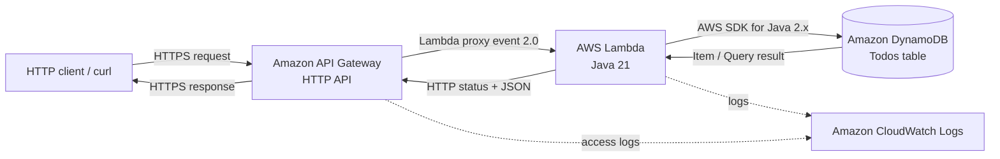

# Tạo API serverless bằng API Gateway, Lambda và DynamoDB

Trong bài thực hành này, bạn xây dựng một REST-style API nhỏ để quản lý danh sách công việc (todo). Amazon API Gateway tiếp nhận HTTP request, AWS Lambda xử lý logic nghiệp vụ bằng Java và Amazon DynamoDB lưu dữ liệu. AWS Serverless Application Model (AWS SAM) mô tả toàn bộ tài nguyên trong một template để có thể build, triển khai, kiểm thử và xóa môi trường bằng các lệnh lặp lại được.

Kiến trúc này minh họa mô hình serverless phổ biến: API Gateway là lớp giao tiếp, Lambda là lớp xử lý và DynamoDB là lớp lưu trữ. Bạn không phải tự quản lý máy chủ ứng dụng hay database server. AWS quản lý việc vận hành hạ tầng; bạn vẫn chịu trách nhiệm thiết kế API, quyền IAM, dữ liệu, bảo mật, quan sát và chi phí.

## Mục tiêu học tập

Sau bài thực hành, bạn có thể:

- Giải thích luồng request từ API Gateway đến Lambda và DynamoDB.
- Tạo HTTP API với các route GET, POST, PUT và DELETE.
- Viết Lambda handler bằng Java 21 và AWS SDK for Java 2.x.
- Cấp quyền tối thiểu để Lambda đọc và ghi đúng DynamoDB table.
- Dùng AWS SAM để build, deploy và quản lý vòng đời ứng dụng.
- Kiểm thử API bằng `curl` và theo dõi log trên Amazon CloudWatch.
- Nhận diện giới hạn của mẫu CRUD cơ bản và biết cách mở rộng cho production.

## 1. Kiến trúc bài thực hành

API quản lý `todos` có các endpoint:

| Method | Path | Chức năng |
|---|---|---|
| `GET` | `/todos` | Liệt kê một trang todo |
| `POST` | `/todos` | Tạo todo mới |
| `GET` | `/todos/{id}` | Lấy một todo theo ID |
| `PUT` | `/todos/{id}` | Cập nhật tiêu đề và trạng thái hoàn thành |
| `DELETE` | `/todos/{id}` | Xóa todo |



API Gateway định tuyến request theo HTTP method và path. Với HTTP API, API Gateway gửi event payload format 2.0 đến Lambda. Lambda đọc `routeKey`, `pathParameters`, `queryStringParameters` và `body`, sau đó gọi DynamoDB bằng IAM execution role của function. Lambda trả một object có `statusCode`, `headers` và `body`; API Gateway chuyển response đó về client.

### Vai trò của từng dịch vụ

| Dịch vụ | Trách nhiệm |
|---|---|
| Amazon API Gateway HTTP API | Cung cấp HTTPS endpoint, route và tích hợp Lambda |
| AWS Lambda | Chạy Java handler theo từng invocation, tự động scale theo request |
| Amazon DynamoDB | Lưu todo dưới dạng item trong table NoSQL |
| AWS IAM | Cấp quyền để Lambda gọi đúng các DynamoDB API cần thiết |
| AWS SAM / CloudFormation | Khai báo, triển khai và quản lý tài nguyên dưới dạng Infrastructure as Code |
| Amazon CloudWatch | Lưu application logs và API access logs |

HTTP API là lựa chọn phù hợp cho API serverless cần định tuyến và tích hợp Lambda với chi phí/độ phức tạp thấp. Nếu cần các tính năng chuyên biệt như API key và usage plan, response caching hoặc khả năng cấu hình REST API nâng cao, hãy đánh giá API Gateway REST API.

## 2. Chuẩn bị môi trường

Bạn cần:

- Một AWS account và quyền triển khai CloudFormation, Lambda, API Gateway, DynamoDB, IAM và CloudWatch Logs.
- AWS CLI đã cấu hình credential hợp lệ.
- AWS SAM CLI phiên bản hiện hành.
- JDK 21 và Apache Maven.
- Docker nếu muốn chạy `sam build --use-container` hoặc `sam local start-api`.
- Một Region có hỗ trợ Lambda Java 21, API Gateway HTTP API và DynamoDB.

Kiểm tra công cụ:

```bash
aws --version
sam --version
java -version
mvn -version
aws sts get-caller-identity
```

`get-caller-identity` xác nhận principal đang triển khai. Không dùng root access key hoặc lưu access key dài hạn trong project. Ưu tiên IAM Identity Center hoặc role/credential tạm thời cho môi trường phát triển.

Chọn Region mặc định, ví dụ Singapore:

```bash
aws configure set region ap-southeast-1
```

Các lệnh tiếp theo giả định AWS CLI đang dùng profile và Region đúng. Nếu dùng named profile, thêm `--profile <profile-name>` vào các lệnh AWS CLI hoặc export `AWS_PROFILE` trong shell.

## 3. Tạo cấu trúc project

Tạo thư mục dự án:

```text
serverless-todo-api/
├── pom.xml
├── template.yaml
└── src/
    └── main/
        └── java/
            └── example/
                └── TodoHandler.java
```

`pom.xml` quản lý dependency và đóng gói Java artifact. `template.yaml` mô tả DynamoDB table, HTTP API, Lambda function, IAM policy và output endpoint. `TodoHandler.java` chứa logic CRUD.

## 4. Khai báo dependency Maven

Tạo file `pom.xml`:

```xml
<project xmlns="http://maven.apache.org/POM/4.0.0"
         xmlns:xsi="http://www.w3.org/2001/XMLSchema-instance"
         xsi:schemaLocation="http://maven.apache.org/POM/4.0.0 https://maven.apache.org/xsd/maven-4.0.0.xsd">
    <modelVersion>4.0.0</modelVersion>

    <groupId>example</groupId>
    <artifactId>serverless-todo-api</artifactId>
    <version>1.0.0</version>
    <packaging>jar</packaging>

    <properties>
        <maven.compiler.release>21</maven.compiler.release>
        <project.build.sourceEncoding>UTF-8</project.build.sourceEncoding>
        <aws.sdk.version>2.31.54</aws.sdk.version>
        <jackson.version>2.18.2</jackson.version>
    </properties>

    <dependencyManagement>
        <dependencies>
            <dependency>
                <groupId>software.amazon.awssdk</groupId>
                <artifactId>bom</artifactId>
                <version>${aws.sdk.version}</version>
                <type>pom</type>
                <scope>import</scope>
            </dependency>
        </dependencies>
    </dependencyManagement>

    <dependencies>
        <dependency>
            <groupId>com.amazonaws</groupId>
            <artifactId>aws-lambda-java-core</artifactId>
            <version>1.2.3</version>
        </dependency>
        <dependency>
            <groupId>software.amazon.awssdk</groupId>
            <artifactId>dynamodb</artifactId>
        </dependency>
        <dependency>
            <groupId>com.fasterxml.jackson.core</groupId>
            <artifactId>jackson-databind</artifactId>
            <version>${jackson.version}</version>
        </dependency>
    </dependencies>

    <build>
        <plugins>
            <plugin>
                <groupId>org.apache.maven.plugins</groupId>
                <artifactId>maven-compiler-plugin</artifactId>
                <version>3.13.0</version>
                <configuration>
                    <release>21</release>
                </configuration>
            </plugin>
            <plugin>
                <groupId>org.apache.maven.plugins</groupId>
                <artifactId>maven-shade-plugin</artifactId>
                <version>3.6.0</version>
                <executions>
                    <execution>
                        <phase>package</phase>
                        <goals>
                            <goal>shade</goal>
                        </goals>
                        <configuration>
                            <createDependencyReducedPom>false</createDependencyReducedPom>
                            <filters>
                                <filter>
                                    <artifact>*:*</artifact>
                                    <excludes>
                                        <exclude>META-INF/*.SF</exclude>
                                        <exclude>META-INF/*.DSA</exclude>
                                        <exclude>META-INF/*.RSA</exclude>
                                    </excludes>
                                </filter>
                            </filters>
                        </configuration>
                    </execution>
                </executions>
            </plugin>
        </plugins>
    </build>
</project>
```

Project dùng Lambda Java Core để khai báo handler, AWS SDK for Java 2.x để gọi DynamoDB và Jackson để parse/serialize JSON. Maven Shade Plugin đóng gói dependency vào JAR triển khai. Phiên bản dependency được ghim để project có build tái lập; khi bắt đầu dự án mới, kiểm tra bản vá bảo mật và cập nhật dependency theo quy trình quản lý phiên bản của tổ chức.

## 5. Tạo Lambda handler bằng Java

Tạo `src/main/java/example/TodoHandler.java`:

```java
package example;

import com.amazonaws.services.lambda.runtime.Context;
import com.amazonaws.services.lambda.runtime.RequestHandler;
import com.fasterxml.jackson.core.JsonProcessingException;
import com.fasterxml.jackson.databind.JsonNode;
import com.fasterxml.jackson.databind.ObjectMapper;
import software.amazon.awssdk.services.dynamodb.DynamoDbClient;
import software.amazon.awssdk.services.dynamodb.model.AttributeValue;
import software.amazon.awssdk.services.dynamodb.model.ConditionalCheckFailedException;
import software.amazon.awssdk.services.dynamodb.model.DeleteItemRequest;
import software.amazon.awssdk.services.dynamodb.model.GetItemRequest;
import software.amazon.awssdk.services.dynamodb.model.PutItemRequest;
import software.amazon.awssdk.services.dynamodb.model.ReturnValue;
import software.amazon.awssdk.services.dynamodb.model.ScanRequest;
import software.amazon.awssdk.services.dynamodb.model.ScanResponse;
import software.amazon.awssdk.services.dynamodb.model.UpdateItemRequest;

import java.nio.charset.StandardCharsets;
import java.time.Instant;
import java.util.ArrayList;
import java.util.Base64;
import java.util.LinkedHashMap;
import java.util.List;
import java.util.Map;
import java.util.Objects;
import java.util.UUID;

public class TodoHandler implements RequestHandler<Map<String, Object>, Map<String, Object>> {

    private static final ObjectMapper JSON = new ObjectMapper();
    private static final DynamoDbClient DDB = DynamoDbClient.builder().build();
    private static final String TABLE_NAME = System.getenv("TABLE_NAME");
    private static final int PAGE_SIZE = 25;

    @Override
    public Map<String, Object> handleRequest(Map<String, Object> event, Context context) {
        String routeKey = Objects.toString(event.get("routeKey"), "");

        try {
            return switch (routeKey) {
                case "GET /todos" -> listTodos(event);
                case "POST /todos" -> createTodo(event);
                case "GET /todos/{id}" -> getTodo(event);
                case "PUT /todos/{id}" -> updateTodo(event);
                case "DELETE /todos/{id}" -> deleteTodo(event);
                default -> json(404, Map.of("message", "Route not found"));
            };
        } catch (IllegalArgumentException e) {
            return json(400, Map.of("message", e.getMessage()));
        } catch (Exception e) {
            context.getLogger().log("requestId=" + requestId(event)
                    + " route=" + routeKey
                    + " errorType=" + e.getClass().getSimpleName());
            return json(500, Map.of("message", "Internal server error"));
        }
    }

    private Map<String, Object> listTodos(Map<String, Object> event) throws JsonProcessingException {
        String nextToken = queryParameter(event, "nextToken");
        ScanRequest.Builder request = ScanRequest.builder()
                .tableName(TABLE_NAME)
                .limit(PAGE_SIZE);

        if (nextToken != null && !nextToken.isBlank()) {
            request.exclusiveStartKey(decodeToken(nextToken));
        }

        ScanResponse result = DDB.scan(request.build());
        List<Map<String, Object>> items = new ArrayList<>();
        for (Map<String, AttributeValue> item : result.items()) {
            items.add(toTodo(item));
        }

        Map<String, Object> body = new LinkedHashMap<>();
        body.put("items", items);
        body.put("count", items.size());
        body.put("nextToken", result.lastEvaluatedKey().isEmpty()
                ? null
                : encodeToken(result.lastEvaluatedKey()));
        return json(200, body);
    }

    private Map<String, Object> createTodo(Map<String, Object> event)
            throws JsonProcessingException {
        JsonNode body = parseBody(event);
        String title = requiredTitle(body);
        String id = UUID.randomUUID().toString();
        String createdAt = Instant.now().toString();

        Map<String, AttributeValue> item = new LinkedHashMap<>();
        item.put("id", stringValue(id));
        item.put("title", stringValue(title));
        item.put("completed", booleanValue(false));
        item.put("createdAt", stringValue(createdAt));

        DDB.putItem(PutItemRequest.builder()
                .tableName(TABLE_NAME)
                .item(item)
                .conditionExpression("attribute_not_exists(#id)")
                .expressionAttributeNames(Map.of("#id", "id"))
                .build());

        return json(201, Map.of(
                "id", id,
                "title", title,
                "completed", false,
                "createdAt", createdAt));
    }

    private Map<String, Object> getTodo(Map<String, Object> event)
            throws JsonProcessingException {
        String id = pathParameter(event, "id");
        var result = DDB.getItem(GetItemRequest.builder()
                .tableName(TABLE_NAME)
                .key(key(id))
                .consistentRead(true)
                .build());

        if (result.item().isEmpty()) {
            return json(404, Map.of("message", "Todo not found"));
        }
        return json(200, toTodo(result.item()));
    }

    private Map<String, Object> updateTodo(Map<String, Object> event)
            throws JsonProcessingException {
        String id = pathParameter(event, "id");
        JsonNode body = parseBody(event);
        String title = requiredTitle(body);
        if (!body.has("completed") || !body.get("completed").isBoolean()) {
            throw new IllegalArgumentException("Field 'completed' must be a boolean");
        }

        try {
            var result = DDB.updateItem(UpdateItemRequest.builder()
                    .tableName(TABLE_NAME)
                    .key(key(id))
                    .updateExpression("SET #title = :title, #completed = :completed, #updatedAt = :updatedAt")
                    .conditionExpression("attribute_exists(#id)")
                    .expressionAttributeNames(Map.of(
                            "#id", "id",
                            "#title", "title",
                            "#completed", "completed",
                            "#updatedAt", "updatedAt"))
                    .expressionAttributeValues(Map.of(
                            ":title", stringValue(title),
                            ":completed", booleanValue(body.get("completed").asBoolean()),
                            ":updatedAt", stringValue(Instant.now().toString())))
                    .returnValues(ReturnValue.ALL_NEW)
                    .build());
            return json(200, toTodo(result.attributes()));
        } catch (ConditionalCheckFailedException e) {
            return json(404, Map.of("message", "Todo not found"));
        }
    }

    private Map<String, Object> deleteTodo(Map<String, Object> event)
            throws JsonProcessingException {
        String id = pathParameter(event, "id");
        var result = DDB.deleteItem(DeleteItemRequest.builder()
                .tableName(TABLE_NAME)
                .key(key(id))
                .returnValues(ReturnValue.ALL_OLD)
                .build());

        if (result.attributes().isEmpty()) {
            return json(404, Map.of("message", "Todo not found"));
        }
        return json(200, Map.of("message", "Todo deleted", "id", id));
    }

    private static JsonNode parseBody(Map<String, Object> event) {
        Object rawBody = event.get("body");
        if (!(rawBody instanceof String body) || body.isBlank()) {
            throw new IllegalArgumentException("Request body is required");
        }
        try {
            JsonNode node = JSON.readTree(body);
            if (node == null || !node.isObject()) {
                throw new IllegalArgumentException("Request body must be a JSON object");
            }
            return node;
        } catch (JsonProcessingException e) {
            throw new IllegalArgumentException("Request body must be valid JSON");
        }
    }

    private static String requiredTitle(JsonNode body) {
        if (!body.has("title") || !body.get("title").isTextual()) {
            throw new IllegalArgumentException("Field 'title' must be a string");
        }
        String title = body.get("title").asText().trim();
        if (title.isEmpty() || title.length() > 200) {
            throw new IllegalArgumentException("Field 'title' must contain 1 to 200 characters");
        }
        return title;
    }

    private static String pathParameter(Map<String, Object> event, String name) {
        Object raw = event.get("pathParameters");
        if (raw instanceof Map<?, ?> values) {
            Object value = values.get(name);
            if (value instanceof String text && !text.isBlank()) {
                return text;
            }
        }
        throw new IllegalArgumentException("Missing path parameter: " + name);
    }

    private static String queryParameter(Map<String, Object> event, String name) {
        Object raw = event.get("queryStringParameters");
        if (raw instanceof Map<?, ?> values) {
            Object value = values.get(name);
            return value instanceof String text ? text : null;
        }
        return null;
    }

    private static Map<String, AttributeValue> key(String id) {
        return Map.of("id", stringValue(id));
    }

    private static AttributeValue stringValue(String value) {
        return AttributeValue.builder().s(value).build();
    }

    private static AttributeValue booleanValue(boolean value) {
        return AttributeValue.builder().bool(value).build();
    }

    private static Map<String, Object> toTodo(Map<String, AttributeValue> item) {
        Map<String, Object> todo = new LinkedHashMap<>();
        todo.put("id", item.get("id").s());
        todo.put("title", item.get("title").s());
        todo.put("completed", Boolean.TRUE.equals(item.get("completed").bool()));
        todo.put("createdAt", item.get("createdAt").s());
        if (item.containsKey("updatedAt")) {
            todo.put("updatedAt", item.get("updatedAt").s());
        }
        return todo;
    }

    private static String encodeToken(Map<String, AttributeValue> lastKey) {
        String id = lastKey.get("id").s();
        return Base64.getUrlEncoder().withoutPadding()
                .encodeToString(id.getBytes(StandardCharsets.UTF_8));
    }

    private static Map<String, AttributeValue> decodeToken(String token) {
        try {
            String id = new String(Base64.getUrlDecoder().decode(token), StandardCharsets.UTF_8);
            if (id.isBlank()) {
                throw new IllegalArgumentException("Invalid nextToken");
            }
            return key(id);
        } catch (IllegalArgumentException e) {
            throw new IllegalArgumentException("Invalid nextToken");
        }
    }

    private static String requestId(Map<String, Object> event) {
        Object raw = event.get("requestContext");
        if (raw instanceof Map<?, ?> context) {
            return Objects.toString(context.get("requestId"), "unknown");
        }
        return "unknown";
    }

    private static Map<String, Object> json(int statusCode, Object body)
            throws JsonProcessingException {
        return Map.of(
                "statusCode", statusCode,
                "headers", Map.of("content-type", "application/json; charset=utf-8"),
                "body", JSON.writeValueAsString(body));
    }
}
```

Handler dùng `routeKey` của HTTP API payload 2.0 để chọn operation. `TABLE_NAME` được đọc từ environment variable; SDK tự lấy credential từ Lambda execution role và Region từ runtime. Không đưa access key/secret key vào code.

Danh sách todo dùng `Scan` với page size 25 để minh họa pagination. `nextToken` là cursor URL-safe chứa partition key cuối trang. Scan đọc toàn bộ keyspace theo từng trang nên phù hợp với bảng demo nhỏ; production thường nên thiết kế partition key theo tenant/user và dùng `Query` để tránh scan toàn bảng.

## 6. Khai báo hạ tầng bằng AWS SAM

Tạo file `template.yaml` ở thư mục gốc:

```yaml
AWSTemplateFormatVersion: '2010-09-09'
Transform: AWS::Serverless-2016-10-31
Description: Todo API using API Gateway HTTP API, Lambda Java 21 and DynamoDB

Resources:
  TodosTable:
    Type: AWS::DynamoDB::Table
    Properties:
      TableName: !Sub '${AWS::StackName}-todos'
      BillingMode: PAY_PER_REQUEST
      AttributeDefinitions:
        - AttributeName: id
          AttributeType: S
      KeySchema:
        - AttributeName: id
          KeyType: HASH
      SSESpecification:
        SSEEnabled: true

  ApiAccessLogs:
    Type: AWS::Logs::LogGroup
    Properties:
      LogGroupName: !Sub '/aws/apigateway/${AWS::StackName}'
      RetentionInDays: 14

  TodoApi:
    Type: AWS::Serverless::HttpApi
    Properties:
      StageName: '$default'
      AccessLogSettings:
        DestinationArn: !GetAtt ApiAccessLogs.Arn
        Format: '$context.requestId $context.requestTime $context.httpMethod $context.routeKey $context.status'

  TodoFunction:
    Type: AWS::Serverless::Function
    Properties:
      FunctionName: !Sub '${AWS::StackName}-todo-api'
      CodeUri: .
      Handler: example.TodoHandler::handleRequest
      Runtime: java21
      MemorySize: 512
      Timeout: 10
      Tracing: Active
      Environment:
        Variables:
          TABLE_NAME: !Ref TodosTable
      Policies:
        - DynamoDBCrudPolicy:
            TableName: !Ref TodosTable
      Events:
        ListTodos:
          Type: HttpApi
          Properties:
            ApiId: !Ref TodoApi
            Path: /todos
            Method: GET
        CreateTodo:
          Type: HttpApi
          Properties:
            ApiId: !Ref TodoApi
            Path: /todos
            Method: POST
        GetTodo:
          Type: HttpApi
          Properties:
            ApiId: !Ref TodoApi
            Path: /todos/{id}
            Method: GET
        UpdateTodo:
          Type: HttpApi
          Properties:
            ApiId: !Ref TodoApi
            Path: /todos/{id}
            Method: PUT
        DeleteTodo:
          Type: HttpApi
          Properties:
            ApiId: !Ref TodoApi
            Path: /todos/{id}
            Method: DELETE

  TodoFunctionLogs:
    Type: AWS::Logs::LogGroup
    DependsOn: TodoFunction
    Properties:
      LogGroupName: !Sub '/aws/lambda/${AWS::StackName}-todo-api'
      RetentionInDays: 14

Outputs:
  ApiUrl:
    Description: HTTPS endpoint for the Todo HTTP API
    Value: !Sub 'https://${TodoApi}.execute-api.${AWS::Region}.amazonaws.com'
  TableName:
    Description: DynamoDB table used by the API
    Value: !Ref TodosTable
  FunctionName:
    Description: Lambda function name
    Value: !Ref TodoFunction
```

### Giải thích cấu hình

- `TodosTable` dùng `id` làm partition key và `PAY_PER_REQUEST` để tính phí theo request. Không cần provision read/write capacity cho lab.
- `TodoApi` là API Gateway HTTP API với `$default` stage. Access log ghi request ID, thời gian, method, route và status vào CloudWatch Logs.
- `TodoFunction` dùng runtime `java21`, timeout 10 giây và memory 512 MB. Giá trị này là điểm bắt đầu, cần benchmark với workload thực.
- `DynamoDBCrudPolicy` là SAM policy template giới hạn quyền CRUD theo đúng table được truyền vào. Lambda không cần quyền quản trị DynamoDB hoặc quyền truy cập các table khác.
- Các event `HttpApi` khai báo method/path. HTTP API dùng payload format 2.0 mặc định, phù hợp với `routeKey` mà handler đọc.
- Log group có retention 14 ngày để tránh lưu log vô thời hạn trong môi trường lab.

Template không cấu hình authorizer nên endpoint demo có thể được gọi công khai qua Internet. Chỉ dùng dữ liệu thử nghiệm, không đưa dữ liệu cá nhân hoặc thông tin bí mật vào API này. Phần bảo mật production ở dưới hướng dẫn cách bổ sung xác thực và phân quyền.

## 7. Build và kiểm tra template

Từ thư mục `serverless-todo-api`, chạy:

```bash
mvn clean package
sam validate --lint
sam build
```

`mvn clean package` biên dịch Java và tạo artifact đã đóng gói dependency. `sam validate --lint` kiểm tra template; nếu môi trường chưa cài cfn-lint hoặc phiên bản SAM không hỗ trợ lint, chạy `sam validate` và xử lý cảnh báo theo môi trường. `sam build` chuẩn bị artifact để deploy.

Nếu muốn build trong container tương thích môi trường Lambda:

```bash
sam build --use-container
```

Lệnh này yêu cầu Docker đang chạy. Với project Java, SAM sử dụng Maven để build source và đóng gói artifact theo cấu hình trong `pom.xml`.

## 8. Triển khai stack

Chạy deploy lần đầu:

```bash
sam deploy --guided --capabilities CAPABILITY_IAM
```

Khi được hỏi, chọn:

| Prompt | Giá trị gợi ý |
|---|---|
| Stack Name | `serverless-todo-api` |
| AWS Region | `ap-southeast-1` hoặc Region bạn chọn |
| Confirm changes before deploy | `Y` trong môi trường cần review |
| Allow SAM CLI IAM role creation | `Y` |
| Disable rollback | `N` |
| Save arguments to configuration file | `Y` |

SAM tạo CloudFormation stack, DynamoDB table, HTTP API, Lambda function, execution role và log groups. CloudFormation sẽ hiển thị tiến độ triển khai. Chờ stack ở trạng thái `CREATE_COMPLETE` trước khi gọi API.

Lấy API URL từ output của stack:

```bash
aws cloudformation describe-stacks \
  --stack-name serverless-todo-api \
  --query "Stacks[0].Outputs[?OutputKey=='ApiUrl'].OutputValue" \
  --output text
```

Gán kết quả vào biến `API_URL` trong shell:

```bash
API_URL="https://example.execute-api.ap-southeast-1.amazonaws.com"
```

Thay URL minh họa bằng endpoint thực tế được CloudFormation trả về. Nếu SAM lưu tham số deploy vào `samconfig.toml`, những lần sau có thể chạy `sam deploy` mà không cần nhập lại các lựa chọn.

## 9. Kiểm thử API bằng curl

### 9.1 Tạo todo

```bash
curl -i -X POST "$API_URL/todos" \
  -H "content-type: application/json" \
  -d '{"title":"Học API Gateway và Lambda"}'
```

Kết quả mong đợi là HTTP `201 Created` và JSON chứa `id`, `title`, `completed=false`, `createdAt`. Lưu `id` để kiểm thử các endpoint còn lại.

### 9.2 Liệt kê todo

```bash
curl -i "$API_URL/todos"
```

Response chứa `items`, `count` và `nextToken`. Khi còn trang tiếp theo, dùng token:

```bash
curl -i "$API_URL/todos?nextToken=PASTE_NEXT_TOKEN"
```

Khi `nextToken` là `null`, đã đến trang cuối. Token chỉ là cursor pagination, không phải access token hay cơ chế xác thực.

### 9.3 Lấy một todo

```bash
curl -i "$API_URL/todos/PASTE_TODO_ID"
```

Nếu ID không tồn tại, API trả `404 Not Found`.

### 9.4 Cập nhật todo

```bash
curl -i -X PUT "$API_URL/todos/PASTE_TODO_ID" \
  -H "content-type: application/json" \
  -d '{"title":"Hoàn thành lab serverless API","completed":true}'
```

`PUT` yêu cầu cả `title` và `completed`. Lambda dùng `UpdateItem` với condition `attribute_exists(id)` để tránh tạo item mới ngoài ý muốn khi ID không tồn tại. Response trả về item sau cập nhật, gồm `updatedAt`.

### 9.5 Xóa todo

```bash
curl -i -X DELETE "$API_URL/todos/PASTE_TODO_ID"
```

Nếu item tồn tại, API trả `200 OK` cùng thông báo xóa. Nếu item không tồn tại, API trả `404 Not Found`.

### 9.6 Kiểm tra validation

Gửi request không có title:

```bash
curl -i -X POST "$API_URL/todos" \
  -H "content-type: application/json" \
  -d '{"title":"   "}'
```

Kết quả mong đợi là HTTP `400 Bad Request`. Gửi JSON sai cú pháp cũng trả `400`. Các lỗi nội bộ được ghi log và trả `500 Internal Server Error` mà không tiết lộ exception hoặc thông tin AWS nhạy cảm cho client.

## 10. Theo dõi bằng CloudWatch

### 10.1 Lambda logs

Lambda ghi log vào log group:

```text
/aws/lambda/<stack-name>-todo-api
```

Có thể theo dõi bằng SAM:

```bash
sam logs \
  --stack-name serverless-todo-api \
  --name TodoFunction \
  --tail
```

Log mẫu do handler ghi khi có lỗi gồm request ID, route và loại exception. Không log request body đầy đủ nếu body có thể chứa thông tin nhạy cảm.

### 10.2 API access logs

API Gateway ghi access log vào:

```text
/aws/apigateway/<stack-name>
```

Log giúp đối chiếu request ID, method, route và status. Dùng request ID để nối API access log với Lambda log khi cần điều tra. Access log không thay thế application log: nó cho biết request đã đi qua API như thế nào, còn Lambda log giải thích xử lý bên trong.

### 10.3 Metrics cần theo dõi

| Dịch vụ | Metric / tín hiệu | Ý nghĩa |
|---|---|---|
| API Gateway | `Count`, `4xx`, `5xx`, `Latency`, `IntegrationLatency` | Lưu lượng, lỗi phía client/server và thời gian tích hợp |
| Lambda | `Invocations`, `Errors`, `Duration`, `Throttles`, `ConcurrentExecutions` | Số invocation, lỗi, thời gian chạy và giới hạn concurrency |
| DynamoDB | `ConsumedReadCapacityUnits`, `ConsumedWriteCapacityUnits`, `ThrottledRequests`, `SystemErrors` | Mức sử dụng và throttling |

Với DynamoDB on-demand, theo dõi throttling và request rate để nhận biết tải tăng đột biến. Với Lambda, nếu `Duration` tăng nhưng DynamoDB không throttling, kiểm tra serialization, cold start, retry hoặc logic ứng dụng.

## 11. Hiểu quyền IAM trong kiến trúc

Có hai đường quyền riêng biệt:

1. **Người dùng gọi API:** endpoint HTTP API hiện chưa có authorizer, vì vậy request được phép tới route công khai.
2. **Lambda gọi DynamoDB:** Lambda dùng execution role do SAM tạo. Policy `DynamoDBCrudPolicy` cấp các action cần cho CRUD trên table `TodosTable`.

Lambda không nhận access key từ người gọi API. SDK sử dụng temporary credentials của execution role thông qua Lambda runtime. Điều này tránh phải lưu long-term access key trong source code hoặc environment variable.

Nếu Lambda nhận `AccessDeniedException`, kiểm tra:

- Function có đúng execution role do SAM tạo không?
- `DynamoDBCrudPolicy` có tham chiếu đúng `TodosTable` không?
- Table name trong `TABLE_NAME` có trùng tên table được deploy không?
- Có permissions boundary, SCP hoặc explicit deny nào chặn action không?
- Region của DynamoDB client có trùng Region của table không?

Nếu API Gateway trả `500` nhưng Lambda không có log, kiểm tra integration, Lambda invoke permission và route configuration. Nếu Lambda chạy nhưng DynamoDB từ chối request, tập trung vào execution role và table ARN.

## 12. Bảo mật API trước khi đưa vào production

Endpoint trong lab không có xác thực để bạn tập trung vào luồng tích hợp. Không triển khai endpoint này với dữ liệu thật hoặc mở rộng quyền truy cập trước khi bổ sung authorization.

### 12.1 Chọn cơ chế xác thực

HTTP API hỗ trợ JWT authorizer, Lambda authorizer và IAM authorization cho route. Hãy chọn theo loại client:

| Client | Hướng triển khai |
|---|---|
| Web/mobile app dùng OAuth 2.0/OIDC | JWT authorizer, ví dụ Amazon Cognito hoặc OIDC provider |
| AWS workload gọi API | IAM authorization và SigV4 |
| Hệ thống cần logic xác thực tùy chỉnh | Lambda authorizer |
| API nội bộ qua private network | Cân nhắc private integration/network controls cùng authorization |

Với JWT authorizer, API Gateway xác minh issuer, audience và token claims trước khi invoke Lambda. Backend vẫn cần kiểm tra claim và ánh xạ user/tenant vào điều kiện truy vấn dữ liệu.

### 12.2 Tách dữ liệu theo người dùng/tenant

Mẫu lab dùng `id` làm partition key và không xác thực user. Nếu nhiều người dùng truy cập, không được chỉ thêm JWT authorizer rồi giữ nguyên logic CRUD: bất kỳ người dùng hợp lệ nào vẫn có thể đọc hoặc sửa item của người khác nếu handler không kiểm tra quyền sở hữu.

Thiết kế production thường dùng partition key như `tenantId` hoặc `userId`, sort key là `todoId`, rồi dùng `Query` với giá trị lấy từ claim đã xác thực ở backend. Không tin `userId` do client gửi trong JSON hoặc query string. Chỉ lấy identity từ authorizer context đã được API Gateway xác minh.

### 12.3 CORS, validation và giới hạn request

Nếu gọi API từ trình duyệt, cấu hình CORS cho đúng origin, method và header cần dùng. Không dùng wildcard origin nếu API chứa dữ liệu riêng tư hoặc dùng cookie/credential.

Ngoài validation trong Lambda, cần cân nhắc:

- Giới hạn kích thước body và số lượng request.
- Rate limiting/throttling theo route và client.
- Kiểm tra content type và schema request.
- Chuẩn hóa error response để không lộ stack trace hoặc ARN nội bộ.
- WAF nếu kiến trúc API Gateway và yêu cầu bảo vệ phù hợp.
- Xác thực và phân quyền cho mọi thao tác đọc/ghi dữ liệu.

### 12.4 IAM least privilege

SAM policy template giúp giới hạn quyền DynamoDB vào table cụ thể. Với production, có thể thay policy template bằng policy tự viết chỉ gồm action thực sự cần. Nếu API chỉ đọc dữ liệu, không cấp `PutItem`, `UpdateItem` hoặc `DeleteItem`. Nếu chỉ dùng `Query`, tránh cấp `Scan`.

## 13. Mở rộng kiến trúc và tối ưu DynamoDB

### 13.1 Thay Scan bằng Query

`Scan` đọc lần lượt các item trong table và có thể tiêu thụ nhiều read capacity khi dữ liệu tăng. Nó phù hợp với dataset nhỏ trong lab nhưng thường không phù hợp cho API list ở production.

Mô hình tenant-aware có thể dùng:

```text
Partition key: tenantId
Sort key: todoId
Attributes: title, completed, createdAt, updatedAt
```

Khi đó, API lấy `tenantId` từ JWT claim đã xác thực và gọi `Query` với partition key đó. Có thể dùng sort key để phân trang, sắp xếp theo thời gian hoặc truy xuất một nhóm item. Hãy thiết kế access pattern trước khi chọn key schema.

### 13.2 Idempotency và concurrency

HTTP client có thể retry request khi timeout, khiến thao tác tạo todo được gửi nhiều lần. Trong hệ thống cần idempotency, client gửi idempotency key; Lambda lưu key và kết quả hoặc dùng ID do client/backend tạo với conditional write để tránh tạo bản ghi trùng.

`PUT` trong bài dùng condition `attribute_exists(id)` để tránh upsert item không tồn tại. Nếu nhiều client cập nhật cùng item, có thể thêm optimistic locking bằng thuộc tính `version` và condition expression.

### 13.3 API versioning và tách function

Một Lambda xử lý nhiều route giúp lab ngắn gọn, nhưng ứng dụng lớn nên cân nhắc tách handler theo bounded context hoặc route group để giảm coupling, phân quyền riêng và deploy độc lập. Có thể version API bằng prefix `/v1/todos` hoặc custom domain mapping, đồng thời duy trì tương thích ngược trong giai đoạn chuyển đổi client.

### 13.4 Cold start và hiệu năng Java

Java có thể có cold start do JVM initialization và dependency loading. Một số biện pháp:

- Giữ AWS SDK client và ObjectMapper ở static scope để tái sử dụng execution environment.
- Chỉ thêm dependency cần thiết và giảm kích thước deployment package.
- Đo `Duration` và p95/p99 trước khi tăng memory hoặc bật tính năng tối ưu.
- Cân nhắc SnapStart cho runtime/Region và workload được hỗ trợ nếu cold start ảnh hưởng SLA.
- Provisioned Concurrency khi cần mức latency khởi tạo ổn định và chấp nhận chi phí duy trì capacity.

Không tăng memory hoặc bật Provisioned Concurrency chỉ dựa trên cảm giác. Đo cold start, duration và concurrency trong điều kiện gần production.

## 14. Troubleshooting

| Triệu chứng | Nguyên nhân thường gặp | Cách kiểm tra |
|---|---|---|
| `sam build` không tìm thấy Java/Maven | JDK hoặc Maven chưa cài, `JAVA_HOME`/PATH sai | `java -version`, `mvn -version` |
| `sam validate` báo lỗi template | YAML indent, intrinsic function hoặc SAM property sai | Đọc line/field lỗi; chạy `sam validate --lint` |
| CloudFormation báo `CAPABILITY_IAM` | Template tạo IAM role/policy nhưng deploy chưa xác nhận capability | Deploy với `--capabilities CAPABILITY_IAM` |
| Lambda trả `500` khi gọi DynamoDB | Table name, IAM policy, Region hoặc DynamoDB exception | Xem Lambda logs và kiểm tra `TABLE_NAME` |
| API trả `404` | Route/method không khớp hoặc todo ID không tồn tại | Kiểm tra `routeKey`, path và ID |
| API trả `400` | JSON sai hoặc thiếu `title`/`completed` | Kiểm tra body và `content-type` |
| Lambda không được invoke | Route integration hoặc Lambda invoke permission chưa đúng | Kiểm tra API route, integration và resource-based permission của Lambda |
| DynamoDB `AccessDeniedException` | Execution role thiếu action hoặc policy tham chiếu sai table | Kiểm tra role và CloudFormation-generated policy |
| DynamoDB throttling | Tải vượt khả năng hoặc access pattern không phù hợp | Xem CloudWatch metrics, partition key và request rate |
| Browser báo CORS | Origin/method/header chưa được cho phép | Cấu hình CORS trên HTTP API và kiểm tra preflight OPTIONS |
| Log không xuất hiện | Execution role thiếu quyền logs hoặc xem sai log group/Region | Kiểm tra Lambda role, Region và log group name |

Quy trình điều tra:

1. Ghi lại HTTP status, API request ID và thời điểm request.
2. Kiểm tra API access log để biết route, status và integration behavior.
3. Kiểm tra Lambda invocation/error/duration metrics.
4. Mở Lambda log theo request ID hoặc thời điểm.
5. Nếu lỗi DynamoDB, kiểm tra table, Region, key và execution role.
6. Nếu lỗi trước Lambda, kiểm tra API route, integration, authorizer và invoke permission.

## 15. Dọn dẹp tài nguyên

Sau khi hoàn thành lab, xóa stack để tránh phát sinh chi phí tiếp tục:

```bash
sam delete --stack-name serverless-todo-api
```

Hoặc dùng CloudFormation delete stack. Template lab không đặt `DeletionPolicy: Retain` cho DynamoDB table, vì vậy table sẽ bị xóa cùng stack. Hãy export dữ liệu cần giữ trước khi xóa. Nếu đổi template sang `Retain`, cần xóa table và log group còn lại theo quy trình riêng.

Kiểm tra CloudFormation stack đã xóa và các tài nguyên liên quan không còn cần thiết. CloudWatch log group, API endpoint, Lambda function, IAM role và DynamoDB table do stack quản lý sẽ được dọn theo vòng đời stack.

## 16. Bài tập mở rộng

Sau khi CRUD cơ bản hoạt động, thử các thay đổi sau:

1. Thêm `PATCH /todos/{id}` để chỉ cập nhật một trường.
2. Thêm JWT authorizer bằng Amazon Cognito và lấy `sub` từ authorizer context.
3. Đổi DynamoDB key schema thành `userId` + `todoId`, rồi thay Scan bằng Query.
4. Thêm GSI để truy vấn todo theo `completed` hoặc thời gian tạo.
5. Thêm DynamoDB TTL cho item tạm thời và kiểm thử thời gian xóa bất đồng bộ.
6. Bật X-Ray tracing và đối chiếu API Gateway, Lambda, DynamoDB latency.
7. Viết unit test cho validation, route mapping và error handling.
8. Tạo stage `dev` và `prod` với cấu hình logging, authorizer và throttling khác nhau.
9. Thêm idempotency key cho POST và optimistic locking cho PUT.
10. Dùng custom domain và TLS certificate để cung cấp endpoint thân thiện.

## 17. Checklist hoàn thành lab

- [ ] AWS CLI, SAM CLI, JDK 21 và Maven hoạt động.
- [ ] `pom.xml` khai báo Lambda Core, AWS SDK DynamoDB và Jackson.
- [ ] Java handler xử lý đúng năm route.
- [ ] SAM template tạo HTTP API, Lambda, DynamoDB và IAM policy.
- [ ] `sam validate` và `sam build` thành công.
- [ ] `sam deploy --guided` tạo stack thành công.
- [ ] `POST /todos` trả HTTP 201.
- [ ] `GET /todos` trả danh sách và cursor nếu còn trang.
- [ ] `GET /todos/{id}` trả item hoặc 404.
- [ ] `PUT /todos/{id}` cập nhật item và không tạo item mới ngoài ý muốn.
- [ ] `DELETE /todos/{id}` xóa item.
- [ ] Request không hợp lệ trả 400.
- [ ] CloudWatch có API access log và Lambda log.
- [ ] Đã hiểu endpoint lab đang public và chưa có authorization.
- [ ] Đã xóa stack sau khi thực hành hoặc có kế hoạch giữ tài nguyên rõ ràng.

## 18. Những nhầm lẫn thường gặp

| Nhầm lẫn | Cách hiểu đúng |
|---|---|
| API Gateway gọi trực tiếp DynamoDB trong bài lab | API Gateway gọi Lambda; Lambda gọi DynamoDB bằng AWS SDK |
| Lambda cần access key được lưu trong environment | Lambda dùng temporary credentials từ execution role |
| `DynamoDBCrudPolicy` cấp quyền cho người gọi API | Policy gắn vào Lambda execution role, không phải API client |
| DynamoDB table tự tạo API endpoint | Table chỉ lưu dữ liệu; API Gateway cung cấp HTTP endpoint |
| HTTP API và REST API có cùng mọi tính năng | Chúng có khác biệt về tính năng, cấu hình và chi phí |
| `Scan` phù hợp với mọi API list | Scan tốn tài nguyên khi table lớn; production thường cần Query theo access pattern |
| Có JWT authorizer là dữ liệu đã tự phân quyền theo user | Handler vẫn phải dùng identity claim để giới hạn dữ liệu được truy cập |
| Stack xóa thì mọi dữ liệu đều được giữ | DynamoDB table trong template lab bị xóa cùng stack nếu không đặt Retain |
| Lambda timeout tăng là cách xử lý mọi request chậm | Cần xác định bottleneck ở API Gateway, Lambda, DynamoDB hoặc network |

## Tài liệu tham khảo

- [Tutorial: Create a CRUD HTTP API with Lambda and DynamoDB](https://docs.aws.amazon.com/apigateway/latest/developerguide/http-api-dynamo-db.html)
- [AWS Lambda Java runtimes](https://docs.aws.amazon.com/lambda/latest/dg/lambda-java.html)
- [Define a Lambda handler in Java](https://docs.aws.amazon.com/lambda/latest/dg/java-handler.html)
- [AWS SDK for Java 2.x DynamoDB examples](https://docs.aws.amazon.com/code-library/latest/ug/java_2_dynamodb_code_examples.html)
- [AWS SAM HttpApi event](https://docs.aws.amazon.com/serverless-application-model/latest/developerguide/sam-property-function-httpapi.html)
- [AWS SAM HttpApi resource](https://docs.aws.amazon.com/serverless-application-model/latest/developerguide/sam-resource-httpapi.html)
- [AWS SAM DynamoDBCrudPolicy](https://docs.aws.amazon.com/serverless-application-model/latest/developerguide/serverless-policy-template-list.html)
- [Build and deploy a serverless application with AWS SAM](https://docs.aws.amazon.com/serverless-application-model/latest/developerguide/using-sam-cli.html)
- [Amazon DynamoDB Scan API](https://docs.aws.amazon.com/amazondynamodb/latest/APIReference/API_Scan.html)
- [Amazon DynamoDB Query API](https://docs.aws.amazon.com/amazondynamodb/latest/APIReference/API_Query.html)
- [HTTP API JWT authorizers](https://docs.aws.amazon.com/apigateway/latest/developerguide/http-api-jwt-authorizer.html)
- [HTTP API IAM authorization](https://docs.aws.amazon.com/apigateway/latest/developerguide/http-api-access-control-iam.html)
- [Logging for HTTP APIs](https://docs.aws.amazon.com/apigateway/latest/developerguide/http-api-logging.html)
- [Lambda monitoring and observability](https://docs.aws.amazon.com/lambda/latest/dg/lambda-monitoring.html)
