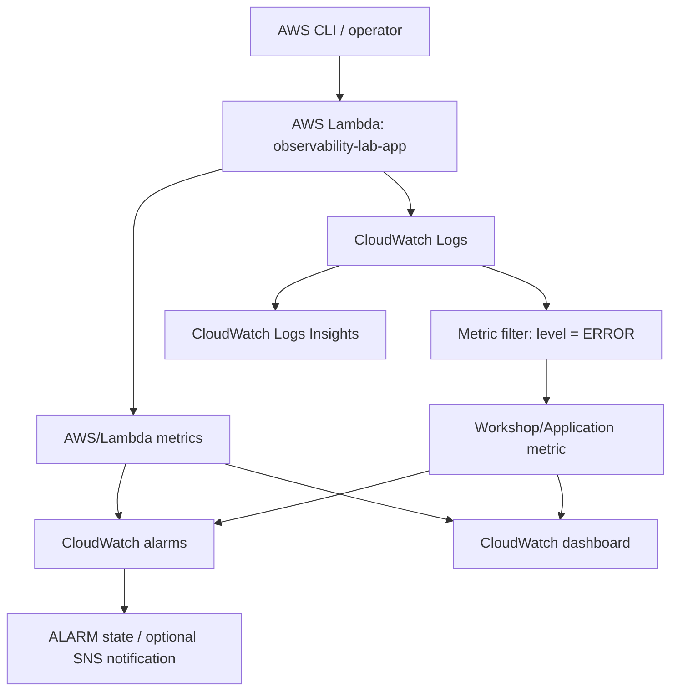

# Tạo dashboard, cảnh báo và thực hành điều tra lỗi ứng dụng

Một ứng dụng có thể vẫn nhận request nhưng bắt đầu trả lỗi, chậm hoặc timeout. Nếu chỉ chờ người dùng báo sự cố, đội vận hành sẽ phát hiện muộn và khó xác định nguyên nhân. Amazon CloudWatch cung cấp metrics, logs, dashboards và alarms để quan sát trạng thái ứng dụng, phát hiện bất thường và điều tra theo từng request.

Trong bài thực hành này, bạn tạo một AWS Lambda function nhỏ làm ứng dụng mẫu. Function có ba chế độ: chạy bình thường, chạy chậm và cố ý phát sinh lỗi. Bạn sẽ gọi function, đọc log JSON, tạo metric filter cho lỗi ứng dụng, thiết lập CloudWatch alarms và xây dashboard theo dõi invocation, error, throttle, duration và application error count. Sau đó, bạn điều tra một lần chạy lỗi bằng request ID và Logs Insights, xác nhận alarm chuyển sang ALARM, rồi dọn tài nguyên.

Bài lab thuộc module `CLOUD_PROVIDERS_AWS`, kết nối IAM, serverless compute, CloudWatch, logging, monitoring và troubleshooting. Bạn sẽ thực hành trong một Region và một tài khoản AWS sandbox.

Sau bài lab, bạn có thể:

- Tạo Lambda function có log cấu trúc và các tình huống normal/slow/fail.
- Phân biệt Lambda service metrics với application-level metrics.
- Tạo CloudWatch Logs metric filter để chuyển log event thành custom metric.
- Tạo CloudWatch alarm với ngưỡng, evaluation period và missing-data behavior.
- Xây CloudWatch dashboard hiển thị health, latency và error trends.
- Dùng CloudWatch Logs Insights tìm lỗi và tương quan theo request ID.
- Đọc alarm history, metric graph và log để xác định nguyên nhân.
- Xóa tài nguyên lab sau khi hoàn thành.

## 1. Kiến trúc và luồng thực hành

Bạn sẽ dùng một Lambda function được gọi trực tiếp bằng AWS CLI. Cách này tập trung vào quan sát ứng dụng và CloudWatch mà không cần dựng thêm API Gateway hoặc máy chủ.



Các tín hiệu được dùng:

| Tín hiệu | Nguồn | Mục đích |
|---|---|---|
| Invocations | AWS/Lambda | Số lần function được gọi |
| Errors | AWS/Lambda | Số invocation kết thúc bằng lỗi function |
| Throttles | AWS/Lambda | Số invocation bị throttle |
| Duration | AWS/Lambda | Thời gian thực thi function |
| ApplicationErrorCount | Metric filter từ log | Số log event có level ERROR |
| Request ID, errorCode | CloudWatch Logs | Điều tra một lần chạy cụ thể |
| Alarm state | CloudWatch Alarms | Phát hiện và thông báo khi vượt ngưỡng |

Lambda `Errors` là service metric: nó đếm invocation kết thúc bằng lỗi. `ApplicationErrorCount` là custom metric do metric filter tạo từ log. Hai số liệu thường có quan hệ nhưng không nhất thiết bằng nhau. Ví dụ ứng dụng có thể ghi ERROR rồi xử lý fallback và trả thành công; khi đó application error tăng nhưng Lambda Errors không tăng.

## 2. Chuẩn bị môi trường

Bạn cần:
- Một AWS account sandbox hoặc môi trường thực hành được cấp quyền.
- Quyền tạo/cập nhật/xóa Lambda function và execution role.
- Quyền `iam:PassRole` cho role mà Lambda sử dụng.
- Quyền đọc/ghi CloudWatch Logs, tạo metric filter, dashboard và alarms.
- AWS CLI v2 đã đăng nhập bằng profile/role hợp lệ, hoặc AWS CloudShell.
- Một Region thống nhất, ví dụ `ap-southeast-1`.

Không cần quyền AdministratorAccess nếu người quản trị có thể cấp các quyền tối thiểu cho lab. Không dùng tài khoản production hoặc log chứa dữ liệu thật.

Kiểm tra identity và Region:

```bash
aws sts get-caller-identity
aws configure get region
```

Nếu Region chưa được cấu hình, đặt biến cho các lệnh trong CloudShell:

```bash
export AWS_REGION=ap-southeast-1
export AWS_DEFAULT_REGION="$AWS_REGION"
export FUNCTION_NAME=observability-lab-app
export DASHBOARD_NAME=observability-lab-dashboard
export LOG_GROUP="/aws/lambda/${FUNCTION_NAME}"
```

`AWS_DEFAULT_REGION` là biến môi trường Region mà AWS CLI sử dụng; `AWS_REGION` giúp các SDK/app runtime dùng cùng Region. Nếu dùng Region khác, thay giá trị nhất quán trong mọi bước. Không trộn dashboard, alarm, Lambda và SNS topic giữa các Region.

## 3. Tạo Lambda function mẫu

Mở AWS Lambda Console, chọn đúng Region, sau đó:

1. Chọn **Create function**.
2. Chọn **Author from scratch**.
3. Function name: `observability-lab-app`.
4. Runtime: **Python 3.12**.
5. Architecture: **x86_64**.
6. Execution role: tạo role mới với quyền cơ bản ghi log vào CloudWatch Logs.
7. Chọn **Create function**.

Lambda cần execution role có quyền tạo log stream và ghi log events, thường được cấp qua managed policy `AWSLambdaBasicExecutionRole`. Không cần cấp quyền truy cập S3, DynamoDB hoặc Administrator cho function mẫu này.

Trong tab **Code**, thay nội dung file `lambda_function.py` bằng:

```python
import json
import time


def emit_log(level, event_name, request_id, **fields):
    record = {
        "level": level,
        "event": event_name,
        "requestId": request_id,
        **fields,
    }
    print(json.dumps(record, separators=(",", ":")))


def lambda_handler(event, context):
    event = event or {}
    mode = event.get("mode", "normal")
    request_id = context.aws_request_id

    emit_log(
        "INFO",
        "request_started",
        request_id,
        mode=mode,
    )

    if mode == "slow":
        time.sleep(2.5)

    if mode == "fail":
        emit_log(
            "ERROR",
            "simulated_dependency_failure",
            request_id,
            errorCode="SIMULATED_DEPENDENCY_TIMEOUT",
            dependency="inventory-service",
        )
        raise RuntimeError("SIMULATED_DEPENDENCY_TIMEOUT")

    result = {
        "ok": True,
        "mode": mode,
        "requestId": request_id,
    }

    emit_log(
        "INFO",
        "request_completed",
        request_id,
        mode=mode,
    )

    return result
```

Chọn **Deploy** để cập nhật code.

Đặt function timeout thành 10 giây trong **Configuration → General configuration → Edit → Timeout**, hoặc dùng CLI:

```bash
aws lambda update-function-configuration \
  --function-name "$FUNCTION_NAME" \
  --timeout 10
```

Timeout mặc định của Lambda là 3 giây; tăng lên 10 giây để chế độ `slow` chờ 2,5 giây mà không bị ảnh hưởng bởi cold start hoặc overhead khởi tạo.
Chờ `LastUpdateStatus` hiển thị `Successful` trước khi tiếp tục gọi function.

Function ghi mỗi event dưới dạng một JSON object trên một dòng. Khi `mode=fail`, function ghi một log có `level=ERROR`, sau đó raise exception. Lambda ghi nhận invocation đó là lỗi và tạo traceback trong log. Khi `mode=slow`, function chờ 2,5 giây để bạn quan sát Duration.

## 4. Kiểm tra function và CloudWatch log group

Chạy một invocation bình thường:

```bash
aws lambda invoke \
  --function-name "$FUNCTION_NAME" \
  --cli-binary-format raw-in-base64-out \
  --payload '{"mode":"normal"}' \
  normal-response.json

cat normal-response.json
```

Kết quả response dự kiến có `ok=true`, `mode=normal` và `requestId`.

Kiểm tra cấu hình function:

```bash
aws lambda get-function-configuration \
  --function-name "$FUNCTION_NAME" \
  --query '{State:State,Runtime:Runtime,Timeout:Timeout,MemorySize:MemorySize,Role:Role,LastUpdateStatus:LastUpdateStatus}'
```

Sau invocation đầu tiên, Lambda thường tạo log group:

```text
/aws/lambda/observability-lab-app
```

Kiểm tra log group:

```bash
aws logs describe-log-groups \
  --log-group-name-prefix "$LOG_GROUP" \
  --query 'logGroups[*].{Name:logGroupName,Retention:retentionInDays,StoredBytes:storedBytes}'
```

Nếu log group không xuất hiện, kiểm tra function đã chạy chưa và execution role có quyền `logs:CreateLogGroup`, `logs:CreateLogStream`, `logs:PutLogEvents` không.

## 5. Tạo metric filter từ application log

CloudWatch Logs metric filter tìm pattern trong log events và phát custom metric khi có event khớp. Trong lab này, mọi log record có `level=ERROR` sẽ tăng `ApplicationErrorCount` thêm 1.

Tạo metric filter:

```bash
aws logs put-metric-filter \
  --log-group-name "$LOG_GROUP" \
  --filter-name ApplicationErrors \
  --filter-pattern '{ $.level = "ERROR" }' \
  --metric-transformations \
    metricName=ApplicationErrorCount,metricNamespace=Workshop/Application,metricValue=1,unit=Count
```

Kiểm tra filter:

```bash
aws logs describe-metric-filters \
  --log-group-name "$LOG_GROUP" \
  --filter-name-prefix ApplicationErrors
```

Metric filter chỉ xử lý log events được ingest sau khi filter được tạo; nó không quét ngược log lịch sử. Vì vậy, bạn phải tạo filter trước khi phát sinh lỗi ở bước tiếp theo.

Không thêm dimension như request ID hoặc user ID vào metric filter. Dimension có cardinality cao có thể tạo số lượng custom metrics lớn và tăng chi phí. Request ID nên nằm trong log để điều tra, không dùng làm dimension metric.

## 6. Tạo CloudWatch alarms

Bạn sẽ tạo hai alarms:

- Lambda Errors: phát hiện invocation kết thúc bằng exception.
- ApplicationErrorCount: phát hiện log event ở mức ERROR.

Trong CloudWatch, metric data có thể xuất hiện trễ một vài phút sau invocation. Alarm ban đầu có thể ở trạng thái `INSUFFICIENT_DATA` cho tới khi có metric datapoint phù hợp.

### 6.1. Alarm cho Lambda Errors

```bash
aws cloudwatch put-metric-alarm \
  --alarm-name "${FUNCTION_NAME}-lambda-errors" \
  --namespace AWS/Lambda \
  --metric-name Errors \
  --dimensions Name=FunctionName,Value="$FUNCTION_NAME" \
  --statistic Sum \
  --period 60 \
  --evaluation-periods 1 \
  --datapoints-to-alarm 1 \
  --threshold 1 \
  --comparison-operator GreaterThanOrEqualToThreshold \
  --treat-missing-data notBreaching
```

Ý nghĩa:
- `period=60`: gom metric theo cửa sổ 60 giây.
- `evaluation-periods=1`: đánh giá một period.
- `datapoints-to-alarm=1`: chỉ cần một datapoint vi phạm để chuyển ALARM.
- `threshold=1`: một lỗi trong period là đủ.
- `treat-missing-data=notBreaching`: khi không có datapoint, coi là không vi phạm.

Ngưỡng này phù hợp cho lab để alarm chuyển trạng thái nhanh. Production cần chọn ngưỡng theo baseline, traffic và mức độ nghiêm trọng; một lỗi đơn lẻ có thể chỉ nên tạo warning nếu ứng dụng có retry/fallback.

### 6.2. Alarm cho ApplicationErrorCount

```bash
aws cloudwatch put-metric-alarm \
  --alarm-name "${FUNCTION_NAME}-application-errors" \
  --namespace Workshop/Application \
  --metric-name ApplicationErrorCount \
  --statistic Sum \
  --period 60 \
  --evaluation-periods 1 \
  --datapoints-to-alarm 1 \
  --threshold 1 \
  --comparison-operator GreaterThanOrEqualToThreshold \
  --treat-missing-data notBreaching
```

Metric này không có dimension. Nếu sau này bạn thêm dimension, alarm phải khai báo chính xác bộ dimensions tương ứng với metric.

### 6.3. Kiểm tra alarm

```bash
aws cloudwatch describe-alarms \
  --alarm-names \
    "${FUNCTION_NAME}-lambda-errors" \
    "${FUNCTION_NAME}-application-errors" \
  --query 'MetricAlarms[*].{Name:AlarmName,State:StateValue,Reason:StateReason,Metric:MetricName}'
```

Trước khi có lỗi, alarm có thể ở `OK` hoặc `INSUFFICIENT_DATA` tùy dữ liệu metric. Sau khi có lỗi, kiểm tra state và state reason.

### 6.4. (Tùy chọn) Gửi thông báo qua SNS

Nếu muốn nhận email khi alarm chuyển sang ALARM, tạo SNS topic và subscription:

```bash
export TOPIC_ARN=$(aws sns create-topic \
  --name observability-lab-alerts \
  --query TopicArn --output text)

aws sns subscribe \
  --topic-arn "$TOPIC_ARN" \
  --protocol email \
  --notification-endpoint your-email@example.com
```

Thay email mẫu bằng địa chỉ của bạn và xác nhận subscription trong email. Sau đó cập nhật alarm với `--alarm-actions "$TOPIC_ARN"`. Khi dùng SNS topic policy tùy chỉnh, bảo đảm CloudWatch được phép publish vào topic. Bạn vẫn có thể thực hành alarm state mà không cần bật SNS.

Ví dụ cập nhật alarm Lambda Errors để gửi notification tới topic (giữ nguyên các thông số đánh giá đã tạo):

```bash
aws cloudwatch put-metric-alarm \
  --alarm-name "${FUNCTION_NAME}-lambda-errors" \
  --namespace AWS/Lambda \
  --metric-name Errors \
  --dimensions Name=FunctionName,Value="$FUNCTION_NAME" \
  --statistic Sum \
  --period 60 \
  --evaluation-periods 1 \
  --datapoints-to-alarm 1 \
  --threshold 1 \
  --comparison-operator GreaterThanOrEqualToThreshold \
  --treat-missing-data notBreaching \
  --alarm-actions "$TOPIC_ARN"
```

## 7. Tạo CloudWatch dashboard

Dashboard sẽ hiển thị ba nhóm thông tin:
- Invocation, error và throttle count.
- Duration p95.
- Custom application error count.

Tạo file `dashboard.json` trong CloudShell bằng editor, dán nguyên khối JSON dưới đây và lưu file trong thư mục hiện tại:

```json
{
  "widgets": [
    {
      "type": "metric",
      "x": 0,
      "y": 0,
      "width": 12,
      "height": 6,
      "properties": {
        "view": "timeSeries",
        "region": "ap-southeast-1",
        "title": "Lambda invocations, errors and throttles",
        "period": 60,
        "stat": "Sum",
        "metrics": [
          ["AWS/Lambda", "Invocations", "FunctionName", "observability-lab-app"],
          [".", "Errors", ".", "."],
          [".", "Throttles", ".", "."]
        ]
      }
    },
    {
      "type": "metric",
      "x": 12,
      "y": 0,
      "width": 12,
      "height": 6,
      "properties": {
        "view": "timeSeries",
        "region": "ap-southeast-1",
        "title": "Lambda duration p95",
        "period": 60,
        "stat": "p95",
        "metrics": [
          ["AWS/Lambda", "Duration", "FunctionName", "observability-lab-app"]
        ]
      }
    },
    {
      "type": "metric",
      "x": 0,
      "y": 6,
      "width": 12,
      "height": 6,
      "properties": {
        "view": "timeSeries",
        "region": "ap-southeast-1",
        "title": "Application errors from log filter",
        "period": 60,
        "stat": "Sum",
        "metrics": [
          ["Workshop/Application", "ApplicationErrorCount"]
        ]
      }
    }
  ]
}
```

Nếu bạn dùng Region hoặc function name khác, thay các giá trị `region` và `observability-lab-app` trong JSON.

Đăng dashboard:

```bash
aws cloudwatch put-dashboard \
  --dashboard-name "$DASHBOARD_NAME" \
  --dashboard-body file://dashboard.json
```

Mở CloudWatch Console → Dashboards → `observability-lab-dashboard`. Đặt time range là 1 hour hoặc 3 hours và refresh dashboard sau khi tạo dữ liệu.

Dashboard chỉ là lớp hiển thị. Nó không tự tạo alarm hoặc sửa lỗi; alarms được cấu hình riêng ở bước trước.

## 8. Tạo dữ liệu bình thường, chậm và lỗi

Metric filter đã tồn tại và alarms đã được tạo. Bây giờ tạo ba tình huống.

### 8.1. Invocation bình thường

```bash
aws lambda invoke \
  --function-name "$FUNCTION_NAME" \
  --cli-binary-format raw-in-base64-out \
  --payload '{"mode":"normal"}' \
  normal-response.json

cat normal-response.json
```

Kỳ vọng:
- Function trả JSON với `ok=true`.
- CloudWatch Logs có `request_started` và `request_completed`.
- Lambda Invocations tăng.
- Lambda Errors không tăng.

### 8.2. Invocation chậm

```bash
aws lambda invoke \
  --function-name "$FUNCTION_NAME" \
  --cli-binary-format raw-in-base64-out \
  --payload '{"mode":"slow"}' \
  slow-response.json

cat slow-response.json
```

Kỳ vọng:
- Function vẫn thành công.
- Duration tăng khoảng 2,5 giây cộng thời gian xử lý.
- Lambda Errors không tăng.
- Dashboard Duration p95 có thể chưa thay đổi rõ nếu số invocation ít; xem period và time range phù hợp.

### 8.3. Cố ý tạo application error

```bash
aws lambda invoke \
  --function-name "$FUNCTION_NAME" \
  --cli-binary-format raw-in-base64-out \
  --payload '{"mode":"fail"}' \
  fail-response.json

cat fail-response.json
```

AWS CLI có thể trả response metadata gồm `FunctionError=Unhandled`; payload file chứa thông tin lỗi. Invocation API vẫn có thể trả HTTP status thành công ở lớp Invoke API trong khi function execution thất bại. Hãy kiểm tra cả `FunctionError`, response payload và Lambda Errors metric.

Function ghi log `SIMULATED_DEPENDENCY_TIMEOUT`, sau đó raise exception. Kết quả kỳ vọng:
- Lambda Errors tăng ít nhất 1.
- Metric filter tăng ApplicationErrorCount.
- Hai alarms chuyển sang ALARM sau khi metric được publish và evaluation hoàn tất.
- CloudWatch Logs có traceback và JSON error record.

Đây là lỗi giả lập có chủ đích, không gọi dịch vụ ngoài và không thay đổi dữ liệu thật.

## 9. Điều tra lỗi bằng CloudWatch Logs Insights

Mở CloudWatch Console → Logs → Logs Insights. Chọn log group:

```text
/aws/lambda/observability-lab-app
```

Chọn time range bao phủ thời điểm gọi `mode=fail`.

### 9.1. Tìm tất cả log mức ERROR

```sql
fields @timestamp, level, event, requestId, errorCode, dependency, @message
| filter level = "ERROR"
| sort @timestamp desc
| limit 50
```

### 9.2. Tìm lỗi dependency cụ thể

```sql
fields @timestamp, requestId, errorCode, dependency, @message
| filter errorCode = "SIMULATED_DEPENDENCY_TIMEOUT"
| sort @timestamp desc
```

### 9.3. Đếm lỗi theo loại trong từng khoảng 5 phút

```sql
fields @timestamp, errorCode
| filter level = "ERROR"
| stats count() as errorCount by errorCode, bin(5m)
| sort bin(5m) desc
```

### 9.4. Tương quan request

Lấy `requestId` từ kết quả lỗi rồi tìm mọi log event của request đó:

```sql
fields @timestamp, level, event, requestId, @message
| filter requestId = "REPLACE_WITH_REQUEST_ID"
| sort @timestamp asc
```

Thay giá trị mẫu bằng request ID thực tế. Nếu application gọi nhiều service, hãy truyền correlation ID xuyên suốt các service để điều tra toàn request thay vì chỉ một Lambda invocation.

CloudWatch Logs Insights tự khám phá field của JSON log event. Nếu field không xuất hiện, kiểm tra log line có phải JSON hợp lệ trên một dòng hay không; log wrapper hoặc multiline JSON có thể khiến field extraction khác dự kiến.

## 10. Đọc alarm và dashboard để tìm nguyên nhân

Khi alarm chuyển sang ALARM:

1. Mở CloudWatch → Alarms.
2. Chọn alarm `observability-lab-app-lambda-errors`.
3. Xem State reason và History.
4. Mở metric graph của alarm.
5. Đối chiếu timestamp với Lambda invocation và log event.
6. Mở dashboard để so sánh Invocations, Errors, Throttles, Duration và ApplicationErrorCount.
7. Mở Logs Insights và truy tìm request ID.

Diễn giải ví dụ:

| Quan sát | Khả năng | Bước tiếp theo |
|---|---|---|
| Errors tăng cùng ApplicationErrorCount | Function exception và log error cùng xuất hiện | Đọc traceback và errorCode |
| ApplicationErrorCount tăng nhưng Lambda Errors không tăng | App ghi ERROR nhưng đã bắt exception/fallback hoặc invocation vẫn thành công | Điều tra business path và fallback |
| Duration p95 tăng nhưng Errors không tăng | Dependency chậm, xử lý nặng hoặc cold start | Tìm request chậm và xem trace/dependency latency |
| Throttles tăng | Lambda concurrency/quota hoặc reserved concurrency | Kiểm tra concurrency và account quota |
| Invocations tăng đột biến, Errors tăng theo | Traffic spike hoặc input bất thường | Phân tích nguồn request, payload và error rate |
| Alarm INSUFFICIENT_DATA | Chưa có datapoint hoặc metric chưa được publish | Kiểm tra time range, dimension, filter và invocation |

Một alarm báo lỗi không tự chỉ ra root cause. Alarm là tín hiệu để bắt đầu điều tra; cần đối chiếu metric, log, request ID, deployment và dependency.

## 11. Phân biệt metric filter với metric Lambda

Metric filter chuyển log event thành metric. Lambda service metrics được phát tự động bởi Lambda service.

| Đặc điểm | Lambda Errors | ApplicationErrorCount |
|---|---|---|
| Nguồn | Lambda service | CloudWatch Logs metric filter |
| Tăng khi | Invocation kết thúc bằng lỗi | Log event khớp filter |
| Phụ thuộc log | Không | Có |
| Có thể đếm nhiều lần trong một invocation | Không theo cùng semantics invocation | Có thể, nếu function ghi nhiều ERROR events |
| Dùng để | Health của function runtime | Business/application-specific error signal |

Nếu function bắt exception, ghi log ERROR rồi trả response thành công, Lambda Errors không tăng nhưng ApplicationErrorCount vẫn tăng. Ngược lại, nếu function crash trước khi ghi log phù hợp, Lambda Errors có thể tăng nhưng metric filter không thấy error record. Nên dùng hai loại metric bổ trợ nhau.

Metric filter chỉ xử lý log mới sau khi filter được tạo. Khi thay đổi filter pattern, kiểm thử với event mới thay vì kỳ vọng metric lịch sử được tính lại.

## 12. Tạo alarm notification và severity trong production

Lab dùng ngưỡng 1 lỗi/60 giây để dễ quan sát. Production nên cân nhắc:
- Error rate thay vì chỉ error count khi traffic thay đổi lớn.
- Mức độ nghiêm trọng của lỗi.
- Số datapoints cần vi phạm.
- Evaluation periods và missing-data policy.
- Alarm cho duration p95, throttle, concurrency hoặc dependency failure.
- SNS, incident management hoặc ticket integration.
- Composite alarms để kết hợp nhiều tín hiệu và giảm alert noise.

Không đặt alarm trên một metric có cardinality cao. Không gửi email cho từng log event; hãy dùng alarm aggregation và notification routing.

Với Lambda, có thể tạo alarm cho `Duration` gần timeout, `Throttles`, `ConcurrentExecutions` hoặc `AsyncEventAge` tùy loại invocation. Với ứng dụng có API Gateway, bổ sung 4XX/5XX, IntegrationLatency và Latency metrics. Với database dependency, theo dõi connection, latency và throttling tương ứng.

## 13. Troubleshooting khi lab không hoạt động

| Triệu chứng | Nguyên nhân có thể | Cách kiểm tra |
|---|---|---|
| Lambda không ghi log | Execution role thiếu quyền CloudWatch Logs | Kiểm tra role policy và log group |
| Không tạo được function | Thiếu lambda create hoặc iam:PassRole | Xem AccessDenied và role ARN |
| Metric filter không tạo được | Sai log group hoặc thiếu logs permissions | Kiểm tra log group tồn tại và Region |
| ApplicationErrorCount không tăng | Filter tạo sau log event hoặc pattern không khớp | Invoke fail mới, kiểm tra JSON log |
| Lambda Errors không tăng | Function bắt exception và trả thành công | Kiểm tra code path và invocation result |
| Alarm ở INSUFFICIENT_DATA | Chưa có metric hoặc dimensions sai | Kiểm tra metric namespace/name/dimensions |
| Alarm không chuyển ALARM | Chưa có datapoint vi phạm hoặc period chưa kết thúc | Kiểm tra graph, threshold và evaluation |
| Dashboard trống | Sai Region, FunctionName hoặc metric chưa có dữ liệu | Kiểm tra dimensions và time range |
| Logs Insights không thấy field | Log không phải JSON một dòng | Mở raw log event và kiểm tra format |
| SNS không nhận email | Subscription chưa xác nhận hoặc topic policy | Xác nhận email và kiểm tra subscription/topic policy |

Lệnh kiểm tra log group:

```bash
aws logs describe-log-groups \
  --log-group-name-prefix "$LOG_GROUP"
```

Kiểm tra metric filters:

```bash
aws logs describe-metric-filters \
  --log-group-name "$LOG_GROUP"
```

Kiểm tra alarm state:

```bash
aws cloudwatch describe-alarms \
  --alarm-name-prefix "$FUNCTION_NAME" \
  --query 'MetricAlarms[*].{Name:AlarmName,State:StateValue,Reason:StateReason}'
```

## 14. Bài tập mở rộng

Sau khi hoàn thành lab cơ bản, thử các thay đổi sau:

1. Thêm mode `handled-error`: ghi log ERROR nhưng bắt exception và trả response thành công. Quan sát ApplicationErrorCount tăng nhưng Lambda Errors không tăng.
2. Thêm field `severity` và `service` vào JSON logs; tạo metric filter riêng cho một loại lỗi.
3. Tạo alarm cho Duration p95 gần Lambda timeout.
4. Tạo SNS topic, xác nhận email và gắn notification action vào alarm.
5. Thêm environment variable `APP_VERSION` và ghi version vào mọi log record để tương quan lỗi với deployment.
6. Tạo dashboard riêng cho từng môi trường dev/staging/prod bằng metric dimensions hoặc tên function riêng.
7. Thêm API Gateway HTTP API trước Lambda và so sánh Lambda Errors với API Gateway 5XX metrics.

Khi thêm dimension như `service` hoặc `APP_VERSION`, giữ cardinality thấp. Không dùng request ID, email hoặc user ID làm metric dimension.

## 15. Dọn dẹp tài nguyên

Xóa tài nguyên sau khi thực hành để tránh phát sinh chi phí CloudWatch custom metrics, alarms, log storage hoặc SNS.

Xóa alarms:

```bash
aws cloudwatch delete-alarms \
  --alarm-names \
    "${FUNCTION_NAME}-lambda-errors" \
    "${FUNCTION_NAME}-application-errors"
```

Xóa dashboard:

```bash
aws cloudwatch delete-dashboards \
  --dashboard-names "$DASHBOARD_NAME"
```

Xóa metric filter và Lambda function:

```bash
aws logs delete-metric-filter \
  --log-group-name "$LOG_GROUP" \
  --filter-name ApplicationErrors

aws lambda delete-function \
  --function-name "$FUNCTION_NAME"
```

Sau khi không cần log nữa, xóa log group:

```bash
aws logs delete-log-group \
  --log-group-name "$LOG_GROUP"
```

Nếu đã tạo SNS topic:
- Xóa topic bằng `aws sns delete-topic --topic-arn "$TOPIC_ARN"`.
- Việc xóa topic cũng xóa subscriptions của topic.
- Nếu execution role được tạo riêng cho lab, có thể xóa role sau khi detach policy `AWSLambdaBasicExecutionRole`; chỉ làm điều này khi chắc chắn role không được function hoặc workload khác dùng.

Metric datapoints đã phát vẫn có thể được giữ theo retention của CloudWatch; xóa metric filter sẽ dừng việc tạo datapoint mới. Kiểm tra Billing/Cost Explorer nếu cần xác nhận chi phí sau lab.

## 16. Tiêu chí hoàn thành

Bạn hoàn thành lab khi có thể chứng minh:

- [ ] Lambda function chạy thành công ở chế độ normal.
- [ ] Chế độ slow tạo Duration cao hơn rõ rệt.
- [ ] Chế độ fail tạo Lambda Errors và JSON log mức ERROR.
- [ ] Metric filter tạo ApplicationErrorCount từ log mới.
- [ ] Hai alarms được tạo đúng namespace, metric và dimensions.
- [ ] Alarm chuyển ALARM sau lần gọi fail.
- [ ] Dashboard hiển thị invocation, errors, throttles, duration và application error count.
- [ ] Logs Insights tìm được errorCode và requestId.
- [ ] Bạn giải thích được sự khác nhau giữa Lambda Errors và application log metric.
- [ ] Tài nguyên lab được xóa sau khi thực hành.

## 17. Tóm tắt kiến thức

CloudWatch metrics cho biết ứng dụng và dịch vụ đang hoạt động như thế nào theo thời gian; logs giữ chi tiết từng event; dashboard tổng hợp tín hiệu; alarms đánh giá metric theo threshold và evaluation period để phát hiện bất thường. Bốn thành phần bổ trợ nhau trong quy trình observability.

Trong lab, Lambda service metrics phản ánh trạng thái invocation, còn metric filter chuyển JSON log event thành application-specific metric. Logs Insights giúp tìm errorCode, request ID và chuỗi sự kiện xung quanh lỗi. Khi alarm chuyển ALARM, hãy đối chiếu alarm history, metric graph, Lambda logs và request context để tìm nguyên nhân.

Production monitoring cần baseline, error rate, latency percentile, missing-data policy, severity và notification routing phù hợp. Sau khi sửa lỗi, xác minh metric và business success rate trở lại bình thường, rồi dọn tài nguyên lab hoặc cập nhật dashboard/runbook theo quy trình vận hành.

## Tài liệu tham khảo

- [Amazon CloudWatch dashboards](https://docs.aws.amazon.com/AmazonCloudWatch/latest/monitoring/CloudWatch_Dashboards.html)
- [Using CloudWatch alarms](https://docs.aws.amazon.com/AmazonCloudWatch/latest/monitoring/AlarmThatSendsEmail.html)
- [Creating CloudWatch alarms based on metrics](https://docs.aws.amazon.com/AmazonCloudWatch/latest/monitoring/AlarmThatSendsEmail.html)
- [Creating metrics from log events using filters](https://docs.aws.amazon.com/AmazonCloudWatch/latest/logs/MonitoringLogData.html)
- [CloudWatch Logs filter and pattern syntax](https://docs.aws.amazon.com/AmazonCloudWatch/latest/logs/FilterAndPatternSyntax.html)
- [Analyzing log data with CloudWatch Logs Insights](https://docs.aws.amazon.com/AmazonCloudWatch/latest/logs/AnalyzingLogData.html)
- [AWS Lambda metrics](https://docs.aws.amazon.com/lambda/latest/dg/monitoring-metrics.html)
- [Using CloudWatch Logs with AWS Lambda](https://docs.aws.amazon.com/lambda/latest/dg/monitoring-cloudwatchlogs.html)
- [AWS Lambda execution role](https://docs.aws.amazon.com/lambda/latest/dg/lambda-intro-execution-role.html)
- [Publishing custom metrics](https://docs.aws.amazon.com/AmazonCloudWatch/latest/monitoring/publishingMetrics.html)
- [Amazon SNS email notifications](https://docs.aws.amazon.com/sns/latest/dg/sns-email-notifications.html)

