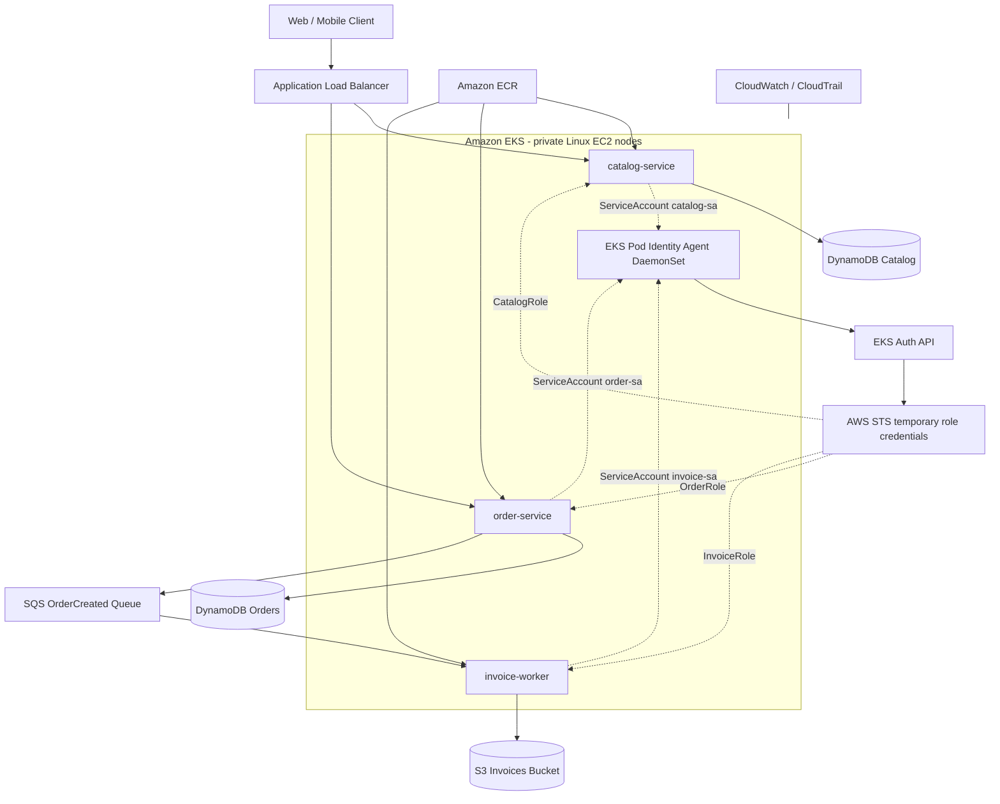
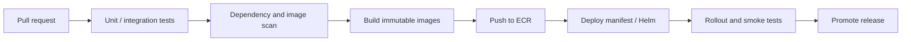

# Triển khai microservices Java lên EKS với workload identity

## 1. Giới thiệu capstone

Trong dự án này, bạn xây dựng một nền tảng thương mại điện tử nhỏ gồm các microservices Java chạy trên Amazon Elastic Kubernetes Service (Amazon EKS). Các service dùng AWS services để lưu dữ liệu, gửi sự kiện và lưu hóa đơn. Mỗi workload nhận một IAM role riêng thông qua Kubernetes ServiceAccount và EKS Pod Identity.

Mục tiêu quan trọng nhất là triển khai workload identity đúng cách: một Pod chỉ có quyền AWS cần thiết cho chức năng của nó, sử dụng temporary credentials được làm mới tự động, không chứa access key tĩnh và không thừa hưởng quyền dữ liệu của EC2 node role.

Capstone dùng **EKS Pod Identity** làm luồng triển khai chính trên Linux EC2 managed node group. Phần cuối so sánh **IAM Roles for Service Accounts (IRSA)** để người học biết cách xử lý môi trường cần OIDC federation hoặc không đáp ứng giới hạn của Pod Identity.

### Bối cảnh nghiệp vụ

Một cửa hàng trực tuyến cần hiển thị catalog sản phẩm, tiếp nhận đơn hàng và lưu trạng thái đơn, phát sự kiện khi đơn hàng được tạo, xử lý sự kiện bất đồng bộ để tạo hóa đơn JSON và lưu vào Amazon S3, cho phép nhóm vận hành triển khai, quan sát và mở rộng từng service độc lập.

Bạn sẽ triển khai ba workload:

| Workload | Trách nhiệm | AWS access |
|---|---|---|
| `catalog-service` | Đọc thông tin sản phẩm | DynamoDB `GetItem`, `Query` trên Catalog table |
| `order-service` | Tạo/đọc đơn hàng, gửi OrderCreated event | DynamoDB `PutItem`, `GetItem` trên Orders table; SQS `SendMessage` |
| `invoice-worker` | Nhận event và lưu hóa đơn | SQS receive/delete/visibility; S3 `PutObject` trong prefix hóa đơn |

Mỗi workload có Kubernetes ServiceAccount và IAM role riêng. Các quyền được tách theo chức năng để nếu một service bị xâm nhập, blast radius bị giới hạn.

## 2. Mục tiêu và năng lực cần chứng minh

Hoàn thành capstone khi bạn có thể:

1. Thiết kế EKS cluster có control plane endpoint, VPC, private subnets và managed node group phù hợp.
2. Phân biệt Kubernetes identity, AWS IAM identity, node role và workload role.
3. Cài EKS Pod Identity Agent và xác minh agent hoạt động trên các Linux EC2 nodes.
4. Tạo trust policy cho `pods.eks.amazonaws.com` và giới hạn namespace/ServiceAccount bằng session tags.
5. Gán IAM role cho ServiceAccount bằng EKS Pod Identity association.
6. Cấp quyền tối thiểu cho DynamoDB, SQS và S3 theo từng microservice.
7. Dùng AWS SDK for Java 2.x với default credential provider chain.
8. Build container image, push lên Amazon ECR và triển khai Deployment/Service/Ingress trên EKS.
9. Chứng minh mỗi Pod nhận đúng IAM role và không dùng node role hay static credentials.
10. Kiểm thử cả trường hợp được phép và bị từ chối (positive/negative authorization tests).
11. Thiết lập health checks, resource requests/limits, logging, metrics và rollout.
12. Vận hành pipeline bất đồng bộ có retry, dead-letter queue và idempotency.

## 3. Kiến trúc tổng thể



Các đường chính:

- **Request path:** client → ALB → Kubernetes Service → Pod.
- **Data path:** catalog/order services → DynamoDB; order service → SQS; invoice worker → SQS → S3.
- **Identity path:** ServiceAccount → Pod Identity association → Pod Identity Agent → EKS Auth API → temporary IAM role credentials.
- **Delivery path:** CI pipeline → ECR → EKS Deployment rollout.

ALB chỉ expose HTTP entry points. DynamoDB, SQS và S3 được gọi bằng AWS SDK từ trong Pod; không cần expose chúng ra internet.

## 4. Phạm vi dự án và giả định

### Trong phạm vi

- Java 21 và Spring Boot 3.x.
- AWS SDK for Java 2.x.
- Amazon EKS trên Linux EC2 managed node group.
- EKS Pod Identity Agent và IAM role associations.
- Amazon ECR, DynamoDB, SQS, S3.
- AWS Load Balancer Controller đã được platform team cài đặt, hoặc EKS Auto Mode cung cấp khả năng load balancing tương ứng.
- Kubernetes Deployments, Services, Ingress, HPA và NetworkPolicy.
- CloudWatch/CloudTrail cho vận hành và audit.

### Ngoài phạm vi

- Thiết kế frontend hoàn chỉnh.
- Thanh toán thật hoặc tích hợp ngân hàng.
- Multi-region active-active.
- Service mesh bắt buộc.
- Xây dựng Kubernetes control plane tự quản lý.
- Dùng static AWS access keys, node role rộng quyền hoặc chia sẻ một IAM role cho tất cả Pods.

### Giả định triển khai

Chọn Region có hỗ trợ EKS, EKS Pod Identity, DynamoDB, SQS, S3 và các instance type cần thiết. Ví dụ lệnh dùng biến `AWS_REGION`; thay bằng Region được tổ chức phê duyệt. Chọn Kubernetes version còn trong vòng đời hỗ trợ của EKS tại thời điểm tạo cluster và đồng bộ version `kubectl`/`eksctl`.

## 5. Yêu cầu chức năng

### 5.1. Catalog service

- `GET /api/products/{productId}` đọc một sản phẩm từ Catalog table.
- `GET /api/products?category=...` truy vấn theo partition key hoặc index được thiết kế.
- Không được ghi hoặc xóa catalog item.

### 5.2. Order service

- `POST /api/orders` nhận order ID, customer ID, items và tổng tiền.
- Ghi order vào Orders table.
- Gửi message `OrderCreated` đến SQS sau khi lưu thành công.
- `GET /api/orders/{orderId}` đọc trạng thái đơn.
- Không được ghi vào S3 invoice prefix hoặc đọc catalog table nếu nghiệp vụ không yêu cầu.

Để tránh tạo đơn trùng khi client retry, API nhận `Idempotency-Key`. Order service lưu key cùng order ID hoặc dùng conditional write trong DynamoDB.

### 5.3. Invoice worker

- Nhận message từ SQS.
- Validate schema và order ID.
- Tạo invoice JSON.
- Ghi object vào `s3://<invoice-bucket>/invoices/<orderId>.json`.
- Xóa message khỏi queue chỉ sau khi lưu thành công.
- Nếu xử lý lỗi, retry theo visibility timeout và chuyển message vượt số lần retry sang DLQ.

SQS Standard Queue có delivery semantics at-least-once; worker phải xử lý duplicate messages an toàn.

## 6. Yêu cầu phi chức năng

| Nhóm | Yêu cầu |
|---|---|
| Identity | Temporary credentials, một IAM role riêng cho từng workload |
| Authorization | Least privilege; test cả allowed và denied actions |
| Availability | Ít nhất hai compute nodes ở nhiều AZ nếu capacity/cluster design cho phép |
| Security | Node nằm trong private subnets; API endpoint được giới hạn; image và Pod được harden |
| Reliability | Retry có giới hạn, DLQ, idempotency và graceful shutdown |
| Observability | Structured logs, metrics, traces và CloudTrail audit |
| Scalability | HPA theo CPU/memory hoặc custom metrics; node scaling có giới hạn |
| Delivery | Immutable image tag/digest, rollout có readiness gate và rollback |
| Cost | Tắt lab resources sau khi hoàn thành; DynamoDB/SQS/S3 dùng cấu hình lab tiết kiệm |

## 7. Thiết kế dữ liệu

### 7.1. DynamoDB Catalog table

- Table name: `Catalog`.
- Partition key: `productId` (String).
- Thuộc tính gợi ý: `name`, `category`, `price`, `currency`, `active`, `updatedAt`.
- Nếu cần query theo category, tạo GSI với partition key `category` và sort key phù hợp.

### 7.2. DynamoDB Orders table

- Table name: `Orders`.
- Partition key: `orderId` (String).
- Thuộc tính gợi ý: `customerId`, `items`, `totalAmount`, `currency`, `status`, `createdAt`, `idempotencyKey`.
- Có thể thêm GSI theo `customerId` và `createdAt` nếu cần truy vấn lịch sử khách hàng.

Dùng DynamoDB on-demand capacity cho lab để đơn giản hóa capacity planning. Với production, đánh giá request pattern, hot partition, consistency, TTL và backup/PITR.

### 7.3. SQS và S3

- Queue: `order-created`.
- DLQ: `order-created-dlq`.
- Cấu hình redrive policy, retention, visibility timeout và long polling.
- S3 bucket: `<account>-<region>-commerce-invoices`.
- Prefix đầu ra: `invoices/`.
- Bật Block Public Access, encryption, versioning nếu phù hợp và lifecycle policy.
- Không dùng bucket policy public để cho phép worker ghi hóa đơn.

## 8. Thiết kế EKS cluster và network

Tạo EKS cluster trong VPC có public và private subnets ở ít nhất hai Availability Zones. Đặt managed node group trong private subnets; chỉ ALB internet-facing nằm ở public subnets khi ứng dụng cần truy cập từ internet.

Khuyến nghị:

- Bật private API endpoint access để node-to-control-plane traffic ở trong VPC.
- Nếu bật public endpoint cho quản trị viên, giới hạn `publicAccessCidrs` theo dải IP quản trị/VPN.
- Dùng EKS access entries để cấp quyền quản trị cluster cho IAM principals.
- Dùng security groups để giới hạn traffic vào cluster endpoint, nodes, ALB và data services.
- Dùng NAT Gateway hoặc VPC endpoints theo yêu cầu egress và chi phí.
- Với private nodes, bảo đảm có đường truy cập ECR, S3, STS/EKS Auth API và các AWS APIs cần thiết.
- Nếu node private subnet dùng Pod Identity Agent và không có NAT/egress phù hợp, tạo interface VPC endpoint cho EKS Auth API (service name dạng `com.amazonaws.<region>.eks-auth`).
- Không mở rộng security group của node cho toàn bộ internet.

EKS Pod Identity Agent cần truy cập EKS Auth API. Với private subnet, thiếu endpoint/route tới EKS Auth API là một nguyên nhân phổ biến khiến Pod không lấy được credentials.

## 9. Workload identity: các lớp danh tính cần phân biệt

Có ba danh tính độc lập:

1. **IAM identity của người vận hành/CI:** ai được phép tạo cluster, deploy manifest, tạo role hoặc association.
2. **Node IAM role:** quyền nền tảng cho EC2 worker node, kubelet, image pull và agent. Role này không nên chứa quyền đọc Catalog, ghi Orders, gửi SQS hoặc ghi invoice S3.
3. **Workload IAM role:** quyền AWS mà ứng dụng trong Pod cần để thực hiện nghiệp vụ. Role được gắn với Kubernetes ServiceAccount.

Kubernetes ServiceAccount xác định workload trong cluster. IAM role xác định workload được phép gọi API AWS nào. EKS Pod Identity association nối hai hệ thống qua cặp cluster + namespace + ServiceAccount.

Không gắn cùng một role quyền rộng vào namespace hoặc toàn cluster. Tạo role riêng cho `catalog-sa`, `order-sa` và `invoice-sa`.

## 10. Chọn EKS Pod Identity hay IRSA?

| Tiêu chí | EKS Pod Identity | IRSA |
|---|---|---|
| Cơ chế | EKS association + Pod Identity Agent + EKS Auth API | OIDC projected token + STS AssumeRoleWithWebIdentity |
| Cấu hình IAM trust | Service principal `pods.eks.amazonaws.com` | OIDC provider của cluster |
| ServiceAccount annotation | Không cần annotation | Gắn role ARN bằng annotation |
| SDK | Container credential provider trong default chain | Web identity token provider |
| Agent | Cần agent trên EC2 Linux nodes; tích hợp sẵn trong EKS Auto Mode | Không cần Pod Identity Agent |
| Tương thích | Linux EC2 worker nodes | Hỗ trợ nhiều kiểu compute hơn, gồm Fargate |
| Quản lý nhiều cluster | Role trust có thể tái sử dụng, giới hạn bằng session tags | Trust policy thường gắn OIDC provider của từng cluster |

Capstone dùng EKS Pod Identity vì cấu hình association nằm trong EKS API, role trust có thể tái sử dụng giữa clusters và agent lấy credentials tập trung qua EKS Auth API.

**Giới hạn cần nhớ:** EKS Pod Identity không dùng được cho Pods chạy trên Fargate, Windows EC2 nodes, EKS on Outposts hoặc EKS Anywhere. Chọn Linux EC2 worker nodes cho bài thực hành. Nếu workload phải chạy trên Fargate, xem xét IRSA.


## 11. EKS Pod Identity hoạt động như thế nào?

Khi Pod dùng ServiceAccount đã có EKS Pod Identity association, EKS bổ sung thông tin để SDK tìm credential endpoint cục bộ. Luồng thực thi:

1. Pod được tạo trong namespace và dùng đúng ServiceAccount.
2. EKS đưa vào Pod projected token có audience `pods.eks.amazonaws.com`, cùng các biến môi trường trỏ tới container credential endpoint.
3. Pod Identity Agent chạy dạng DaemonSet trên node nhận yêu cầu từ Pod.
4. Agent gọi EKS Auth API bằng quyền node role `eks-auth:AssumeRoleForPodIdentity`.
5. EKS Auth API trả temporary credentials của IAM role được association chỉ định.
6. Agent phục vụ credentials cho AWS SDK trong container; SDK tự refresh khi credentials gần hết hạn.

Pod Identity association được lưu trong EKS API, không phải annotation trên Kubernetes ServiceAccount. Vì vậy `kubectl describe serviceaccount` không hiển thị role ARN. Kiểm tra association bằng AWS CLI.

Các biến môi trường thường được EKS thêm vào Pod:

- `AWS_CONTAINER_CREDENTIALS_FULL_URI`
- `AWS_CONTAINER_AUTHORIZATION_TOKEN_FILE`

Không in nội dung token file hoặc credential response vào log. Chỉ kiểm tra biến có tồn tại, không dump token.

### 11.1. Credential provider chain trong Java

AWS SDK for Java 2.x có default credentials provider chain. Container credentials provider là một bước trong chain và có thể lấy credentials từ Pod Identity Agent.

Các nguồn credentials được xét trước container provider có thể thắng. Do đó, biến `AWS_ACCESS_KEY_ID`, `AWS_SECRET_ACCESS_KEY`, Java system properties, profile hoặc web identity config còn sót trong container có thể khiến ứng dụng dùng nhầm identity.

Trong EKS:

- Không bake access key vào image.
- Không tạo Kubernetes Secret chứa AWS access key.
- Không set `AWS_ACCESS_KEY_ID`/`AWS_SECRET_ACCESS_KEY`.
- Không mount `~/.aws/credentials` vào Pod.
- Không cấu hình credentials provider tĩnh trong Java code.
- Chỉ cấu hình Region và resource endpoint cần thiết.

## 12. Thiết kế IAM roles theo từng workload

Dùng một role cho mỗi ServiceAccount. Bảng dưới đây là permission contract của dự án:

| IAM role | ServiceAccount | Resource | Allowed actions | Not granted by this role |
|---|---|---|---|---|
| `commerce-catalog-role` | `catalog-sa` | Catalog table và index | `dynamodb:GetItem`, `dynamodb:Query` | PutItem, UpdateItem, DeleteItem; SQS; S3 |
| `commerce-order-role` | `order-sa` | Orders table, OrderCreated queue | `dynamodb:GetItem`, `dynamodb:PutItem`, `sqs:SendMessage` | Catalog write, S3 invoice, SQS receive/delete |
| `commerce-invoice-role` | `invoice-sa` | OrderCreated queue, invoice prefix | `sqs:ReceiveMessage`, `DeleteMessage`, `ChangeMessageVisibility`, `GetQueueAttributes`; `s3:PutObject` | DynamoDB; S3 read/list ngoài nhu cầu |

Đây là cách kiểm soát theo quyền được cấp: IAM policy chỉ Allow những action cần thiết và không có policy Allow rộng hơn. Không cần tạo explicit Deny cho mọi action không dùng, nhưng cần rà soát attached policies, permissions boundaries và SCP để chắc chắn không có quyền bổ sung.

### 12.1. Node role không phải workload role

Node role chỉ cấp quyền nền tảng cần thiết cho kubelet, ECR image pull và Pod Identity Agent. Thường gồm `AmazonEKSWorkerNodePolicy` và `AmazonEC2ContainerRegistryPullOnly`; VPC CNI permissions nên gắn vào role riêng cho add-on theo hướng dẫn EKS.

`AmazonEKSWorkerNodePolicy` hiện cung cấp quyền `eks-auth:AssumeRoleForPodIdentity` cho agent. Nếu thay bằng custom node policy, phải cấp action này với resource/conditions phù hợp. Agent không cần một workload IAM role riêng.

Không gắn quyền `dynamodb:*`, `sqs:*` hoặc `s3:*` cho node role chỉ để làm ứng dụng chạy được. Nếu Pod Identity sai, sửa association/trust/agent/SDK; không mở rộng node role để né lỗi.

## 13. Trust policy cho EKS Pod Identity

Pod Identity role cần trust principal là service `pods.eks.amazonaws.com`, với hai actions `sts:AssumeRole` và `sts:TagSession`. Session tags cho phép giới hạn role theo namespace và ServiceAccount.

Ví dụ trust policy cho `commerce-order-role`:

```json
{
  "Version": "2012-10-17",
  "Statement": [
    {
      "Sid": "AllowOrderServicePodIdentity",
      "Effect": "Allow",
      "Principal": {
        "Service": "pods.eks.amazonaws.com"
      },
      "Action": [
        "sts:AssumeRole",
        "sts:TagSession"
      ],
      "Condition": {
        "StringEquals": {
          "aws:RequestTag/kubernetes-namespace": "commerce",
          "aws:RequestTag/kubernetes-service-account": "order-sa"
        }
      }
    }
  ]
}
```

Tạo trust policy tương ứng cho `catalog-sa` và `invoice-sa`. Điều kiện namespace/service-account làm rõ workload nào được phép assume role. Nếu tổ chức có nhiều cluster, có thể bổ sung điều kiện session tag cluster theo danh sách tag EKS Pod Identity hiện hành và kiểm tra chính xác key trong tài liệu AWS.

Không dùng wildcard namespace/service-account trong production nếu không có lý do rõ ràng. Role có quyền càng lớn thì trust policy càng cần giới hạn chặt.

## 14. Permission policies tối thiểu

Thay `ACCOUNT_ID`, `AWS_REGION`, table, queue và bucket bằng ARN thật. Ví dụ sử dụng inline policy để dễ hiểu; production nên quản lý policy bằng IaC và review qua pull request.

### 14.1. Catalog role

```json
{
  "Version": "2012-10-17",
  "Statement": [
    {
      "Sid": "ReadCatalog",
      "Effect": "Allow",
      "Action": [
        "dynamodb:GetItem",
        "dynamodb:Query"
      ],
      "Resource": [
        "arn:aws:dynamodb:AWS_REGION:ACCOUNT_ID:table/Catalog",
        "arn:aws:dynamodb:AWS_REGION:ACCOUNT_ID:table/Catalog/index/*"
      ]
    }
  ]
}
```

Nếu service chỉ dùng `GetItem`, bỏ `Query` và index ARN. Không cấp `Scan` chỉ để tiện debug; thiết kế key/index cho access pattern thực tế.

### 14.2. Order role

```json
{
  "Version": "2012-10-17",
  "Statement": [
    {
      "Sid": "WriteAndReadOrders",
      "Effect": "Allow",
      "Action": [
        "dynamodb:GetItem",
        "dynamodb:PutItem"
      ],
      "Resource": "arn:aws:dynamodb:AWS_REGION:ACCOUNT_ID:table/Orders"
    },
    {
      "Sid": "PublishOrderEvents",
      "Effect": "Allow",
      "Action": "sqs:SendMessage",
      "Resource": "arn:aws:sqs:AWS_REGION:ACCOUNT_ID:order-created"
    }
  ]
}
```

Nếu order API có chức năng cập nhật trạng thái, bổ sung `dynamodb:UpdateItem` sau khi review access pattern. Nếu dùng DynamoDB transaction, chỉ bổ sung actions transaction thật sự cần thiết và giới hạn resource tương ứng.

### 14.3. Invoice worker role

```json
{
  "Version": "2012-10-17",
  "Statement": [
    {
      "Sid": "ConsumeOrderEvents",
      "Effect": "Allow",
      "Action": [
        "sqs:ReceiveMessage",
        "sqs:DeleteMessage",
        "sqs:ChangeMessageVisibility",
        "sqs:GetQueueAttributes"
      ],
      "Resource": "arn:aws:sqs:AWS_REGION:ACCOUNT_ID:order-created"
    },
    {
      "Sid": "WriteInvoiceObjects",
      "Effect": "Allow",
      "Action": "s3:PutObject",
      "Resource": "arn:aws:s3:::INVOICE_BUCKET/invoices/*"
    }
  ]
}
```

Nếu bucket dùng SSE-KMS customer-managed key, worker cần quyền KMS tối thiểu phù hợp như `kms:GenerateDataKey` trên key đó và key policy phải cho phép role. Nếu dùng S3-managed encryption, không thêm quyền KMS không cần thiết.

`PutObject` vào prefix cụ thể không tự cấp `ListBucket`, `GetObject` hoặc `DeleteObject`. Đây là hành vi mong muốn cho worker chỉ tạo hóa đơn.

## 15. Tạo IAM roles và Pod Identity associations

Thực hiện bằng IAM administrator hoặc pipeline hạ tầng có quyền giới hạn. Người deploy cần `eks:CreatePodIdentityAssociation` và `iam:PassRole` cho các role được gán.

### 15.1. Tạo roles và policies

Lưu trust documents và permission policies thành file JSON. Tạo role:

```bash
aws iam create-role \
  --role-name commerce-catalog-role \
  --assume-role-policy-document file://catalog-trust.json

aws iam put-role-policy \
  --role-name commerce-catalog-role \
  --policy-name catalog-read \
  --policy-document file://catalog-permissions.json

aws iam create-role \
  --role-name commerce-order-role \
  --assume-role-policy-document file://order-trust.json

aws iam put-role-policy \
  --role-name commerce-order-role \
  --policy-name order-access \
  --policy-document file://order-permissions.json

aws iam create-role \
  --role-name commerce-invoice-role \
  --assume-role-policy-document file://invoice-trust.json

aws iam put-role-policy \
  --role-name commerce-invoice-role \
  --policy-name invoice-access \
  --policy-document file://invoice-permissions.json
```

Trong production, ưu tiên managed policies có versioning, tagging và IaC thay vì inline policy rải rác. Tách quyền tạo role, cập nhật policy và deploy workload theo separation of duties.

### 15.2. Cài Pod Identity Agent

Với cluster dùng Linux EC2 managed node groups:

```bash
aws eks create-addon \
  --cluster-name java-commerce \
  --addon-name eks-pod-identity-agent \
  --region "$AWS_REGION"

kubectl get pods -n kube-system | grep 'eks-pod-identity-agent'
```

Đảm bảo node role có `eks-auth:AssumeRoleForPodIdentity`. Nếu dùng managed `AmazonEKSWorkerNodePolicy`, quyền này đã được cung cấp theo tài liệu EKS hiện hành.

EKS Auto Mode đã tích hợp Pod Identity Agent; không cài add-on lần nữa trên cluster Auto Mode. Kiểm tra trạng thái add-on và pod trên từng node trước khi tạo association.

### 15.3. Tạo associations

```bash
aws eks create-pod-identity-association \
  --cluster-name java-commerce \
  --namespace commerce \
  --service-account catalog-sa \
  --role-arn "arn:aws:iam::$ACCOUNT_ID:role/commerce-catalog-role" \
  --region "$AWS_REGION"

aws eks create-pod-identity-association \
  --cluster-name java-commerce \
  --namespace commerce \
  --service-account order-sa \
  --role-arn "arn:aws:iam::$ACCOUNT_ID:role/commerce-order-role" \
  --region "$AWS_REGION"

aws eks create-pod-identity-association \
  --cluster-name java-commerce \
  --namespace commerce \
  --service-account invoice-sa \
  --role-arn "arn:aws:iam::$ACCOUNT_ID:role/commerce-invoice-role" \
  --region "$AWS_REGION"
```

Các ServiceAccount phải tồn tại trong namespace khi Pod khởi chạy. Tạo associations trước khi deploy Pods. Khi đổi association, rollout/recreate Pods để chúng nhận cấu hình identity mới.

IAM role được gán trực tiếp qua Pod Identity association phải nằm trong cùng AWS account với EKS cluster. Nếu dữ liệu đích ở account khác, dùng role chaining/target role theo mô hình cross-account của Pod Identity; không trỏ association trực tiếp tới role ngoài account cluster.

Kiểm tra:

```bash
aws eks list-pod-identity-associations \
  --cluster-name java-commerce \
  --namespace commerce \
  --region "$AWS_REGION"
```


## 16. Tích hợp AWS SDK for Java 2.x

EKS Pod Identity cung cấp credentials thông qua container credential provider. Ứng dụng Java không cần biết IAM role ARN, không gọi STS AssumeRole thủ công và không đọc token file.

AWS SDK for Java 2.x cần version **2.21.30 trở lên** để hỗ trợ EKS Pod Identity. Dùng BOM để giữ các module SDK cùng version.

### 16.1. Maven dependencies

```xml
<project xmlns="http://maven.apache.org/POM/4.0.0"
         xmlns:xsi="http://www.w3.org/2001/XMLSchema-instance"
         xsi:schemaLocation="http://maven.apache.org/POM/4.0.0 https://maven.apache.org/xsd/maven-4.0.0.xsd">
  <modelVersion>4.0.0</modelVersion>
  <parent>
    <groupId>org.springframework.boot</groupId>
    <artifactId>spring-boot-starter-parent</artifactId>
    <version>3.5.0</version>
    <relativePath/>
  </parent>
  <groupId>com.example</groupId>
  <artifactId>order-service</artifactId>
  <version>1.0.0</version>
  <properties>
    <java.version>21</java.version>
    <maven.compiler.release>21</maven.compiler.release>
  </properties>
  <dependencyManagement>
    <dependencies>
      <dependency>
        <groupId>software.amazon.awssdk</groupId>
        <artifactId>bom</artifactId>
        <version>2.21.30</version>
        <type>pom</type>
        <scope>import</scope>
      </dependency>
    </dependencies>
  </dependencyManagement>
  <dependencies>
    <dependency>
      <groupId>org.springframework.boot</groupId>
      <artifactId>spring-boot-starter-web</artifactId>
    </dependency>
    <dependency>
      <groupId>org.springframework.boot</groupId>
      <artifactId>spring-boot-starter-actuator</artifactId>
    </dependency>
    <dependency>
      <groupId>software.amazon.awssdk</groupId>
      <artifactId>dynamodb</artifactId>
    </dependency>
    <dependency>
      <groupId>software.amazon.awssdk</groupId>
      <artifactId>sqs</artifactId>
    </dependency>
    <dependency>
      <groupId>software.amazon.awssdk</groupId>
      <artifactId>s3</artifactId>
    </dependency>
    <dependency>
      <groupId>software.amazon.awssdk</groupId>
      <artifactId>sts</artifactId>
    </dependency>
  </dependencies>
  <build>
    <plugins>
      <plugin>
        <groupId>org.springframework.boot</groupId>
        <artifactId>spring-boot-maven-plugin</artifactId>
      </plugin>
    </plugins>
  </build>
</project>
```

Version trên là mức tối thiểu được tài liệu EKS công bố cho Java SDK v2; trong dự án thật, chọn bản 2.x mới hơn đã được kiểm thử, pin version và cập nhật dependency có kiểm soát.

POM hoàn chỉnh cần kế thừa Spring Boot parent/BOM và khai báo spring-boot-maven-plugin để đóng gói executable JAR. Đường dẫn JAR trong Dockerfile phải khớp với artifact name/version của module Maven.

### 16.2. Khởi tạo AWS clients

Ví dụ cấu hình Spring:

```java
@Configuration
public class AwsClientConfiguration {
    @Bean
    DynamoDbClient dynamoDbClient(
            @Value("#{systemEnvironment['AWS_REGION']}") String region) {
        return DynamoDbClient.builder()
                .region(Region.of(region))
                .build();
    }

    @Bean
    SqsClient sqsClient(
            @Value("#{systemEnvironment['AWS_REGION']}") String region) {
        return SqsClient.builder()
                .region(Region.of(region))
                .build();
    }

    @Bean
    S3Client s3Client(
            @Value("#{systemEnvironment['AWS_REGION']}") String region) {
        return S3Client.builder()
                .region(Region.of(region))
                .build();
    }
}
```

Không chỉ định credentialsProvider trong các builder trên. SDK sử dụng default credentials provider chain và tự tìm Pod Identity container endpoint trong EKS. Khi chạy local, có thể dùng AWS IAM Identity Center profile hoặc credential source dành cho developer; không đưa profile đó vào image production.

### 16.3. Ghi order và phát event

Ví dụ rút gọn cho order service:

```java
public void createOrder(Order order) throws JsonProcessingException {
    Map<String, AttributeValue> item = Map.of(
        "orderId", AttributeValue.fromS(order.id()),
        "customerId", AttributeValue.fromS(order.customerId()),
        "status", AttributeValue.fromS("CREATED"),
        "totalAmount", AttributeValue.fromN(
            order.totalAmount().toPlainString())
    );

    dynamoDb.putItem(PutItemRequest.builder()
        .tableName(ordersTable)
        .item(item)
        .conditionExpression("attribute_not_exists(orderId)")
        .build());

    String event = objectMapper.writeValueAsString(
        new OrderCreated(order.id(), order.customerId()));

    sqs.sendMessage(SendMessageRequest.builder()
        .queueUrl(orderQueueUrl)
        .messageBody(event)
        .build());
}
```

Ví dụ tập trung vào cách SDK lấy credentials. Xử lý lỗi cần tách bạch: nếu DynamoDB ghi thành công nhưng SQS send thất bại, retry request có thể gặp conditional-check failure. Production nên triển khai transactional outbox hoặc workflow reconciliation để không mất event và không tạo order trùng.

### 16.4. Ghi invoice vào S3

```java
public void saveInvoice(String orderId, String json) {
    s3.putObject(
        PutObjectRequest.builder()
            .bucket(invoiceBucket)
            .key("invoices/" + orderId + ".json")
            .contentType("application/json")
            .build(),
        RequestBody.fromString(json, StandardCharsets.UTF_8)
    );
}
```

Invoice worker chỉ cần quyền s3:PutObject vào prefix đã định. Nếu cần chống ghi đè, dùng object key có version/run ID hoặc conditional request phù hợp; không cấp s3:DeleteObject chỉ để retry.

### 16.5. Xác minh identity bằng STS

Trong môi trường lab, thêm một diagnostic operation nội bộ để gọi GetCallerIdentity:

```java
try (StsClient sts = StsClient.builder()
        .region(Region.of(region))
        .build()) {
    GetCallerIdentityResponse identity = sts.getCallerIdentity();
    log.info("AWS identity account={}, arn={}",
        identity.account(), identity.arn());
}
```

GetCallerIdentity không yêu cầu cấp IAM permission riêng. Không expose endpoint này công khai; dùng log startup có kiểm soát hoặc admin-only diagnostic. ARN phải tương ứng role của service, ví dụ commerce-order-role, chứ không phải node instance profile.

## 17. Tạo Kubernetes namespace và ServiceAccounts

Tạo namespace riêng cho ứng dụng. Bật Pod Security Admission ở mức restricted nếu các workload đã đáp ứng policy:

```yaml
apiVersion: v1
kind: Namespace
metadata:
  name: commerce
  labels:
    pod-security.kubernetes.io/enforce: restricted
    pod-security.kubernetes.io/audit: restricted
    pod-security.kubernetes.io/warn: restricted
---
apiVersion: v1
kind: ServiceAccount
metadata:
  name: catalog-sa
  namespace: commerce
---
apiVersion: v1
kind: ServiceAccount
metadata:
  name: order-sa
  namespace: commerce
---
apiVersion: v1
kind: ServiceAccount
metadata:
  name: invoice-sa
  namespace: commerce
```

Không thêm annotation eks.amazonaws.com/role-arn cho EKS Pod Identity. Association được quản lý qua EKS API và ánh xạ cluster + namespace + ServiceAccount.

Không dùng default ServiceAccount cho ứng dụng. Mỗi Deployment phải khai báo rõ serviceAccountName.

## 18. Đóng gói Java microservices thành container

Dùng multi-stage build để image runtime không chứa Maven toolchain hoặc source code.

```dockerfile
FROM maven:3.9-eclipse-temurin-21 AS build
WORKDIR /workspace
COPY pom.xml .
COPY src ./src
RUN mvn -B -DskipTests package

FROM eclipse-temurin:21-jre
WORKDIR /app
COPY --from=build /workspace/target/app.jar /app/app.jar
USER 10001:10001
EXPOSE 8080
ENTRYPOINT ["java", "-XX:MaxRAMPercentage=75", "-jar", "/app/app.jar"]
```

Các yêu cầu:

- Pin base image bằng digest trong production.
- Quét image và dependency vulnerabilities.
- Chạy non-root.
- Không COPY file credentials hoặc local AWS profile.
- Không lưu secret trong Docker build args/layers.
- Dùng immutable tag hoặc image digest khi deploy.
- Đặt memory request/limit dựa trên heap và native memory; MaxRAMPercentage giúp JVM cân đối heap theo container memory limit.


## 19. Kubernetes Deployment và Service

Ví dụ Deployment cho order service. Tạo manifest tương tự cho catalog và invoice worker, thay image, ServiceAccount, environment variables và probes.

```yaml
apiVersion: apps/v1
kind: Deployment
metadata:
  name: order-service
  namespace: commerce
spec:
  replicas: 2
  selector:
    matchLabels:
      app: order-service
  template:
    metadata:
      labels:
        app: order-service
    spec:
      serviceAccountName: order-sa
      securityContext:
        runAsNonRoot: true
        runAsUser: 10001
        runAsGroup: 10001
        seccompProfile:
          type: RuntimeDefault
      containers:
        - name: app
          image: ACCOUNT_ID.dkr.ecr.AWS_REGION.amazonaws.com/order-service:VERSION
          ports:
            - name: http
              containerPort: 8080
          env:
            - name: AWS_REGION
              value: AWS_REGION
            - name: ORDERS_TABLE
              value: Orders
            - name: ORDER_QUEUE_URL
              value: https://sqs.AWS_REGION.amazonaws.com/ACCOUNT_ID/order-created
            - name: MANAGEMENT_ENDPOINT_HEALTH_PROBES_ENABLED
              value: "true"
          resources:
            requests:
              cpu: 250m
              memory: 512Mi
            limits:
              cpu: "1"
              memory: 1Gi
          startupProbe:
            httpGet:
              path: /actuator/health
              port: http
            periodSeconds: 5
            failureThreshold: 30
          readinessProbe:
            httpGet:
              path: /actuator/health/readiness
              port: http
            periodSeconds: 10
          livenessProbe:
            httpGet:
              path: /actuator/health/liveness
              port: http
            periodSeconds: 20
          securityContext:
            allowPrivilegeEscalation: false
            readOnlyRootFilesystem: true
            capabilities:
              drop: ["ALL"]
          volumeMounts:
            - name: tmp
              mountPath: /tmp
      volumes:
        - name: tmp
          emptyDir: {}
---
apiVersion: v1
kind: Service
metadata:
  name: order-service
  namespace: commerce
spec:
  type: ClusterIP
  selector:
    app: order-service
  ports:
    - name: http
      port: 80
      targetPort: http
```

Liveness probe kiểm tra tiến trình còn hoạt động; readiness probe kiểm tra service đã sẵn sàng nhận traffic. Không để readiness phụ thuộc cứng vào mọi downstream service nếu điều đó khiến một sự cố ngắn ở dependency làm toàn bộ Pods bị rút khỏi load balancer.

Invoice worker không cần Kubernetes Service/Ingress nếu chỉ poll SQS. Cấu hình replicas và concurrency theo throughput queue, xử lý idempotent và giới hạn số message đang xử lý.

## 20. Expose HTTP APIs bằng ALB Ingress

AWS Load Balancer Controller tạo Application Load Balancer khi quan sát Kubernetes Ingress. Controller phải được cài đặt và có IAM role riêng để quản lý ELB resources. Không gắn role của controller vào order-sa hoặc catalog-sa.

Subnets cần được gắn tags để controller tìm đúng loại load balancer: public subnets thường dùng `kubernetes.io/role/elb=1`, private subnets cho internal load balancer dùng `kubernetes.io/role/internal-elb=1`. Kiểm tra subnet discovery và quyền của controller trước khi tạo Ingress.

Ví dụ Ingress:

```yaml
apiVersion: networking.k8s.io/v1
kind: Ingress
metadata:
  name: commerce-api
  namespace: commerce
  annotations:
    alb.ingress.kubernetes.io/scheme: internet-facing
    alb.ingress.kubernetes.io/target-type: ip
    alb.ingress.kubernetes.io/listen-ports: '[{"HTTPS":443}]'
    alb.ingress.kubernetes.io/certificate-arn: arn:aws:acm:AWS_REGION:ACCOUNT_ID:certificate/CERTIFICATE_ID
    alb.ingress.kubernetes.io/ssl-redirect: "443"
spec:
  ingressClassName: alb
  rules:
    - host: api.example.com
      http:
        paths:
          - path: /api/products
            pathType: Prefix
            backend:
              service:
                name: catalog-service
                port:
                  number: 80
          - path: /api/orders
            pathType: Prefix
            backend:
              service:
                name: order-service
                port:
                  number: 80
```

DNS api.example.com cần trỏ tới ALB DNS name sau khi controller reconcile Ingress. Dùng ACM certificate phù hợp domain và chỉ expose những route cần thiết. Nếu API chỉ dùng nội bộ, chọn internal ALB thay vì internet-facing.


## 21. Build và push images lên Amazon ECR

Tạo repository riêng cho từng service. Dùng account, Region và tag immutable theo commit SHA hoặc release version.

```bash
aws ecr create-repository --repository-name catalog-service --region "$AWS_REGION"
aws ecr create-repository --repository-name order-service --region "$AWS_REGION"
aws ecr create-repository --repository-name invoice-worker --region "$AWS_REGION"

aws ecr get-login-password --region "$AWS_REGION" |
  docker login --username AWS --password-stdin \
  "$ACCOUNT_ID.dkr.ecr.$AWS_REGION.amazonaws.com"

docker build -t order-service:"$GIT_SHA" ./order-service
docker tag order-service:"$GIT_SHA" \
  "$ACCOUNT_ID.dkr.ecr.$AWS_REGION.amazonaws.com/order-service:$GIT_SHA"
docker push \
  "$ACCOUNT_ID.dkr.ecr.$AWS_REGION.amazonaws.com/order-service:$GIT_SHA"
```

Lặp lại cho catalog-service và invoice-worker. ECR repository policy nên giới hạn push/pull principals; node role cần quyền pull image, còn CI role mới có quyền push image.

## 22. Deploy lên EKS và xác minh rollout

Trình tự triển khai:

1. Tạo namespace và ServiceAccounts.
2. Tạo IAM roles, permission policies và trust policies.
3. Cài Pod Identity Agent (trừ EKS Auto Mode).
4. Tạo Pod Identity associations.
5. Tạo DynamoDB tables, SQS queue/DLQ và S3 bucket.
6. Deploy ConfigMap chứa non-secret configuration.
7. Deploy microservices với đúng ServiceAccount.
8. Deploy Ingress sau khi AWS Load Balancer Controller sẵn sàng.
9. Kiểm tra rollout, endpoints, target health và application logs.

Lệnh kiểm tra:

```bash
kubectl get pods -n commerce -o wide
kubectl get serviceaccounts -n commerce
kubectl get deployments -n commerce
kubectl rollout status deployment/catalog-service -n commerce
kubectl rollout status deployment/order-service -n commerce
kubectl rollout status deployment/invoice-worker -n commerce
kubectl get ingress -n commerce
```

Khi cập nhật image, dùng tag mới hoặc digest mới. Không ghi đè tag production đang được Deployment sử dụng vì điều đó làm khó audit và rollback.

## 23. CI/CD và phân tách quyền build/deploy/runtime

Pipeline tham khảo:



Dùng GitHub Actions OIDC hoặc cơ chế federation tương đương để CI assume một IAM role ngắn hạn. Role CI chỉ có quyền push image vào ECR và cập nhật workload theo cluster access policy. Không lưu AWS access key lâu dài trong repository secrets.

Phân tách ba vai trò:

- **Infrastructure role:** tạo VPC, EKS, IAM roles, Pod Identity associations và data resources.
- **CI/CD role:** push ECR image, cập nhật Kubernetes Deployment/Helm release.
- **Runtime roles:** catalog/order/invoice role được gán qua Pod Identity.

CI/CD role không phải runtime role. Runtime role không cần quyền tạo EKS cluster, tạo IAM role hoặc push ECR.


## 24. IRSA: phương án thay thế khi cần

Nếu workload chạy trên Fargate hoặc môi trường chưa hỗ trợ EKS Pod Identity, dùng IAM Roles for Service Accounts (IRSA) khi nền tảng hỗ trợ.

IRSA cần:

1. EKS cluster có OIDC issuer.
2. IAM OIDC provider được tạo trong account.
3. IAM role trust policy có Federated principal là OIDC provider của cluster.
4. Trust condition giới hạn audience và subject của đúng ServiceAccount.
5. Kubernetes ServiceAccount được gắn annotation chứa IAM role ARN.
6. AWS SDK dùng web identity token provider để gọi STS AssumeRoleWithWebIdentity.

Ví dụ trust policy IRSA:

```json
{
  "Version": "2012-10-17",
  "Statement": [
    {
      "Effect": "Allow",
      "Principal": {
        "Federated": "arn:aws:iam::ACCOUNT_ID:oidc-provider/oidc.eks.AWS_REGION.amazonaws.com/id/OIDC_ID"
      },
      "Action": "sts:AssumeRoleWithWebIdentity",
      "Condition": {
        "StringEquals": {
          "oidc.eks.AWS_REGION.amazonaws.com/id/OIDC_ID:aud": "sts.amazonaws.com",
          "oidc.eks.AWS_REGION.amazonaws.com/id/OIDC_ID:sub": "system:serviceaccount:commerce:order-sa"
        }
      }
    }
  ]
}
```

ServiceAccount IRSA sẽ có annotation `eks.amazonaws.com/role-arn`. Cấu hình này khác EKS Pod Identity, không thêm annotation đó vào ServiceAccount của capstone chính.

Không cấu hình cả IRSA và Pod Identity như hai nguồn credentials cạnh tranh trên cùng workload. AWS SDK default chain có thứ tự ưu tiên; một provider đứng trước container credentials có thể được chọn thay cho Pod Identity.

## 25. Kiểm thử workload identity và quyền truy cập

Kiểm thử phải chứng minh cả hành vi thành công và hành vi bị từ chối. Chỉ thấy Pod Running hoặc association tồn tại chưa đủ để kết luận identity hoạt động đúng.

### 25.1. Xác minh association và agent

- `aws eks list-pod-identity-associations` trả về ba association đúng cluster, namespace, ServiceAccount và role ARN.
- Pod Identity Agent DaemonSet có Pod Ready trên mọi node chạy ứng dụng.
- Pod được tạo sau khi association đã sẵn sàng.
- Pod có container credential endpoint variables nhưng log không chứa token.
- SDK version Java v2 từ 2.21.30 trở lên.
- Không có static AWS credentials hoặc profile mount trong container.

### 25.2. Xác minh AWS principal

Từ diagnostic operation nội bộ hoặc debug Pod dùng cùng ServiceAccount, gọi STS GetCallerIdentity. Kiểm tra ARN assumed role có tên role tương ứng:

| Pod | Expected role |
|---|---|
| catalog-service | `commerce-catalog-role` |
| order-service | `commerce-order-role` |
| invoice-worker | `commerce-invoice-role` |

Nếu ARN là node instance profile, kiểm tra Pod Identity association, SDK version, credential provider chain và IMDS access.

### 25.3. Positive và negative authorization tests

| Workload | Allowed test | Denied test |
|---|---|---|
| catalog-service | DynamoDB GetItem trên Catalog | DynamoDB PutItem trên Catalog |
| order-service | PutItem/GetItem Orders và SendMessage queue | PutObject vào invoice bucket; ReceiveMessage queue |
| invoice-worker | Receive/Delete message và PutObject vào invoices prefix | DynamoDB GetItem; S3 GetObject/DeleteObject |
| Pod dùng default ServiceAccount | Không có quyền data-plane | Thử truy cập Catalog, Orders, SQS và S3 phải bị từ chối |

Ghi lại request ID, timestamp, AWS principal và error code. Không log access token, payload có PII hoặc toàn bộ invoice content.

### 25.4. Kiểm thử end-to-end

1. Gọi GET product và xác minh catalog response.
2. Gọi POST order với Idempotency-Key mới.
3. Xác minh order xuất hiện trong DynamoDB.
4. Xác minh message OrderCreated vào SQS.
5. Invoice worker nhận message và tạo object trong S3 prefix invoices/.
6. Xác minh message được delete sau khi object ghi thành công.
7. Gửi lại cùng event để kiểm tra idempotency.
8. Tạo event lỗi có chủ đích để xác minh retry và DLQ.
9. Gọi các API không được phép để xác minh AccessDenied.
10. Kiểm tra CloudTrail để xác định role và API actions.

## 26. Observability và audit

### 26.1. Application signals

Mỗi service cần structured JSON logs và correlation ID xuyên suốt request/order/event. Không log credential, authorization token, thông tin thanh toán hoặc dữ liệu khách hàng nhạy cảm.

Metrics nên có:

- HTTP request count, latency p50/p95/p99 và error rate.
- JVM heap, GC pause, thread pool và CPU/memory.
- DynamoDB throttling, consumed capacity và conditional failures.
- SQS ApproximateAgeOfOldestMessage, visible messages, in-flight messages và DLQ depth.
- S3 PutObject errors và invoice generation duration.
- Pod restarts, readiness failures, HPA desired/current replicas và node pressure.

### 26.2. CloudWatch và tracing

Dùng CloudWatch Container Insights hoặc giải pháp metrics/logging được tổ chức chuẩn hóa. Dùng OpenTelemetry/ADOT để instrument Spring Boot và propagate trace context qua HTTP/SQS message attributes khi phù hợp.

Đặt alarms cho HTTP 5xx/error rate vượt ngưỡng, SQS oldest-message age tăng kéo dài, DLQ có message, Pod restart loop hoặc Deployment không đạt desired replicas, DynamoDB throttling và node memory/disk pressure.

### 26.3. CloudTrail

CloudTrail giúp audit AWS API activity. Khi điều tra workload identity, đối chiếu role session principal, API action và resource ARN, event time, Region, source IP/network context, AccessDenied và successful API calls.

Session tags từ Pod Identity hỗ trợ phân biệt cluster, namespace và ServiceAccount trong các log/authorization context tương ứng. Thiết kế log retention và quyền truy cập audit theo policy của tổ chức.

## 27. Security hardening

### 27.1. Giới hạn truy cập node metadata

Pod Identity không tự động biến container thành security boundary. Nếu IMDS của EC2 node có thể truy cập từ Pod, workload có thể thử lấy node instance-profile credentials. Giới hạn truy cập IMDS theo EKS best practices và cấu hình node launch template phù hợp; kiểm thử bằng một Pod không có Pod Identity.

Pod dùng hostNetwork có thể luôn truy cập IMDS. Tránh hostNetwork nếu không cần. Ngay cả khi SDK ưu tiên Pod Identity credentials, vẫn cần ngăn workload truy cập node role ngoài ý muốn.

### 27.2. Pod security

- Chạy process non-root.
- Bật seccomp RuntimeDefault.
- Tắt privilege escalation.
- Drop Linux capabilities không cần thiết.
- Dùng read-only root filesystem và chỉ mount writable paths có chủ đích.
- Không dùng privileged container, hostPath, hostPID hoặc hostNetwork trừ trường hợp được review.
- Đặt CPU/memory requests và limits.
- Dùng Pod Security Admission hoặc policy-as-code để kiểm tra manifest.

### 27.3. Network isolation

Mặc định Kubernetes không chặn mọi Pod-to-Pod traffic. Dùng NetworkPolicy để giới hạn:

- ALB ingress chỉ đến catalog/order service ports.
- Chỉ order service được gọi catalog nếu use case cần.
- Invoice worker không nhận traffic từ internet.
- Chỉ các workload cần thiết được gọi DNS, EKS Pod Identity Agent endpoint và AWS endpoints.
- Egress đến DynamoDB/SQS/S3 theo VPC endpoint/network design.

Security groups kiểm soát traffic giữa Pod/node và AWS resources; NetworkPolicy kiểm soát east-west Pod traffic. Chọn CNI/network policy implementation được EKS hỗ trợ và kiểm thử enforcement mode trước production.

### 27.4. Secrets và encryption

Capstone không cần database password vì dùng DynamoDB. Nếu bổ sung secrets, lưu trong AWS Secrets Manager hoặc Systems Manager Parameter Store, cấp quyền đọc secret cụ thể cho workload cần dùng và rotate theo policy.

- Bật encryption at rest cho DynamoDB, SQS và S3 theo yêu cầu.
- Dùng customer-managed KMS key nếu cần tách quyền quản trị key.
- Bật S3 Block Public Access và bucket policy giới hạn principal.
- Dùng HTTPS trên ALB với ACM certificate.
- Không ghi secret, PII hoặc invoice payload đầy đủ vào logs.
- Tách namespace, IAM roles, S3 prefixes và data resources theo môi trường.

## 28. Scaling và reliability

### 28.1. Horizontal Pod Autoscaler

Ví dụ HPA cho order service:

```yaml
apiVersion: autoscaling/v2
kind: HorizontalPodAutoscaler
metadata:
  name: order-service
  namespace: commerce
spec:
  scaleTargetRef:
    apiVersion: apps/v1
    kind: Deployment
    name: order-service
  minReplicas: 2
  maxReplicas: 10
  metrics:
    - type: Resource
      resource:
        name: cpu
        target:
          type: Utilization
          averageUtilization: 65
```

HPA cần Metrics Server hoặc metrics pipeline phù hợp. Với invoice worker, CPU có thể không phản ánh backlog; production có thể scale theo SQS queue depth bằng KEDA hoặc custom metrics.

### 28.2. SQS consumer reliability

- Dùng long polling để giảm empty receives.
- Visibility timeout lớn hơn thời gian xử lý tối đa dự kiến.
- Extend visibility timeout khi xử lý lâu.
- Chỉ DeleteMessage sau khi S3 PutObject thành công.
- Dùng DLQ và redrive policy.
- Xử lý duplicate event bằng deterministic object key hoặc idempotency record.
- Không retry lỗi dữ liệu vĩnh viễn vô hạn.
- Graceful shutdown: dừng nhận message mới, hoàn tất hoặc release message đang xử lý trước khi Pod terminate.

### 28.3. Node scaling và disruption

Dùng managed node group, Cluster Autoscaler hoặc Karpenter theo chuẩn của tổ chức. Đặt PodDisruptionBudget cho API services, topology spread constraints hoặc pod anti-affinity để phân tán replicas qua AZ/nodes.

Không đặt replica count lớn hơn khả năng cấp compute/IP/subnet. Theo dõi pod pending, node capacity, subnet IP exhaustion và rollout surge.

## 29. Troubleshooting

| Triệu chứng | Nguyên nhân có thể | Hướng xử lý |
|---|---|---|
| Pod nhận AccessDenied | Permission policy thiếu action/resource hoặc role sai | Kiểm tra association, role ARN, IAM policy, resource ARN và CloudTrail |
| Pod nhận node role ARN | Pod Identity association không áp dụng hoặc SDK chọn provider khác | Kiểm tra ServiceAccount, association, SDK version, static env/profile/web identity và IMDS |
| Không lấy được credentials | Agent chưa chạy hoặc node không gọi được EKS Auth API | Kiểm tra DaemonSet, node role và EKS Auth VPC endpoint/route |
| Association tồn tại nhưng Pod không nhận role | Pod được tạo trước association hoặc dùng namespace/ServiceAccount khác | Kiểm tra Pod spec và rollout/recreate Pod |
| EKS Pod Identity Agent không start | IPv6 localhost bị disable hoặc agent config sai | Kiểm tra agent logs và cấu hình IPv6 theo hướng dẫn AWS |
| SDK không dùng Pod Identity | SDK quá cũ hoặc credentials provider tĩnh được cấu hình | Nâng AWS SDK Java v2 lên ít nhất 2.21.30 và bỏ static provider |
| Workload chạy trên Fargate không lấy Pod Identity | Pod Identity không hỗ trợ Fargate | Dùng IRSA hoặc chuyển workload sang Linux EC2 nodes |
| ALB không được tạo | Controller thiếu quyền, subnet tags hoặc ingressClass sai | Kiểm tra controller logs, IAM role, subnet discovery và annotations |
| ALB target unhealthy | Readiness path/port hoặc security group không đúng | Kiểm tra Pod readiness, target group health và SG rules |
| SQS message lặp | Worker crash trước DeleteMessage hoặc visibility timeout quá ngắn | Tăng timeout, idempotency và DLQ |
| Invoice không xuất hiện | Role thiếu PutObject, bucket/prefix sai hoặc KMS key policy thiếu | Kiểm tra ARN, S3 policy, KMS policy và CloudTrail |
| HPA không scale | Metrics Server/custom metrics thiếu hoặc requests không khai báo | Kiểm tra metrics API và resource requests |

Quy trình điều tra identity nên đi từ Pod → ServiceAccount → EKS association → IAM trust policy → node agent/node role → EKS Auth API connectivity → SDK credential chain → IAM permission policy. Không sửa bằng cách gắn AdministratorAccess cho node role.

## 30. Cost management

Các thành phần phát sinh chi phí:

- EKS cluster control plane và EC2 worker nodes.
- NAT Gateway, load balancer và data transfer.
- ECR image storage và image scanning.
- DynamoDB read/write requests và storage.
- SQS requests và DLQ retention.
- S3 storage, requests, lifecycle và KMS requests.
- CloudWatch logs, metrics, dashboards và tracing.
- Public IPv4, nếu kiến trúc sử dụng.

Tối ưu:

- Dùng DynamoDB on-demand và SQS Standard cho lab.
- Chọn node instance size theo requests/limits và tải đo được.
- Dùng HPA nhưng đặt min/max replicas hợp lý.
- Dọn image tags cũ và lifecycle ECR.
- Dùng S3 lifecycle cho invoice archive.
- Hạn chế log verbose và đặt retention.
- Tắt ALB, NAT Gateway, EKS cluster và EC2 nodes khi kết thúc lab nếu không còn dùng.
- Gắn cost allocation tags theo project, environment và owner.

Không xóa cluster hoặc data resources trước khi export deliverables và giữ lại bằng chứng kiểm thử cần nộp.

## 31. Kế hoạch triển khai theo milestone

| Milestone | Công việc | Bằng chứng đầu ra |
|---|---|---|
| M1 - Foundation | VPC, EKS, private node group, ECR, EKS access | Cluster Ready, node Ready, private/public endpoint policy |
| M2 - Identity | Node role, Pod Identity Agent, trust policies, IAM permission roles, associations | Association list, agent Ready, trust/policy JSON |
| M3 - Application | Java catalog/order/invoice services, AWS SDK v2, Dockerfiles | Unit tests, image digests, service source |
| M4 - Deployment | ServiceAccounts, Deployments, Services, Ingress, HPA | Rollout Ready, ALB target healthy |
| M5 - Data flow | DynamoDB, SQS/DLQ, S3 invoice prefix | Order end-to-end tạo invoice |
| M6 - Security tests | Allowed/denied tests, STS identity, CloudTrail | Test report và role ARN evidence |
| M7 - Operations | Logs, metrics, alarms, retry, rollback, cost review | Dashboard, runbook và cost estimate |

Thứ tự này giúp xác minh identity trước khi phụ thuộc vào dữ liệu thật. Nếu M2 chưa đạt, không chuyển sang xử lý lỗi bằng quyền rộng hơn cho node.

## 32. Deliverables và tiêu chí nghiệm thu

### 32.1. Deliverables

- Sơ đồ kiến trúc và mô tả luồng request/data/identity.
- Source code của ba Java microservices.
- Maven dependency configuration và Dockerfiles.
- EKS cluster/network configuration dưới dạng IaC hoặc cấu hình tái tạo được.
- IAM trust policies và permission policies riêng cho từng service.
- Danh sách Pod Identity associations.
- Kubernetes namespace, ServiceAccounts, Deployments, Services, Ingress, HPA và NetworkPolicies.
- ECR image digests.
- DynamoDB/SQS/S3 resource definitions.
- Test cases positive/negative và kết quả chạy.
- CloudWatch dashboard/alarms và CloudTrail evidence.
- Runbook troubleshooting, rollback và cleanup.
- Cost estimate theo lab hoặc workload mục tiêu.

### 32.2. Tiêu chí nghiệm thu bắt buộc

- [ ] Ba service chạy trên EKS Linux EC2 nodes.
- [ ] Mỗi Pod dùng đúng ServiceAccount riêng.
- [ ] Ba Pod Identity associations trỏ đúng IAM roles.
- [ ] Pod Identity Agent Ready trên node chạy workload.
- [ ] Java AWS SDK version ít nhất 2.21.30 và dùng default credentials chain.
- [ ] Không có AWS access key tĩnh trong image, environment, Secret hoặc source code.
- [ ] Catalog role chỉ đọc Catalog table/index cần thiết.
- [ ] Order role đọc/ghi Orders và gửi message vào đúng queue.
- [ ] Invoice role nhận message và ghi object đúng S3 prefix.
- [ ] Negative tests chứng minh các service không truy cập resource ngoài quyền.
- [ ] Node role không chứa quyền dữ liệu nghiệp vụ.
- [ ] Order → SQS → invoice → S3 flow chạy thành công và idempotent.
- [ ] ALB chỉ expose route cần thiết qua HTTPS.
- [ ] Có logs/metrics, DLQ và runbook cho các lỗi chính.

### 32.3. Rubric đánh giá

| Hạng mục | Trọng số |
|---|---:|
| Thiết kế EKS/VPC/network và deployment | 15% |
| Workload identity, trust policy và least privilege | 30% |
| Java microservices và AWS SDK integration | 15% |
| Kubernetes manifests, security và scaling | 15% |
| End-to-end flow, retry và idempotency | 10% |
| Observability, test evidence và runbook | 10% |
| Cost awareness và tài liệu bàn giao | 5% |

Lỗi nghiêm trọng gồm dùng static access keys, gắn AdministratorAccess cho node role, dùng chung một role rộng quyền cho mọi Pod hoặc không có negative authorization tests. Các lỗi này phải được sửa trước khi capstone được nghiệm thu.

## 33. Tài liệu tham khảo chính thức

### Amazon EKS và workload identity

- [Learn how EKS Pod Identity grants Pods access to AWS services](https://docs.aws.amazon.com/eks/latest/userguide/pod-identities.html)
- [Understand how EKS Pod Identity works](https://docs.aws.amazon.com/eks/latest/userguide/pod-id-how-it-works.html)
- [Create an IAM role with the trust policy required by EKS Pod Identity](https://docs.aws.amazon.com/eks/latest/userguide/pod-id-role.html)
- [Set up the Amazon EKS Pod Identity Agent](https://docs.aws.amazon.com/eks/latest/userguide/pod-id-agent-setup.html)
- [Assign an IAM role to a Kubernetes service account with Pod Identity](https://docs.aws.amazon.com/eks/latest/userguide/pod-id-association.html)
- [Use Pod Identity with the AWS SDK](https://docs.aws.amazon.com/eks/latest/userguide/pod-id-minimum-sdk.html)
- [IAM roles for service accounts (IRSA)](https://docs.aws.amazon.com/eks/latest/userguide/iam-roles-for-service-accounts.html)
- [EKS best practices: Identity and Access Management](https://docs.aws.amazon.com/eks/latest/best-practices/identity-and-access-management.html)
- [EKS best practices: Security](https://docs.aws.amazon.com/eks/latest/best-practices/security.html)

### Networking, load balancing và vận hành

- [Cluster API server endpoint](https://docs.aws.amazon.com/eks/latest/userguide/cluster-endpoint.html)
- [Route internet traffic with AWS Load Balancer Controller](https://docs.aws.amazon.com/eks/latest/userguide/aws-load-balancer-controller.html)
- [Limit Pod traffic with Kubernetes network policies](https://docs.aws.amazon.com/eks/latest/userguide/cni-network-policy.html)
- [Amazon EKS node IAM role](https://docs.aws.amazon.com/eks/latest/userguide/create-node-role.html)
- [Amazon EKS access entries](https://docs.aws.amazon.com/eks/latest/userguide/access-entries.html)

### Application và AWS services

- [AWS SDK for Java 2.x developer guide](https://docs.aws.amazon.com/sdk-for-java/latest/developer-guide/home.html)
- [Amazon DynamoDB developer guide](https://docs.aws.amazon.com/amazondynamodb/latest/developerguide/Introduction.html)
- [Amazon SQS developer guide](https://docs.aws.amazon.com/AWSSimpleQueueService/latest/SQSDeveloperGuide/welcome.html)
- [Amazon S3 user guide](https://docs.aws.amazon.com/AmazonS3/latest/userguide/Welcome.html)
- [Amazon ECR user guide](https://docs.aws.amazon.com/AmazonECR/latest/userguide/what-is-ecr.html)
