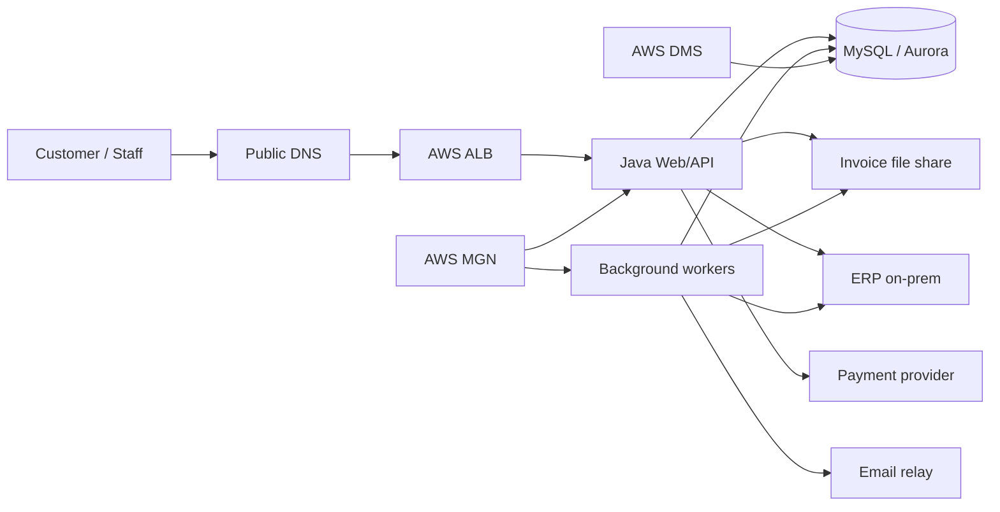
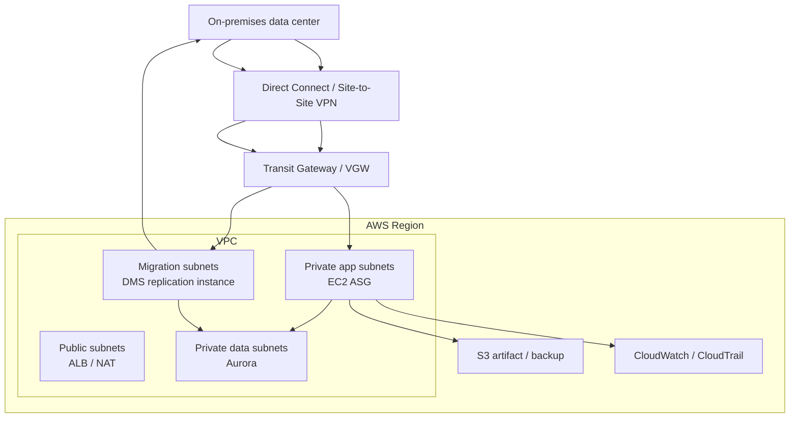
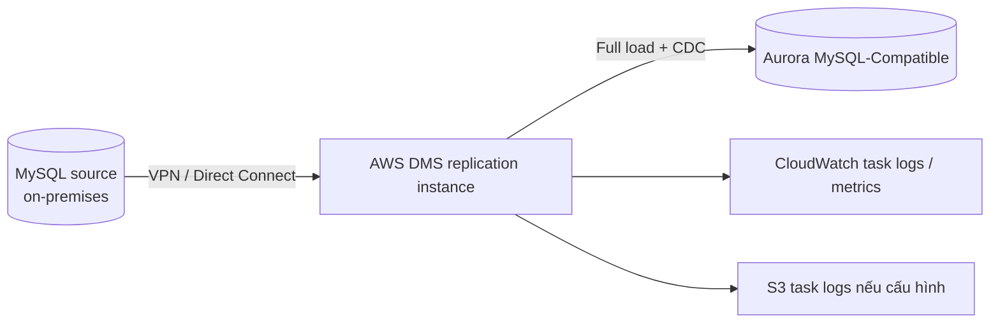

# Di chuyển ứng dụng và database với kế hoạch cutover

Một doanh nghiệp đang vận hành ứng dụng Java trên các máy chủ tại trung tâm dữ liệu riêng. Ứng dụng phục vụ đơn hàng và tồn kho, dùng cơ sở dữ liệu quan hệ, lưu file trên shared storage và tích hợp với hệ thống thanh toán, email, ERP. Doanh nghiệp muốn chuyển hệ thống lên AWS để tăng khả năng mở rộng, cải thiện khả năng phục hồi và giảm công việc vận hành phần cứng. Tuy nhiên, việc di chuyển cả ứng dụng lẫn database tạo ra nhiều rủi ro: thiếu dependency, sai cấu hình mạng, dữ liệu không đồng nhất, replication lag, DNS cache cũ, connection pool không tự kết nối lại và rollback không còn đơn giản sau khi phát sinh giao dịch mới trên môi trường đích.

Capstone này yêu cầu bạn lập kế hoạch và mô phỏng một dự án migration có thể triển khai thực tế. Bạn sẽ phân tích workload, chọn chiến lược cho từng thành phần, xây dựng landing zone, di chuyển máy chủ ứng dụng bằng AWS Application Migration Service (AWS MGN; tài liệu hướng dẫn hiện hành được hiển thị dưới tên AWS Transform MGN), di chuyển database bằng AWS Database Migration Service (AWS DMS), kiểm thử môi trường đích, chuẩn bị cutover runbook, xác định go/no-go criteria và thiết kế rollback có xét đến dữ liệu phát sinh sau cutover.

Module AWS Cloud Providers tập trung vào khả năng lựa chọn dịch vụ, thiết kế và triển khai ứng dụng an toàn, có thể giám sát, phục hồi và kiểm soát chi phí. Dự án sử dụng Amazon VPC, AWS Direct Connect hoặc Site-to-Site VPN, EC2, Application Load Balancer, Auto Scaling, Amazon RDS/Aurora, AWS MGN, AWS DMS, DMS Schema Conversion, IAM, KMS, Secrets Manager, CloudWatch, CloudTrail, Route 53 và S3. Mục tiêu cuối cùng là tạo ra một kế hoạch di chuyển có thể kiểm chứng, có người chịu trách nhiệm và có điểm dừng rõ ràng.

## Kết quả cần đạt

Sau capstone, bạn có thể:

- Phân tích application portfolio, dependency map, RTO/RPO, SLA, data volume và yêu cầu downtime.
- Chọn migration strategy phù hợp: rehost, replatform, refactor, repurchase, relocate, retain hoặc retire.
- Thiết kế landing zone với account, VPC, subnet, routing, security, IAM, logging và encryption.
- Dùng AWS MGN để replicate server, launch test instance, kiểm thử và chuẩn bị cutover.
- Chọn phương pháp database migration: native tools, AWS DMS full load, CDC hoặc full load + CDC.
- Dùng DMS Schema Conversion khi cần chuyển đổi database engine và đánh giá các object cần xử lý thủ công.
- Thiết kế data validation, CDC latency monitoring, performance test và application acceptance test.
- Lập cutover runbook theo phút, có freeze window, final sync, traffic switch và verification.
- Xác định rollback triggers và phân biệt rollback trước/sau khi target đã nhận transaction mới.
- Chuẩn bị communication plan, RACI, risk register, cost estimate và decommission checklist.

## Bối cảnh dự án và giả định

### Hệ thống hiện tại

Doanh nghiệp có một ứng dụng quản lý đơn hàng với kiến trúc ba tầng:

| Thành phần | Hiện trạng | Vai trò |
|---|---|---|
| Web/API tier | 4 Linux VMs chạy Java 17/Spring Boot sau reverse proxy | Nhận request, xử lý nghiệp vụ |
| Worker tier | 3 Linux VMs chạy scheduler và background jobs | Gửi email, đồng bộ ERP, xử lý đơn hàng |
| Database | MySQL 8.0 primary + replica | Lưu order, customer, inventory và payment reference |
| File storage | NFS share 2 TB | Lưu hóa đơn PDF và file đính kèm |
| Identity | Active Directory/LDAP | Xác thực nhân viên và service account |
| Integration | ERP, payment gateway, email relay | Giao tiếp với hệ thống bên ngoài |
| Monitoring | Monitoring tại trung tâm dữ liệu | CPU, memory, log và alert |

### Mục tiêu trên AWS

| Thành phần | Target design | Lý do |
|---|---|---|
| Web/API | EC2 Auto Scaling Group trên private subnets, sau Application Load Balancer | Giữ tương thích ứng dụng hiện tại và hỗ trợ scale/health checks |
| Worker | EC2 Auto Scaling Group riêng, có thể scale theo queue depth | Tách tải nền khỏi web traffic |
| Database | Amazon Aurora MySQL-Compatible hoặc Amazon RDS for MySQL sau khi đánh giá compatibility | Managed backup, patching, Multi-AZ/failover và khả năng mở rộng |
| File storage | Amazon EFS hoặc Amazon S3 tùy access pattern | EFS cho shared POSIX access; S3 cho object storage |
| Identity | AWS Managed Microsoft AD hoặc AD connector/trust theo kiến trúc hiện hữu | Giữ tích hợp domain nếu ứng dụng cần |
| Secrets | AWS Secrets Manager | Lưu credential database/API và hỗ trợ rotation |
| Monitoring | Amazon CloudWatch, CloudTrail và hệ thống cảnh báo | Tập trung log, metric và audit |
| Network | VPC, private/public subnets, VPN hoặc Direct Connect | Kết nối an toàn với hệ thống còn ở on-premises |

Giả định bài lab dùng MySQL nguồn và Aurora MySQL-Compatible làm đích để tập trung vào full load + CDC. Nếu bạn chọn migration heterogeneous như Oracle sang PostgreSQL, cần thêm DMS Schema Conversion, remediation cho stored procedures, functions, data types, sequence, collation và application SQL. Không được coi việc DMS copy dữ liệu thành công là bằng chứng toàn bộ ứng dụng đã tương thích.

### Ràng buộc kinh doanh

- RTO mục tiêu cho ứng dụng: tối đa 60 phút trong sự kiện cutover.
- RPO mục tiêu trong cutover: không mất transaction đã commit trước thời điểm write freeze.
- Downtime cho phép: tối đa 45 phút trong cửa sổ bảo trì đã thông báo.
- Hệ thống phải hỗ trợ ít nhất 2 Availability Zones.
- Dữ liệu thanh toán không lưu số thẻ đầy đủ; chỉ lưu token/reference từ payment provider.
- Hệ thống phải giữ audit trail và có thể đối soát số lượng đơn hàng, tổng tiền, tồn kho.
- Không xóa hoặc ngừng hệ thống nguồn cho đến khi business owner ký nghiệm thu và hết thời hạn rollback đã thống nhất.

Các con số là giả định dự án. Trong triển khai thật, phải thay bằng yêu cầu được business owner, application owner, database owner và security owner phê duyệt.

## Phạm vi và tiêu chí thành công

### Trong phạm vi

- Discovery và phân loại các server/application/database dependency.
- Thiết kế AWS landing zone và network connectivity.
- Rehost web/API và worker servers bằng AWS MGN.
- Migrate MySQL sang Aurora MySQL-Compatible bằng AWS DMS full load + CDC.
- Di chuyển file share sang EFS hoặc S3 theo access pattern đã xác nhận.
- Kiểm thử ứng dụng, database, network, performance, failover và backup/restore.
- Cutover traffic, theo dõi production và giữ phương án rollback.

### Ngoài phạm vi mặc định

- Viết lại toàn bộ ứng dụng sang microservices.
- Thay thế ERP, payment gateway hoặc email provider.
- Thay đổi business workflow trong cùng thời điểm migration.
- Tự động chuyển đổi mọi stored procedure hoặc SQL dialect mà không review.
- Xóa dữ liệu nguồn ngay sau cutover.

### Acceptance criteria

| Nhóm | Tiêu chí đạt |
|---|---|
| Server migration | Tất cả server trong wave khởi chạy được, service cần thiết hoạt động và không có lỗi OS/application nghiêm trọng |
| Database | Schema, row counts, critical aggregates và validation checks đạt ngưỡng đã duyệt |
| Replication | DMS CDC latency giảm về ngưỡng cutover; không còn transaction backlog chưa xử lý khi chuyển quyền ghi |
| Application | Login, tạo đơn, thanh toán sandbox, cập nhật tồn kho, truy vấn lịch sử và background jobs hoạt động |
| Performance | p95 latency và throughput đáp ứng SLO ở tải kiểm thử đã thống nhất |
| Security | IAM least privilege, encryption, secrets, security groups, audit và backup được xác nhận |
| Resilience | ALB/ASG, database failover và backup restore được kiểm thử |
| Operations | Dashboard, alarm, runbook, on-call ownership và support escalation sẵn sàng |
| Cutover | Go/no-go được ký, traffic chuyển thành công và business owner nghiệm thu |

## Lựa chọn migration strategy

Không nhất thiết phải dùng cùng một chiến lược cho toàn bộ hệ thống. Hãy đánh giá từng application component theo business value, technical constraints, licensing, operating system, database compatibility, downtime và chi phí.

### 7 chiến lược migration (7 Rs)

| Strategy | Ý nghĩa | Ví dụ trong dự án |
|---|---|---|
| Rehost | Di chuyển gần như nguyên trạng sang hạ tầng AWS | Dùng AWS MGN đưa Linux VM lên EC2 |
| Replatform | Điều chỉnh có giới hạn để dùng dịch vụ managed | Chuyển MySQL sang Aurora MySQL-Compatible, giữ nguyên phần lớn SQL |
| Refactor / Re-architect | Thiết kế lại đáng kể để tận dụng cloud-native | Tách worker thành event-driven services; không làm trong wave đầu nếu rủi ro cao |
| Repurchase | Thay ứng dụng bằng SaaS/COTS khác | Thay email relay hoặc CRM nếu business case phù hợp |
| Relocate | Di chuyển workload theo mô hình tương thích hạ tầng | Dùng khi nền tảng/ảo hóa có phương án relocation phù hợp |
| Retain | Giữ lại thành phần chưa phù hợp để di chuyển | Giữ ERP on-premises và kết nối qua Direct Connect/VPN |
| Retire | Ngừng thành phần không còn giá trị | Xóa server test cũ sau khi owner xác nhận |

AWS MGN phù hợp với rehost server. AWS DMS phù hợp với chuyển dữ liệu database, còn DMS Schema Conversion hỗ trợ chuyển đổi schema và code objects cho một số engine pair. Những dịch vụ này không tự quyết định chiến lược kinh doanh hoặc thay thế kiểm thử ứng dụng.

### Ma trận quyết định cho dự án

| Thành phần | Chiến lược | Công cụ/đích | Lý do và điều kiện |
|---|---|---|---|
| Web/API VMs | Rehost | AWS MGN → EC2 cutover instances; sau đó chuẩn hóa AMI/launch template để vào ASG nếu phù hợp | Giảm thay đổi ứng dụng trong lần di chuyển đầu, kiểm thử riêng bước đưa vào fleet |
| Worker VMs | Rehost | AWS MGN → EC2 cutover instances; sau đó chuẩn hóa cách triển khai/scale worker | Giữ runtime và scheduler, kiểm thử job identity và state trước khi scale |
| MySQL | Replatform | AWS DMS → Aurora MySQL-Compatible | Cần kiểm tra compatibility, parameter, extension, SQL và workload |
| NFS file share | Replatform | AWS DataSync → EFS hoặc S3 | Chọn theo POSIX semantics, locking, metadata và access pattern |
| ERP | Retain | VPN/Direct Connect | Dependency chưa được thay thế trong phạm vi này |
| Email relay | Retain trước, review sau | Kết nối private/public theo yêu cầu | Tránh thay nhiều dependency cùng lúc |

**Lưu ý về MGN và Auto Scaling:** MGN launch test/cutover instances dưới dạng EC2 instances; việc cutover không tự động biến các máy này thành thành viên của một Auto Scaling Group. Nếu target architecture cần ASG, sau khi kiểm thử và chốt cấu hình hãy tạo AMI/launch template chuẩn từ image đã được phê duyệt hoặc đóng gói ứng dụng để triển khai fleet mới, rồi kiểm thử lại bootstrap, identity, licensing, shared storage và state handling. Với server stateful hoặc giữ machine identity, không đưa instance vào ASG theo cách máy móc.

## Workstream 1 — Discovery và migration wave plan

### Inventory và dependency discovery

Thu thập tối thiểu:

- Hostname, IP, OS, CPU, memory, disk, filesystem, boot mode và license.
- Application owner, business criticality, maintenance window và on-call.
- Process/service đang chạy, port, protocol, inbound/outbound dependency.
- DNS records, certificates, domain membership, service accounts và secrets.
- Database engine/version, database size, transaction rate, peak log generation, LOB size, character set, collation, stored procedures và replication configuration.
- File share size, file count, throughput, locking, POSIX permissions và thay đổi theo giờ.
- Batch schedule, cron, queue, integration endpoint và external allowlist.
- Backup policy, restore time, RTO/RPO, retention và legal requirements.

Có thể dùng AWS Application Discovery Service, AWS Transform discovery capabilities hoặc công cụ inventory hiện có để thu thập thông tin. Kết quả tự động cần được application owner xác nhận; agent discovery không hiểu đầy đủ dependency nghiệp vụ hoặc quy trình cutover.

### Dependency map

Ví dụ dependency của ứng dụng đặt hàng:



Dependency map phải thể hiện cả hướng kết nối, port, DNS name, data owner, authentication method và yêu cầu latency. Nếu application server chuyển sang AWS nhưng database vẫn ở on-premises, latency WAN có thể làm tăng thời gian query và giảm throughput. Nếu database chuyển trước nhưng app còn ở on-premises, cần kiểm tra network path, TLS, DNS và connection pool. Nhóm các thành phần có coupling cao vào cùng migration wave.

### Chọn migration wave

| Wave | Thành phần | Mục tiêu | Điều kiện chuyển wave |
|---|---|---|---|
| 0 — Foundation | Account, VPC, VPN/DX, IAM, KMS, logging | Tạo landing zone | Security/network review đạt |
| 1 — Pilot | Một web server và bản sao database nhỏ | Xác minh MGN/DMS, bootstrap, performance | Functional test và rollback rehearsal đạt |
| 2 — Non-production | Toàn bộ app stack staging và dữ liệu đã mask | Rehearsal end-to-end | Test evidence và cutover duration đạt |
| 3 — Production cutover | Web/API, workers, database, file storage | Chuyển workload thật | Go/no-go được phê duyệt |
| 4 — Stabilization | Monitoring, optimization, cleanup | Ổn định và đóng migration | Business sign-off, hết rollback window |

Không di chuyển một worker phụ thuộc vào database trước khi database endpoint, credentials, firewall và DNS đã sẵn sàng. Migration wave nên theo dependency, không chỉ theo số lượng server.

### Sizing và capacity baseline

Đo baseline ít nhất qua một chu kỳ nghiệp vụ có peak traffic:

- CPU/memory p50, p95 và peak.
- Disk IOPS, throughput, latency và growth.
- Database QPS, active connections, transaction log generation và slow queries.
- Network throughput, packet loss, round-trip latency và egress.
- Application response time, error rate, queue depth và job duration.
- File share throughput, concurrency và file operation mix.

Không chọn EC2/RDS size chỉ dựa trên cấu hình máy nguồn. Workload có thể bị over-provision ở on-premises hoặc có peak đặc biệt. Dùng số liệu thực tế và chạy load test trên target.

## Workstream 2 — AWS landing zone và kết nối mạng

### Account và governance

Thiết kế account/environment phù hợp tổ chức:

- Production và non-production được tách theo account hoặc OU.
- Centralized logging/security account nếu tổ chức đã có landing zone.
- SCP/guardrails ngăn tắt CloudTrail, xóa log bucket hoặc vô hiệu hóa encryption.
- Tag chuẩn: `Application`, `Environment`, `Owner`, `CostCenter`, `MigrationWave`.
- AWS Budgets/Cost Anomaly Detection để theo dõi chi phí migration và tài nguyên chạy song song.

### Network topology

Một topology cơ bản:

| Vùng | Subnet | Tài nguyên |
|---|---|---|
| Public | 2 AZ | ALB, NAT Gateway nếu cần outbound internet |
| Private application | 2 AZ | EC2 web/API, worker |
| Private data | 2 AZ | Aurora/RDS, cache |
| Migration | Private subnets | DMS replication instance, MGN staging resources |
| Hybrid connectivity | Transit Gateway/VGW | Site-to-Site VPN hoặc Direct Connect về on-premises |



Đảm bảo CIDR AWS không overlap với on-premises, VPN, partner network hoặc các VPC đang peering. Với nhiều VPC/accounts, cân nhắc Transit Gateway để quản lý routing tập trung. Route table, DNS resolution, resolver rules, NACL và security groups phải được kiểm tra theo từng luồng kết nối.

### Security group và firewall

Ví dụ nguyên tắc network access:

| Source | Destination | Port | Lý do |
|---|---|---|---|
| Client network | ALB | 443 | HTTPS ingress |
| ALB security group | EC2 application security group | 8080/8443 | Forward request |
| EC2 application security group | Aurora security group | 3306 | MySQL connection |
| DMS replication security group | Source DB | Port theo engine | Full load/CDC source connection |
| DMS replication security group | Target DB | 3306 | Apply changes to Aurora MySQL |
| EC2/worker | ERP on-premises | Port được ERP owner xác nhận | Business integration |
| Admin | EC2/managed nodes | SSM endpoints | Quản trị qua Systems Manager |

Chỉ cho phép database ingress từ security group của application/DMS cần thiết. Nếu source database ở on-premises, firewall on-prem phải cho phép kết nối từ CIDR hoặc NAT egress đã được thống nhất. Không mở database port ra `0.0.0.0/0`.

### DMS network placement

AWS DMS replication instance chạy trong VPC. Khi thực tế cho phép, đặt replication instance trong cùng Region và cùng VPC/subnet gần target database để giảm network latency. Source và target endpoint phải truy cập được từ replication instance. Nếu source on-premises, cấu hình route qua VPN/Direct Connect và firewall allowlist. Security group của endpoint database cần cho phép ingress từ DMS replication instance security group hoặc nguồn network ổn định đã xác định.

### Encryption và identity

- TLS cho kết nối database và ứng dụng.
- KMS encryption cho EBS, RDS/Aurora, S3 và log buckets.
- Secrets Manager cho database credentials; không hard-code password trong DMS task JSON, user data hoặc source control.
- IAM role riêng cho MGN, DMS, EC2, automation và operator.
- CloudTrail management events và log retention theo chính sách audit.
- S3 Block Public Access, bucket policy và versioning cho artifact/backup cần giữ.

## Workstream 3 — Di chuyển application servers bằng AWS MGN

AWS Application Migration Service (AWS MGN) hỗ trợ rehost server bằng cách replicate block-level data từ source server sang staging area trong AWS, sau đó launch test/cutover instances. Tài liệu hiện hành có thể xuất hiện dưới tên AWS Transform MGN. MGN di chuyển trạng thái máy chủ; application owner vẫn phải kiểm tra hostname, IP, domain membership, service startup, license, DNS, firewall và kết nối database.

### MGN lifecycle

| Lifecycle state | Ý nghĩa | Việc tiếp theo |
|---|---|---|
| `Not ready` | Initial sync chưa hoàn tất | Kiểm tra agent, network, staging area và replication progress |
| `Ready for testing` | Initial sync hoàn tất, replication đang chạy | Launch test instance |
| `Test in progress` | Test instance đang được launch | OS/application acceptance test |
| `Ready for cutover` | Test đã hoàn tất và server sẵn sàng cutover | Xác nhận replication healthy và cutover window |
| `Cutover in progress` | Cutover instance đang được launch | Kiểm tra target instance và ứng dụng |
| `Cutover complete` | Migration đã được finalize | Archive source và đóng replication resources |

### Chuẩn bị source server

Trước khi cài AWS Replication Agent:

1. Xác nhận OS/version/architecture nằm trong danh sách hỗ trợ của MGN.
2. Kiểm tra CPU, memory, disk, partition, boot mode và filesystem.
3. Kiểm tra network outbound đến service endpoints và replication server theo tài liệu MGN.
4. Xác nhận quyền administrator/root để cài agent.
5. Kiểm tra antivirus/EDR, firewall và proxy không chặn agent.
6. Ghi nhận hostname, static IP, DNS, domain, certificates và license dependencies.
7. Chụp backup/snapshot theo chính sách trước khi thay đổi.

### Cấu hình staging area và replication

1. Initialize MGN trong target Region.
2. Chọn staging subnet, replication instance type, EBS volume type, encryption và replication settings.
3. Tạo IAM/service-linked role theo quy trình MGN.
4. Cài AWS Replication Agent trên source server.
5. Theo dõi initial sync đến khi lifecycle chuyển `Ready for testing` và data replication status `Healthy`.
6. Kiểm tra lag, throughput, replication server và cảnh báo.

Initial sync có thể mất nhiều thời gian tùy tổng dung lượng disk, tốc độ thay đổi dữ liệu và network. Không đặt cutover window trước khi có số đo replication thực tế. Sau khi initial sync, MGN tiếp tục replicate block changes để giữ staging data cập nhật.

### Launch test instance

Trước khi production cutover, launch test instances từ replicated state. Thực hiện:

- Kiểm tra EC2 instance type, subnet, security groups, IAM instance profile, EBS mapping và launch settings.
- Kiểm tra boot, filesystem, service startup, hostname, network interfaces và license.
- Cập nhật application config cho target DNS/database nếu cần.
- Kiểm tra ALB target health, API health, worker schedule và external integrations.
- Kiểm tra log, monitoring agent, SSM connectivity, backup và patch baseline.
- Chạy performance test, failover test và security scan.
- Ghi nhận lỗi và sửa launch settings/post-launch actions.

Có thể launch test nhiều lần; test instance cũ và dependent resources được thay thế trong lần test tiếp theo. Test instances sử dụng EC2/EBS resources và phát sinh chi phí, vì vậy terminate khi không còn cần thiết. Nên hoàn tất ít nhất một lần test đủ sớm trước cutover để có thời gian sửa vấn đề.

### Launch settings và post-launch actions

Kiểm tra:

- EC2 instance type và CPU architecture.
- Target subnet/AZ, security group và private IP strategy.
- EBS volume type/size/encryption.
- IAM instance profile và SSM access.
- Tags, hostname/domain join và post-launch scripts.
- License activation, machine identity, monitoring và backup agent.

Nếu source server phụ thuộc MAC/IP cố định, license server hoặc hostname allowlist, phải xác minh cách ánh xạ trên AWS trước khi cutover. Không giả định mọi license/agent có thể chuyển sang EC2 mà không cần rehost approval.

### Cutover server bằng MGN

Trong cửa sổ cutover:

1. Xác nhận tất cả source servers ở `Ready for cutover`, replication healthy và lag trong ngưỡng.
2. Dừng application services, scheduled jobs và các process ghi dữ liệu trên source server.
3. Xác nhận không còn thay đổi dữ liệu ở disk/application cần đồng bộ cuối.
4. Launch cutover instances từ MGN.
5. Kiểm tra instance launch, OS boot, service startup, network và application health.
6. Chuyển ALB target, internal DNS hoặc routing theo runbook.
7. Theo dõi error rate, latency, logs, worker status và dependency connections.
8. Chỉ finalize cutover khi các điều kiện nghiệm thu đạt và rollback decision được ký.

Finalize cutover dừng replication và loại bỏ replication resources; đây là bước có ý nghĩa hoàn tất lifecycle MGN. Giữ source server ở trạng thái có thể khôi phục trong thời gian rollback đã thống nhất; không archive hoặc xóa source ngay khi vừa launch target.

## Workstream 4 — Di chuyển database bằng AWS DMS

### Chọn homogeneous hay heterogeneous migration

| Trường hợp | Cách tiếp cận | Công cụ |
|---|---|---|
| Cùng database engine, ví dụ MySQL → Aurora MySQL-Compatible | Giữ schema/code tương thích, migrate data và changes | Native dump/restore hoặc AWS DMS |
| Khác database engine, ví dụ Oracle → PostgreSQL | Chuyển schema/code, sửa incompatibility, rồi migrate data | DMS Schema Conversion + AWS DMS |
| Database nhỏ, downtime dài được chấp nhận | Backup/restore có kiểm soát | Native database tools |
| Database lớn, downtime ngắn | Initial full load + ongoing CDC, sau đó cutover | AWS DMS full load + CDC |

AWS DMS hỗ trợ basic schema migration như tạo tables và primary keys trong các tình huống được hỗ trợ. Không mặc định DMS tự tạo secondary indexes, foreign keys, users, grants, triggers hoặc toàn bộ stored procedures. Chuẩn bị schema đích bằng native tools hoặc DMS Schema Conversion và review từng object.

### Database assessment

Thu thập:

- Engine/version, edition, extensions/plugins và parameter settings.
- Database/schema/table count, row count và data volume.
- Primary/unique keys, foreign keys, indexes, triggers và constraints.
- Stored procedures, functions, views, events, sequences và generated columns.
- Character set, collation, timezone, date/time precision và numeric precision.
- LOB/BLOB/CLOB size distribution.
- Transaction rate, log generation rate, peak concurrency và long-running transactions.
- User/role/privilege, authentication plugin, TLS và network ACL.
- Backup/restore time, replication topology và failover behavior.

### Schema conversion

Với heterogeneous migration, tạo DMS Schema Conversion project:

1. Kết nối source và target database metadata.
2. Chạy assessment report để xác định object không thể tự động convert.
3. Cấu hình transformation rules cho schema/table/object names nếu cần.
4. Convert schema và database code objects.
5. Review conversion action items, unsupported data types, SQL dialect và performance implications.
6. Sửa SQL/stored procedures/functions bằng developer/DBA.
7. Lưu SQL output vào version control và peer review.
8. Apply schema lên target sau khi migration owner phê duyệt.
9. Chạy application regression test trên target.

Không áp dụng converted code trực tiếp lên production mà chưa review. DMS Schema Conversion có thể tự động chuyển đổi nhiều object nhưng vẫn trả về action items cho object cần can thiệp thủ công.

### Thiết kế AWS DMS

Các thành phần:

| Thành phần | Vai trò | Lựa chọn trong dự án |
|---|---|---|
| Replication subnet group | Xác định subnets cho replication instance | Private subnets trong VPC migration/data |
| Replication instance hoặc DMS Serverless | Compute chạy replication | Chọn theo workload, capacity, engine support và cost model |
| Source endpoint | Kết nối database nguồn | MySQL on-prem qua VPN/Direct Connect |
| Target endpoint | Kết nối database đích | Aurora MySQL-Compatible trong private subnet |
| Migration task | Full load/CDC, table mapping và task settings | `full-load-and-cdc` |
| Premigration assessment | Phát hiện issue trước khi chạy | Enable trước task và review report |
| Data validation | So sánh dữ liệu source/target | Bật cho các bảng/đường migration hỗ trợ |



Replication instance phải truy cập được cả hai endpoint qua routing, DNS, firewall và security groups. Với source on-premises, xác nhận đường đi hai chiều theo thiết kế, TLS và allowlist trước khi chạy task.

### Source và target prerequisites

**Source database:**

- Bật binary logging/transaction log phù hợp với engine và DMS CDC requirements.
- Đặt retention cho transaction logs đủ dài để DMS có thể đọc trong thời gian migration/recovery.
- Cấp user DMS các quyền đọc metadata, tables và log cần thiết.
- Xác minh source không bị quá tải bởi full load, CDC reader và validation queries.
- Kiểm tra long-running transactions, binlog format, GTID và engine-specific settings theo hướng dẫn.

**Target database:**

- Tạo Aurora/RDS cluster, subnet group, security groups, parameter group và KMS encryption.
- Tạo database/schema/table theo schema conversion hoặc DMS target table preparation mode.
- Cấp user DMS quyền insert/update/delete và quyền cần thiết để apply changes.
- Đánh giá index/foreign key/trigger strategy để không làm full load/CDC quá chậm.
- Kiểm tra instance class, storage, IOPS, connection limit và failover configuration.

### Full load và CDC

AWS DMS có ba migration types chính:

| Migration type | Ý nghĩa | Khi dùng |
|---|---|---|
| Full load | Copy dữ liệu hiện có từ source sang target | Downtime có thể chấp nhận hoặc database ít thay đổi |
| CDC only | Chỉ đọc transaction log và replicate thay đổi | Target đã có baseline dữ liệu đồng nhất |
| Full load + CDC | Copy dữ liệu hiện có, đồng thời capture/apply thay đổi phát sinh | Database production cần giảm downtime |

Trong full load + CDC, DMS thực hiện full load theo các bảng đã chọn và capture source changes trong quá trình load. Khi full load hoàn tất, cached changes được apply rồi CDC tiếp tục replicate các transaction mới. DMS apply committed transactions theo nhóm transaction để giữ tính nhất quán transaction trong phạm vi hỗ trợ.

CDC là asynchronous replication, không phải synchronous replication và không có SLA đảm bảo latency bằng 0. Latency phụ thuộc source workload/log generation, network, replication instance resources, target ingest capacity, LOB, số bảng/task và cấu hình. Phải đo trên workload thực tế và dành thời gian giảm backlog trước cutover.

### Table mapping và task settings

Table mapping xác định schema/table được chọn, include/exclude rule, filter và transformation rule. Bắt đầu bằng allowlist các schema/table cần di chuyển. Không chọn toàn bộ database nếu có schema hệ thống, staging hoặc dữ liệu không thuộc ứng dụng.

Ví dụ table mapping minh họa:

```json
{
  "rules": [
    {
      "rule-type": "selection",
      "rule-id": "1",
      "rule-name": "include-orders-schema",
      "object-locator": {
        "schema-name": "orders",
        "table-name": "%"
      },
      "rule-action": "include"
    },
    {
      "rule-type": "selection",
      "rule-id": "2",
      "rule-name": "exclude-temporary-table",
      "object-locator": {
        "schema-name": "orders",
        "table-name": "tmp_%"
      },
      "rule-action": "exclude"
    }
  ]
}
```

Ví dụ minh họa cách giới hạn schema/table; kiểm tra cú pháp wildcard và thứ tự rule theo AWS DMS table mapping reference trước khi dùng trong task.

Task settings cần xem xét:

- `TargetTablePrepMode`: `DO_NOTHING`, `DROP_AND_CREATE` hoặc `TRUNCATE_BEFORE_LOAD` theo cách chuẩn bị target.
- `MaxFullLoadSubTasks`: số table/segment được load song song; tăng quá cao có thể tiêu thụ memory và gây lỗi.
- `ParallelLoadThreads`: số thread load đồng thời; cần cân bằng với source/target capacity.
- LOB mode: limited/full/inline tùy engine và kích thước LOB; limited mode có thể truncate nếu vượt giới hạn.
- `EnableValidation`: so sánh dữ liệu source/target sau full load và trong CDC theo hỗ trợ.
- Error handling: quyết định log, suspend table hay stop task với data/truncation/apply errors.
- Logging: bật CloudWatch task logs và control tables phù hợp.

Không chọn `DROP_AND_CREATE` hoặc `TRUNCATE_BEFORE_LOAD` trên target đang chứa dữ liệu production mà chưa xác nhận quyền sở hữu và backup. Với `DO_NOTHING`, schema đích phải được chuẩn bị đúng trước đó.

### Premigration assessment

Chạy premigration assessment trước khi start task. Assessment có thể phát hiện unsupported data types, mismatched indexes/primary keys, source/target configuration và task settings có khả năng gây lỗi. Review report cùng DBA/application owner, sửa vấn đề và chạy lại assessment sau khi thay đổi đáng kể.

### DMS data validation

DMS data validation so sánh dữ liệu trên target với source. Bật validation trong task settings cho các đường migration được hỗ trợ. Theo dõi table validation state và validation failures; validation tạo thêm query load trên source/target nên cần sizing và scheduling phù hợp.

Validation cần bổ sung các kiểm tra nghiệp vụ:

- Row count theo bảng và partition.
- Tổng số đơn hàng theo ngày/trạng thái.
- Tổng tiền theo currency và settlement batch.
- Tổng số lượng tồn kho theo SKU/location.
- Referential integrity và orphan records.
- Hash/checksum theo partition hoặc business key cho tập dữ liệu quan trọng.
- Kiểm tra LOB/document object có thể mở và nội dung đúng.
- So sánh timezone, decimal precision, collation và case sensitivity.

Row count bằng nhau không chứng minh dữ liệu giống nhau. DMS validation không thay thế business reconciliation và application test.

### Monitoring DMS

Theo dõi ít nhất:

| Metric/tín hiệu | Ý nghĩa | Phản ứng |
|---|---|---|
| `CDCLatencySource` | Độ trễ source change được capture | Kiểm tra source logs, log retention và capture capacity |
| `CDCLatencyTarget` | Độ trễ change được apply đến target | Kiểm tra target write throughput, indexes, locks và replication resources |
| `FullLoadThroughputRowsTarget` | Tốc độ load record đến target | Tune parallel load và target capacity |
| `CDCIncomingChanges` | Thay đổi đang chờ xử lý | Xác định backlog tăng hay giảm |
| `CDCChangesMemorySource` / disk | Cached changes ở replication instance | Tăng capacity hoặc giảm backlog/transaction size |
| Table statistics | Load status, rows loaded và validation | Xác định bảng lỗi/chậm |
| Task logs | Error, warning và apply behavior | Điều tra lỗi schema/data/permissions |

Không dùng một metric duy nhất để tuyên bố đã sẵn sàng cutover. Cần quan sát xu hướng, transaction backlog, task state, table validation và khả năng source/target duy trì tải.

### Tạo DMS task bằng CLI (mẫu)

Sau khi tạo replication instance và endpoints, có thể tạo task bằng AWS CLI. Thay ARN và tên task theo môi trường:

```bash
aws dms create-replication-task \
  --replication-task-identifier orders-mysql-full-load-cdc \
  --source-endpoint-arn SOURCE_ENDPOINT_ARN \
  --target-endpoint-arn TARGET_ENDPOINT_ARN \
  --replication-instance-arn REPLICATION_INSTANCE_ARN \
  --migration-type full-load-and-cdc \
  --table-mappings file://table-mappings.json \
  --replication-task-settings file://task-settings.json \
  --tags Key=Application,Value=orders Key=MigrationWave,Value=production
```

Ví dụ cấu hình validation rút gọn trong `task-settings.json`:

```json
{
  "TargetMetadata": {
    "TargetSchema": "",
    "SupportLobs": true,
    "FullLobMode": false,
    "LimitedSizeLobMode": true,
    "LobMaxSize": 64
  },
  "FullLoadSettings": {
    "TargetTablePrepMode": "DO_NOTHING",
    "CreatePkAfterFullLoad": false,
    "MaxFullLoadSubTasks": 8,
    "TransactionConsistencyTimeout": 600
  },
  "ValidationSettings": {
    "EnableValidation": true,
    "ThreadCount": 5,
    "ValidationMode": "ROW_LEVEL",
    "SkipLobColumns": false
  },
  "Logging": {
    "EnableLogging": true
  }
}
```

Đây là ví dụ khung, không phải cấu hình dùng chung cho mọi engine. Kiểm tra các thuộc tính được hỗ trợ cho source/target version, LOB policy và task type. `LobMaxSize` 64 KB chỉ là giá trị minh họa; không dùng limited LOB mode nếu nghiệp vụ yêu cầu giữ đầy đủ LOB lớn hơn mức đó.

Start task và theo dõi:

```bash
aws dms start-replication-task \
  --replication-task-arn REPLICATION_TASK_ARN \
  --start-replication-task-type start-replication

aws dms describe-replication-tasks \
  --filters Name=replication-task-arn,Values=REPLICATION_TASK_ARN

aws dms describe-table-statistics \
  --replication-task-arn REPLICATION_TASK_ARN
```

Nếu task bị lỗi, đọc task status, table statistics, CloudWatch logs và source/target engine logs trước khi restart/reload. Restart hoặc reload target có thể tác động đến dữ liệu đã load; phải hiểu `TargetTablePrepMode` và task checkpoint trước khi thao tác.

## Workstream 5 — File storage và application configuration

### Chọn EFS hay S3

| Tiêu chí | Amazon EFS | Amazon S3 |
|---|---|---|
| Access model | Shared POSIX filesystem | Object storage qua API |
| File locking/rename | Hỗ trợ semantics filesystem theo NFS | Không phải POSIX filesystem |
| Nhiều EC2 cùng mount | Có | Không mount trực tiếp theo cùng semantics; cần application/API hoặc gateway phù hợp |
| Versioning/lifecycle | Không giống object versioning | Có versioning, lifecycle và storage classes |
| Phù hợp | App cần shared path, file locking, POSIX permissions | Invoice/archive/object, backup và static assets |

Nếu ứng dụng dựa vào file locking, inode, symlink, atomic rename hoặc POSIX ownership, test EFS trước khi chuyển. Nếu file chỉ được upload/download qua API và không cần shared filesystem, S3 thường phù hợp hơn. AWS DataSync có thể hỗ trợ chuyển file từ NFS/SMB sang EFS/S3; cần kiểm tra metadata, permission, symlink và verification options.

### Cập nhật connection strings và secrets

Không hard-code database hostname/password trong JAR hoặc AMI. Dùng environment/config management hoặc Secrets Manager. Ví dụ application configuration:

```yaml
spring:
  datasource:
    url: jdbc:mysql://${DB_HOST}:3306/orders?useSSL=true&requireSSL=true
    username: ${DB_USERNAME}
    password: ${DB_PASSWORD}
    hikari:
      maximum-pool-size: 30
      connection-timeout: 10000
      validation-timeout: 5000
```

Đây là cấu hình minh họa. JDBC TLS parameters và certificate trust phải theo driver/version đang dùng. Lấy secret qua IAM role/Secrets Manager integration hoặc secret injection an toàn; không in secret ra log. Sau khi cutover, cập nhật DNS/endpoint và recycle connection pools để tránh giữ connection tới source.

### DNS và endpoint strategy

- Hạ DNS TTL trước cutover nếu policy DNS cho phép và kiểm tra resolver/client cache behavior.
- Dùng stable application hostname, ví dụ `orders-db.internal.example.com`, trỏ đến endpoint target sau khi cutover.
- Không dựa vào việc mọi client tuân thủ TTL; JVM DNS cache, connection pools và local resolver có thể giữ cache lâu hơn.
- Database endpoint phải là writer/cluster endpoint phù hợp; không trỏ write traffic vào reader endpoint.
- Chuẩn bị certificate/TLS trust, private hosted zone và resolver rules cho hybrid clients.

## Workstream 6 — Test, rehearsal và cutover readiness

### Test strategy

| Test layer | Nội dung | Bằng chứng |
|---|---|---|
| Infrastructure | EC2 boot, subnet, route, SG, IAM, KMS, SSM | Instance status, flow logs, CloudTrail, SSM managed node |
| Database | Login, schema, index, stored procedure, CDC, failover | DMS validation, query results, database logs |
| Application | Login, create order, cancel order, update inventory | Automated test report và business sign-off |
| Integration | ERP, payment sandbox, email, file access | Contract test, event logs, reconciliation |
| Performance | Load, stress, soak và peak-hour simulation | p95/p99, throughput, CPU, DB connections |
| Resilience | EC2 replacement, ALB target fail, Aurora failover | RTO measurement, healthy targets và error budget |
| Security | IAM, secrets, encryption, vulnerability scan | Security review, evidence và findings closure |
| Backup/restore | Snapshot/backup restore sang isolated target | Restore duration và integrity report |

### Cutover rehearsal

Chạy ít nhất một rehearsal trong staging với data volume và traffic gần production. Đo:

- Thời gian dừng ingestion và write freeze.
- Thời gian DMS CDC backlog về ngưỡng cho phép.
- Thời gian final validation và business reconciliation.
- Thời gian đổi connection string, DNS/ALB routing và restart services.
- Thời gian health checks đạt healthy.
- Thời gian smoke tests và business approval.
- Thời gian rollback trong hai trường hợp: chưa có write trên target và đã có write trên target.

Nếu tổng thời gian vượt maintenance window, phải tối ưu/rehearse lại hoặc thay đổi cutover approach. Không lấy estimate từ slide thay cho thời gian đã đo.

### Cutover decision gates

**Go** chỉ khi:

- MGN source servers đã test và ở trạng thái Ready for cutover.
- DMS full load hoàn tất; CDC task running và latency/backlog trong ngưỡng đã phê duyệt.
- Data validation và business reconciliation đạt.
- Target database backup, monitoring, security và failover đã được xác nhận.
- Application test/performance test đạt.
- DNS/ALB/configuration changes đã chuẩn bị và review.
- On-call, application owner, DBA, network/security, business owner và incident commander sẵn sàng.
- Rollback/fail-forward plan, checkpoint và decision authority được xác nhận.
- Không có incident nghiêm trọng, change freeze hoặc dependency chưa được giải quyết.

**No-go** nếu có một trong các điều kiện:

- DMS CDC latency tăng hoặc không giảm về ngưỡng cutover.
- Có table validation failures chưa được giải thích.
- Thiếu dữ liệu, sai aggregate hoặc duplicate transaction.
- MGN replication không healthy hoặc server test không boot/không chạy application.
- Target database không đáp ứng capacity/performance.
- Security/network path, certificate hoặc secrets chưa hoạt động.
- Không đủ người trực hoặc chưa có người ra quyết định rollback.
- Không còn đủ thời gian để hoàn thành cutover và verification trong cửa sổ.

## Cutover plan — runbook theo thời gian

Ví dụ dưới đây là runbook cho all-at-once cutover. Điều chỉnh mốc thời gian theo rehearsal và downtime đã phê duyệt.

### Chọn all-at-once hay phased cutover

- **All-at-once:** chuyển toàn bộ application/database tier tại một thời điểm. Phù hợp khi app không thể chạy đồng thời ở hai môi trường, có hostname/license conflict hoặc không chịu được latency giữa app và database bị chia đôi. Cần performance/regression test và rollback decision rõ ràng.
- **Phased/canary:** chuyển một phần server hoặc traffic trước, quan sát rồi tăng dần tỷ lệ. Chỉ phù hợp nếu load balancer, application, data model và integration hỗ trợ chia traffic; các thành phần còn on-prem phải truy cập được data source với latency chấp nhận được. Nếu app tiers không thể chia tách hoặc có shared write state, phased cutover có thể tạo consistency issue.

Runbook dưới đây dùng all-at-once vì web/API, workers và database có coupling chặt. Nếu chọn phased, hãy viết riêng từng wave, traffic percentage, data ownership và rollback route.

| Thời điểm | Owner | Hành động | Exit criteria |
|---|---|---|---|
| T-7 ngày | Migration lead | Xác nhận wave, scope, stakeholders, communication và change ticket | Tất cả owner sign-off |
| T-3 ngày | DBA/Platform | Xác nhận MGN test, DMS CDC health, backup/restore và alarm | Replication healthy, test evidence đầy đủ |
| T-1 ngày | Application/Network | Hạ DNS TTL, kiểm tra target endpoints, route, SG, certificates, secrets | Pre-cutover checklist PASS |
| T-60 phút | Incident commander | Mở bridge, điểm danh owner, xác nhận go/no-go | Tất cả owner sẵn sàng |
| T-30 phút | Application | Bật maintenance banner, ngừng scheduler/batch jobs và ingestion mới | Không nhận workload mới |
| T-20 phút | DBA | Freeze application writes ở source, xác nhận không còn transaction mới từ app | Source write freeze được xác nhận |
| T-15 phút | DBA | Theo dõi DMS CDC source/target latency và backlog | Latency/backlog trong ngưỡng đã duyệt |
| T-10 phút | DBA | Chạy final validation/reconciliation cho bảng trọng yếu | Data checks PASS |
| T-5 phút | Migration lead | Go/no-go checkpoint cuối và ghi quyết định | Go được ký; nếu fail thì abort trước traffic switch |
| T0 | Platform/Network | Chuyển DB/application endpoint, ALB target hoặc DNS sang AWS | Traffic đến target |
| T+5 phút | Application | Smoke test login, create order, query, inventory, integration | Critical journeys PASS |
| T+10 phút | DBA | Xác nhận database connections, writes và error logs | Target là writer, không có replication/data error |
| T+15 phút | Business owner | Đối soát giao dịch và phê duyệt tiếp tục | Business validation PASS |
| T+30 phút | Incident commander | Quyết định continue, fix-forward hoặc rollback theo checkpoint | Decision được ghi nhận |
| T+60 phút | Migration lead | Kết thúc cutover window hoặc kích hoạt rollback/escalation | SLO ổn định, handover hoàn tất |
| T+24 giờ | Operations | Hypercare, review metrics, backup và unresolved issues | Handover vận hành |

Với giả định downtime tối đa 45 phút, ứng dụng phải nhận lại traffic và hoàn tất critical smoke tests trước T+45. Mốc T+60 là checkpoint xác nhận ổn định/handover sau khi dịch vụ đã hoạt động; không được hiểu là cho phép downtime 60 phút. RTO 60 phút là giới hạn khôi phục trong tình huống sự cố, còn maintenance downtime target 45 phút là mục tiêu cutover đã cam kết với business.

### Freeze dữ liệu đúng cách

Write freeze phải ngăn mọi producer tạo transaction mới trên source database. Chỉ bật maintenance page ở web tier là chưa đủ nếu worker, scheduler, batch import hoặc integration vẫn ghi dữ liệu. Danh sách freeze cần gồm:

- Tắt scheduler và background workers.
- Dừng consumer/producer xử lý message có thể ghi database.
- Tạm ngừng inbound integration hoặc chuyển sang durable queue.
- Chặn write role của ứng dụng hoặc bật maintenance mode được kiểm chứng.
- Chờ transaction đang chạy hoàn tất hoặc rollback theo chính sách.
- Xác nhận không còn session/write activity ngoài các session replication/admin cần thiết.

Không tắt source database trước khi DMS hoàn tất CDC final catch-up và DBA xác nhận trạng thái. DMS cần đọc transaction logs để apply các changes cuối.

### Final sync và validation

Sau khi freeze:

1. Ghi lại thời điểm freeze và source database log position/GTID/checkpoint theo engine.
2. Xác nhận source application không còn writes.
3. Theo dõi DMS task và CDC latency đến khi backlog được apply.
4. Xác nhận DMS table statistics không có table lỗi/suspended chưa xử lý.
5. Chạy reconciliation trên bảng critical: order count, order amount, inventory quantity, payment references.
6. Kiểm tra target constraints, indexes, triggers và permissions.
7. DBA xác nhận target sẵn sàng nhận writes.

Không yêu cầu một metric latency đơn lẻ phải đúng bằng 0 trong mọi trường hợp nếu hệ thống metric có sampling delay; định nghĩa ngưỡng, thời gian ổn định và cách xác minh transaction log position trước dự án. Quyết định cutover dựa trên bằng chứng đồng bộ dữ liệu và không còn writes ở source.

### Traffic switch

Thực hiện theo một thứ tự thống nhất:

1. Cập nhật application secret/config để dùng target database endpoint.
2. Cập nhật ALB target group/DNS/service discovery theo thiết kế.
3. Khởi động web/API instances trên AWS và xác nhận target health.
4. Bật worker/consumer theo từng nhóm sau khi database target đã sẵn sàng.
5. Mở lại ingestion và traffic khách hàng.
6. Theo dõi database write activity, queue, error rate, latency và business metrics.

Không cho cả source và target cùng nhận writes độc lập nếu chưa có cơ chế consistency/dual-write được thiết kế và kiểm thử. Hai database writable độc lập dễ tạo split-brain và data divergence.

## Rollback và fail-forward strategy

Rollback database khác rollback application server. Trước khi target nhận writes, có thể chuyển traffic về source nếu source vẫn đồng nhất và được giữ nguyên. Sau khi target nhận transaction mới, source trở thành stale; chỉ đổi DNS về source sẽ làm mất hoặc bỏ qua dữ liệu mới trên target.

### Quyết định theo thời điểm

| Thời điểm phát hiện lỗi | Tình trạng dữ liệu | Hướng xử lý |
|---|---|---|
| Trước write freeze | Source vẫn là system of record | Hủy cutover, tiếp tục vận hành source |
| Sau freeze, trước target writes | Target đã catch up, source chưa thay đổi | Có thể abort và mở lại source sau khi xác minh dữ liệu/replication |
| Sau traffic switch nhưng chưa có target writes | Chưa có divergence | Có thể chuyển routing về source theo runbook và xác nhận app connection reset |
| Sau khi target đã nhận writes | Target có dữ liệu mới, source stale | Không rollback chỉ bằng DNS; dùng fail-forward, reverse replication, dual-write được chuẩn bị trước hoặc restore/reconciliation strategy |
| Sau khi finalize migration và retire source | Source có thể không còn khả năng khôi phục nhanh | Phục hồi theo DR/backup plan đã được test; đây không còn là simple cutback |

### Rollback triggers

Ví dụ điều kiện bắt đầu rollback/fix-forward decision:

- Critical business journey thất bại kéo dài hơn 10 phút.
- HTTP 5xx vượt 5% trong 5 phút hoặc vượt error budget đã thống nhất.
- Database connection failure liên tục, data validation mismatch hoặc write errors.
- Mất giao dịch, duplicate order hoặc sai số tiền/tồn kho.
- p95 latency vượt SLO trong thời gian liên tục sau khi đã loại trừ warm-up.
- Security incident, data exposure hoặc IAM permission bất thường.
- Target không đạt RTO hoặc không đủ capacity.

Các ngưỡng phải được business/application owner phê duyệt và kiểm chứng bằng rehearsal. Incident commander có quyền dừng cutover; DBA chịu trách nhiệm xác nhận trạng thái dữ liệu.

### Phương án sau khi target đã ghi dữ liệu

Chọn và rehearsal ít nhất một phương án:

1. **Fail-forward:** giữ target làm system of record, sửa lỗi trên AWS và tiếp tục phục vụ. Đây thường là hướng ít rủi ro hơn khi target đã nhận writes.
2. **Reverse replication/failback database:** chuẩn bị trước một DMS task/kiến trúc replicate từ target về một database failback tương thích. Kiểm tra engine pair, schema, DDL, conflict và khả năng đồng bộ ngược; không giả định task thuận chiều có thể đảo ngược tự động.
3. **Dual-write:** chỉ dùng khi application được thiết kế để ghi đồng bộ/đảm bảo idempotency và xử lý partial failure; đây là kiến trúc riêng, không phải thao tác bật nhanh trong cutover.
4. **Backup/restore và reconciliation:** phục hồi source hoặc database mới từ backup/snapshot rồi reconcile giao dịch phát sinh; cần đo restore time và có quy trình đối soát.

AWS Prescriptive Guidance khuyến nghị xác định checkpoint, người ra quyết định và chiến lược dữ liệu cho rollback; khi dữ liệu đã thay đổi, cần cân nhắc fail-forward, dual write hoặc backup/restore. Không được hứa rollback không mất dữ liệu nếu chưa chứng minh đường đồng bộ ngược.

## Risk register

| Rủi ro | Tác động | Giảm thiểu | Owner |
|---|---|---|---|
| CIDR overlap hoặc route sai | Mất kết nối app/DMS/source | IPAM, network review, route test trước migration | Network lead |
| MGN initial sync chậm | Lỡ cutover window | Pilot sớm, đo change rate, staging capacity và bandwidth | Migration engineer |
| Source OS/boot không tương thích | Test instance không boot | Kiểm tra support matrix, test launch và sửa driver/boot config | Server owner |
| DMS source logs hết retention | CDC không thể tiếp tục | Tăng log retention, monitor task, không pause lâu tùy tiện | DBA |
| DMS target latency cao | Backlog không catch up | Sizing target, indexes, task tuning và test transaction rate | DBA |
| Schema conversion thiếu object | Application runtime error | Assessment, code review và regression test | Database/app owner |
| LOB bị truncate | Mất nội dung hóa đơn/tệp | Chọn LOB mode/size đúng, validation LOB và sample compare | DBA |
| DNS cache cũ | Một phần client vẫn vào source | Hạ TTL, recycle connection, theo dõi resolver và routing | Network/app owner |
| Secret/certificate sai | App không kết nối DB/ERP | Secret test, TLS trust test và rotation runbook | Security/app owner |
| App và worker cùng ghi source/target | Split-brain, duplicate/lost transaction | Global write freeze và staged worker restart | Application owner |
| Rollback sau target writes | Data loss/divergence | Fail-forward/reverse replication plan và rehearsal | DBA/incident commander |
| Capacity target thiếu | Latency cao hoặc throttling | Load test, capacity headroom, quota review | Platform owner |
| Cost tăng do chạy song song | Vượt ngân sách | Time-box resources, budget alarm, terminate test instances | FinOps owner |

## Project plan và RACI

### Timeline tham khảo 6 tuần

| Tuần | Công việc | Deliverable |
|---|---|---|
| 1 | Discovery, inventory, dependency map, 7R assessment | Migration assessment và wave plan |
| 2 | Landing zone, network, IAM, security, logging | Architecture decision record và network test |
| 3 | MGN pilot, DMS schema/PoC, sizing | Test instances, DMS PoC và performance baseline |
| 4 | Staging migration, application regression, data validation | Test report và issue remediation |
| 5 | Cutover rehearsal, rollback rehearsal, runbook review | Rehearsal timing và signed go/no-go checklist |
| 6 | Production cutover, hypercare và handover | Cutover report, operational handover |

Timeline chỉ là mẫu. Database lớn, schema conversion phức tạp hoặc regulatory review có thể cần nhiều tuần/tháng hơn.

### RACI

| Hoạt động | Migration lead | App owner | DBA | Network/Security | Business owner | Operations |
|---|---|---|---|---|---|---|
| Scope/wave plan | A/R | C | C | C | C | C |
| Landing zone/network | C | C | C | A/R | I | C |
| MGN server migration | A | R | I | C | I | R |
| DMS/schema/data validation | A | C | R | C | I | C |
| Application acceptance | C | R | C | C | A | C |
| Cutover execution | R | R | R | R | A | R |
| Go/no-go | R | C | C | C | A | C |
| Rollback/fail-forward | R | R | R | C | A | R |
| Handover/decommission | A | R | R | C | I | R |

R = Responsible, A = Accountable, C = Consulted, I = Informed. Mỗi hoạt động chỉ nên có một người accountable cuối cùng theo governance của tổ chức.

## Cost model và FinOps

Migration có giai đoạn chạy song song source và AWS target. Ước tính cost theo từng workstream:

| Cost area | Thành phần cần tính |
|---|---|
| Server replication | MGN staging resources, EBS snapshots/volumes, test/cutover EC2 instances |
| Application target | EC2 On-Demand/Spot nếu phù hợp, EBS, ALB, Auto Scaling |
| Database | DMS replication instance/serverless usage, Aurora/RDS instance, storage, I/O, backup |
| Network | Direct Connect port, VPN, NAT Gateway, data transfer, cross-AZ/cross-Region traffic |
| Storage | S3 artifact/backup, EFS/FSx, DataSync |
| Observability | CloudWatch Logs ingestion/storage, metrics, alarms, dashboards, CloudTrail data events nếu bật |
| Security | KMS requests/key usage, Secrets Manager, security tooling |
| Parallel operation | Source license/support và AWS resources trong overlap window |

Gắn tags `Application`, `Environment`, `MigrationWave`, `Owner` và `CostCenter`. Tạo AWS Budget cho migration account/project, cảnh báo khi chạy quá thời gian dự kiến và tự động nhắc owner terminate test instances/resources không còn dùng. Không xóa staging resources trước khi migration owner xác nhận đã finalize và có evidence.

## Deliverables bắt buộc của capstone

Nộp một bộ tài liệu có thể review:

1. **Migration assessment:** inventory, dependency map, 7R decision và wave plan.
2. **Target architecture:** diagram VPC, subnets, routing, security groups, ALB/ASG, database và hybrid links.
3. **Server migration plan:** MGN staging, replication settings, test cases, launch settings và cutover sequence.
4. **Database migration plan:** source/target engine, schema conversion, DMS endpoints/replication/task, table mapping, CDC và validation.
5. **Application test plan:** functional, integration, performance, security, failover và backup/restore.
6. **Cutover runbook:** timeline, owner, command/action, expected result, evidence và stop condition.
7. **Rollback/fail-forward plan:** phân biệt trước/sau target writes, data strategy và decision authority.
8. **Risk register và RACI:** owner, probability, impact, mitigation và escalation.
9. **Cost estimate:** migration overlap, target steady state, data transfer và cleanup.
10. **Operational handover:** dashboards, alarms, runbooks, backup policy, support contacts và decommission approval.

## Đề bài triển khai theo nhóm

### Phần A — Discovery và kiến trúc

- Vẽ dependency map cho web/API, worker, database, file storage và ERP.
- Phân loại từng thành phần theo 7R.
- Xác định workload có thể chuyển theo wave và dependency cần chuyển cùng nhau.
- Đề xuất AWS target architecture với ít nhất hai AZ.
- Chỉ rõ các endpoint/DNS/port cần thay đổi.

### Phần B — Server migration

- Chuẩn bị MGN staging area và IAM/network.
- Cài Replication Agent trên source lab servers hoặc dùng server mẫu được cung cấp.
- Theo dõi initial sync đến `Ready for testing`.
- Launch test instance và ghi lại OS/application acceptance test.
- Sửa launch settings, security groups, IAM, hostname và post-launch configuration.
- Chuẩn bị cutover checklist cho từng server.

### Phần C — Database migration

- Chọn homogeneous hoặc heterogeneous engine pair và giải thích lý do.
- Tạo source/target endpoints, replication instance/subnet group và security groups.
- Chạy premigration assessment.
- Chuẩn bị target schema và table mapping.
- Tạo task full load + CDC, bật logging và validation phù hợp.
- Theo dõi full load, CDC latency và table statistics.
- Chạy business reconciliation cho orders, payments và inventory.

### Phần D — Rehearsal và cutover

- Thực hiện staging rehearsal với thời gian đo thực tế.
- Viết runbook freeze ingestion/write, final sync, route switch và validation.
- Xác định go/no-go criteria và người có quyền quyết định.
- Diễn tập rollback trước target writes.
- Thiết kế và diễn tập fail-forward/reverse replication strategy sau target writes.
- Nộp cutover report có timestamp, owner, evidence và unresolved issues.

### Phần E — Handover và cleanup

- Xác nhận CloudWatch dashboards, alarms, logs và CloudTrail.
- Kiểm tra backup/restore, database failover và application recovery.
- Chuyển ownership cho operations/on-call.
- Lập kế hoạch archive/decommission source sau khi hết rollback window.
- Xác nhận không còn replication/test resources hoặc chi phí không có owner.

## Troubleshooting trong migration

| Triệu chứng | Nguyên nhân có thể | Hướng xử lý |
|---|---|---|
| MGN server ở `Not ready` | Initial sync chưa xong, agent không kết nối, replication server lỗi | Xem replication initiation steps, agent logs, firewall, route và staging capacity |
| MGN initial sync stalled | Disk change rate cao, network thiếu bandwidth hoặc agent issue | Đo throughput, kiểm tra source load/network và replication status |
| Test instance không boot | Boot mode/driver/filesystem hoặc launch setting sai | Kiểm tra console output, boot logs, instance type và launch settings |
| MGN test boot nhưng app không hoạt động | Hostname, IP, license, secrets hoặc dependency chưa cập nhật | Chạy application checklist và kiểm tra dependency map |
| DMS endpoint test connection thất bại | Route, SG, firewall, DNS, TLS hoặc credential | Test từ replication instance network, kiểm tra port và endpoint logs |
| DMS CDC latency tăng | Source log generation cao, target write chậm, replication instance thiếu capacity | Phân tích source/target latency riêng, scale/tune và giảm tải |
| DMS table suspended | Data conversion, key/index, LOB hoặc apply error | Đọc task logs/table stats, sửa schema/data rồi reload table theo runbook |
| DMS validation mismatch | Dữ liệu thay đổi đồng thời, collation, LOB hoặc conversion khác biệt | Xác nhận CDC catch-up, kiểm tra data type/collation và business reconciliation |
| Aurora connection refused | Security group, subnet group, endpoint sai hoặc cluster failover | Kiểm tra cluster/writer endpoint, SG ingress, DNS và connection pool |
| Application vẫn ghi source sau switch | Worker/scheduler chưa freeze hoặc config cache cũ | Dừng producer, xác nhận source write activity và tránh split-brain |
| Client vẫn đến source sau DNS change | Resolver/JVM cache hoặc TTL chưa hết | Recycle connection, kiểm tra resolver cache và ALB/DNS routing |
| Rollback phát hiện data divergence | Target đã nhận writes sau cutover | Dừng quyết định DNS-only rollback; kích hoạt fail-forward/reverse-sync strategy |

## Checklist cuối dự án

### Trước cutover

- [ ] Scope, owner, dependency map và wave plan được phê duyệt.
- [ ] Landing zone, network, DNS, IAM, KMS, logging và backup đã sẵn sàng.
- [ ] MGN initial sync healthy và test instances đã được acceptance.
- [ ] DMS premigration assessment đã review và các lỗi blocking đã đóng.
- [ ] Full load hoàn tất, CDC đang chạy và latency nằm trong ngưỡng.
- [ ] DMS data validation và business reconciliation đạt.
- [ ] Application functional/performance/security tests đạt.
- [ ] DNS TTL, certificate, secrets, connection strings và integration endpoints đã chuẩn bị.
- [ ] Cutover rehearsal và rollback/fail-forward rehearsal đã thực hiện.
- [ ] Go/no-go owner, bridge, on-call và communication đã xác nhận.

### Trong cutover

- [ ] Freeze toàn bộ ingestion, scheduler, worker và application writes.
- [ ] Xác nhận source không còn transaction nghiệp vụ mới.
- [ ] Chờ DMS CDC final catch-up và kiểm tra table statistics.
- [ ] Chạy final validation/reconciliation.
- [ ] DBA xác nhận target writer sẵn sàng.
- [ ] Chuyển app config/traffic sang AWS theo runbook.
- [ ] Smoke test critical journeys và integration.
- [ ] Business owner xác nhận giao dịch, tồn kho và payment references.
- [ ] Incident commander ghi quyết định continue/fix-forward/rollback.

### Sau cutover

- [ ] Target là system of record duy nhất cho writes.
- [ ] Source write path được khóa hoặc chuyển sang read-only theo quyết định.
- [ ] DMS task được giữ/tắt theo kế hoạch replication/failback đã duyệt.
- [ ] Backup, monitoring, alerting, failover và restore đã được xác nhận.
- [ ] Hypercare owner theo dõi error rate, latency, CDC/task errors và business metrics.
- [ ] Operations nhận dashboard, runbook, credential ownership và support contacts.
- [ ] Source chỉ archive/decommission sau khi hết rollback window và có business sign-off.
- [ ] Test instances, temporary resources và unused migration capacity được cleanup.

## Kết luận

Di chuyển ứng dụng và database thành công đòi hỏi phối hợp server replication, database replication, network, identity, application configuration, business validation và quyết định cutover. AWS MGN giúp replicate server ở mức block và kiểm thử target instances trước khi chuyển; AWS DMS hỗ trợ full load và CDC để giảm downtime, còn DMS Schema Conversion hỗ trợ đánh giá/chuyển schema cho một số heterogeneous engine pairs. Những công cụ này cần được đặt trong một kế hoạch có dependency map, rehearsal, validation, monitoring và người chịu trách nhiệm.

Điểm quyết định nhất của cutover là quyền ghi dữ liệu. Trước khi target nhận transaction mới, việc chuyển traffic về source có thể tương đối đơn giản nếu source vẫn đồng nhất. Sau khi target đã nhận writes, source có thể stale; rollback phải xử lý dữ liệu bằng fail-forward, reverse replication, dual-write được thiết kế trước hoặc backup/restore và reconciliation. Chỉ khi các điều kiện go/no-go, recovery plan, SLO và business validation được chứng minh, migration mới nên được xem là hoàn tất.

## Tài liệu tham khảo

- [AWS Transform MGN — Migration workflow](https://docs.aws.amazon.com/mgn/latest/ug/migration-workflow-gs.html)
- [AWS Transform MGN — Launching test instances](https://docs.aws.amazon.com/mgn/latest/ug/launching-test-servers.html)
- [AWS Transform MGN — Launching cutover instances](https://docs.aws.amazon.com/mgn/latest/ug/launch-cutover.html)
- [AWS Transform MGN — Monitor the server in the migration lifecycle](https://docs.aws.amazon.com/mgn/latest/ug/migration-dashboard.html)
- [AWS DMS — Creating a task](https://docs.aws.amazon.com/dms/latest/userguide/CHAP_Tasks.Creating.html)
- [AWS DMS — Best practices](https://docs.aws.amazon.com/dms/latest/userguide/CHAP_BestPractices.html)
- [AWS DMS — Setting up a network for a replication instance](https://docs.aws.amazon.com/dms/latest/userguide/CHAP_ReplicationInstance.VPC.html)
- [AWS DMS — Full-load task settings](https://docs.aws.amazon.com/dms/latest/userguide/CHAP_Tasks.CustomizingTasks.TaskSettings.FullLoad.html)
- [AWS DMS — Creating tasks for ongoing replication using CDC](https://docs.aws.amazon.com/dms/latest/userguide/CHAP_Task.CDC.html)
- [AWS DMS — Data validation](https://docs.aws.amazon.com/dms/latest/userguide/CHAP_Validating.html)
- [AWS DMS — Data validation task settings](https://docs.aws.amazon.com/dms/latest/userguide/CHAP_Tasks.CustomizingTasks.TaskSettings.DataValidation.html)
- [AWS DMS — Troubleshooting latency issues](https://docs.aws.amazon.com/dms/latest/userguide/CHAP_Troubleshooting_Latency.html)
- [AWS DMS — Using DMS Schema Conversion](https://docs.aws.amazon.com/dms/latest/userguide/schema-conversion.html)
- [AWS Prescriptive Guidance — Cutover stage](https://docs.aws.amazon.com/prescriptive-guidance/latest/best-practices-migration-cutover/cutover-stage.html)
- [AWS Prescriptive Guidance — Overview of the cutover phase](https://docs.aws.amazon.com/prescriptive-guidance/latest/best-practices-migration-cutover/overview-cutover-phase.html)
- [AWS Prescriptive Guidance — Best practices for cutting over network traffic to AWS](https://docs.aws.amazon.com/prescriptive-guidance/latest/best-practices-migration-cutover/)
- [AWS DataSync — What is AWS DataSync?](https://docs.aws.amazon.com/datasync/latest/userguide/what-is-datasync.html)
- [AWS Migration Hub](https://docs.aws.amazon.com/migrationhub/latest/ug/whatishub.html)
