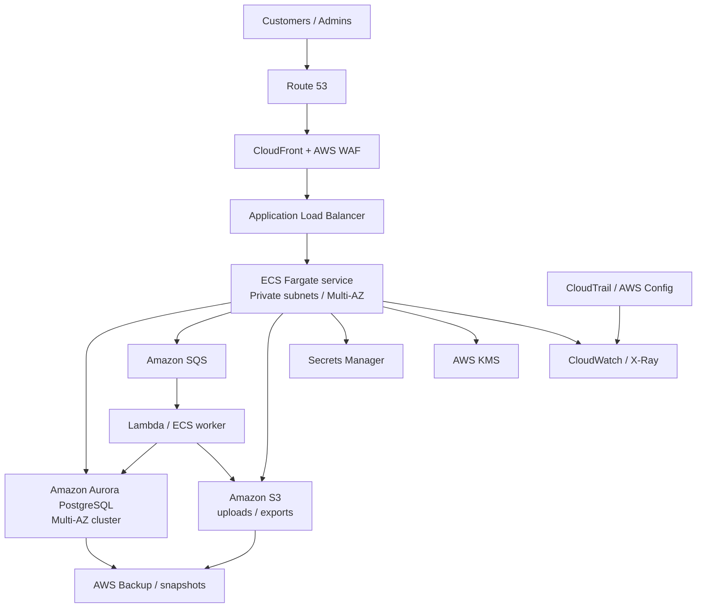
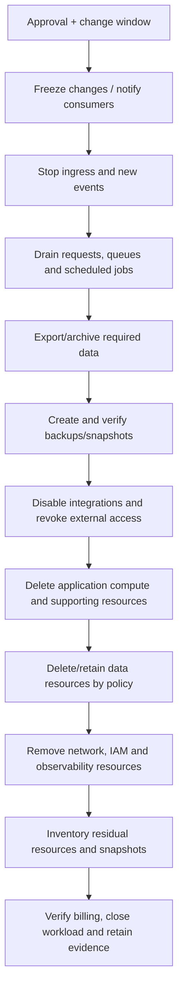

# Đánh giá Well-Architected, bàn giao vận hành và thu hồi tài nguyên

Một workload trên AWS chỉ sẵn sàng đưa vào vận hành khi kiến trúc đã được đánh giá có hệ thống, nhóm vận hành có đủ thông tin và quyền để hỗ trợ, và tổ chức có thể kết thúc workload mà không làm mất dữ liệu cần giữ hoặc để sót tài nguyên tiếp tục phát sinh chi phí.

Capstone này đưa bạn qua toàn bộ vòng đời cuối của một dự án AWS: mô tả workload, thực hiện AWS Well-Architected review, lập kế hoạch cải thiện, chuẩn bị operational handover, diễn tập runbook và cuối cùng thu hồi tài nguyên theo quy trình có phê duyệt. Bạn sẽ sử dụng **AWS Well-Architected Tool**, CloudWatch, AWS Backup, AWS CloudFormation, IAM, Resource Groups Tagging API và các dịch vụ nền tảng đã học trong module.

Dự án dùng một hệ thống xử lý đơn hàng thương mại điện tử làm ví dụ. Bạn có thể áp dụng cùng phương pháp cho workload thực tế của mình bằng cách thay business context, sơ đồ kiến trúc, yêu cầu RTO/RPO, rủi ro và chính sách lưu giữ dữ liệu.

Bài capstone thuộc module `CLOUD_PROVIDERS_AWS`: khám phá hệ sinh thái AWS từ Region/AZ, IAM, VPC, compute, storage, database, integration tới serverless; đồng thời rèn năng lực thiết kế ứng dụng an toàn, có khả năng giám sát, phục hồi và kiểm soát chi phí.

Sau dự án, bạn có thể:

- Xác định workload boundary, business outcomes, owner, account, Region và dependencies.
- Thực hiện review theo sáu pillars của AWS Well-Architected Framework.
- Dùng AWS Well-Architected Tool để ghi nhận câu trả lời, lưu milestone và tạo report.
- Phân tích High Risk Issues (HRIs) và Medium Risk Issues (MRIs), ưu tiên remediation theo business impact.
- Xây improvement backlog có owner, effort, deadline, evidence và acceptance criteria.
- Chuẩn bị operational readiness review và bộ tài liệu bàn giao.
- Viết, kiểm thử runbooks/playbooks cho deploy, incident, backup/restore, failover và cost review.
- Xác nhận SLO, dashboard, alarms, escalation, access, backup và DR.
- Lập kế hoạch decommission, bảo toàn dữ liệu, xóa resource có kiểm soát và xác minh chi phí còn lại.

## 1. Bối cảnh capstone: Retail Orders Workload

Một doanh nghiệp bán lẻ trực tuyến vận hành ứng dụng nhận đơn hàng, cập nhật tồn kho, xử lý thanh toán và cung cấp trạng thái đơn cho khách hàng. Workload chạy trên AWS, có traffic biến động theo chiến dịch và cần hỗ trợ vận hành ngoài giờ.

### 1.1. Business outcomes

| Mục tiêu | Kết quả mong đợi |
|---|---|
| Nhận và xử lý đơn hàng | Không mất đơn đã xác nhận |
| Trải nghiệm khách hàng | API ổn định, thời gian phản hồi phù hợp |
| Vận hành | Có thể phát hiện, điều tra và khôi phục sự cố |
| Bảo mật | Dữ liệu và quyền truy cập được kiểm soát |
| Tính liên tục | Có backup và phương án khôi phục đã kiểm thử |
| Chi phí | Có owner, budget, tagging và review định kỳ |
| Kết thúc workload | Có thể archive/delete theo chính sách và không để sót resource |

### 1.2. Phạm vi workload

Workload gồm:
- Website/API tiếp nhận đơn hàng.
- Service xử lý order và inventory.
- Database lưu trạng thái giao dịch.
- Queue xử lý tác vụ bất đồng bộ.
- Object storage cho ảnh, export và archive.
- Monitoring, logging, security và backup.
- Quy trình deployment, incident response và decommission.

Không bắt buộc phải triển khai toàn bộ kiến trúc trong tài khoản thật. Có thể dùng sơ đồ, cấu hình hiện có, log/metric mẫu và AWS Well-Architected Tool để hoàn thành review. Nếu triển khai trong sandbox, chỉ tạo các resource cần thiết và thu hồi sau khi nộp bằng chứng.

### 1.3. Giả định mục tiêu dịch vụ

Các con số dưới đây là giả định để nhóm thảo luận và xác nhận với business owner; chúng không phải SLA mặc định của AWS.

| Chỉ tiêu | Mục tiêu đề xuất | Cách đo |
|---|---:|---|
| Availability | 99,9% mỗi tháng | Successful requests / eligible requests |
| API latency | p95 dưới 500 ms cho read API | ALB/API metrics hoặc tracing |
| Error rate | Dưới 0,1% trong cửa sổ ổn định | 5XX và application errors |
| Order processing lag | p95 dưới 2 phút | Age of oldest message / event timestamp |
| RTO | 2 giờ | Thời gian từ incident tới khôi phục dịch vụ |
| RPO | 15 phút | Khoảng dữ liệu có thể mất tối đa |
| Backup restore | Đạt trong diễn tập | Restore test evidence |
| Cost variance | Trong budget đã duyệt | Actual vs budget |

RTO là thời gian mục tiêu để khôi phục dịch vụ; RPO là mức mất dữ liệu tối đa có thể chấp nhận. Hai chỉ tiêu cần được business owner, compliance và technical owner phê duyệt dựa trên tác động thực tế.

## 2. Kiến trúc tham chiếu

Kiến trúc mẫu dùng dịch vụ managed để giảm công việc vận hành. Nhóm cần điều chỉnh sơ đồ theo trạng thái thực tế của workload; không được đánh dấu một control là đã triển khai nếu chưa có bằng chứng.



### 2.1. Thành phần và trách nhiệm

| Thành phần | Vai trò | Điểm cần review |
|---|---|---|
| Route 53 / CloudFront | DNS và phân phối nội dung | DNS failover, cache policy, TLS |
| AWS WAF | Lọc request web | Managed rules, rate limits, logging |
| Application Load Balancer | Phân phối request tới service | Health checks, access logs, TLS |
| ECS Fargate | Chạy API và worker container | Task sizing, deployment, autoscaling |
| Aurora PostgreSQL | Lưu order/inventory | Multi-AZ, backup, connections, failover |
| SQS | Buffer công việc bất đồng bộ | DLQ, visibility timeout, age, redrive |
| Lambda | Xử lý event/worker nhỏ | Concurrency, retry, idempotency |
| S3 | Upload, export, archive | Versioning, encryption, lifecycle, access |
| IAM / Secrets Manager | Identity và secret | Least privilege, rotation, audit |
| KMS | Quản lý encryption keys | Key policy, grants, rotation, deletion |
| CloudWatch / X-Ray | Metrics, logs, traces | SLO, alarm, retention, correlation |
| CloudTrail / Config | Audit và configuration history | Account/Region coverage, retention |
| AWS Backup | Policy backup/restore | Coverage, vault, retention, restore test |

### 2.2. Luồng dữ liệu

1. Khách hàng gửi request qua DNS, CloudFront/WAF và ALB.
2. ECS API xác thực request, kiểm tra nghiệp vụ và ghi order vào Aurora.
3. API phát message tới SQS để xử lý bất đồng bộ.
4. Worker xử lý payment/inventory integration, cập nhật trạng thái và lưu kết quả.
5. S3 lưu các object như invoice, export hoặc file upload.
6. CloudWatch thu metrics/logs; X-Ray hỗ trợ trace request qua service.
7. AWS Backup và native database backup bảo vệ dữ liệu theo RPO/RTO.
8. CloudTrail và AWS Config cung cấp bằng chứng audit/configuration.

Luồng này là giả định cho bài tập. Khi review workload khác, hãy thay bằng luồng thực tế, gồm cả dependency bên ngoài AWS, SaaS, on-premises và manual operations.

## 3. Deliverables của dự án

Nhóm phải tạo một bộ hồ sơ có thể bàn giao cho người không tham gia thiết kế ban đầu.

| Deliverable | Nội dung tối thiểu | Bằng chứng |
|---|---|---|
| Workload profile | Business context, owner, criticality, accounts/Regions, dependencies | Workload record |
| Architecture pack | Sơ đồ hiện trạng và target, data flow, trust boundaries | Diagram + notes |
| Well-Architected review | Câu trả lời, notes, risks theo sáu pillars | WA Tool report |
| Risk register | HRI/MRI, impact, likelihood, owner, remediation | Bảng backlog |
| Improvement plan | Priority, effort, due date, success criteria | Roadmap |
| Operations handbook | SLO, dashboard, alarms, access, runbooks, escalation | Handover pack |
| Backup/DR evidence | Policy, recovery points, restore test và RTO/RPO result | Test report |
| Decommission plan | Inventory, retention, approval, deletion sequence | Signed checklist |
| Closure report | Resource residuals, cost check, lessons learned | Final report |

Không tạo số liệu review hoặc bằng chứng giả. Nếu chưa kiểm thử một control, ghi trạng thái `Not verified` hoặc `Planned` và tạo action item.

## 4. Chuẩn bị buổi Well-Architected Review

Một review hiệu quả cần đúng người, đúng phạm vi và bằng chứng có thể kiểm chứng.

### 4.1. Thành phần tham gia

- Workload owner: chịu trách nhiệm business outcome và risk acceptance.
- Solution architect: giải thích kiến trúc, trade-off và design decisions.
- Application owner: mô tả code, release, dependencies và failure modes.
- Platform/cloud engineer: account, networking, compute, storage và IaC.
- Security representative: IAM, encryption, logging, incident response.
- Operations/SRE: SLO, alarms, on-call, runbooks và DR.
- Finance/FinOps: budget, tagging, cost allocation và savings opportunities.
- Data/compliance owner: classification, retention, legal hold và data deletion.

Một người có thể đảm nhận nhiều vai trò ở dự án nhỏ, nhưng trách nhiệm phê duyệt risk, vận hành và dữ liệu phải được xác định rõ.

### 4.2. Thu thập đầu vào

Trước review, chuẩn bị:

- Business purpose, user journeys và critical business transactions.
- Workload owner, support owner, escalation contacts.
- AWS accounts, Regions, VPCs, AZs và external dependencies.
- Architecture diagram và data-flow diagram.
- Data classification, retention và residency constraints.
- Deployment pipeline, IaC repositories và change process.
- Metrics, logs, traces, incidents và postmortems gần đây.
- Backup policies, recovery points và restore test results.
- Cost/budget reports, tags và usage trends.
- Existing risks, exceptions và remediation backlog.

Dữ liệu cần có timestamp và nguồn. Một screenshot cũ không đủ chứng minh control hiện vẫn hoạt động.

## 5. Định nghĩa workload trong AWS Well-Architected Tool

AWS Well-Architected Tool (WA Tool) hỗ trợ ghi nhận workload, trả lời các câu hỏi theo lens, xem các risk và theo dõi cải tiến bằng milestones. Tool cung cấp quy trình review có cấu trúc; câu trả lời và bằng chứng vẫn cần do người hiểu workload xác minh. Không coi WA Tool là một công cụ tự động quét toàn bộ tài khoản rồi kết luận kiến trúc an toàn.

### 5.1. Tạo workload

1. Mở AWS Management Console và chọn **AWS Well-Architected Tool**.
2. Chọn **Define workload**.
3. Đặt tên dễ nhận diện, ví dụ `Retail Orders - Production`.
4. Mô tả business purpose và workload boundary.
5. Chỉ định review owner.
6. Chọn environment phù hợp, ví dụ Production.
7. Chọn AWS Regions thực sự được sử dụng.
8. Liên kết account IDs nếu tổ chức muốn quản lý phạm vi đó trong workload.
9. Thêm application ARN, architecture diagram, industry và tags nếu có.
10. Xem xét profile và các lens cần áp dụng.
11. Lưu workload và bắt đầu review.

Chỉ khai báo Region/account có trong phạm vi. Không thêm Region dự phòng chưa triển khai chỉ để tạo cảm giác multi-Region.

### 5.2. Xác định boundary

Workload boundary phải làm rõ:
- Thành phần nào thuộc workload.
- Dịch vụ AWS nào được dùng.
- Hệ thống ngoài AWS nào là dependency.
- Đội nào chịu trách nhiệm từng thành phần.
- Dữ liệu nào đi qua trust boundary.
- Thành phần nào nằm ngoài phạm vi review và lý do.

Nếu payment provider bên ngoài xử lý giao dịch, workload vẫn cần đánh giá cách gọi, timeout, retry, credential và failure handling đối với dependency đó.

### 5.3. Bắt đầu review

1. Mở workload vừa tạo.
2. Chọn **Start reviewing** hoặc **Continue reviewing**.
3. Chọn AWS Well-Architected Framework lens.
4. Với từng câu hỏi, đọc best practices và đánh dấu các practice hiện đang áp dụng.
5. Nếu practice không áp dụng, đánh dấu Not applicable và ghi lý do.
6. Ghi notes mô tả evidence, link tài liệu, owner hoặc giới hạn.
7. Lặp lại cho từng pillar.
8. Lưu và thoát nếu cần chia review thành nhiều buổi.

Không chọn một best practice chỉ vì nó có trong architecture diagram. Ví dụ có CloudWatch không chứng minh workload có alarms hữu ích, owner trực on-call hoặc runbook đã diễn tập.

## 6. Review sáu pillars

Sáu pillars là Operational Excellence, Security, Reliability, Performance Efficiency, Cost Optimization và Sustainability. Mỗi pillar cần được đánh giá bằng câu hỏi, evidence, risk và action cụ thể.

### 6.1. Operational Excellence — Vận hành xuất sắc

Câu hỏi review:
- Team có hiểu workload health và business outcome không?
- Có quy trình change management, release và rollback không?
- Runbooks/playbooks có sẵn, có owner và đã được thử nghiệm không?
- Incident có được phát hiện, phân loại, điều tra và postmortem không?
- Có cơ chế học từ operational events và cải tiến không?
- Có đủ nhân sự, quyền truy cập và escalation coverage không?

Evidence:
- Deployment pipeline, change record, release history.
- CloudWatch dashboard, alarms và alert routing.
- Runbook, incident timeline và postmortem.
- On-call rota, support plan và training record.
- Operational readiness checklist.

Ví dụ risk: alert chỉ gửi email tới một cá nhân đã rời team. Remediation: dùng SNS/on-call integration do team sở hữu, thêm escalation và kiểm thử notification.

### 6.2. Security — Bảo mật

Câu hỏi review:
- Identity có least privilege, federation và MFA không?
- Workload có phân tách role cho task execution và application access không?
- Data at rest/in transit có encryption phù hợp không?
- Secrets có được lưu trong Secrets Manager/Parameter Store và rotate không?
- Có audit log, detection và incident response không?
- Network exposure có được giới hạn không?
- Dependency, container image và code có được scan không?

Evidence:
- IAM role/policy review, access analyzer findings.
- KMS key policy, encryption configuration.
- Secrets rotation settings.
- CloudTrail, AWS Config, GuardDuty findings.
- Security group, WAF và network architecture.
- Container image scan và patch records.

Ví dụ risk: task role có quyền `s3:*` trên mọi bucket. Remediation: giới hạn action, bucket ARN và prefix; xác nhận ứng dụng vẫn hoạt động sau policy change.

### 6.3. Reliability — Độ tin cậy

Câu hỏi review:
- Có loại bỏ single points of failure không?
- Workload có triển khai qua nhiều AZ phù hợp không?
- Có backup, restore test và DR strategy không?
- Retry, timeout, queue và idempotency có được thiết kế không?
- Có health check và automatic recovery không?
- Có kiểm thử failover và capacity failure không?

Evidence:
- ECS service desired/running tasks theo AZ.
- Aurora failover configuration và event history.
- SQS DLQ, redrive policy và message age.
- AWS Backup policy, recovery points và restore test.
- DR runbook, RTO/RPO measurement.
- Failure injection/game day report.

Ví dụ risk: backup job xanh nhưng chưa từng restore. Remediation: tạo restore test vào môi trường cách ly, xác nhận dữ liệu và đo thời gian phục hồi.

### 6.4. Performance Efficiency — Hiệu năng

Câu hỏi review:
- Compute/storage/database có được sizing theo workload không?
- Có đo p50/p95/p99 latency và saturation không?
- Có cache, queue, async processing hoặc autoscaling khi phù hợp không?
- Database query/index và connection pool có được theo dõi không?
- Có load test theo traffic profile và peak event không?

Evidence:
- Load test report, latency percentiles.
- ECS CPU/memory, ALB target response time.
- Aurora CPU, connections, I/O và Database Insights.
- SQS age/depth và worker concurrency.
- Cache hit ratio, throughput và scaling history.

Ví dụ risk: worker xử lý đồng bộ khiến API chờ external payment provider. Remediation: dùng asynchronous workflow, bounded retry, idempotency key và trạng thái order rõ ràng.

### 6.5. Cost Optimization — Tối ưu chi phí

Câu hỏi review:
- Có owner và cost allocation tags không?
- Có budget, forecast và anomaly alert không?
- Có tắt/xóa non-production resource khi không dùng không?
- Có right-size compute/database và storage lifecycle không?
- Có đo idle capacity, data transfer, NAT, logs và backup cost không?
- Có chọn pricing model phù hợp với usage pattern không?

Evidence:
- Cost Explorer, CUR hoặc billing export.
- AWS Budgets và Cost Anomaly Detection.
- Resource tags và cost allocation reports.
- Compute utilization, storage growth và retention settings.
- Savings Plans/Reserved capacity analysis nếu phù hợp.

Ví dụ risk: log group không có retention, dung lượng tăng liên tục. Remediation: đặt retention theo compliance và nhu cầu điều tra; archive log cần giữ vào storage phù hợp.

### 6.6. Sustainability — Phát triển bền vững

Câu hỏi review:
- Có tránh overprovisioning và tài nguyên idle không?
- Có dùng managed/serverless service khi phù hợp không?
- Có tối ưu data lifecycle và storage footprint không?
- Có giảm dữ liệu truyền và xử lý không cần thiết không?
- Có đo utilization và cải thiện hiệu quả resource không?

Evidence:
- Compute utilization và autoscaling.
- Storage lifecycle/retention.
- Workload scheduling và non-production shutdown.
- Architecture decisions giảm data movement.
- Rightsizing records và resource cleanup evidence.

Ví dụ risk: development environment chạy 24/7 dù chỉ dùng giờ hành chính. Remediation: schedule stop/start có ngoại lệ và owner rõ ràng.

### 6.7. Bảng tổng hợp review

| Pillar | Câu hỏi trọng tâm | Evidence chính | Ví dụ improvement |
|---|---|---|---|
| Operational Excellence | Có vận hành nhất quán và học từ sự cố? | Runbooks, alarms, incidents | On-call, runbook test |
| Security | Có bảo vệ identity, data và network? | IAM, KMS, CloudTrail | Least privilege, secret rotation |
| Reliability | Có chịu lỗi và khôi phục được? | Multi-AZ, backup, restore test | DR exercise, DLQ |
| Performance Efficiency | Có đáp ứng tải hiệu quả? | Load test, latency, utilization | Autoscaling, query tuning |
| Cost Optimization | Chi phí có owner và phù hợp usage? | Cost Explorer, budgets, tags | Rightsizing, lifecycle |
| Sustainability | Có dùng tài nguyên hiệu quả? | Utilization, storage lifecycle | Schedule idle resources |

## 7. Evidence và cách ghi nhận câu trả lời

Một câu trả lời Well-Architected nên gắn với bằng chứng cụ thể.

Mẫu evidence record:

| Trường | Ví dụ |
|---|---|
| Pillar/question | Reliability — backup và recovery |
| Current practice | Aurora automated backups bật |
| Evidence | Backup retention setting, recovery point ID |
| Evidence date | 2026-11-20 |
| Owner | Database platform team |
| Gap | Chưa có restore test trong 90 ngày |
| Risk | Không biết backup có đáp ứng RTO/RPO |
| Next action | Restore test vào isolated VPC |
| Acceptance | Data validation pass, restore time dưới RTO |

Phân biệt ba trạng thái:
- **Implemented and verified**: đã triển khai và có bằng chứng kiểm thử.
- **Implemented, not recently verified**: có cấu hình nhưng evidence cũ hoặc chưa kiểm tra gần đây.
- **Planned/not implemented**: chưa triển khai, phải tạo improvement item.

Không đánh dấu Not applicable để né một practice khó. Ghi lý do, business context và người chấp thuận ngoại lệ.

## 8. Lưu milestone và tạo workload report

Sau khi hoàn tất câu hỏi ban đầu:

1. Mở workload overview.
2. Chọn **Save milestone**.
3. Đặt tên như `Baseline-2026-11-20`.
4. Ghi chú scope, reviewer và phiên bản architecture.
5. Lưu milestone.
6. Chọn lens và tạo workload report.
7. Lưu report vào project evidence repository theo quy định nội bộ.

Milestone ghi lại trạng thái workload tại thời điểm lưu và không thể sửa sau đó. Khi hoàn tất remediation hoặc một vòng review mới, tạo milestone mới để so sánh tiến độ. Workload report thể hiện câu trả lời, notes và risk state của lần review đó.

## 9. Đọc Improvement Plan và phân loại rủi ro

AWS WA Tool tổng hợp các risk dựa trên best practices được chọn. Improvement Plan làm nổi bật:
- **High Risk Issues (HRIs)**.
- **Medium Risk Issues (MRIs)**.
- Recommended improvement items và hướng dẫn khắc phục.

Danh sách này là đầu vào để nhóm đánh giá và ưu tiên. Không nên coi thứ tự công cụ là quyết định business cuối cùng; cần xem tác động, khả năng khai thác, phạm vi, effort, dependencies và risk acceptance.

### 9.1. Risk register

Mẫu:

| ID | Pillar | Issue | Impact | Priority | Owner | Target |
|---|---|---|---|---|---|---|
| R-01 | Reliability | Chưa restore test DB backup | Mất khả năng chứng minh RTO/RPO | P0 | DBA | Sprint 1 |
| R-02 | Security | Task role quá rộng | Tăng blast radius | P0 | Security | Sprint 1 |
| R-03 | Operational | Không có escalation ngoài giờ | Phát hiện chậm | P1 | SRE | Sprint 2 |
| R-04 | Cost | Log retention không kiểm soát | Chi phí tăng | P2 | Platform | Sprint 2 |
| R-05 | Performance | Worker xử lý đồng bộ | API latency tăng | P2 | App team | Sprint 3 |

Đây là ví dụ minh họa, không phải kết quả review thật của workload.

### 9.2. Ưu tiên theo business impact

Có thể dùng thang nội bộ:

- Severity: mức ảnh hưởng tới người dùng, dữ liệu, bảo mật hoặc vận hành.
- Likelihood: khả năng xảy ra.
- Exposure: phạm vi account/resource/data bị ảnh hưởng.
- Urgency: thời gian trước khi rủi ro trở thành sự cố.
- Effort: công sức, chi phí và dependency để khắc phục.

Ví dụ ma trận:

| Priority | Tiêu chí gợi ý | Hành động |
|---|---|---|
| P0 | Nguy cơ mất dữ liệu, breach, hoặc không đáp ứng critical recovery | Xử lý ngay, có owner và escalation |
| P1 | Có thể gây outage lớn hoặc vi phạm SLA | Đưa vào sprint gần nhất |
| P2 | Ảnh hưởng hiệu quả/chi phí có thể kiểm soát | Lên kế hoạch theo quý |
| P3 | Cải thiện nhỏ, rủi ro thấp | Theo dõi backlog |

P0-P3 là quy ước của capstone; hãy dùng severity scheme của tổ chức nếu đã có.

## 10. Xây Improvement Plan có thể thực hiện

Mỗi action item cần có:
- Risk ID và pillar.
- Mô tả vấn đề, evidence và business impact.
- Proposed change.
- Owner và approver.
- Effort/estimated cost.
- Dependencies và rollback plan.
- Due date.
- Acceptance criteria.
- Evidence sau remediation.
- Residual risk và risk acceptance nếu còn.

Ví dụ:

| Action | Owner | Acceptance criteria | Rollback |
|---|---|---|---|
| Giới hạn task role vào S3 prefix | App + Security | Negative test từ prefix khác bị AccessDenied; luồng hợp lệ pass | Revert policy version đã lưu |
| Diễn tập Aurora restore | DBA | Database phục hồi, checksum/business validation pass, thời gian đạt RTO | Xóa isolated restore sau khi lưu evidence |
| Bật DLQ và redrive runbook | Platform | Poison message được cách ly, alert tới đúng owner | Revert consumer config theo change plan |
| Chuẩn hóa alarm/on-call | SRE | Test alarm tới escalation channel và được acknowledge | Khôi phục routing config cũ |
| Lifecycle cho archive bucket | Data owner | Object hết retention được xử lý theo policy và legal hold được bảo vệ | Tạm dừng lifecycle rule |

### 10.1. Theo dõi tiến độ

- Gắn action item vào backlog/ticket system.
- Cập nhật status: Not started, In progress, Blocked, Complete, Accepted risk.
- Lưu evidence sau khi triển khai.
- Re-review câu hỏi liên quan trong WA Tool.
- Tạo milestone mới sau mỗi nhóm remediation.
- Theo dõi HRI/MRI giảm hay còn tồn tại.
- Lặp lại review theo cadence của tổ chức và sau thay đổi kiến trúc lớn.

Không đánh dấu risk Complete chỉ vì ticket đã đóng. Cần evidence xác nhận control hoạt động.

## 11. Operational Readiness Review trước bàn giao

Operational handover là chuyển trách nhiệm từ nhóm xây dựng sang nhóm chịu trách nhiệm vận hành. Trước khi bàn giao, thực hiện Operational Readiness Review (ORR) với các nhóm sau:

| Nhóm kiểm tra | Câu hỏi cần trả lời |
|---|---|
| Ownership | Ai là service owner, technical owner và business owner? |
| Support | Ai on-call, giờ hỗ trợ và escalation path? |
| Architecture | Sơ đồ, dependency và data flow có cập nhật? |
| Deployment | Ai deploy, approval ở đâu, rollback thế nào? |
| Observability | Dashboard, alarms, logs, traces và SLO có đủ? |
| Incident | Có playbook, severity và communication plan? |
| Security | IAM, secret, KMS, audit và vulnerability process? |
| Data | Backup, restore, retention, classification và deletion? |
| Reliability | RTO/RPO, failover và capacity plan đã thử? |
| Cost | Budget, tags, anomaly alerts và cost owner? |
| Change | Maintenance window, change calendar và release notes? |
| Knowledge | Runbook, known issues và training đã bàn giao? |

Mỗi mục có trạng thái Pass, Conditional Pass hoặc Blocked, cùng owner và ngày xử lý. Conditional Pass cần ghi risk, compensating control, deadline và người chấp thuận.

## 12. Bộ tài liệu bàn giao vận hành

Tạo một operations handbook với các phần sau.

### 12.1. Service overview

- Tên workload và business purpose.
- Service owner, support team, escalation contact.
- Account/Region/environment.
- Architecture diagram và data-flow diagram.
- Critical dependencies và external providers.
- Data classification và retention.
- SLO/SLA, RTO/RPO và maintenance window.
- Known limitations và accepted risks.

### 12.2. Resource inventory

Mỗi resource cần có:
- Resource ARN/ID và service type.
- Account/Region/AZ.
- Environment, project, owner và cost center tags.
- IaC stack/module quản lý.
- Data classification và retention.
- Dependency/upstream/downstream.
- Backup/deletion policy.
- Operational contact.

### 12.3. Deployment và rollback

Ghi rõ:
- Source repository và release branch.
- CI/CD pipeline và required approvals.
- Artifact/image digest.
- Deployment strategy (rolling, blue/green, canary).
- Health checks và smoke tests.
- Rollback trigger và rollback steps.
- Database migration compatibility.
- Change record và communication plan.

### 12.4. Access handover

- IAM Identity Center/federated access.
- Role mapping theo nhiệm vụ.
- Break-glass procedure có audit.
- Quy trình cấp/thu hồi quyền.
- Secret ownership và rotation schedule.
- KMS key owner và recovery procedure.
- Quy trình offboarding thành viên.
- Không chuyển password/private key qua email hoặc tài liệu plaintext.

### 12.5. Known issues và technical debt

Mỗi issue ghi:
- Triệu chứng.
- Điều kiện tái hiện.
- Tác động.
- Workaround đã kiểm thử.
- Root cause nếu đã biết.
- Owner và target date.
- Điều gì sẽ xảy ra nếu không xử lý.

## 13. SLO, dashboard và alarms bàn giao

Một dashboard chỉ hữu ích khi nó trả lời được câu hỏi vận hành. Thiết kế dashboard theo golden signals và business outcomes.

| Tầng | Signal | Alarm/điều kiện gợi ý |
|---|---|---|
| User/API | Availability, 5XX, p95/p99 latency | Error budget burn, latency vượt SLO |
| ALB | Healthy targets, target response time | Healthy target thấp hoặc 5XX tăng |
| ECS | Running/pending tasks, CPU, memory | Service desired/running mismatch |
| SQS | ApproximateAgeOfOldestMessage, visible messages | Queue age vượt processing SLA |
| Lambda | Errors, Throttles, Duration, ConcurrentExecutions | Error/throttle tăng hoặc duration gần timeout |
| Aurora | CPU, connections, free storage, failover events | Connection saturation, storage low |
| S3 | 4XX/5XX request metrics, replication status | Access failure hoặc replication lag |
| Security | GuardDuty findings, Config compliance, CloudTrail events | Finding critical hoặc drift |
| Cost | Budget actual/forecast, anomaly | Forecast vượt budget threshold |

### 13.1. Alarm phải có owner và action

Mỗi alarm cần:
- Tên dễ hiểu và resource dimension chính xác.
- Severity (critical/high/warning).
- Threshold, evaluation period và missing-data behavior.
- Owner/on-call route.
- Runbook link.
- Action khi alarm firing.
- Điều kiện resolve và silence policy.
- Kiểm thử notification.

Không tạo alarm chỉ để tăng số lượng. Alarm không có owner hoặc không dẫn tới hành động sẽ tạo noise.

### 13.2. Error budget

Nếu SLO availability là 99,9% theo tháng, error budget là phần downtime/error được phép trong kỳ đó theo định nghĩa SLI. Team dùng burn rate để phát hiện việc tiêu hao budget quá nhanh. Khi budget bị cạn, cần review release risk và ưu tiên reliability work theo policy tổ chức.

## 14. Runbooks và playbooks

Runbook mô tả thủ tục có thể lặp lại; playbook hướng dẫn điều tra và quyết định khi có sự cố. Cả hai cần được lưu ở vị trí tập trung, version control và thử nghiệm định kỳ.

Mẫu cấu trúc runbook:

1. Mục tiêu và phạm vi.
2. Triệu chứng/trigger.
3. Severity và business impact.
4. Preconditions và permissions.
5. Dashboard/log/query cần mở.
6. Các bước điều tra.
7. Các bước mitigation/recovery.
8. Verification sau khắc phục.
9. Rollback/stop conditions.
10. Escalation và communication.
11. Evidence cần lưu.
12. Owner, reviewer và ngày cập nhật.

### 14.1. Runbook: API 5XX tăng

1. Mở dashboard API/ALB/ECS.
2. Xác định thời điểm bắt đầu và phạm vi endpoint/AZ.
3. Kiểm tra deployment gần nhất và change record.
4. So sánh target health, task count, CPU/memory và dependency latency.
5. Mở structured logs và trace theo correlation ID.
6. Nếu lỗi do release, dùng rollback procedure đã kiểm thử.
7. Nếu dependency lỗi, áp dụng circuit breaker/traffic control theo playbook.
8. Xác minh 5XX và latency trở lại baseline.
9. Ghi incident timeline, customer impact và follow-up actions.

### 14.2. Runbook: SQS backlog tăng

1. Kiểm tra `ApproximateAgeOfOldestMessage`, visible/in-flight messages.
2. Kiểm tra worker desired/running count, errors và throttles.
3. Kiểm tra downstream DB/API có bị saturation không.
4. Xem message failure và retry pattern.
5. Tăng consumer concurrency chỉ khi downstream còn capacity.
6. Cách ly poison messages vào DLQ theo policy.
7. Redrive sau khi sửa nguyên nhân và có kiểm soát tốc độ.
8. Xác nhận queue age giảm và business transaction hoàn tất.

### 14.3. Runbook: Aurora failover hoặc connection saturation

1. Kiểm tra RDS/Aurora events và cluster status.
2. Dùng cluster endpoint, tránh IP cố định.
3. Kiểm tra connection count, CPU, locks và DB load.
4. Xác minh application pool reconnect/backoff.
5. Nếu cần, giảm concurrency hoặc scale service theo giới hạn DB.
6. Xác nhận writer endpoint và transaction health.
7. Chạy smoke test đọc/ghi trong phạm vi cho phép.
8. Theo dõi connection errors, latency và failover events.

### 14.4. Runbook: Restore từ backup

1. Xác định incident, recovery point và RPO.
2. Xin approval của incident commander/data owner.
3. Restore vào môi trường cách ly hoặc target được phê duyệt.
4. Giới hạn network và IAM access.
5. Kiểm tra schema, row counts, checksums và business invariants.
6. Đo thời gian restore và so sánh với RTO.
7. Lập kế hoạch cutover, DNS/endpoint và consumer pause.
8. Thực hiện cutover có phê duyệt.
9. Xác minh application health và data integrity.
10. Ghi evidence và xóa môi trường restore tạm theo policy.

Không diễn tập restore bằng cách ghi đè database production.

## 15. Backup, disaster recovery và bằng chứng phục hồi

Backup có giá trị khi có thể restore và dữ liệu phục hồi đáp ứng mục tiêu nghiệp vụ.

### 15.1. Backup strategy

- Aurora/RDS automated backups và point-in-time recovery theo retention phù hợp.
- AWS Backup plans cho resource types được hỗ trợ.
- S3 Versioning và lifecycle; replication khi yêu cầu DR.
- Backup vault access policy và encryption.
- Cross-account/cross-Region copy nếu threat model yêu cầu.
- Retention/legal hold theo policy.
- Monitoring backup job failures và recovery point age.

Không phải mọi resource đều được bảo vệ theo cùng một cách. Kiểm tra coverage theo resource type và service-specific backup features.

### 15.2. Restore test

Bằng chứng cần lưu:
- Recovery point ARN/ID.
- Resource và Region nguồn.
- Thời điểm bắt đầu/kết thúc restore.
- Target environment.
- Data validation result.
- RTO/RPO measured.
- Người thực hiện và approver.
- Findings và remediation.

AWS Backup hỗ trợ restore testing cho các resource type được hỗ trợ. Với dịch vụ có native restore/PITR, dùng quy trình phù hợp và ghi nhận kết quả tương đương.

### 15.3. DR strategy

Chọn chiến lược dựa trên RTO/RPO và ngân sách:
- Backup and restore: chi phí thấp hơn, RTO thường dài hơn.
- Pilot light: duy trì phần nền tối thiểu ở Region dự phòng.
- Warm standby: phiên bản thu nhỏ luôn sẵn sàng.
- Multi-site active/active: khả năng phục hồi cao nhưng phức tạp và tốn kém.

Không tuyên bố workload multi-Region chỉ vì backup được copy sang Region khác. DR cần network, identity, data replication, deployment, DNS/cutover và diễn tập.

## 16. Change management và knowledge transfer

Trước khi chuyển giao:
- Đóng băng hoặc ghi nhận release đang triển khai.
- Đồng bộ IaC, runbook và resource inventory.
- Ghi lại version ứng dụng và infrastructure.
- Xác định pending changes, maintenance và known issues.
- Thực hiện walkthrough kiến trúc và data flow.
- Cho đội nhận bàn giao tự chạy một runbook.
- Diễn tập một alarm/incident giả lập.
- Xác nhận quyền console/CLI và break-glass access.
- Ghi lại câu hỏi, gaps và owner.

Bàn giao chỉ hoàn tất khi đội nhận có thể tìm tài liệu, truy cập đúng phạm vi, phát hiện sự cố, thực hiện recovery cơ bản và biết escalation path.

## 17. Sign-off bàn giao

| Tiêu chí | Nhóm bàn giao | Nhóm nhận | Trạng thái |
|---|---|---|---|
| Architecture và resource inventory cập nhật | Cung cấp | Xác minh | Pass/Blocked |
| SLO, dashboard và alarms | Cấu hình | Kiểm tra notification | Pass/Blocked |
| Runbooks/playbooks | Viết và diễn tập | Thực hành lại | Pass/Blocked |
| Backup và restore evidence | Cung cấp | Review RTO/RPO | Pass/Blocked |
| IAM/access | Cấp theo role | Xác nhận quyền | Pass/Blocked |
| Security findings | Ghi risk và action | Chấp nhận/khắc phục | Pass/Blocked |
| Cost/budget ownership | Cung cấp baseline | Nhận ownership | Pass/Blocked |
| Open issues và accepted risks | Bàn giao | Xác nhận owner | Pass/Blocked |
| Support/on-call | Chỉ định | Xác nhận lịch | Pass/Blocked |

Sign-off phải có workload owner, technical owner và operations owner. Risk còn mở cần người có thẩm quyền chấp nhận; không chuyển trách nhiệm một cách mặc định chỉ vì dự án kết thúc.

## 18. Lập kế hoạch decommission

Decommission là quá trình ngừng workload, chuyển dữ liệu cần giữ và thu hồi resource an toàn. Đây là thay đổi có thể ảnh hưởng người dùng, compliance, billing và các hệ thống phụ thuộc.

Trước khi xóa bất kỳ resource nào, xác nhận:
- Business owner đã phê duyệt ngày kết thúc.
- Không còn user, API client hoặc integration phụ thuộc.
- Data owner xác nhận archive/delete và retention.
- Legal hold, regulatory retention và eDiscovery đã được kiểm tra.
- Backup/snapshot cần giữ đã được tạo và kiểm tra.
- IaC stack, resource owner và dependency đã được lập inventory.
- DNS, certificates, secrets, keys và integrations có kế hoạch xử lý.
- Billing owner đồng ý với phần snapshot/archive còn phát sinh phí.

Không chạy lệnh xóa hàng loạt chỉ dựa trên tag hoặc tên project. Tag có thể thiếu, sai hoặc được dùng chung với workload khác.

## 19. Resource inventory trước khi thu hồi

Dùng nhiều nguồn để lập inventory:

- AWS CloudFormation stacks và stack resources.
- AWS Resource Groups Tagging API.
- AWS Resource Explorer và AWS Config inventory nếu đã bật.
- AWS Backup protected resources/recovery points.
- Cost Explorer và billing data để tìm resource còn phát sinh chi phí.
- Service consoles/API cho resource đặc thù như RDS snapshots, EBS volumes, NAT Gateways, load balancers, log groups, ECR images và KMS keys.

Tag gợi ý:
- `Project=retail-orders`
- `Environment=production`
- `Owner=team-name`
- `CostCenter=CC-1001`
- `DataClass=confidential`
- `ManagedBy=CloudFormation`
- `DecommissionDate=YYYY-MM-DD`

Tagging API không nhất thiết liệt kê mọi resource type. Đối chiếu với CloudFormation, Config, Resource Explorer và billing.

### 19.1. Lệnh inventory an toàn

Liệt kê stack còn hoạt động:

```bash
aws cloudformation list-stacks \
  --stack-status-filter CREATE_COMPLETE UPDATE_COMPLETE UPDATE_ROLLBACK_COMPLETE \
  --query 'StackSummaries[*].{Name:StackName,Status:StackStatus,Updated:LastUpdatedTime}'
```

Xem resource của một stack cụ thể:

```bash
aws cloudformation describe-stack-resources \
  --stack-name "$STACK_NAME" \
  --query 'StackResources[*].{LogicalId:LogicalResourceId,Type:ResourceType,PhysicalId:PhysicalResourceId,Status:ResourceStatus}'
```

Tìm resource có tag project (kết quả phụ thuộc resource type được Tagging API hỗ trợ):

```bash
aws resourcegroupstaggingapi get-resources \
  --tag-filters Key=Project,Values=retail-orders \
  --resources-per-page 100
```

Kiểm tra RDS snapshots:

```bash
aws rds describe-db-cluster-snapshots \
  --query 'DBClusterSnapshots[*].{Cluster:DBClusterIdentifier,Snapshot:DBClusterSnapshotIdentifier,Status:Status,Created:SnapshotCreateTime}'
```

Các lệnh trên chỉ đọc inventory. Chạy ở đúng account và Region; nếu workload dùng nhiều Region, lặp lại với từng Region đã được xác nhận.

## 20. Data disposition: archive, retain hay delete

Phân loại dữ liệu trước khi teardown:

| Loại dữ liệu | Quyết định cần có | Cách xử lý |
|---|---|---|
| Order/transaction records | Retention theo business/legal policy | Giữ trong data store hoặc archive có access control |
| Customer personal data | Retention, deletion request, privacy obligations | Delete/anonymize theo policy và legal approval |
| Audit/security logs | Retention theo compliance và incident needs | Giữ log archive với encryption và access logging |
| Application logs | Retention theo giá trị điều tra | Giảm retention hoặc archive cần thiết |
| S3 uploads/exports | Owner xác nhận nội dung và retention | Versioned archive hoặc delete sau approval |
| Database backups/snapshots | RPO, audit và retention | Giữ đến hết retention, sau đó expire |
| Secrets/certificates | Xác nhận không còn consumer | Revoke/disable rồi xóa theo quy trình |
| KMS keys | Kiểm tra mọi ciphertext và dependency | Không schedule deletion khi dữ liệu còn cần giải mã |

Archive cũng là một resource cần owner, encryption, retention, restore path và budget. Không giữ snapshot vô thời hạn chỉ vì chưa có người quyết định.

## 21. Trình tự decommission an toàn

Thực hiện theo thứ tự để tránh tạo dữ liệu mới trong lúc đang xóa dependency.



### 21.1. Freeze và stop ingress

- Thông báo maintenance/decommission tới user và integration owner.
- Chặn tạo đơn mới hoặc chuyển hệ thống sang read-only theo change plan.
- Ngừng scheduler, EventBridge rules, webhook và API routes không còn cần.
- Xác nhận không còn producer ghi dữ liệu.
- Lưu final deployment/version và trạng thái workload.

### 21.2. Drain và hoàn tất công việc

- Chờ request đang xử lý hoàn tất.
- Dừng nhận message mới vào queue.
- Đợi consumer xử lý hết backlog hoặc chuyển message còn lại sang archive theo policy.
- Kiểm tra DLQ, retry queue và scheduled tasks.
- Xác nhận không còn batch/job đang chạy.
- Lưu reconciliation totals để chứng minh dữ liệu không bị bỏ sót.

Không xóa SQS queue khi còn message cần xử lý hoặc audit.

### 21.3. Archive và backup

- Export dữ liệu theo schema và format được phê duyệt.
- Tạo snapshot database hoặc recovery point.
- Kiểm tra snapshot status là available/completed.
- Kiểm tra khả năng restore trong môi trường cách ly.
- Lưu manifest, checksum, encryption key ARN và retention date.
- Chuyển quyền sở hữu archive cho data owner.
- Ghi rõ ai được phép restore và quy trình cấp quyền.

### 21.4. Thu hồi compute và integration

Sau khi đã drain và archive:
- Scale ECS services về 0 hoặc xóa service theo IaC.
- Xóa Lambda/event source mappings không còn dùng.
- Xóa scheduled rules, targets và Step Functions schedules liên quan.
- Gỡ API routes, ALB target groups và listeners theo dependency.
- Dừng EC2/ASG/ECS capacity và xóa sau khi xác nhận không còn dependency.
- Thu hồi external webhook/API credentials.
- Gỡ DNS records và certificates chỉ khi không còn consumer.

### 21.5. Thu hồi data và network

- Giữ hoặc xóa Aurora/RDS theo retention và snapshot approval.
- Giữ hoặc xóa S3 bucket sau khi xử lý object versions, delete markers và replication dependencies.
- Xử lý EBS volumes, snapshots, EFS/FSx và backup recovery points.
- Gỡ security groups, ENIs, endpoints, NAT Gateway, load balancers và VPC sau khi không còn attachment/dependency.
- Thu hồi IAM roles/policies sau khi xác minh không có workload khác sử dụng.
- Disable/revoke credentials và certificates.
- Xử lý KMS keys theo quy trình riêng, chỉ sau khi xác nhận dữ liệu cần giữ không còn phụ thuộc key.

Không xóa VPC hoặc KMS key đầu tiên trong chuỗi. Đây thường là dependency của nhiều resource và có thể khiến archive/backup không thể truy cập.

## 22. CloudFormation deletion policies và retained resources

Nếu workload được quản lý bằng CloudFormation, dùng IaC để xóa stack theo dependency. Trước đó, review từng resource trong template và các policy:

- `DeletionPolicy: Delete`: xóa resource khi stack bị xóa, nếu service cho phép.
- `DeletionPolicy: Retain`: giữ physical resource và dữ liệu sau khi stack bị xóa.
- `DeletionPolicy: Snapshot`: tạo snapshot trước khi xóa với resource type được hỗ trợ.
- `UpdateReplacePolicy`: kiểm soát resource cũ khi update thay thế resource.

Ví dụ YAML:

```yaml
Resources:
  OrdersArchiveBucket:
    Type: AWS::S3::Bucket
    DeletionPolicy: Retain
    UpdateReplacePolicy: Retain
    Properties:
      VersioningConfiguration:
        Status: Enabled

  OrdersDatabaseCluster:
    Type: AWS::RDS::DBCluster
    DeletionPolicy: Snapshot
    UpdateReplacePolicy: Snapshot
    Properties:
      # Properties omitted for this capstone example.
      Engine: aurora-postgresql
```

Đây là snippet minh họa policy, không phải template triển khai hoàn chỉnh. Với S3, Retain giữ bucket và object; resource vẫn tồn tại và tiếp tục có thể phát sinh chi phí. Nếu dùng Delete, bucket phải được làm rỗng đúng cách, bao gồm object versions/delete markers khi versioning bật. Với RDS, snapshot được giữ lại có chi phí lưu trữ và cần retention/owner rõ ràng.

### 22.1. Xóa stack có kiểm soát

Trước khi chạy delete:
1. Xác nhận account, Region và stack name.
2. Review toàn bộ stack resources và dependencies.
3. Xác nhận data disposition và snapshots.
4. Review DeletionPolicy/UpdateReplacePolicy.
5. Xác nhận resource retained sẽ có owner và budget.
6. Có approval/change record.
7. Thông báo đội vận hành và consumer.

Sau khi được phê duyệt, lệnh xóa stack có dạng:

```bash
aws cloudformation delete-stack \
  --stack-name "$STACK_NAME" \
  --region "$AWS_REGION"
```

Lệnh này bắt đầu thao tác xóa; CloudFormation không thể dừng stack deletion sau khi đã bắt đầu. Không chạy lệnh cho tới khi checklist approval hoàn tất. Nếu stack xóa xong, resource có DeletionPolicy Retain vẫn tồn tại ngoài stack và phải được quản lý riêng.

### 22.2. Xử lý DELETE_FAILED

Nếu stack ở trạng thái `DELETE_FAILED`:
- Đọc stack events để xác định resource gây lỗi.
- Kiểm tra dependency, protection flag, non-empty S3 bucket và service-specific deletion constraint.
- Không force delete toàn bộ stack một cách mặc định.
- Nếu cần giữ một số resource, chỉ định logical IDs được phê duyệt để retain khi retry delete.
- Sau khi stack bị xóa, kiểm tra Resources tab và các resource có trạng thái `DELETE_SKIPPED`.
- Ghi resource retained vào residual inventory và chỉ xóa sau approval riêng.

## 23. Xử lý tài nguyên còn sót và chi phí sau teardown

Stack `DELETE_COMPLETE` không chứng minh toàn bộ chi phí workload đã dừng. Các resource có thể tồn tại độc lập:
- Retained S3 buckets và objects.
- RDS/EBS snapshots.
- AWS Backup recovery points.
- CloudWatch log groups và custom metrics.
- ECR images.
- Elastic IPs, NAT Gateways, load balancers.
- KMS keys và secrets.
- Data transfer, archive và cross-Region replication.
- Resource được tạo thủ công hoặc từ stack khác.

### 23.1. Residual-resource register

| Resource | Trạng thái | Owner | Retention/expiry | Cost impact | Next action |
|---|---|---|---|---|---|
| S3 archive bucket | Retained | Data owner | 7 năm | Storage/request | Review lifecycle |
| Aurora final snapshot | Available | DBA | 90 ngày | Snapshot storage | Delete khi hết retention |
| CloudWatch log group | Retained | SRE | 30 ngày | Log storage | Confirm deletion date |
| KMS key | Enabled/retained | Security | Theo data retention | Key charges/operational | Review dependencies |
| ECR repository | Retained | App team | 30 ngày | Image storage | Delete after rollback window |

### 23.2. Xác minh sau xóa

- Kiểm tra CloudFormation stack status và retained resources.
- Tìm lại resource theo project tags.
- Kiểm tra service consoles/API cho resource đặc thù.
- Kiểm tra AWS Backup vault/recovery points.
- Kiểm tra DNS, certificate, secret và IAM references.
- Kiểm tra CloudWatch log groups, alarms và dashboards.
- Đối chiếu Cost Explorer/Billing sau khi dữ liệu usage được cập nhật.
- Giữ residual register cho mọi tài nguyên được giữ lại.

Chi phí có thể xuất hiện trễ trong billing data. Đặt một mốc review sau teardown để kiểm tra usage mới và phát hiện resource còn sót.

## 24. Kịch bản capstone theo giai đoạn

| Giai đoạn | Hoạt động | Output |
|---|---|---|
| Tuần 1 — Discover | Workload boundary, owner, architecture, evidence | Workload profile + diagram |
| Tuần 1 — Review | Review sáu pillars trong WA Tool | Baseline milestone + report |
| Tuần 2 — Prioritize | HRI/MRI, impact/effort, owner, target | Risk register + improvement plan |
| Tuần 2 — Remediate | Thực hiện 2-3 cải tiến ưu tiên trong sandbox | Change evidence + updated answers |
| Tuần 3 — Handover | ORR, SLO, dashboard, runbooks, backup/DR | Operations handbook + sign-off |
| Tuần 4 — Decommission | Archive, drain, delete theo dependency | Teardown record + residual inventory |
| Tuần 4 — Close | Cost review, lessons learned, final approval | Closure report |

Thời lượng chỉ là gợi ý. Workload production hoặc có yêu cầu compliance có thể cần nhiều vòng review và phê duyệt hơn.

## 25. Tiêu chí nghiệm thu

Capstone được xem là hoàn thành khi:

### Well-Architected review
- [ ] Workload boundary và business outcomes được owner xác nhận.
- [ ] Architecture/data-flow diagram phản ánh trạng thái thực tế.
- [ ] Review đủ sáu pillars.
- [ ] Câu trả lời có notes/evidence và Not applicable có lý do.
- [ ] Baseline milestone được lưu.
- [ ] Workload report được tạo.
- [ ] HRI/MRI được đưa vào risk register.

### Improvement plan
- [ ] Mỗi risk có impact, owner và priority.
- [ ] Action item có effort, due date và acceptance criteria.
- [ ] Ít nhất hai remediation được thực hiện hoặc có lý do/approval nếu chưa thể làm.
- [ ] Evidence sau remediation được lưu.
- [ ] Milestone mới ghi nhận tiến độ.

### Operational handover
- [ ] Service owner, support owner và escalation path đã xác nhận.
- [ ] Dashboard và alarms được kiểm thử.
- [ ] Runbooks/playbooks có owner và được diễn tập.
- [ ] SLO, RTO/RPO và support plan được phê duyệt.
- [ ] Backup/restore evidence đạt yêu cầu.
- [ ] IAM access và break-glass procedure được bàn giao.
- [ ] Open risks được chấp nhận hoặc có remediation owner.
- [ ] Handover sign-off hoàn tất.

### Decommission
- [ ] Business/data owner phê duyệt data disposition.
- [ ] Resource inventory và dependency graph đầy đủ.
- [ ] Backup/snapshot cần giữ đã được xác minh.
- [ ] Ingress, producer, consumer và queue đã được drain.
- [ ] Resource xóa theo IaC/dependency order.
- [ ] Retained resources có owner, retention và cost owner.
- [ ] Residual inventory và billing review hoàn tất.
- [ ] Closure report và evidence được lưu.

## 26. Rubric đánh giá

| Hạng mục | Trọng số | Mức đạt |
|---|---:|---|
| Workload scope và architecture evidence | 10% | Đúng boundary, dependency, diagram |
| Well-Architected review | 25% | Đủ sáu pillars, evidence, risks |
| Improvement plan | 15% | Ưu tiên hợp lý, owner và acceptance |
| Operations handover | 20% | Runbooks, SLO, dashboard, access, sign-off |
| Backup/DR validation | 10% | Restore test và RTO/RPO evidence |
| Decommission/resource recovery | 15% | Data disposition, IaC deletion, residual inventory |
| Communication và closure report | 5% | Rõ ràng, có evidence, lessons learned |

Điểm cao không phụ thuộc số lượng service được dùng. Trọng tâm là chất lượng bằng chứng, tính khả thi của remediation, khả năng vận hành và độ an toàn của quy trình thu hồi.

## 27. Những lỗi thường gặp

| Lỗi | Hậu quả | Cách làm đúng |
|---|---|---|
| Review chỉ dựa trên sơ đồ | Bỏ sót cấu hình và quy trình thực tế | Thu thập evidence và phỏng vấn owner |
| Chọn best practice mà không xác minh | Risk score không phản ánh workload | Ghi đúng trạng thái và notes |
| Xem WA Tool như scanner tự động | Tin nhầm rằng tài khoản đã được audit đầy đủ | Dùng tool để document/review; kiểm chứng từng practice |
| Chỉ xử lý HRI kỹ thuật, bỏ business impact | Backlog không đúng ưu tiên | Đánh giá impact, likelihood và deadline |
| Bàn giao không có runbook | Đội mới phụ thuộc người cũ | Walkthrough và diễn tập runbook |
| Có backup nhưng chưa restore | Không biết RTO/RPO thực tế | Restore test và lưu evidence |
| Alarm không có owner | Cảnh báo không được xử lý | Gắn severity, on-call và action |
| Xóa stack nhưng quên retained resources | Tiếp tục phát sinh chi phí | Residual inventory và billing review |
| Xóa S3 trước khi archive/version check | Mất dữ liệu hoặc delete stack thất bại | Data disposition, version inventory, approval |
| Xóa KMS key quá sớm | Không giải mã được archive/backup | Xác minh dependency và retention trước |
| Xóa resource thủ công khi IaC còn quản lý | Drift và khó tái lập | Dùng IaC, hoặc Retain/import theo kế hoạch |
| Đóng project khi còn resource ownerless | Rủi ro security và cost | Sign-off residual resources |

## 28. Mẫu Closure Report

Sử dụng mẫu sau khi hoàn tất:

```text
WORKLOAD:
BUSINESS OWNER:
TECHNICAL OWNER:
AWS ACCOUNTS / REGIONS:
DECOMMISSION DATE:
CHANGE RECORD:

WELL-ARCHITECTED REVIEW
- Baseline milestone:
- Review report:
- HRIs:
- MRIs:
- Risks accepted:
- Remediations completed:

OPERATIONS HANDOVER
- Operations owner:
- SLO / RTO / RPO:
- Dashboard / alarms:
- Runbooks tested:
- Backup / restore evidence:
- Open incidents / known issues:
- Sign-off:

DATA DISPOSITION
- Data archived:
- Data deleted:
- Legal hold / retention:
- Snapshot / recovery point IDs:
- Data owner approval:

RESOURCE TEARDOWN
- IaC stacks:
- Resources deleted:
- Resources retained:
- Residual resource owners:
- KMS / secrets / certificates:
- DNS / integrations:
- Verification date:

COST AND SECURITY
- Cost review:
- Residual monthly cost owner:
- IAM access revoked:
- Audit evidence retained:

FINAL STATUS:
LESSONS LEARNED:
APPROVERS:
```

Không ghi secret, password, access key hoặc thông tin cá nhân nhạy cảm vào closure report.

## 29. Tóm tắt kiến thức

AWS Well-Architected Framework cung cấp sáu pillars để review workload theo một quy trình nhất quán. AWS Well-Architected Tool giúp định nghĩa workload, ghi nhận câu trả lời, lưu milestones, tạo report và theo dõi improvement plan. Review có giá trị khi câu trả lời gắn với evidence và rủi ro được ưu tiên theo business impact.

Operational handover cần nhiều hơn một sơ đồ kiến trúc. Đội nhận phải có ownership, SLO, dashboard, alarms, runbooks, playbooks, IAM access, backup/DR evidence, support plan và danh sách known risks. Một runbook chỉ đáng tin khi đã được thử nghiệm bởi người sẽ vận hành nó.

Decommission phải bắt đầu từ approval, data disposition và resource inventory. Dừng ingress, drain workload, archive và xác minh backup trước khi xóa compute/data/network theo dependency. CloudFormation DeletionPolicy có thể giữ hoặc snapshot resource, nhưng retained resource và snapshot vẫn có thể phát sinh phí. Sau teardown, cần kiểm tra residual resources, access, billing và lưu closure evidence.

Capstone hoàn tất khi workload được đánh giá, các rủi ro có owner, nhóm vận hành có thể tiếp nhận, và tổ chức chứng minh được tài nguyên đã được thu hồi hoặc giữ lại theo một quyết định có trách nhiệm.

## Tài liệu tham khảo

- [AWS Well-Architected Framework](https://docs.aws.amazon.com/wellarchitected/latest/userguide/waf.html)
- [What is AWS Well-Architected Tool?](https://docs.aws.amazon.com/wellarchitected/latest/userguide/tool.html)
- [Getting started with AWS Well-Architected Tool](https://docs.aws.amazon.com/wellarchitected/latest/userguide/getting-started.html)
- [Tutorial: Document an AWS Well-Architected Tool workload](https://docs.aws.amazon.com/wellarchitected/latest/userguide/tutorial.html)
- [Documenting a workload in AWS WA Tool](https://docs.aws.amazon.com/wellarchitected/latest/userguide/start-workflow-review.html)
- [Improving your workload](https://docs.aws.amazon.com/wellarchitected/latest/userguide/improving-your-workload.html)
- [Milestones in AWS Well-Architected Tool](https://docs.aws.amazon.com/wellarchitected/latest/userguide/milestones.html)
- [Implement and track improvements](https://docs.aws.amazon.com/wellarchitected/latest/userguide/implement-and-track-improvements.html)
- [Operational readiness and change management](https://docs.aws.amazon.com/wellarchitected/latest/operational-excellence-pillar/operational-readiness.html)
- [Develop and test runbooks to perform procedures](https://docs.aws.amazon.com/wellarchitected/latest/framework/ops05-bp01.html)
- [Use runbooks to perform procedures](https://docs.aws.amazon.com/wellarchitected/2025-02-25/framework/ops_ready_to_support_use_runbooks.html)
- [AWS Backup restore testing](https://docs.aws.amazon.com/aws-backup/latest/devguide/restore-testing.html)
- [CloudFormation DeletionPolicy attribute](https://docs.aws.amazon.com/AWSCloudFormation/latest/TemplateReference/aws-attribute-deletionpolicy.html)
- [Delete a CloudFormation stack](https://docs.aws.amazon.com/AWSCloudFormation/latest/UserGuide/cfn-console-delete-stack.html)
- [CloudFormation DeleteStack API](https://docs.aws.amazon.com/AWSCloudFormation/latest/APIReference/API_DeleteStack.html)
- [CloudFormation UpdateReplacePolicy attribute](https://docs.aws.amazon.com/AWSCloudFormation/latest/TemplateReference/aws-attribute-updatereplacepolicy.html)
- [AWS Resource Groups Tagging API](https://docs.aws.amazon.com/resourcegroupstagging/latest/APIReference/Welcome.html)
- [AWS Cost Explorer](https://docs.aws.amazon.com/cost-management/latest/userguide/ce-what-is.html)

