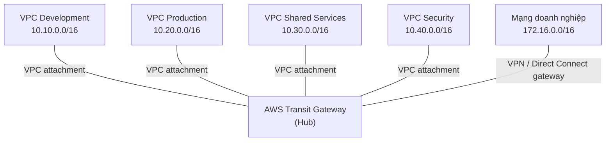
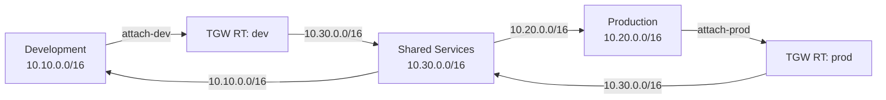
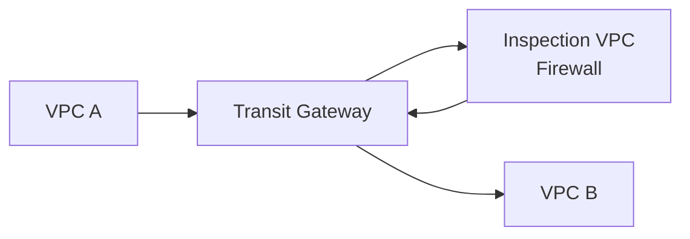

# Transit Gateway và mô hình hub-and-spoke

Khi một hệ thống AWS phát triển từ một VPC sang nhiều VPC nằm trong các tài khoản khác nhau, việc kết nối từng cặp mạng bằng VPC peering trở nên khó quản lý. **AWS Transit Gateway (TGW)** giải quyết bài toán này bằng một điểm trung chuyển định tuyến dùng chung: mỗi VPC, kết nối VPN hoặc mạng doanh nghiệp được nối vào một **hub**, còn mạng ở các đầu kết nối là các **spoke**. Người quản trị dùng bảng định tuyến của TGW để xác định mạng nào được trao đổi lưu lượng với mạng nào.

Bài học thuộc chương **Kết nối mạng nâng cao** của module **CLOUD_PROVIDERS_AWS**. Kiến thức này hỗ trợ người học chọn kiến trúc mạng giữa nhiều tài khoản AWS, triển khai ứng dụng đa tầng với EC2/ECS/Lambda, bảo vệ dữ liệu trên RDS, kết nối mạng tại doanh nghiệp, giám sát đường truyền, thiết kế khả năng phục hồi và tính toán chi phí khi mở rộng quy mô.

## 1. Mục tiêu học tập

Sau bài học, bạn có thể:

1. Giải thích khái niệm **hub-and-spoke**, **transitive routing** và trường hợp phù hợp để sử dụng AWS Transit Gateway.
2. Phân biệt **Transit Gateway**, **TGW attachment**, **TGW route table**, **VPC subnet route table** và **AWS Resource Access Manager (RAM)**.
3. Phân tích hai cơ chế **association** và **propagation**; biết chiều đi và chiều về của gói tin cần những route nào.
4. Thiết kế kết nối giữa các VPC phát triển, sản xuất và dịch vụ dùng chung mà vẫn kiểm soát việc phân đoạn mạng.
5. Nêu điều kiện về **CIDR**, **Availability Zone**, subnet attachment, IP, DNS, security group và network ACL.
6. Lựa chọn cách mở rộng kết nối tới mạng tại doanh nghiệp qua **Site-to-Site VPN** hoặc **Direct Connect gateway**, tới Region khác qua **TGW peering**.
7. Kiểm tra cấu hình cơ bản trên AWS Console/CLI, đọc trạng thái attachment và tìm nguyên nhân lỗi định tuyến.
8. Nhận diện tác động vận hành, bảo mật, độ sẵn sàng và chi phí của mô hình hub-and-spoke.

## 2. Vì sao cần một network hub?

Giả sử tổ chức có bốn VPC:

| Mạng | CIDR minh họa | Mục đích |
| --- | --- | --- |
| `vpc-development` | `10.10.0.0/16` | Phát triển và kiểm thử ứng dụng |
| `vpc-production` | `10.20.0.0/16` | Hệ thống đang phục vụ khách hàng |
| `vpc-shared-services` | `10.30.0.0/16` | DNS resolver, quản trị, dịch vụ nội bộ |
| `vpc-security` | `10.40.0.0/16` | Công cụ giám sát và kiểm tra bảo mật |

Nếu tạo VPC peering giữa tất cả cặp mạng, số lượng liên kết tiềm năng là:

\[
N_\text{peering} = \frac{n(n-1)}{2}
\]

Với **4 VPC**, số liên kết đầy đủ là **6**; với **10 VPC**, con số là **45**. Không phải tổ chức nào cũng cần kết nối mọi cặp mạng, nhưng số lượng kết nối và route có thể tăng nhanh khi môi trường lớn lên.

**VPC peering** chỉ kết nối trực tiếp hai VPC và **không cung cấp transitive routing** qua VPC thứ ba: nếu A peering với B, B peering với C thì A không tự dùng B làm trung gian để đi C.

**AWS Transit Gateway** cung cấp hub có thể trung chuyển lưu lượng giữa nhiều attachment theo route table. Một VPC chỉ cần một attachment tới hub trong phạm vi kiến trúc, thay vì duy trì nhiều kết nối peering trực tiếp tới từng VPC còn lại. TGW **có thể** cho phép lưu lượng đi từ A tới C qua hub nếu route table và lớp bảo mật cho phép; nó **không mặc định cho phép mọi mạng truy cập nhau**.

### Sơ đồ hub-and-spoke



Đây là mô hình kết nối **logic**, không ngụ ý tất cả các nhánh có thể đi qua nhau. Các tuyến xuất phát từ mỗi attachment vẫn phải được quy định cụ thể.

## 3. Các thành phần của AWS Transit Gateway

### 3.1. Transit Gateway là hub định tuyến lớp mạng

AWS Transit Gateway là dịch vụ mạng do AWS quản lý, hoạt động như một **bộ định tuyến trung tâm** để kết nối VPC và các loại mạng được hỗ trợ. TGW là tài nguyên **theo Region**; nó có thể được chia sẻ cho các tài khoản khác qua **AWS RAM**. Muốn kết nối tới TGW thuộc Region khác, sử dụng **Transit Gateway peering** và cấu hình route tương ứng.

TGW không tự thay thế:

- **Internet Gateway (IGW):** cung cấp đường ra/vào Internet cho tài nguyên VPC đáp ứng điều kiện.
- **NAT Gateway:** thực hiện NAT cho các kịch bản cần thiết.
- **AWS Network Firewall hoặc firewall appliance:** kiểm tra/áp dụng chính sách lưu lượng chuyên sâu.
- **Security Group và NACL:** kiểm soát lưu lượng vào/ra tài nguyên và subnet.

**Có route qua TGW** nghĩa là có đường chuyển tiếp giữa các mạng; còn **được phép truy cập ứng dụng** cần phụ thuộc vào kiểm soát bảo mật, địa chỉ, cổng và trạng thái dịch vụ.

### 3.2. Attachment: đầu nối vào hub

**Transit Gateway attachment** gắn một mạng/tài nguyên vào TGW. Các loại thường gặp:

| Attachment | Chức năng | Chú ý |
| --- | --- | --- |
| **VPC attachment** | Kết nối một VPC với TGW | Chọn subnet attachment theo AZ, không tự tạo route trong subnet workload |
| **VPN attachment** | Kết nối mạng bên ngoài bằng AWS Site-to-Site VPN | Có thể dùng BGP để học/quảng bá tuyến |
| **Direct Connect gateway attachment** | Nối kết nối Direct Connect vào TGW qua Direct Connect gateway | Cần cấu hình allowed prefixes, quyền/association và BGP phù hợp |
| **TGW peering attachment** | Kết nối hai Transit Gateway, cùng Region hoặc khác Region | Cần **static route** trên cả hai phía; không tự trao đổi route qua propagation |
| **Connect attachment** | Kết nối với thiết bị SD-WAN thông qua các cơ chế được hỗ trợ | Dành cho bài toán mạng doanh nghiệp nâng cao |

Một VPC attachment thường có dạng ID `tgw-attach-...`. **TGW ID** dạng `tgw-...` và **attachment ID** là hai đối tượng khác nhau; vì vậy route trong **VPC route table** trỏ tới **TGW ID**, còn route trong **TGW route table** trỏ tới **attachment** tương ứng.

### 3.3. Hai cấp route table dễ nhầm

| Cấp route table | Được dùng khi nào? | Ví dụ |
| --- | --- | --- |
| **VPC subnet route table** | Router của VPC quyết định gói rời subnet phải đi đâu | `10.30.0.0/16 → tgw-...` |
| **Transit Gateway route table** | TGW quyết định gói **đến từ một attachment** sẽ đi ra attachment nào | `10.30.0.0/16 → tgw-attach-shared` |

**Quan trọng:** VPC route table và TGW route table là **hai lớp cấu hình độc lập**. Thêm route trong TGW không tự thêm route ở VPC. Tạo attachment cũng không tự bảo đảm mọi subnet đã có đường đi tới TGW.

## 4. Association và propagation: trái tim của việc phân đoạn mạng

TGW có thể có nhiều route table. Mỗi **attachment được associate với đúng một TGW route table** tại một thời điểm; một TGW route table có thể associate với nhiều attachment. Ngược lại, một attachment có thể **propagate** các tiền tố mạng của nó tới **nhiều TGW route table**.

### 4.1. Association quyết định cách xử lý gói đi vào TGW

**Association** trả lời câu hỏi: *Khi traffic đến TGW từ attachment A, TGW phải tra cứu bảng nào?*

Ví dụ:

- `attach-dev` **associate** với `tgw-rt-dev`.
- `attach-prod` **associate** với `tgw-rt-prod`.
- `attach-shared` **associate** với `tgw-rt-shared`.

Khi một EC2 trong `vpc-development` gửi gói tới dịch vụ ở `vpc-shared-services`, TGW tra **`tgw-rt-dev`**, vì gói vào từ `attach-dev`. TGW **không tra `tgw-rt-shared` cho chiều đi từ dev**.

### 4.2. Propagation cung cấp route đích cho bảng khác

**Propagation** trả lời câu hỏi: *Những mạng của attachment nào được đưa vào bảng định tuyến nào?*

Với một VPC attachment, propagation thường đưa các CIDR VPC được hỗ trợ vào TGW route table được chọn. Với VPN/Direct Connect và BGP, bảng có thể học các tiền tố từ phía mạng doanh nghiệp theo cấu hình kết nối.

Ví dụ:

- `attach-shared` propagate `10.30.0.0/16` vào `tgw-rt-dev` và `tgw-rt-prod`.
- `attach-dev` propagate `10.10.0.0/16` vào `tgw-rt-shared`.
- `attach-prod` propagate `10.20.0.0/16` vào `tgw-rt-shared`.

Nhờ đó, dev có thể tìm tới shared; prod có thể tìm tới shared; shared có tuyến phản hồi tới dev và prod.

**Propagation không thay đổi bảng route của các subnet trong VPC.** Nó chỉ tạo route trong bảng **TGW** nhận propagation.

### 4.3. Static route, propagated route và blackhole

TGW route table có thể chứa:

- **Static route:** do người quản trị xác định CIDR và attachment đích.
- **Propagated route:** được tự động đưa vào nhờ propagation/BGP từ attachment theo cơ chế hỗ trợ.
- **Blackhole route:** loại bỏ lưu lượng có đích khớp để ngăn định tuyến tới mạng đó.

TGW chọn route theo độ khớp CIDR và quy tắc ưu tiên của dịch vụ. Một **blackhole route** có thể được dùng để chủ động chặn một tiền tố, nhưng phải kiểm tra route cụ thể hơn có tồn tại không và tránh nghĩ rằng blackhole thay thế toàn bộ chính sách firewall/SG.

**Đừng đồng nhất association và propagation.** Một attachment có thể associate với một bảng, đồng thời propagate thông tin tuyến của chính nó sang nhiều bảng khác.

### 4.4. Bảng tổng hợp cơ chế

| Cơ chế | Cấu hình ở đâu? | Tác động | Lỗi điển hình |
| --- | --- | --- | --- |
| VPC subnet route | VPC → Route tables | Gói từ subnet đi tới TGW | Thiếu route tới CIDR VPC đích |
| Association | Transit Gateway → Route tables | Chọn bảng để xử lý traffic **đi vào** từ attachment | Attachment associate nhầm bảng |
| Propagation | Transit Gateway → Route tables | Tạo route tới CIDR của attachment đích | CIDR đích không xuất hiện trong bảng cần thiết |
| Static TGW route | Transit Gateway → Route tables | Chỉ định attachment cho tiền tố đích | Trỏ nhầm attachment hoặc thiếu route đối xứng |
| SG/NACL | Tài nguyên/subnet | Cho hoặc chặn giao thức, cổng, nguồn/đích | Route đúng nhưng kết nối vẫn timeout/denied |

## 5. Thiết kế ví dụ: dev và prod cùng dùng shared-services nhưng không nối trực tiếp nhau

### 5.1. Nhu cầu nghiệp vụ

Một tổ chức muốn:

- **Development** dùng máy chủ DNS và dịch vụ quản trị trong **shared-services**.
- **Production** dùng cùng các dịch vụ dùng chung đó.
- Development **không** được có đường kết nối trực tiếp qua TGW tới production.
- Shared-services có đường trả lời đúng cho cả dev và prod.
- SG ở shared-services vẫn giới hạn đúng dịch vụ/cổng được phép.

Ba VPC và attachment minh họa:

| VPC | CIDR | Attachment (ký hiệu) |
| --- | --- | --- |
| Development | `10.10.0.0/16` | `attach-dev` |
| Production | `10.20.0.0/16` | `attach-prod` |
| Shared Services | `10.30.0.0/16` | `attach-shared` |

Những CIDR trên **không trùng lặp**. Trước khi tạo VPC mới, cần dùng kế hoạch IP tập trung (chẳng hạn **Amazon VPC IP Address Manager - IPAM**) để tránh xung đột với các mạng đang có và mạng doanh nghiệp.

### 5.2. Thiết kế TGW route table

| TGW route table | Attachment được associate | Route cần có | Route cố ý không có |
| --- | --- | --- | --- |
| `tgw-rt-dev` | `attach-dev` | `10.30.0.0/16 → attach-shared` | `10.20.0.0/16 → attach-prod` |
| `tgw-rt-prod` | `attach-prod` | `10.30.0.0/16 → attach-shared` | `10.10.0.0/16 → attach-dev` |
| `tgw-rt-shared` | `attach-shared` | `10.10.0.0/16 → attach-dev`; `10.20.0.0/16 → attach-prod` | Các mạng không được cấp quyền |

Sơ đồ phân đoạn logic:



**Không có cạnh dev → prod trong TGW route table của dev.** Khi development cố truy cập địa chỉ thuộc `10.20.0.0/16`, TGW không có route khớp trong bảng đầu vào `tgw-rt-dev` nên không chuyển tiếp lưu lượng sang production.

Mô hình trên dựa vào route table để phân đoạn. Nếu shared-services chứa router/appliance có thể **chuyển tiếp** lưu lượng từ dev sang prod ở tầng mạng/ứng dụng, cần thiết kế chính sách firewall và chống đi vòng cho luồng đó. **Không nên coi phân đoạn bằng route table là thay thế tường lửa.**

### 5.3. Association và propagation tương ứng

| Attachment | Association | Propagation vào bảng |
| --- | --- | --- |
| `attach-dev` | `tgw-rt-dev` | `tgw-rt-shared` |
| `attach-prod` | `tgw-rt-prod` | `tgw-rt-shared` |
| `attach-shared` | `tgw-rt-shared` | `tgw-rt-dev`, `tgw-rt-prod` |

Cách trình bày này nhấn mạnh sự bất đối xứng **có chủ ý**:

- Attachment dev **không propagate** vào bảng của prod.
- Attachment prod **không propagate** vào bảng của dev.
- Attachment shared **propagate** cho cả hai.

Nếu mặc định AWS bật **default route table association** và **default route table propagation** khi tạo TGW/attachment, cần kiểm tra kỹ trước khi đưa các VPC nhạy cảm vào hub. Sơ đồ phân đoạn ở trên yêu cầu cấu hình rõ các association/propagation, thay vì giả định attachment mới luôn ở đúng bảng.

### 5.4. Route table trong các VPC

Giả sử subnet workload cần liên lạc với shared-services. Các subnet route table hiệu lực cần có:

**Development VPC**

| Destination | Target |
| --- | --- |
| `10.10.0.0/16` | `local` |
| `10.30.0.0/16` | `tgw-...` |

**Production VPC**

| Destination | Target |
| --- | --- |
| `10.20.0.0/16` | `local` |
| `10.30.0.0/16` | `tgw-...` |

**Shared-services VPC**

| Destination | Target |
| --- | --- |
| `10.30.0.0/16` | `local` |
| `10.10.0.0/16` | `tgw-...` |
| `10.20.0.0/16` | `tgw-...` |

Đây chỉ là các route liên quan đến TGW; nếu subnet còn kết nối Internet hoặc các endpoint khác, bảng thực tế có thể có nhiều route bổ sung. **Các subnet dùng cho TGW attachment cũng phải có bảng định tuyến phù hợp với các subnet/tài nguyên bên trong VPC**, để lưu lượng từ TGW tìm được đích và trả lời được.

Cùng một địa chỉ CIDR có thể xuất hiện trong **VPC route table** và **TGW route table**, nhưng *target* khác nhau. Ví dụ `10.30.0.0/16` trong bảng của dev trỏ tới **TGW ID**, còn trong `tgw-rt-dev` trỏ tới **attachment của shared VPC**.

## 6. Theo dõi gói tin: kiểm tra cả chiều đi và chiều về

Giả sử:

- EC2 dev: `10.10.11.15`.
- DNS/service shared: `10.30.21.53`.
- Kết nối mẫu: TCP tới port `443` của dịch vụ quản trị trong shared-services.

### Chiều đi: dev → shared

1. EC2 dev tạo kết nối đến `10.30.21.53:443`.
2. Subnet route table của EC2 dev có `10.30.0.0/16 → tgw-...`.
3. Gói tin đi vào TGW qua `attach-dev`.
4. TGW tra bảng **`tgw-rt-dev`** vì attachment nguồn associate với bảng này.
5. Bảng có `10.30.0.0/16 → attach-shared`.
6. TGW chuyển lưu lượng sang VPC shared-services qua attachment tương ứng.
7. VPC shared route gói tới tài nguyên đích theo quy tắc VPC/local và cấu hình attachment subnet.
8. Security Group/NACL và dịch vụ ở `10.30.21.53` phải cho phép cổng 443 từ nguồn hợp lệ.

### Chiều về: shared → dev

1. Server shared gửi phản hồi tới `10.10.11.15`.
2. Route table của subnet shared cho `10.10.0.0/16 → tgw-...`.
3. TGW nhận gói từ `attach-shared` nên tra **`tgw-rt-shared`**.
4. Bảng có `10.10.0.0/16 → attach-dev`.
5. TGW chuyển gói về VPC dev, rồi VPC chuyển tới EC2 theo local route.
6. Security Group (stateful) và NACL (stateless) phải cho phép lưu lượng/đường phản hồi phù hợp.

**Một chiều route đúng chưa đủ.** Nếu `tgw-rt-shared` thiếu tuyến tới dev, yêu cầu TCP có thể đi tới đích nhưng phản hồi không về. Tương tự, nếu shared VPC thiếu route trả về TGW hoặc NACL chặn cổng phản hồi, kết nối cũng thất bại.

## 7. Yêu cầu VPC attachment và Availability Zone

### 7.1. Chọn subnet theo AZ

Khi tạo **VPC attachment**, phải chọn **ít nhất một subnet**. AWS cho phép chọn **một subnet trong mỗi Availability Zone** được đưa vào attachment. TGW tạo network interface được quản lý trong mỗi subnet được chọn để trung chuyển lưu lượng.

Ví dụ VPC development có workload ở **AZ-A** và **AZ-B**:

| AZ | Subnet cho TGW attachment | Subnet chứa workload | Kỳ vọng |
| --- | --- | --- | --- |
| AZ-A | `10.10.0.0/28` | `10.10.11.0/24` | Workload AZ-A có đường tới TGW khi route phù hợp |
| AZ-B | `10.10.0.16/28` | `10.10.12.0/24` | Workload AZ-B có đường tới TGW khi route phù hợp |

Hai subnet `/28` chỉ để minh họa; chúng phải thật sự nằm trong AZ được chọn và còn địa chỉ IP khả dụng cho giao diện do AWS quản lý.

**Điểm dễ bỏ sót:** tài nguyên ở AZ không được **enable** trong VPC attachment không thể trực tiếp gửi traffic đến TGW qua attachment đó, ngay cả khi subnet route table có tuyến tới TGW. Nên bật các AZ có workload cần kết nối; thường dùng nhiều AZ để tăng khả năng phục hồi.

### 7.2. Khuyến nghị dành riêng subnet attachment

AWS khuyến nghị tạo subnet riêng cho các TGW attachment, thường có thể dùng CIDR nhỏ như `/28`. Lợi ích:

- Không tiêu tốn nhiều địa chỉ của subnet ứng dụng.
- Tách route table của điểm kết nối và route table của workload để dễ kiểm tra.
- Dễ quan sát/điều chỉnh subnet association và NACL khi có thiết bị kiểm tra lưu lượng.
- Hỗ trợ cấu hình nhiều AZ nhất quán.

Không nhầm **subnet attachment** với **toàn bộ subnet workload**. TGW có thể đưa lưu lượng tới workload ở những subnet khác trong cùng AZ đã enable, miễn là route table phù hợp. Bảng định tuyến của subnet attachment cần cho phép lưu lượng tiếp tục vào những subnet đích trong VPC; nếu dùng route local mặc định cho CIDR VPC, hành vi cơ bản đã phù hợp.

### 7.3. CIDR không được chồng lấn

Nếu hai VPC có CIDR trùng hoặc chồng lấn, TGW **không hỗ trợ định tuyến thông thường giữa các VPC đó** theo tiền tố bị trùng. Với một VPC attachment mới có CIDR overlap với attachment hiện có, CIDR mới có thể không được propagate vào TGW route table.

Do vậy:

1. Lập sơ đồ CIDR cho VPC dev, prod, shared, security và mạng on-premises.
2. Kiểm tra trước cả dải IPv4/IPv6 nếu định dùng dual-stack.
3. Giữ một quy tắc cấp phát duy nhất qua IPAM hoặc quản trị mạng tập trung.
4. Giải quyết overlap bằng tái phân bổ địa chỉ hoặc giải pháp kiến trúc có NAT/proxy riêng được thiết kế kỹ; **không** kỳ vọng chỉ thêm static route là khắc phục được CIDR overlap.

### 7.4. DNS và kết nối ứng dụng

Có đường IP qua TGW không bảo đảm tên miền sẽ phân giải sang IP private đúng:

- DNS riêng có thể dùng **Route 53 Private Hosted Zone**, **Route 53 Resolver inbound/outbound endpoint** hoặc hệ thống DNS doanh nghiệp.
- TGW **không tự chia sẻ** khả năng phân giải mọi private hosted zone giữa các VPC.
- Các ứng dụng có TLS cần xác nhận tên máy chủ/hostname và certificate khớp dịch vụ đích.

Khi sự cố xuất hiện, hãy thử phân biệt **lỗi DNS** với **lỗi route IP** trước khi thay đổi cấu hình hub.

## 8. Bảo mật và phân tách mạng trong hub-and-spoke

### 8.1. TGW route table không thay thế SG/NACL

Có thể thiết kế đường tới shared-services nhưng SG của server chỉ cho phép cổng cần thiết từ nguồn đã duyệt, ví dụ:

| Lớp | Chính sách minh họa |
| --- | --- |
| TGW route table của dev | Có route tới CIDR shared; không có route tới prod |
| VPC route table | Chỉ định các CIDR cần đi TGW |
| SG của máy shared | Cho phép TCP 443 từ dải IP ứng dụng dev/prod cần truy cập, hoặc SG reference khi được hỗ trợ |
| NACL của subnet | Cho phép đúng chiều giao tiếp và lưu lượng phản hồi theo thiết kế |
| IAM | Hạn chế người có quyền sửa TGW attachment, association, propagation và routes |
| CloudTrail/giám sát | Theo dõi thay đổi định tuyến trái phép |

**Security Group referencing qua TGW** có thể hỗ trợ tham chiếu SG trong **inbound rule** giữa các VPC cùng gắn vào TGW khi tính năng được bật ở **cả TGW và các VPC attachment** liên quan, trong giới hạn được AWS hỗ trợ. Không mặc định dùng tham chiếu SG cho outbound rule hoặc kết nối đi qua TGW peering.

### 8.2. Mô hình inspection VPC

Một số tổ chức yêu cầu mọi lưu lượng giữa các mạng nhạy cảm phải đi qua **AWS Network Firewall** hoặc firewall appliance đặt tại **inspection VPC**.



Tuy nhiên, sơ đồ này chỉ mô tả **ý tưởng kiểm tra trung tâm**. Kiến trúc thật cần route table điều hướng theo từng chiều, NAT/địa chỉ phù hợp, cơ chế tránh vòng lặp và **đối xứng luồng** cho thiết bị stateful.

Khi dùng thiết bị stateful qua VPC attachment, cần xem xét **appliance mode** để giữ đường đi của từng luồng qua cùng AZ của appliance VPC trong suốt vòng đời luồng. Appliance mode không phải tùy chọn bật bừa cho mọi VPC; thay đổi tính năng trên attachment đang chạy có thể ảnh hưởng traffic.

### 8.3. Giới hạn quyền thay đổi hub

Nếu network hub được nhiều tài khoản sử dụng, nên:

- Cấp quyền quản lý TGW/route table cho nhóm mạng trung tâm thông qua IAM Identity Center hoặc IAM role.
- Phê duyệt thay đổi association, propagation, route và attachment; ghi lại CIDR, account owner và lý do.
- Không bật mặc định các route `0.0.0.0/0` tới mọi attachment chỉ vì muốn “mọi mạng có Internet”.
- Dùng tagging và quản lý thay đổi tự động khi nhiều tài khoản, nhiều VPC.
- Xác nhận **phân đoạn thực tế** bằng cách kiểm tra từng chiều, không chỉ nhìn danh sách attachment tồn tại.

## 9. Kết nối tài khoản khác, mạng doanh nghiệp và Region khác

### 9.1. Chia sẻ TGW qua AWS RAM

Tổ chức có thể đặt TGW trong **network account**, rồi dùng **AWS Resource Access Manager (AWS RAM)** chia sẻ cho các tài khoản ứng dụng. Tài khoản được chia sẻ có thể tạo VPC attachment tới TGW theo quyền và cấu hình phê duyệt.

Quy trình ở mức kiến trúc:

1. Nhóm mạng tạo TGW trong tài khoản sở hữu.
2. Tạo resource share cho **Transit Gateway** qua AWS RAM, chia sẻ tới AWS accounts/OU phù hợp.
3. Kiểm tra trạng thái chấp nhận share/attachment theo cài đặt của tổ chức; nếu không tự động chấp nhận, người sở hữu TGW cần **accept attachment**.
4. Các tài khoản workload tạo attachment với VPC của mình.
5. Nhóm mạng gắn attachment vào đúng TGW route table, bật propagation được phép, rà route của từng VPC.
6. Giám sát cấu hình và ghi rõ bên nào chịu trách nhiệm chi phí/phân quyền.

**Share được TGW không đồng nghĩa các VPC tự kết nối được với nhau.** Association, propagation, VPC routes và lớp bảo mật vẫn quyết định luồng traffic.

### 9.2. AWS Site-to-Site VPN

Khi doanh nghiệp cần nối mạng on-premises vào AWS, một lựa chọn là **Site-to-Site VPN attachment** tới TGW. Một mô hình thường dùng:

- Mạng công ty có CIDR `172.16.0.0/16`.
- Site-to-Site VPN kết nối từ customer gateway đến TGW.
- Các tuyến được học qua **BGP** hoặc cấu hình tĩnh tùy kiểu VPN và thiết bị.
- TGW route table cần đường đến `172.16.0.0/16`; router on-premises cần đường quay về các CIDR VPC AWS.
- SG/NACL và firewall phía doanh nghiệp cho phép đúng dịch vụ.

Vì vậy “VPN đã up” không chứng minh các máy hai đầu truy cập nhau. Cần kiểm tra route, BGP, an ninh và chiều phản hồi.

### 9.3. AWS Direct Connect gateway

**AWS Direct Connect** là kết nối riêng có khả năng dự đoán hơn về vận hành cho những yêu cầu chuyên biệt. Để nối các VPC gắn TGW với môi trường tại doanh nghiệp, kiến trúc có thể dùng **Direct Connect gateway** và **transit virtual interface** theo cấu hình được AWS hỗ trợ.

Việc kết nối không được quyết định chỉ bằng một nút attach: phải phối hợp association tới TGW, allowed prefixes, quảng bá/nhận BGP routes và chính sách mạng phía doanh nghiệp. Có thể cần **VPN dự phòng** và kiểm tra thiết kế chịu lỗi; không giả định một đường Direct Connect vật lý đảm bảo tính sẵn sàng cao.

### 9.4. TGW peering giữa hai Region

TGW là tài nguyên theo Region. Nếu `Region-A` và `Region-B` đều có các VPC riêng, có thể tạo **TGW peering attachment** giữa hai hub.

Điều kiện trọng tâm:

1. Tạo peering attachment từ TGW phía yêu cầu tới TGW phía nhận.
2. Chấp nhận yêu cầu peering ở phía nhận.
3. Tạo **static route** trong TGW route table ở **cả hai phía** trỏ tới peering attachment cho các CIDR được phép.
4. Cấu hình VPC subnet routes, đường phản hồi và bảo mật ở mỗi Region.

TGW peering hỗ trợ kết nối giữa các Region hoặc cùng Region theo phạm vi dịch vụ hiện hành. **Peering không tự propagate CIDR từ các VPC phía kia**: thiếu static route ở một đầu thường dẫn tới lỗi một chiều. Cần tính phí truyền dữ liệu giữa Region và kiểm tra giới hạn dịch vụ trước khi triển khai.

## 10. So sánh Transit Gateway với các phương án khác

| Tiêu chí | VPC peering | AWS Transit Gateway | AWS PrivateLink |
| --- | --- | --- | --- |
| Mục đích chính | Kết nối mạng trực tiếp giữa **hai VPC** | Kết nối tập trung nhiều mạng/VPC theo route table | Cho phép truy cập **dịch vụ cụ thể** qua endpoint |
| Transitive routing | Không | Có, theo route table và chính sách | Không phải mô hình định tuyến IP chung |
| Tách biệt nhà cung cấp dịch vụ/khách dùng | Cần quản lý route và SG hai VPC | Có thể phân đoạn bằng TGW tables | Mạnh về truy cập service mà không cần phơi toàn bộ CIDR |
| Khả năng mở rộng quản trị | Dễ dùng cho vài VPC, phức tạp khi nhiều cặp | Phù hợp kiến trúc multi-account/hybrid quy mô lớn | Phù hợp cung cấp API/endpoint theo dịch vụ |
| Tính phí | Không có phí riêng cho peering attachment, vẫn có data transfer | Theo attachment thời gian, lưu lượng xử lý và data transfer | Theo endpoint/giờ và dữ liệu, tùy loại |
| Cần CIDR không chồng lấn | Có cho đường IP giữa VPC | Có cho VPC routing thông thường | Có thể hỗ trợ kết nối service giữa các VPC dù CIDR overlap trong một số mô hình |

**Chọn TGW khi** cần định tuyến mạng tổng quát giữa nhiều VPC và kết nối hybrid, có nhóm mạng quản trị trung tâm và yêu cầu phân đoạn bằng routing. **Chọn VPC peering** khi hai VPC cần đường trực tiếp đơn giản và chi phí quản trị được chấp nhận. **Chọn PrivateLink** khi mục tiêu là cho ứng dụng dùng một dịch vụ cụ thể mà không mở kết nối mạng rộng giữa hai VPC.

## 11. Tạo và cấu hình Transit Gateway qua AWS Console

Phần này mô tả trình tự để hiểu thao tác. Việc **tạo TGW attachment phát sinh chi phí** và làm thay đổi đường mạng. Nếu bạn chỉ học lý thuyết, sử dụng phần mô phỏng ở mục 14; chỉ thao tác thật khi được cấp quyền và có ngân sách.

### Bước 1. Chuẩn bị sơ đồ IP và phân đoạn

Ghi lại các thông tin:

- Region, tài khoản sở hữu TGW, tài khoản sở hữu từng VPC.
- VPC ID/CIDR, subnet ID/AZ, route table hiệu lực của workload và subnet attachment.
- Những kết nối được phép: dev ↔ shared; prod ↔ shared; **dev không ↔ prod**.
- Dự kiến đặt tên TGW route table và assignment/propagation.
- Các giới hạn về quyền IAM, SCP, SG/NACL, chi phí và kế hoạch quay lui nếu cấu hình không chính xác.

### Bước 2. Tạo Transit Gateway

1. Vào [VPC Console](https://console.aws.amazon.com/vpc/), chọn **Region** phù hợp.
2. Chọn **Transit Gateways → Create transit gateway**.
3. Đặt tag **Name**, chọn ASN và tùy chọn DNS/VPN/route table theo kiến trúc đã phê duyệt.
4. Quyết định có dùng **default route table association** và **default route table propagation** hay không. Đối với mô hình phân đoạn dev/prod, cần kiểm soát rõ việc này.
5. Tạo TGW; đợi trạng thái khả dụng trước khi tiếp tục.

### Bước 3. Tạo VPC attachments

1. Chọn **Transit Gateway Attachments → Create transit gateway attachment**.
2. Chọn TGW ID và **Attachment type = VPC**.
3. Chọn VPC cần attach.
4. Chọn **một subnet ở mỗi AZ** có workload cần kết nối TGW; ưu tiên subnet riêng cho attachment.
5. Kiểm tra các tùy chọn DNS, IPv6, appliance mode và security group referencing nếu có yêu cầu.
6. Tạo attachment, theo dõi trạng thái (và bước accept nếu yêu cầu).
7. Lặp lại với các VPC được phê duyệt.

**Không chỉnh route production** khi attachment vẫn đang tạo/chờ chấp nhận hoặc khi chưa xác nhận route table dự kiến.

### Bước 4. Tạo TGW route tables và gắn association

1. Mở **Transit Gateway Route Tables → Create transit gateway route table**.
2. Tạo ba bảng `tgw-rt-dev`, `tgw-rt-prod` và `tgw-rt-shared` với đúng TGW.
3. Với bảng `tgw-rt-dev`, association `attach-dev`.
4. Với bảng `tgw-rt-prod`, association `attach-prod`.
5. Với bảng `tgw-rt-shared`, association `attach-shared`.
6. Kiểm tra **mỗi attachment xuất hiện ở đúng một bảng** và không còn association ngoài ý muốn ở default table.

### Bước 5. Bật route propagation có chọn lọc

1. Ở `tgw-rt-dev`, tạo propagation từ `attach-shared`.
2. Ở `tgw-rt-prod`, tạo propagation từ `attach-shared`.
3. Ở `tgw-rt-shared`, tạo propagation từ `attach-dev` và `attach-prod`.
4. Kiểm tra tab **Routes** của từng bảng: đúng CIDR và attachment đích như mục 5.
5. Xác nhận **không có route dev → prod hoặc prod → dev** ở các bảng nguồn tương ứng.

### Bước 6. Sửa VPC subnet route tables và thử đúng phạm vi

1. Vào **VPC → Route Tables** trong từng tài khoản/VPC.
2. Trên các subnet cần kết nối, thêm route tới CIDR được phép, target là TGW.
3. Kiểm tra đường về ở subnet đích và bảng của **subnet attachment**.
4. Cập nhật SG/NACL để chỉ cho phép giao thức/địa chỉ cần dùng.
5. Kiểm tra bằng công cụ quan sát hoặc phiên kết nối tới endpoint thử nghiệm được cho phép.
6. Tài liệu hóa kết quả, chủ sở hữu và lịch xem lại quyền truy cập giữa các môi trường.

## 12. AWS CLI: lệnh kiểm tra và ví dụ cấu hình

Dùng **AWS CLI v2** với danh tính đã được cấp quyền, chẳng hạn profile IAM Identity Center. Đừng dùng root access key. Các lệnh **describe/search** dưới đây không tạo tài nguyên AWS.

### 12.1. Quan sát tài nguyên và định tuyến

```bash
# Xác nhận đúng tài khoản AWS hiện dùng.
aws sts get-caller-identity --profile training-network

# Xem Transit Gateway trong Region.
aws ec2 describe-transit-gateways \
  --region ap-southeast-1 \
  --profile training-network

# Xem attachment và trạng thái (available, pending, deleting...).
aws ec2 describe-transit-gateway-attachments \
  --filters Name=transit-gateway-id,Values=tgw-0123456789abcdef0 \
  --region ap-southeast-1 \
  --profile training-network

# Liệt kê TGW route tables.
aws ec2 describe-transit-gateway-route-tables \
  --filters Name=transit-gateway-id,Values=tgw-0123456789abcdef0 \
  --region ap-southeast-1 \
  --profile training-network

# Xem association và propagation của một TGW route table.
aws ec2 get-transit-gateway-route-table-associations \
  --transit-gateway-route-table-id tgw-rtb-0123456789abcdef0 \
  --region ap-southeast-1 \
  --profile training-network

aws ec2 get-transit-gateway-route-table-propagations \
  --transit-gateway-route-table-id tgw-rtb-0123456789abcdef0 \
  --region ap-southeast-1 \
  --profile training-network

# Tìm route đến CIDR shared-services trong TGW route table.
aws ec2 search-transit-gateway-routes \
  --transit-gateway-route-table-id tgw-rtb-0123456789abcdef0 \
  --filters Name=route-search.exact-match,Values=10.30.0.0/16 \
  --region ap-southeast-1 \
  --profile training-network
```

Tất cả ID đều chỉ để minh họa, không thể dùng nguyên xi. Tài khoản/Region khác nhau có thể thấy TGW hoặc attachment khác nhau; một tài khoản nhận resource share có quyền quan sát không giống tài khoản sở hữu TGW.

### 12.2. Ví dụ cú pháp thay đổi cấu hình — chỉ dành cho sandbox được phép

Đây là **ví dụ tham khảo** để hiểu API. Mỗi lệnh đều có thể thay đổi hạ tầng và chi phí. Chỉ chạy khi đã kiểm tra ID, route table và phạm vi tác động:

```bash
# Tạo TGW route table riêng.
aws ec2 create-transit-gateway-route-table \
  --transit-gateway-id tgw-0123456789abcdef0 \
  --region ap-southeast-1 \
  --profile training-network

# Associate attachment dev vào TGW route table dev.
aws ec2 associate-transit-gateway-route-table \
  --transit-gateway-route-table-id tgw-rtb-0123456789abcdef0 \
  --transit-gateway-attachment-id tgw-attach-0123456789abcdef0 \
  --region ap-southeast-1 \
  --profile training-network

# Bật propagation cho attachment shared vào TGW route table dev.
aws ec2 enable-transit-gateway-route-table-propagation \
  --transit-gateway-route-table-id tgw-rtb-0123456789abcdef0 \
  --transit-gateway-attachment-id tgw-attach-11111111111111111 \
  --region ap-southeast-1 \
  --profile training-network

# Tạo route từ subnet workload dev tới CIDR shared-services.
aws ec2 create-route \
  --route-table-id rtb-0123456789abcdef0 \
  --destination-cidr-block 10.30.0.0/16 \
  --transit-gateway-id tgw-0123456789abcdef0 \
  --region ap-southeast-1 \
  --profile training-network
```

Các lệnh này **không tự tạo đầy đủ mô hình hub-and-spoke**: cần các attachment ở trạng thái khả dụng, thêm association/propagation còn lại, cấu hình chiều về, thiết lập subnet/AZ và SG/NACL. Nếu route đã tồn tại, `create-route` không phải lệnh cập nhật phù hợp; phải đọc trạng thái hiện tại và tuân thủ quy trình thay đổi.

## 13. Giám sát, vận hành và chi phí

### 13.1. Những nguồn thông tin nên theo dõi

| Công cụ | Vai trò | Khi nào hữu ích? |
| --- | --- | --- |
| **Amazon CloudWatch (TGW metrics)** | Theo dõi lưu lượng, lỗi thiếu route/blackhole, thông số attachment | Phát hiện thay đổi bất thường hoặc drops |
| **Transit Gateway Flow Logs** | Ghi metadata luồng đi qua TGW đến S3, CloudWatch Logs hoặc Firehose | Phân tích tuyến nguồn/đích, nguyên nhân mất kết nối |
| **VPC Flow Logs** | Ghi metadata luồng qua ENI/VPC | Xem dấu hiệu traffic bị từ chối ở tầng VPC |
| **AWS CloudTrail** | Ghi hoạt động API cấu hình TGW, attachment và route | Điều tra ai thay đổi cấu hình vào lúc nào |
| **Reachability Analyzer** | Phân tích đường đi dựa trên cấu hình mạng được hỗ trợ | Kiểm tra trường hợp có hoặc không có đường đến endpoint |
| **Billing / Cost Explorer** | Theo dõi phí attachment, lưu lượng xử lý và data transfer | Đánh giá chi phí thiết kế nhiều VPC/AZ |

Trong CloudWatch namespace `AWS/TransitGateway` có các metric như `BytesIn`, `BytesOut`, `BytesDropCountNoRoute` hoặc `BytesDropCountBlackhole` để định hướng chẩn đoán. Không nên xem metric lưu lượng có giá trị là bằng chứng ứng dụng đã hoạt động: lỗi DNS, TLS, ứng dụng hoặc SG/NACL vẫn có thể xảy ra ở các tầng khác.

### 13.2. Tác động chi phí

AWS Transit Gateway là dịch vụ có phí. Mô hình tính phí cơ bản liên quan:

1. **Số attachment và thời gian tồn tại**: VPC attachment có phí theo giờ trong thời gian được gắn vào TGW. Đối với tài khoản chia sẻ, chủ sở hữu VPC có thể chịu phí attachment tương ứng.
2. **Lưu lượng xử lý**: tính theo lượng dữ liệu đi qua TGW tùy loại attachment/chiều lưu lượng được tính phí.
3. **Data transfer**: có thể phát sinh phí truyền dữ liệu giữa các AZ/Region hoặc loại đường truyền liên quan, ngoài phí TGW.
4. **Dịch vụ đi kèm**: VPN, Direct Connect, NAT, Network Firewall, CloudWatch Logs, endpoint và các thành phần khác có bảng giá riêng.

**Không nên đưa một con số cố định thành “giá TGW tại mọi Region”.** Giá thay đổi theo Region, loại attachment và tính năng. Sử dụng [bảng giá AWS Transit Gateway](https://aws.amazon.com/transit-gateway/pricing/) và [AWS Pricing Calculator](https://calculator.aws/) để tính đúng kiến trúc trước khi tạo.

Một **TGW mới nhưng có attachment không truyền dữ liệu** vẫn có thể phát sinh **phí theo giờ**. Vì vậy nếu thử nghiệm thật, phải có kế hoạch dọn dẹp attachment và tài nguyên liên quan sau khi kết thúc.

### 13.3. Nâng cao khả năng phục hồi

- Bật attachment ở **các AZ chứa workload** cần đi qua TGW; ưu tiên nhiều AZ theo thiết kế sẵn sàng cao.
- Tránh thiết kế inspection VPC chỉ có một firewall/appliance duy nhất hoặc kết nối on-premises chỉ có một đường vật lý.
- Kiểm tra đường đi chiều về và chính sách chuyển tiếp khi một attachment/VPN tunnel hoặc AZ gặp sự cố.
- Lập kế hoạch cấu hình DNS/route/failover rõ ràng; **TGW là hub**, nhưng sự sẵn sàng của ứng dụng còn phụ thuộc các kết nối và dịch vụ ở hai đầu.
- Theo dõi route changes và drift bằng cấu hình hạ tầng như mã (IaC) khi phù hợp với quy trình.

## 14. Troubleshooting: route đi được nhưng traffic vẫn thất bại

| Triệu chứng | Nguyên nhân có thể | Kiểm tra ưu tiên |
| --- | --- | --- |
| VPC dev không tới shared | Thiếu route `10.30.0.0/16 → TGW` trong subnet route table dev | Đọc route table **hiệu lực** của subnet nguồn |
| VPC có route tới TGW nhưng gói bị mất | Workload ở AZ chưa enable VPC attachment hoặc attachment chưa `available` | Xem subnet attachment theo AZ và trạng thái |
| Dev tới shared nhưng không nhận phản hồi | Bảng TGW của shared hoặc VPC subnet route bên shared thiếu đường về dev | Truy gói tin theo **hai chiều** |
| Dev thấy được prod ngoài ý muốn | Associate nhầm bảng; propagation/static route dư; có router đi vòng | Kiểm tra bảng đầu vào dev, bảng shared và firewall |
| TGW không học CIDR mới | Chưa enable propagation hoặc CIDR overlap với VPC khác | Kiểm tra CIDR kế hoạch và trạng thái propagation |
| On-premises VPN up nhưng VPC không kết nối | Thiếu BGP/route/allowed prefixes hoặc policy on-prem | Kiểm tra route ở **hai đầu** VPN/DX |
| Peering hai Region đang `available` nhưng traffic drop | Chưa tạo static TGW route tại cả hai đầu | Kiểm tra TGW route table hai phía và VPC routes |
| Kết nối IP được nhưng hostname không resolve | Route 53 Resolver/PHZ/DNS forwarding chưa cấu hình | Kiểm tra DNS query, endpoint và rules |
| Route đúng nhưng kết nối tới dịch vụ vẫn timeout | SG/NACL/firewall hoặc tiến trình ứng dụng không lắng nghe | Kiểm tra đúng nguồn, đích, cổng và log |
| Metric `BytesDropCountBlackhole` tăng | Traffic khớp blackhole route | Kiểm tra route/intentional segmentation |
| Không có log flow | Chưa bật logging hoặc sai scope/đích lưu; độ trễ ghi log | Kiểm tra log config, CloudWatch/S3 và phí |

### Quy trình kiểm tra có hệ thống

1. **Xác định nguồn và đích:** account/VPC/subnet/AZ, IP và protocol/port; xác minh CIDR không overlap.
2. **Đọc subnet route table nguồn:** có route tới đúng CIDR đích trỏ TGW không?
3. **Đọc TGW VPC attachment:** attachment `available` và có subnet trong AZ nguồn không?
4. **Đọc association của attachment nguồn:** nó dùng **TGW route table nào**?
5. **Tìm route đích trong bảng đó:** route là static/propagated hay blackhole; target attachment đã sẵn sàng chưa?
6. **Đọc route của VPC đích:** subnet attachment và subnet workload có đường đưa gói tới tài nguyên không?
7. **Truy ngược chiều về:** lặp lại từ subnet đích, TGW association ở phía đích và route trả về nguồn.
8. **Kiểm tra bảo mật và tên miền:** SG/NACL, firewall, OS, DNS, certificate và ứng dụng.
9. **Dùng log/metrics và công cụ AWS:** CloudWatch drops, TGW Flow Logs, VPC Flow Logs, CloudTrail, Reachability Analyzer theo quyền được cấp.

**Không thay route production theo phỏng đoán.** Ghi rõ route hiện tại, đường cần thêm và tác động tới các môi trường khác trước khi áp dụng.

## 15. Bài thực hành: mô phỏng phân đoạn dev/prod/shared không tạo tài nguyên trả phí

**Bối cảnh:** Một tổ chức có ba VPC trong cùng Region:

- `vpc-dev`: `10.10.0.0/16`.
- `vpc-prod`: `10.20.0.0/16`.
- `vpc-shared`: `10.30.0.0/16`.

Các VPC giả định đã attach thành công vào `tgw-hub`, mỗi VPC có đủ subnet attachment trong các AZ cần thiết. Nhiệm vụ của bạn là thiết kế **dev và prod chỉ nói chuyện với shared, không có đường trực tiếp tới nhau**.

### Nhiệm vụ A. Điền ma trận association/propagation

Bảng tham khảo:

| Attachment | Associate với | Propagate tới |
| --- | --- | --- |
| `attach-dev` | `tgw-rt-dev` | `tgw-rt-shared` |
| `attach-prod` | `tgw-rt-prod` | `tgw-rt-shared` |
| `attach-shared` | `tgw-rt-shared` | `tgw-rt-dev` và `tgw-rt-prod` |

Hãy giải thích **vì sao** không propagate `attach-dev` vào `tgw-rt-prod`.

### Nhiệm vụ B. Dự đoán đường gói tin

Đối với cấu hình ở mục 5, xác định kết quả **chỉ về mặt định tuyến**:

| Nguồn | Đích | Kết quả mong đợi |
| --- | --- | --- |
| Dev `10.10.11.10` | Shared `10.30.21.20` | Có đường qua TGW nếu VPC route đầy đủ |
| Prod `10.20.11.10` | Shared `10.30.21.20` | Có đường qua TGW nếu VPC route đầy đủ |
| Dev `10.10.11.10` | Prod `10.20.11.10` | Không có route đích trong `tgw-rt-dev` |
| Shared `10.30.21.20` | Dev `10.10.11.10` | Có đường qua `attach-dev` |
| Shared `10.30.21.20` | Prod `10.20.11.10` | Có đường qua `attach-prod` |

Giải thích lý do **shared → dev** có route nhưng **dev → prod** không có. Liệt kê ít nhất hai lớp bảo mật khác ngoài TGW route table cần kiểm tra.

### Nhiệm vụ C. Tìm lỗi giả lập

Cho bảng `tgw-rt-shared` bị xóa mất route `10.10.0.0/16 → attach-dev`, trong khi route ở dev, shared VPC và `tgw-rt-dev` vẫn đúng.

Trả lời:

1. Traffic dev → shared có đi đến dịch vụ shared theo route được không?
2. Traffic phản hồi shared → dev bị gián đoạn ở bảng nào?
3. Cần kiểm tra lại điều gì để khôi phục đường trả về mà không tạo route dev → prod?

### Nhiệm vụ D. Kiểm tra đọc-only nếu có tài khoản AWS được cấp

1. Xác minh bằng `aws sts get-caller-identity` bạn đang ở đúng account.
2. Dùng lệnh `describe-transit-gateways` và `describe-transit-gateway-attachments` để ghi ID/trạng thái.
3. Dùng `get-transit-gateway-route-table-associations` và `get-transit-gateway-route-table-propagations` để lập ma trận.
4. Dùng `search-transit-gateway-routes` để kiểm tra CIDR của shared có trong bảng dev hay không.
5. Không tạo TGW, attachment, EC2, VPN hoặc NAT Gateway chỉ để làm bài thực hành này.

### Mẫu báo cáo kết quả

```text
Region / Account: ...
Transit Gateway ID: ...
VPC Dev CIDR / Attachment: ...
VPC Prod CIDR / Attachment: ...
VPC Shared CIDR / Attachment: ...
TGW RT Dev: ...
TGW RT Prod: ...
TGW RT Shared: ...
Dev to Shared route: Present / Missing
Prod to Shared route: Present / Missing
Dev to Prod route: Absent / Unexpected
Shared to Dev return route: Present / Missing
Shared to Prod return route: Present / Missing
AZ attachment coverage reviewed: Yes / No
SG/NACL and DNS review: Done / Pending
Owner / Date: ...
```

**Tiêu chí hoàn thành:** bạn giải thích được điều kiện **hai chiều** của tuyến mạng, phân biệt association với propagation, chứng minh được cách phân đoạn mạng và xác định được những điểm có thể gây lỗi kết nối hoặc phát sinh chi phí.

## 16. Câu hỏi tự kiểm tra

1. Vì sao khi có 10 VPC, nhiều tổ chức ưu tiên hub-and-spoke thay vì peering đầy đủ từng cặp?
2. Một TGW attachment có thể associate với bao nhiêu TGW route table tại một thời điểm? Nó có thể propagate vào bao nhiêu bảng?
3. Route `10.30.0.0/16` trong subnet route table dev trỏ đến đối tượng nào? Trong `tgw-rt-dev` thì target là gì?
4. Nếu route dev → shared đúng nhưng phản hồi không đến dev, hãy nêu ít nhất ba lớp cấu hình cần kiểm tra.
5. Tại sao phải xét AZ của workload khi chọn subnet cho VPC attachment?
6. TGW có thay thế security group hoặc tường lửa kiểm tra nội dung gói tin không?
7. Vì sao kết nối VPC có CIDR trùng lặp là vấn đề với TGW?
8. TGW peering hai Region có tự học route CIDR của nhau không?
9. Khi mạng công ty kết nối qua Site-to-Site VPN, tại sao VPN tunnel up chưa đủ chứng minh ứng dụng hoạt động?
10. Những yếu tố nào làm tăng hóa đơn TGW ngay cả khi không tạo thêm EC2?
11. Nếu gán cả `attach-dev` và `attach-prod` vào TGW route table mặc định có mọi CIDR, mục tiêu phân đoạn dev/prod sẽ bị ảnh hưởng thế nào?
12. Tại sao cần kiểm tra DNS riêng và các rule của ứng dụng ngay cả khi Reachability Analyzer cho thấy có đường mạng?

## 17. Tài liệu AWS chính thức

- [What is AWS Transit Gateway?](https://docs.aws.amazon.com/vpc/latest/tgw/what-is-transit-gateway.html).
- [How AWS Transit Gateway works — associations, propagation, route tables](https://docs.aws.amazon.com/vpc/latest/tgw/how-transit-gateways-work.html).
- [Transit gateways — sharing and attachments](https://docs.aws.amazon.com/vpc/latest/tgw/tgw-transit-gateways.html).
- [VPC attachments — AZ, route tables, overlapping CIDRs, appliance mode](https://docs.aws.amazon.com/vpc/latest/tgw/tgw-vpc-attachments.html).
- [Create a VPC attachment](https://docs.aws.amazon.com/vpc/latest/tgw/create-vpc-attachment.html).
- [Transit Gateway route tables](https://docs.aws.amazon.com/vpc/latest/tgw/tgw-route-tables.html).
- [Enable route propagation to a Transit Gateway route table](https://docs.aws.amazon.com/vpc/latest/tgw/enable-tgw-route-propagation.html).
- [Transit Gateway design best practices](https://docs.aws.amazon.com/vpc/latest/tgw/tgw-best-design-practices.html).
- [Transit Gateway peering attachments](https://docs.aws.amazon.com/vpc/latest/tgw/tgw-peering.html).
- [AWS VPC routing for a Transit Gateway](https://docs.aws.amazon.com/vpc/latest/userguide/route-table-options.html#route-tables-tgw).
- [Transit Gateway monitoring and metrics](https://docs.aws.amazon.com/vpc/latest/tgw/transit-gateway-monitoring.html).
- [Transit Gateway Flow Logs](https://docs.aws.amazon.com/vpc/latest/tgw/tgw-flow-logs.html).
- [AWS Transit Gateway pricing](https://aws.amazon.com/transit-gateway/pricing/).

> **Ghi nhớ:** AWS Transit Gateway tạo **hub định tuyến có kiểm soát** cho nhiều VPC và mạng hybrid. Để một kết nối hoạt động, phải đồng thời đúng **subnet routes**, **attachment/AZ**, **TGW association**, **TGW routes/propagation**, **đường về** và **chính sách bảo mật**.
