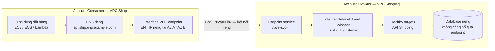
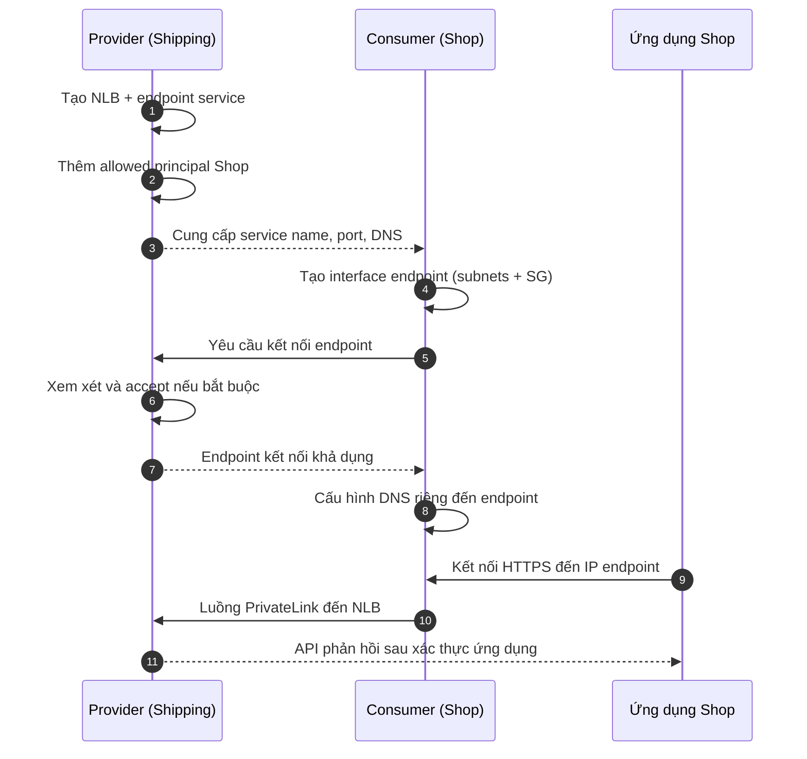
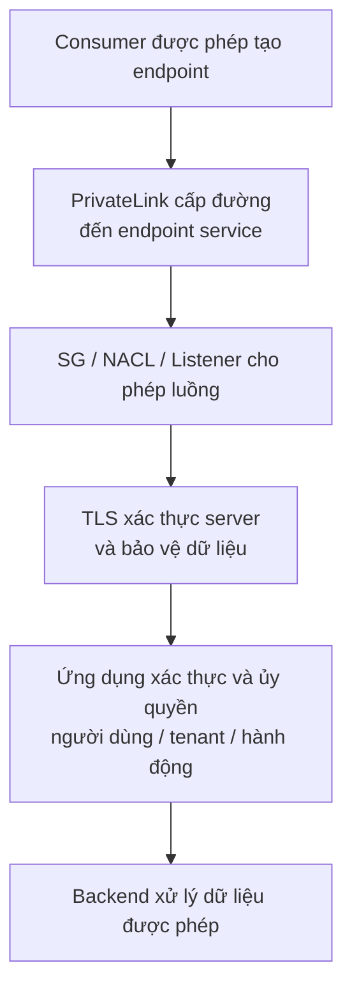
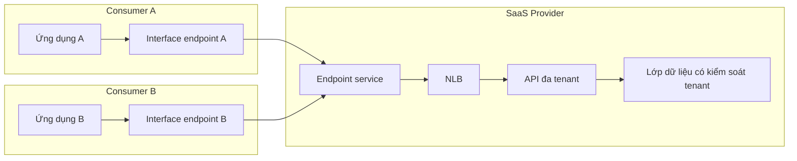
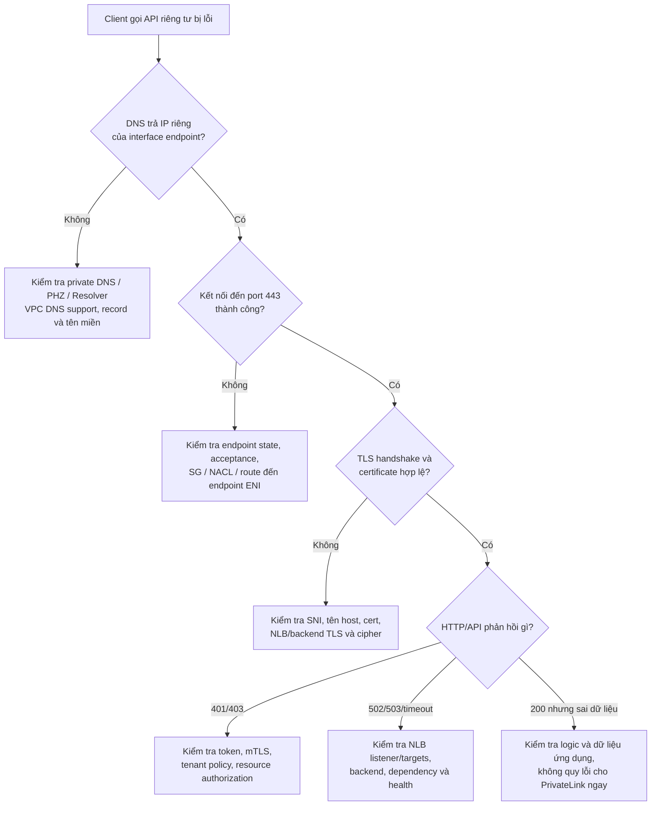

# AWS PrivateLink và cung cấp dịch vụ riêng tư

Trong AWS, ứng dụng thường cần gọi đến dịch vụ nằm bên ngoài VPC của mình: một dịch vụ AWS như Secrets Manager, một API nội bộ do đội khác vận hành, hay một dịch vụ SaaS cung cấp từ tài khoản AWS của đối tác. Cách tiếp cận đơn giản là đưa API ra Internet rồi bảo vệ bằng TLS, token và firewall. Nhưng nhiều hệ thống xử lý dữ liệu nhạy cảm muốn **không cần công bố địa chỉ dịch vụ trên Internet**, đồng thời tránh tạo kết nối mạng rộng giữa các VPC.

**AWS PrivateLink** giải quyết nhu cầu này bằng cách cho phép **consumer** truy cập một dịch vụ qua **địa chỉ IP riêng của VPC endpoint**. Kết nối được chuyển đến dịch vụ qua mạng AWS mà không cần Internet Gateway, NAT Gateway hay đường kết nối VPC trực tiếp giữa consumer và provider cho luồng này. Consumer chỉ thấy điểm truy cập đến dịch vụ đã được cung cấp; không mặc nhiên có quyền đi đến mọi subnet, instance hoặc database phía provider.

Bài học thuộc chương **Kết nối mạng nâng cao**, module **CLOUD_PROVIDERS_AWS**. Trong hành trình tìm hiểu Region/AZ, IAM, VPC, dịch vụ tính toán, lưu trữ, database, tích hợp, serverless, giám sát, khôi phục và chi phí của AWS, PrivateLink là một lựa chọn quan trọng khi thiết kế ứng dụng **an toàn, hạn chế phạm vi kết nối, dễ quản trị và có thể phục vụ nhiều VPC/tài khoản**.

## 1. Tình huống thực tế và mục tiêu học tập

Giả sử hệ thống bán hàng có hai phần:

- **Account Consumer** chạy ứng dụng đặt hàng trong VPC `shop-vpc`.
- **Account Provider** vận hành API tính phí giao hàng trong VPC `shipping-vpc`.

Ứng dụng đặt hàng cần gọi API HTTPS để tính phí, nhưng không cần truy cập máy chủ, database hoặc các subnet khác của đội Shipping. Hai VPC thậm chí có thể dùng dải CIDR trùng nhau do được xây dựng độc lập.

Với kết nối mạng truyền thống như VPC peering, ta phải quản lý route, CIDR và phạm vi thông mạng giữa hai VPC. Với PrivateLink, provider có thể **công bố một dịch vụ cụ thể**, còn consumer tạo **interface VPC endpoint** và truy cập dịch vụ qua IP nội bộ.

Sau bài học, người học có thể:

1. Giải thích luồng dữ liệu của AWS PrivateLink và ranh giới giữa **consumer**, **endpoint**, **endpoint service**, **Network Load Balancer (NLB)** và **backend**.
2. Phân biệt PrivateLink với VPC peering, AWS Transit Gateway, gateway endpoint, NAT Gateway và các giải pháp kết nối ứng dụng khác.
3. Thiết kế dịch vụ riêng tư giữa hai tài khoản AWS: quyền tạo kết nối, xác nhận kết nối, endpoint ENI, security group, DNS và TLS.
4. Nhận diện các vấn đề về Availability Zone, khả năng sẵn sàng, quan sát, chi phí, quota và xử lý sự cố.
5. Chọn cách dùng PrivateLink khi ứng dụng cần gọi dịch vụ AWS, API nội bộ, SaaS hoặc hệ thống phân tách theo đội/môi trường.

## 2. PrivateLink hoạt động theo nguyên tắc nào?

AWS PrivateLink là cơ chế kết nối đến **dịch vụ/tài nguyên được cung cấp qua VPC endpoint**, không phải một cặp mạng được định tuyến toàn bộ như peering. Mẫu tiêu biểu cho việc cung cấp dịch vụ do doanh nghiệp tự vận hành gồm:

| Thành phần | Nằm ở đâu? | Vai trò |
|---|---|---|
| **Service provider** | Tài khoản/VPC bên cung cấp | Chủ sở hữu API, quyết định ai được phép thiết lập endpoint đến dịch vụ |
| **Endpoint service** | Bên provider | Cấu hình dịch vụ PrivateLink, liên kết với NLB và quy tắc chấp nhận kết nối |
| **Network Load Balancer (NLB)** | Bên provider | Nhận luồng từ PrivateLink rồi chuyển tới target group ứng dụng |
| **Target group và backend** | Bên provider | EC2/ECS/EKS hoặc hạ tầng phù hợp xử lý yêu cầu thực tế |
| **Service consumer** | Tài khoản/VPC bên sử dụng | Chủ ứng dụng gọi API, tạo endpoint vào VPC của mình |
| **Interface VPC endpoint** | Bên consumer | Một hoặc nhiều Elastic Network Interface (ENI) với IP riêng tại subnet đã chọn |
| **DNS và bảo mật** | Hai bên | Phân giải tên đến IP endpoint, kiểm soát luồng vào/ra và xác thực ứng dụng |

### 2.1. Sơ đồ luồng dữ liệu giữa hai tài khoản



Đường đi logic của một request:

1. Ứng dụng consumer gọi `https://api.shipping.example.com`.
2. DNS trong VPC consumer trả về IP riêng của **interface endpoint ENI**, nếu đã cấu hình tên DNS phù hợp.
3. Ứng dụng gửi kết nối TCP/TLS đến IP endpoint. Security group của instance/task và endpoint phải cho phép luồng cần thiết.
4. Hạ tầng AWS PrivateLink chuyển luồng đến **endpoint service** rồi đến **NLB** thuộc provider.
5. NLB phân phối kết nối đến backend đang healthy; backend thực hiện xác thực/ủy quyền ứng dụng và trả kết quả theo đường kết nối.

Đối với mô hình thông thường này, **không cần route peering đến CIDR của VPC provider** và không cần công bố IP backend cho consumer. Backend database nằm ngoài phạm vi endpoint service vẫn không trở thành tài nguyên mà consumer tự do truy cập.

**Quan trọng:** PrivateLink xử lý **đường truyền mạng đến dịch vụ**, không thay thế authentication, authorization, TLS hoặc kiểm soát dữ liệu của API. Một kết nối PrivateLink được chấp nhận không đồng nghĩa consumer được phép gọi mọi chức năng nghiệp vụ.

### 2.2. Tại sao CIDR có thể trùng nhau?

Trong VPC peering hoặc Transit Gateway, định tuyến IP giữa các VPC phụ thuộc việc nhận diện dải mạng đích rõ ràng. Hai mạng cùng dùng `10.0.0.0/16` sẽ tạo xung đột định tuyến khi muốn nối trực tiếp.

Với PrivateLink, consumer gửi request đến **IP của endpoint nằm trong chính VPC consumer**; AWS chuyển kết nối đến dịch vụ provider mà không cần quảng bá route CIDR của provider. Vì vậy, hai VPC có thể có dải CIDR trùng nhau trong nhiều kiến trúc PrivateLink hợp lệ. Tuy nhiên, nếu muốn kết hợp thêm peering/TGW hoặc các luồng kết nối khác, bài toán CIDR vẫn cần giải quyết riêng.

## 3. Phân biệt các kiểu VPC endpoint

Khi nói “VPC endpoint”, không phải mọi endpoint đều sử dụng cùng cơ chế, cùng chi phí hoặc cùng cách bảo mật.

| Loại endpoint | Cơ chế chính | Tình huống phù hợp | Điều cần chú ý |
|---|---|---|---|
| **Interface endpoint** | ENI có IP riêng trong subnet, kết nối qua AWS PrivateLink | Truy cập các AWS service hỗ trợ, dịch vụ SaaS, endpoint service của tổ chức | Có security group, DNS, phí theo endpoint/AZ và dữ liệu xử lý |
| **Gateway endpoint** | Route-table target đặc biệt cho dịch vụ được hỗ trợ | Truy cập Amazon S3 hoặc DynamoDB từ VPC theo cơ chế gateway | Không tạo ENI như interface endpoint; gắn với route table, có giới hạn về phạm vi định tuyến |
| **Gateway Load Balancer endpoint** | Điểm chuyển traffic đến dịch vụ kiểm tra mạng dùng Gateway Load Balancer | Firewall/inspection appliance tập trung, luồng định tuyến có kiểm soát | Khác mục tiêu với API PrivateLink thông thường |
| **Resource endpoint / các hình thức truy cập tài nguyên khác** | Cơ chế endpoint đến loại tài nguyên mà AWS hỗ trợ | Trường hợp cần kết nối một tài nguyên cụ thể mà không tự dựng NLB | Phạm vi dịch vụ/Region, giới hạn và cách định tuyến phụ thuộc tính năng được hỗ trợ |

Trong bài này, mẫu **interface endpoint → endpoint service → NLB → ứng dụng** là trọng tâm. Đây là mô hình cơ bản để một đội hoặc doanh nghiệp **cung cấp dịch vụ riêng tư cho tài khoản khác**.

### 3.1. AWS service endpoint và dịch vụ do mình cung cấp

Hai trường hợp dùng PrivateLink cần phân biệt:

**Trường hợp A — Gọi một AWS service:** Ví dụ workload ở private subnet cần lấy secret từ AWS Secrets Manager. Consumer tạo interface endpoint đến tên AWS service tương ứng, ví dụ `com.amazonaws.ap-southeast-1.secretsmanager` ở Region Singapore. AWS là bên cung cấp; bạn chủ yếu cấu hình endpoint, DNS, security group, IAM và endpoint policy nếu service hỗ trợ.

**Trường hợp B — Cung cấp API riêng:** Nhóm Shipping quản lý API và tạo endpoint service trỏ đến NLB; nhóm Shop tạo endpoint trỏ tới service name do Shipping cung cấp. Lúc này bạn phải quản trị **cả hai phía**, gồm NLB, target, Allowed Principals, connection acceptance và DNS.

Không thể lấy một endpoint kết nối đến AWS Secrets Manager rồi coi nó như NLB do mình quản lý. Cũng không thể suy luận rằng endpoint policy của một AWS service luôn có thể áp dụng trực tiếp để phân quyền chức năng của API tự xây dựng.

### 3.2. Trường hợp serverless

AWS Lambda có thể **gọi ra** dịch vụ qua interface endpoint nếu Lambda chạy trong VPC và được cấu hình đường truy cập phù hợp. Nhưng để **cung cấp một API dựa trên Lambda**, có thể cần một lớp HTTP API/REST API phù hợp.

Ví dụ, **Amazon API Gateway private REST API** có thể nhận request từ VPC qua interface endpoint `execute-api` và resource policy có điều kiện, thay vì tự dựng NLB chỉ để gọi một Lambda function. Khả năng private API phụ thuộc **loại API Gateway API** và cấu hình hỗ trợ; không được mặc định mọi loại API đều hỗ trợ như nhau.

## 4. Chọn PrivateLink hay phương án mạng khác?

Trước khi triển khai, cần xác định nhu cầu là **truy cập một dịch vụ riêng tư** hay **kết nối nhiều mạng/tài nguyên**.

| Tiêu chí | AWS PrivateLink (interface endpoint) | VPC Peering | AWS Transit Gateway | Public API qua HTTPS |
|---|---|---|---|---|
| Phạm vi | Dịch vụ được cung cấp qua endpoint | Kết nối định tuyến giữa hai VPC | Kết nối mạng nhiều VPC/on-prem theo hub | API công khai có điểm vào Internet |
| Có cần route đến toàn VPC provider? | Không trong mô hình endpoint service | Có, theo CIDR liên quan | Có, theo route table/attachment | Không |
| CIDR chồng lấn | Có thể phù hợp | Không phù hợp khi cần định tuyến chồng lấn | Không giải quyết tự động xung đột CIDR | Không phụ thuộc CIDR VPC |
| Mức độ công bố | Chỉ endpoint/dịch vụ được mở | Nhiều đích có thể định tuyến, phải lọc thêm | Phân đoạn được bằng route table/policy | Endpoint công khai, hạn chế bằng ứng dụng/WAF/network |
| Kịch bản tốt | SaaS riêng tư, API của đội khác, AWS API | Hai VPC cần giao tiếp mạng tương đối rộng | Nhiều VPC, hệ thống hybrid, mô hình hub | API phục vụ client rộng trên Internet |
| Việc phải vận hành | Endpoint, DNS, policy, NLB/targets nếu tự cung cấp | Route, CIDR, SG, DNS | Attachment, route table, propagation, phân đoạn | Public ingress, DNS, bảo vệ ứng dụng |

**Các phương án khác đáng cân nhắc:**

- **AWS VPC Lattice** khi cần nhiều service HTTP/HTTPS ở các VPC/tài khoản, cùng cách quản lý service network, chính sách truy cập ứng dụng và quan sát. Phù hợp nhu cầu cấp service và khám phá service ở quy mô lớn; phải đánh giá tính năng, chi phí, giới hạn thực tế.
- **AWS Site-to-Site VPN / Direct Connect** khi cần kết nối hệ thống on-premises với AWS. Truy cập endpoint qua các kết nối này có thể khả thi nếu route và DNS đến IP endpoint đúng, nhưng bản thân PrivateLink không thay thế đường truyền vật lý/tunnel hybrid.
- **NAT Gateway** khi workload private subnet phải gọi endpoint công khai và không có đường private phù hợp. PrivateLink có thể loại bỏ nhu cầu đi NAT **cho những dịch vụ hỗ trợ endpoint được triển khai**, không loại bỏ mọi nhu cầu outbound Internet của ứng dụng.

**Quy tắc chọn nhanh:** nếu consumer chỉ cần gọi **một API cụ thể** và provider không muốn cho phép định tuyến VPC-to-VPC, PrivateLink là ứng viên tốt. Nếu nhiều hệ thống cần trao đổi IP hai chiều với hàng loạt đích, peering/TGW hoặc kiến trúc service network khác có thể phù hợp hơn.

## 5. Hai vai trò trong cung cấp dịch vụ riêng tư

### 5.1. Phía provider sở hữu những gì?

Đội Shipping sở hữu:

1. Backend API chạy trên EC2/ECS/EKS hoặc công nghệ khác được NLB hỗ trợ thông qua target group.
2. **Network Load Balancer** (thường chọn scheme `internal` cho kiến trúc nội bộ) có listener chuyển traffic đến target group.
3. **Endpoint service configuration** gắn với ARN của NLB.
4. Danh sách **Allowed Principals** được phép tạo endpoint đến dịch vụ.
5. Quyết định có **yêu cầu chấp nhận từng endpoint connection** hay không.
6. Optional private DNS name, cơ chế chứng minh sở hữu tên miền và hướng dẫn consumer cấu hình DNS.
7. Giám sát tình trạng backend/NLB và cơ chế ứng cứu khi endpoint hoặc target gặp sự cố.

### 5.2. Phía consumer sở hữu những gì?

Đội Shop sở hữu:

1. VPC, subnet ở các Availability Zone phù hợp, và địa chỉ IP riêng cho endpoint ENI.
2. **Interface VPC endpoint** kết nối đến `service name` của Shipping.
3. **Security group của endpoint** giới hạn nguồn/port được phép truy cập.
4. DNS để tên API nội bộ phân giải đến endpoint; chứng chỉ TLS và cấu hình client phù hợp.
5. IAM hoặc quy trình cấp quyền cho người tạo/sửa/xóa endpoint; xác thực ứng dụng tới API Shipping.
6. Log, metrics, cảnh báo và chi phí endpoint của mình.

### 5.3. Quyền tạo endpoint và quyền sử dụng API là hai lớp độc lập

Provider có thể cho phép principal của account consumer tạo endpoint, ví dụ principal dạng `arn:aws:iam::222233334444:root` (ý nghĩa là ủy quyền cho account tương ứng). Điều này **không có nghĩa toàn bộ user trong account đó tự động có quyền tạo endpoint**: các IAM policy và lớp quản trị của account consumer vẫn quyết định ai được dùng API EC2 để tạo endpoint.

Nếu endpoint service yêu cầu chấp nhận kết nối, provider còn phải **accept** endpoint connection đang chờ. Sau khi kết nối Active/Available, ứng dụng vẫn cần tuân theo chính sách bảo mật riêng của API như JWT, mTLS, API key phù hợp hoặc cơ chế xác thực doanh nghiệp.



**Lưu ý:** thời điểm của các bước DNS, acceptance và kích hoạt endpoint có thể khác nhau theo quy trình triển khai; trình tự trên chỉ biểu diễn phụ thuộc chính, không phải giao thức tự động do AWS thực hiện thay cho người quản trị.

## 6. Thiết kế VPC, Availability Zone và IP

### 6.1. Interface endpoint là ENI trong subnet

Khi tạo interface endpoint, consumer chọn một hoặc nhiều subnet thuộc VPC. AWS tạo **endpoint network interface** trong các subnet được chỉ định, dùng IP riêng thuộc dải subnet. Một interface endpoint hỗ trợ chọn subnet theo AZ trong phạm vi endpoint/service tương ứng; thông thường thiết kế với **một subnet ở mỗi AZ được chọn**.

Ví dụ:

| Thành phần | AZ A | AZ B |
|---|---|---|
| Consumer VPC | `10.20.0.0/16` | Cùng VPC |
| Subnet cho endpoint | `10.20.10.0/24` | `10.20.20.0/24` |
| IP endpoint minh họa | `10.20.10.50` | `10.20.20.50` |
| Backend provider | NLB/targets ở AZ phù hợp | NLB/targets ở AZ phù hợp |
| Ứng dụng | App/task ở AZ A | App/task ở AZ B |

Địa chỉ IP minh họa trên chỉ để giải thích; IP thực được AWS cấp từ subnet theo yêu cầu khi tạo endpoint. Endpoint cần có subnet đủ IP trống; các thay đổi subnet/AZ phải tuân theo khả năng hỗ trợ của dịch vụ.

**Không cần thêm route-table entry đến provider VPC** để app trong cùng VPC gọi IP endpoint. Route `local` của VPC và các điều kiện mạng liên quan xử lý phần đường đi đến ENI. Nếu client nằm ở VPC khác hoặc on-premises, phải có **khả năng định tuyến tới IP endpoint** và giải quyết DNS, SG, NACL theo topology đó.

### 6.2. AZ name khác nhau giữa các tài khoản

Tên như `ap-southeast-1a` có thể ánh xạ đến AZ vật lý khác nhau ở từng AWS account. Khi provider công bố service từ NLB và consumer chọn AZ, cần dùng **AZ ID** (ví dụ dạng `apse1-az1`) hoặc thông tin vùng khả dụng thực tế của endpoint service để đối chiếu khi cần tính nhất quán giữa account.

Không giả định vì hai account đều thấy “AZ a” mà đó là cùng một trung tâm dữ liệu. Khi một NLB/service không bật ở một AZ, consumer có thể không chọn được subnet AZ tương ứng hoặc lưu lượng không được phục vụ theo cách kỳ vọng.

### 6.3. Thiết kế tính sẵn sàng

- Bật NLB trên các AZ phù hợp với nhu cầu consumer, đồng thời có targets healthy theo chiến lược HA.
- Tạo endpoint ở nhiều AZ để giảm rủi ro khi một AZ/ENI bị gián đoạn.
- Cấu hình ứng dụng có retry có giới hạn, timeout, circuit breaker và xử lý yêu cầu idempotent khi phù hợp.
- Theo dõi phân phối lưu lượng theo AZ và thiết lập target group health check chính xác.
- Đánh giá **cross-zone load balancing**, lưu lượng giữa các AZ, chi phí chuyển dữ liệu và tác động failover; không mặc định thêm một AZ là toàn bộ hành trình luôn AZ-local.
- Nếu cần khả năng phục hồi **cả Region**, thiết kế riêng dịch vụ/endpoint ở Region dự phòng và cơ chế định tuyến/khôi phục. Endpoint ở nhiều AZ trong một Region không giải quyết sự cố toàn Region.

Ví dụ cơ bản trong bài giả định consumer và provider **cùng Region**. AWS có các tính năng PrivateLink cross-Region ở những trường hợp/Region được hỗ trợ; nếu muốn dùng, phải xác nhận điều kiện, cấu hình riêng và chi phí tương ứng, không mặc định mọi loại endpoint service đều tự động có kết nối cross-Region.

## 7. Security group, NACL và phạm vi mạng

### 7.1. Cổng cần mở ở phía consumer

Giả sử ứng dụng Shop gọi API HTTPS qua port 443. Thiết lập mẫu:

| Vị trí | Chiều lưu lượng | Khuyến nghị |
|---|---|---|
| Security group ứng dụng | Egress | Cho phép TCP 443 đến security group/IP endpoint theo mô hình hỗ trợ |
| Security group interface endpoint | Ingress | Chỉ cho phép TCP 443 từ SG hoặc CIDR nguồn ứng dụng được tin cậy |
| NACL của subnet | Inbound/outbound | Cho phép chiều request/response với ephemeral ports phù hợp (NACL là stateless) |
| DNS | Outbound/return | Cho phép phân giải DNS của ứng dụng đến resolver được dùng |

Không nên mở endpoint SG `0.0.0.0/0` chỉ để “kết nối cho dễ”. Chỉ cho phép các nguồn client hợp lệ và port mà service thực sự lắng nghe. Ứng dụng ở cùng VPC có thể tham chiếu security group trong rule nếu topology/API hỗ trợ, giúp tránh hardcode nhiều IP.

### 7.2. Bảo mật NLB và backend phía provider

Với endpoint service do mình quản lý, provider cần kiểm tra:

- Listener NLB đúng cổng/giao thức và target group đang healthy.
- Security group liên kết với NLB, nếu có, cùng rules ở target và subnet; các thiết lập về **thực thi inbound SG đối với lưu lượng PrivateLink** cần được hiểu đúng trước khi bật/tắt.
- Backend chỉ nhận lưu lượng từ đường dự kiến, tránh mở trực tiếp port API ra công cộng nếu không cần.
- Giao thức TLS: mã hóa giữa client và nơi kết thúc TLS (NLB hoặc backend) theo thiết kế; bảo vệ đoạn tiếp sau termination nếu yêu cầu.
- Xác thực khách hàng: endpoint connection được chấp nhận là **được phép thiết lập đường mạng**, không phải danh tính người dùng cuối.

NLB cho PrivateLink có đặc điểm về nguồn IP khi gửi tới target: **không nên dựa vào source IP của target làm danh tính consumer cuối cùng**. Nếu backend cần metadata như **VPC endpoint ID**, tìm hiểu **Proxy Protocol v2** (bao gồm các TLV do NLB cung cấp theo cấu hình/tính năng hỗ trợ) và kiểm tra backend thật sự đọc, xác thực được metadata đó. Đây là thông tin bổ sung để phân loại/kiểm soát khách hàng, không thay thế JWT/mTLS hoặc cơ chế authorization của ứng dụng.

### 7.3. Ranh giới bảo mật được tạo ra là gì?



Lớp B không tự làm thay các lớp C, D, E. Ví dụ một SaaS cần phân biệt hai tenant cùng kết nối tới một endpoint service: backend vẫn phải kiểm tra tenant ID và quyền trên từng request. Tương tự, có PrivateLink không có nghĩa tất cả dữ liệu qua đó mặc nhiên được mã hóa ở tầng ứng dụng.

## 8. DNS và TLS cho dịch vụ riêng tư

### 8.1. DNS do AWS tạo

Khi consumer tạo interface endpoint, AWS cấp các DNS name gắn với endpoint (thường có **regional DNS name** và có thể có tên gắn từng AZ tùy trường hợp). Khi tên được phân giải từ nơi phù hợp, nó dẫn đến IP riêng của endpoint ENI.

Ứng dụng có thể trực tiếp sử dụng tên DNS của endpoint, nhưng tên dài và khó thay đổi. Trong thực tế, đa số đội muốn gọi một tên có ý nghĩa, ví dụ:

```text
api.shipping.internal.example.com
```

Nên tách:

1. **Tên được API client sử dụng**: tên nghiệp vụ, ổn định trong cấu hình và certificate.
2. **Tên endpoint DNS do AWS cấp**: điểm đến kỹ thuật có thể thay đổi khi endpoint bị thay thế.
3. **Đường phân giải DNS**: private hosted zone, private DNS name trên endpoint service hoặc cấu hình resolver khác.

### 8.2. Private DNS name của endpoint service

Provider có thể cấu hình **private DNS name** cho endpoint service theo khả năng hỗ trợ, cần **xác minh quyền sở hữu tên miền** theo quy trình AWS. Consumer có thể bật private DNS trên interface endpoint khi dịch vụ/tên đã được cấu hình và xác minh đúng.

Khi đó, trong VPC consumer, tên private DNS được cấu hình có thể phân giải về endpoint thay vì đi tới địa chỉ công khai. Việc cấu hình thực tế phải kiểm tra **DNS support** và **DNS hostnames** của VPC, các hosted zone trùng tên, cũng như quy tắc resolver của doanh nghiệp.

Nếu dùng tên tùy chỉnh qua **Route 53 private hosted zone**, consumer có thể tạo record phù hợp trỏ đến regional endpoint DNS (alias/CNAME tùy loại record) và gắn hosted zone với VPC cần sử dụng. Phải kiểm tra phân giải từ chính nguồn client: kết quả ở máy quản trị ngoài VPC có thể khác hoàn toàn.

### 8.3. TLS certificate và tên gọi

PrivateLink không tự phát chứng chỉ TLS hợp lệ cho tên API tùy chỉnh. Khi client gọi `https://api.shipping.internal.example.com`, certificate mà server/NLB trình bày phải hợp lệ với tên mà client xác minh.

**Cần tránh:** “sửa nhanh” bằng cách tắt xác minh TLS của client. Thao tác này làm mất xác thực server và có thể gây rủi ro ngay cả khi lưu lượng đi qua mạng riêng.

Nếu TLS terminate tại NLB, provider phải quản lý certificate/listener phù hợp và quyết định có mã hóa kết nối đến backend hay không. Nếu cần TLS end-to-end, có thể chuyển luồng TCP/TLS đến backend để backend terminate; lựa chọn phụ thuộc yêu cầu chứng chỉ, khả năng quan sát và xác thực hai chiều.

### 8.4. DNS cho on-premises hoặc VPC khác

Để client ở on-premises/VPC khác gọi endpoint trong VPC consumer, chỉ có thể thành công khi:

- Đã có đường truyền/định tuyến thực tế đến IP endpoint như Direct Connect/VPN/TGW/peering theo kiến trúc được phép.
- DNS của client trả về địa chỉ mà client thật sự có thể đi tới; Route 53 Resolver inbound/outbound endpoint và conditional forwarding có thể giúp nối hệ thống DNS hybrid.
- Security group, NACL, firewall và quy định phân đoạn mạng cho phép các luồng cần thiết.

PrivateLink tự nó **không phải đường kết nối từ on-premises vào AWS**. Nó là điểm đến riêng tư của dịch vụ; nguồn client vẫn phải có khả năng reach đến endpoint ENI.

## 9. Quy trình triển khai dịch vụ riêng tư qua NLB

Phần này sử dụng một bài thực hành theo hai account:

| Thành phần | Giá trị minh họa |
|---|---|
| Provider account | `111122223333` |
| Consumer account | `222233334444` |
| Region | `ap-southeast-1` |
| Provider VPC | `shipping-vpc` |
| Consumer VPC | `shop-vpc` |
| API | HTTPS port `443`, endpoint `/health` |
| Provider NLB | `shipping-private-nlb` |
| Endpoint service | `vpce-svc-...` |
| Interface endpoint | `vpce-...` |

Các ID, ARN và tên trong phần lệnh bên dưới chỉ là **placeholder**. Thay bằng giá trị từ môi trường của bạn; tài nguyên AWS thực tế có thể phát sinh phí ngay sau khi tạo.

### Bước 1 — Chuẩn bị backend API và NLB

Ở account provider:

1. Triển khai API Shipping trên targets phù hợp (ví dụ dịch vụ ECS chạy nhiều AZ).
2. Cho API trả HTTP 200 ở đường `/health` nếu ứng dụng sẵn sàng phục vụ.
3. Tạo target group với giao thức/port tương ứng; đăng ký targets.
4. Tạo **Network Load Balancer** đặt ở các subnet/AZ phù hợp, thêm listener TCP hoặc TLS trên port 443 và forward đến target group.
5. Xác nhận target group có targets **healthy**. Nếu dùng TLS termination tại NLB, gắn chứng chỉ hợp lệ và kiểm tra kết nối giữa NLB với backend.

Provider nên cấu hình security group khi tạo NLB nếu muốn quản trị NLB theo SG; các giới hạn thêm SG sau khi tạo phụ thuộc cách NLB được khởi tạo. Kiểm tra cả thuộc tính **Enforce inbound rules on PrivateLink traffic** và quy tắc ở target để tránh vô tình chặn luồng đến từ interface endpoint.

**Không nên tạo endpoint service trước khi backend healthy.** Việc endpoint connection hiển thị `available` chỉ chứng minh đường kết nối được thiết lập, không bảo đảm API sẽ trả HTTP 200.

### Bước 2 — Provider tạo endpoint service

Trong console: **VPC → Endpoint services → Create endpoint service**. Chọn loại cung cấp thông qua **Network Load Balancer**, NLB của Shipping và bật **Acceptance required** để provider xét duyệt từng endpoint.

AWS CLI minh họa:

```bash
aws ec2 create-vpc-endpoint-service-configuration \
  --network-load-balancer-arns "<NLB_ARN>" \
  --acceptance-required \
  --region ap-southeast-1
```

Kết quả phản hồi chứa thông tin cấu hình service, gồm **ServiceId** và **ServiceName**. Một tên dịch vụ PrivateLink tùy chỉnh có dạng tổng quát:

```text
com.amazonaws.vpce.ap-southeast-1.vpce-svc-0123456789abcdef0
```

Đây là tên kỹ thuật mà consumer sẽ dùng khi tạo endpoint. Nó **không phải URL của API**, và không phải ARN NLB.

### Bước 3 — Provider cấp phép principal của consumer

Provider thêm account hoặc principal được quyền yêu cầu kết nối:

```bash
aws ec2 modify-vpc-endpoint-service-permissions \
  --service-id "<SERVICE_ID>" \
  --add-allowed-principals "arn:aws:iam::222233334444:root" \
  --region ap-southeast-1
```

Giá trị `arn:aws:iam::222233334444:root` ở đây là dạng principal đại diện **account consumer** trong danh sách được phép của endpoint service; không yêu cầu ứng dụng phải sử dụng root credentials. Thực tế nên quản lý danh sách account/principal có chủ đích theo môi trường và hợp đồng truy cập.

Hai bước cấp phép cần phân biệt:

1. **Allowed Principals**: principal/account nào có thể tìm và yêu cầu tạo endpoint đến service.
2. **Acceptance required**: với endpoint mới, provider còn xem xét và xác nhận **connection request** của endpoint đó.

Nếu service được cấu hình cho phép quá rộng và không yêu cầu approval, bên ngoài phạm vi kỳ vọng có thể tạo nhiều kết nối hơn dự định. Vì vậy, với dịch vụ nhạy cảm, nên giới hạn allowed principals và giữ quy trình acceptance/kiểm toán phù hợp.

### Bước 4 — Consumer tạo interface endpoint

Trong account consumer, chuẩn bị:

- VPC `shop-vpc` và các subnet ở các AZ mà service hỗ trợ.
- Security group của endpoint, cho phép **ingress TCP 443 từ workload Shop**.
- IAM quyền tạo VPC endpoint cho người vận hành/pipeline.
- `ServiceName` do provider cung cấp.

Tạo endpoint bằng CLI:

```bash
aws ec2 create-vpc-endpoint \
  --vpc-id "<CONSUMER_VPC_ID>" \
  --vpc-endpoint-type Interface \
  --service-name "<PROVIDER_SERVICE_NAME>" \
  --subnet-ids "<SUBNET_A_ID>" "<SUBNET_B_ID>" \
  --security-group-ids "<ENDPOINT_SECURITY_GROUP_ID>" \
  --no-private-dns-enabled \
  --region ap-southeast-1
```

Ở bước này dùng `--no-private-dns-enabled` vì ví dụ chưa cấu hình/kiểm chứng private DNS name của service provider. Có thể cấu hình DNS riêng sau khi kết nối hoạt động và chứng chỉ TLS đã sẵn sàng.

Khi provider yêu cầu acceptance, endpoint mới có thể ở trạng thái `pendingAcceptance`. Đây là hành vi dự kiến, không phải lỗi mạng.

### Bước 5 — Provider xem xét và chấp nhận kết nối

Ở account provider, kiểm tra các yêu cầu kết nối và chỉ chấp nhận endpoint từ account/VPC được phê duyệt:

```bash
aws ec2 describe-vpc-endpoint-connections \
  --service-id "<SERVICE_ID>" \
  --region ap-southeast-1

aws ec2 accept-vpc-endpoint-connections \
  --service-id "<SERVICE_ID>" \
  --vpc-endpoint-ids "<CONSUMER_ENDPOINT_ID>" \
  --region ap-southeast-1
```

Trong account consumer, kiểm tra endpoint:

```bash
aws ec2 describe-vpc-endpoints \
  --vpc-endpoint-ids "<CONSUMER_ENDPOINT_ID>" \
  --region ap-southeast-1
```

Tìm trạng thái `available`, thông tin `DnsEntries` và `NetworkInterfaceIds`. Nếu endpoint chưa available, chưa nên kết luận rằng ứng dụng đã kết nối được.

### Bước 6 — Cấu hình DNS và thử kết nối

Có hai lựa chọn phổ biến:

- **Dùng tên DNS được AWS cấp cho endpoint** để kiểm tra đường mạng ban đầu. Với HTTPS, cần chú ý tên trong certificate và SNI: không dùng tùy tiện tên kỹ thuật endpoint để bỏ qua TLS hostname verification.
- **Dùng private DNS name đã được provider xác minh** hoặc record trong Route 53 private hosted zone của consumer để tên `api.shipping.internal.example.com` phân giải đến interface endpoint. Certificate phải khớp tên API đã chọn.

Từ **chính workload consumer** hoặc một máy thử nghiệm trong VPC:

```bash
nslookup api.shipping.internal.example.com
curl -v --connect-timeout 5 https://api.shipping.internal.example.com/health
```

Kết quả mong đợi:

1. DNS trả về **địa chỉ riêng** phù hợp với endpoint.
2. Kết nối TCP đến port 443 thành công.
3. TLS handshake hợp lệ với tên API và chứng chỉ đáng tin cậy.
4. Backend trả HTTP status/response mong đợi, ví dụ `200 OK`.

Với API có yêu cầu xác thực, gửi token hoặc certificate client hợp lệ qua luồng kiểm thử được phê duyệt. Nhận `401 Unauthorized` hoặc `403 Forbidden` có thể chứng minh client đã tới tầng API nhưng chưa vượt qua authorization; cần phân biệt nó với timeout, lỗi DNS và lỗi TLS.

### Bước 7 — Kiểm thử từ chối và lưu bằng chứng

Không chỉ thử trường hợp thành công. Cần xác minh:

- Workload không được cấp trong endpoint SG không thể mở kết nối.
- Account nằm ngoài allowed principals không thể thiết lập endpoint theo cách mong muốn.
- Endpoint chưa được accept không sử dụng được dịch vụ.
- Client không có token/tài khoản ứng dụng hợp lệ bị backend từ chối.
- Target không healthy làm hệ thống phát cảnh báo và client nhận lỗi theo hành vi đã thiết kế.
- Khi một AZ bị gián đoạn, chiến lược nhiều AZ và retry hoạt động như dự kiến.

Ghi lại tên VPC, endpoint ID, service ID, DNS name, trạng thái kết nối, cổng, kết quả HTTP/TLS, CloudWatch metrics và người chịu trách nhiệm vận hành.

## 10. Kiểm soát truy cập: IAM, endpoint policy và quyền ứng dụng

PrivateLink thường liên quan **ít nhất ba lớp quyền khác nhau**:

| Lớp quyền | Câu hỏi | Công cụ điển hình |
|---|---|---|
| **Quản trị hạ tầng** | Ai được tạo/xóa endpoint và thay cấu hình service? | IAM policy, SCP, IaC approval, CloudTrail |
| **Cho phép kết nối** | Account/principal nào được tạo endpoint; provider có chấp nhận endpoint này không? | Allowed Principals, endpoint connection acceptance |
| **Sử dụng chức năng API** | Client/tenant nào được xem dữ liệu hoặc gọi phương thức nghiệp vụ? | JWT/OIDC, mTLS, application authorization, kiểm tra tenant |

### 10.1. IAM của account consumer

Người vận hành cần quyền EC2 API tương ứng để tạo/mô tả/sửa/xóa endpoint. Quyền này phải được cấp trong IAM và không bị SCP/permissions boundary giới hạn. Khi dùng IaC, nên cấp quyền cho role triển khai có review thay đổi và log đầy đủ.

Không cấp quyền quản trị endpoint đại trà cho mọi developer chỉ vì ứng dụng của họ dùng endpoint. **Ứng dụng gọi HTTPS qua một endpoint đã tồn tại không cần có quyền IAM tạo endpoint**; quyền của ứng dụng đối với API vẫn do lớp ứng dụng hoặc dịch vụ AWS đích quyết định.

### 10.2. Endpoint policy khi gọi AWS service

Với **interface endpoint trỏ đến một AWS service có hỗ trợ endpoint policy**, consumer có thể đặt thêm giới hạn hành động/tài nguyên được phép đi qua endpoint. Ví dụ, khi sử dụng interface endpoint cho Secrets Manager, endpoint policy có thể giới hạn request tới các secret nằm trong phạm vi cần thiết.

Policy minh họa, chỉ dùng sau khi đã kiểm tra giới hạn theo AWS service và yêu cầu của hệ thống:

```json
{
  "Version": "2012-10-17",
  "Statement": [
    {
      "Sid": "ReadShopDevSecretsOnly",
      "Effect": "Allow",
      "Principal": "*",
      "Action": [
        "secretsmanager:DescribeSecret",
        "secretsmanager:GetSecretValue"
      ],
      "Resource": "arn:aws:secretsmanager:ap-southeast-1:111122223333:secret:shop/dev/*"
    }
  ]
}
```

Ý nghĩa: policy giới hạn **những thao tác qua endpoint này**, không tự cấp quyền đọc secret cho mọi principal. Identity policy, resource policy (nếu có) và KMS key policy vẫn phải cho phép request tương ứng. Định dạng ARN secret trong thực tế gồm hậu tố AWS tạo, vì vậy cần kiểm tra mẫu ARN khớp đúng các secret dự kiến.

**Không đánh đồng endpoint policy của AWS service với chính sách của API riêng phía NLB.** Với endpoint service ứng dụng tự cung cấp, cách phân quyền chức năng API vẫn cần được thiết kế ở ứng dụng/identity gateway theo khả năng dịch vụ.

### 10.3. Resource policy và quyền của AWS service

Khi gọi dịch vụ AWS qua endpoint, một số dịch vụ còn có **resource-based policy**. Ví dụ bucket policy hoặc API Gateway private REST API resource policy có thể giới hạn nguồn kết nối theo VPC endpoint khi condition key được hỗ trợ. Có những tình huống cần ràng buộc `aws:SourceVpce` để chỉ cho phép request qua endpoint được chỉ định, nhưng phải kiểm tra chính xác request context và các ngoại lệ vận hành.

Không sao chép cùng một IAM condition vào mọi dịch vụ: một condition key chỉ có hiệu lực theo API/action và ngữ cảnh hỗ trợ.

## 11. Xây dựng dịch vụ SaaS riêng tư cho nhiều khách hàng

Một provider có thể phục vụ nhiều consumer account qua cùng endpoint service, hoặc tách service theo tenant/mức nhạy cảm.

### 11.1. Mô hình dùng chung



**Điểm thuận lợi:** mỗi khách hàng tạo endpoint trong VPC của họ. Provider không phải cấp route tới toàn mạng khách hàng, không cần thỏa thuận CIDR không trùng lặp cho luồng dịch vụ, và có thể giới hạn account nào được tạo endpoint.

**Điểm cần thận trọng:** khi dùng chung một endpoint service, tất cả consumer được chấp nhận về cơ bản có đường mạng đến cùng lớp tiếp nhận; provider phải tách quyền truy cập dữ liệu theo tenant ở tầng ứng dụng. Không được dựa vào IP nguồn như danh tính tenant duy nhất.

### 11.2. Các mức cô lập tenant

| Cách thiết kế | Ưu điểm | Đánh đổi |
|---|---|---|
| Một endpoint service + một API đa tenant | Ít cấu hình, vận hành đơn giản | Authorization tenant phải rất chặt; tài nguyên dùng chung có thể chịu ảnh hưởng tải chéo |
| Một endpoint service theo nhóm tenant | Có thể tách rủi ro hoặc gói dịch vụ | Nhiều service/NLB/cấu hình và chi phí hơn |
| Endpoint service riêng cho từng tenant nhạy cảm | Cô lập cao hơn ở điểm tiếp nhận và cấu hình dịch vụ | Tăng đáng kể số lượng endpoint service, backend, giám sát và quy trình cấp phát |

Đối với dịch vụ thanh toán hoặc API dữ liệu nhạy cảm, hãy đánh giá **cô lập network + cô lập định danh + cô lập dữ liệu + quota + audit** như một tổng thể. Việc sở hữu endpoint ID khác nhau không bảo đảm dữ liệu của tenant không thể bị truy vấn chéo.

### 11.3. Thu hồi quyền và kết thúc hợp đồng

Khi một khách hàng không còn được sử dụng dịch vụ:

1. Thu hồi/điều chỉnh quyền ứng dụng, certificate hoặc token theo SLA và quy trình bảo mật.
2. Xem xét trạng thái connection và **reject/delete kết nối endpoint** theo quyền provider nếu cần.
3. Loại principal khỏi danh sách được phép tạo kết nối mới.
4. Kiểm tra DNS/config ứng dụng, log và hoạt động truy cập còn lại.

**Chỉ xóa principal khỏi Allowed Principals không phải lúc nào cũng đủ để vô hiệu hóa các endpoint connection đã được chấp nhận trước đó.** Cần có quy trình quản lý connection hiện hữu và thu hồi quyền ứng dụng.

## 12. Giám sát, ghi log và vận hành

PrivateLink liên quan cả tài nguyên hạ tầng và ứng dụng. Nên giám sát theo từng lớp:

| Lớp | Cần theo dõi | Nguồn dữ liệu phù hợp |
|---|---|---|
| Endpoint service | Connection mới, trạng thái `pendingAcceptance`/`available`/`rejected` | EC2 endpoint service/connection APIs, event và CloudTrail cho hành động quản trị |
| Consumer endpoint | ENI, subnet/AZ, SG, trạng thái endpoint, DNS entry | EC2 VPC endpoint APIs, cấu hình VPC và giám sát mạng |
| Mạng | Flow accept/reject, port, source/destination theo góc nhìn subnet/ENI | VPC Flow Logs, network troubleshooting |
| NLB | Targets healthy, số kết nối/luồng, lượng dữ liệu, lỗi kết nối và TLS nếu áp dụng | Amazon CloudWatch metrics của NLB, access logs theo loại listener/tính năng được hỗ trợ |
| API | HTTP 4xx/5xx, latency p50/p95/p99, lỗi xác thực, request ID | Application logs, tracing, CloudWatch/OTel |
| Bảo mật | Tạo/xóa/sửa endpoint, thay Allowed Principals, accept/reject, thay SG | AWS CloudTrail và cơ chế phát hiện drift/config |
| Chi phí | Endpoint-hours, data processing, NLB, data transfer | AWS Cost Explorer, Cost and Usage Report, Budgets |

**CloudTrail không tự ghi nội dung HTTP request của API tùy chỉnh**. Nó giúp kiểm toán các thao tác quản trị AWS. Để điều tra yêu cầu nghiệp vụ, cần logging trong ứng dụng, gateway/proxy hoặc tầng load balancing phù hợp. Tương tự, VPC Flow Logs thể hiện thông tin luồng mạng, **không cung cấp body của request HTTPS**.

### 12.1. Các chỉ số SLI/SLO có thể dùng

Với API Shipping có SLO độ sẵn sàng 99,9% trong tháng, đội vận hành có thể đo:

- **Availability của API**: tỷ lệ request hợp lệ nhận phản hồi thành công theo định nghĩa nghiệp vụ.
- **Latency**: p95/p99 tổng thời gian client chờ, phân biệt network handshake, TLS, NLB và thời gian xử lý backend.
- **Backend health**: số healthy targets trong mỗi AZ và sự thay đổi đột ngột.
- **Error budget**: tổng thời gian/đơn vị request lỗi còn được phép theo mục tiêu SLO.
- **Endpoint connection readiness**: thời gian từ tạo endpoint đến khi available và test API thành công.

**Không dùng một chỉ số `NLB HealthyHostCount > 0` để khẳng định API an toàn.** Backend vẫn có thể xác thực sai, gọi database lỗi hoặc trả response nghiệp vụ không hợp lệ.

### 12.2. Cảnh báo vận hành mẫu

1. Healthy target count về 0 ở một hoặc nhiều AZ.
2. Tỷ lệ lỗi 5xx tăng hoặc p95 latency vượt ngưỡng.
3. Một endpoint service có lượng connection request lạ hoặc thay đổi Allowed Principals ngoài quy trình.
4. Lượng data processed tăng bất thường gây rủi ro hiệu năng/chi phí.
5. Khách hàng không truy cập được sau thay đổi SG, DNS, certificate hoặc release.

Nên có runbook chỉ rõ **đội consumer xử lý gì** (endpoint SG, DNS, client), **đội provider xử lý gì** (NLB, target health, application, acceptance) và trách nhiệm phối hợp khi chỉ một tenant bị ảnh hưởng.

## 13. Chi phí và quota: thiết kế private không đồng nghĩa miễn phí

Giá sử dụng phụ thuộc Region, loại endpoint, số AZ, thời lượng, lưu lượng xử lý và các tài nguyên hạ tầng đi kèm. Với mẫu interface endpoint cho endpoint service thông thường:

- **Phía consumer** thường chịu chi phí interface endpoint theo thời gian triển khai ở các AZ và lượng dữ liệu xử lý qua endpoint, theo bảng giá áp dụng.
- **Phía provider** chịu chi phí NLB, capacity/usage của load balancer, targets/backend và các dịch vụ giám sát liên quan.
- **Data transfer**, đặc biệt qua AZ/Region hoặc đường hybrid, có thể bổ sung phí tùy topology và loại traffic.
- **DNS, log, CloudWatch, NAT, TGW hoặc Direct Connect** (nếu có sử dụng ở những phần khác của kiến trúc) cũng cần được tính riêng.

### 13.1. Mô hình ước lượng tương đối

Một cách ước lượng cho **một endpoint của consumer**:

```text
Chi phí tương đối mỗi tháng
  ≈ (Số AZ có endpoint × Giờ hoạt động × Đơn giá endpoint-hour)
    + (GiB dữ liệu xử lý × Đơn giá data-processing)
    + Chi phí data transfer liên quan
    + Chi phí thành phần bổ sung (nếu có)
```

Đây là **công thức khái niệm**, không phải hóa đơn đầy đủ. Đơn giá, bậc tính phí và cách phân bổ có thể thay đổi; luôn dùng AWS Pricing và Cost Explorer hiện hành khi lập ngân sách.

Ví dụ hai phương án có cùng tải:

| Phương án | Endpoint ở consumer | Tác động |
|---|---|---|
| Chỉ một AZ | Một endpoint ENI/AZ | Có thể rẻ hơn về thành phần theo AZ, nhưng khả năng sẵn sàng thấp hơn |
| Hai AZ | Hai endpoint ENI ở hai AZ | Thêm chi phí theo AZ, đổi lại có lựa chọn failover tốt hơn |

**Không cắt một AZ chỉ dựa trên phí endpoint** nếu API là phụ thuộc quan trọng của đơn hàng. So sánh chi phí phải gắn với yêu cầu RTO/RPO/SLO và tác động doanh thu khi dịch vụ ngừng hoạt động.

### 13.2. Quota và giới hạn cần kiểm tra

- Số interface endpoints tối đa trong mỗi VPC/Region theo Service Quotas và hạn mức hiện hành.
- Số endpoint services/provider, số NLB và targets theo account/Region.
- Những Availability Zone mà endpoint service cung cấp; IP address types và DNS name được hỗ trợ.
- Giới hạn băng thông/kết nối theo endpoint loại cụ thể, NLB và backend.
- Khả năng hỗ trợ cross-Region/private DNS/tính năng mạng đặc thù của dịch vụ, nếu cần.

Thiết kế nhiều tenant nên dự kiến **quản lý vòng đời endpoint**: tạo, chấp nhận, thay đổi, phát hiện endpoint cũ và thu hồi. Không giả định quota là vô hạn chỉ vì các endpoint IP nằm trong VPC riêng của khách hàng.

## 14. Khắc phục sự cố PrivateLink theo từng lớp

Khi một client báo “không gọi được API”, trước tiên xác định lỗi nằm ở **phân giải tên**, **thiết lập kết nối**, **TLS**, **kết nối endpoint**, **NLB/backend** hay **quyền ứng dụng**. Trộn các lớp này khiến việc điều tra kéo dài và dễ mở quá rộng security group.

### 14.1. Cây chẩn đoán



### 14.2. Bảng triệu chứng — nguyên nhân — hướng xử lý

| Triệu chứng | Nguyên nhân có khả năng | Kiểm tra đầu tiên |
|---|---|---|
| Không tìm thấy service name khi tạo endpoint | Region sai, service name sai, principal chưa được provider cho phép hoặc tính năng chưa hỗ trợ | Provider service ID/Region/allowed principal; quyền account consumer |
| Endpoint ở `pendingAcceptance` lâu | Provider chưa accept request | Provider xem danh sách connections và quyết định accept/reject |
| Endpoint ở `rejected` hoặc `failed` | Kết nối bị từ chối, cấu hình service thay đổi hoặc sự cố dịch vụ | Lịch sử trạng thái, service config và sự kiện quản trị |
| Endpoint `available` nhưng TCP timeout | SG, NACL, route đến endpoint, port hoặc backend/NLB sai | SG ingress của endpoint và client egress; kiểm tra listener |
| DNS trả IP public hoặc không có câu trả lời | Thiếu private DNS, hosted zone không gắn VPC, resolver sai | `nslookup` từ workload, VPC DNS settings, PHZ association |
| Kết nối TCP thành công nhưng TLS lỗi | Tên host không khớp certificate, cấu hình SNI/cipher hoặc terminate TLS không đúng | Certificate SAN, tên client đang dùng, listener/backend |
| Backend không có healthy target | Health check sai port/path, SG backend chặn, ứng dụng không sẵn sàng | NLB target group health, application logs, security rules |
| HTTP 401/403 | Lỗi quyền truy cập ứng dụng, token hết hạn, tenant không hợp lệ | Application auth logs và request ID |
| Kết nối một AZ chạy, AZ khác lỗi | Endpoint subnet/service AZ không khớp hoặc backend/route/health ở AZ khác nhau | AZ ID, trạng thái ENI, NLB enabled AZ và target health |
| Provider log không thấy IP thật của consumer | NLB/PrivateLink thay đổi góc nhìn source IP | Dùng metadata và identity ở tầng ứng dụng; cân nhắc Proxy Protocol v2 khi phù hợp |
| Hoá đơn tăng sau mở rộng | Tăng endpoint/AZ, dữ liệu xử lý, NLB hoặc cross-AZ transfer | Cost Explorer và data processed theo dịch vụ |

### 14.3. Thứ tự điều tra thực hành

1. **Consumer** xác nhận endpoint ID, ServiceName và `State=available` qua EC2 API.
2. **Consumer** chạy `nslookup` ở subnet/VPC thực tế của workload; so với DNS name và IP của endpoint ENI.
3. **Consumer** kiểm tra luồng TCP đến listener port, endpoint SG ingress, ứng dụng egress và NACL hai chiều.
4. **Provider** xác nhận endpoint connection đã accept, endpoint service vẫn gắn NLB đúng và listener/target group có targets healthy.
5. **Cả hai** kiểm tra certificate, SNI, DNS hostname; không tắt TLS verification để “thử cho nhanh” rồi quên bật lại.
6. **Ứng dụng** kiểm tra token, application logs và quyền tenant; HTTP 403 khác với timeout TCP.
7. **Vận hành** đối chiếu CloudWatch, VPC Flow Logs và CloudTrail, ghi lại thời điểm thay đổi cấu hình gần nhất.

Trong xử lý sự cố, nên thu thập **service ID, endpoint ID, VPC/account/Region, AZ ID, endpoint IP, source client, port, hostname, trace/request ID và timestamp**. Bộ dữ liệu này giúp provider và consumer làm việc chung mà không cần cấp quyền quản trị chéo tài khoản.

## 15. Tình huống thiết kế đầy đủ: Shop dùng API Shipping

Một công ty chia workload thành ba môi trường:

| Môi trường | Consumer | Provider | Đề xuất |
|---|---|---|---|
| **Dev** | `shop-dev` | `shipping-dev` hoặc service thử nghiệm | Endpoint riêng, dữ liệu giả lập, chi phí giới hạn |
| **Staging** | `shop-staging` | `shipping-staging` | Kiến trúc gần production, kiểm thử DNS/TLS/authorization và failover |
| **Production** | `shop-prod` | `shipping-prod` | Endpoint, service, backend và quyền độc lập; nhiều AZ, giám sát và runbook |

Điểm quan trọng là **không tái sử dụng endpoint production cho dev chỉ để tiết kiệm thao tác**. Mỗi môi trường phải có phương án dữ liệu, định danh ứng dụng và route riêng. Ví dụ `shop-dev` không được gọi Shipping production bằng token thử nghiệm hoặc qua service network dùng chung thiếu kiểm soát.

### 15.1. Một request thực tế

Khách hàng đặt đơn hàng. Shop API ở account production gọi:

```http
POST /v1/shipping/quote HTTP/1.1
Host: api.shipping.internal.example.com
Authorization: Bearer <application-token>
Content-Type: application/json

{
  "orderId": "ORD-123",
  "destinationProvince": "HCM",
  "weightKg": 2.5
}
```

Đường đi:

1. Service Shop xác thực yêu cầu đặt hàng của người dùng và tạo request nội bộ đến Shipping.
2. DNS trả IP riêng của interface endpoint trong `shop-prod`.
3. Security group của endpoint chỉ nhận HTTPS từ security group của service Shop.
4. PrivateLink chuyển kết nối qua endpoint service tới NLB của `shipping-prod`.
5. NLB forward đến Shipping API healthy; Shipping xác minh token **và** quyền gọi chức năng `quote`.
6. Shipping tính phí và trả kết quả; Shop ghi request ID, timeout và latency để điều tra khi cần.

Trong đường đi này, PrivateLink không đảm nhiệm tính đúng đắn nghiệp vụ của `weightKg` hoặc quyền người dùng đặt hàng. Đó là trách nhiệm của hệ thống ứng dụng.

### 15.2. Thiết kế bảo mật và phục hồi

| Yêu cầu | Giải pháp |
|---|---|
| Không truy cập trực tiếp backend Shipping từ Internet | NLB internal, backend private, không tạo public ingress ngoài nhu cầu |
| Tách quyền theo môi trường | Endpoint service và allowed principals riêng cho dev/staging/prod |
| Chỉ service Shop gọi API | Endpoint SG giới hạn nguồn, mTLS/JWT hoặc xác thực ứng dụng phù hợp |
| Giới hạn tenant và dữ liệu | Authorization tại Shipping API, tenant ID được xác thực, không dựa vào source IP |
| Một AZ bị lỗi | Endpoint và backend trải nhiều AZ, health check/timeout/retry phù hợp |
| Thay đổi định tuyến/certificate | Triển khai qua IaC và staged rollout, test DNS/TLS trước cutover |
| Phục hồi sau sự cố Region | Dịch vụ/endpoint Region dự phòng nếu RTO/RPO yêu cầu, kèm runbook |
| Chi phí tăng bất thường | Budget/anomaly alert theo account, theo dõi xử lý dữ liệu và NLB |

### 15.3. Quyết định kiến trúc

PrivateLink là lựa chọn phù hợp ở đây vì Shop chỉ cần API Shipping và hai đội muốn duy trì sự độc lập của VPC/account. Nếu sau đó công ty cần hàng trăm service HTTP/HTTPS giao tiếp nhiều chiều với chính sách ở tầng ứng dụng, nên đánh giá thêm **VPC Lattice** hoặc giải pháp service mesh phù hợp; nếu cần định tuyến cả subnet on-premises thì cân nhắc **Transit Gateway/VPN/Direct Connect**.

Không phải mọi hệ thống đều cần PrivateLink. Một public API được bảo vệ tốt có thể phù hợp cho đối tác Internet hoặc ứng dụng di động trực tiếp; PrivateLink hữu ích khi khách hàng **đã có VPC/đường mạng riêng và có yêu cầu truy cập dịch vụ không công khai**.

## 16. Những lỗi kiến trúc thường gặp

| Sai lầm | Vì sao nguy hiểm/không hiệu quả | Cách thiết kế đúng |
|---|---|---|
| Coi PrivateLink là kết nối giữa toàn bộ hai VPC | Consumer vẫn không truy cập được các IP/tài nguyên provider ngoài service đã công bố | Chỉ dùng cho service; nếu cần kết nối mạng rộng hãy chọn peering/TGW |
| Mở SG endpoint cho toàn VPC hoặc mọi nơi | Tăng số nguồn có thể gọi API | Chỉ mở nguồn ứng dụng/port cần thiết |
| Cho phép tất cả principal và không kiểm soát connection | Provider khó biết account nào đang kết nối | Allowed Principals có chủ đích, acceptance và log |
| Bỏ qua JWT/mTLS vì “mạng đã riêng” | Mọi client có đường mạng hợp lệ có thể thử gọi API | Xác thực và authorization trong ứng dụng |
| Tắt kiểm tra certificate khi gặp lỗi TLS | Mất bảo đảm danh tính server | Sửa DNS/SNI/certificate chính xác |
| Chọn AZ theo tên `1a` giữa hai account | Tên AZ có thể ánh xạ khác nhau | So sánh AZ ID/thông tin service khả dụng |
| Không tính phí endpoint theo AZ | Chi phí tăng khi tạo nhiều endpoint | Lập ngân sách theo số endpoint/AZ và data processing |
| Chỉ kiểm tra endpoint `available` | Backend có thể unhealthy hoặc ứng dụng trả lỗi | Kiểm tra DNS → TCP → TLS → API response |
| Cắt một AZ để giảm chi phí mà không đánh giá SLO | Mất dự phòng ở tầng endpoint/backend | Thiết kế HA theo ảnh hưởng sự cố |
| Dùng chung production service với dev | Có thể lộ dữ liệu/hạn mức hoặc gián đoạn production | Tách service/account/danh tính theo môi trường |
| Không cập nhật DNS khi thay endpoint | Ứng dụng giữ tham chiếu IP/tên endpoint cũ | Quản lý record bằng IaC, kiểm tra propagation và TTL |
| Dùng source IP ở backend để nhận diện tenant | PrivateLink/NLB có thể làm thay đổi source IP quan sát được | Dùng identity ứng dụng; thêm endpoint ID metadata khi cần |

## 17. Bài tập thực hành và câu hỏi tự kiểm tra

### Bài tập A — Chọn giải pháp kết nối

Chọn giải pháp chính phù hợp với từng yêu cầu:

| Yêu cầu | Gợi ý đáp án |
|---|---|
| EC2 trong private subnet gọi Secrets Manager không đi NAT | **Interface VPC endpoint** dành cho Secrets Manager |
| VPC đội Shop gọi riêng API Shipping ở account khác, CIDR có thể trùng | **PrivateLink endpoint service + interface endpoint** |
| Kết nối toàn bộ hệ thống các VPC và on-premises theo hub | **Transit Gateway** kết hợp VPN/Direct Connect nếu cần |
| VPC gọi S3 theo cơ chế endpoint gắn route table | **Gateway endpoint** cho S3 |
| Các VPC dùng chung dịch vụ kiểm tra firewall bằng thiết bị chuyên dụng | **Gateway Load Balancer endpoint** theo kiến trúc inspection |
| Ứng dụng Lambda cần được gọi qua private REST API Gateway | **API Gateway private REST API** qua interface endpoint `execute-api` và resource policy |

**Giải thích:** “kết nối riêng tư” không đồng nghĩa luôn chọn cùng một loại endpoint. Phạm vi cần mở, giao thức, dữ liệu, mạng nguồn, chi phí và hỗ trợ của AWS service quyết định lựa chọn.

### Bài tập B — Tìm lỗi cấu hình

Provider đã tạo NLB và endpoint service. Consumer tạo endpoint thành công, trạng thái `available`. Tuy nhiên, khi gọi `https://api.shipping.internal.example.com/health`, client báo timeout.

Hãy đề xuất tối thiểu năm kiểm tra theo thứ tự ưu tiên:

1. DNS của client có phân giải tới IP riêng của endpoint trong VPC consumer không?
2. SG endpoint có cho phép ingress port 443 từ workload client không; SG client có egress?
3. NACL/firewall/route có cho phép kết nối đến ENI và traffic hồi đáp?
4. Endpoint service/NLB có listener port 443 và targets healthy?
5. Backend SG có cho phép traffic từ NLB theo cơ chế đã cấu hình?
6. Nếu TCP đã thông nhưng HTTPS lỗi, kiểm tra TLS certificate/SNI và log ứng dụng.

**Đánh giá:** một lời giải tốt không mở toàn bộ firewall, mà dùng từng bằng chứng để thu hẹp nguyên nhân. Khi endpoint `available`, phải tiếp tục kiểm tra tầng mạng và ứng dụng.

### Bài tập C — Thiết kế môi trường production

Đội Platform cần cung cấp một API quản lý tồn kho cho ba đội nội bộ, mỗi đội có AWS account riêng. Yêu cầu: API không public, hai AZ, phát hiện lỗi sớm, giới hạn consumer và giữ bí mật dữ liệu từng đội.

Hãy thiết kế:

1. Sơ đồ endpoint service, NLB và backend tại provider; interface endpoint của từng consumer.
2. Chính sách allowed principals và acceptance cho từng account consumer.
3. DNS nội bộ, certificate TLS và authentication của từng đội.
4. Hệ thống giám sát: backend health, latency, 5xx, endpoint connection, thay đổi quyền.
5. Mô hình cost phân biệt endpoint ở consumer và NLB/backend ở provider.
6. Phương án khi một AZ hoặc toàn Region gặp sự cố.

**Tiêu chí chấm tự đánh giá:** phân biệt đúng quyền kết nối với quyền dữ liệu, có phòng ngừa chia sẻ dữ liệu giữa tenant, có hai AZ ở tầng endpoint và backend, có chiến lược phát hành/khôi phục và ước lượng chi phí.

## 18. Checklist trước khi đưa PrivateLink vào production

- [ ] Đã xác định nhu cầu là kết nối **một dịch vụ** và chọn đúng loại endpoint.
- [ ] Provider NLB có listener, target group và health check được kiểm tra thực tế.
- [ ] Endpoint service gắn với NLB đúng, có người chịu trách nhiệm và quy trình thay đổi.
- [ ] Allowed Principals chỉ gồm account/principal có hợp đồng truy cập hợp lệ.
- [ ] Quy trình acceptance, từ chối và thu hồi endpoint connection được xác định.
- [ ] Interface endpoint nằm trong đúng VPC/subnet/AZ, còn đủ IP và state available.
- [ ] Đã đối chiếu AZ ID khi làm việc giữa nhiều account nếu cần.
- [ ] Endpoint SG chỉ mở nguồn client và port cần thiết; NACL/route không chặn kết nối.
- [ ] DNS trả đúng IP endpoint từ **môi trường chạy ứng dụng**.
- [ ] Certificate TLS hợp lệ cho hostname; client không bỏ qua TLS verification.
- [ ] API xác thực và ủy quyền người dùng/tenant; không dựa vào quyền mạng duy nhất.
- [ ] Có logging/audit và alert cho endpoint service, NLB, backend và ứng dụng.
- [ ] Có thử nghiệm kịch bản 401/403, timeout, DNS sai, target unhealthy và lỗi một AZ.
- [ ] Có phương án backup/khôi phục dữ liệu backend; PrivateLink không thay thế DR.
- [ ] Đã ước lượng phí endpoint theo AZ, data processing, NLB và data transfer liên quan.
- [ ] Có IaC/runbook để tạo, thay đổi, chuyển vùng, thay endpoint và thu hồi dịch vụ.

## 19. Ghi nhớ kiến thức cốt lõi

**AWS PrivateLink giúp consumer truy cập dịch vụ qua IP riêng trong VPC mà không cần mở route đến toàn bộ VPC provider.** Đối với API tự vận hành, mô hình phổ biến nhất là:

```text
Consumer workload
    -> Interface VPC endpoint (ENI, private IP, security group)
    -> AWS PrivateLink
    -> Provider endpoint service
    -> Network Load Balancer
    -> Healthy application targets
```

Thiết kế thành công cần phối hợp **đúng loại endpoint, đúng quyền tạo/accept connection, đúng subnet/AZ, security group, DNS, TLS, authentication ứng dụng, health check và quan sát**. Các yếu tố này bổ sung cho nhau; một endpoint `available` không có nghĩa ứng dụng đã an toàn hoặc hoạt động đúng.

Trong module **CLOUD_PROVIDERS_AWS**, kiến thức PrivateLink giúp người học đưa những dịch vụ tính toán (EC2/ECS/Lambda), API, dữ liệu và thành phần tích hợp vào một kiến trúc AWS có phạm vi truy cập rõ ràng, dễ giám sát, có phương án phục hồi và khả năng kiểm soát chi phí khi hệ thống mở rộng nhiều account/VPC.

### Tài liệu AWS tham khảo

- [AWS PrivateLink — What is AWS PrivateLink?](https://docs.aws.amazon.com/vpc/latest/privatelink/what-is-privatelink.html)
- [AWS PrivateLink — Access AWS services through AWS PrivateLink](https://docs.aws.amazon.com/vpc/latest/privatelink/interface-endpoints.html)
- [AWS PrivateLink — Create an endpoint service](https://docs.aws.amazon.com/vpc/latest/privatelink/create-endpoint-service.html)
- [AWS PrivateLink — Configure an endpoint service](https://docs.aws.amazon.com/vpc/latest/privatelink/configure-endpoint-service.html)
- [Amazon VPC — VPC endpoints](https://docs.aws.amazon.com/vpc/latest/privatelink/vpc-endpoints.html)
- [Elastic Load Balancing — Network Load Balancers](https://docs.aws.amazon.com/elasticloadbalancing/latest/network/network-load-balancers.html)
- [API Gateway — Private REST APIs](https://docs.aws.amazon.com/apigateway/latest/developerguide/apigateway-private-apis.html)
- [AWS PrivateLink pricing](https://aws.amazon.com/privatelink/pricing/)
