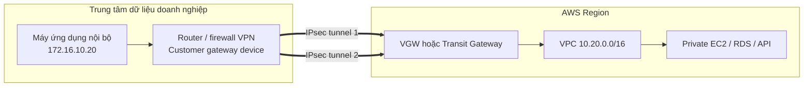
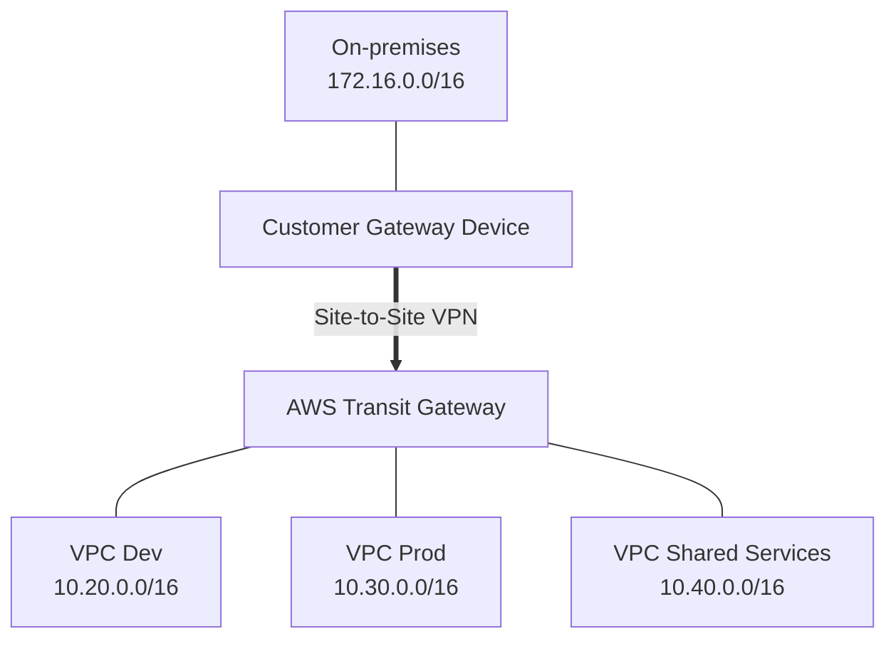
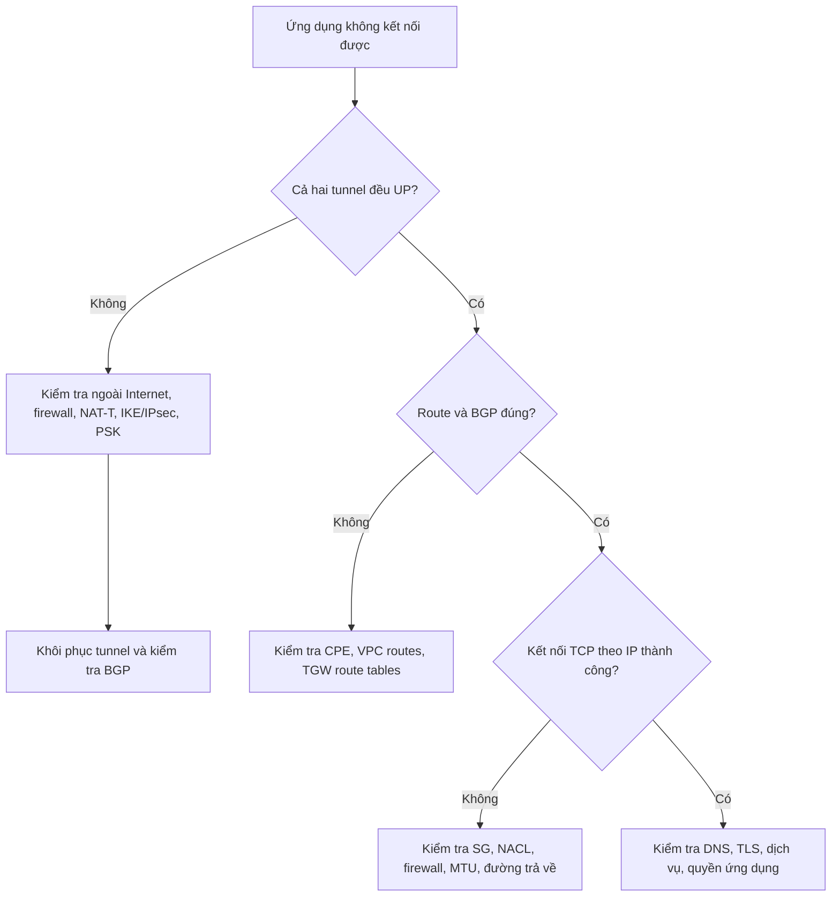

# Site-to-Site VPN và kết nối mạng doanh nghiệp

## 1. Bối cảnh và mục tiêu bài học

Một doanh nghiệp có hệ thống quản lý kho tại trung tâm dữ liệu riêng (on-premises) và đang chuyển dần ứng dụng web lên AWS. Ứng dụng chạy trên EC2, ECS hoặc Lambda trong Amazon VPC cần truy cập cơ sở dữ liệu nội bộ; nhân viên tại văn phòng cần gọi một API chỉ có địa chỉ IP riêng trong VPC. Doanh nghiệp chưa muốn công khai các dịch vụ này ra Internet và cần một kết nối có mã hóa giữa mạng công ty với mạng AWS.

**AWS Site-to-Site VPN** là một giải pháp cho nhu cầu đó: thiết lập các đường hầm IPsec giữa thiết bị VPN ở phía doanh nghiệp và đầu cuối VPN do AWS quản lý, cho phép định tuyến lưu lượng giữa hai mạng theo cấu hình. Đây là một thành phần quan trọng của **kết nối mạng lai (hybrid networking)**, nơi các workload trên AWS cùng tồn tại với hệ thống tại văn phòng hoặc trung tâm dữ liệu.

Bài học thuộc chương **Kết nối mạng nâng cao** của lộ trình **CLOUD_PROVIDERS_AWS**. Khi học về Region/AZ, IAM, VPC, compute, storage, database, tích hợp và serverless, bạn cần biết cách lựa chọn kết nối, đưa gói tin đi đúng đường, bảo vệ dữ liệu, giám sát đường truyền, thiết kế khả năng phục hồi và dự toán chi phí.

Sau bài học, bạn có thể:

- Giải thích kiến trúc AWS Site-to-Site VPN, hai tunnel IPsec và vai trò của customer gateway, virtual private gateway hoặc transit gateway.
- Phân biệt định tuyến **BGP động** và **static route**, cũng như điều kiện để mạng hai phía thực sự liên lạc.
- Chọn giữa VPN, AWS Direct Connect và các mô hình hybrid connectivity phổ biến theo yêu cầu thực tế.
- Trình bày quy trình tạo VPN, cấu hình thiết bị doanh nghiệp, route table và quyền truy cập trong VPC.
- Thiết kế dự phòng, giám sát, xử lý lỗi tunnel và kiểm soát an toàn/chi phí.

## 2. Site-to-Site VPN là gì và hoạt động ở đâu?

**Site-to-Site VPN** nối **hai mạng** với nhau; một đầu là mạng công ty, một đầu là các mạng riêng trong AWS. Lưu lượng giữa hai bên được đóng gói và bảo vệ bởi **IPsec** trên các đường hầm (VPN tunnels). Đường truyền thường đi qua Internet công cộng, nhưng payload IP bên trong được mã hóa; để kết nối an toàn, hai bên còn phải xác minh danh tính và thỏa thuận bộ thuật toán thông qua **IKE (Internet Key Exchange)**.

Giải pháp này khác với VPN cho một người dùng làm việc từ xa. Ví dụ, laptop của nhân viên đăng nhập vào **AWS Client VPN** là mô hình *client-to-site*, còn router/firewall của văn phòng nối cả mạng `172.16.0.0/16` tới một hoặc nhiều VPC là mô hình *site-to-site*.



Trong hình, `172.16.10.20` thuộc mạng doanh nghiệp, còn `10.20.0.0/16` là mạng VPC minh họa. Hai đường hầm VPN là hai đường hầm IPsec riêng biệt do AWS cung cấp cho **mỗi VPN connection** để tăng khả năng sẵn sàng. Chúng không đương nhiên thay thế được một router công ty bị hỏng hoặc một nhà mạng Internet bị mất kết nối.

### 2.1. Những thành phần cần phân biệt

| Thành phần | Vị trí và vai trò | Điều cần nhớ |
| --- | --- | --- |
| **Customer gateway device (CGW device)** | Router/firewall hoặc thiết bị VPN của doanh nghiệp | Phải cấu hình IPsec/IKE, route và bảo vệ lưu lượng theo thông số VPN do AWS cung cấp |
| **Customer gateway resource (CGW)** | Đối tượng cấu hình trong AWS đại diện đầu phía khách hàng | Khai báo địa chỉ IP bên ngoài hoặc phương thức chứng thực được hỗ trợ, cùng thông tin như ASN khi dùng BGP; **không phải** thiết bị phần cứng |
| **VPN connection** | Đối tượng AWS kết nối CGW tới cổng phía AWS | Thông thường gồm **hai IPsec tunnels** với thông số riêng |
| **Virtual private gateway (VGW)** | VPN gateway phía AWS gắn với **một VPC** | Phù hợp kiến trúc kết nối trực tiếp vào một VPC |
| **Transit Gateway (TGW)** | Trung tâm định tuyến kết nối nhiều VPC, VPN và các attachment khác | Phù hợp mạng doanh nghiệp nhiều tài khoản/VPC; cần cấu hình TGW route tables và VPC routes |
| **BGP** | Giao thức định tuyến động giữa thiết bị doanh nghiệp và AWS | Quảng bá route, hỗ trợ phát hiện và chuyển đường khi cấu hình đúng |
| **VPC route table** | Quyết định next hop cho subnet của VPC | Gói từ EC2 tới mạng on-prem phải có route hướng về VGW/TGW |
| **Security group / NACL** | Kiểm soát lưu lượng ra/vào tài nguyên hoặc subnet | VPN kết nối thành công không có nghĩa cổng ứng dụng được phép truy cập |

**CGW resource và CGW device là hai khái niệm khác nhau**: bạn tạo resource tại AWS để khai báo phía doanh nghiệp, nhưng vẫn phải cấu hình router/firewall thực tế ở phía doanh nghiệp. AWS không tự thay đổi cấu hình thiết bị của bạn.

### 2.2. Mỗi kết nối có hai IPsec tunnels

AWS cung cấp hai tunnel cho một Site-to-Site VPN connection, mỗi tunnel có địa chỉ đầu cuối phía AWS và tham số IKE/IPsec riêng. Khi tải cấu hình của hãng thiết bị từ AWS, bạn thường nhận thông tin để cấu hình **cả hai**, chẳng hạn địa chỉ tunnel, thông tin xác thực, tham số mã hóa và BGP (nếu dùng định tuyến động).

Hai tunnel nên được thiết lập và kiểm tra ngay từ đầu. Nếu chỉ cấu hình một tunnel, hệ thống có thể gián đoạn khi AWS bảo trì hoặc thay đổi đầu cuối tunnel đó. Việc lưu lượng đi qua tunnel nào phụ thuộc cấu hình, tuyến đường và hành vi của thiết bị/AWS; không nên giả định tunnel 1 luôn là đường chính vĩnh viễn.

> **Đường hầm đang UP không đồng nghĩa ứng dụng đã hoạt động.** IPsec có thể được thiết lập trong khi VPC chưa có route trả về, security group chặn TCP hoặc DNS phân giải sai địa chỉ.

## 3. Kết nối doanh nghiệp theo VGW hay Transit Gateway?

### 3.1. Site-to-Site VPN qua Virtual Private Gateway

**VGW** phù hợp khi doanh nghiệp muốn tạo một kết nối VPN tới **một VPC** và không có yêu cầu định tuyến phức tạp giữa nhiều VPC.

```text
Mạng on-premises 172.16.0.0/16
          |
     Firewall / CGW
          ||  IPsec x 2
       AWS VGW
          |
     VPC 10.20.0.0/16
          |
       Private subnet
```

Các bước quan trọng gồm tạo và gắn VGW vào đúng VPC, tạo VPN connection sử dụng CGW và VGW, rồi bảo đảm **route tables của VPC** có đường về mạng on-prem. Có thể bật route propagation ở các route table tương ứng khi sử dụng cơ chế được hỗ trợ, hoặc thêm static route theo thiết kế. Phía doanh nghiệp cũng cần có đường tới CIDR của VPC.

VGW đơn giản hơn về mặt vận hành cho một VPC, nhưng khi có hàng chục VPC ở nhiều tài khoản, việc triển khai và quản trị nhiều kết nối riêng lẻ có thể trở nên khó khăn.

### 3.2. Site-to-Site VPN qua AWS Transit Gateway

**Transit Gateway** hoạt động như một trung tâm định tuyến. Mạng công ty tạo VPN attachment vào TGW; các VPC cần sử dụng đường truyền cũng tạo VPC attachment vào TGW. Kết nối có thể được chia sẻ giữa nhiều tài khoản theo kiến trúc quản trị của tổ chức.



TGW cần **hai lớp định tuyến**:

1. **VPC subnet route table:** subnet phát sinh lưu lượng phải có route đưa CIDR on-prem về TGW; đối với các subnet nhận lưu lượng, cần bảo đảm tuyến trả về phù hợp.
2. **TGW route table:** route table được **association** với attachment đầu vào phải có route đến attachment đích. Route có thể được **propagation** từ những attachment phù hợp hoặc được khai báo tĩnh; association và propagation là hai thao tác khác nhau.

Ví dụ: gói từ `10.30.1.10` trong VPC Production tới `172.16.10.20` sẽ đi theo subnet route `172.16.0.0/16 → tgw-...`. TGW tiếp tục tìm route tới VPN attachment. Ở chiều ngược, thiết bị doanh nghiệp gửi gói tới `10.30.0.0/16` qua VPN, TGW định tuyến tới VPC Production, rồi security group/NACL mới quyết định lưu lượng ứng dụng có được nhận hay không.

**TGW không tự cho phép tất cả VPC giao tiếp với nhau.** Bạn có thể dùng nhiều TGW route tables để phân tách `Production`, `Development` và `Shared Services`, chỉ quảng bá/đặt route cần thiết và kiểm soát bổ sung bằng IAM, security group, NACL và firewall.

### 3.3. Bảng chọn kiến trúc

| Tiêu chí | VPN + VGW | VPN + TGW |
| --- | --- | --- |
| Quy mô thường gặp | Một VPC hoặc số lượng nhỏ | Nhiều VPC/account/OU, mạng hub-and-spoke |
| Vị trí gắn VPN | VGW gắn với VPC | VPN attachment gắn với TGW |
| Định tuyến chính | VPC route table + gateway routing | VPC route tables + TGW route tables, association/propagation |
| Phân đoạn nhiều nhóm mạng | Hạn chế hơn | Linh hoạt hơn với nhiều TGW route tables |
| Vận hành và chi phí | Ít thành phần hơn | Thêm chi phí attachment/data processing và quản trị routing |
| Trường hợp ưu tiên | Proof of concept, ứng dụng một VPC | Hybrid networking ở quy mô doanh nghiệp |

## 4. IPsec, IKE và yêu cầu của thiết bị doanh nghiệp

### 4.1. Các lớp hoạt động

**IKE** thương lượng thông số xác thực và tạo khóa cho đường hầm; **IPsec** bảo vệ lưu lượng IP theo các tham số đã thống nhất. AWS hỗ trợ những tập thuật toán và phiên bản IKE xác định trong tunnel options. Tùy thiết bị và chính sách an ninh, nên ưu tiên IKEv2 và bộ mã hóa/xác thực mạnh được cả hai phía hỗ trợ.

Các khái niệm dễ gặp trong tập cấu hình tải xuống:

| Thuật ngữ | Chức năng | Khi sai thường gây gì? |
| --- | --- | --- |
| **IKE version** | Phiên bản thương lượng bảo mật | Hai đầu không đàm phán được phiên |
| **Pre-shared key (PSK)** hoặc chứng chỉ được hỗ trợ | Xác thực phía tunnel | Không xác thực được peer |
| **Encryption / integrity algorithms** | Bảo mật và kiểm tra tính toàn vẹn | IKE/IPsec không tìm được proposal chung |
| **Diffie-Hellman (DH) group / PFS** | Trao đổi khóa và bảo vệ phiên | Không thống nhất được thông số bảo mật |
| **Inside tunnel IP** | Địa chỉ dùng cho phần bên trong tunnel, ví dụ thiết lập BGP peering | BGP không hình thành dù phía ngoài tunnel có kết nối |
| **Outside IP** | Địa chỉ endpoint mà tunnel đi tới qua mạng ngoài | Không thiết lập được nếu bị chặn định tuyến/firewall |
| **DPD (Dead Peer Detection)** | Phát hiện peer không phản hồi | Chuyển đường chậm hoặc tunnel “treo” khi xảy ra lỗi |

Tài liệu thiết bị tải từ AWS là điểm xuất phát tốt, nhưng người vận hành cần đối chiếu với **firmware, tính năng, cipher suite và cấu hình NAT** của thiết bị thực tế. Không sử dụng mặc định một thuật toán cũ chỉ vì bản cấu hình mẫu có chứa nó. Các tùy chọn tunnel có thể được thay đổi theo khả năng hỗ trợ, nhưng việc thay đổi có thể gây gián đoạn khi thiết lập lại tunnel.

### 4.2. Giao thức và firewall trên đường Internet

Thiết bị doanh nghiệp phải kết nối được tới hai địa chỉ endpoint phía AWS. Các lưu lượng thường liên quan gồm **UDP 500** (IKE), **UDP 4500** khi dùng NAT Traversal (NAT-T), và **IPsec ESP (IP protocol 50)** trong trường hợp không đóng gói qua NAT-T. Các port/protocol cần mở chính xác phụ thuộc đường mạng và cấu hình tunnel.

**NAT có thể ảnh hưởng cách tunnel được thiết lập.** Khi firewall doanh nghiệp đứng sau một thiết bị NAT, cần kiểm tra khả năng NAT-T, đường đi của UDP 4500, địa chỉ ngoài công bố trong CGW resource và các giới hạn mà AWS áp dụng cho cấu hình tương ứng. Một đường truyền có thể truy cập Internet bình thường nhưng vẫn chặn IKE/IPsec.

### 4.3. CIDR và chồng lấn dải IP

Trước khi tạo VPN, phải lập sơ đồ IP ở cả hai đầu. Ví dụ:

| Khu vực | CIDR | Vai trò |
| --- | --- | --- |
| On-premises | `172.16.0.0/16` | Máy ứng dụng và hệ thống cũ |
| VPC Production | `10.20.0.0/16` | Dịch vụ sản xuất trên AWS |
| VPC Development | `10.30.0.0/16` | Dịch vụ thử nghiệm |

Ba dải này **không chồng lấn**. Nếu công ty và VPC cùng dùng `10.0.0.0/16`, route table không thể đơn giản quyết định đích nào là tài nguyên địa phương và đích nào nằm bên kia VPN. Cần đổi kế hoạch cấp phát IP, tái đánh số hoặc thiết kế NAT/chuyển đổi địa chỉ được kiểm soát. Chồng lấn CIDR là vấn đề kiến trúc, không được giải quyết chỉ bằng cách tăng quyền security group.

## 5. Định tuyến động bằng BGP và định tuyến tĩnh

AWS Site-to-Site VPN có thể dùng **dynamic routing với BGP** hoặc **static routing** theo khả năng của customer gateway và loại kết nối.

### 5.1. BGP (Border Gateway Protocol)

Với BGP, thiết bị doanh nghiệp và đầu phía AWS thiết lập phiên định tuyến qua các địa chỉ **inside tunnel**, rồi trao đổi CIDR mà mỗi bên cho phép quảng bá. Thiết bị doanh nghiệp cần ASN phù hợp; cổng phía AWS cũng dùng ASN trong phạm vi cấu hình của gateway. Các network prefix được quảng bá cần được lọc có chủ đích, không quảng bá toàn bộ bảng định tuyến của doanh nghiệp một cách vô tình.

Lợi ích của BGP:

- Thay đổi mạng được quảng bá linh hoạt hơn khi kiến trúc có nhiều subnet hoặc site.
- Khi một đường BGP mất, route có thể được rút và traffic chuyển qua route còn hiệu lực theo hành vi của gateway, thiết bị và cấu hình.
- Phù hợp với triển khai nhiều tunnel, nhiều kết nối và mô hình mạng doanh nghiệp tăng trưởng.

**BGP tự động trao đổi route, nhưng không tự tạo mọi route cần thiết trong AWS.** VPC route table có thể vẫn cần cấu hình/propagation riêng; với TGW, còn cần route table association và propagation của attachment.

### 5.2. Static routes

Với **static routing**, doanh nghiệp khai báo trước các dải mạng được phép đi qua VPN và duy trì tuyến tương ứng ở AWS và thiết bị CPE. Cách này dễ hiểu trong mạng nhỏ, nhưng khi CIDR thay đổi, người vận hành phải cập nhật thủ công; việc phát hiện hoặc chuyển đường còn tùy cơ chế tunnel và thiết bị.

| Tình huống | BGP dynamic routing | Static routing |
| --- | --- | --- |
| Nhiều mạng, thường thay đổi | Thường phù hợp hơn | Dễ phát sinh cập nhật thủ công |
| Thiết bị doanh nghiệp không hỗ trợ BGP | Không dùng được trên thiết bị đó | Có thể phù hợp |
| Chuyển đường khi tunnel hỏng | Có cơ chế rút và chọn lại route theo BGP | Cần kiểm tra cơ chế failover thực tế |
| Kiểm soát dải được quảng bá | Filter, prefix policy, ASN, BGP policy | Khai báo rõ từng route |
| Công vận hành | Cần hiểu và giám sát BGP | Đơn giản ban đầu, kém linh hoạt khi mở rộng |

**Chọn BGP khi hạ tầng hỗ trợ và yêu cầu sẵn sàng/đa kết nối cao** thường là điểm xuất phát tốt. Trước khi chuyển sang production, phải kiểm tra routing hai chiều và hành vi khi một tunnel bị ngắt, thay vì chỉ xem màn hình AWS hiển thị `UP`.

## 6. Luồng gói tin giữa on-premises và VPC

Giả sử `on-prem 172.16.10.20` muốn gọi API HTTPS tại `10.20.2.15` trong một private subnet của VPC Production.

```text
172.16.10.20:ephemeral -> 10.20.2.15:443
        |
        v
On-prem router: route 10.20.0.0/16 qua VPN
        |
        v
IPsec tunnel (tunnel còn hoạt động)
        |
        v
VGW hoặc TGW: chọn VPC attachment / route tương ứng
        |
        v
VPC private subnet và EC2/API: security group cho phép HTTPS
        |
        v
Gói phản hồi: VPC route 172.16.0.0/16 -> VGW/TGW -> VPN -> on-prem
```

Một yêu cầu HTTPS chỉ thành công khi **cả hai chiều** có đường đi hợp lệ:

1. CPE ở on-prem biết đường tới `10.20.0.0/16`, qua tunnel phù hợp.
2. Gateway phía AWS biết đường đến VPC Production; với TGW phải có route/attachment đúng.
3. VPC subnet route table có đường trả về `172.16.0.0/16` qua VGW/TGW; các subnet cần đi on-prem đều phải có route phù hợp.
4. Security group của đích cho phép TCP 443 từ nguồn được phê duyệt. **NACL là stateless**, nên khi dùng NACL giới hạn chặt cần cho phép cả lưu lượng đi và lưu lượng trả về, kể cả các cổng tạm thời cần thiết.
5. Firewall phía công ty cũng cho phép giao tiếp và phản hồi; DNS phân giải đích sang IP phù hợp.

Không nên dùng kết quả `ping` làm phép thử duy nhất: ICMP có thể bị chặn hợp lệ. Kiểm tra bằng cổng ứng dụng thật, chẳng hạn HTTPS/443, truy vấn TCP tới database hoặc công cụ kiểm tra kết nối thích hợp. Hãy ghi nhận **nguồn, đích, protocol, port và thời gian thử** để đối chiếu log.

### 6.1. DNS trong mô hình hybrid

VPN chỉ cung cấp đường đi mạng IP; **nó không tự đồng bộ DNS** giữa công ty và VPC. Nếu người dùng nội bộ cần truy cập `api.internal.example` và tên chỉ được định nghĩa trong **Route 53 private hosted zone**, có thể dùng **Route 53 Resolver inbound endpoint** để DNS phía on-prem chuyển truy vấn thích hợp vào VPC. Ở chiều ngược, workload trong VPC cần phân giải tên thuộc domain nội bộ công ty có thể sử dụng **Resolver outbound endpoint và forwarding rule**.

Phải tính thêm security group của Resolver endpoints, UDP/TCP 53, route hai chiều, resolver dự phòng, chi phí endpoint và tránh vòng lặp forwarding DNS. Khi đường IP hoạt động mà ứng dụng chỉ lỗi theo hostname, hãy kiểm tra DNS trước khi sửa IPsec.

## 7. Quy trình thiết kế và tạo Site-to-Site VPN

### Bước 1 — Thu thập yêu cầu và đánh giá hạ tầng

Trước khi tạo tài nguyên AWS, nhóm mạng và nhóm ứng dụng nên thống nhất:

- CIDR của tất cả mạng on-prem, các VPC và subnet cần liên lạc; xác định chồng lấn địa chỉ.
- Thiết bị CPE và firmware có hỗ trợ IPsec/IKE, BGP, NAT-T, hai tunnel và bộ mã hóa dự kiến hay không.
- Địa chỉ IP phía ngoài, khả năng truy cập UDP 500/4500 hoặc ESP, hệ thống firewall/NAT của nhà mạng.
- Lượng traffic, độ trễ, nhu cầu băng thông, yêu cầu RTO và đường dự phòng độc lập.
- Các account, OU, Region, VPC cần kết nối; mô hình VGW hay TGW phù hợp với phạm vi đó.
- Chính sách bảo mật, log, quyền IAM quản trị VPN, lịch bảo trì, ngân sách và người chịu trách nhiệm hai đầu.

Giả định cho ví dụ tiếp theo: mạng công ty `172.16.0.0/16`, VPC `10.20.0.0/16`, địa chỉ public IPv4 bên ngoài thiết bị CPE `198.51.100.10` (đây là địa chỉ tài liệu minh họa), ASN doanh nghiệp `65010`. Các ID AWS trong ví dụ đều là **placeholder**, không phải tài nguyên sẵn có.

### Bước 2 — Tạo Customer Gateway resource

Trong **Amazon VPC Console → Customer gateways**, tạo đối tượng đại diện thiết bị doanh nghiệp và cung cấp tham số phù hợp. Với mô hình BGP dùng địa chỉ IP công khai, cú pháp AWS CLI minh họa:

```bash
aws ec2 create-customer-gateway \
  --type ipsec.1 \
  --public-ip 198.51.100.10 \
  --bgp-asn 65010 \
  --region ap-southeast-1
```

Phản hồi chứa `CustomerGatewayId`, ví dụ `cgw-0123456789abcdef0` (placeholder). Đảm bảo đã chọn đúng Region và account. Trong triển khai thật, IP ngoài/loại xác thực và các giới hạn kết nối phải phù hợp với phương án thiết bị/NAT; không dùng địa chỉ tài liệu ở trên.

### Bước 3 — Chọn AWS-side gateway và tạo VPN connection

**Nếu dùng VGW:** tạo virtual private gateway, gắn với VPC đích, rồi tạo VPN connection trỏ tới VGW và CGW.

```bash
# Ví dụ tạo một VGW, sau đó dùng ID nhận được để gắn với VPC
aws ec2 create-vpn-gateway \
  --type ipsec.1 \
  --amazon-side-asn 64512 \
  --region ap-southeast-1

# Thay vgw-... và vpc-... bằng ID thực tế
aws ec2 attach-vpn-gateway \
  --vpn-gateway-id vgw-0123456789abcdef0 \
  --vpc-id vpc-0123456789abcdef0 \
  --region ap-southeast-1

# Tạo VPN connection sử dụng BGP (không bật StaticRoutesOnly)
aws ec2 create-vpn-connection \
  --type ipsec.1 \
  --customer-gateway-id cgw-0123456789abcdef0 \
  --vpn-gateway-id vgw-0123456789abcdef0 \
  --options StaticRoutesOnly=false \
  --region ap-southeast-1
```

**Nếu dùng TGW:** tạo hoặc chọn Transit Gateway đã có và tạo VPN connection trỏ tới TGW; đồng thời tạo VPC attachments cần thiết và cấu hình association/propagation trên TGW route tables.

```bash
aws ec2 create-vpn-connection \
  --type ipsec.1 \
  --customer-gateway-id cgw-0123456789abcdef0 \
  --transit-gateway-id tgw-0123456789abcdef0 \
  --options StaticRoutesOnly=false \
  --region ap-southeast-1
```

Các lệnh trên **chỉ minh họa thành phần cơ bản**, chưa phải script triển khai hoàn chỉnh. Các gateway/VPC/TGW/attachment phải tồn tại ở đúng account/Region và ở trạng thái phù hợp. Cần xác nhận quyền IAM thực thi, tham số tunnel, định tuyến, phần bảo mật và quota trước khi sử dụng trong môi trường thật.

### Bước 4 — Lấy cấu hình tunnel và cấu hình CPE

Trong VPN connection, chọn **Download configuration** và chọn hãng, model, phiên bản phần mềm tương ứng của customer gateway device. Nếu không có mẫu phù hợp, tham khảo yêu cầu chung và hướng dẫn của nhà cung cấp thiết bị. Cần cấu hình **cả hai tunnels**, gồm peer outside IP, IKE/IPsec, xác thực, BGP neighbor hoặc static route và cơ chế failover.

**Tệp cấu hình có thể chứa PSK và thông tin nhạy cảm.** Không commit tệp vào Git, không gửi qua kênh chat công khai và không in nguyên nội dung qua terminal/log CI. Lưu trữ và xoay vòng PSK theo quy định quản lý bí mật của doanh nghiệp; kiểm soát quyền xem cấu hình VPN.

### Bước 5 — Cấu hình route hai chiều

Với VGW, kiểm tra route tables của các subnet cần truy cập và thêm/bật propagation route tới on-prem. Với TGW, kiểm tra cả **VPC route tables** lẫn **TGW route tables**. Ở phía công ty, cấu hình đường tới CIDR VPC thông qua tunnel và lọc BGP prefix cho phù hợp.

Ví dụ route hợp lý cho mô hình đơn giản:

| Vị trí route table | Destination | Target / next hop |
| --- | --- | --- |
| On-prem CPE | `10.20.0.0/16` | VPN tunnel hoặc BGP next hop phù hợp |
| VPC private subnet | `172.16.0.0/16` | `vgw-...` hoặc `tgw-...` |
| TGW route table (nếu dùng TGW) | `172.16.0.0/16` | VPN attachment |
| TGW route table (nếu dùng TGW) | `10.20.0.0/16` | VPC attachment Production |

Nếu các CIDR được học động qua BGP/propagation, không cần ép thêm static route trùng lặp một cách tùy tiện. Khi có nhiều route tới một đích, phải kiểm tra **độ ưu tiên tuyến đường** và route được chọn thực tế.

### Bước 6 — Mở quyền ứng dụng và thử nghiệm

Đảm bảo security group, NACL và firewall chỉ cho phép lưu lượng cần thiết: chẳng hạn `172.16.10.0/24 → 10.20.2.15:443`, thay vì mở tất cả port cho cả mạng doanh nghiệp. Dùng kết nối kiểm tra từ nguồn thực tế, đo độ trễ/throughput phù hợp, thử chuyển tunnel và ghi nhận hành vi khi mất kết nối.

Cuối cùng, đưa cảnh báo tunnel và tài liệu vận hành vào hệ thống giám sát trước khi cho ứng dụng production phụ thuộc vào đường truyền này.

## 8. Thiết kế độ sẵn sàng và phục hồi

Hai tunnel của một Site-to-Site VPN connection giúp giảm nguy cơ mất kết nối vì sự cố hoặc bảo trì ở **một tunnel**, nhưng không loại bỏ mọi điểm lỗi chung. Nếu cả hai tunnel đều đi qua **một firewall**, **một đường Internet**, **một nguồn điện** hoặc **một thiết bị CPE**, các thành phần đó vẫn có thể làm toàn bộ kết nối gián đoạn.

### 8.1. Phương án dự phòng theo mức độ quan trọng

| Mức thiết kế | Cấu hình | Rủi ro còn lại |
| --- | --- | --- |
| Cơ bản | Một VPN connection, cấu hình đủ hai IPsec tunnels | Cùng một CPE/ISP có thể là điểm lỗi chung |
| Tốt hơn | Hai thiết bị CPE hoặc hai đường WAN với các VPN connection phù hợp | Cần kiểm tra định tuyến, BGP policy, thời gian hội tụ tuyến và vận hành cả hai đường |
| Kết nối doanh nghiệp quan trọng | Direct Connect làm đường chính, Site-to-Site VPN là đường dự phòng, hoặc kiến trúc redundant DX/VPN tùy RTO | Chi phí cao hơn; phải thiết kế route preference và test failover định kỳ |
| Nhiều VPC | TGW và các VPN/DX attachments, TGW route tables được thiết kế HA | Sai association/propagation có thể tạo lỗi diện rộng |

**ECMP (Equal-Cost Multi-Path)** có thể hữu ích ở kiến trúc TGW với VPN attachments và routing đủ điều kiện, giúp phân phối luồng qua nhiều đường phù hợp. Không nên giả định VGW sẽ cung cấp đúng hành vi ECMP đó. Khả năng tổng hợp băng thông, lựa chọn tuyến, một chiều hay hai chiều và giới hạn mỗi tunnel cần đối chiếu dịch vụ cùng thiết bị thực tế.

### 8.2. Băng thông, độ trễ và MTU

- VPN qua Internet thường chịu biến động độ trễ, packet loss hoặc jitter từ nhà mạng; vì vậy không nên kỳ vọng SLA giống đường thuê riêng.
- Mã hóa và encapsulation IPsec tạo overhead, làm **MTU/MSS hiệu dụng** nhỏ hơn đường IP không có tunnel. Khi ứng dụng truyền gói lớn bị treo hoặc mất gói, kiểm tra Path MTU Discovery, ICMP cần thiết, MSS clamping và fragmentation ở CPE.
- Băng thông hữu dụng phụ thuộc giới hạn tunnel/connection hiện hành, hiệu năng mã hóa của firewall, một luồng hay nhiều luồng, TCP window, độ trễ và tuyến Internet. Không lấy tốc độ WAN ghi trên hợp đồng làm tốc độ ứng dụng chắc chắn đạt được.
- Nếu workload cần thông lượng ổn định hoặc truyền dữ liệu khối lượng lớn, hãy đánh giá **Direct Connect** hoặc thiết kế truyền dữ liệu khác. Đối với một số cấu hình TGW, các tùy chọn như **Accelerated Site-to-Site VPN** có thể cải thiện đường mạng khi đáp ứng điều kiện dịch vụ; cần kiểm tra khả năng hỗ trợ và chi phí cụ thể.

### 8.3. Kịch bản thử nghiệm failover tối thiểu

1. Xác minh **hai tunnel** đều ở trạng thái mong đợi, BGP neighbor/route hoạt động và ứng dụng giao tiếp được.
2. Tại thời điểm bảo trì có kiểm soát, lần lượt làm gián đoạn **một tunnel** theo quy trình được phê duyệt. Đo thời gian chuyển đường, số request lỗi và thời gian khôi phục.
3. Kiểm thử mất một **WAN link** hoặc CPE nếu kiến trúc được thiết kế với đường dự phòng độc lập; xác nhận route không trôi sang một kết nối kém bảo mật.
4. Khôi phục đường ban đầu; kiểm tra tunnel, BGP, route preference và khả năng hoạt động của ứng dụng sau khi chuyển lại.
5. So sánh thời gian gián đoạn với **RTO/SLO** của workload, cập nhật runbook và cảnh báo nếu không đạt yêu cầu.

## 9. Giám sát VPN và xử lý sự cố

### 9.1. Các nguồn quan sát

| Công cụ | Quan sát điều gì? | Giá trị vận hành |
| --- | --- | --- |
| **Amazon CloudWatch VPN metrics** | Ví dụ `TunnelState`, `TunnelDataIn`, `TunnelDataOut` khi có hỗ trợ | Theo dõi tunnel UP/DOWN và lưu lượng vào/ra |
| **Site-to-Site VPN tunnel logs** | Thông tin kết nối IKE, thương lượng và trạng thái tunnel khi bật log | Hỗ trợ tìm lỗi proposal, xác thực và thiết lập phiên |
| **VPC Flow Logs** | Metadata luồng IP qua các giao diện được theo dõi | Hỗ trợ nhận biết traffic bị reject/đi tới đâu trong VPC, trong giới hạn khả năng quan sát |
| **CloudTrail** | Thao tác quản trị API như tạo/sửa/xóa VPN, route, gateway | Kiểm toán thay đổi cấu hình và người thực hiện |
| **CPE logs / BGP status** | IKE, IPsec SA, DPD, BGP neighbors và route thực tế | Phân biệt lỗi ngoài AWS với lỗi route/ứng dụng |
| **Application telemetry** | Response time, timeout, lỗi TCP/TLS, retry | Chứng minh mức tác động tới người dùng và SLO |

Ví dụ AWS CLI để kiểm tra tổng quan VPN connection:

```bash
aws ec2 describe-vpn-connections \
  --vpn-connection-ids vpn-0123456789abcdef0 \
  --query 'VpnConnections[0].VgwTelemetry[*].[OutsideIpAddress,Status,StatusMessage]' \
  --region ap-southeast-1
```

`vpn-0123456789abcdef0` là placeholder. Telemetry cho biết góc nhìn của AWS về tunnel; kết hợp với trạng thái IPsec/BGP trên CPE và luồng ứng dụng để xác định lỗi thật. Cấu hình cảnh báo ở CloudWatch với ngưỡng và thời gian phù hợp để tránh báo động giả khi có thay đổi ngắn hạn.

### 9.2. Sơ đồ chẩn đoán theo tầng



### 9.3. Triệu chứng và nguyên nhân thường gặp

| Triệu chứng | Nghi vấn nên kiểm tra đầu tiên | Cách xác minh |
| --- | --- | --- |
| **Cả hai tunnel DOWN** | IP public/NAT sai, ISP chặn, UDP 500/4500/ESP, sai IKE proposal/PSK | CPE IKE logs, reachability endpoint, tunnel logs |
| **IPsec UP nhưng BGP DOWN** | Sai ASN, inside tunnel IP, BGP neighbor/peer, route filter | CPE BGP neighbors, thông tin tunnel AWS |
| **BGP UP nhưng EC2 không gọi được on-prem** | Thiếu route VPC/TGW hoặc route phía công ty, SG/NACL/firewall chặn | VPC route tables, TGW propagation, Flow Logs, CPE routes |
| **Đường một chiều hoạt động** | Return path, asymmetric routing, NAT hoặc stateful firewall không theo dõi được phiên | Theo dõi cả hai chiều ở CPE và route AWS |
| **IP kết nối được, hostname không truy cập được** | DNS resolver, split-horizon DNS hoặc forwarding rule | `nslookup`/`dig`, Resolver logs và endpoint |
| **Gói nhỏ được, gói lớn treo** | MTU/MSS, PMTUD hoặc fragmentation | Packet capture có kiểm soát, MSS/MTU và ICMP |
| **Một tunnel mất gây gián đoạn dài** | Chưa cấu hình tunnel thứ hai, BGP failover/route preference/DPD không đúng | Test chuyển đường và thời gian hội tụ route |

Một hướng xử lý tốt là **xác định tầng bị lỗi trước khi thay đổi cấu hình**. Không nên tắt NACL, mở toàn bộ security group hay nới rộng route/scope BGP chỉ để thử nhanh trên production; các hành động đó có thể mở đường truy cập ngoài dự kiến.

## 10. Bảo mật và phân đoạn mạng

### 10.1. Mã hóa đường truyền chưa đủ để kiểm soát truy cập

IPsec bảo vệ lưu lượng trên tunnel, nhưng **không định nghĩa ai được phép gọi API ứng dụng**. Thiết kế bảo mật đầy đủ gồm:

- **Mạng:** chỉ quảng bá CIDR thật sự cần thiết; tách route tables giữa Production, Development và Shared Services; dùng network firewall nếu cần kiểm soát lưu lượng nâng cao.
- **Tài nguyên:** security group chỉ cho đúng nguồn/port, NACL cho subnet theo yêu cầu, không mở rộng phạm vi bằng `0.0.0.0/0` thiếu kiểm soát.
- **Danh tính:** người dùng/ứng dụng vẫn cần IAM hoặc cơ chế xác thực của chính dịch vụ; VPN không thay thế việc phân quyền S3, RDS, API Gateway hoặc ứng dụng web.
- **Vận hành:** PSK/chứng chỉ, quản trị thiết bị CPE, cập nhật firmware, quyền sửa VPN/TGW/VPC routes, log và giám sát thay đổi.

Ví dụ, việc một nhân viên có thể gửi TCP packet qua VPN tới RDS không có nghĩa họ đã có username/password DB hay quyền IAM Database Authentication. Hai lớp network access và application authorization phải được kiểm soát riêng.

### 10.2. Kiểm soát thay đổi và bảo vệ bí mật

Chỉ cấp quyền IAM tạo/sửa/xóa CGW, VPN, gateway attachment hoặc route cho nhóm quản trị mạng có trách nhiệm. Sử dụng thay đổi có phê duyệt với phương án hoàn tác; kiểm tra CloudTrail khi route hoặc tunnel options bị thay đổi ngoài lịch.

PSK và cấu hình tunnel cần được lưu tại nơi bảo mật, giới hạn người được đọc và xoay vòng khi có nghi ngờ rò rỉ hoặc thay đổi người vận hành. Không chèn PSK vào tài liệu hướng dẫn công khai, Terraform output không được che hoặc script log. Nếu dùng Infrastructure as Code, tránh lưu secret ở dạng dễ đọc trong version control hoặc các state files thiếu kiểm soát truy cập/mã hóa.

## 11. So sánh với các kiểu kết nối AWS khác

| Phương án | Kết nối/đặc điểm | Phù hợp khi | Lưu ý |
| --- | --- | --- | --- |
| **AWS Site-to-Site VPN** | IPsec giữa mạng doanh nghiệp và AWS, thường qua Internet | Cần hybrid connectivity nhanh, mã hóa, có thể làm dự phòng | Internet latency và throughput biến động; cần CPE phù hợp |
| **AWS Direct Connect (DX)** | Kết nối mạng riêng từ doanh nghiệp/đối tác vào AWS | Cần băng thông, độ trễ và đường truyền ổn định hơn cho hệ thống doanh nghiệp | **DX không tự mã hóa toàn bộ lưu lượng**; có thể kết hợp IPsec hoặc giải pháp mã hóa khác |
| **Direct Connect + VPN** | DX làm đường mạng, VPN cung cấp mã hóa/dự phòng theo thiết kế | Cần kiểm soát đường truyền và bảo mật hoặc failover | Phải xác định mô hình underlay, route priority và chi phí |
| **AWS Client VPN** | VPN cho thiết bị người dùng cuối | Nhân viên từ xa truy cập tài nguyên được cho phép | Quản lý danh tính người dùng, endpoint, phiên và client |
| **VPC Peering** | Kết nối riêng giữa hai VPC | Cần kết nối VPC-to-VPC đơn giản | Không phải đường nối trực tiếp on-prem; không hỗ trợ định tuyến chuyển tiếp qua peering |
| **AWS PrivateLink** | Truy cập dịch vụ cụ thể qua interface endpoint | Chia sẻ API/dịch vụ theo mô hình hạn chế bề mặt mạng | Không cung cấp định tuyến toàn mạng như VPN; cần xét DNS và endpoint |
| **AWS Transit Gateway** | Hub định tuyến nhiều VPC, VPN, DX attachment | Doanh nghiệp nhiều VPC/account hoặc cần phân đoạn mạng | Là thành phần định tuyến; bản thân TGW không phải tunnel VPN hay đường truyền vật lý |

Để chọn, hãy bắt đầu từ *topology*, yêu cầu throughput/độ trễ, khả năng triển khai CPE, chuẩn bảo mật, độ sẵn sàng, chi phí và phạm vi các account/VPC. **VPN qua Internet** thường được triển khai nhanh hơn đường kết nối riêng, nhưng không nên coi hai loại đường truyền tương đương về hiệu năng.

### 11.1. Kết hợp VPN với Direct Connect

Ở một mô hình phổ biến, doanh nghiệp dùng **Direct Connect** làm kết nối chính cho lưu lượng lớn, còn **Site-to-Site VPN** làm kết nối dự phòng nếu DX hoặc tuyến nhà mạng gặp sự cố. Có thể thiết kế một số phương án private-IP VPN qua DX/TGW trong các điều kiện được AWS hỗ trợ, nhưng đó là cấu hình chuyên biệt khác với VPN có public endpoint đi qua Internet; cần xem tài liệu dịch vụ và topology cụ thể trước khi chọn.

Đường chính/dự phòng chỉ có ý nghĩa khi **route preference** nhất quán ở cả hai đầu và đã kiểm thử. Có thể cần BGP policy, định tuyến riêng cho từng tiền tố và cơ chế phát hiện lỗi. Nếu cấu hình sai, lưu lượng có thể đi đường dự phòng dù đường chính đang hoạt động hoặc chuyển đường không hoàn tất khi xảy ra sự cố.

## 12. Chi phí và năng lực vận hành

Việc tạo VPN connection có thể phát sinh **phí theo thời gian tồn tại của kết nối** và **phí truyền dữ liệu AWS** theo bảng giá tại Region, cùng các khoản phát sinh liên quan. Sử dụng TGW còn có thể tính phí **attachment và data processing**; Route 53 Resolver endpoints, CloudWatch logs/metrics và Direct Connect (nếu dùng) có chi phí riêng.

Không nên mặc định “tunnel không có lưu lượng thì miễn phí”. Một VPN connection không còn được dùng nhưng chưa xóa vẫn có thể tiếp tục phát sinh khoản phí tương ứng. Khi thiết kế nhiều site hoặc nhiều VPN dự phòng, tính tổng chi phí đường truyền, thiết bị CPE, vận hành, monitoring và xử lý sự cố, không chỉ chi phí dịch vụ VPN.

Các **quota** cần kiểm tra thực tế gồm số VPN connections, customer gateways, routes, TGW attachments/route tables (nếu dùng), giới hạn tunnel/throughput và các hạn mức liên quan. Giá trị quota và khả năng điều chỉnh thay đổi theo loại tài nguyên, account, Region và cập nhật dịch vụ: hãy tra **Service Quotas** và tài liệu AWS hiện hành cho môi trường thật.

Một chỉ tiêu vận hành thực tế có thể gồm:

| Chỉ tiêu | Cách theo dõi | Mục tiêu ví dụ (do doanh nghiệp tự đặt) |
| --- | --- | --- |
| Tunnel availability | CloudWatch `TunnelState`, CPE | Hai tunnel được cấu hình và giám sát |
| Tỷ lệ request lỗi khi failover | Application metrics, synthetic checks | Không vượt ngưỡng SLO đã phê duyệt |
| Độ trễ qua mạng lai | Kiểm tra ứng dụng thực tế | Dưới mức đáp ứng ứng dụng, theo từng đường mạng |
| Tuân thủ route/CIDR | Review TGW/VPC route tables và CPE BGP | Không có prefix ngoài phạm vi được duyệt |
| Chi phí VPN/TGW | AWS Cost Explorer, Budgets và tagging | Theo ngân sách mạng doanh nghiệp |

## 13. Tình huống áp dụng: doanh nghiệp bán lẻ kết nối AWS

Một công ty bán lẻ có hệ thống ERP tại trung tâm dữ liệu, trong khi API thương mại điện tử chạy trên AWS. Công ty dự kiến kết nối 3 VPC (`development`, `production`, `shared services`) tới ERP, không công khai ERP ra Internet và cần lưu log để điều tra sự cố.

**Thiết kế đề xuất:**

1. **Phân hoạch mạng:** on-prem `172.16.0.0/16`, VPC Dev `10.20.0.0/16`, Prod `10.30.0.0/16`, Shared `10.40.0.0/16`. Kiểm tra không chồng CIDR với các chi nhánh và tài khoản AWS khác.
2. **Chọn TGW:** tạo VPC attachments cần thiết và VPN attachment từ CGW; dùng TGW route tables để chỉ Prod và Shared Services giao tiếp với hệ thống ERP. Dev không tự có quyền đi tới production.
3. **IPsec/BGP:** cấu hình đủ hai tunnel, lọc chỉ những prefix được duyệt; dùng đường WAN/CPE dự phòng khi RTO yêu cầu.
4. **Phân quyền mạng:** chỉ subnet ứng dụng Production được gọi ERP trên port ứng dụng; không quảng bá toàn bộ route của doanh nghiệp vào AWS.
5. **DNS:** dùng Route 53 Resolver để ứng dụng ở VPC phân giải tên ERP nội bộ; kiểm tra truy vấn đi đúng đường và có phương án dự phòng.
6. **Giám sát:** CloudWatch tunnel metrics/logs, CPE logs, VPC Flow Logs và synthetic checks cho giao tiếp ERP. Đặt cảnh báo khi mất tunnel và khi các endpoint ứng dụng mất phản hồi.
7. **Đánh giá hiệu năng:** đo độ trễ API tới ERP và tác động khi mất một tunnel. Nếu phụ thuộc đồng bộ quá chặt hoặc lưu lượng tăng cao, cân nhắc cache, queue/bất đồng bộ, dịch chuyển dữ liệu hoặc đường kết nối chuyên dụng thay vì chỉ tăng băng thông VPN.

Mô hình này minh họa cách Site-to-Site VPN góp phần vào các mục tiêu **an toàn, giám sát, khả năng phục hồi và chi phí**. VPN là lớp nối mạng; độ sẵn sàng của hệ thống bán hàng còn phụ thuộc VPC routing, dịch vụ ứng dụng, database, chiến lược retry, queue và khả năng khôi phục dữ liệu.

## 14. Câu hỏi tự kiểm tra

**Câu 1.** Một VPN connection hiển thị cả hai tunnel `UP`, nhưng nhân viên văn phòng không gọi được API `10.20.2.15:443`. Có chắc IPsec bị lỗi?

**Gợi ý:** Không. Kiểm tra route hai chiều, TGW route tables (nếu có), VPC subnet route, security group, NACL, firewall, DNS và dịch vụ đích. Tunnel `UP` chỉ phản ánh lớp kết nối VPN.

**Câu 2.** Vì sao nên cấu hình cả hai tunnel ngay cả khi ứng dụng đang chạy tốt qua tunnel 1?

**Gợi ý:** Để có đường thay thế khi một tunnel bảo trì hoặc gặp lỗi. Tuy nhiên cả hai tunnel có thể dùng chung CPE/ISP, vì vậy vẫn cần thiết kế dự phòng các thành phần đó nếu yêu cầu HA cao.

**Câu 3.** Doanh nghiệp có 20 VPC tại nhiều tài khoản, cần một đầu nối tập trung tới mạng on-prem và muốn cô lập Dev/Prod. Nên bắt đầu đánh giá VGW hay TGW?

**Gợi ý:** TGW, vì có mô hình hub và route tables phân đoạn. Vẫn phải tính phí, quota, attachment, bảo mật và thiết kế vận hành.

**Câu 4.** BGP neighbor đã lên nhưng subnet Production không kết nối tới on-prem. Vì sao BGP chưa đủ?

**Gợi ý:** VPC subnet route và TGW route table association/propagation có thể thiếu hoặc sai; security group/firewall cũng có thể chặn lưu lượng. BGP không tự bảo đảm toàn bộ data plane.

**Câu 5.** Khi ứng dụng truyền dữ liệu lớn qua VPN thường xuyên bị treo nhưng gói nhỏ lại hoạt động, nên kiểm tra gì?

**Gợi ý:** MTU, MSS, fragmentation, Path MTU Discovery và ICMP cần thiết; kiểm tra hiệu năng CPE và tuyến Internet.

**Câu 6.** Direct Connect có thay thế nhu cầu mã hóa IPsec một cách tự động không?

**Gợi ý:** Không. Direct Connect cung cấp kết nối mạng riêng theo thiết kế dịch vụ, nhưng không mặc định mã hóa toàn bộ payload; đánh giá VPN qua DX hoặc lớp mã hóa phù hợp nếu cần bảo mật đường truyền.

## 15. Ghi nhớ

**AWS Site-to-Site VPN** kết nối mạng doanh nghiệp với AWS bằng **hai đường hầm IPsec** trên mỗi VPN connection. **Customer gateway device** phía công ty và **CGW resource** trong AWS là hai đối tượng khác nhau; phía AWS có thể dùng **VGW** cho một VPC hoặc **TGW** cho topology nhiều VPC/tài khoản. **BGP** giúp quản lý route động và failover, nhưng ứng dụng chỉ hoạt động khi VPC/TGW routing, firewall, security group, NACL và DNS đều được cấu hình đúng ở **cả hai chiều**.

Khi đưa vào production, hãy thiết kế dự phòng ngoài hai tunnel, kiểm tra MTU và băng thông, giám sát CloudWatch/CPE, kiểm soát bí mật IKE và thay đổi định tuyến. Đối với hệ thống đòi hỏi đường truyền ổn định hoặc lưu lượng lớn, cân nhắc **AWS Direct Connect** cùng phương án VPN mã hóa/dự phòng phù hợp. Kết nối mạng lai an toàn là kết quả của **định tuyến đúng + bảo mật nhiều lớp + kiểm thử phục hồi + quản trị chi phí**.

### Tài liệu AWS tham khảo

- [AWS Site-to-Site VPN — User Guide](https://docs.aws.amazon.com/vpn/latest/s2svpn/VPC_VPN.html)
- [How Site-to-Site VPN works](https://docs.aws.amazon.com/vpn/latest/s2svpn/how_it_works.html)
- [Create an AWS Site-to-Site VPN connection](https://docs.aws.amazon.com/vpn/latest/s2svpn/SetUpVPNConnections.html)
- [AWS Site-to-Site VPN tunnel options](https://docs.aws.amazon.com/vpn/latest/s2svpn/VPNTunnels.html)
- [Amazon VPC Transit Gateways — VPN attachments](https://docs.aws.amazon.com/vpc/latest/tgw/tgw-vpn-attachments.html)
- [Transit Gateway route tables](https://docs.aws.amazon.com/vpc/latest/tgw/tgw-route-tables.html)
- [Monitor your Site-to-Site VPN connection](https://docs.aws.amazon.com/vpn/latest/s2svpn/monitoring-cloudwatch-vpn.html)
- [AWS Direct Connect — User Guide](https://docs.aws.amazon.com/directconnect/latest/UserGuide/Welcome.html)
- [Amazon Route 53 Resolver](https://docs.aws.amazon.com/Route53/latest/DeveloperGuide/resolver.html)
