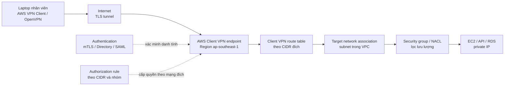
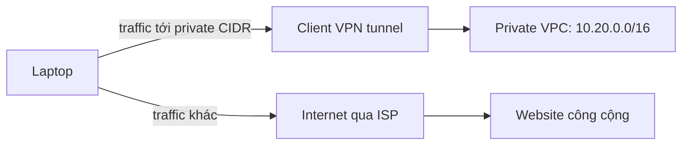
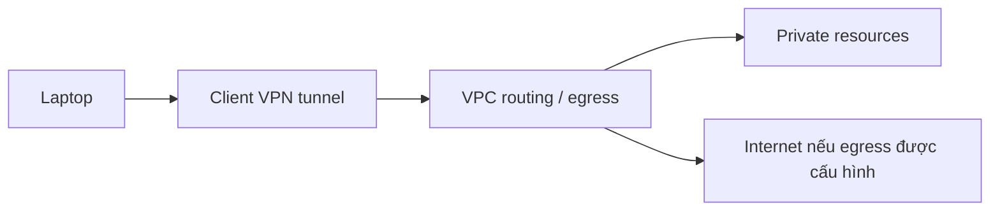
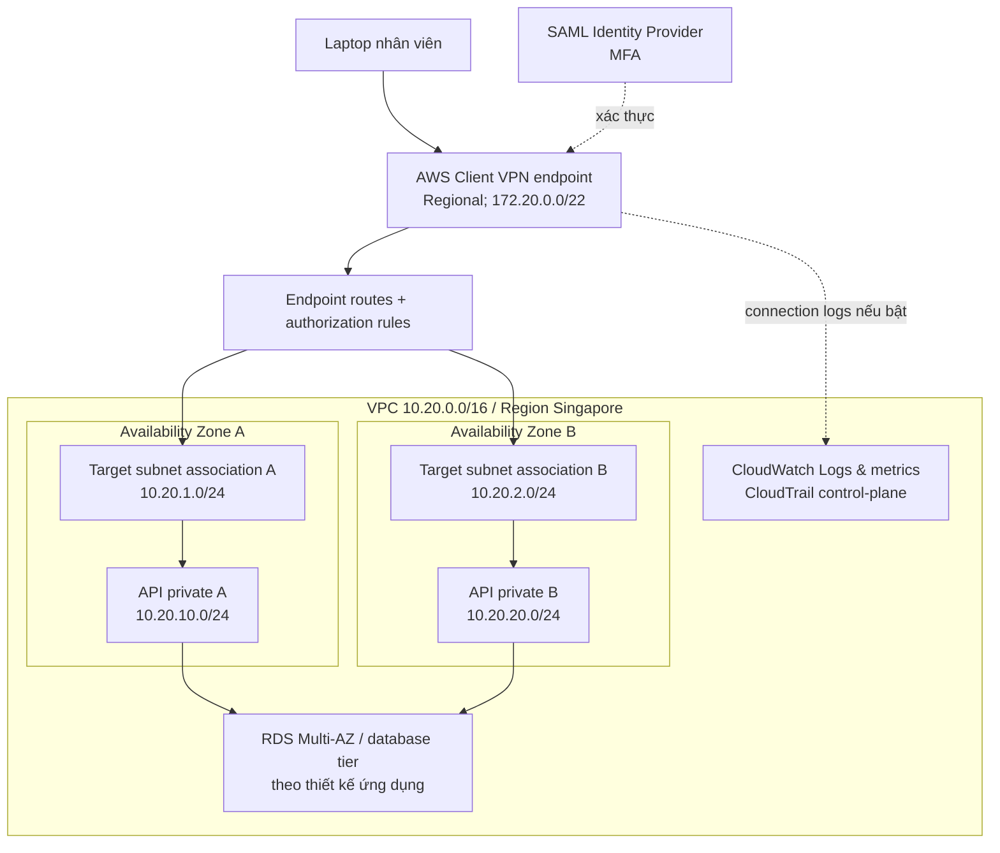
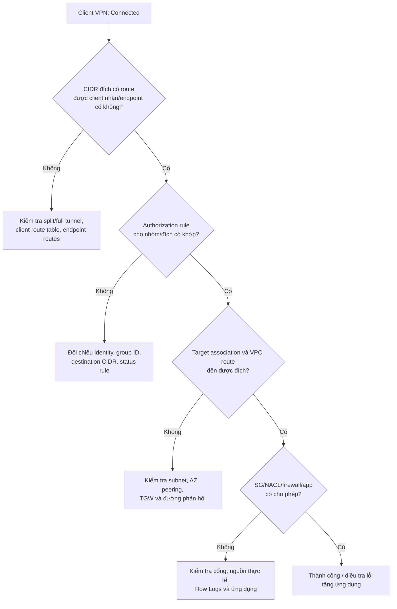

# AWS Client VPN cho truy cập từ xa

> **Chương:** Kết nối mạng nâng cao  
> **Module:** CLOUD_PROVIDERS_AWS  
> **Mục tiêu:** thiết kế và vận hành kết nối bảo mật từ máy người dùng bên ngoài đến tài nguyên riêng trong Amazon VPC; lựa chọn xác thực, ủy quyền, định tuyến, mức sẵn sàng và công cụ giám sát phù hợp.

## 1. Bài toán: truy cập hệ thống AWS khi làm việc từ xa

Giả sử nhóm kỹ thuật vận hành một ứng dụng bán hàng tại AWS Region Singapore. API, EC2, RDS và hệ thống quản trị nằm trong **private subnet** của VPC, không có địa chỉ public IPv4. Nhân viên làm việc từ nhà cần:

- Truy cập trang quản trị nội bộ và SSH/SSM đến các máy được phép.
- Kết nối có kiểm soát đến dịch vụ database phục vụ công việc.
- Giữ server/database trong mạng riêng, không mở cổng quản trị ra Internet.
- Xác thực người dùng, có thể kết hợp MFA, thu hồi quyền khi nhân viên rời nhóm.
- Phân biệt người thuộc nhóm **Developer**, **Operations**, **Database Administrator**.
- Ghi log phục vụ điều tra và tính toán chi phí khi nhiều người kết nối.

**AWS Client VPN** là một dịch vụ VPN do AWS quản lý cho mô hình **client-to-site**: máy cá nhân dùng phần mềm VPN để thiết lập đường hầm bảo mật tới **Client VPN endpoint** tại AWS. Từ đó, theo cấu hình, người dùng có thể kết nối tới tài nguyên trong VPC và mạng được VPC kết nối.

Đây là một phần của hệ sinh thái mạng AWS, phối hợp với **VPC, subnet, security group, route table, IAM, AWS Directory Service, SAML identity provider, CloudWatch và CloudTrail**. Hiểu rõ các thành phần giúp thiết kế kết nối an toàn, có khả năng phục hồi và kiểm soát chi phí.

### 1.1. Mục tiêu sau bài học

Người học có thể:

1. Giải thích sự khác nhau giữa **AWS Client VPN**, **Site-to-Site VPN** và các cơ chế kết nối khác.
2. Nhận diện Client VPN endpoint, client CIDR, target network association, route, authorization rule và security group.
3. Phân biệt **authentication** (xác thực) với **authorization** (ủy quyền).
4. Thiết kế kết nối **split tunnel** hoặc **full tunnel** theo nhu cầu.
5. Xây dựng mô hình đa AZ, giám sát kết nối, xử lý lỗi và dự báo chi phí.
6. Dùng AWS CLI ở chế độ chỉ đọc để kiểm tra cấu hình trước khi khắc phục.

## 2. Client VPN là gì và khác những kết nối mạng nào?

AWS Client VPN dùng giao thức VPN dựa trên **OpenVPN**, với **TLS** bảo vệ kết nối giữa máy người dùng và endpoint. Người dùng sử dụng AWS VPN Client hoặc client tương thích với phương pháp xác thực đã chọn. Các client cần nhận cấu hình kết nối phù hợp, thường là tệp **`.ovpn`**.

| Lựa chọn | Bên kết nối | Bài toán chính | Cách phân biệt |
|---|---|---|---|
| **AWS Client VPN** | Laptop/máy của từng người dùng | Nhân viên truy cập từ xa vào tài nguyên riêng của AWS | Client thiết lập tunnel đến endpoint AWS quản lý |
| **AWS Site-to-Site VPN** | Thiết bị VPN/router của mạng doanh nghiệp với AWS | Kết nối **network-to-network** giữa văn phòng/data center và VPC | Phù hợp kết nối giữa các mạng cố định, không cấp phiên riêng cho từng laptop theo cách Client VPN |
| **AWS Direct Connect** | Đường kết nối chuyên dụng giữa mạng khách hàng và AWS | Kết nối mạng doanh nghiệp với AWS qua đối tác/địa điểm DX | Không mặc nhiên mã hóa như một VPN; có thể kết hợp giải pháp mã hóa |
| **AWS Systems Manager Session Manager** | Quản trị viên → phiên được quản lý tới instance/hệ thống hỗ trợ | Truy cập shell/port forwarding có kiểm soát, không cần mở SSH công cộng | Thường là lựa chọn tốt cho quyền quản trị một số instance, không thay thế mọi lưu lượng ứng dụng nội bộ |
| **Public endpoint + IAM/WAF/IdP** | Trình duyệt/ứng dụng qua Internet | Công bố ứng dụng phù hợp cho người dùng được ủy quyền | Thiết kế web access không yêu cầu máy khách tham gia toàn bộ mạng riêng |
| **Self-managed VPN appliance trên EC2** | VPN client đến máy chủ VPN tự vận hành | Cần chức năng đặc thù, giao thức hoặc cấu hình sâu | Người vận hành tự đảm nhận nâng cấp, HA, giám sát và bảo mật appliance |

**Không phải mọi tình huống truy cập từ xa đều cần Client VPN.** Nếu chỉ cần truy cập shell một EC2, Session Manager có thể giảm số thành phần mạng phải quản trị. Nếu cần máy của nhân viên truy cập nhiều dịch vụ private theo địa chỉ nội bộ, Client VPN là lựa chọn phù hợp để đánh giá.

## 3. Kiến trúc AWS Client VPN

### 3.1. Các thành phần trong cùng một luồng truy cập



Một yêu cầu thành công cần **nhiều điều kiện cùng đúng**:

1. Client kết nối tới endpoint và **xác thực thành công**.
2. Người dùng thuộc phạm vi của **authorization rule** dành cho CIDR đích.
3. **Client VPN route table** biết gửi traffic đến đúng target.
4. **Target network association** còn hoạt động, có đường đến tài nguyên.
5. Route bên trong VPC và các mạng nối tiếp hỗ trợ đường đi/đường về.
6. Security group, network ACL, firewall hệ điều hành và ứng dụng cho phép lưu lượng.
7. Nếu truy cập bằng hostname, DNS của client phải phân giải ra địa chỉ có thể đi qua đường hầm.

**Kết nối VPN hiển thị “Connected” chỉ chứng minh đã có phiên VPN.** Nó không đồng nghĩa mọi địa chỉ trong VPC đều truy cập được.

### 3.2. Client VPN endpoint

**Client VPN endpoint** là tài nguyên cấu hình trung tâm cho truy cập từ xa:

- Được tạo trong một **AWS Region**; các thành phần mạng liên quan phải phù hợp phạm vi Region/VPC.
- Cung cấp **DNS name của endpoint** để VPN client kết nối.
- Cấu hình **client IPv4 CIDR** để cấp địa chỉ cho client.
- Có **server certificate** được quản lý qua **AWS Certificate Manager (ACM)**.
- Chọn phương thức xác thực, tùy chọn kết nối, split tunnel, DNS server và connection logging.
- Quản lý **target network associations**, routes và authorization rules.
- Có thể triển khai kết nối tới các mạng khác bằng cơ chế định tuyến thích hợp.

Không nhầm **DNS name của Client VPN endpoint** với DNS nội bộ của ứng dụng. Tên endpoint giúp thiết lập VPN từ Internet, còn tên nội bộ như `db.internal.example` cần hệ thống DNS riêng giải quyết sau khi tunnel thiết lập.

### 3.3. Client IPv4 CIDR

Khi tạo endpoint, chọn khối IPv4 dùng **cấp địa chỉ cho các phiên VPN client**. AWS Client VPN yêu cầu client CIDR có kích thước trong khoảng **/12 đến /22** theo giới hạn dịch vụ; CIDR này không được trùng/chồng lấn với các mạng mà endpoint phải truy cập. Chọn đúng theo tài liệu dịch vụ và kế hoạch cấp phát IP thực tế.

Ví dụ minh họa:

| Vùng địa chỉ | CIDR | Vai trò |
|---|---|---|
| VPC AWS | `10.20.0.0/16` | Mạng đặt tài nguyên ứng dụng |
| Public subnet AZ A | `10.20.1.0/24` | Subnet phục vụ hạ tầng public cần thiết |
| Private subnet AZ A | `10.20.10.0/24` | EC2/API nội bộ |
| Private subnet AZ B | `10.20.20.0/24` | EC2/API dự phòng |
| **Client VPN CIDR** | **`172.20.0.0/22`** | Pool IP dành cho client VPN |

Client CIDR ở ví dụ **không thuộc CIDR của VPC**. Nó không được cấp từ dải private subnet đặt EC2. Địa chỉ cấp cho client được dịch vụ quản lý và có giới hạn về số phiên khả dụng; không nên quy đổi đơn giản số địa chỉ thô của CIDR thành số kết nối tối đa được bảo đảm.

**Ràng buộc quan trọng:** client CIDR của endpoint **không thể đổi trực tiếp sau khi tạo**. Nếu chọn CIDR xung đột với mạng gia đình, văn phòng hoặc mạng on-prem cần truy cập, có thể phải thiết kế lại hoặc tạo endpoint khác. Kiểm tra toàn bộ kế hoạch CIDR trước khi triển khai.

### 3.4. Target network association

Để endpoint đưa lưu lượng đến tài nguyên VPC, cần **associate endpoint với một hoặc nhiều subnet** làm target network. Những subnet này:

- Thuộc **cùng một VPC** cho một Client VPN endpoint; không associate trực tiếp subnet của VPC khác vào chính endpoint đó.
- Nằm ở AZ khác nhau nếu muốn tăng khả năng sẵn sàng; một endpoint chỉ hỗ trợ **một target subnet association trong mỗi AZ**.
- Khi được associate, dịch vụ AWS tạo/quản lý những giao diện mạng phục vụ kết nối trong subnet.
- Không nhất thiết phải là subnet chứa ứng dụng cuối; subnet cần có đường định tuyến tới tài nguyên đích.
- Có thể có security group áp dụng cho endpoint/target network association theo mô hình AWS.

Để chịu lỗi một AZ, nên chọn **ít nhất hai AZ phù hợp**, đồng thời kiểm tra cả route và quyền truy cập với từng target subnet association.

### 3.5. Client VPN route table khác VPC route table

Đây là **hai bảng định tuyến riêng**.

| Bảng | Phạm vi | Câu hỏi nó trả lời |
|---|---|---|
| **Client VPN endpoint route table** | Đường đi của lưu lượng từ VPN client qua endpoint | “CIDR đích này được gửi qua target subnet association nào?” |
| **VPC subnet route table** | Đường đi từ subnet bên trong VPC | “Từ subnet/ENI, traffic sẽ đi tới VPC local, peering, transit gateway, NAT, Internet Gateway... theo route nào?” |

Khi associate subnet đầu tiên, AWS tạo các route phù hợp cho mạng VPC trong Client VPN endpoint route table. Với các đích ngoài VPC (mạng qua VPC peering, transit gateway, kết nối on-prem hoặc Internet), cần kiểm tra và tạo các **Client VPN routes** tương ứng. Muốn dự phòng giữa hai association tại các AZ khác nhau, cần bảo đảm các đích có route phù hợp cho cả hai target networks.

**Route không cấp quyền.** Một route đúng nhưng thiếu authorization rule vẫn bị từ chối. Ngược lại, có authorization rule mà không có route hay đường đi hợp lệ thì vẫn không truy cập được.

## 4. Xác thực người dùng: ai được vào VPN?

**Authentication** là bước xác định danh tính hoặc chứng minh client sở hữu credential được chấp nhận. AWS Client VPN hỗ trợ các phương án chính như sau.

### 4.1. Mutual certificate-based authentication (mTLS)

Client và server sử dụng chứng chỉ để xác thực:

- Endpoint dùng **server certificate** trong ACM.
- Client được cấp **client certificate/private key** hợp lệ theo cơ chế CA/tin cậy của endpoint.
- Client chứng minh sở hữu private key trong quá trình bắt tay TLS.

Điểm mạnh: máy hoặc người có chứng chỉ hợp lệ mới kết nối được, không phụ thuộc mật khẩu trong mô hình thuần chứng chỉ.

Điểm cần vận hành: cấp phát, bảo quản private key, xoay vòng chứng chỉ, xử lý chứng chỉ hết hạn và quy trình thu hồi quyền. Không gửi private key qua kênh công khai, không commit tệp cấu hình chứa private key vào Git.

Đối với nhu cầu phân quyền **theo nhóm nhân viên**, chỉ dựa vào chứng chỉ có thể không tiện bằng cơ chế danh tính tập trung. Hãy lựa chọn xác thực dựa trên cách đơn vị quản lý vòng đời người dùng.

### 4.2. Active Directory authentication

AWS Client VPN có thể tích hợp với cơ sở dữ liệu người dùng dựa trên **Active Directory** qua cấu hình được AWS hỗ trợ, ví dụ AWS Directory Service.

Ưu điểm:

- Nhân viên đăng nhập theo thông tin tài khoản do tổ chức quản lý.
- Có thể gắn authorization rules với nhóm AD.
- Quy trình vô hiệu hóa tài khoản có thể được tích hợp vào quản trị nhân sự.

Cần bảo đảm Directory Service, kết nối mạng và các thành phần xác thực hoạt động. MFA có thể được triển khai qua phương án tích hợp phù hợp; không mặc định rằng chỉ bật AD authentication là MFA đã có hiệu lực.

### 4.3. Federated authentication qua SAML 2.0

AWS Client VPN có thể dùng **SAML-based federated authentication** với một identity provider (IdP) được hỗ trợ.

Luồng khái niệm:

1. Client bắt đầu kết nối VPN.
2. Quy trình đăng nhập điều hướng người dùng tới IdP.
3. IdP xác thực người dùng và có thể áp dụng MFA, conditional access, chính sách thiết bị tùy hệ thống.
4. Thông tin SAML được AWS Client VPN dùng theo cấu hình federation.
5. Sau khi xác thực, **authorization rule** quyết định người dùng/nhóm được đi tới mạng nào.

SAML giúp đồng bộ chính sách đăng nhập với hệ thống danh tính của công ty. Khi sử dụng phân nhóm, cần đối chiếu chính xác **group ID/thuộc tính nhóm** được Client VPN nhận từ IdP; tên nhóm hiển thị trong giao diện quản trị IdP không nhất thiết là giá trị mà endpoint dùng trong authorization rule.

Các client OpenVPN bên thứ ba có mức hỗ trợ SAML không giống nhau. Hãy xác minh tương thích với phương thức đăng nhập trước khi chọn phần mềm client.

### 4.4. Phân biệt authentication và authorization

| Câu hỏi | Cơ chế chính | Ví dụ |
|---|---|---|
| Người dùng có đăng nhập được vào Client VPN không? | mTLS, AD hoặc SAML | Nhân viên A nhập đúng tài khoản và MFA |
| Người đó được truy cập mạng đích nào? | **Client VPN authorization rules** | Nhóm Developer được phép đến `10.20.10.0/24` |
| Lưu lượng có route tới mạng đó không? | Client VPN route table + route trong VPC/mạng nối tiếp | Route đến `10.20.10.0/24` qua target subnet |
| Máy chủ có nhận kết nối từ luồng VPN không? | Security group/NACL/firewall/app | API cho phép TCP 443 qua nguồn/SG phù hợp |

Đăng nhập thành công ở tầng authentication **không tự động cấp** quyền vào database, SSH hay ứng dụng.

## 5. Authorization rules: ai được tới mạng nào?

Authorization rule của Client VPN cho phép người dùng **đi tới một CIDR đích**. Có thể:

- Cho phép **tất cả người dùng đã xác thực** với một đích.
- Cho phép **người thuộc một nhóm được chỉ định** khi phương thức xác thực và cấu hình nhóm hỗ trợ.

Mặc định, khi không có authorization rule phù hợp, yêu cầu truy cập mạng đích **không được phép**. Mô hình quyền ở đây là **allow-based**: nên cấp chính xác các CIDR cần thiết, thay vì mở toàn mạng rồi hy vọng ứng dụng tự hạn chế.

### 5.1. Ví dụ phân quyền theo nhóm

Ứng dụng có những mạng nội bộ:

| Nhóm | Mạng đích | Mục đích |
|---|---|---|
| **Developer** | `10.20.10.0/24` | Gọi API môi trường development hoặc công cụ nội bộ |
| **Operations** | `10.20.10.0/24` và `10.20.20.0/24` | Kiểm tra hệ thống tại các AZ |
| **DBA** | `10.20.30.0/24` | Kết nối database bằng cơ chế nhận dạng của database |

Trong cách triển khai authorization rule theo nhóm, tạo các rule đến từng CIDR phù hợp với group ID thực tế. Tùy cách tổ chức CIDR, có thể cần nhiều rule riêng cho từng nhóm.

**Quan trọng:** quyền đến CIDR `10.20.30.0/24` không đồng nghĩa DBA được truy cập tất cả cổng hoặc mọi database trong mạng đó. Lớp **security group, firewall, IAM database authentication hoặc thông tin đăng nhập DB** vẫn phải kiểm soát truy cập.

### 5.2. Vì sao cần tránh rule 0.0.0.0/0 tùy tiện?

Rule cho phép **`0.0.0.0/0`** là phạm vi IPv4 rất rộng. Nó có thể phù hợp trong thiết kế **full-tunnel Internet access** đã được phê duyệt, nhưng không thích hợp khi mục tiêu chỉ là truy cập API trong VPC.

Hãy cấp quyền theo prefix tối thiểu và kiểm tra các mạng CIDR chồng lấn. Khi mạng mở rộng, nên lập bản đồ ai thực sự cần mạng nào trước khi thêm rule.

## 6. Split tunnel và full tunnel

Sau khi kết nối VPN, máy người dùng vẫn có Internet và mạng gia đình/văn phòng riêng. Có hai chiến lược chính để quyết định đường đi.

### 6.1. Split tunnel

Với **split tunnel**, chỉ traffic khớp những route VPN được phân phối tới client mới đi qua tunnel; phần traffic còn lại tiếp tục qua kết nối mạng thông thường của máy.

Ví dụ:

- `10.20.0.0/16` → Client VPN → VPC.
- `10.80.0.0/16` → Client VPN → mạng kết nối qua transit gateway, nếu đã cấu hình.
- `https://example.com` trên Internet → ISP của người dùng, không đi qua tunnel.



**Ưu điểm:** giảm traffic và chi phí truyền qua AWS, bớt ảnh hưởng tới tốc độ duyệt web của người dùng; phù hợp khi VPN chỉ cần tài nguyên riêng.

**Điểm cần lưu ý:** traffic Internet thông thường của thiết bị nằm ngoài hệ thống lọc/giám sát egress của AWS. Chính sách bảo vệ endpoint và mạng người dùng vẫn cần được áp dụng.

**Chi tiết vận hành:** ở split-tunnel, endpoint đẩy những route phù hợp của endpoint route table tới client khi thiết lập kết nối. Việc thay đổi route có thể khiến các phiên client phải thiết lập lại; cần thông báo người dùng nếu thay cấu hình trong giờ làm việc. Nếu endpoint chứa route **`0.0.0.0/0`**, split tunnel cũng có thể đẩy phần lớn/toàn bộ traffic IPv4 qua VPN, làm mất ý nghĩa split theo kỳ vọng.

### 6.2. Full tunnel

Với **full tunnel**, toàn bộ traffic IPv4 phù hợp từ máy client được định tuyến qua Client VPN, kể cả lưu lượng tới Internet công cộng nếu hệ thống được cấu hình cung cấp đường ra đó.



**Ưu điểm:** có thể tập trung kiểm soát lưu lượng từ xa, áp dụng egress policy và giám sát theo kiến trúc doanh nghiệp.

**Đổi lại:** đường đi tới Internet có thể tăng độ trễ, tăng băng thông qua AWS và tạo chi phí xử lý/transfer/NAT/firewall. Nếu đường egress tại AWS lỗi, việc truy cập Internet của người dùng cũng có thể bị ảnh hưởng.

**Không đủ khi chỉ tắt split tunnel:** để client đi Internet qua AWS, còn phải có route đích tương ứng trong Client VPN route table, authorization rule, đường ra từ VPC và các security group/NACL cần thiết. Thiết kế egress phải được kiểm thử thực tế, tránh giả định có Internet sau khi VPN “Connected”.

### 6.3. So sánh để lựa chọn

| Tiêu chí | Split tunnel | Full tunnel |
|---|---|---|
| Mục tiêu | Truy cập mạng riêng, giữ Internet địa phương | Tập trung lưu lượng IPv4 của máy qua AWS |
| Băng thông qua VPN | Thường ít hơn | Thường nhiều hơn |
| Độ trễ web công cộng | Thường theo đường ISP | Có thể cao hơn do đi vòng qua AWS |
| Kiểm soát truy cập Internet | Dựa nhiều vào bảo mật endpoint/mạng địa phương | Có thể áp dụng egress control tại AWS |
| Chi phí | Thường thấp hơn khi chỉ truy cập nội bộ | Cần tính thêm traffic và hạ tầng egress |
| Rủi ro cấu hình | Thiếu route đến mạng nội bộ, xung đột CIDR | Thiếu Internet egress, mất kết nối web ngoài |

**Gợi ý:** với nhóm kỹ thuật cần truy cập VPC nhưng vẫn làm việc bình thường trên Internet, split tunnel là điểm xuất phát hợp lý. Full tunnel phù hợp khi có yêu cầu kiểm soát egress rõ ràng và đủ khả năng vận hành đường ra tập trung.

## 7. Thiết kế ví dụ: truy cập ứng dụng private ở hai AZ

Giả sử yêu cầu:

- Client VPN endpoint tại Region `ap-southeast-1`.
- VPC `10.20.0.0/16`, có private application subnet tại AZ A và AZ B.
- Client CIDR `172.20.0.0/22`.
- SAML authentication với IdP công ty, MFA do IdP áp dụng.
- Chỉ nhóm Operations được truy cập công cụ vận hành; Developer chỉ truy cập API development.
- Split tunnel; không định tuyến web Internet qua VPN.
- Kết nối tiếp tục có phương án dự phòng nếu một AZ của target network gặp sự cố.

### 7.1. Sơ đồ triển khai



Sơ đồ là kiến trúc khái niệm; route tới các subnet đích có thể sử dụng target association tại mỗi AZ, không nhất thiết traffic từ A chỉ đến tài nguyên ở A. VPC networking và route thực tế quyết định đường đi.

### 7.2. Các bước triển khai theo thứ tự hợp lý

**Bước 1 — Lập kế hoạch CIDR và tài nguyên.** Kiểm tra VPC, subnet, địa chỉ mạng văn phòng/on-prem, các VPC có peering hoặc transit gateway; chọn client CIDR không chồng lấn. Chọn các AZ có sẵn năng lực và phù hợp yêu cầu dữ liệu.

**Bước 2 — Chuẩn bị authentication.** Cấu hình server certificate trong ACM và phương thức đăng nhập mTLS, AD hoặc SAML. Nếu dùng SAML, chuẩn bị IdP, ánh xạ nhóm, MFA và vòng đời người dùng trước khi phát hành cấu hình cho nhân viên.

**Bước 3 — Tạo Client VPN endpoint.** Chọn client CIDR, server certificate, DNS server khi cần, split/full tunnel và bật connection logging theo chính sách. Ghi nhận endpoint ID và DNS name.

**Bước 4 — Associate target subnet.** Liên kết ít nhất một subnet thuộc VPC; với yêu cầu HA, liên kết subnet ở **hai AZ khác nhau**. Chờ trạng thái association chuyển sang khả dụng. Gắn security group phù hợp cho traffic từ endpoint.

**Bước 5 — Thiết kế routes.** Bảo đảm Client VPN route table có route đến các mạng `10.20.10.0/24` và `10.20.20.0/24` qua các target associations hợp lệ. Kiểm tra VPC subnet route table và kết nối đến tài nguyên.

**Bước 6 — Tạo authorization rules.** Cấp theo CIDR và nhóm thực sự cần. Ví dụ Developer → API dev; Operations → API và công cụ vận hành. Cần lưu ý CIDR rule phải phù hợp với các đích mà client cần đến.

**Bước 7 — Thiết lập security groups.** Chỉ mở cổng ứng dụng từ **Client VPN endpoint security group hoặc nguồn thực tế được AWS dùng** theo cấu hình mạng. Với RDS, hạn chế cổng DB và yêu cầu authentication riêng. Không mở SSH/RDS vào `0.0.0.0/0` chỉ để VPN hoạt động.

**Bước 8 — Kiểm thử client.** Phát hành cấu hình `.ovpn` và hướng dẫn sử dụng an toàn. Kiểm tra authentication, DNS, ping/TCP test đến IP/hostname, quyền từng nhóm, Internet access (khi split/full tunnel) và hành vi lúc rớt mạng.

**Bước 9 — Kiểm thử sự cố.** Mô phỏng AZ hoặc target association không khả dụng trong môi trường thử nghiệm; xác định các kết nối có cần reconnect không, route của target còn lại có đủ không và ứng dụng backend có tiếp tục hoạt động không.

### 7.3. Nên dùng bao nhiêu authorization rule?

**Không có quy tắc “mỗi endpoint một rule”.** Ví dụ nếu nhiều nhóm cần nhiều dải đích khác nhau, có thể phải tạo các authorization rule tương ứng từng CIDR/nhóm. Đặc biệt:

- Route cho `10.20.0.0/16` giúp tìm đường, nhưng **không tự cấp** quyền.
- Một rule Allow cho `10.20.10.0/24` không mặc nhiên bao trùm `10.20.20.0/24`.
- Nếu dùng rule rộng `10.20.0.0/16`, hãy hiểu rằng nó mở phạm vi đến nhiều subnet; security groups vẫn cần chặn các dịch vụ không được phép.
- Với AD/SAML, cần bảo đảm group ID được phản ánh đúng trong phiên người dùng.

### 7.4. Tại sao cần đa AZ?

Một Client VPN endpoint có thể có target network associations ở nhiều AZ; cơ chế được AWS quản lý giúp giảm phụ thuộc vào một AZ. Nhưng **đa AZ của VPN chưa đủ** nếu ứng dụng/database chỉ tồn tại ở AZ đã lỗi.

Muốn có hệ thống hoạt động khi lỗi AZ, cần kiểm tra toàn tuyến: **Client VPN → target association → route → security group → ứng dụng → database/DNS**. Nếu chỉ có một backend ở AZ A, người dùng vẫn mất ứng dụng dù Client VPN còn endpoint ở AZ B.

## 8. DNS, địa chỉ IP và mạng chồng lấn

### 8.1. Phân giải tên nội bộ

Người dùng muốn truy cập `api.internal.example` thay vì nhớ `10.20.10.25`. Điều kiện thường cần:

- Endpoint cung cấp hoặc cho client dùng **DNS server** có thể giải tên nội bộ.
- DNS server đó truy cập được qua tunnel và được phép bởi route/authorization rules/security group.
- Với **Route 53 private hosted zone**, cần thiết kế cách DNS resolver phục vụ truy vấn từ VPN client; không suy đoán client bên ngoài tự nhìn thấy mọi private record của VPC.
- Ứng dụng có thể cần DNS tên miền riêng và TLS certificate phù hợp.

Khi thử lỗi, hãy phân biệt **DNS failed** với **TCP connection failed**. Nếu kết nối bằng IP thành công nhưng hostname thất bại, ưu tiên kiểm tra DNS/search domain/resolver thay vì thay đổi security group tùy tiện.

### 8.2. Xung đột địa chỉ mạng tại nhà

Một nhân viên có router gia đình cấp `10.20.0.0/24`, trong khi mạng AWS cần truy cập cũng sử dụng địa chỉ trùng/chồng lấn. Hệ điều hành client có thể chọn route không như mong muốn, đặc biệt ở split tunnel.

Cách phòng tránh:

1. Quy hoạch dải VPC/client CIDR và mạng văn phòng dùng những CIDR ít có khả năng trùng nhau.
2. Kiểm tra bảng route thực tế trên máy khi client đã kết nối.
3. Với mạng đã chồng lấn, đánh giá đổi dải mạng, DNS/proxy, NAT hoặc kiến trúc trung gian phù hợp thay vì chỉ thêm authorization rule.
4. Thử từ nhiều loại mạng người dùng: nhà riêng, coworking, mạng di động, khách sạn.

### 8.3. Mạng ngoài VPC: peering, transit gateway, on-premises

Client VPN có thể được dùng để đi tới những mạng **được VPC kết nối hợp lệ**, ví dụ VPC khác qua peering/transit gateway hoặc mạng on-prem qua Site-to-Site VPN/Direct Connect. Khi đó cần xét:

- Route của **Client VPN endpoint** đến CIDR từ xa.
- Route của **VPC và các bảng định tuyến tại peering/transit gateway/on-prem**.
- Quyền và security group/firewall của mạng đích.
- Đường đi **phản hồi**, địa chỉ nguồn mà thiết bị đích thực sự nhìn thấy, quy tắc NAT do dịch vụ/thiết kế áp dụng.
- Khả năng phân giải tên và phạm vi DNS của mạng từ xa.

Không giả định “VPC đã kết nối mạng khác, VPN client tự truy cập được mạng khác” khi chưa kiểm chứng cả tuyến và quy tắc ủy quyền.

## 9. Bảo mật: các lớp kiểm soát phải phối hợp

### 9.1. Mô hình phòng thủ nhiều lớp

| Lớp | Cơ chế | Cần kiểm tra |
|---|---|---|
| **Danh tính** | mTLS, AD hoặc SAML | Credential/certificate hợp lệ, MFA khi yêu cầu, quy trình thu hồi |
| **Quyền mạng** | Client VPN authorization rules | Nhóm nào được đi tới CIDR nào |
| **Đường đi** | Client VPN routes, VPC routes | Đường đến đích và đường phản hồi |
| **Lọc lưu lượng** | Security group, network ACL, OS firewall | Chỉ cổng và nguồn cần thiết |
| **Ứng dụng/dữ liệu** | IAM, DB auth, TLS, resource policy, secrets | Đến được máy không đồng nghĩa được truy cập dữ liệu |
| **Quan sát** | CloudWatch Logs/metrics, CloudTrail | Ai kết nối, thời điểm, lỗi cấu hình, thay đổi quản trị |
| **Thiết bị người dùng** | Disk encryption, endpoint management, cập nhật OS | Không để laptop bị xâm nhập trở thành đường vào mạng riêng |

**Principle of least privilege** nên áp dụng ở cả authorization rule lẫn security group và quyền ứng dụng. Ví dụ cấp Developer đến API private ở TCP 443, không cấp CIDR của toàn VPC và mở tất cả cổng nếu không có lý do.

### 9.2. Certificate và credential

- Server certificate phải được theo dõi hạn sử dụng, vòng đời ACM và cách client tin cậy.
- Client private key cần được lưu/trao đổi an toàn khi dùng mTLS. Không đặt trong tài liệu công khai hay repository.
- Khi người dùng nghỉ việc hoặc mất thiết bị, thực hiện quy trình vô hiệu hóa tài khoản, thay đổi quyền nhóm và thu hồi/luân chuyển certificate nếu cần.
- Với SAML/MFA, kiểm tra chính sách ở IdP và giới hạn phiên; không chỉ dựa vào việc người dùng “đã từng đăng nhập”.
- Quản lý quyền IAM cho người được phép **tạo/sửa/xóa Client VPN endpoint, authorization rule, route và association**; đây là quyền quản trị hạ tầng, tách biệt với quyền của VPN end user.

### 9.3. Tránh mở toàn bộ mạng qua một rule

Một rule đích `0.0.0.0/0` có thể cần cho kịch bản full-tunnel, nhưng nên đi kèm kiểm soát phù hợp. Đối với truy cập nội bộ, chỉ cho phép những CIDR thực sự cần thiết; phân đoạn mạng bằng security group và các chính sách ứng dụng.

Không dùng Client VPN như “bằng chứng đã bảo mật” để bỏ kiểm tra authentication của database, web dashboard hoặc dịch vụ quản trị.

## 10. Quan sát và kiểm soát chi phí

### 10.1. Connection logging, CloudWatch và CloudTrail

| Dữ liệu | Công cụ | Câu hỏi có thể trả lời |
|---|---|---|
| **Client VPN connection logs** | CloudWatch Logs khi bật logging | Ai kết nối/ngắt, lúc nào, thông tin trạng thái và lỗi kết nối |
| **Client VPN metrics** | Amazon CloudWatch | Số kết nối, trạng thái dịch vụ và biểu đồ theo dõi tùy metric được công bố |
| **API management events** | AWS CloudTrail | Ai sửa endpoint, route, authorization rule, target association |
| **VPC traffic metadata** | VPC Flow Logs khi cấu hình | Flow tới ENI/subnet, IP/cổng/ALLOW-REJECT được ghi nhận |
| **Ứng dụng và database** | App logs, RDS logs, CloudWatch | Vì sao request TCP tới nơi nhưng ứng dụng từ chối |

Connection log và Flow Logs không phải packet capture đầy đủ. Chúng cũng không mặc nhiên được bật trong mọi tài khoản. Tùy loại log, còn có thời gian lưu giữ, phí ingest/storage và yêu cầu bảo vệ thông tin nhân viên.

**Gợi ý giám sát:** đặt cảnh báo cho xu hướng nhiều phiên thất bại, kết nối tăng bất thường, sự cố tại target association và thay đổi cấu hình nhạy cảm. Dùng CloudTrail để điều tra quyền quản trị khi có sự thay đổi authorization hoặc routes ngoài dự kiến.

### 10.2. Mô hình chi phí

AWS Client VPN thường có những nhóm chi phí cần dự trù:

1. **Phí theo thời gian target network association** của endpoint (số lượng association và thời gian tồn tại).
2. **Phí theo thời gian client connection** (số kết nối đồng thời và thời gian duy trì kết nối).
3. Phí bổ sung tùy kiến trúc: data transfer, NAT Gateway/transit gateway, CloudWatch Logs, DNS hoặc các dịch vụ khác.

Không nên ghi cứng một mức USD/giờ trong giáo trình vì **giá theo Region và thời điểm có thể thay đổi**. Kiểm tra bảng giá AWS Client VPN và các dịch vụ đi kèm trước khi triển khai.

### 10.3. Ví dụ tư duy về hóa đơn

Giả sử một endpoint có **hai target subnet associations**, hoạt động liên tục trong một tháng 30 ngày, và bình quân **20 client** giữ kết nối 8 giờ/ngày trong 22 ngày làm việc.

Khi đó lượng sử dụng quy đổi để lập dự toán:

- Target association-hours = `2 × 24 × 30 = 1.440 association-hours`.
- Client connection-hours = `20 × 8 × 22 = 3.520 connection-hours`.

Chi phí sơ bộ bằng **số giờ tương ứng × đơn giá hiện hành**, cộng các khoản phụ thuộc như lưu lượng và logging. Đây chỉ là mô hình tính, không đại diện hóa đơn cuối cùng; cơ chế tính/chu kỳ làm tròn và điều khoản giá cần đối chiếu trang giá dịch vụ.

**Hệ quả vận hành:** để client kết nối cả ngày dù không dùng dịch vụ vẫn có thể làm tăng connection-hours. Quản lý phiên nhàn rỗi, số endpoint và số association theo yêu cầu thực tế, đồng thời không giảm HA chỉ vì tối ưu ngắn hạn.

## 11. Kiểm tra cấu hình bằng AWS CLI

Các lệnh dưới đây là **read-only**, nhằm quan sát tài nguyên đang có. Cần AWS CLI v2, credentials/profile có quyền đọc EC2 Client VPN và Region phù hợp. ID dạng `cvpn-endpoint-0123456789abcdef0` là mẫu; thay bằng ID thật của môi trường.

### 11.1. Liệt kê Client VPN endpoints trong Region

```bash
aws ec2 describe-client-vpn-endpoints \
  --region ap-southeast-1 \
  --query "ClientVpnEndpoints[].[ClientVpnEndpointId,Status.Code,ClientCidrBlock,SplitTunnel]" \
  --output table
```

Lệnh giúp xác nhận endpoint ID, trạng thái, client CIDR và split tunnel. Không nhìn thấy endpoint ở Region khác nếu chỉ truy vấn Singapore.

### 11.2. Xem target network associations

```bash
aws ec2 describe-client-vpn-target-networks \
  --region ap-southeast-1 \
  --client-vpn-endpoint-id cvpn-endpoint-0123456789abcdef0 \
  --query "ClientVpnTargetNetworks[].[AssociationId,TargetNetworkId,Status.Code]" \
  --output table
```

Từ `TargetNetworkId` (subnet ID), có thể dùng lệnh read-only của EC2 để kiểm tra AZ/VPC:

```bash
aws ec2 describe-subnets \
  --region ap-southeast-1 \
  --subnet-ids subnet-0123456789abcdef0 \
  --query "Subnets[].[SubnetId,VpcId,AvailabilityZone,CidrBlock]" \
  --output table
```

Nếu endpoint chỉ có association ở một AZ, đó là một rủi ro cần đánh giá khi yêu cầu hệ thống chịu lỗi AZ.

### 11.3. Xem routes của Client VPN endpoint

```bash
aws ec2 describe-client-vpn-routes \
  --region ap-southeast-1 \
  --client-vpn-endpoint-id cvpn-endpoint-0123456789abcdef0 \
  --query "Routes[].[DestinationCidr,TargetSubnet,Status.Code]" \
  --output table
```

Kiểm tra có route đến CIDR ứng dụng và mọi target associations cần thiết. Nếu route trỏ tới target đang không khả dụng, luồng truy cập có thể thất bại.

### 11.4. Xem authorization rules

```bash
aws ec2 describe-client-vpn-authorization-rules \
  --region ap-southeast-1 \
  --client-vpn-endpoint-id cvpn-endpoint-0123456789abcdef0 \
  --query "AuthorizationRules[].[DestinationCidr,AccessAll,Status.Code]" \
  --output table
```

Để xem nhóm được ủy quyền và các trường bổ sung, có thể xuất đầy đủ dạng JSON:

```bash
aws ec2 describe-client-vpn-authorization-rules \
  --region ap-southeast-1 \
  --client-vpn-endpoint-id cvpn-endpoint-0123456789abcdef0 \
  --output json
```

Dữ liệu có thể chứa thông tin cấu hình nội bộ; chỉ lưu/chia sẻ theo quyền truy cập thích hợp.

### 11.5. Xem phiên client đang kết nối

```bash
aws ec2 describe-client-vpn-connections \
  --region ap-southeast-1 \
  --client-vpn-endpoint-id cvpn-endpoint-0123456789abcdef0 \
  --query "Connections[].[ConnectionId,Status.Code,ConnectionEstablishedTime]" \
  --output table
```

Có thể lọc/xem chi tiết các trường được API hỗ trợ, đối chiếu với connection log. Đừng suy từ một phiên đang ở trạng thái active rằng application traffic đã được cho phép.

### 11.6. Tự kiểm tra đường đi bằng công cụ của máy client

Sau khi kết nối từ máy thử nghiệm được phép:

```bash
# Linux: xem địa chỉ/route, tìm đường đi tới IP riêng
ip addr
ip route
ip route get 10.20.10.25

# Kiểm tra DNS và TCP tùy công cụ có sẵn
nslookup api.internal.example
curl -v --connect-timeout 5 https://api.internal.example/
```

Tùy hệ điều hành, dùng `route print` (Windows), `netstat -rn` (macOS) hoặc công cụ tương đương. Ví dụ `curl` chỉ hữu ích nếu đích thực sự chạy HTTPS; kiểm tra TCP port khác bằng phương pháp phù hợp. Không dùng việc ping ICMP thất bại như bằng chứng duy nhất rằng VPN hỏng: tài nguyên có thể không cho phép ICMP.

## 12. Khắc phục sự cố theo tầng

### 12.1. VPN client không kết nối được

Kiểm tra từ ngoài vào trong:

1. Máy người dùng có Internet và phân giải được **endpoint DNS name** không?
2. Tường lửa/network nơi người dùng đang ở có chặn giao thức/cổng được endpoint cấu hình không?
3. Client sử dụng tệp `.ovpn` và phần mềm tương thích đúng phương thức auth không?
4. Server certificate/client certificate còn hợp lệ; đồng hồ máy và chuỗi tin cậy có đúng không?
5. Với AD/SAML, tài khoản/MFA/IdP hoạt động? Group mapping có được cấu hình đúng?
6. Endpoint đã ở trạng thái khả dụng; có **target network association** hoạt động không?
7. Connection logs (nếu bật) có báo nguyên nhân thất bại không?

Không nên mở mọi cổng firewall hoặc tắt MFA để thử nếu chưa cô lập được nguyên nhân.

### 12.2. VPN đã Connected nhưng không truy cập được IP private

Phân tích theo thứ tự:



Mỗi câu hỏi tương ứng với một thành phần cấu hình riêng. Ví dụ Client VPN route có thể đúng nhưng authorization rule của nhóm Developer chưa có, hoặc authorization rule đúng nhưng security group của RDS chỉ cho phép từ security group khác.

### 12.3. IP truy cập được nhưng hostname không truy cập được

- Kiểm tra DNS server được chỉ định/được client dùng sau khi kết nối.
- Kiểm tra DNS server có nhìn thấy private hosted zone hoặc upstream resolver phù hợp không.
- Xác nhận authorization rule/route/SG cho lưu lượng đến DNS.
- Kiểm tra DNS suffix, bộ nhớ đệm và DNS client.
- So sánh kết quả `nslookup` khi VPN bật và tắt để tìm khác biệt.

### 12.4. Chỉ một nhóm người dùng không truy cập được

- Kiểm tra authentication type và ID nhóm trong rule.
- Xác minh thành viên nhóm ở IdP/AD được đưa vào session đúng.
- Kiểm tra rule đã có trạng thái áp dụng và đúng CIDR đích.
- Đối chiếu thêm security group/app-level roles nếu những nhóm dùng ứng dụng khác nhau.

Trường hợp một nhóm được vào VPN nhưng không vào database thường là **vấn đề ủy quyền hoặc lớp ứng dụng**, không phải lỗi kết nối endpoint toàn bộ.

### 12.5. Chỉ mất kết nối khi AZ hoặc target subnet lỗi

- Endpoint có ít nhất hai target network associations ở các AZ khác nhau không?
- Các route đích quan trọng có entry phù hợp tới từng association không?
- Khi target đổi, session VPN có được client kết nối lại phù hợp không?
- Backend/database có bản sao và health check ở AZ còn lại không?
- Dependency như NAT, DNS resolver hoặc transit gateway attachment có tập trung vào AZ đã lỗi không?

Độ sẵn sàng phải được **kiểm chứng bằng diễn tập**, không chỉ bằng việc đã tạo hai subnet.

## 13. Các sai lầm phổ biến

| Nhận định | Giải thích đúng |
|---|---|
| “Client VPN Connected tức là đã có quyền vào toàn VPC.” | **Sai.** Cần authorization rule, route và bộ lọc mạng. |
| “Authentication và authorization là một.” | **Sai.** Authentication chứng minh danh tính; authorization xác định CIDR đích được truy cập. |
| “Có route đến database là đã mở quyền database.” | **Sai.** Route không cấp quyền; RDS còn security group và xác thực DB. |
| “Target network subnet phải là nơi đặt mọi server được truy cập.” | **Sai.** Target là điểm vào VPC; route có thể đưa lưu lượng tới mạng khác được kết nối. |
| “Thêm subnet ở cùng AZ làm endpoint chịu lỗi AZ.” | **Sai.** Cần target association ở các **AZ khác nhau** và thiết kế toàn tuyến. |
| “Client CIDR nên trùng VPC CIDR cho dễ định tuyến.” | **Sai.** Client CIDR cần không chồng lấn với các mạng phải truy cập. |
| “Bật split tunnel nhưng có default route 0.0.0.0/0 chắc chắn chỉ gửi private traffic.” | **Sai.** Default route có thể đưa phần lớn traffic IPv4 qua tunnel. |
| “Bật full tunnel tự tạo Internet egress.” | **Sai.** Cần các route, authorization và egress path hợp lệ. |
| “SAML đã bật là chắc chắn có MFA.” | **Sai.** MFA còn phụ thuộc chính sách IdP/cấu hình. |
| “Một VPN endpoint giải quyết được mất dữ liệu khi Region lỗi.” | **Sai.** Endpoint là tài nguyên theo Region; phục hồi ở Region khác đòi hỏi kiến trúc và dữ liệu dự phòng. |

## 14. Tình huống thực hành

### Bài 1 — Developer không được truy cập database

Endpoint dùng SAML. Người thuộc Developer kết nối VPN thành công nhưng không mở được DB tại `10.20.30.15:5432`. Chỉ nhóm DBA có authorization rule cho `10.20.30.0/24`.

**Đáp án:** Đây là hành vi đúng nếu thiết kế yêu cầu Developer không vào DB. Không thêm rule rộng chỉ để hết lỗi; xác định quyền nghiệp vụ cần thiết và giữ phân quyền theo nhóm.

### Bài 2 — Đã có authorization rule nhưng API timeout

Operations có rule vào `10.20.10.0/24`. AWS CLI cho thấy route đến prefix này ở Client VPN endpoint lại không có cho target association đang active.

**Đáp án:** Bổ sung/chỉnh tuyến route phù hợp sau khi được phê duyệt, kiểm tra status, VPC routing và health của đích. Authorization rule không tạo đường đi.

### Bài 3 — Nhân viên mất Internet sau khi kết nối

Công ty dự định dùng split tunnel, nhưng endpoint có route `0.0.0.0/0` và mạng AWS chưa có egress Internet hợp lệ.

**Đáp án:** Route toàn bộ IPv4 có thể bị đưa qua VPN rồi tắc ở đường ra. Xem lại thiết kế split-tunnel và chỉ phân phối prefix nội bộ cần thiết; hoặc triển khai full-tunnel egress đúng nếu đó là yêu cầu có chủ đích.

### Bài 4 — Lỗi chỉ xảy ra tại nhà một nhân viên

Laptop nhân viên dùng mạng Wi-Fi `10.20.10.0/24`; API private nằm cũng ở `10.20.10.0/24`. Người khác không lỗi.

**Đáp án:** Có thể là xung đột route/CIDR mạng địa phương. Kiểm tra `route get`/`route print` và xem đường đi thực tế; giải pháp căn cơ là quy hoạch CIDR tránh chồng lấn.

### Bài 5 — VPN có hai AZ nhưng API vẫn ngừng

Endpoint có target associations A/B, nhưng API và database chỉ có một instance tại AZ A.

**Đáp án:** VPN có phương án dự phòng nhưng workload không có. Cần thiết kế ứng dụng, database, DNS/health check và phụ thuộc đa AZ phù hợp.

### Bài 6 — Nhân viên kết nối bằng IP được nhưng không bằng DNS

Client gọi `https://10.20.10.25` được nhưng `https://api.internal.example` thất bại do không phân giải được tên.

**Đáp án:** Ưu tiên kiểm tra DNS server/client resolver, private hosted zone và route/quyền đến resolver. Nếu hostname phân giải được nhưng TLS báo lỗi, kiểm tra certificate/SNI và tên miền; đừng nhầm lỗi TLS với lỗi route.

### Bài 7 — Tính thử usage tháng

Endpoint có ba target subnet associations trong 30 ngày và trung bình 10 client nối 6 giờ/ngày trong 20 ngày.

**Đáp án:** Association-hours = `3 × 24 × 30 = 2.160`; connection-hours = `10 × 6 × 20 = 1.200`. Nhân với giá hiện hành và cộng phí dịch vụ đi kèm để lập ngân sách.

### Bài 8 — Truy cập mạng on-prem qua Client VPN

Client VPN vào VPC tốt, nhưng không thể truy cập mạng văn phòng qua Site-to-Site VPN hiện hữu.

**Đáp án:** Kiểm tra Client VPN route đến CIDR on-prem, authorization rule, route trong VPC/thiết bị kết nối, nguồn IP và đường trả lời thực tế, firewall văn phòng và DNS. Việc VPC có Site-to-Site VPN không tự động tạo các quyền/route cho Client VPN client.

## 15. Checklist trước khi đưa Client VPN vào sử dụng

1. **Yêu cầu truy cập:** biết rõ người dùng, dịch vụ, CIDR, giao thức và cổng cần thiết.
2. **Phạm vi mạng:** VPC/Region, client CIDR không chồng lấn, subnet target ở nhiều AZ khi cần HA.
3. **Danh tính:** chọn mTLS/AD/SAML, MFA phù hợp, quy trình cấp/thu hồi quyền.
4. **Đường đi:** đủ Client VPN routes, VPC routes, đường phản hồi và DNS.
5. **Ủy quyền:** authorization rule nhỏ nhất theo CIDR và nhóm; không mở rộng tùy tiện.
6. **Bảo mật tài nguyên:** security group/NACL và authentication ở ứng dụng/database tiếp tục có hiệu lực.
7. **Truy cập Internet:** chọn split/full tunnel có chủ đích; kiểm thử default route và egress.
8. **Độ sẵn sàng:** nhiều AZ cho target, backend không tập trung một AZ, kiểm thử reconnect/failover.
9. **Quan sát:** connection logging/metrics/CloudTrail theo nhu cầu, retention và cảnh báo.
10. **Chi phí:** dự toán endpoint association-hours, client connection-hours, transfer và log.
11. **Thực hành:** thử bằng từng nhóm người dùng và nhiều loại mạng bên ngoài; ghi lại kết quả và quy trình hỗ trợ.

AWS Client VPN không đơn thuần là “bật VPN để vào mạng AWS”. Nó là một hệ thống gồm **nhận dạng người dùng, chính sách cấp quyền, route, VPC, DNS, bảo mật và quy trình vận hành**. Khi thiết kế những thành phần này nhất quán, doanh nghiệp có thể hỗ trợ làm việc từ xa mà vẫn giữ các workload quan trọng ở private subnet, giám sát được hoạt động và kiểm soát chi phí.

## Tài liệu AWS tham khảo

- [What is AWS Client VPN? — AWS Client VPN Administrator Guide](https://docs.aws.amazon.com/vpn/latest/clientvpn-admin/what-is.html)
- [Client VPN endpoints](https://docs.aws.amazon.com/vpn/latest/clientvpn-admin/cvpn-working-endpoints.html)
- [Client VPN target networks](https://docs.aws.amazon.com/vpn/latest/clientvpn-admin/cvpn-working-target.html)
- [Client VPN routes](https://docs.aws.amazon.com/vpn/latest/clientvpn-admin/cvpn-working-routes.html)
- [Client VPN authorization rules](https://docs.aws.amazon.com/vpn/latest/clientvpn-admin/cvpn-working-rule.html)
- [Client authentication for Client VPN](https://docs.aws.amazon.com/vpn/latest/clientvpn-admin/client-authentication.html)
- [Split-tunnel Client VPN](https://docs.aws.amazon.com/vpn/latest/clientvpn-admin/split-tunnel-vpn.html)
- [Client VPN connection logging](https://docs.aws.amazon.com/vpn/latest/clientvpn-admin/cvpn-working-with-connection-logs.html)
- [Client VPN troubleshooting](https://docs.aws.amazon.com/vpn/latest/clientvpn-admin/troubleshooting.html)
- [AWS Client VPN pricing](https://aws.amazon.com/vpn/client-vpn-pricing/)
