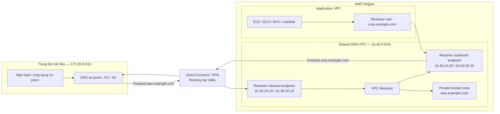

# Route 53 Resolver trong mạng hybrid

Một ứng dụng trên Amazon EC2 có thể kết nối mạng tới máy chủ cơ sở dữ liệu trong trung tâm dữ liệu doanh nghiệp qua AWS Direct Connect hoặc Site-to-Site VPN, nhưng ứng dụng vẫn thất bại nếu không phân giải được tên `db01.corp.example.com`. Chiều ngược lại cũng vậy: nhân viên trong văn phòng có thể có tuyến mạng tới AWS nhưng không phân giải được `api.aws.example.com`, là tên nội bộ được lưu trong một **Route 53 private hosted zone**.

**Amazon Route 53 VPC Resolver** (trong một số tài liệu được gọi là *Route 53 Resolver*) giải quyết phần **phân giải DNS** của bài toán kết nối hybrid. Thông qua **inbound endpoint**, **outbound endpoint** và **Resolver rules**, tổ chức có thể trao đổi truy vấn DNS có kiểm soát giữa VPC và mạng tại chỗ (*on-premises*).

Bài học thuộc chương **Kết nối mạng nâng cao** của module **CLOUD_PROVIDERS_AWS**. Kiến thức được kết nối với Region/AZ, IAM, VPC, DNS, dịch vụ tính toán, lưu trữ, cơ sở dữ liệu, tích hợp và serverless; người học sẽ thiết kế, kiểm tra và vận hành một kiến trúc hybrid DNS an toàn, có giám sát, khả năng phục hồi và tính toán chi phí.

## 1. Mục tiêu học tập

Sau bài học, bạn có thể:

1. Giải thích sự khác nhau giữa **DNS resolver**, **DNS authoritative server**, **Route 53 public/private hosted zone** và **Route 53 VPC Resolver**.
2. Mô tả chính xác chiều đi của truy vấn qua **inbound endpoint** và **outbound endpoint**.
3. Thiết lập phương án **conditional forwarding**, **Resolver forwarding rule**, liên kết rule với VPC và chia sẻ rule giữa các tài khoản.
4. Xây dựng sơ đồ hybrid DNS qua **Direct Connect/VPN**, bao gồm route, security group, NACL và ít nhất hai Availability Zone.
5. Phân tích thứ tự ưu tiên rule, private hosted zone, khả năng vòng lặp DNS, lỗi `NXDOMAIN`/`SERVFAIL`/timeout và giới hạn do bộ nhớ đệm.
6. Lập kế hoạch logging, kiểm soát quyền, mở rộng, dự phòng, kiểm thử và chi phí endpoint.

## 2. Ôn tập DNS: tên miền được giải ra IP như thế nào?

Hãy xem truy vấn tên `db01.corp.example.com`:

- **Client / stub resolver**: ứng dụng hoặc hệ điều hành phát sinh truy vấn để tìm địa chỉ IP.
- **Recursive resolver**: máy chủ nhận truy vấn từ client, sử dụng cache, áp dụng chính sách và truy vấn/chuyển tiếp tới nơi phù hợp.
- **Authoritative DNS server**: nguồn có thẩm quyền trả lời bản ghi của một DNS zone, ví dụ bản ghi `A`, `AAAA`, `CNAME`, `SRV`.
- **Conditional forwarder**: cấu hình trên recursive resolver để chuyển truy vấn thuộc một domain nhất định tới DNS resolver khác.
- **TTL (time to live)**: thời hạn cache có thể giữ kết quả; thay bản ghi không đồng nghĩa mọi client thấy kết quả mới ngay.

Ví dụ, doanh nghiệp có hai namespace:

| Namespace | Ai quản lý bản ghi? | Ví dụ |
|---|---|---|
| `corp.example.com` | DNS nội bộ trong trung tâm dữ liệu, ví dụ Microsoft DNS/BIND | `db01.corp.example.com → 172.20.50.20` |
| `aws.example.com` | Route 53 **private hosted zone** liên kết với VPC phù hợp | `api.aws.example.com → 10.40.16.25` |

Cách dùng `example.com` ở đây dành cho tài liệu minh họa. Trong môi trường thực tế, hãy dùng namespace thuộc quyền quản lý của tổ chức, có chính sách phân chia quyền quản trị rõ ràng.

**Điểm mấu chốt:** đường truyền mạng và đường phân giải DNS là hai phần riêng. Một bản ghi DNS trả về IP không chứng minh TCP tới IP đó hoạt động. Bạn còn cần route, kết nối private, security group, NACL, firewall, cấu hình dịch vụ và quyền ứng dụng.

### 2.1. Private hosted zone khác gì public hosted zone?

- **Public hosted zone**: lưu bản ghi dành cho DNS công cộng của domain và được sử dụng qua hạ tầng authoritative DNS công cộng theo delegation phù hợp.
- **Private hosted zone (PHZ)**: cung cấp bản ghi nội bộ cho những VPC đã được liên kết hợp lệ; tên trong PHZ không tự được phân giải bởi DNS công cộng.
- **Route 53 VPC Resolver**: dịch vụ resolver của VPC, hỗ trợ truy vấn private hosted zones, các tên nội bộ AWS và phân giải DNS phù hợp. Nó không thay thế chính máy chủ authoritative của zone on-premises.

Trong một VPC, Amazon-provided DNS server có thể được truy vấn qua địa chỉ **VPC CIDR + 2**, ví dụ `10.40.0.2` với VPC `10.40.0.0/16`, hoặc `169.254.169.253` theo hỗ trợ của AmazonProvidedDNS.

**Không gửi truy vấn từ DNS on-premises hoặc DNS server ở VPC khác trực tiếp tới địa chỉ VPC CIDR + 2** như một cách nối mạng hybrid. AWS không hỗ trợ cách forwarding này và kết quả có thể không ổn định. Đường truy vấn từ mạng ngoài VPC vào VPC Resolver cần **Resolver inbound endpoint**. [AWS — Resolving DNS queries between VPCs and your network](https://docs.aws.amazon.com/Route53/latest/DeveloperGuide/resolver-overview-DSN-queries-to-vpc.html).

## 3. Ba thành phần chính của Route 53 Resolver hybrid DNS

| Thành phần | Chiều truy vấn DNS | Cấu hình chính | Ví dụ |
|---|---|---|---|
| **Inbound endpoint** | Từ DNS server **ngoài VPC → VPC Resolver** | VPC, subnet, nhiều IP riêng, security group; DNS server bên ngoài forward tới các IP này | Văn phòng tra `api.aws.example.com` |
| **Outbound endpoint** | Từ **VPC Resolver → DNS server ngoài VPC** | VPC, subnet, nhiều IP nguồn, security group; gắn với các Resolver rules | EC2 tra `db01.corp.example.com` |
| **Resolver rule** | Quyết định **domain nào** được forward và **đi đâu** | Domain, loại rule, outbound endpoint, target DNS IP; liên kết với VPC cần sử dụng | Forward `corp.example.com` tới `172.20.1.53/54` |

Hai chiều có mục đích khác nhau. Nếu chỉ cần nhân viên on-premises truy vấn tên private trên AWS, thường **inbound endpoint** là đủ. Nếu chỉ cần workload AWS truy vấn DNS nội bộ, thường cần **outbound endpoint + rule**. Nếu cần cả hai chiều, triển khai cả hai luồng.

### 3.1. Endpoint thực chất là gì?

Một Resolver endpoint gồm các địa chỉ IP gắn với **elastic network interfaces (ENI)** trong các subnet được chọn. Những địa chỉ này thuộc phạm vi mạng VPC và thường được truy cập theo tuyến private; chúng không mặc nhiên là dịch vụ DNS công khai trên Internet.

Khi lập endpoint, bạn chọn ít nhất **hai địa chỉ IP**, nên bố trí ở **hai Availability Zone** để có dự phòng. Một endpoint có thể dùng cho nhiều VPC trong **cùng Region** thông qua cơ chế association/sharing phù hợp; không cần tạo endpoint mới cho mỗi EC2.

**Endpoint không đồng nghĩa với máy chủ DNS bạn tự vận hành.** AWS quản lý hạ tầng Route 53 Resolver; doanh nghiệp chịu trách nhiệm về IP, SG, kết nối mạng, namespace, Resolver rule và quyền sử dụng.

### 3.2. Các loại inbound endpoint và rule mới hơn

AWS hỗ trợ hai **inbound endpoint categories**:

- **Default inbound endpoint**: on-premises resolver **forward truy vấn** tới IP của endpoint.
- **Delegation inbound endpoint**: on-premises DNS **delegate authority** cho subdomain dựa trên NS/glue records được cấu hình, theo điều kiện của tính năng này.

Về Resolver rule, ngoài **Forward** và **System** còn có **Delegate** theo tài liệu AWS hiện hành:

- **Forward**: chuyển truy vấn khớp domain tới target DNS resolvers chỉ định.
- **System**: cho phép VPC Resolver xử lý trực tiếp một namespace cụ thể, dùng để tạo ngoại lệ với một forwarding rule rộng hơn.
- **Delegate**: áp dụng cơ chế DNS delegation dựa trên bản ghi NS và điều kiện khớp của quy tắc, khác với conditional forwarding thuần túy.

Bài này tập trung vào **Default inbound + Forward outbound**, là mẫu dễ hiểu khi tích hợp DNS doanh nghiệp. Delegation cần thiết kế NS zone và cơ chế quản lý thẩm quyền riêng.

Tham khảo: [AWS — Forwarding inbound DNS queries](https://docs.aws.amazon.com/Route53/latest/DeveloperGuide/resolver-forwarding-inbound-queries.html) và [AWS — Resolver rule types](https://docs.aws.amazon.com/Route53/latest/DeveloperGuide/resolver-forwarding-outbound-queries-rule-values.html).

## 4. Kiến trúc tham khảo: AWS kết nối trung tâm dữ liệu

Giả sử công ty có:

- **On-premises**: mạng `172.20.0.0/16`, DNS recursive servers `172.20.1.53` và `172.20.1.54`, authoritative zone `corp.example.com`.
- **AWS Region**: một Region được lựa chọn theo vị trí người dùng/dữ liệu, có **Shared DNS VPC `10.40.0.0/16`**.
- **Private hosted zone**: `aws.example.com`, liên kết với Shared DNS VPC để inbound endpoint truy vấn được.
- **Application VPCs**: các VPC khác, nơi EC2/ECS/EKS/Lambda trong VPC cần phân giải tên on-premises.
- **Kết nối private**: Direct Connect hoặc Site-to-Site VPN; có thể đi qua Virtual Private Gateway/Transit Gateway theo cấu trúc thật.
- **Hai AZ**: mỗi AZ chứa IP của inbound/outbound endpoint.

Sơ đồ dưới đây mô tả **luồng DNS**, không phải tất cả tuyến lưu lượng ứng dụng:



*Mũi tên thể hiện truy vấn/forwarding logic; phản hồi DNS đi theo chiều ngược lại. Trong cấu hình thật, VPC Resolver ở Application VPC xử lý truy vấn trước khi chọn rule; AWS quản lý đường chuyển tới outbound endpoint dùng chung. Sơ đồ lược giản để dễ học.*

### 4.1. Bảng phân bổ mẫu cho Shared DNS VPC

| Thành phần | AZ | Subnet | IP mẫu |
|---|---|---|---|
| Inbound IP 1 | A | `10.40.10.0/24` | `10.40.10.10` |
| Inbound IP 2 | B | `10.40.20.0/24` | `10.40.20.10` |
| Outbound IP 1 | A | `10.40.10.0/24` | `10.40.10.20` |
| Outbound IP 2 | B | `10.40.20.0/24` | `10.40.20.20` |
| DNS target on-prem 1 | Trung tâm dữ liệu A | `172.20.0.0/16` | `172.20.1.53` |
| DNS target on-prem 2 | Trung tâm dữ liệu B | `172.20.0.0/16` | `172.20.1.54` |

Các IP chỉ là ví dụ. Thực tế phải kiểm tra subnet còn đủ địa chỉ, IP không trùng, VPC DNS options và quota Endpoint/ENI. Hãy ưu tiên đặt các địa chỉ endpoint ở hai AZ độc lập; nếu một mạng con hoặc AZ lỗi, DNS vẫn có đường hoạt động qua IP còn lại khi các điều kiện mạng khác đáp ứng.

## 5. Luồng 1 — On-premises truy vấn DNS của AWS (inbound)

**Yêu cầu:** một ứng dụng trên máy tính trong văn phòng cần truy cập `api.aws.example.com`. Private hosted zone `aws.example.com` chứa:

```text
Zone: aws.example.com (private hosted zone)
A    api.aws.example.com   10.40.16.25
```

Giả định PHZ đã được **associated** với Shared DNS VPC nơi có inbound endpoint.

### 5.1. Trình tự phân giải

1. Ứng dụng on-premises hỏi DNS recursive resolver của công ty: “`api.aws.example.com` có địa chỉ IP nào?”.
2. DNS server on-premises phát hiện domain `aws.example.com` khớp **conditional forwarder** của nó.
3. Nó forward yêu cầu tới một trong hai IP của **inbound endpoint**: `10.40.10.10` hoặc `10.40.20.10`.
4. Truy vấn đi qua VPN/Direct Connect, qua route, firewall và security group thích hợp, tới inbound endpoint.
5. Route 53 VPC Resolver phân giải bằng các nguồn phù hợp với VPC, ở đây là PHZ `aws.example.com` đã liên kết.
6. Kết quả `A = 10.40.16.25` trả về on-premises DNS server rồi trả về ứng dụng.
7. Ứng dụng mới kết nối tới `10.40.16.25` qua **đường mạng ứng dụng** riêng, với TCP/HTTPS theo nhu cầu.

**Nhận biết lỗi:** nếu lệnh DNS trả về `10.40.16.25` nhưng truy cập API thất bại, phần DNS có thể đã hoạt động. Tiếp tục kiểm tra route, SG, ACL, load balancer, firewall và ứng dụng, thay vì thay Resolver rule ngay.

### 5.2. Conditional forwarder trên DNS on-premises

Ví dụ **BIND** (chỉ là mẫu cấu hình, không áp dụng trực tiếp vào production nếu chưa kiểm tra chính sách DNS):

```conf
zone "aws.example.com" IN {
    type forward;
    forward only;
    forwarders {
        10.40.10.10;
        10.40.20.10;
    };
};
```

Ý nghĩa:

- `zone "aws.example.com"`: chỉ forwarding cho namespace này và các tên thuộc phạm vi tương ứng.
- `forward only`: không thử phân giải theo cách khác khi các forwarders không trả lời theo hành vi của BIND.
- `forwarders`: hai địa chỉ **inbound endpoint**, không phải VPC CIDR + 2.

Trên **Windows DNS Server**, cùng ý tưởng được cấu hình bằng **Conditional Forwarders**: zone `aws.example.com`, master servers là hai IP inbound. Cần bảo đảm DNS server có đường đi tới VPC và chính sách tổ chức cho phép.

**Không cấu hình DNS trên máy trạm văn phòng tự động trỏ trực tiếp vào tất cả inbound IP nếu bạn đã có DNS recursive servers quản lý tập trung.** Thường nên tập trung conditional forwarding tại hệ thống DNS doanh nghiệp để bảo toàn kiểm soát, cache, logging và chính sách truy cập.

### 5.3. Quyền truy cập PHZ

Inbound endpoint phân giải theo **ngữ cảnh VPC nơi endpoint được tạo**. Nếu bản ghi nằm trong PHZ chỉ được liên kết với một VPC khác, chưa chắc inbound endpoint ở Shared DNS VPC thấy được zone đó. Bạn phải thiết kế **PHZ association** phù hợp, hoặc chia sẻ các cấu hình phân giải theo giải pháp được AWS hỗ trợ. Mạng thông không tự tạo quyền phân giải PHZ.

## 6. Luồng 2 — Ứng dụng AWS truy vấn DNS on-premises (outbound)

**Yêu cầu:** một EC2 trong Application VPC cần phân giải `db01.corp.example.com`; DNS on-premises đang quản lý bản ghi:

```text
Zone: corp.example.com (on-premises)
A    db01.corp.example.com   172.20.50.20
```

### 6.1. Các thành phần phải có

1. **Outbound endpoint** trong Shared DNS VPC, có ít nhất hai IP nguồn ở hai AZ, ví dụ `10.40.10.20` và `10.40.20.20`.
2. **Forwarding rule** cho domain `corp.example.com`.
3. **Target IP addresses** của DNS on-premises, ví dụ `172.20.1.53` và `172.20.1.54` (cổng DNS theo cấu hình thực tế).
4. **Resolver rule association** với những Application VPC cần sử dụng rule.
5. **Route và firewall hai chiều** từ các subnet outbound endpoint tới DNS target on-premises.
6. Ứng dụng AWS dùng VPC Resolver trong cấu hình DNS của VPC/host; nếu host dùng resolver tùy chỉnh, phải bảo đảm truy vấn được chuyển tới VPC Resolver phù hợp.

### 6.2. Trình tự phân giải

1. EC2 trong Application VPC gửi yêu cầu DNS cho `db01.corp.example.com` tới resolver được cấu hình.
2. VPC Resolver nhận truy vấn và tìm rule được liên kết với VPC.
3. Rule `corp.example.com → Forward` khớp yêu cầu, nên Route 53 Resolver gửi truy vấn qua **outbound endpoint** đã chỉ định.
4. Truy vấn xuất phát từ một địa chỉ IP của outbound endpoint, được định tuyến qua Direct Connect/VPN tới `172.20.1.53` hoặc `172.20.1.54`.
5. On-premises DNS trả lời `172.20.50.20`.
6. DNS response quay về VPC Resolver rồi tới EC2.
7. EC2 kết nối tới IP dữ liệu bằng route và chính sách mạng của ứng dụng, **không phải “qua DNS endpoint”**.

### 6.3. Mô tả forwarding rule

| Trường | Giá trị ví dụ | Vai trò |
|---|---|---|
| Rule type | `Forward` | Chuyển truy vấn phù hợp tới DNS khác |
| Domain name | `corp.example.com` | Namespace được chuyển tiếp, bao gồm subdomain theo logic matching |
| Outbound endpoint | `rslvr-out-...` | Điểm gửi truy vấn từ AWS |
| Target 1 | `172.20.1.53:53` | Recursive/authoritative DNS path tại trung tâm dữ liệu |
| Target 2 | `172.20.1.54:53` | Đích dự phòng |
| Rule association | Application VPC A, Application VPC B | Các VPC sẽ áp dụng rule |

Sau khi tạo **outbound endpoint**, **nếu chưa tạo forwarding rule và associate với VPC, DNS traffic sẽ không tự được forward theo namespace**. AWS có thể chọn bất kỳ target DNS IP phù hợp, không nên coi thứ tự target là cơ chế primary/secondary cứng. Hai target nên có khả năng truy cập và trả lời đúng zone như nhau. [AWS — Forwarding outbound DNS queries](https://docs.aws.amazon.com/Route53/latest/DeveloperGuide/resolver-forwarding-outbound-queries.html).

## 7. Route table, security group và firewall

Resolver endpoints dùng IP riêng trong VPC; cần mạng kết nối đúng cả hai chiều.

### 7.1. Route path

Trong sơ đồ mẫu:

- **Phía on-premises** phải có đường đi tới subnet hoặc địa chỉ inbound endpoint `10.40.10.10`/`10.40.20.10` qua Direct Connect/VPN.
- **VPC subnet chứa outbound endpoint** cần route tới `172.20.0.0/16` qua đúng Transit Gateway/VGW hoặc đích mạng hỗ trợ, và có đường phản hồi.
- Các tuyến on-premises tới ứng dụng AWS (`10.40.16.25`) là thiết kế **riêng** của data path và phải được cấp theo nhu cầu.
- Nếu dùng nhiều Region, endpoint là tài nguyên **theo Region**; cần thiết kế riêng region-local routing, association và dự phòng.

**Không bắt buộc NAT gateway hoặc Internet gateway** để DNS đi qua VPN/Direct Connect có định tuyến private hợp lệ. NAT có thể xuất hiện trong một số kiến trúc khác, nhưng không phải thành phần cố hữu của Route 53 Resolver hybrid DNS.

### 7.2. Security group ở endpoint

Với **DNS thông thường (Do53: UDP/TCP 53)**, áp dụng tối thiểu theo phạm vi nguồn/đích đã biết:

| Endpoint | Hướng | Protocol/port | Địa chỉ minh họa | Mục đích |
|---|---|---|---|---|
| **Inbound** | Inbound | UDP 53, TCP 53 | `172.20.1.53/32`, `172.20.1.54/32` | Cho phép DNS on-premises truy vấn inbound IP |
| **Outbound** | Outbound | UDP 53, TCP 53 | `172.20.1.53/32`, `172.20.1.54/32` | Cho phép outbound IP gửi DNS tới target |
| Inbound / outbound | Phản hồi | Theo quy tắc SG stateful | Dòng truy vấn tương ứng | SG theo dõi trạng thái kết nối; vẫn phải kiểm tra tối ưu throughput |

Một số ví dụ **hiệu năng cao** trong tài liệu AWS khuyến nghị mẫu security group rộng hơn hoặc cấu hình tối ưu connection tracking nhằm đạt thông lượng lớn. Đây là đánh đổi cần quyết định theo threat model; không tự động mở `0.0.0.0/0` cho DNS khi chỉ có hai resolver nội bộ.

Với **network ACL (stateless)**, phải tính cả hai chiều và ephemeral response ports. Với **firewall on-premises**, cho phép luồng từ các IP outbound endpoint tới DNS server và luồng từ DNS on-premises tới inbound endpoint, bao gồm phản hồi. Nếu sử dụng DoH hoặc cổng tùy chỉnh được AWS hỗ trợ, điều chỉnh policy theo giao thức đã chọn.

### 7.3. Những kiểm tra bảo mật khác

- Giới hạn IAM role được phép tạo/sửa/xóa endpoints, rules và associations.
- Chỉ chia sẻ Resolver rules tới account/VPC hợp lệ qua **AWS Resource Access Manager (AWS RAM)** hoặc cơ chế quản trị tổ chức.
- Với DNS query logging, bảo vệ quyền đọc log vì **tên DNS** có thể tiết lộ hệ thống nội bộ.
- Xem xét **Route 53 Resolver DNS Firewall** cho lưu lượng DNS đi qua VPC Resolver theo phạm vi tính năng; DNS Firewall lọc namespace, không kiểm soát TCP đến IP trả về.
- Tách phạm vi IP từ client DNS hợp lệ với người dùng đầu cuối; thông thường endpoint nhận truy vấn từ DNS servers doanh nghiệp.
- Phân biệt **bảo mật truyền DNS** với **bảo mật ứng dụng**: DNS truyền thống qua UDP/TCP 53 không tự mã hóa payload như TLS của ứng dụng. AWS có hỗ trợ các cấu hình giao thức DNS-over-HTTPS (DoH) cho một số loại endpoint/target; tính khả dụng và policy phải kiểm tra theo phiên bản/dịch vụ.
- Giám sát cấu hình thay đổi (CloudTrail/API events và công cụ quản trị phù hợp), đánh giá secret của ứng dụng và dữ liệu vẫn theo **Shared Responsibility Model**.

## 8. Thứ tự ưu tiên phân giải: rule, hosted zone và cache

DNS hybrid thường khó ở **quy tắc phân giải** hơn là thao tác tạo endpoint.

### 8.1. Longest matching domain

Giả sử VPC có:

| Rule | Loại | Kết quả mong muốn |
|---|---|---|
| `example.com` | Forward | Truy vấn domain rộng đưa tới DNS trung tâm |
| `corp.example.com` | Forward | Truy vấn subdomain cụ thể đưa tới DNS doanh nghiệp |
| `aws.example.com` | System | Cho VPC Resolver xử lý namespace AWS trong phạm vi phù hợp |

Với các rule khớp theo domain, **tên có độ cụ thể cao hơn thắng**. Truy vấn `db01.corp.example.com` sẽ theo `corp.example.com` hơn là `example.com`. Rule `System` có thể ngăn một vùng con bị forwarding bởi rule rộng hơn và để VPC Resolver phân giải theo cấu hình khác.

Một forwarding rule cho domain thường áp dụng cho cả subdomain của nó, nên tạo rule `example.com` có thể ảnh hưởng tới nhiều namespace hơn dự định.

### 8.2. Rule trùng tên với private hosted zone

Trường hợp quan trọng:

- VPC có PHZ `corp.example.com`.
- VPC cũng được associate một **Resolver forwarding rule cùng domain** `corp.example.com`.

Theo tài liệu AWS, **forwarding rule có độ khớp cùng tên sẽ được ưu tiên hơn PHZ**. Truy vấn được gửi tới resolver chỉ định theo rule, thay vì đọc bản ghi PHZ. Điều này gây nhầm lẫn khi một đội vừa tạo bản ghi PHZ vừa cấu hình forwarding tới on-premises cho cùng namespace.

Khi phân chia namespace, ưu tiên cấu trúc rõ ràng như:

- AWS authoritative private: `aws.example.com`.
- On-premises authoritative: `corp.example.com`.

Với private hosted zone khớp domain nhưng **không có bản ghi cụ thể**, VPC Resolver có thể trả `NXDOMAIN` thay vì tự fallback sang public DNS. Không nên kỳ vọng cơ chế “thử PHZ trước, không thấy thì hỏi Internet” nếu không có cấu hình DNS được hỗ trợ cho mô hình đó.

AWS còn có **Route 53 Profiles** để quản lý tập hợp PHZ/rule/logging/firewall giữa VPC; khi dùng Profile, độ ưu tiên giữa profile associations và cấu hình local phức tạp hơn. Vì vậy cần xem xét Profile priority, domain specificity và local overrides khi điều tra truy vấn sai đích.

Nguồn: [AWS — Considerations for private hosted zones](https://docs.aws.amazon.com/Route53/latest/DeveloperGuide/hosted-zone-private-considerations.html) và [What are Route 53 Profiles?](https://docs.aws.amazon.com/Route53/latest/DeveloperGuide/profiles.html).

### 8.3. Cache và TTL

Khi DNS record vừa thay đổi, client có thể tiếp tục thấy IP cũ do:

- Cache của ứng dụng hoặc hệ điều hành.
- Cache của DNS on-premises.
- Cache trong VPC Resolver.
- **Negative caching** của kết quả không tồn tại theo DNS SOA/TTL.

Không nên đánh giá “quy tắc forwarding sai” chỉ vì một host còn thấy kết quả cũ. Hãy truy vấn **trực tiếp resolver ở từng chặng** trong phạm vi cho phép, kiểm tra TTL, log và thời điểm thay đổi.

## 9. Kiến trúc nhiều VPC, nhiều tài khoản và nhiều Region

### 9.1. Centralized DNS VPC (hub-and-spoke)

Khi công ty có nhiều ứng dụng, một **Shared DNS VPC** có thể chứa outbound endpoint trung tâm cho cùng Region. Đội network tạo và quản lý forwarding rules; đội ứng dụng **associate rule** với Application VPC.

Ví dụ:

```text
Account: networking
  Shared DNS VPC
  ├─ Inbound endpoint (AZ A/B)
  ├─ Outbound endpoint (AZ A/B)
  ├─ Private hosted zones / associations
  └─ Resolver rules: corp.example.com -> 172.20.1.53 / 172.20.1.54

Account: app-a
  VPC app-a -> association với rule corp.example.com

Account: app-b
  VPC app-b -> association với rule corp.example.com
```

Lợi ích: một điểm quản lý IP, SG, kết nối hybrid, namespace và logging. Chi phí/độ trễ và ranh giới vận hành cũng tập trung hơn, nên phải lên kế hoạch HA và ownership.

AWS cho phép **chia sẻ Resolver rules giữa tài khoản qua AWS RAM**, để VPC ở tài khoản khác associate cùng rule theo điều kiện AWS hỗ trợ. Việc share rule không đồng nghĩa chia sẻ tất cả PHZ hay tạo route mạng ứng dụng. Cần kiểm tra chính sách AWS Organizations, quyền nhận chia sẻ và association ở từng VPC.

**Lưu ý quyền sở hữu:** không thể tự tạo Resolver endpoint trong một VPC mà tài khoản hiện tại không sở hữu, trừ cơ chế cụ thể AWS hỗ trợ; thiết kế dùng chung cần phối hợp chủ sở hữu VPC/account.

### 9.2. Không nhầm DNS path với data path

Nếu Application VPC dùng Resolver rule tới shared outbound endpoint, **DNS resolution** có thể dùng cơ chế quản lý AWS giữa các VPC theo tính năng rule association. Nhưng kết quả trả về `172.20.50.20` chỉ là **IP đích**. Đường kết nối từ ứng dụng đến IP đó vẫn cần Transit Gateway/peering/routing/firewall phù hợp với topology thực tế.

Tương tự, PHZ association cho phép phân giải tên, **không tự cấp quyền truy cập** tới RDS hoặc máy chủ phía sau bản ghi.

### 9.3. Triển khai nhiều Region

Resolver endpoint là **regional resource**. Nếu workloads chạy ở hai Region cần truy vấn DNS on-premises, nên thiết kế khả năng phân giải, routing và HA riêng theo từng Region. Không dùng một endpoint Region A làm bảo đảm khả dụng cho Region B khi kết nối mạng liên vùng lỗi.

Với hệ thống yêu cầu DR, bảng kiểm tra cần bao gồm:

- Dải CIDR VPC và IP endpoint tại Region dự phòng không trùng lặp.
- PHZ và rule associations hiện diện đúng Region/VPC.
- Route và kết nối DNS targets còn hoạt động khi Region/AZ chính lỗi.
- DNS server on-premises biết forward tới đúng endpoint dự phòng theo kịch bản.
- RTO/RPO của **dịch vụ ứng dụng**, dữ liệu và DNS cache đáp ứng mục tiêu nghiệp vụ.

## 10. Tránh vòng lặp DNS (forwarding loop)

Vòng lặp xảy ra khi các resolver liên tục chuyển cùng một truy vấn qua lại.

**Ví dụ cấu hình sai:**

1. AWS có forwarding rule `corp.example.com → DNS on-premises`.
2. DNS on-premises cũng được cấu hình `corp.example.com → inbound endpoint AWS`.
3. Một truy vấn `db01.corp.example.com` bị gửi từ AWS ra on-premises rồi quay lại AWS; không bên nào xử lý authoritative đúng cách.

Kết quả có thể là timeout, `SERVFAIL`, số lượng truy vấn tăng, log dày đặc và hóa đơn DNS tăng. Với hub-and-spoke, đặc biệt tránh **association khiến outbound forwarding rule dẫn trở lại inbound endpoint của chính VPC theo đường trực tiếp/gián tiếp** cho cùng namespace.

### 10.1. Thiết kế không loop

| Domain | Nguồn authoritative | Trên AWS | Trên on-premises |
|---|---|---|---|
| `aws.example.com` | PHZ trên AWS | VPC Resolver xử lý trực tiếp từ zone phù hợp | Conditional forward tới inbound endpoint AWS |
| `corp.example.com` | DNS nội bộ | Forward rule tới outbound endpoint → DNS on-premises | DNS on-premises giải quyết trực tiếp |
| Public `www.example.com` | Public DNS authoritative | Recursive resolution theo policy phù hợp | Recursive resolution theo policy phù hợp |

**Thực hành:** viết rõ cho từng zone **một nơi authoritative chính**, resolver nào được forwarding vào đó và chặng nào có thể tạo vòng lặp. Với rule dạng `.` (forward mọi domain), hết sức cẩn trọng vì có các system rules tự động của AWS và một số tên AWS nội bộ cần được xử lý đặc biệt.

Nguồn: [AWS — Avoid loop configurations with Resolver endpoints](https://docs.aws.amazon.com/Route53/latest/DeveloperGuide/best-practices-resolver-endpoints.html).

## 11. Thiết kế tính sẵn sàng và năng lực

### 11.1. Endpoint nhiều Availability Zone

Để hạn chế một AZ gây ngừng DNS:

1. Chọn **ít nhất hai IP endpoint** ở **hai AZ** có subnet và route phù hợp.
2. Cấu hình DNS servers on-premises sử dụng **cả hai inbound IP**, không trỏ duy nhất tới AZ A.
3. Với outbound, chỉ định **ít nhất hai target DNS resolvers** có khả năng trả lời zone phù hợp, lý tưởng ở các hệ thống hạ tầng độc lập.
4. Kiểm tra redundancy của Direct Connect/VPN, router, firewall, BGP và DNS trên on-premises.
5. Thử mất một IP/đường kết nối theo lịch kiểm thử và xác nhận hệ thống vẫn giải được tên quan trọng.

AWS yêu cầu tối thiểu hai IP khi tạo Resolver endpoint và khuyến nghị bố trí nhiều AZ. Đối với nhu cầu thông lượng cao, có thể thêm IP/ENI và dự trù một ENI dự phòng để giảm ảnh hưởng của bảo trì hay đột biến tải.

### 11.2. Thông lượng và DNS caching

Không ước lượng khả năng chịu tải bằng “một endpoint = vô hạn DNS queries”. Năng lực phụ thuộc số IP, loại endpoint, giao thức, security group connection tracking và đặc tính lưu lượng. Kiểm tra **AWS quotas hiện hành** thay vì ghi một con số QPS cứng cho mọi Region và thời điểm.

Các cách giảm tải hợp lý:

- Cấu hình TTL tương xứng với tốc độ cập nhật bản ghi.
- Tránh TTL cực thấp cho toàn bộ zone khi không cần.
- Kiểm tra recursive cache tại DNS server on-premises và các service clients.
- Theo dõi lượng truy vấn, lỗi và thời gian phân giải theo từng nguồn.
- Tăng IP/ENI cho endpoint nếu quy mô/kiến trúc và quota đòi hỏi.

**TTL thấp** có thể hỗ trợ giảm thời gian thấy bản ghi cũ nhưng đổi lại tăng truy vấn, có thể tăng độ trễ và chi phí. TTL không thay thế failover ở tầng ứng dụng.

Nguồn: [AWS — High availability for Resolver endpoints](https://docs.aws.amazon.com/Route53/latest/DeveloperGuide/best-practices-resolver-endpoint-high-availability.html) và [Resolver endpoint scaling](https://docs.aws.amazon.com/Route53/latest/DeveloperGuide/best-practices-resolver-endpoint-scaling.html).

## 12. Quan sát và bảo mật DNS

### 12.1. Route 53 Resolver query logging

**Resolver query logging** có thể ghi các truy vấn/response trong phạm vi được cấu hình, bao gồm truy vấn xuất phát từ VPC, qua inbound endpoint hoặc outbound forwarding theo mô hình tính năng. Log có thể chứa:

- Thời điểm và Region/VPC.
- Domain được hỏi (ví dụ `api.aws.example.com`).
- Loại bản ghi `A`, `AAAA`, `CNAME`.
- Response code `NOERROR`, `NXDOMAIN`, `SERVFAIL`.
- IP nguồn hoặc thông tin tài nguyên/endpoint khi có.
- Thông tin phản hồi và DNS Firewall action khi được áp dụng.

Các đích phổ biến: **CloudWatch Logs**, **Amazon S3**, **Amazon Data Firehose**. Chọn theo độ trễ tìm kiếm, mức lưu trữ dài hạn và yêu cầu phân tích.

**Quan trọng:** Route 53 VPC Resolver có cache. Query logging có thể **không ghi lại mọi lượt hỏi giống nhau khi câu trả lời đã được phục vụ từ cache**. Vì vậy, số dòng log không nhất thiết bằng số lần ứng dụng gọi resolver. Log cũng không phải packet capture.

### 12.2. Các nguồn quan sát bổ sung

| Công cụ | Giúp trả lời | Giới hạn |
|---|---|---|
| Resolver query logs | Truy vấn tên gì, response code gì, từ đâu | Cache có thể làm vắng một số truy vấn; cần bật cho đúng VPC |
| CloudWatch metrics/alarms | Xu hướng lỗi, lưu lượng và dấu hiệu vận hành tùy metric có sẵn | Cần thiết lập ngưỡng theo thực tế |
| VPC Flow Logs | Có lưu lượng mạng từ IP endpoint đến DNS target không? | Ghi metadata của flows, không phải bản ghi đầy đủ DNS payload |
| CloudTrail | Ai thay đổi endpoint/rule/association theo sự kiện API được ghi lại? | Không thay Resolver query logging |
| Firewall/VPN/Direct Connect logs | Có route, ACL, tunnel, BGP, session bị lỗi không? | Chỉ quan sát theo phạm vi thiết bị/kết nối |

Nếu on-premises name query trả về `SERVFAIL`, cần xem cả DNS logs phía on-premises, không thể kết luận chỉ từ AWS.

### 12.3. Resolver DNS Firewall

**Route 53 Resolver DNS Firewall** hỗ trợ chặn, cho phép hoặc cảnh báo dựa trên domain list/advanced protections theo rules và associations với VPC. Có thể giúp chống các hoạt động như truy vấn tên đáng ngờ hoặc DNS tunneling qua Resolver. Trong thiết kế hybrid, cần xác định những VPC và loại luồng truy vấn nào nằm trong phạm vi kiểm soát.

DNS Firewall **không thay** network firewall, SG, IAM hoặc bảo vệ dữ liệu. Nếu ứng dụng dùng DNS resolver riêng bỏ qua Route 53 VPC Resolver, phải đánh giá đường đi và khả năng kiểm soát DNS của kiến trúc.

Nguồn: [Resolver query logging](https://docs.aws.amazon.com/Route53/latest/DeveloperGuide/resolver-query-logs.html) và [Using DNS Firewall to filter outbound DNS traffic](https://docs.aws.amazon.com/Route53/latest/DeveloperGuide/resolver-dns-firewall.html).

## 13. Lộ trình triển khai cho nhóm hạ tầng

Các bước dưới đây là **quy trình triển khai có kiểm soát**, cần được điều chỉnh theo account, Region, loại DNS server và chính sách doanh nghiệp.

### Giai đoạn A — Khảo sát và lập thiết kế

- Thu thập danh sách namespace on-premises, các private hosted zones và chủ sở hữu authoritative.
- Xác nhận VPC CIDR, subnet theo AZ, đường Direct Connect/VPN, Transit Gateway/VGW, các route cần thiết và phạm vi IAM.
- Lập bảng inbound/outbound target IP, target DNS IP và firewall policy.
- Xác định VPC nào được dùng rule, PHZ nào phải associate với VPC chứa inbound endpoint.
- Kiểm tra không có trùng domain forwarding tạo loop; ghi nhận TTL, cơ chế failover và cách logging.

### Giai đoạn B — Cấu hình inbound

1. Chọn Shared DNS VPC và hai subnet ở hai AZ.
2. Tạo **Default inbound endpoint**, chọn IP và security group thích hợp.
3. Kiểm tra trạng thái endpoint **Operational**, kết nối từ on-premises đến mỗi IP.
4. Associate private hosted zone với VPC của inbound endpoint theo yêu cầu.
5. Cấu hình conditional forwarder trên DNS on-premises cho `aws.example.com` tới **hai IP inbound**.
6. Kiểm thử từ DNS on-premises bằng `dig`/`nslookup` rồi từ client thực tế.

### Giai đoạn C — Cấu hình outbound

1. Tạo **outbound endpoint** với hai IP ở hai AZ và egress tới DNS target.
2. Cho phép SG/route/firewall đi tới `172.20.1.53`, `172.20.1.54` và đường trả lời.
3. Tạo **Resolver Forward rule** cho `corp.example.com`, gắn outbound endpoint và target DNS servers.
4. Associate rule với từng Application VPC; nếu khác account, thiết lập sharing qua AWS RAM.
5. Kiểm tra các VPC đang sử dụng Amazon-provided Resolver hoặc DNS forwarder phù hợp.
6. Kiểm thử cả tên tồn tại, tên không tồn tại, IPv4/IPv6 record nếu có và điều kiện mất một target.

### Giai đoạn D — Hoàn thiện vận hành

- Bật query logging đúng VPC/Region, kiểm tra thời gian lưu và quyền truy cập log.
- Thiết lập cảnh báo theo hành vi sử dụng, lỗi, trạng thái endpoint và network.
- Viết runbook sự cố: người trực, đường escalations, hành vi rollback rule, kiểm thử DNS.
- Ghi lại sở hữu endpoint/rule/PHZ/namespace, cấu hình dưới dạng mã nếu dùng IaC.
- Ước lượng chi phí endpoint IPs, queries, logs và Direct Connect/VPN/network traffic; theo dõi hóa đơn.

## 14. Công cụ và ví dụ kiểm tra read-only

### 14.1. Thử DNS từ hệ thống on-premises

Với `dig`, truy vấn thẳng hai inbound IP để tách vấn đề conditional forwarding khỏi vấn đề endpoint:

```bash
# Truy vấn trực tiếp vào inbound endpoint IP thứ nhất
dig @10.40.10.10 api.aws.example.com A

# So sánh với IP inbound endpoint còn lại
dig @10.40.20.10 api.aws.example.com A

# Truy vấn bằng DNS server doanh nghiệp, kiểm tra conditional forwarder
dig @172.20.1.53 api.aws.example.com A
dig @172.20.1.54 api.aws.example.com A
```

Các lệnh trên chỉ truy vấn DNS, không tạo tài nguyên AWS. IP chỉ là giá trị minh họa trong tài liệu; cần thay theo cấu hình được phê duyệt.

### 14.2. Thử chiều outbound từ máy trong VPC

```bash
# Theo resolver hệ điều hành/VPC đang dùng
dig db01.corp.example.com A

# So sánh kết quả ở phía on-premises nếu được cấp quyền mạng
dig @172.20.1.53 db01.corp.example.com A

# Truy vấn tên cố tình không tồn tại để xem mã trả lời
dig not-exist.corp.example.com A
```

Nếu truy vấn thẳng DNS on-premises thành công nhưng qua VPC Resolver thất bại, hãy xem forwarding rule, VPC association và đường outbound endpoint. Nếu mọi truy vấn tới `172.20.1.53` đều timeout, hãy kiểm tra route, SG/NACL, firewall và DNS server, không chỉ record.

### 14.3. AWS CLI: chỉ đọc cấu hình Resolver

Yêu cầu AWS CLI có profile và quyền đọc tương ứng, ví dụ các quyền liệt kê trong `route53resolver`. Chọn Region nơi endpoint được tạo.

```bash
# Xem các Resolver endpoints trong Region
aws route53resolver list-resolver-endpoints \
  --region ap-southeast-1 \
  --profile learning

# Xem các Resolver rules
aws route53resolver list-resolver-rules \
  --region ap-southeast-1 \
  --profile learning

# Xem association của các rules
aws route53resolver list-resolver-rule-associations \
  --region ap-southeast-1 \
  --profile learning

# Kiểm tra VPC được bật DNS support hay chưa
aws ec2 describe-vpc-attribute \
  --vpc-id vpc-0123456789abcdef0 \
  --attribute enableDnsSupport \
  --region ap-southeast-1 \
  --profile learning
```

VPC ID và Region đều là ví dụ; thay bằng môi trường thực tế. Lệnh thất bại vì `AccessDenied` không khẳng định tài nguyên hỏng: cần kiểm tra quyền IAM. Bạn cũng có thể truy vấn cấu hình qua AWS Console mà không cấp quyền thay đổi.

### 14.4. Kiểm tra trạng thái bằng bảng

| Nguồn thử | Query | Kết quả kỳ vọng |
|---|---|---|
| DNS on-prem A | `api.aws.example.com` | Phân giải `10.40.16.25` từ PHZ thông qua inbound |
| DNS on-prem B | `api.aws.example.com` | Kết quả tương ứng, hoạt động nếu một inbound IP lỗi |
| EC2 Application VPC | `db01.corp.example.com` | Phân giải `172.20.50.20` qua forwarding rule/outbound |
| EC2 Application VPC | `www.example.com` | Đi theo chính sách DNS public thông thường, không bị rule `corp.example.com` áp vào |
| EC2 Application VPC | `not-exist.corp.example.com` | Phản hồi lỗi tên phù hợp với authoritative zone, phân biệt với timeout |

## 15. Quy trình chẩn đoán lỗi DNS hybrid

### 15.1. Phân loại theo dấu hiệu

| Hiện tượng | Nguyên nhân có thể | Hướng xác minh |
|---|---|---|
| `NXDOMAIN` | Bản ghi không tồn tại, hỏi sai zone/PHZ, trùng namespace, negative cache | So sánh trả lời của authoritative DNS, PHZ association, rule priority và TTL |
| `SERVFAIL` | Resolver không hoàn thành phân giải; đích forward lỗi, loop, authoritative lỗi | Kiểm tra logs hai phía, rule, target IP, forwarding chain |
| Timeout | Không tới được endpoint/target, SG/NACL/firewall/route chặn, DNS process không trả lời | Thử từng IP, TCP/UDP 53, VPC Flow Logs, tunnel/BGP |
| AWS → on-prem hoạt động, chiều ngược lại hỏng | Chưa có inbound endpoint/conditional forwarder hoặc PHZ association | Truy vấn trực tiếp inbound IP và kiểm tra DNS server on-prem |
| On-prem → AWS hoạt động, chiều AWS → on-prem hỏng | Chưa có outbound rule/association, route hoặc egress tới target | Xem outbound endpoint, target và rule associations |
| Tên giải được IP nhưng ứng dụng vẫn lỗi | Data path khác DNS path, app/auth/port/TLS lỗi | Kiểm tra tuyến tới IP dịch vụ, SG và log ứng dụng |
| Đổi record rồi nhưng host còn IP cũ | DNS cache/TTL/negative cache | Hỏi trực tiếp từng resolver, kiểm tra TTL và lịch thay đổi |
| DNS hoạt động từng lúc | Chỉ một endpoint IP/target DNS còn khỏe, sự cố AZ/link hoặc cạn năng lực | Thử từng IP riêng, quan sát network và service metrics |

**Điều tra theo thứ tự:** xác định client đang hỏi resolver nào → resolver chọn namespace/rule gì → endpoint nào nhận/gửi → route/SG/firewall có cho phép → authoritative trả lời gì → cache lưu kết quả ra sao → IP sau DNS có đường truyền ứng dụng không.

### 15.2. Ví dụ: không resolve được tên private AWS từ văn phòng

1. Hỏi trực tiếp `dig @10.40.10.10 api.aws.example.com A`.
2. Nếu lỗi, thử `@10.40.20.10` để xác định một AZ/IP hay toàn endpoint có vấn đề.
3. Nếu cả hai timeout, kiểm tra VPN/DX, route, firewall và ingress SG UDP/TCP 53.
4. Nếu trả `NXDOMAIN`, kiểm tra PHZ liên kết với VPC chứa inbound endpoint, tên bản ghi và namespace.
5. Nếu truy vấn trực tiếp thành công nhưng hỏi qua `172.20.1.53` thất bại, cấu hình conditional forwarder hoặc DNS cache/policy on-premises cần kiểm tra.

### 15.3. Ví dụ: EC2 không resolve được tên cơ sở dữ liệu on-premises

1. Kiểm tra EC2 đang sử dụng DNS resolver đúng, VPC có `enableDnsSupport` phù hợp và DHCP option set không vô tình trỏ sang resolver khác.
2. Kiểm tra `corp.example.com` forwarding rule được associate với Application VPC.
3. Kiểm tra outbound endpoint Operational, target DNS IP, SG egress và routes từ endpoint subnet tới `172.20.1.53/54`.
4. Kiểm tra DNS on-premises authoritative/recursive có trả lời đúng domain và cho phép nguồn truy vấn từ các IP outbound endpoint.
5. Kiểm tra rule/PHZ precedence và tránh forward lại cùng namespace qua inbound endpoint (loop).

## 16. Chi phí và quản trị vận hành

Route 53 Resolver endpoints có chi phí gắn với **số địa chỉ IP trong inbound/outbound endpoints** và **lượng DNS queries được xử lý**, theo bảng giá Region hiện hành. Ngoài ra còn có thể phát sinh:

- **Direct Connect/VPN/Transit Gateway** và truyền dữ liệu trong kết nối hybrid.
- **CloudWatch Logs, S3 hoặc Firehose** khi bật DNS query logging.
- **Resolver DNS Firewall** hoặc tính năng mở rộng khác nếu sử dụng.
- Nhân công quản trị DNS, private hosted zones, IaC, bảo mật và phản ứng sự cố.

### 16.1. Mô hình dự toán

```text
Chi phí DNS hybrid trong kỳ ≈
    số IP inbound × đơn giá IP/giờ × số giờ sử dụng
  + số IP outbound × đơn giá IP/giờ × số giờ sử dụng
  + số truy vấn tính phí × đơn giá theo bậc/Region
  + query logging / lưu trữ
  + chi phí mạng và tích hợp liên quan
```

Đây là khung ước lượng, **không phải bảng giá cố định**. Cần xem điều kiện định giá, mức miễn/ưu đãi nếu có và loại truy vấn thực tế trước khi chốt ngân sách. Đặc biệt, **endpoint còn hoạt động dù ít truy vấn vẫn có thể phát sinh phí theo IP/giờ**. Không nên mở endpoint riêng cho từng VPC nếu rule sharing trong cùng Region đáp ứng yêu cầu và phù hợp chính sách.

### 16.2. Quy tắc vận hành

- Đặt tên endpoint/rule có ý nghĩa, ví dụ `shared-dns-inbound-a`, `corp-example-com-forward`.
- Gắn tag `owner`, `environment`, `cost-center` theo chuẩn tổ chức.
- Có quy trình yêu cầu thêm zone, cập nhật target DNS IP, thay đổi PHZ association.
- Quản lý IaC và review tác động khi cập nhật rule cho nhiều VPC.
- Kiểm thử định kỳ khi mất một AZ, một DNS on-prem target hoặc một kết nối WAN.
- Theo dõi chi phí theo account và Region; xóa endpoint/rule không còn dùng sau khi xác minh phụ thuộc.

Tham khảo: [Amazon Route 53 Pricing](https://aws.amazon.com/route53/pricing/).

## 17. Bài thực hành tự đánh giá

### Bài A — Thiết kế DNS hai chiều

Công ty muốn:

1. Máy tính tại văn phòng tra `orders.aws.example.com` (bản ghi private ở AWS).
2. Container ECS trong VPC tra `sap.corp.example.com` (do DNS tại chỗ quản lý).
3. Các ứng dụng production không bị gián đoạn khi một AZ chứa Resolver endpoint gặp sự cố.
4. Đội bảo mật tra cứu được lịch sử DNS trong phạm vi chính sách.

**Yêu cầu:** vẽ sơ đồ inbound và outbound; chỉ ra nơi cần PHZ, conditional forwarder, forwarding rule, association, route, security group, logging và phương án dự phòng.

**Đáp án gợi ý:**

| Nhu cầu | Thành phần cần |
|---|---|
| Văn phòng → tên private AWS | PHZ `aws.example.com` associated với VPC có inbound, hai IP inbound, conditional forwarder trên DNS on-prem |
| ECS → tên nội bộ công ty | Hai IP outbound, Forward rule `corp.example.com` tới DNS on-prem, associate với VPC chạy ECS |
| Dự phòng AZ | Endpoint IPs đặt ở hai AZ, các tuyến/target DNS và firewall hoạt động qua đường còn lại |
| Quan sát | Resolver query logging, CloudWatch/CloudTrail/Flow Logs ở phạm vi phù hợp và quyền bảo vệ log |

### Bài B — Phát hiện vòng lặp

Một nhóm đặt forwarding rule `example.com → DNS on-prem`. DNS on-prem lại forward toàn bộ `example.com` tới inbound endpoint của cùng VPC để “ưu tiên AWS”.

**Câu hỏi:** khả năng lỗi là gì, và cách sửa?

**Gợi ý:** tạo **DNS forwarding loop** hoặc kết quả không mong muốn. Tách vùng authoritative: ví dụ chỉ forward `corp.example.com` từ AWS ra on-prem và chỉ forward `aws.example.com` từ on-prem vào AWS; bảo đảm on-prem giải quyết trực tiếp zone của mình.

### Bài C — So sánh các phương án

| Phương án | Nhận định |
|---|---|
| Dùng VPC `10.40.0.2` làm DNS forwarder từ on-prem | Không được AWS hỗ trợ như giải pháp hybrid DNS; dùng inbound endpoint |
| Mỗi Application VPC tạo một outbound endpoint riêng | Có thể chạy, nhưng có thể tăng chi phí/khó quản trị; đánh giá shared endpoint/rules |
| Dùng một inbound IP duy nhất để giảm chi phí | Không đáp ứng cấu hình endpoint tối thiểu và làm mất dự phòng |
| Route 53 public hosted zone để chứa các IP private và coi như DNS nội bộ | Không phù hợp bảo mật/phạm vi phân giải private; cân nhắc PHZ |
| Tăng TTL toàn bộ bản ghi để giảm queries | Có thể giảm lưu lượng nhưng làm chậm cập nhật/failover; chọn TTL theo yêu cầu |
| Bật Resolver query logging và nghĩ sẽ thấy mọi lần cache hit | Không đúng; cache có thể trả lời mà không tạo dòng query log tương ứng |

### Câu hỏi ôn tập

1. Inbound endpoint dùng để làm gì và bên nào phải cấu hình conditional forwarder?
2. Outbound endpoint có tự động forward mọi truy vấn DNS on-premises không?
3. Một forwarding rule cho `corp.example.com` được tạo nhưng chưa associate với Application VPC; điều gì xảy ra?
4. Vì sao không được trỏ conditional forwarding on-premises trực tiếp tới VPC CIDR + 2?
5. Tại sao đã phân giải được IP của RDS vẫn có thể kết nối thất bại?
6. Resolver rule và PHZ cùng tên domain trong một VPC: thành phần nào được ưu tiên?
7. Khi lỗi DNS lúc có lúc không, vì sao nên kiểm tra từng IP endpoint và target DNS?
8. Một endpoint có thể phục vụ nhiều VPC cùng Region bằng cách nào?
9. Thông số nào thường ảnh hưởng chi phí Route 53 Resolver endpoints?
10. TTL, query logs và cache liên hệ với nhau thế nào?

**Gợi ý đáp án:** (1) nhận query từ ngoài VPC, DNS ngoài VPC forward tới inbound IP; (2) không, cần rule và association phù hợp; (3) VPC đó không dùng forwarding rule mới; (4) AWS không hỗ trợ forwarding cross-network tới địa chỉ này; (5) DNS resolution độc lập với routing/SG/TLS/app; (6) forwarding rule trùng tên thắng; (7) để tìm điểm lỗi AZ/ENI/target/link; (8) chia sẻ rule/association, có thể qua AWS RAM; (9) số IP endpoint, query, dịch vụ log/mạng kèm theo; (10) cache hit không nhất thiết tạo log và TTL ảnh hưởng thời gian lưu phản hồi.

## 18. Checklist trước khi bàn giao hybrid DNS

- [ ] Mỗi namespace có người sở hữu authoritative rõ ràng.
- [ ] Có sơ đồ chiều **on-prem → inbound** và **AWS → outbound**.
- [ ] Dải IP endpoint, subnet, hai AZ và kết nối WAN đã được phê duyệt.
- [ ] Route, SG, NACL, firewall và protocol/port hỗ trợ luồng DNS hai chiều.
- [ ] Không dùng VPC CIDR + 2 làm đích forwarding từ on-premises/VPC khác.
- [ ] PHZ đã associate đúng VPC để inbound endpoint phân giải được.
- [ ] Các forwarding rules có đúng domain, target IP và VPC association.
- [ ] Không có vòng lặp DNS hoặc xung đột namespace/rule/PHZ.
- [ ] Có hai endpoint IP và nhiều target DNS ở hạ tầng đủ độc lập.
- [ ] Có test case `NOERROR`, `NXDOMAIN`, timeout, cache và failover.
- [ ] Query logging/metrics/CloudTrail được cấu hình theo nhu cầu quản trị.
- [ ] Có owner, runbook, ngân sách và quy trình thay đổi DNS.

## 19. Tổng kết

**Route 53 VPC Resolver** giúp thống nhất phân giải DNS giữa mạng AWS và mạng doanh nghiệp khi triển khai hybrid cloud. Quy tắc ghi nhớ chính:

- **Inbound**: DNS **từ bên ngoài** hỏi các tên có thể được VPC Resolver phân giải qua endpoint IP.
- **Outbound**: VPC Resolver **gửi truy vấn ra ngoài** theo **domain forwarding rule** gắn với VPC và target DNS.
- **Private hosted zone**, **Resolver rules** và **DNS namespace ownership** phải được phối hợp chặt chẽ để tránh trùng ưu tiên, `NXDOMAIN` và vòng lặp.
- **DNS resolution**, **kết nối mạng đến IP kết quả** và **quyền truy cập ứng dụng** là những kiểm tra độc lập.
- **HA, logging, bảo mật và chi phí** cần thiết kế từ đầu, đặc biệt khi một endpoint/rule được chia sẻ cho nhiều account và ứng dụng.

Hiểu đúng luồng DNS là nền tảng để triển khai VPC, kết nối on-premises, các dịch vụ tính toán, database, storage, tích hợp và serverless an toàn, quan sát được và có khả năng phục hồi.

### Tài liệu tham khảo AWS chính thức

1. [What is Route 53 VPC Resolver?](https://docs.aws.amazon.com/Route53/latest/DeveloperGuide/resolver.html)
2. [Resolving DNS queries between VPCs and your network](https://docs.aws.amazon.com/Route53/latest/DeveloperGuide/resolver-overview-DSN-queries-to-vpc.html)
3. [Forwarding inbound DNS queries to your VPCs](https://docs.aws.amazon.com/Route53/latest/DeveloperGuide/resolver-forwarding-inbound-queries.html)
4. [How DNS resolvers on your network forward DNS queries](https://docs.aws.amazon.com/Route53/latest/DeveloperGuide/resolver-overview-forward-network-to-vpc.html)
5. [Forwarding outbound DNS queries to your network](https://docs.aws.amazon.com/Route53/latest/DeveloperGuide/resolver-forwarding-outbound-queries.html)
6. [Using Resolver rules to control forwarding](https://docs.aws.amazon.com/Route53/latest/DeveloperGuide/resolver-overview-forward-vpc-to-network-using-rules.html)
7. [Private hosted zones and Resolver rules](https://docs.aws.amazon.com/Route53/latest/DeveloperGuide/hosted-zone-private-considerations.html)
8. [Avoid loop configurations with Resolver endpoints](https://docs.aws.amazon.com/Route53/latest/DeveloperGuide/best-practices-resolver-endpoints.html)
9. [High availability for Resolver endpoints](https://docs.aws.amazon.com/Route53/latest/DeveloperGuide/best-practices-resolver-endpoint-high-availability.html)
10. [Resolver query logging](https://docs.aws.amazon.com/Route53/latest/DeveloperGuide/resolver-query-logs.html)
11. [Resolver DNS Firewall](https://docs.aws.amazon.com/Route53/latest/DeveloperGuide/resolver-dns-firewall.html)
12. [Amazon Route 53 Pricing](https://aws.amazon.com/route53/pricing/)
