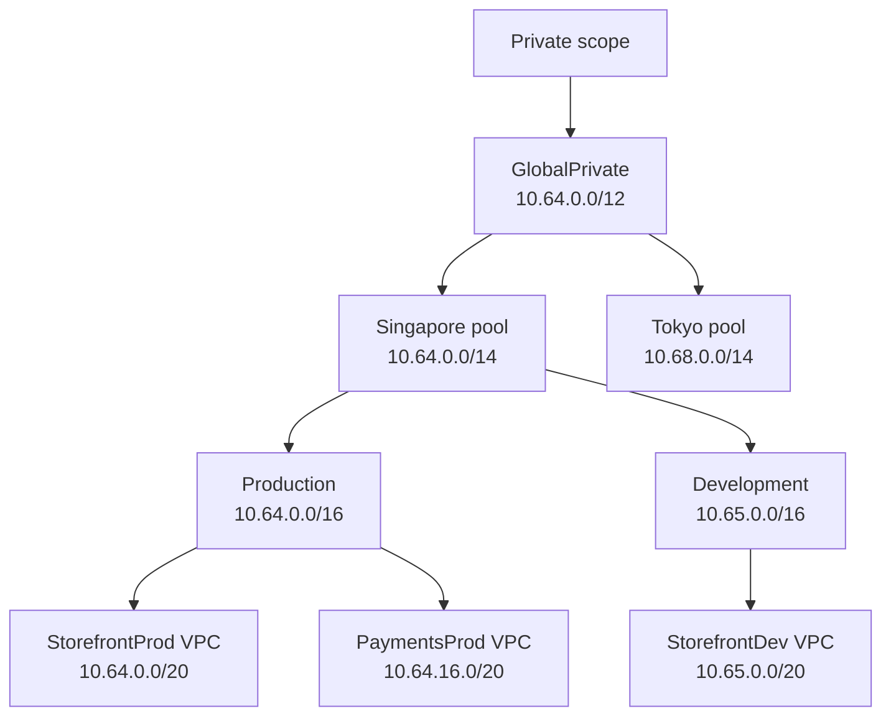

# AWS IPAM và quản lý địa chỉ tập trung

## Mục tiêu học tập

Sau bài học, bạn có thể:

1. Giải thích tại sao hệ thống AWS có nhiều VPC, account, Region và đường kết nối hybrid cần một phương pháp quản lý CIDR tập trung.
2. Mô tả các thành phần của **Amazon VPC IP Address Manager (IPAM)**: IPAM, home Region, operating Region, scope, pool, CIDR provision và allocation.
3. Xây dựng kế hoạch địa chỉ IPv4/IPv6, phân cấp pool theo Region và môi trường, hạn chế rủi ro chồng lấn mạng.
4. Phân biệt **khám phá/giám sát CIDR hiện có** với **cấp phát CIDR mới từ pool**, và giải thích trạng thái compliant, noncompliant, unmanaged, overlapping.
5. Trình bày quản trị IPAM đa tài khoản bằng **AWS Organizations**, delegated administrator và chia sẻ pool qua **AWS Resource Access Manager (RAM)**.
6. Thực hiện một quy trình mẫu với AWS CLI để tạo IPAM, tạo pool, cấp phát dải mạng cho VPC, kiểm tra và dọn tài nguyên theo thứ tự đúng.
7. Đánh giá giới hạn, quyền truy cập, tính sẵn sàng, giám sát và chi phí giữa IPAM Free Tier và Advanced Tier.

## 1. Vì sao quản lý địa chỉ IP trở nên khó khi mở rộng AWS?

Giả sử một doanh nghiệp bắt đầu với một VPC duy nhất. Người quản trị tự chọn CIDR `10.0.0.0/16` và ghi vào bảng tính. Vài tháng sau, nhiều đội tự triển khai VPC trên hai AWS Region:

| Workload | AWS Region | VPC CIDR do nhóm tự chọn |
| --- | --- | --- |
| Storefront Production | Singapore | `10.0.0.0/16` |
| Payments Production | Singapore | `10.1.0.0/16` |
| Analytics Development | Tokyo | `10.0.0.0/16` |
| Hệ thống tại data center | On-premises | `10.1.128.0/17` |

Mỗi VPC vẫn có thể hoạt động riêng. Nhưng khi công ty muốn nối các VPC bằng **VPC peering**, **AWS Transit Gateway** hoặc kết nối về data center bằng **Site-to-Site VPN/Direct Connect**, chồng lấn địa chỉ có thể cản trở định tuyến: mạng không còn phân biệt rõ đường tới một địa chỉ đích.

Ví dụ, `10.1.128.0/17` nằm **bên trong** `10.1.0.0/16`. Nếu thiết kế định tuyến liên thông mà không giải quyết các dải trùng nhau, việc xác định đường đi giữa mạng Payments và data center sẽ gặp xung đột. Một số giải pháp NAT hoặc phân tách miền định tuyến có thể giải quyết từng trường hợp, nhưng làm tăng độ phức tạp.

**Amazon VPC IP Address Manager (IPAM)** là khả năng của Amazon VPC cho phép **lập kế hoạch, quản lý, giám sát và theo dõi lịch sử sử dụng địa chỉ IP** trong môi trường AWS. Thay vì để từng đội tự chọn CIDR, tổ chức tạo các **IPAM pool** rồi cấp phát CIDR cho VPC theo nguyên tắc đã định.

IPAM hỗ trợ hai nhu cầu khác nhau:

- **Quản lý chủ động:** xác định trước các dải được dùng ở từng Region/môi trường; VPC mới xin CIDR từ pool chung.
- **Quan sát hiện trạng:** phát hiện CIDR của các tài nguyên AWS đã tồn tại, hiển thị phạm vi sử dụng, overlap và mức độ tuân thủ những quy tắc pool.

IPAM **không thay thế** VPC, route table, Transit Gateway, VPN, Direct Connect, DNS, firewall hoặc IAM. Nó quản lý thông tin và vòng đời **địa chỉ**; đường đi và quyền truy cập thực tế vẫn do các thành phần mạng và bảo mật quyết định.

## 2. Ôn tập nhanh CIDR và bài toán chồng lấn

Địa chỉ mạng được biểu diễn bằng **Classless Inter-Domain Routing (CIDR)**, gồm địa chỉ mạng và độ dài prefix. Với IPv4, độ dài prefix càng **nhỏ** thì dải càng **lớn**:

| CIDR | Số địa chỉ IPv4 trong khối | Ví dụ sử dụng |
| --- | ---: | --- |
| `10.64.0.0/12` | 1.048.576 | Không gian cấp cao dành cho một đơn vị lớn. |
| `10.64.0.0/14` | 262.144 | Phần địa chỉ dành cho một Region. |
| `10.64.0.0/16` | 65.536 | Pool cho production. |
| `10.64.0.0/20` | 4.096 | CIDR VPC do một pool cấp phát. |
| `10.64.0.0/24` | 256 | Một subnet trong VPC, nếu quy hoạch phù hợp. |

Số trên là **tổng số địa chỉ trong CIDR**, không phải số địa chỉ có thể gán cho EC2. Chẳng hạn, mỗi subnet IPv4 trong VPC có một số địa chỉ AWS dành riêng; quy hoạch CIDR của VPC phải xét thêm cách chia subnet, AZ và tăng trưởng.

Ba dải **RFC 1918** thường dùng cho mạng IPv4 riêng là `10.0.0.0/8`, `172.16.0.0/12` và `192.168.0.0/16`. Khi thiết kế toàn công ty, cần tính cả địa chỉ ở data center, chi nhánh, thiết bị VPN, mạng đối tác hoặc các hạ tầng cloud khác có thể kết nối trong tương lai.

### Khi nào hai CIDR chồng lấn?

Ví dụ:

- `10.64.0.0/20` bao phủ `10.64.0.0` đến `10.64.15.255`.
- `10.64.8.0/21` bao phủ `10.64.8.0` đến `10.64.15.255`, nên **nằm trong /20**, tức **chồng lấn**.
- `10.64.16.0/20` bao phủ `10.64.16.0` đến `10.64.31.255`, nên **không chồng lấn** với `10.64.0.0/20`.

Hai VPC không kết nối có thể dùng cùng một CIDR; tuy nhiên nếu cần kết nối về sau, việc đổi địa chỉ nhiều subnet, ứng dụng và security rule thường tốn công. IPAM giúp phát hiện và hạn chế tình trạng chọn dải thiếu phối hợp.

**IPv6** cũng được IPAM quản lý bằng các CIDR IPv6; không dùng phép tính số địa chỉ kiểu IPv4 để lập kế hoạch IPv6. Các dải IPv6 có nguồn cấp phát và quy tắc dùng riêng, bao gồm lựa chọn IPv6 do Amazon cung cấp, BYOIPv6 và private IPv6 GUA ở các trường hợp được hỗ trợ.

## 3. Các thành phần cốt lõi của Amazon VPC IPAM

### 3.1. IPAM instance, home Region và operating Region

Khi tạo IPAM, bạn chọn **home Region**: nơi tạo IPAM và xem cấu hình quản lý tập trung. IPAM có một hoặc nhiều **operating Regions**: các Region mà IPAM được phép khám phá, giám sát và quản lý CIDR theo tính năng/tier đang dùng.

Ví dụ IPAM đặt tại `ap-southeast-1` (Singapore) và khai báo operating Regions là `ap-southeast-1` và `ap-northeast-1` (Tokyo). IPAM có thể quan sát tài nguyên trong các Region được chọn **nếu tài khoản, quyền và tier hỗ trợ**.

Điều cần nhớ:

- **Home Region** là nơi sở hữu cấu hình IPAM; không phải Region chứa mọi VPC.
- **Operating Region** xác định phạm vi giám sát/quản lý; thiếu một Region có thể khiến VPC trong Region đó không xuất hiện trong inventory.
- Một **regional IPAM pool** có thuộc tính `locale` xác định Region mà dải địa chỉ của pool có thể được cấp phát.
- IPAM chuyển thông tin cần thiết giữa các operating Regions và home Region theo cơ chế dịch vụ. Khi triển khai cần xem xét chính sách dữ liệu, quyền và cấu hình IPAM.

### 3.2. Scope: phân chia miền địa chỉ

**Scope** là container cao nhất của không gian địa chỉ trong một IPAM. Khi tạo IPAM, AWS tạo sẵn **default private scope** và **default public scope**.

| Loại scope | Mục đích điển hình |
| --- | --- |
| **Private scope** | Quản lý không gian IP dùng cho mạng riêng không được quảng bá ra Internet. |
| **Public scope** | Quản lý không gian địa chỉ có thể quảng bá công khai từ AWS; có các trường hợp ngoại lệ về khả năng quảng bá của BYOIPv6. |
| **Private scope bổ sung** | Phân tách các miền mạng độc lập để có thể dùng lại cùng CIDR mà không coi chúng là cùng không gian định tuyến, theo tính năng/tier phù hợp. |

Ví dụ: công ty có hai hệ thống cô lập hoàn toàn, đều dùng `10.20.0.0/16`. Có thể theo dõi chúng ở **các private scope khác nhau** nếu thiết kế cho phép. Nhưng hai không gian CIDR giống nhau **không tự nhiên định tuyến liên thông** chỉ vì được tách scope.

> **Scope là miền quản lý địa chỉ, không phải VPC, subnet, route table hay ranh giới bảo mật tự động.**

### 3.3. Pool: cấp phát theo hệ thống phân cấp

**IPAM pool** chứa một hoặc nhiều CIDR để cấp phát. Một pool có thể có **pool con**; pool con lấy một phần địa chỉ từ pool cha. Có thể thiết kế pool theo Region, môi trường, ứng dụng hoặc miền kết nối.

**Allocation** là một khối CIDR được dành từ pool để sử dụng bởi **một tài nguyên**, **một pool con** hoặc một **reservation** thủ công phù hợp.

**Provision** là thao tác **đưa CIDR vào một pool** để pool có không gian cấp phát. **Allocate** là thao tác **lấy một phần CIDR từ pool** và gắn vào tài nguyên hoặc dành chỗ. Hai động từ này không đồng nghĩa.

| Thuật ngữ | Câu hỏi giải quyết | Ví dụ |
| --- | --- | --- |
| `Provision pool CIDR` | Pool này được quyền quản lý những dải nào? | Provision `10.64.0.0/14` vào pool Singapore. |
| `Allocate CIDR` | Tài nguyên/pool con nào đang giữ một phần dải đó? | VPC `StorefrontProd` nhận `10.64.0.0/20`. |
| `Release allocation` | Dải đã dành thủ công còn cần giữ không? | Giải phóng reservation không còn dùng. |
| `Deprovision pool CIDR` | Có thể rút dải khỏi pool không? | Rút `10.65.0.0/16` khỏi pool sau khi xóa các allocation phụ thuộc. |

Không deprovision một CIDR đang chứa allocation hoạt động. Vòng đời nên xử lý các phụ thuộc trước, sau đó mới trả không gian cho cấp cha.

### 3.4. Resource discovery và lịch sử

**Resource discovery** cho phép IPAM tìm và theo dõi các tài nguyên, địa chỉ của chúng trong phạm vi được cấp quyền. AWS tạo một resource discovery mặc định khi tạo IPAM. Có thể kết hợp thêm resource discoveries được chia sẻ ở các trường hợp quản trị nhiều tổ chức/account ngoài Organization.

IPAM có các khả năng như:

- Xem CIDR đang được dùng bởi VPC và các loại tài nguyên được hỗ trợ.
- Hiển thị địa chỉ đang trùng nhau, dải đã dùng, dải còn trống trong scope.
- Tìm lịch sử sử dụng địa chỉ hoặc CIDR theo thời gian.
- Phân tích việc resource có tuân thủ **allocation rules** của pool hay không.

**Khám phá một VPC đang tồn tại không đồng nghĩa IPAM đã cấp phát CIDR cho VPC đó.** VPC có CIDR do người dùng gán trước đây vẫn có thể xuất hiện trong inventory với trạng thái `Unmanaged`. Chỉ khi pool và cơ chế nhập/quản lý phù hợp được thiết lập, tài nguyên mới được xem là managed allocation theo quy tắc tương ứng.

## 4. Thiết kế cây pool cho công ty đa Region

Giả sử công ty quyết định dành `10.64.0.0/12` cho các workload AWS, sau khi xác nhận dải này không đụng các kết nối on-premises, VPC hiện có và mạng đối tác. Một cây IPAM phù hợp:

```text
IPAM (home Region: ap-southeast-1)
└── Default private scope
    └── GlobalPrivate pool: 10.64.0.0/12
        ├── Singapore pool (locale ap-southeast-1): 10.64.0.0/14
        │   ├── Production pool: 10.64.0.0/16
        │   │   ├── VPC StorefrontProd: 10.64.0.0/20
        │   │   └── VPC PaymentsProd:  10.64.16.0/20
        │   └── Development pool: 10.65.0.0/16
        │       └── VPC StorefrontDev: 10.65.0.0/20
        ├── Tokyo pool (locale ap-northeast-1): 10.68.0.0/14
        │   ├── Production pool: 10.68.0.0/16
        │   └── Development pool: 10.69.0.0/16
        └── Reserved for later: 10.72.0.0/13
```

Trong ví dụ này:

- `10.64.0.0/12` bao phủ `10.64.0.0` đến `10.79.255.255`.
- Singapore dùng `10.64.0.0/14`; Tokyo dùng `10.68.0.0/14`. Hai dải **không chồng lấn**.
- Các VPC `10.64.0.0/20` và `10.64.16.0/20` không trùng nhau.
- `10.72.0.0/13` là **phần ngân sách địa chỉ đề xuất để dành**, không mặc nhiên là reservation trong IPAM. Chỉ khi bạn tạo pool/allocate thủ công mới có trạng thái được ghi nhận như vậy.



**Tại sao chọn cấu trúc Region → môi trường?** Region là yếu tố vận hành quan trọng của VPC; môi trường production/dev có vòng đời và yêu cầu phê duyệt khác nhau. Tuy nhiên, nếu doanh nghiệp chủ yếu kết nối theo **miền định tuyến/security domain** hoặc theo đơn vị kinh doanh, có thể chọn cấu trúc pool phù hợp hơn. Mục tiêu là một cây dễ hiểu, dễ cấp phát, có khoảng trống tăng trưởng và không lặp CIDR ngoài chủ ý.

### Ước lượng năng lực một pool

Một pool `/16` chứa **16 khối /20** khi chia đều, vì `2^(20-16) = 16`. Đây là sức chứa lý thuyết theo kích thước CIDR, chưa trừ các dải đã provision cho pool con, đã reserve hoặc đang bị chiếm.

Trước khi chọn `/20` cho VPC, hãy dự báo số subnet trong mỗi AZ, nhu cầu tách public/private/database, số địa chỉ mà AWS bảo lưu trên subnet và quy mô node, pod, ENI, tài nguyên serverless kết nối VPC. Không nên ấn định kích thước VPC chỉ dựa vào số EC2 hiện tại.

## 5. Allocation rules và kiểm soát tuân thủ

Tại mỗi pool, IPAM hỗ trợ cấu hình những **allocation rules** để chuẩn hóa cách cấp phát:

- **Minimum netmask length:** prefix nhỏ nhất được chấp nhận, tức kích thước CIDR **lớn nhất**.
- **Maximum netmask length:** prefix lớn nhất được chấp nhận, tức kích thước CIDR **nhỏ nhất**.
- **Default netmask length:** kích thước mặc định khi yêu cầu cấp phát mà không chỉ rõ.
- **Allocation resource tags:** những tag bắt buộc trên resource được quản lý từ pool, chẳng hạn `Environment=Production`.
- **Locale:** Region mà pool cấp phát địa chỉ cho resource.
- **Auto-import:** nhập các CIDR mà IPAM phát hiện nằm trong dải của pool khi các điều kiện được hỗ trợ đáp ứng.

Ví dụ, pool `Production-SG` có thể yêu cầu prefix từ `/18` tới `/22`, mặc định `/20`, và tag `Environment=Production`. Một VPC được phân phối `/20` và giữ đúng tag được đánh giá **compliant** nếu các điều kiện khác cũng hợp lệ. Nếu tag đổi hoặc CIDR không còn đáp ứng rule, IPAM có thể chuyển trạng thái **noncompliant**.

**Hai lưu ý quan trọng:**

1. Các allocation rule thuộc một pool áp cho **managed resources trong pool đó**. Không suy ra mọi rule của pool cha tự động được áp cho mọi VPC từ pool cháu; cấu hình cần được kiểm tra ở đúng pool cấp phát.
2. Auto-import và quá trình discovery có độ trễ và điều kiện, không phải là hệ thống chặn tức thì mọi CIDR thủ công được tạo ở ngoài pool. Hãy chuẩn hóa pipeline tạo VPC để sử dụng IPAM và kiểm soát quyền `ec2:CreateVpc`/`ec2:AssociateVpcCidrBlock` trong phạm vi phù hợp.

### Các trạng thái kiểm tra trên IPAM

| Trạng thái | Ý nghĩa thực tiễn | Hướng xử lý |
| --- | --- | --- |
| **Compliant** | Resource được quản lý và đáp ứng allocation rules. | Tiếp tục theo dõi thay đổi và mức sử dụng. |
| **Noncompliant** | Resource được quản lý nhưng vi phạm một hoặc nhiều rules: netmask, tag, locale… | Xác định rule bị vi phạm; điều chỉnh resource, tag hoặc thiết kế pool theo quy trình. |
| **Unmanaged** | CIDR được theo dõi nhưng không phải managed allocation từ pool. | Lập kế hoạch đưa vào IPAM hoặc ghi nhận ngoại lệ. |
| **Overlapping** | CIDR trùng một phần/toàn phần với resource hoặc allocation khác trong **cùng scope**. | Xem topology và miền định tuyến; phân biệt overlap nguy hiểm với mạng chủ ý độc lập. |
| **Ignored** | Resource được loại khỏi việc đánh giá theo cơ chế ignore. | Chỉ dùng khi có lý do rõ ràng; tránh che khuất sự cố quản lý địa chỉ. |

**Đánh giá IPAM không tự thay đổi route table.** Một VPC `Compliant` vẫn có thể mất kết nối do route, Security Group, NACL, DNS, TGW, VPN hoặc service endpoint sai. Tương tự, IPAM hiển thị overlap là tín hiệu cần phân tích kiến trúc, không phải bằng chứng mọi kết nối đang bị lỗi.

## 6. Tích hợp AWS Organizations: quản trị IPAM đa tài khoản

Một doanh nghiệp có nhiều AWS account thường áp dụng:

```text
AWS Organizations
├── Management account
│   └── Chỉ định IPAM delegated administrator
├── NetworkServices account (delegated IPAM administrator)
│   ├── IPAM / scopes / pools
│   ├── Theo dõi CIDR toàn Organization
│   └── Chia sẻ pools qua AWS RAM
├── StorefrontProd account
│   └── Tạo VPC từ pool được chia sẻ
├── PaymentsProd account
│   └── Tạo VPC từ pool được chia sẻ
└── AnalyticsDev account
    └── Tạo VPC từ pool được chia sẻ
```

**Delegated administrator** là **member account** được management account giao quản trị chức năng IPAM. Khi tích hợp đúng với Organizations, IPAM có thể quan sát các resource CIDR của những member accounts trong các operating Regions được chọn, bất kể chúng nằm ở OU nào. Cơ chế này sử dụng **service-linked IAM role** của IPAM trong member accounts theo tích hợp dịch vụ.

### Quy trình phân vai

1. **Management account:** bật tích hợp IPAM với AWS Organizations và chỉ định một member account (ví dụ `NetworkServices`) làm IPAM administrator.
2. **NetworkServices:** tạo IPAM tại home Region, chọn operating Regions, scopes/pools và allocation rules; theo dõi inventory địa chỉ.
3. **NetworkServices:** chia sẻ pool thích hợp cho account/OU qua **AWS RAM**; chia sẻ đúng pool mà đội ứng dụng cần dùng.
4. **Member account:** dùng quyền IAM được cấp để tạo VPC từ pool đã chia sẻ, thay vì tự nhập CIDR.
5. **Nhóm vận hành:** rà soát overlap, tuân thủ, quota, tăng trưởng và vòng đời các dải đã cấp.

**Đặc biệt khi bật IPAM integration:** AWS yêu cầu sử dụng **IPAM console** hoặc API `ec2:EnableIpamOrganizationAdminAccount`. Nếu chỉ bật trusted access từ AWS Organizations console hoặc chỉ gọi `organizations:RegisterDelegatedAdministrator`, role `AWSServiceRoleForIPAM` có thể không được tạo đúng; quá trình quan sát và quản lý địa chỉ đa account sẽ không hoạt động như mong đợi.

Trong member accounts, service-linked role phục vụ **AWS IPAM service**, không đồng nghĩa người dùng tại NetworkServices tự có quyền quản trị tất cả EC2, VPC hoặc IAM trong mọi account. Quyền của người vận hành vẫn cần IAM thích hợp; SCP và quy trình bảo mật tổ chức cũng phải được xét.

### Vì sao vẫn cần AWS RAM?

IPAM **nhìn thấy** CIDR của các member accounts không có nghĩa tất cả account đều **được cấp CIDR từ mọi pool**. Khi muốn account khác sử dụng pool để tạo VPC, IPAM administrator cần chia sẻ pool thông qua **AWS Resource Access Manager** và cho phép đúng principal được sử dụng.

Các điểm cần kiểm tra:

- IPAM đã tích hợp với AWS Organizations.
- AWS RAM đã bật chia sẻ tài nguyên trong Organization.
- Resource share của pool được tạo tại **home Region của IPAM**, kể cả khi pool có locale ở Region khác.
- IAM principal có quyền sử dụng pool; account/OU đích là principal của share.
- Quy tắc netmask, tag, locale của pool cho phép allocation được yêu cầu.

IPAM pool share là **chia sẻ quyền sử dụng dải CIDR**. Nó **không** kết nối hai VPC, không hợp nhất account và không tạo sẵn route Transit Gateway.

### Nếu có account nằm ngoài cùng một Organization?

IPAM có khả năng tích hợp **resource discovery được chia sẻ** với những account ngoài Organization theo thủ tục riêng. Cần xử lý rõ phạm vi dữ liệu được chia sẻ, quyền của chủ tài khoản và khu vực giám sát; không coi external account là member account đã tự được khám phá và ủy quyền.

## 7. Free Tier, Advanced Tier và chi phí

IPAM có **Free Tier** và **Advanced Tier** với phạm vi tính năng khác nhau.

| Tiêu chí | Free Tier | Advanced Tier |
| --- | --- | --- |
| Mục tiêu | Khởi đầu với các khả năng được AWS cung cấp miễn phí. | Quản trị địa chỉ toàn diện trong môi trường lớn, đa Region/account khi cần. |
| Đa Region | Có thể chọn nhiều operating Regions, nhưng **Public IP insights** là tính năng hoạt động qua nhiều Region trong Free Tier; các tính năng khác bị giới hạn ở home Region. | Hỗ trợ các chức năng IPAM xuyên operating Regions theo điều kiện dịch vụ. |
| Các scope/pool, chia sẻ đa account và tính năng nâng cao | Có giới hạn tùy tính năng; cần xem bảng hỗ trợ hiện hành. | Phù hợp cho các mô hình private pools, phân chia phạm vi và chia sẻ cần tính năng nâng cao. |
| Giá | Theo phạm vi miễn phí/tính năng được công bố. | Tính phí theo **số địa chỉ IP đang hoạt động do IPAM quản lý × số giờ**, theo đơn giá/tier hiện hành. |

Với Advanced Tier, chi phí không nên được ước tính bằng cách **lấy tổng địa chỉ của toàn bộ CIDR pool nhân đơn giá**. AWS dùng đơn vị **active IP address-hours** theo định nghĩa tính phí của IPAM. Hãy dùng AWS pricing calculator, trang giá Amazon VPC/IPAM và thông tin sử dụng thực tế để tính.

Để theo dõi chi phí IPAM, sử dụng **AWS Cost Explorer** lọc usage type liên quan `IPAddressManager`; có thể đánh giá theo Region, account và khoảng thời gian. Nếu dùng cơ chế phân bổ chi phí theo account sở hữu resource, cần xem cấu hình **metering mode** được hỗ trợ.

**Không tự giả định Free Tier đủ cho một IPAM quản lý tất cả private CIDR ở nhiều Region.** Với bài toán Organizations + Singapore + Tokyo, nên xác nhận tính năng trong bảng giá và thường cần đánh giá Advanced Tier.

## 8. Thực hành AWS CLI: tạo IPAM và cấp phát CIDR cho VPC

Ví dụ tập trung vào **tạo resource ở một account IPAM thử nghiệm**; nếu tổ chức đã có delegated administrator thì dùng profile của account đó. Tất cả ID và tên profile dưới đây đều là **giả định**. Lệnh thực tế tạo resource và có thể phát sinh chi phí, đặc biệt khi chọn Advanced Tier.

**Giả định:**

- Home Region: `ap-southeast-1`.
- Operating Regions: Singapore và Tokyo.
- IPv4 private tổng: `10.64.0.0/12` đã được xác minh không chồng lấn với mạng công ty.
- Pool Singapore: `10.64.0.0/14`.
- Pool Development Singapore: `10.65.0.0/16`.
- VPC Development sẽ xin một CIDR `/20` từ pool.

Để thuận tiện đọc ví dụ:

- `--profile ipam-admin` đại diện cho IAM role có quyền quản lý IPAM.
- `--profile org-management` là role tại Organizations management account, chỉ dùng ở bước được ủy quyền.
- Các lệnh sử dụng cú pháp Bash nhiều dòng; khi chạy trên PowerShell cần chuyển cách xuống dòng hoặc viết trên một dòng.

### 8.1. Kiểm tra danh tính và bật delegated IPAM admin (chỉ khi dùng Organization)

```bash
aws sts get-caller-identity --profile org-management

# Chạy từ management account, chỉ định MEMBER account làm IPAM admin
aws ec2 enable-ipam-organization-admin-account \
  --delegated-admin-account-id 222233334444 \
  --region ap-southeast-1 \
  --profile org-management
```

Account `222233334444` phải là **member account**, không phải management account. Bước này không cần thực hiện nếu đã cấu hình IPAM delegated administrator từ trước. Nếu chỉ thực hành IPAM một account, bỏ qua bước delegated admin và dùng account được cấp quyền trong các bước còn lại.

Kiểm tra danh tính sau khi chuyển profile:

```bash
aws sts get-caller-identity --profile ipam-admin
```

### 8.2. Tạo IPAM

```bash
aws ec2 create-ipam \
  --description "ExampleCommerce central IPAM" \
  --tier advanced \
  --operating-regions RegionName=ap-southeast-1 RegionName=ap-northeast-1 \
  --region ap-southeast-1 \
  --profile ipam-admin
```

Ghi lại `IpamId` trả về, ví dụ `ipam-0123456789abcdef0`. Trạng thái tạo có thể chưa hoàn tất ngay. Xem IPAM và tìm private scope mặc định:

```bash
aws ec2 describe-ipams \
  --ipam-ids ipam-0123456789abcdef0 \
  --region ap-southeast-1 \
  --profile ipam-admin
```

Từ phần `Ipams`, lấy `PrivateDefaultScopeId`, ví dụ `ipam-scope-01111111111111111`. Mọi lệnh tiếp theo phải thay ID ví dụ bằng ID được cấp thật.

### 8.3. Tạo top-level pool và provision CIDR

```bash
aws ec2 create-ipam-pool \
  --ipam-scope-id ipam-scope-01111111111111111 \
  --address-family ipv4 \
  --description "Global private IPv4 address space" \
  --region ap-southeast-1 \
  --profile ipam-admin
```

Ghi lại `IpamPoolId`, ví dụ `ipam-pool-02222222222222222`. Đợi pool đạt trạng thái `create-complete`:

```bash
aws ec2 describe-ipam-pools \
  --ipam-pool-ids ipam-pool-02222222222222222 \
  --query 'IpamPools[0].State' \
  --region ap-southeast-1 \
  --profile ipam-admin
```

Provision không gian IPv4:

```bash
aws ec2 provision-ipam-pool-cidr \
  --ipam-pool-id ipam-pool-02222222222222222 \
  --cidr 10.64.0.0/12 \
  --region ap-southeast-1 \
  --profile ipam-admin
```

Kiểm tra CIDR `10.64.0.0/12` có state `provisioned`:

```bash
aws ec2 get-ipam-pool-cidrs \
  --ipam-pool-id ipam-pool-02222222222222222 \
  --region ap-southeast-1 \
  --profile ipam-admin
```

### 8.4. Tạo regional pool và Development pool

Pool Singapore nhận một phần từ top-level pool:

```bash
aws ec2 create-ipam-pool \
  --ipam-scope-id ipam-scope-01111111111111111 \
  --source-ipam-pool-id ipam-pool-02222222222222222 \
  --locale ap-southeast-1 \
  --address-family ipv4 \
  --description "Singapore IPv4 pool" \
  --region ap-southeast-1 \
  --profile ipam-admin
```

Giả sử pool mới là `ipam-pool-03333333333333333`. Đợi `create-complete`, rồi:

```bash
aws ec2 provision-ipam-pool-cidr \
  --ipam-pool-id ipam-pool-03333333333333333 \
  --cidr 10.64.0.0/14 \
  --region ap-southeast-1 \
  --profile ipam-admin
```

Đợi state `provisioned` trước khi tạo pool con, rồi tạo Development pool:

```bash
aws ec2 create-ipam-pool \
  --ipam-scope-id ipam-scope-01111111111111111 \
  --source-ipam-pool-id ipam-pool-03333333333333333 \
  --locale ap-southeast-1 \
  --address-family ipv4 \
  --description "Singapore development IPv4 pool" \
  --region ap-southeast-1 \
  --profile ipam-admin
```

Giả sử Development pool có ID `ipam-pool-04444444444444444`. Sau khi pool tạo xong, provision `10.65.0.0/16`:

```bash
aws ec2 provision-ipam-pool-cidr \
  --ipam-pool-id ipam-pool-04444444444444444 \
  --cidr 10.65.0.0/16 \
  --region ap-southeast-1 \
  --profile ipam-admin

aws ec2 get-ipam-pool-cidrs \
  --ipam-pool-id ipam-pool-04444444444444444 \
  --region ap-southeast-1 \
  --profile ipam-admin
```

Như vậy, dải địa chỉ đã đi từ **top-level pool → Singapore pool → Development pool**. Mỗi lần provision vào pool con sẽ dành một phần từ pool cha, theo trạng thái của hệ thống IPAM.

### 8.5. Tạo VPC dùng CIDR IPAM cấp phát tự động

Sau khi Development pool sẵn sàng, tạo VPC tại Singapore:

```bash
aws ec2 create-vpc \
  --ipv4-ipam-pool-id ipam-pool-04444444444444444 \
  --ipv4-netmask-length 20 \
  --tag-specifications 'ResourceType=vpc,Tags=[{Key=Name,Value=StorefrontDev},{Key=Environment,Value=Development}]' \
  --region ap-southeast-1 \
  --profile ipam-admin
```

Kết quả trả về `VpcId` và `CidrBlock`; CIDR thực tế là **một /20 còn trống từ pool**. Nó có thể là `10.65.0.0/20`, nhưng không được giả định trước dải AWS sẽ chọn khi pool đã có allocation khác.

Xem allocation:

```bash
aws ec2 get-ipam-pool-allocations \
  --ipam-pool-id ipam-pool-04444444444444444 \
  --region ap-southeast-1 \
  --profile ipam-admin
```

Kết quả kỳ vọng có allocation với `ResourceType=vpc`, `ResourceId` tương ứng VPC mới và `Cidr` là dải /20 AWS đã cấp.

**Lưu ý về tạo VPC từ shared pool:** nếu IPAM pool đã được chia sẻ qua RAM, member account sẽ thực hiện lệnh tạo VPC bằng profile của **member account** và phải có quyền sử dụng pool; `--region` phải phù hợp `locale`. Kịch bản trên chỉ dùng một profile để làm rõ cơ chế tạo/cấp phát.

### 8.6. Reservation thủ công và dọn dẹp

Nếu muốn **đặt trước** một CIDR dành cho một hệ thống chưa triển khai VPC, IPAM hỗ trợ tạo **manual allocation** (khác với VPC allocation tự động):

```bash
# Dành trước một khối /20 từ Development pool
aws ec2 allocate-ipam-pool-cidr \
  --ipam-pool-id ipam-pool-04444444444444444 \
  --netmask-length 20 \
  --region ap-southeast-1 \
  --profile ipam-admin
```

Lệnh trả về `IpamPoolAllocationId` và CIDR được dành. Hãy ghi lại ID để release khi không còn cần reservation; **không** coi reservation tự động tạo ra một VPC.

Khi kết thúc bài thử nghiệm, cần xóa theo thứ tự phụ thuộc:

1. Xóa các tài nguyên trong VPC thử nghiệm và xóa VPC; IPAM sẽ cập nhật allocation của resource theo vòng đời dịch vụ.
2. Release **manual allocation** chưa dùng bằng API tương ứng, sau khi kiểm tra đúng allocation ID.
3. Chỉ sau khi hết allocation phụ thuộc, **deprovision** CIDR khỏi Development pool rồi xóa Development pool.
4. Tiếp tục deprovision/delete Singapore pool, top-level pool.
5. Cuối cùng xóa IPAM thử nghiệm nếu không còn resource discovery hoặc thành phần phụ thuộc khác.

Ví dụ những lệnh dọn dẹp khi **đã xác nhận** tài nguyên đúng và không còn phụ thuộc:

```bash
# Ví dụ sau khi VPC đã bị xóa và không còn allocation con
aws ec2 deprovision-ipam-pool-cidr \
  --ipam-pool-id ipam-pool-04444444444444444 \
  --cidr 10.65.0.0/16 \
  --region ap-southeast-1 \
  --profile ipam-admin

aws ec2 delete-ipam-pool \
  --ipam-pool-id ipam-pool-04444444444444444 \
  --region ap-southeast-1 \
  --profile ipam-admin
```

Không chạy các lệnh dọn dẹp chỉ vì ID nhìn giống ví dụ. Nếu đang dùng IPAM chung của doanh nghiệp, không tự xóa pool/root/IPAM để “dọn bài”; làm việc trên môi trường thử nghiệm cô lập và xác nhận quyền sở hữu.

## 9. Chia sẻ pool cho member account qua AWS RAM

Sau khi IPAM được tích hợp Organizations và tạo pool phân bổ cho `Production`/`Development`, delegated administrator có thể chia sẻ pool cho OU hoặc account phù hợp:

1. Mở AWS VPC IPAM tại **home Region**, chọn pool có CIDR và rules thích hợp.
2. Chọn **Create resource share** để mở AWS RAM.
3. Chọn tài nguyên `IPAM pools` và principal, ví dụ OU chứa workload Development.
4. Sử dụng RAM permission phù hợp, thông thường `AWSRAMDefaultPermissionsIpamPool` cho việc xem/cấp phát/giải phóng trong phạm vi được hỗ trợ.
5. Đảm bảo AWS RAM **sharing within Organizations** được bật và IAM của thành viên có quyền tạo VPC/nhận CIDR.
6. Từ member account, tạo VPC chọn **IPAM-allocated IPv4 CIDR** và đúng pool đã được chia sẻ.

Với shared pool, người sở hữu tài nguyên sẽ tiếp tục quản lý VPC và các subnet/route/security groups trong account của họ. IPAM administrator quản trị nguồn địa chỉ và quan sát việc sử dụng; đây là **phân tách trách nhiệm** cần giữ trong kiến trúc đa tài khoản.

**Không chia sẻ root/top-level pool cho mọi member account** nếu mỗi nhóm chỉ cần một phần địa chỉ. Nên chia sẻ pool lá đã gắn Region, môi trường và allocation rules cụ thể.

## 10. Giám sát CIDR, mức sử dụng và lịch sử

IPAM có thể được dùng cho các hoạt động:

### 10.1. Phát hiện overlap

Giả sử một VPC mới có `10.64.8.0/21` trong scope chứa VPC `10.64.0.0/20`. Hai dải chồng lấn như đã phân tích. IPAM cho phép tìm tài nguyên, account, Region và CIDR liên quan để đội mạng xử lý theo quy trình.

**Không nên sửa địa chỉ VPC production ngay khi thấy cảnh báo.** Trước tiên xác định hai VPC có thực sự cần định tuyến chung hay không, mức độ phụ thuộc và khả năng dùng giải pháp liên thông phù hợp. Nếu phải đổi địa chỉ, cần kế hoạch migration về subnet, ENI, DNS, routes, firewall và ứng dụng.

### 10.2. Tìm địa chỉ và lịch sử cấp phát

Ở IPAM console có các chức năng như **Search IP history** và xem **Resources** theo scope/pool. Có thể tìm thời điểm một CIDR được sử dụng, resource/account tương ứng và các thay đổi theo phạm vi tính năng hỗ trợ.

Qua CLI:

```bash
# Liệt kê những CIDR của resources do IPAM quản lý/giám sát trong scope
aws ec2 get-ipam-resource-cidrs \
  --ipam-scope-id ipam-scope-01111111111111111 \
  --region ap-southeast-1 \
  --profile ipam-admin

# Xem các allocation từ một pool cụ thể
aws ec2 get-ipam-pool-allocations \
  --ipam-pool-id ipam-pool-04444444444444444 \
  --region ap-southeast-1 \
  --profile ipam-admin
```

Kết quả khác nhau vì **resource discovery** và **pool allocations** không phải cùng một danh sách. Chỉ chạy lệnh ở Region phù hợp và đảm bảo quyền truy cập của profile.

### 10.3. Các chỉ số vận hành nên theo dõi

| Chỉ số quan sát | Quyết định được hỗ trợ |
| --- | --- |
| CIDR còn trống theo pool và Region | Khi nào cần cấp thêm pool CIDR hoặc mở rộng không gian dành cho một vùng. |
| Số allocation thực tế và kích thước CIDR | Pool có đang bị phân mảnh hoặc cấp dải quá rộng không. |
| Resources `Unmanaged` | Tài nguyên nào chưa đi qua quy trình cấp phát tập trung. |
| CIDR `Overlapping` trong cùng scope | Những vùng cần xem xét trước khi cấu hình TGW, VPN, Direct Connect hoặc peering. |
| Resources `Noncompliant` | Tag, kích thước CIDR hoặc locale nào không đúng quy định. |
| Operating Regions và tài khoản được giám sát | Có Region/account mới nào chưa được IPAM bao phủ không. |
| Active IP address-hours | Chi phí thực của Advanced Tier và xu hướng tăng trưởng. |

Các dữ liệu từ IPAM có thể bổ sung cho **AWS Config**, **CloudTrail**, AWS Organizations và dashboard quản trị hạ tầng. IPAM không thay thế log luồng mạng của **VPC Flow Logs** hay phép đo độ trễ/băng thông.

## 11. Quyền truy cập, bảo mật và quản trị thay đổi

### 11.1. Đặt ranh giới quyền hợp lý

Một mô hình tách vai trò:

| Vai trò | Các thao tác cần thiết | Hạn chế cần có |
| --- | --- | --- |
| **Network Architect** | Đề xuất phân chia địa chỉ, pool, Region, security domain. | Không tự thay đổi production khi chưa có quy trình. |
| **IPAM Administrator** | Quản lý scopes/pools, allocation rules, RAM shares, resource inventory. | Chỉ dùng member account được ủy quyền; giới hạn IAM theo tác vụ. |
| **Application Platform Engineer** | Tạo VPC từ pool được chia sẻ, quản lý subnet/tài nguyên của ứng dụng. | Không sửa global pool, không quản lý VPC của account khác. |
| **Security/Auditor** | Xem sự tuân thủ, thay đổi và lịch sử sử dụng. | Dùng read-only permissions khi phù hợp. |

Cần bảo vệ thao tác cấp phát/thu hồi địa chỉ và thay đổi RAM share bằng IAM, SCP và quy trình phê duyệt phù hợp. Một lỗi đổi pool hoặc thu hồi CIDR đang sử dụng có thể ảnh hưởng kế hoạch mở rộng VPC, không chỉ số liệu báo cáo.

### 11.2. Chọn scope có trách nhiệm

Nếu tạo **hai private scopes** chứa cùng CIDR, đội mạng phải biết rõ chúng đại diện cho những miền **thực sự tách biệt**. Sau này muốn nối hai miền, bài toán overlap vẫn tồn tại ở tầng định tuyến. Việc tách scope sai có thể che đi nhu cầu kiểm tra trùng lặp của toàn công ty.

### 11.3. Đồng bộ với hạ tầng ngoài AWS

Khi doanh nghiệp có data center hoặc cloud khác, xây dựng **sổ đăng ký CIDR liên cloud**: địa chỉ đã dùng, địa chỉ dành trước, chủ sở hữu, mục đích, miền định tuyến và trạng thái kết nối. Có thể dùng IPAM để ghi nhận/phân bổ thủ công các dải được lên kế hoạch, nhưng đừng suy ra IPAM sẽ tự khám phá mọi router/thiết bị ngoài AWS hoặc cấu hình BGP cho Direct Connect.

Nếu cần áp các thay đổi mạng trên nhiều account, có thể kết hợp **Infrastructure as Code**, ví dụ CloudFormation/Terraform, với IPAM pools và quy trình review CIDR. IPAM quyết định không gian địa chỉ được cấp; công cụ IaC thực thi tài nguyên VPC/route/TGW theo thiết kế.

## 12. Xử lý sự cố thường gặp

| Triệu chứng | Nguyên nhân khả dĩ | Cách kiểm tra |
| --- | --- | --- |
| Không tìm thấy VPC của một account trong IPAM | IPAM chưa tích hợp Organizations, role thiếu, resource discovery chưa bao phủ hoặc Region chưa là operating Region. | Xem Organization settings, delegated admin, operating Regions, resource discovery và trạng thái tài nguyên. |
| Không cấp được CIDR cho VPC | Pool hết chỗ, prefix không hợp lệ, locale khác Region, thiếu RAM share/IAM hoặc pool chưa `provisioned`. | Xem pool hierarchy, CIDRs, rules, `State` và quyền tài khoản tạo VPC. |
| Pool con `create-complete` nhưng `create-vpc` vẫn lỗi | Chưa provision CIDR vào pool con hoặc thiếu nguồn cấp phát phù hợp. | `get-ipam-pool-cidrs` và `get-ipam-pool-allocations`. |
| VPC bị đánh dấu `Noncompliant` | Tag bị đổi, netmask lệch rule hoặc resource không khớp locale. | Resource → Compliance status → allocation rules của đúng pool. |
| IPAM thấy VPC cũ nhưng không có allocation | Resource đang `Unmanaged`, chỉ được discovery theo dõi. | Kiểm tra có tạo VPC bằng IPAM pool hay đã auto-import theo cấu hình. |
| Lỗi `AccessDenied` khi tạo VPC từ shared pool | RAM share chưa chia đúng principal, AWS RAM org sharing chưa bật hoặc IAM/SCP chặn. | Kiểm tra share tại home Region và quyền profile member account. |
| Có overlap nhưng hệ thống vẫn chạy | VPC chưa nối mạng, hoặc trùng lặp nằm trong các miền độc lập. | Xem topology, routes, TGW attachments, peering và kế hoạch kết nối tương lai. |
| Không thể xóa pool/IPAM | Còn allocation, provision CIDR, child pool hoặc resource dependency. | Xóa theo thứ tự VPC/reservation → pool con → pool cha → IPAM. |
| Chi phí Advanced Tier tăng nhanh | Nhiều active IP được quản lý hoặc thêm account/Region ngoài dự toán. | Cost Explorer `IPAddressManager`, kiểm tra metering mode và phạm vi resource discovery. |

**Nguyên tắc xử lý:** không giải quyết lỗi cấp phát bằng cách nới hết allocation rules hoặc chuyển toàn bộ người dùng sang quyền Administrator. Hãy xác định chính xác lớp bị lỗi: **account/Region → scope → pool → provision → allocation → IAM/RAM → resource**.

## 13. Bài tập tình huống thiết kế

**Bối cảnh:** Công ty đang vận hành 40 VPC trong 15 AWS account ở Singapore và Tokyo. Một số VPC dùng `10.0.0.0/16` trùng nhau; data center sử dụng `10.100.0.0/16`. Công ty chuẩn bị dùng Transit Gateway để kết nối các VPC quan trọng và Site-to-Site VPN vào data center.

Yêu cầu của kiến trúc mới:

1. Không cấp phát thêm dải gây chồng lấn đối với những VPC sẽ kết nối.
2. Các account production/dev nhận CIDR tự động khi tạo VPC.
3. Nhóm Network quản lý pool, các nhóm ứng dụng chỉ quản lý VPC của họ.
4. Có báo cáo CIDR đã dùng, còn trống, overlap, noncompliant và chi phí.
5. Có thể mở thêm Region trong tương lai.

### Một phương án giải

**Khảo sát hiện trạng:** thống kê CIDR của VPC, subnet, on-premises và các kết nối; xác định những dải bắt buộc giữ nguyên, những dải phải migration. Không coi hai CIDR trùng là lỗi nếu các mạng không bao giờ nối, nhưng ghi nhận rủi ro tương lai.

**Chọn địa chỉ mục tiêu:** sau khi đối chiếu với toàn bộ inventory, dành một khối riêng như `10.64.0.0/12` cho AWS VPC mới; tránh `10.100.0.0/16` đang dùng ở data center. Phân chia theo Region và môi trường như sơ đồ ở mục 4.

**Vận hành tập trung:** management account chỉ định `NetworkServices` làm delegated IPAM administrator; account đó tạo IPAM, chọn Singapore/Tokyo làm operating Regions và chia sẻ pool lá qua AWS RAM cho đúng account/OU. Quy trình cấp VPC buộc chọn pool được chia sẻ và kích thước CIDR hợp lệ.

**Xử lý overlap cũ:** IPAM discovery tạo inventory và cảnh báo, nhưng **không tự đổi CIDR đang sử dụng**. Lập kế hoạch migration từng VPC, kiểm tra route/TGW/DNS/security group và rollback. Chỉ kết nối các mạng sau khi chắc chắn đường định tuyến được thiết kế đúng.

**Kiểm soát kết quả:** giám sát `Unmanaged`, `Overlapping`, `Noncompliant`, pool còn trống và IPAM usage costs hàng tháng. Khi cần Region mới, đăng ký operating Region, thêm pool có locale phù hợp, chia sẻ tới thành viên và kiểm thử provisioning.

### Tự đánh giá

- Giải thích vì sao một CIDR đang **Unmanaged** vẫn xuất hiện trong IPAM.
- Chỉ ra tại sao không thể dùng IPAM thay cho bảng định tuyến Transit Gateway.
- Tính số khối `/20` tối đa có thể lấy từ một pool `/16` khi không có allocation khác.
- Mô tả sự khác nhau giữa hai account có **quyền xem CIDR** và có **quyền allocate CIDR**.
- Đề xuất cách theo dõi một VPC mới được tạo bằng CIDR thủ công ngoài pool của tổ chức.

## 14. Sai lầm thường gặp

**Sai lầm 1: “IPAM tạo ra kết nối mạng giữa các VPC.”**  
Không đúng. IPAM quản lý địa chỉ; muốn liên thông phải thiết kế TGW, peering, VPN, Direct Connect, route, DNS và chính sách an toàn tương ứng.

**Sai lầm 2: “Tạo IPAM là tự động cấp CIDR hợp lý cho mọi VPC đang có.”**  
Không đúng. IPAM có thể khám phá VPC hiện có, nhưng cấp phát tự động xảy ra khi VPC được tạo từ pool hoặc theo một quy trình quản lý được hỗ trợ.

**Sai lầm 3: “Provision một CIDR vào pool là tạo ra VPC.”**  
Không đúng. Provision thêm không gian cho pool; allocate mới dành địa chỉ cho resource hoặc reservation. Tạo VPC là thao tác khác.

**Sai lầm 4: “Cấp quyền delegated IPAM admin là mọi account tự dùng được mọi pool.”**  
Không đúng. Cần AWS RAM share, IAM permissions và allocation rules phù hợp.

**Sai lầm 5: “Có nhiều operating Regions nghĩa là mọi tính năng Free Tier đều hoạt động xuyên Region.”**  
Không đúng. Free Tier có giới hạn; Public IP insights là tính năng được hỗ trợ qua operating Regions, còn nhiều tính năng khác chỉ hoạt động ở home Region.

**Sai lầm 6: “Nếu IPAM không báo overlap thì các hệ thống sẽ định tuyến được.”**  
Không đúng. Phạm vi phát hiện có thể thiếu Region/account hoặc các mạng ngoài AWS; ngay cả CIDR không trùng vẫn có thể không kết nối được vì route, firewall, VPN hoặc DNS.

**Sai lầm 7: “Hai private scopes khác nhau cùng dùng một CIDR thì có thể kết nối trực tiếp.”**  
Không đúng. Scope là miền quản lý; nếu kết nối hai mạng địa chỉ trùng, cần giải quyết xung đột định tuyến.

**Sai lầm 8: “Chi phí IPAM Advanced Tier bằng tổng số địa chỉ lý thuyết trong pool.”**  
Không đúng. AWS tính theo active IP address-hours được quản lý, với định nghĩa và đơn giá hiện hành.

## 15. Câu hỏi tự kiểm tra

**Câu 1.** IPAM khác gì với route table?  
**Đáp án:** IPAM quản lý/quan sát địa chỉ và CIDR; route table quyết định bước tiếp theo của gói tin. Một VPC có CIDR được IPAM cấp vẫn cần route và kết nối mạng thích hợp.

**Câu 2.** Bạn có một parent pool `10.64.0.0/14`; muốn dùng `10.65.0.0/16` cho Development. Đây là thao tác gì?  
**Đáp án:** Tạo pool con và **provision** `10.65.0.0/16` vào pool con; từ đó có thể **allocate** các CIDR nhỏ hơn cho VPC Development.

**Câu 3.** Tại sao `10.64.8.0/21` chồng lấn `10.64.0.0/20`?  
**Đáp án:** Vì /21 nằm trong khoảng địa chỉ mà /20 đã bao phủ (`10.64.0.0` đến `10.64.15.255`).

**Câu 4.** Một VPC hiện hữu được IPAM phát hiện nhưng không tạo từ pool, nên có thể được báo trạng thái nào?  
**Đáp án:** `Unmanaged`, dù CIDR của nó vẫn có thể được theo dõi để phát hiện overlap.

**Câu 5.** Chỉ định IPAM delegated administrator bằng API Organizations `RegisterDelegatedAdministrator` có đủ không?  
**Đáp án:** Không theo quy trình tích hợp IPAM được AWS hướng dẫn. Cần dùng IPAM console hoặc `ec2:EnableIpamOrganizationAdminAccount` để service-linked role được cấu hình đúng.

**Câu 6.** Vì sao share IPAM pool bằng AWS RAM phải thực hiện ở home Region?  
**Đáp án:** Vì IPAM pool resource sharing trong AWS RAM được quản lý tại home Region của IPAM, kể cả pool có locale ở Region khác.

**Câu 7.** Pool `/16` chia đều cho các VPC `/20` chứa tối đa bao nhiêu khối?  
**Đáp án:** `2^(20 - 16) = 16` khối /20, trước khi tính allocation/reservation khác.

**Câu 8.** Công ty có hai VPC trùng CIDR nhưng đang cô lập. IPAM có tự giải quyết khi kết nối chúng qua TGW không?  
**Đáp án:** Không. Cần thiết kế dải CIDR mới, migration hoặc giải pháp mạng phù hợp; IPAM chỉ giúp phát hiện và theo dõi.

## Tài liệu AWS chính thức

- [Amazon VPC IPAM — What is IPAM?](https://docs.aws.amazon.com/vpc/latest/ipam/what-it-is-ipam.html)
- [How IPAM works: scopes, pools and allocations](https://docs.aws.amazon.com/vpc/latest/ipam/how-it-works-ipam.html)
- [Create an IPAM and configure operating Regions](https://docs.aws.amazon.com/vpc/latest/ipam/create-ipam.html)
- [Integrate IPAM with AWS Organizations](https://docs.aws.amazon.com/vpc/latest/ipam/enable-integ-ipam.html)
- [Share an IPAM pool using AWS RAM](https://docs.aws.amazon.com/vpc/latest/ipam/share-pool-ipam.html)
- [Create a top-level IPv4 pool and allocation rules](https://docs.aws.amazon.com/vpc/latest/ipam/create-top-ipam.html)
- [Allocate CIDRs from an IPAM pool](https://docs.aws.amazon.com/vpc/latest/ipam/allocate-cidrs-ipam.html)
- [Monitor CIDR usage and compliance](https://docs.aws.amazon.com/vpc/latest/ipam/monitor-cidr-compliance-ipam.html)
- [Get started with IPAM using AWS CLI](https://docs.aws.amazon.com/vpc/latest/ipam/getting-started-with-ipam-using-the-aws-cli.html)
- [IPAM pricing and Cost Explorer](https://docs.aws.amazon.com/vpc/latest/ipam/pricing-ipam.html)
- [AWS CLI — enable-ipam-organization-admin-account](https://docs.aws.amazon.com/cli/latest/reference/ec2/enable-ipam-organization-admin-account.html)

**Ghi nhớ:** AWS IPAM giúp quản lý **ai đang dùng CIDR nào**, **CIDR nào còn trống** và **những dải nào được phép cấp cho VPC mới**. Kết hợp **scopes → pools → allocations**, operating Regions, Organizations delegated administrator và AWS RAM giúp quy hoạch địa chỉ nhất quán giữa các account/Region. IPAM tạo nền tảng cho kết nối mạng AWS an toàn, dễ mở rộng và kiểm soát chi phí, nhưng thiết kế route, bảo mật và kết nối thực tế vẫn phải được thực hiện riêng.
